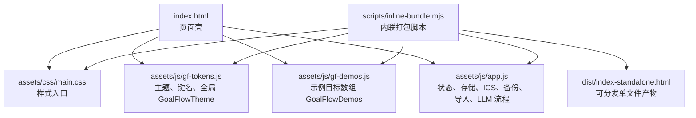
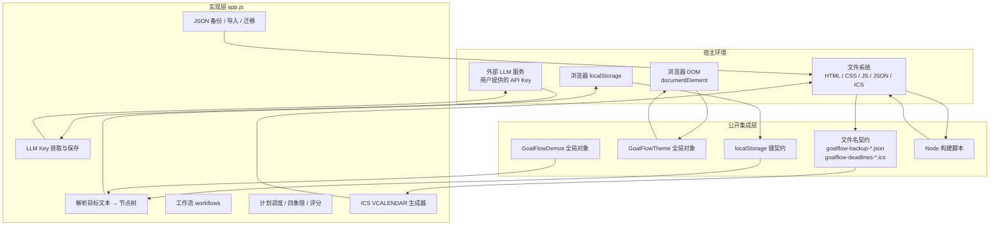
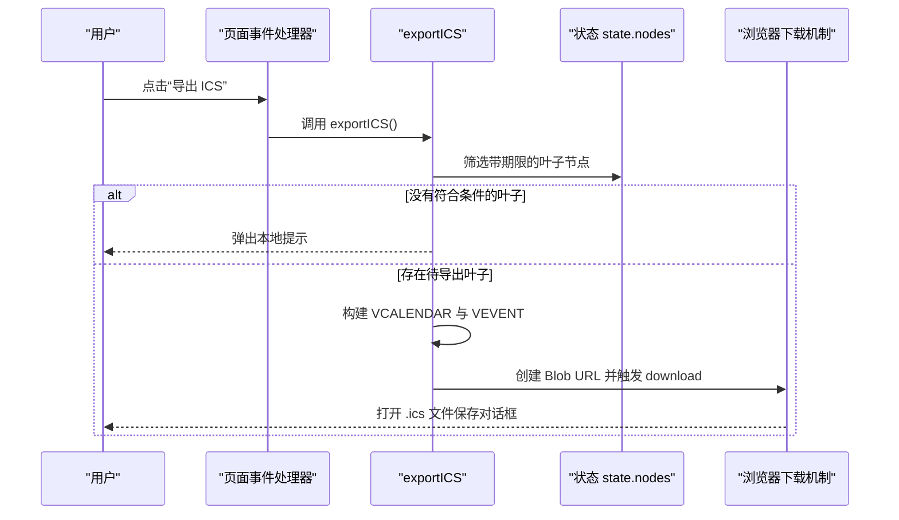
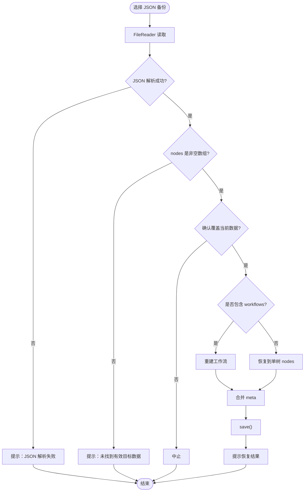
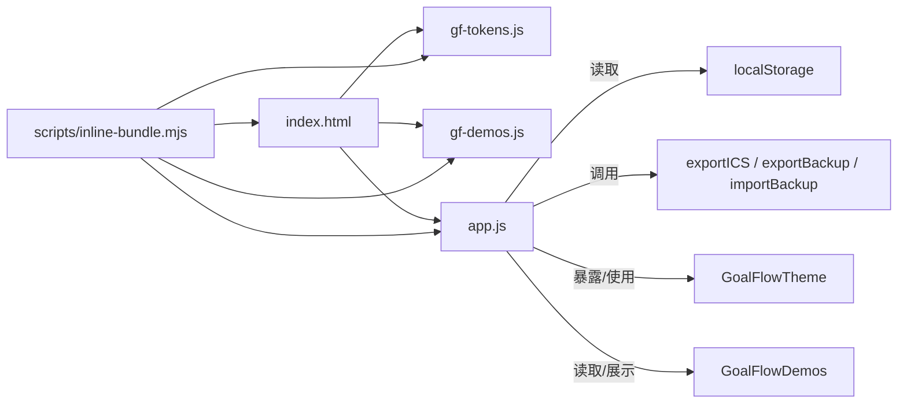

# API 与集成参考

<cite>
**本文引用的文件**   
- [index.html](file://index.html)
- [app.js](file://assets/js/app.js)
- [gf-tokens.js](file://assets/js/gf-tokens.js)
- [gf-demos.js](file://assets/js/gf-demos.js)
- [inline-bundle.mjs](file://scripts/inline-bundle.mjs)
- [README.md](file://README.md)
</cite>

## 目录
1. [引言](#引言)
2. [项目结构](#项目结构)
3. [核心接口总览](#核心接口总览)
4. [架构总图](#架构总图)
5. [localStorage 数据接口](#localstorage-数据接口)
6. [GoalFlowTheme 主题接口](#goalflowtheme-主题接口)
7. [示例 Demo 数据接口](#示例-demo-数据接口)
8. [ICS 导出接口](#ics-导出接口)
9. [JSON 备份 v6 与迁移接口](#json-备份-v6-与迁移接口)
10. [DeepSeek LLM 集成接口](#deepseek-llm-集成接口)
11. [构建脚本 inline-bundle.mjs](#构建脚本-inline-bundlemjs)
12. [依赖关系分析](#依赖关系分析)
13. [性能与兼容性考量](#性能与兼容性考量)
14. [故障排查指南](#故障排查指南)
15. [结论](#结论)

## 引言

GoalFlow（目标流）是一个纯前端本地时间管理工具，其公开集成点全部发生在浏览器上下文或文件系统边界：

- 无账号系统。
- 无后端服务器。
- 无云端上传。
- 默认数据存储在浏览器 `localStorage`。
- DeepSeek LLM 能力基于用户填写的 API Key，在调用方浏览器中访问外部服务。
- ICS 和 JSON 备份通过浏览器 Blob 下载触发实际文件写出。
- 单文件部署产物由 Node.js 构建脚本 `scripts/inline-bundle.mjs` 生成。

因此，所有“API”都应以**浏览器对象、DOM 属性、localStorage 键值、文件系统输入输出**来理解，而不是传统 HTTP 服务端 REST API。

**本节来源**
- [README.md:1-30](file://README.md#L1-L30)
- [README.md:70-103](file://README.md#L70-L103)

## 项目结构

GoalFlow 的公开集成面由少量关键文件构成：



**图表来源**
- [index.html:1-10](file://index.html#L1-L10)
- [app.js:15-21](file://assets/js/app.js#L15-L21)
- [gf-tokens.js:157-177](file://assets/js/gf-tokens.js#L157-L177)
- [gf-demos.js:160-166](file://assets/js/gf-demos.js#L160-L166)
- [inline-bundle.mjs:7-15](file://scripts/inline-bundle.mjs#L7-L15)

**本节来源**
- [README.md:85-103](file://README.md#L85-L103)
- [index.html:1-10](file://index.html#L1-L10)

## 核心接口总览

| 类别 | 公开对象 / 行为 | 作用域 | 典型参数 | 返回值 / 副作用 | 主要异常来源 |
|---|---|---|---|---|---|
| localStorage | `goalfocus.v4`、`goalfocus.meta.v1`、`goalflow.theme`、`goalflow.mode`、`gf_llm_key` 等键 | 当前浏览器存储区 | 键名 + JSON 字符串 | 应用持久化状态 | 存储不可用、非法 JSON、损坏键 |
| 主题 | `GoalFlowTheme.*` 及 `documentElement.dataset.theme` | 当前文档 | 主题名称、模式 | 刷新页面并切换配色 | 无效主题、存储失败 |
| 示例 | `GoalFlowDemos.list` 与 `GoalFlowDemos.get(id)` | 当前全局 | demo id | 示例对象或首个示例 | 未知 id |
| ICS 导出 | `exportICS()` | 已解析的节点状态 | 无 | 触发 `.ics` 下载，若无带期限叶子则弹窗提醒 | 状态未初始化、浏览器不允许下载 |
| 备份 | `exportBackup()`、`importBackup(file)` | 当前状态 + FileReader | JSON 文件或 null | 下载备份 / 覆盖恢复 | JSON 解析失败、用户取消 |
| LLM 密钥 | 本地键 `gf_llm_key` + 设置界面 | 浏览器键空间 | 用户输入的 Key | 存入本地并可用于对话请求 | 网络错误、Key 无效、响应非 JSON |
| 构建脚本 | `node scripts/inline-bundle.mjs` | 命令行 Node.js | 无 | 生成 `dist/index-standalone.html` | 找不到源文件、权限不足 |

**本节来源**
- [gf-tokens.js:157-177](file://assets/js/gf-tokens.js#L157-L177)
- [app.js:5560-5715](file://assets/js/app.js#L5560-L5715)
- [inline-bundle.mjs:7-52](file://scripts/inline-bundle.mjs#L7-L52)

## 架构总图

从集成分层看，GoalFlow 可以理解为三层：



该图中每一侧都有对应代码依据；下面各节展开每个接口的正式约定。

## localStorage 数据接口

### 支持的键名

| 键名 | 数据类型 | 写入位置 | 读取位置 | 含义 |
|---|---:|---|---|---|
| `goalfocus.v4` | JSON 字符串（扁平节点数组） | 旧主数据存储路径 | 应用加载时读取 | 早期单树结构；新实现优先使用工作流存储 |
| `goalfocus.v3` | 历史兼容键 | 应用启动阶段尝试 | 兼容读 | 极旧版本遗留数据 |
| `goalfocus.meta.v1` | JSON 元数据 | 元数据存储 | 加载元数据 | 包含 `backup`、`logsTrimmedAt`、日志裁剪标记等字段 |
| `goalfocus.workflows.v2` | JSON 字符串 | `workflowsPayload(...)` 序列化后写入 | `parseWorkflowsJson` 主来源 | 当前多工作流主存储 |
| `goalfocus.workflows.bak` | JSON 字符串 | 与主工作流内容相同，但写入节流间隔不同 | 主源缺失时镜像回退 | 冗余镜像备份 |
| `goalfocus.workflows.v1` | 工作流旧格式 | 迁移过程中出现 | 回退源之一 | 旧工作流存储 |
| `goalflow.theme` | 字符串 | `GoalFlowTheme.setTheme` 与设置 UI | `<head>` 内同步脚本 | 活跃主题名 |
| `goalflow.mode` | 字符串 `dark` / `light` | `GoalFlowTheme.setMode` / 切换按钮 | `<head>` 内同步脚本 | 明暗模式 |
| `gf_llm_key` | 字符串 | LLM Key 保存逻辑 | `getLLMKey()` | DeepSeek 用户的 API Key |
| `goalflow.flowSeen` | 字符 `1` | 执行流引导关闭 | 初次展示判断 | 是否已显示过执行流提示 |
| `goalflow.view` | 字符串 | 视图切换时写入 | 初始视图决策 | 最近使用的视图 |
| `goalflow.treeHintSeen` | 字符 `1` | 任务树引导结束后写入 | 控制是否显示引导提示 | 树引导状态 |
| `goalflow.zone.<元素ID>` | 字符 `1` / `0` | 折叠区域 toggle 事件 | 折叠状态判定 | 面板折叠偏好 |
| `goalflow.aiSkill` | 字符串 | AI 技能选择保存逻辑 | AI 功能读取 | 自定义提示词技能 |
| `goalflow.zone.todayPanel` | 同上 | 首页面板折叠交互 | 同前 | 首页面板折叠记忆 |
| `goalflow.zone.status` | 同上 | 状态区域折叠交互 | 同前 | 状态区域折叠记忆 |
| `goalflow.zone.attention` | 同上 | 关注区域折叠交互 | 同前 | 关注区域折叠记忆 |
| `goalflow.zone.focus` | 同上 | 备选区域折叠交互 | 同前 | 备选区域折叠记忆 |
| `goalfocus.nodeStatus.` | 同上 | 节点状态 | 节点开关态 | 节点级小状态 |

### JSON 结构与复杂度

- `goalfocus.workflows.v2` 是最完整的内部持久化表示，包含：
  - `activeWorkflowId`
  - `workflows[]`：每个工作流有 `id`、`name`、`topId`、`topPin`、`tags`、`startDate`、`endDate`、`description`、`color`、`nodes[]`
- 节点是扁平列表，通过 `parentId` 形成树形关系；运行时会计算 `_children` 等缓存字段。
- 节点字段包括：`id`、`text`、`im`、`ur`、`val`、`eff`、`role`、`targetNum`、`targetDone`、`deadline`、`deadlineDate`、`done`、`doneAt`、`touchedAt`、`estimateMinutes`、`actualMinutes`、`remindAt`、`ifThen`、`premortem`、`createdAt`、`anchor`、`status`、`waitNote`、`timesPerWeek`、`conf`、`confNote`、`confAt`、`recur`、`scale`、`parentId`、`slot`。

时间相关字段采用以下形式：

| 字段 | 类型说明 | 示例语义 |
|---|---|---|
| `deadline` | 原始日期字符串 | “周五前”、“本月结束” |
| `deadlineDate` | 时间戳整数或 `null` | 解析后的截止日期 |
| `doneAt` | 完成时间戳或 `null` | 任务勾选完成的时间 |
| `touchedAt` | 最近修改时间戳或 `null` | 最后一次编辑时间 |
| `remindAt` | 提醒时间戳或 `null` | 到期提醒时间 |
| `createdAt` | 创建时间戳或 `null` | 节点创建时间 |
| `confAt` | 信心评估时间戳或 `null` | 信心打分时间 |

### 读写规范

#### 读取节点数据

推荐方式不是直接调用 `localStorage.getItem('goalfocus.v4')`，而是依赖应用自身的加载流程；若确需读取，应遵循以下约束：

1. 先尝试工作流主键 `goalfocus.workflows.v2`。
2. 否则读取 `goalfocus.workflows.bak`。
3. 否则尝试 `goalfocus.workflows.v1`。
4. 以上都失败后，再尝试 `goalfocus.v4` 与 `goalfocus.v3`。
5. 解析结果必须做类型校验：`Array.isArray(nodes)`。

#### 写入节点数据

直接写入 `goalfocus.v4` 会被工作流写入层视为旧结构。更安全的做法是：

- 对旧单树数据：写入 `goalfocus.v4`，保持 `parentId` / `id` / `text` 等字段。
- 对新工作流数据：写入 `goalfocus.workflows.v2`，且同时维护 `workflows[]`。
- 不要直接覆盖 `goalfocus.workflows.v2` 而不保留工作流根对象结构。

#### 元数据写入

元数据通过 `saveMeta()` 写入 `goalfocus.meta.v1`；当前可见语义包括：

| 元数据字段 | 类型 | 含义 |
|---|---|---|
| `lastBackupAt` | 时间戳整数 | 最近一次成功导出备份的时间 |
| `lastSaveAt` | 时间戳整数 | 最近一次内存保存时间 |
| `viewMode` | 字符串 | 当前可视化视图模式 |
| `logsTrimmedAt` | 时间戳或日期串 | 日志滚动裁剪的最后时间 |

### 适用场景

| 场景 | 推荐键 | 建议 |
|---|---|---|
| 第三方只读检查是否有数据 | `goalfocus.workflows.v2` | 同时检查 `backup.logsTrimmedAt` 是否存在 |
| 迁移旧浏览器数据 | `goalfocus.v4` / `goalfocus.v3` | 仅作为旧数据源，不应作为长期写目标 |
| 跨浏览器同步计划 | 不使用这些键，而使用导出 JSON | localStorage 不会自动跨浏览器同步 |
| 自定义主题 | `goalflow.theme` 和 `goalflow.mode` | 配合主题常量值使用 |
| 配置 LLM | `gf_llm_key` | 仅限同一浏览器的安全边界内 |

**本节来源**
- [app.js:15-21](file://assets/js/app.js#L15-L21)
- [app.js:1878-1910](file://assets/js/app.js#L1878-L1910)
- [app.js:5300-5360](file://assets/js/app.js#L5300-L5360)
- [app.js:5368-5420](file://assets/js/app.js#L5368-L5420)
- [app.js:4321-4371](file://assets/js/app.js#L4321-L4371)
- [app.js:4127-4137](file://assets/js/app.js#L4127-L4137)
- [app.js:4676-4699](file://assets/js/app.js#L4676-L4699)

## GoalFlowTheme 主题接口

GoalFlowTheme 是一个在全局暴露的主题模块，供 `gf-tokens.js` 内部以及 HTML `<head>` 内的首行脚本协作使用。

### 主题命名与模式

主题名来自 `THEMES` 对象键：

| 主题键 | label | 行为特征 |
|---|---|---|
| `linear` | Linear | 默认线性风格 |
| `raycast` | Raycast 玻璃（预览） | 玻璃拟态预览 |
| `rpg` | RPG 游戏（预览） | 游戏感配色预览 |

模式只有两个合法值：`dark` 和 `light`。其他值会被忽略。

### 主题对象字段

每个主题的色板对象具有以下结构：

| 字段 | 类型 | 含义 |
|---|---|---|
| `PALETTE_UR` | 颜色数组（至少 5 项） | 冷到暖的五级调色板 |
| `noise` | 字符串 | 噪音/中性色 |
| `COLORS.accent` | 字符串 | 主要强调色 |
| `COLORS.accent2` | 字符串 | 第二强调色 |
| `COLORS.gold` | 字符串 | 金色/高亮色 |
| `COLORS.goldSoft` | 字符串 | 柔和金色 |
| `COLORS.svgGlow` | 字符串 | SVG 光晕色 |
| `COLORS.scaleLabel` | 字符串 | 比例尺标签色 |
| `COLORS.smartGap` | 字符串 | SMART 缺口色 |
| `COLORS.gradSmartDot` | 双端点颜色数组 | SMART 渐变点 |

应用内还导出：

| 全局成员 | 类型 | 用途 |
|---|---|---|
| `GoalFlowTheme.THEMES` | 主题字典 | 扩展或枚举有效主题 |
| `GoalFlowTheme.theme` | 字符串 | 当前主题名 |
| `GoalFlowTheme.mode` | 字符串 | 当前模式 |
| `GoalFlowTheme.setTheme(name)` | 函数 | 设置主题并刷新 |
| `GoalFlowTheme.setMode(mode)` | 函数 | 设置明暗并刷新 |
| `GoalFlowTheme.toggleMode()` | 函数 | 反转明暗 |
| `GoalFlowTheme.PALETTE_UR` | 数组 | 渲染用调色板 |
| `GoalFlowTheme.CAT` | 象限映射 | 四象限分类 |
| `GoalFlowTheme.COLORS` | 对象 | 调色板 COLORS |
| `GoalFlowTheme.STORAGE` | 对象 | 键名集中声明处 |
| `GoalFlowTheme.BTN` | 对象 | 内置按钮 class 组合 |

### 外部切换主题

最可靠的宿主集成方式是修改 DOM：

1. 将 `document.documentElement.dataset.theme` 设为 `linear`、`raycast` 或 `rpg`。
2. 将 `document.documentElement.dataset.mode` 设为 `dark` 或 `light`。
3. 如果目标是完全对齐应用内部状态，还需要更新 `localStorage`：
   - `localStorage.setItem('goalflow.theme', name)`
   - `localStorage.setItem('goalflow.mode', mode)`
4. 应用内 `GoalFlowTheme.setTheme` 与 `setMode` 会调用 `location.reload()`，使 `<head>` 内的初始化脚本重新读取本地存储并设置初始数据集。

手动设置不刷新时，CSS 可能不会立刻生效；这是当前实现的预期行为。

### 异常处理

- `setTheme` 会在主题不在 `THEMES` 时静默跳过。
- `setMode` 只对 `dark` / `light` 放行。
- `localStorage` 访问全部带有 `try/catch`；浏览器隐私模式禁用存储时不会抛出给调用方。

### 适用场景

- iframe 嵌入 GoalFlow。
- 外部网页希望以编程方式预置目标流外观。
- 自动化测试需要按主题遍历截图。

**本节来源**
- [gf-tokens.js:1-40](file://assets/js/gf-tokens.js#L1-L40)
- [gf-tokens.js:62-110](file://assets/js/gf-tokens.js#L62-L110)
- [gf-tokens.js:112-155](file://assets/js/gf-tokens.js#L112-L155)
- [gf-tokens.js:157-177](file://assets/js/gf-tokens.js#L157-L177)
- [index.html:6-8](file://index.html#L6-L8)

## 示例 Demo 数据接口

`gf-demos.js` 暴露一个全局 `GoalFlowDemos` 对象，提供示例目标文本集合。

### 全局对象

| 成员 | 类型 | 含义 |
|---|---|---|
| `GoalFlowDemos.list` | 示例数组 | 所有可用示例的主题标题与文本 |
| `GoalFlowDemos.get(id)` | 函数 | 按 id 查找示例；不存在时返回第一个示例 |

### 示例对象结构

| 字段 | 类型 | 必填 | 含义 |
|---|---|---:|---|
| `id` | 字符串 | 是 | 示例唯一标识，例如 `sales`、`postgrad`、`health` |
| `title` | 字符串 | 是 | 示例标题 |
| `text` | 字符串 | 是 | 可被 GoalFlow 解析为目标的自然语言描述 |

`text` 字段不是 JSON 节点树，而是缩进式自然文本；解析逻辑会将其转化为 `nodes[]` 数组、识别重要度、紧急度、期限和时间尺度。

### 在其他页面复用示例节点

如果你需要把示例复用到自定义页面：

1. 确保你的页面加载了 `gf-demos.js`。
2. 通过 `GoalFlowDemos.list` 枚举可用示例。
3. 通过 `GoalFlowDemos.get('某个id')` 获取示例。
4. 将该对象的 `text` 交给目标解析器；如果没有自己的解析器，可直接使用 GoalFlow 内置解析按钮。
5. 不要在应用已存在 `state.nodes` 的情况下自行合并节点 ID，因为应用会把 `id` 当作唯一标识。

注意：示例数组是纯数据接口，它不会自动把数据写入 GoalFlow 应用状态；它只负责提供“目标文本”，而不是节点对象本身。

### 异常处理

- 传入未知 `id` 不会抛错，而是降级为首个示例。
- 如果页面没有加载该模块，全局访问 `GoalFlowDemos` 会报错。

### 适用场景

- 演示页面。
- 第三方插件预填示例目标。
- 帮助向导引导新用户快速体验。

**本节来源**
- [gf-demos.js:1-15](file://assets/js/gf-demos.js#L1-L15)
- [gf-demos.js:18-159](file://assets/js/gf-demos.js#L18-L159)
- [gf-demos.js:161-166](file://assets/js/gf-demos.js#L161-L166)

## ICS 导出接口

### 入口函数

- 函数名：`exportICS()`
- 参数：无
- 调用来源：页面上导出 ICS 按钮的事件处理器
- 返回值：无；副作用为弹出浏览器下载对话框或触发下载
- 前置条件：当前状态中存在已解析的目标节点

### 过滤规则

该方法从 `state.nodes` 中选取满足以下条件的叶子节点：

1. 具有父节点：`parentId` 存在。
2. 是叶子节点：内部子节点数组为空。
3. 具有可解析的截止日期：`deadlineDate` 不为空。

如果没有符合条件的节点，会弹出本地警告，不再产生文件。

### 生成的 .ics 语义

| ICS 组件/字段 | 值 | 语义 |
|---|---|---|
| 根组件 | `VCALENDAR` | 日历容器 |
| `VERSION` | `2.0` | iCalendar 2.0 |
| `PRODID` | `-//GoalFlow//ZH` | 产品标识 |
| `CALSCALE` | `GREGORIAN` | 公历 |
| `METHOD` | `PUBLISH` | 发布日历方法 |
| 条目组件 | `VEVENT` | 每个带期限叶子一条日程事件 |
| `UID` | `{节点ID}@goalflow.local` | 唯一 ID |
| `DTSTAMP` | 导出时的时间戳 | 事件生成时间 |
| `DTSTART;VALUE=DATE` | 截止日期日期部分 | 事件开始日 |
| `SUMMARY` | 转义后的节点文本 | 显示标题 |
| `DESCRIPTION` | 说明包含“重要性”和“紧急性”信息 | 辅助说明 |

注意事项：

- 虽然文件扩展名是 `.ics`，并且容器是 `VCALENDAR`，但条目类型是 `VEVENT`，不是 `VTODO`。
- 目前批量导出的是“带期限叶子”，并非所有未完成叶子。
- SUMMARY 和 DESCRIPTION 中的逗号、分号、换行会进行基础转义。
- 当前文件名是 `goalflow-deadlines-YYYY-MM-DD.ics`。
- 该方法不会修改本地数据；它只是从内存状态导出快照。

### 序列图：导出 ICS



**图表来源**
- [app.js:5560-5586](file://assets/js/app.js#L5560-L5586)

### 异常与退化行为

| 情况 | 行为 | 建议 |
|---|---|---|
| 没有带期限叶子 | 弹框提示，不生成文件 | 为任务添加明确期限 |
| 浏览器不允许下载 | Blob 对象仍可创建，但 `a.click()` 可能被拦截 | 让用户显式触发点击 |
| 目标尚未解析 | 可能没有叶子 | 先解析或载入示例 |
| 特殊字符 | 经过简单转义 | 避免过度复杂的中文标点造成第三方客户端解析差异 |

### 适用场景

- 把今日重要任务同步到 Google Calendar、Outlook、Apple Calendar。
- 向协作者发送带截止时间的里程碑。
- 把目标计划交给日程型产品消费。

**本节来源**
- [app.js:5560-5586](file://assets/js/app.js#L5560-L5586)

## JSON 备份 v6 与迁移接口

GoalFlow 支持两种 JSON 文件格式：**导出备份**与**内部工作流存储**。两者语义不同。

### 导出备份 JSON

导出时调用 `exportBackup()`，产物文件名为 `goalflow-backup-YYYY-MM-DD.json`。

| 顶层字段 | 类型 | 含义 |
|---|---|---|
| `app` | 字符串 | 固定为 `goalflow` |
| `version` | 数字 | 版本号，当前实现使用 `10` |
| `exportedAt` | ISO 时间字符串 | 导出时间 |
| `viewMode` | 字符串 | 当前可视化视图模式 |
| `activeWorkflowId` | 字符串或 `null` | 活动工作流 ID |
| `workflows` | 数组 | 工作流列表 |
| `nodes` | 数组 | 当前活动流的扁平节点快照 |
| `meta` | 对象 | 应用元数据副本 |

工作流对象字段包括：

| 字段 | 类型 | 含义 |
|---|---|---|
| `id` | 字符串 | 工作流唯一 ID |
| `name` | 字符串 | 工作流名称 |
| `topId` | 字符串或 `null` | 置顶任务 |
| `topPin` | 布尔或省略 | 是否置顶锁定 |
| `tags` | 数组 | 标签列表 |
| `startDate` | 字符串 | 周期开始日期 |
| `endDate` | 字符串 | 周期结束日期 |
| `description` | 字符串 | 工作流描述 |
| `color` | 字符串 | 视觉颜色 |
| `nodes` | 数组 | 该工作流序列化后的节点 |

### JSON 导入

导入通过 `importBackup(file)` 处理，其中 `file` 是 FileReader 产生的文本文件对象。

流程概要：

1. 读取文件内容为字符串。
2. 解析 JSON。
3. 如果是 v6+ 备份，提取 `data.nodes`。
4. 校验是否为非空数组。
5. 弹出确认，覆盖当前全部目标流。
6. 若文件包含 `workflows`，则重建多个工作流。
7. 否则回到单树模式，使用 `nodes` 数组。
8. 可选合并 `meta`。
9. 可选应用 `viewMode`。
10. 保存并触发界面刷新。
11. 弹出恢复结果提示。



**图表来源**
- [app.js:5607-5640](file://assets/js/app.js#L5607-L5640)

### 内部工作流存储 vs 导出备份

内部存储键 `goalfocus.workflows.v2` 的内容结构更接近运行时模型，不包含 `app`、`version`、`exportedAt` 字段。其根结构大致是：

| 字段 | 类型 |
|---|---|
| `activeWorkflowId` | 字符串或 `null` |
| `workflows[]` | 工作流数组 |

节点通过 `serializeNodes` 输出，丢弃如 `daysLeft`、`overdue` 等派生字段。

| 字段类别 | 是否存入 |
|---|---:|
| `id`、`text` | 是 |
| `im`、`ur` | 是 |
| `deadline`、`deadlineDate` | 是 |
| `done`、`doneAt`、`touchedAt` | 是 |
| `estimateMinutes`、`actualMinutes` | 是 |
| `parent`、`depth`、`_children`、`daysLeft`、`overdue` | 否；派生计算得到 |
| `pomo` | 不作为节点字段存盘；番茄钟状态位于 `state.pomo` |
| `pomos`（记录） | 作为评分条目写入评分记录，由 `kind === 'pomo'` 区分 |

### 适用场景

- 定期手动备份到磁盘。
- 在更换浏览器时迁移数据。
- 把工作流导出后用编辑器检查、复制或归档。
- 将旧版单树数据恢复成多工作流结构。

**本节来源**
- [app.js:5570-5597](file://assets/js/app.js#L5570-L5597)
- [app.js:5607-5640](file://assets/js/app.js#L5607-L5640)
- [app.js:5300-5360](file://assets/js/app.js#L5300-L5360)
- [app.js:1878-1910](file://assets/js/app.js#L1878-L1910)

## DeepSeek LLM 集成接口

GoalFlow 对 LLM 的集成非常谨慎：**只把用户提供的 Key 存入本机 localStorage，并把请求发到外部 LLM 服务**。

### Key 配置位置

| 位置 | 键名 | 生命周期 |
|---|---|---|
| 设置界面输入框 | 用户输入 | 临时变量 |
| 保存到本地 | `gf_llm_key` | 持久化到当前浏览器 |
| 读取 | `getLLMKey()` | 首次从本地读，之后缓存 |
| 提示词技能 | `goalflow.aiSkill` | 可选自定义提示词 |
| AI 对话历史 | 独立键 | 当前实现中包含聊天历史记录结构 |

Key 仅在本地使用，应用声明中明确说明不会上传账户或遥测数据。

### 请求体结构

仓库中没有显式的标准化 JavaScript DTO 定义；LLM Key 在设置处保存，并在需要时取回。通常此类工具对外暴露的请求体会包含：

- 用户问题或目标拆解提示。
- 系统提示词。
- 当前任务上下文。
- 可选技能 prompt。
- 模型参数。

由于本仓库中没有公开 JS API 封装类，外部程序不建议直接调用内部函数。更安全的方式是使用应用导出的 JSON/ICS，或复制已有 Key 后在自己应用中构造请求。

### 返回体结构

LLM 返回值通常是平台标准响应：

- 成功时：返回含回复文本的对象。
- 失败时：返回网络错误、认证错误或业务错误。

GoalFlow 内部在读取 Key 和保存 Key 时使用 `try/catch` 包裹 localStorage 操作；具体 HTTP 层的错误处理未在本次检索片段中出现，因此外部开发者不应假设它一定做了统一错误转换。

### 错误处理

| 异常情况 | 行为 |
|---|---|
| localStorage 不可用 | 读取返回空 Key，保存静默失败 |
| Key 为空 | LLM 相关请求无法成功认证外部服务 |
| 网络异常 | 应由上层 UI 提示“AI 请求失败” |
| Key 无效 | LLM 平台返回认证错误 |
| 页面未加载完整 | 应在 DOM ready 后打开 LLM 设置窗口 |

### 安全建议

- `gf_llm_key` 相当于明文凭证。
- 不要把导出备份上传到公共 Git。
- 清理浏览器数据会清除 Key。
- 如果需要分享 GoalFlow 的数据模型，不要分享包含 LLM Key 的备份文件。

**本节来源**
- [app.js:742-744](file://assets/js/app.js#L742-L744)
- [app.js:4676-4680](file://assets/js/app.js#L4676-L4680)
- [app.js:4964-4995](file://assets/js/app.js#L4964-L4995)
- [app.js:6683-6685](file://assets/js/app.js#L6683-L6685)
- [README.md:70-84](file://README.md#L70-L84)

## 构建脚本 inline-bundle.mjs

构建脚本的作用是：把 `index.html`、CSS 和 JS 资源内联为单个 HTML，方便离线使用或静态托管。

### 命令

```text
node scripts/inline-bundle.mjs
```

### 输入

| 路径或资源 | 角色 |
|---|---|
| `scripts/../index.html` | HTML 外壳 |
| `scripts/../assets/css/main.css` | 主样式 |
| `assets/css/**/*.css` | main.css 通过 `@import url("./xxx")` 递归展开 |
| `assets/js/gf-tokens.js` | 主题令牌 |
| `assets/js/gf-demos.js` | 示例数据 |
| `assets/js/app.js` | 主应用逻辑 |

### 处理流程

```mermaid
flowchart TD
    Start(["执行 Node 脚本"]) --> LoadHTML["读取 index.html"]
    LoadHTML --> LoadCSS["读取 assets/css/main.css"]
    LoadCSS --> Expand["递归展开 @import url(\"./...\")"]
    Expand --> BundleScripts["串联 gf-tokens.js / gf-demos.js / app.js"]
    BundleScripts --> ReplaceStyles["替换外链样式为 <style>"]
    ReplaceScripts["替换外链脚本为内联 <script>"]
    ReplaceStyles --> Write["创建 dist 目录并写入 index-standalone.html"]
    Write --> Log["打印输出文件大小"]
    Log --> End(["完成"])
```

**图表来源**
- [inline-bundle.mjs:7-52](file://scripts/inline-bundle.mjs#L7-L52)

### 输出

| 路径 | 内容 |
|---|---|
| `dist/index-standalone.html` | 内联样式的静态 HTML |

终端输出包含类似：

```text
Wrote path/to/dist/index-standalone.html (XXXX.X KB)
```

### 参数

脚本没有运行时参数；工作目录固定为仓库根目录。

### 返回值

脚本本身返回 Promise（通过顶层 `await`），但对外不暴露 JavaScript API。

### 异常处理

- 读取 HTML、CSS、JS 失败。
- 写入 `dist` 目录失败。
- 磁盘写入权限不足。
- `main.css` 中包含无法正确解析的相对 `@import`。

### 适用场景

- 生成可双击打开的单文件应用。
- 把 GoalFlow 部署到不提供多资源的静态站点。
- 发布不需要 Node 运行时的最终交付产物。

**本节来源**
- [inline-bundle.mjs:1-52](file://scripts/inline-bundle.mjs#L1-L52)

## 依赖关系分析

从文件耦合看：



- `index.html` 是页面聚合点。
- `gf-tokens.js` 决定主题键、DOM 数据集和全局命名空间。
- `gf-demos.js` 提供示例文本，但不强依赖应用状态。
- `app.js` 是核心集成点：它同时依赖存储、主题、示例、文件 IO 和 DOM。
- `inline-bundle.mjs` 反向依赖三个 JS 文件和 HTML。

没有明显的循环依赖：构建脚本只读取源文件，应用运行期也不读取 Node 构建脚本。

**图表来源**
- [index.html:6-8](file://index.html#L6-L8)
- [gf-tokens.js:157-177](file://assets/js/gf-tokens.js#L157-L177)
- [gf-demos.js:161-166](file://assets/js/gf-demos.js#L161-L166)
- [app.js:6793-6793](file://assets/js/app.js#L6793-L6793)
- [inline-bundle.mjs:23-45](file://scripts/inline-bundle.mjs#L23-L45)

## 性能与兼容性考量

### localStorage 限制

- 存储配额通常为 5~10 MB。
- 大量长文本节点会增大 `goalfocus.workflows.v2`。
- 高频保存应依赖应用内部的节流机制。
- 隐私模式下 `localStorage` 可能不可写，代码已通过捕获错误降级。

### ICS 性能

ICS 导出按叶子遍历 `state.nodes`，复杂度约为 O(n)。对于普通用户的目标树规模，开销可忽略。但若未来树达到数万节点，应考虑增量导出而非每次全量构建字符串。

### 主题切换

主题切换会强制 `location.reload()`，因此不适合作为频繁调用的高频 API。外部集成时应尽量只在初始化时设置一次主题。

### 构建产物体积

内联会一次性把所有 CSS 和 JS 放入单个 HTML，提升静态托管便利性，但也增大首字节大小。是否使用取决于是否需要离线单文件。

[本节未直接分析特定代码片段]

## 故障排查指南

| 现象 | 可能原因 | 检查项 | 修复建议 |
|---|---|---|---|
| 主题没有变化 | 主题名无效或未刷新页面 | `goalflow.theme`、`documentElement.dataset.theme` | 使用 `linear` / `raycast` / `rpg`，或直接调用 `GoalFlowTheme.setTheme` |
| 明暗模式无效 | 模式字符串非法 | `goalflow.mode` | 设为 `dark` 或 `light` |
| ICS 没有下载 | 没有带期限叶子 | `state.nodes` 中是否存在 `deadlineDate` | 添加明确日期文本 |
| JSON 备份恢复失败 | JSON 损坏或不含 `nodes` | 备份文件是否能正常 `JSON.parse` | 用原应用重新导出 |
| 工作流恢复为空 | 使用了只含旧单树结构的文件 | 是否包含 `workflows` 或有效 `nodes` | 使用应用内置导入流程 |
| LLM Key 丢失 | 清理浏览器或切换用户 | `localStorage['gf_llm_key']` | 在设置界面重新保存 |
| 构建脚本报错 | 缺少源文件或路径 | 是否在仓库根运行 | 在 root 目录执行脚本 |
| `GoalFlowDemos` 未定义 | 未加载 `gf-demos.js` | 页面 script 引用顺序 | 在脚本使用前加载 |
| 导出 JSON 文件未出现 | 浏览器阻止下载或 Blob URL 失效 | 控制台报错、权限 | 显式触发下载链接 |

**本节来源**
- [gf-tokens.js:112-155](file://assets/js/gf-tokens.js#L112-L155)
- [app.js:5560-5586](file://assets/js/app.js#L5560-L5586)
- [app.js:5607-5640](file://assets/js/app.js#L5607-L5640)
- [app.js:742-744](file://assets/js/app.js#L742-L744)
- [inline-bundle.mjs:7-15](file://scripts/inline-bundle.mjs#L7-L15)

## 结论

GoalFlow 的公开接口可以归纳为五类边界：

1. **浏览器本地存储**：适用于本机数据迁移、跨会话恢复与第三方审计。
2. **主题数据接口**：适用于外部页面嵌入或测试中对视觉外观的控制。
3. **示例数据接口**：适用于快速初始化示例目标。
4. **文件导出/导入**：ICS 适合日程协作，JSON 备份适合数据迁移。
5. **构建脚本**：面向包发布者和维护者，生成单文件产物。

它不是 Web 服务，也没有通用 REST API。任何“集成”都必须尊重这一基本事实：数据和 Key 属于浏览器和文件系统，GoalFlow 的应用逻辑在应用自身的 `app.js` 中实现，外部集成应尽量通过稳定的存储键、全局对象和文件契约进行。