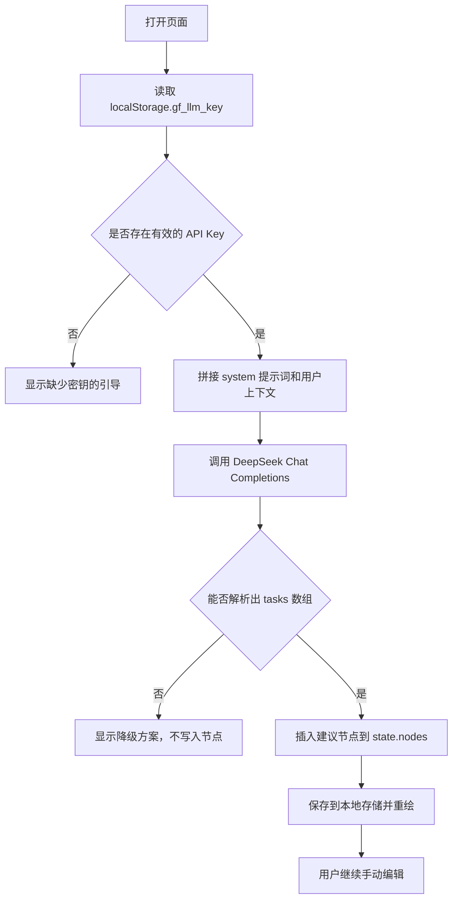
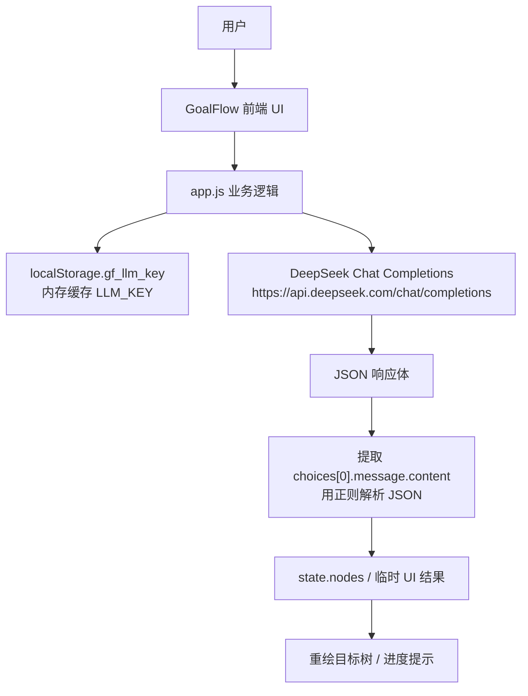
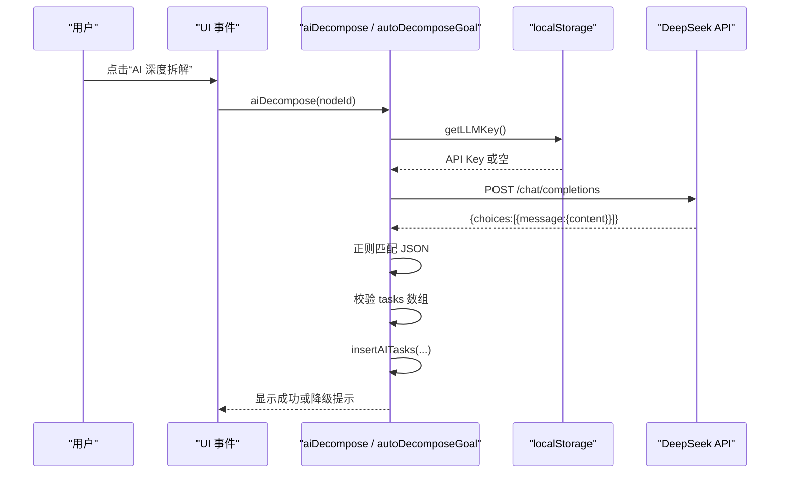
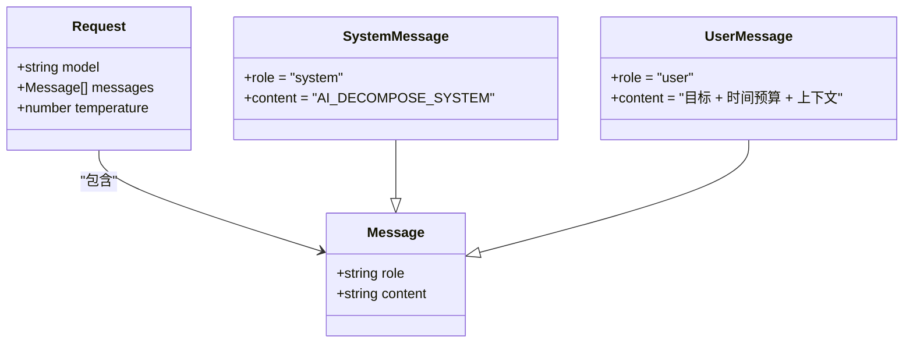
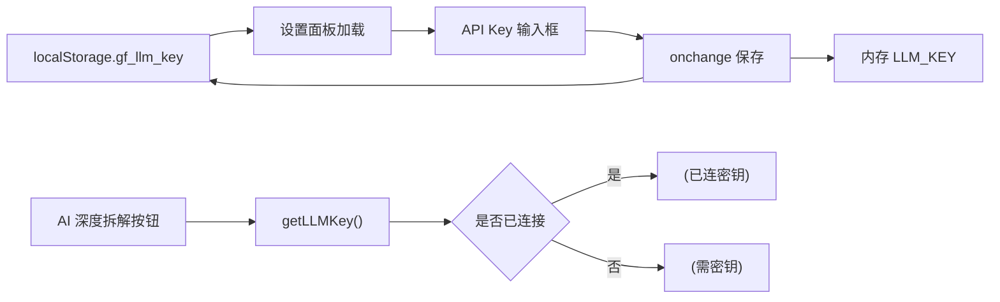

# DeepSeek 大语言模型智能辅助集成指南

<cite>
**本文引用的文件**   
- [assets/js/app.js](file://assets/js/app.js)
- [assets/js/gf-tokens.js](file://assets/js/gf-tokens.js)
- [index.html](file://index.html)
</cite>

## 目录

1. [简介](#简介)
2. [功能边界与可选性说明](#功能边界与可选性说明)
3. [快速开始：最小可用示例](#快速开始最小可用示例)
4. [配置流程](#配置流程)
5. [密钥存储与安全说明](#密钥存储与安全说明)
6. [调用机制与技术实现](#调用机制与技术实现)
7. [消息结构与期望输出](#消息结构与期望输出)
8. [错误处理](#错误处理)
9. [性能、速率限制与重试建议](#性能速率限制与重试建议)
10. [调试方法](#调试方法)
11. [API Key 管理界面](#api-key-管理界面)
12. [已知差异与适配要点](#已知差异与适配要点)
13. [故障排查清单](#故障排查清单)
14. [总结](#总结)

## 简介

GoalFlow 提供了与 DeepSeek 大语言模型的可选集成，用于根据用户输入的目标描述和项目上下文，自动生成结构化的任务拆分建议。它不是 GoalFlow 的核心运行逻辑——没有 API Key，应用依然可以正常使用所有目标树编辑、时间预算和导出功能。

该能力只负责“建议新节点”，最终是否创建、编辑、排序或保存这些节点，完全由用户决定。

核心入口在 `assets/js/app.js`，主题与本地存储键定义在 `assets/js/gf-tokens.js`，页面 UI 骨架在 `index.html`。

## 功能边界与可选性说明

| 项目 | 说明 |
|---|---|
| 是否是核心依赖 | **否**。DeepSeek 调用失败或不配置时，应用不会崩溃，会回退到手动引导。 |
| 启用条件 | 浏览器 `localStorage` 中存在对应键值，且内存缓存 `LLM_KEY` 非空。 |
| 存储位置 | 仅浏览器本地 `localStorage`，不上传服务端，也不会写入打包产物。 |
| 使用范围 | “AI 深度拆解”、“创建项目后自动分解”、“设置面板中触发 AI 分析”。 |
| 影响的数据 | 只在成功解析响应后，将结构化字段映射到 `state.nodes`；若解析失败，不会修改原有数据。 |
| 默认行为 | 未配置 API Key 时弹出引导弹窗；配置完成后可再次触发同一操作。 |
| 风险点 | DeepSeek 返回的文本可能不符合预期 JSON 格式，此时会显示降级提示。 |

**小节来源**
- [assets/js/app.js:740-760](file://assets/js/app.js#L740-L760)
- [assets/js/app.js:762-835](file://assets/js/app.js#L762-L835)
- [assets/js/app.js:836-880](file://assets/js/app.js#L836-L880)
- [assets/js/app.js:946-1010](file://assets/js/app.js#L946-L1010)
- [assets/js/app.js:1165-1280](file://assets/js/app.js#L1165-L1280)

## 快速开始：最小可用示例

以下步骤得到一个包含子节点的叶子或父节点任务建议：

1. 打开 GoalFlow 页面。
2. 选择任意一个已有节点（推荐使用叶子任务，以便直接生成兄弟子任务）。
3. 点击“✨ AI 深度拆解”。如果已经保存过 API Key，按钮旁会显示已连接状态。
4. 应用构造提示词并请求 DeepSeek。
5. 如果返回了可解析的 `tasks` 数组，新节点会被插入到当前节点之后。
6. 用户继续检查、调整或删除这些建议节点。

另一种路径是进入“AI 分析”视图，找到“✨ AI 深度拆解”入口，输入或选择目标后触发。

## 配置流程

### 方式一：通过“设置”面板保存 API Key

1. 在顶部工具栏中打开“⚙ 设置”。
2. 找到“API Key”输入框。
3. 粘贴从 DeepSeek 平台获取的密钥。
4. 点击“保存”。
5. 保存成功后，系统提示“已保存（仅存于本机浏览器）”，同时刷新按钮状态。

此路径对应的代码会：

- 从 `localStorage` 读取上次保存的值并回填到输入框。
- 把用户的输入写入 `LLM_KEY_STORAGE` 所对应的本地键。
- 同时更新内存中的 `LLM_KEY`，使本次会话无需重新加载即可使用。

### 方式二：首次使用 AI 功能时弹出密钥向导

当某个触发入口发现没有 API Key 时，会出现“配置 AI 分解”或类似对话框，要求输入 DeepSeek API Key；输入并确认后会自动重新尝试原操作。

这个体验常见于“创建项目后自动分解目标”以及“AI 深度拆解”等入口。

### 获取密钥的方式

配置界面提供了指向 DeepSeek 开放平台的链接。用户需要自行注册并创建 API Key；应用不会代为生成密钥。

**小节来源**
- [assets/js/app.js:6683-6686](file://assets/js/app.js#L6683-L6686)
- [assets/js/app.js:4950-4965](file://assets/js/app.js#L4950-L4965)
- [assets/js/app.js:1057-1120](file://assets/js/app.js#L1057-L1120)
- [assets/js/app.js:1120-1165](file://assets/js/app.js#L1120-L1165)
- [assets/js/app.js:1165-1245](file://assets/js/app.js#L1165-L1245)

## 密钥存储与安全说明

### 使用的存储键

| 用途 | 键名 | 说明 |
|---|---|---|
| LLM API Key | `gf_llm_key` | 实际存储在浏览器的 `localStorage` 中。 |
| 设计令牌常量键 | `goalflow.theme` | 主题名称，LLM 不关心。 |
| 明暗模式键 | `goalflow.mode` | 明/暗模式，LLM 不关心。 |
| 自定义 Skill Prompt | `goalflow.aiSkill` | 允许覆盖默认 system prompt，但默认仍使用内置提示词。 |

`STORAGE.llmKey` 定义为 `gf_llm_key`，并在应用层通过 `getLLMKey()` 读取。首次从 `localStorage` 读到值时，还会缓存在内存变量 `LLM_KEY` 中，避免后续频繁访问浏览器存储。

### 安全边界

- API Key 仅存在于用户本机的浏览器 `localStorage`。
- 不会作为 URL 参数、查询字符串或日志内容发送。
- 网络请求头中使用 `Authorization: Bearer <key>`。
- 打包脚本只是静态合并 `index.html`、CSS 与 JS，不会把运行时 `localStorage` 注入进 `dist/index-standalone.html`。
- 如果清除浏览器缓存或切换浏览器环境，已配置的 Key 不会同步到其他设备。

| 风险 | 缓解方式 |
|---|---|
| 多人共用电脑 | 建议清空浏览器存储或使用隐私模式测试。 |
| Key 泄露 | 如怀疑泄露，可在 DeepSeek 平台撤销 Key。 |
| XSS 读取存储 | 这是通用浏览器安全假设，GoalFlow 本身只做读取与保存，不做复杂模板渲染。 |
| 日志泄露 | 报错使用 `console.error` 打印结构化错误信息，不包含 Authorization 头或完整 key。 |

**小节来源**
- [assets/js/gf-tokens.js:147-155](file://assets/js/gf-tokens.js#L147-L155)
- [assets/js/app.js:740-748](file://assets/js/app.js#L740-L748)
- [assets/js/app.js:6683-6686](file://assets/js/app.js#L6683-L6686)
- [scripts/inline-bundle.mjs:19-45](file://scripts/inline-bundle.mjs#L19-L45)

## 调用机制与技术实现

### 整体架构

### 主要函数职责

| 函数 | 入参 | 返回值 / 副作用 |
|---|---|---|
| `getLLMKey()` | 无 | 返回内存或 `localStorage` 中的 API Key，无则返回空串。 |
| `callLLM(system, user)` | system 提示词、user 自然语言 | 成功时返回模型文本内容；否则返回 `null`。 |
| `aiDecompose(nodeId)` | 目标节点 ID | 调用 LLM，解析 JSON 后插入子节点。 |
| `autoDecomposeGoal(goalText, projectMeta)` | 目标文本、项目元信息 | 若无 Key 则弹出向导；有 Key 时生成根节点和子节点。 |
| `insertAITasks(parentId, tasks)` | 父节点 ID、task 数组 | 构造 Node 对象，递归写入 children，持久化并重绘。 |
| `showApiKeyPrompt(...)` | 目标描述、项目元信息 | 弹出带密码输入的模态框。 |
| `showDecomposeGuide(node)` | 节点对象 | 在 LLM 不可用时提供手动引导。 |

### 时序图

**图表来源**
- [assets/js/app.js:740-760](file://assets/js/app.js#L740-L760)
- [assets/js/app.js:836-880](file://assets/js/app.js#L836-L880)
- [assets/js/app.js:870-945](file://assets/js/app.js#L870-L945)

**小节来源**
- [assets/js/app.js:740-880](file://assets/js/app.js#L740-L880)
- [assets/js/app.js:1120-1165](file://assets/js/app.js#L1120-L1165)

## 消息结构与期望输出

### 请求体

DeepSeek 调用基于 OpenAI 兼容约定，请求体为 JSON，包含以下关键字段：

| 字段 | 值或结构 | 说明 |
|---|---|---|
| `model` | `"deepseek-v4-flash"` | 固定模型名称。 |
| `messages` | 长度至少为 2 的数组 | 先传入 `system`，再传入 `user`。 |
| `temperature` | `0.7` | 控制生成多样性；并非零温度，因此返回文本仍需后端解析。 |

`messages` 的具体结构：

**图表来源**
- [assets/js/app.js:746-748](file://assets/js/app.js#L746-L748)
- [assets/js/app.js:762-835](file://assets/js/app.js#L762-L835)

#### System 提示词来源

系统提示词来自常量 `AI_DECOMPOSE_SYSTEM`。它是内嵌在源代码中的中文指令，要求模型输出符合 GoalFlow 内部使用的任务结构。

用户可通过自定义 Skill Prompt 覆盖此系统提示词；默认仍使用该常量。

#### 用户提示词来源

不同入口拼接的用户提示词略有差异，但都遵循统一原则：

| 入口 | 用户提示词包含内容 |
|---|---|
| `aiDecompose(nodeId)` | 当前节点文本、工作日小时数、周末小时数、每周时间容量、本周已安排时长、剩余可用时长。 |
| `autoDecomposeGoal(goalText, projectMeta)` | 目标、项目名称、起止日期、周容量。 |
| 设置面板触发路径 | 目标、当前工作流、起止周期、时间预算、时间偏好、自定义 Skill Prompt。 |

### 响应体处理

`callLLM` 返回的是 `d.choices[0].message.content` 原始文本，而不是直接返回完整响应对象。随后由调用方执行：

1. 使用正则提取第一个 `{...}` 片段。
2. 对片段调用 `JSON.parse`。
3. 校验是否存在 `tasks` 字段且为数组。
4. 通过 `insertAITasks` 转换成 GoalFlow Node 并写回 `state.nodes`。

#### 期望的结构化输出字段

| 顶层字段 | 类型 | 必填 | 含义 |
|---|---|---:|---|
| `tasks` | `Task[]` | 是 | 根级任务列表。 |

| Task 字段 | 类型 | 必填 | 写入 Node 的效果 |
|---|---|---:|---|
| `text` | string | 建议 | 子任务标题。 |
| `im` | number (1-5) | 否，默认 3 | 重要度。 |
| `ur` | number (1-5) | 否，默认 3 | 紧急度。 |
| `estimate` | number (1-999) | 否 | 转为 `estimateMinutes`。 |
| `deadline` | string | 否 | 转为 `deadlineText` 和 `deadlineDate`。 |
| `timeSlot` | string | 否 | morning→`am`、afternoon→`pm`、evening→`eve`。 |
| `smart` | object | 否 | 转成 `smartEval.{s,m,a,r,t}`。 |
| `children` | array | 否 | 递归生成下一层节点，最多两层。 |

**小节来源**
- [assets/js/app.js:746-760](file://assets/js/app.js#L746-L760)
- [assets/js/app.js:762-835](file://assets/js/app.js#L762-L835)
- [assets/js/app.js:860-945](file://assets/js/app.js#L860-L945)

## 错误处理

### 客户端侧的错误分支

| 场景 | 行为 | 用户体验 |
|---|---|---|
| 没有 API Key | 不调用远端 API | 弹出引导，说明需获取 DeepSeek API Key。 |
| 内存缓存中有 Key，但浏览器存储异常 | `try/catch` 捕获并返回空串 | 当作无 Key 处理。 |
| 网络请求抛出异常 | 返回 `null` | 显示“AI 拆解不可用”，提供手动指引。 |
| HTTP 响应 `r.ok` 为假 | 返回 `null` | 同上，但不暴露敏感错误细节。 |
| 响应体缺少 `choices` | 返回 `undefined` | 被外层 `if (!result)` 视为失败。 |
| 响应正文无法解析成 JSON | 抛出错误并被外层 `try/catch` 捕获 | 打印解析错误，显示降级引导。 |
| 返回的 JSON 不含 `tasks` 或 `tasks` 不是数组 | 抛出错误 | 走同一条降级路径。 |
| 成功生成节点但超出容量 | 显示超负荷警告 | 不影响插入，但提醒时间预算。 |

### 常见 HTTP 状态码建议提示

虽然代码不会对状态码做差异化文案，但在实际使用中可按如下语义理解：

| 状态码 | 典型含义 | 建议用户行为 |
|---|---|---|
| 401 | 未授权或 API Key 无效 | 重新粘贴正确的 DeepSeek API Key。 |
| 403 | 权限不足或被禁用 | 检查账户额度、角色或 Key 权限。 |
| 429 | 频率过高 | 稍等片刻后重试；减少并发调用。 |
| 5xx | 服务不可用 | 等待一段时间后重试，或暂时使用手动拆解。 |
| 超时 | 无明确状态码，通常由 fetch 超时策略或代理拦截导致 | 检查网络、代理、跨域策略和服务器状态。 |

注意：当前实现没有显式读取 `r.status` 判断 401、429 等，而是统一以 `!r.ok` 作为失败标志，因此错误提示相对通用。

**小节来源**
- [assets/js/app.js:746-760](file://assets/js/app.js#L746-L760)
- [assets/js/app.js:836-880](file://assets/js/app.js#L836-L880)
- [assets/js/app.js:946-1010](file://assets/js/app.js#L946-L1010)

## 性能、速率限制与重试建议

### 现有行为

- 每次拆解是一次串行异步 `fetch`。
- 没有内置的重试逻辑。
- 没有指数退避或失败计数。
- 响应解析失败时会丢弃该次建议，并不部分写入节点。

### 建议

| 事项 | 建议 |
|---|---|
| 单次调用 | 避免在极短时间内重复点击拆解按钮。 |
| 大批量拆解 | 优先逐个节点触发，不建议批量连续请求。 |
| 429 限制 | 遇到节流时可延迟几十秒到一分钟再试。 |
| 高延迟地区 | 可在本地开发环境中配置反向代理，避免跨国直连不稳定。 |
| 失败恢复 | 如需自动化增强，可在外部封装重试次数、退避时间和上限熔断。 |
| 成本 | DeepSeek v4 Flash 成本较低，但仍应控制调用频率，尤其是自动触发场景。 |

由于本项目未引入全局重试队列或指数退避，这部分属于扩展建议而非现有实现。

**小节来源**
- [assets/js/app.js:746-760](file://assets/js/app.js#L746-L760)
- [assets/js/app.js:762-880](file://assets/js/app.js#L762-L880)

## 调试方法

### 开发者工具 Network 面板

打开浏览器开发者工具 → Network 面板，筛选 XHR 或 Fetch，定位到 `https://api.deepseek.com/chat/completions` 的请求。

#### 请求头检查

| 头部 | 期望值 |
|---|---|
| `Content-Type` | `application/json` |
| `Authorization` | `Bearer <你粘贴的 API Key>` |

请确认 Key 开头不为空，也没有多余空格或换行。

#### 请求体检查

请求体应为 JSON，且至少包含：

- `model` 不为空；
- `messages` 中包含 `system` 和 `user`；
- `user.content` 包含目标及时间预算上下文；
- `temperature` 为数字。

#### 响应体检查

正常情况下，响应体应包含：

- `choices` 数组；
- 首项 `choices[0]`；
- `message` 字段；
- `content` 字段中包含一段可被正则提取为 `{...}` 的 JSON。

#### 常见问题

| 现象 | 排查方向 |
|---|---|
| Authorization 缺失 | 检查 `LLM_KEY` 是否正确从 `localStorage` 加载。 |
| Content-Type 不对 | 当前代码固定为 `application/json`，不应出问题，但可在请求拦截器验证。 |
| 跨域或代理错误 | 检查浏览器网络环境、反向代理规则或安全策略。 |
| 网络慢导致看起来像无响应 | 拉长 Network 过滤时间，确认请求是否仍在进行中。 |
| JSON 解析失败 | 检查模型返回是否混入了 Markdown 或解释文字。 |

**小节来源**
- [assets/js/app.js:746-760](file://assets/js/app.js#L746-L760)
- [assets/js/app.js:860-880](file://assets/js/app.js#L860-L880)

## API Key 管理界面

设置面板中与 LLM 相关的主要功能如下：

| 功能 | 行为 |
|---|---|
| 加载 Key | 页面初始化时从 `localStorage.gf_llm_key` 回填输入框。 |
| 切换可见性 | 支持在明文和密文之间切换 API Key 显示。 |
| 立即保存 | 输入框发生变化时自动写入本地存储和内存。 |
| 重置 Skill | 可将自定义系统提示词恢复为默认值。 |
| 一键拆解入口 | 按钮上根据是否有 Key 动态展示“(已连密钥)”或“(需密钥)”。 |
| 设置面板保存按钮 | 保存后提示“仅存于本机浏览器”。 |

设置面板还支持维护自定义 `goalflow.aiSkill`。如果设置了该键，则会覆盖默认的 `AI_DECOMPOSE_SYSTEM`；否则使用源码中内置提示词。

**图表来源**
- [assets/js/app.js:4950-4965](file://assets/js/app.js#L4950-L4965)
- [assets/js/app.js:4994-5035](file://assets/js/app.js#L4994-L5035)
- [assets/js/app.js:6683-6686](file://assets/js/app.js#L6683-L6686)
- [assets/js/app.js:5204-5210](file://assets/js/app.js#L5204-L5210)

**小节来源**
- [assets/js/app.js:4950-5035](file://assets/js/app.js#L4950-L5035)
- [assets/js/app.js:5200-5210](file://assets/js/app.js#L5200-L5210)
- [assets/js/app.js:6683-6686](file://assets/js/app.js#L6683-L6686)

## 已知差异与适配要点

### 当前实现在 DeepSeek 官方 API 上的差异

| 维度 | 当前实现 | 说明 |
|---|---|---|
| Base URL | 硬编码 `https://api.deepseek.com/chat/completions` | 未发现环境变量或配置文件。 |
| 协议 | OpenAI 兼容风格的消息结构和 `Bearer` 鉴权 | 与 OpenAI Chat Completions 相似，但不是调用 OpenAI。 |
| 模型名 | `deepseek-v4-flash` | 固定值，未对外暴露为可配置项。 |
| 温度 | `0.7` | 固定值，未在设置面板暴露。 |
| Base URL 配置 | 不存在 | 如果需要代理、私有部署或不同域名，需要修改源码。 |
| 超时设置 | 未指定 `fetch` timeout | 受浏览器和代理策略影响。 |
| 重试 | 不存在 | 调用失败不会自动重试。 |
| 错误细分 | 仅区分 `r.ok` 和抛错 | 未对 401、429、5xx 分别提示。 |
| 响应字段 | 只取 `choices[0].message.content` | 忽略其他可能存在的 token、usage、finish_reason 等。 |
| 响应解析 | 正则提取首个 JSON 块 | 如果模型返回 Markdown 或非 JSON 文本，会解析失败。 |

### 适配建议

如果要让实现更接近“按配置运行”，可考虑：

1. 增加 `DEEPSEEK_BASE_URL` 环境变量，默认为 `https://api.deepseek.com`。
2. 使用环境变量拼接完整的 `/chat/completions` 路径。
3. 暴露模型名和温度为用户配置。
4. 对 401、403、429、5xx 给出差异化文案。
5. 加入最大重试次数和指数退避。
6. 记录失败的 summary 而不含 Key，便于运维诊断。
7. 在 CORS 环境下增加代理层，避免生产部署时的跨域问题。

需要注意的是，这些都属于增强建议；仓库当前并未实现上述配置开关。

**小节来源**
- [assets/js/app.js:746-748](file://assets/js/app.js#L746-L748)
- [assets/js/app.js:746-835](file://assets/js/app.js#L746-L835)

## 故障排查清单

| 序号 | 问题 | 检查步骤 |
|---|---|---|
| 1 | 点击“AI 深度拆解”没有反应 | 查看控制台是否有加载提示消失但无结果；确认 API Key 是否已保存。 |
| 2 | 提示需要 API Key | 打开设置面板，填入并保存 DeepSeek API Key。 |
| 3 | 网络错误 | 打开 Network 面板确认能到达 DeepSeek 地址，未被代理或网络安全软件拦截。 |
| 4 | 401/403 | 登录 DeepSeek 平台检查 Key 有效性和账户状态。 |
| 5 | 429 | 停止反复点击，等待一段时间后再试。 |
| 6 | 生成结果为空 | 检查 `choices` 和 `message.content` 是否存在；查看是否被安全策略阻断。 |
| 7 | JSON 解析失败 | 检查返回内容是否为合法 JSON；考虑模型提示词不够约束或输出混入解释文本。 |
| 8 | 节点没出现 | 确认 `parsed.tasks` 是数组；查看 console 是否报告“Invalid format”。 |
| 9 | 保存 Key 后立即失效 | 检查浏览器是否清除了 `localStorage`；确认是否切换了站点或隐私模式。 |
| 10 | 想换模型或 base_url | 当前代码为硬编码，需要修改 `assets/js/app.js` 后再构建或重新加载页面。 |

## 总结

GoalFlow 的 DeepSeek 集成本质是一个轻量级“建议生成层”：

- 它读取用户设置的 API Key。
- 向 DeepSeek Chat Completions 发送系统提示词与用户上下文。
- 将返回的结构化 JSON 转换为新的节点，写回 `state.nodes`。
- 如果解析失败或服务不可用，则保持应用可用并引导用户手动编辑。

它不改变 GoalFlow 本身的持久化 schema、工作流引擎和时间预算算法，也不承担任务状态的最终权威。最终决策权始终在用户手中：生成只是建议，编辑、合并、删除和保存才是用户的权利。