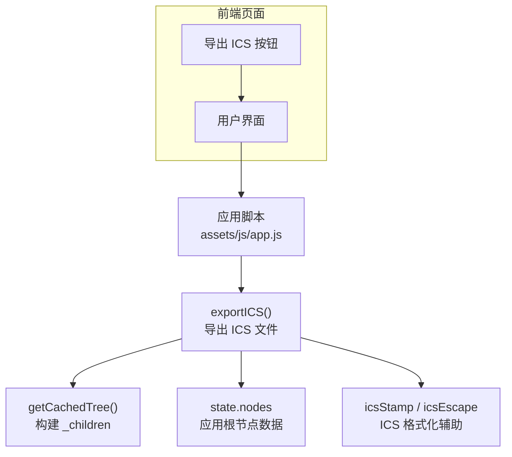
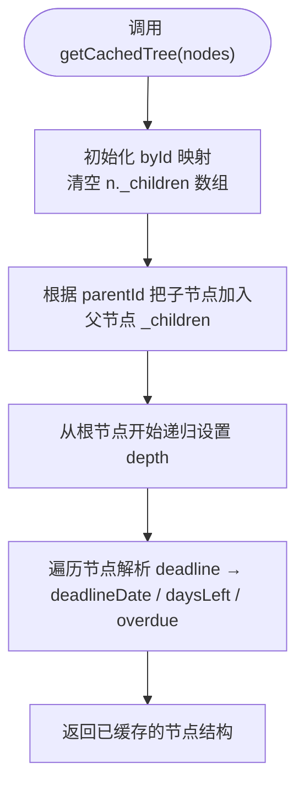
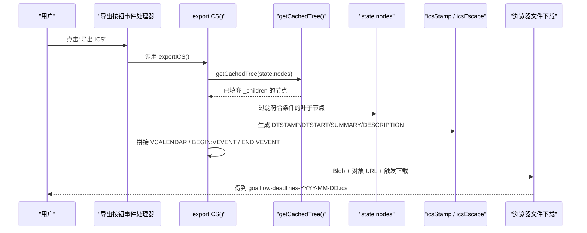
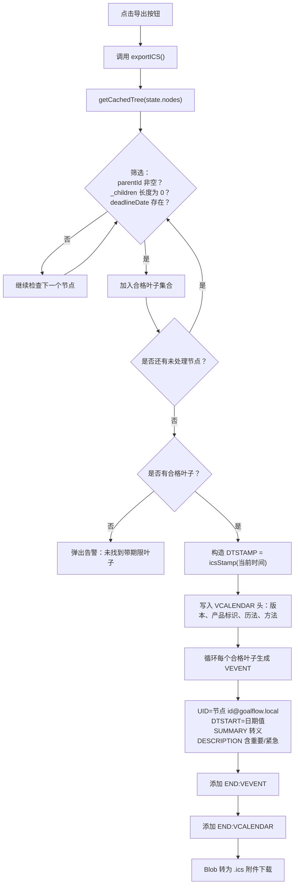
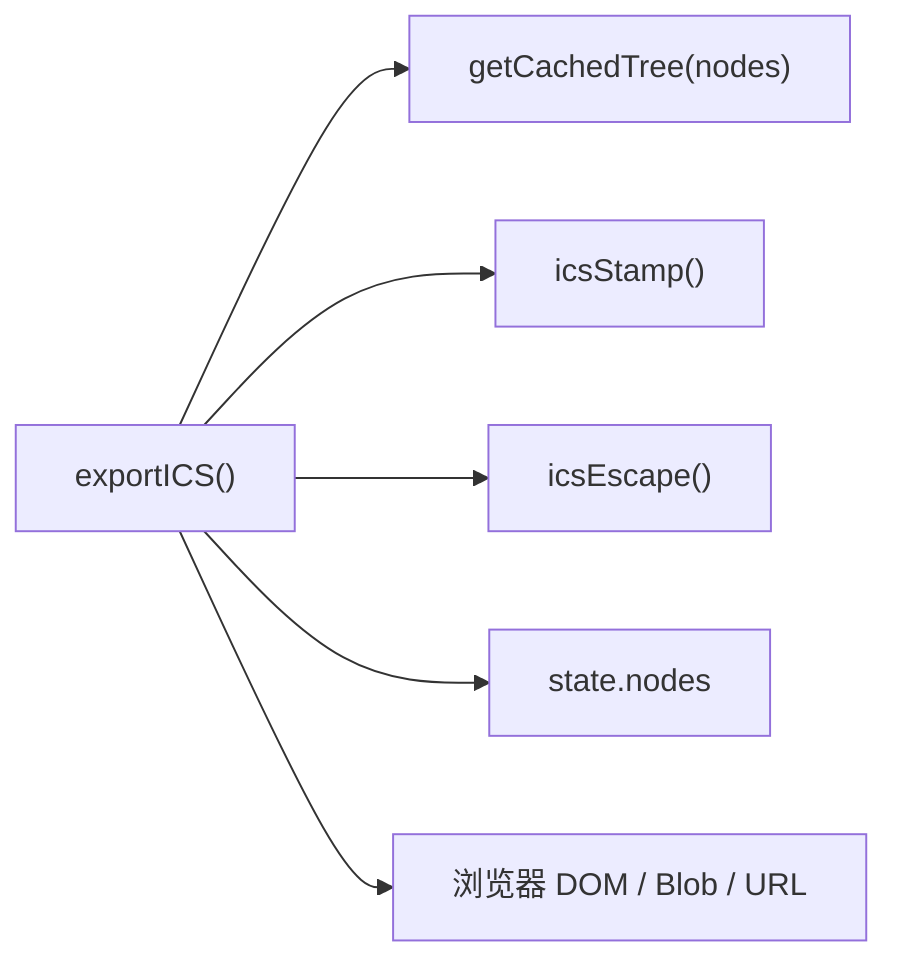
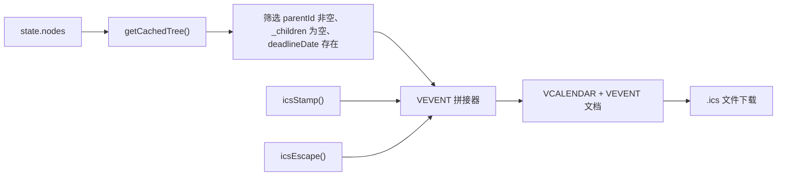
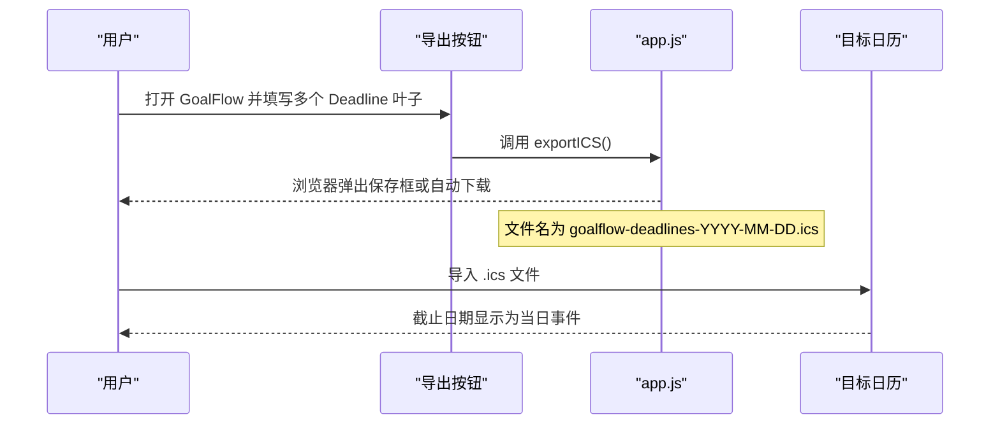

# ICS 日历导出 API

<cite>
**本文引用的文件 **
- [assets/js/app.js](file://assets/js/app.js)
</cite>

## 目录

1. [引言](#引言)
2. [项目结构定位](#项目结构定位)
3. [核心组件](#核心组件)
4. [架构总览](#架构总览)
5. [组件详解](#组件详解)
6. [依赖关系分析](#依赖关系分析)
7. [性能与资源特征](#性能与资源特征)
8. [使用示例](#使用示例)
9. [适用场景与限制](#适用场景与限制)
10. [故障排查指南](#故障排查指南)
11. [结论](#结论)

## 引言

本文档为 GoalFlow 的 ICS 日历导出功能编写 API 级文档，聚焦 `exportICS()` 函数及其辅助实现。该导出功能由浏览器按钮事件直接触发，读取应用状态中的 `state.nodes`，通过纯客户端逻辑构建符合 RFC 5545 的 `.ics` 附件并触发下载，不发起任何 HTTP 请求或后端访问。

`exportICS()` 的核心行为可以概括如下：

1. 调用 `getCachedTree(state.nodes)` 根据节点的 `parentId` 关系补全每个节点上的 `_children` 数组。
2. 从 `state.nodes` 中筛选满足以下条件的叶子节点：
   - `n.parentId` 非空；
   - `n._children.length === 0`；
   - `n.deadlineDate` 存在且为有效值。
3. 如果没有符合条件的节点，则弹出浏览器告警提示。
4. 将全部符合条件的叶子转换为 VEVENT 条目，并用一个外层 VCALENDAR 包裹，生成 .ics 内容字符串。
5. 将生成的内容转为 Blob、创建对象 URL，构造隐藏 `<a>` 元素并点击，使浏览器下载 `goalflow-deadlines-YYYY-MM-DD.ics` 类型的附件。

## 项目结构定位

GoalFlow 的前端主逻辑集中在单页应用的 JavaScript 模块中，`assets/js/app.js` 包含状态管理、节点树解析、任务计算以及导出入口等全部关键逻辑：

- `getById`、`byId` 在节点间按 `parentId` 回溯父链；
- `getCachedTree(nodes)` 维护 `node._children`，供多种查询复用；
- `icsStamp(d)`、`icsEscape(s)` 是独立的 ICS 格式工具函数；
- `exportICS()` 同时被声明并挂载到全局作用域（导出 API），同时在初始化阶段绑定到按钮的点击事件处理器。



图中展示的是概念级交互流程，不对应具体类的继承或模块边界，因此不附加“图表来源”。

**章节来源**
- [assets/js/app.js:5451-5580](file://assets/js/app.js#L5451-L5580)
- [assets/js/app.js:6696-6793](file://assets/js/app.js#L6696-L6793)

## 核心组件

本节对 ICS 导出涉及的三个代码级组件进行结构化说明。

| 组件 | 职责 | 输入 | 输出 | 副作用 |
|---|---|---|---|---|
| `getCachedTree(nodes)` | 以 `nodes` 为基础重建每个节点的 `_children` 缓存数组，并计算深度等派生信息 | 应用节点数组 | 更新节点对象的 `_children` 等缓存字段 | 修改节点对象引用 |
| `icsStamp(date)` | 把日期对象格式化为 `YYYYMMDDTHHMMSS` 字符串 | Date 对象 | 标准 UTC 风格的 iCal 时间戳字符串 | 无 |
| `icsEscape(text)` | 将 `\`、`;`、`,`、换行符按 RFC 5545 转义 | 普通文本 | 适合放在 ICS VALUE 中的转义字符串 | 无 |
| `exportICS()` | 导出带 Deadline 的叶子任务为 .ics 文件 | 无需参数；内部依赖全局 `state.nodes` | 无返回值；触发浏览器下载附件 | 构造 Blob、URL、点击链接下载 |

需要特别强调的是：`exportICS()` **不是传统 API 接口**，没有 HTTP URL、请求体或响应体。它是在浏览器环境中暴露给按钮调用的函数式 API。

**章节来源**
- [assets/js/app.js:454-517](file://assets/js/app.js#L454-L517)
- [assets/js/app.js:5563-5579](file://assets/js/app.js#L5563-L5579)

### 数据结构与复杂度

`getCachedTree()` 的实现通常具有以下时间复杂度特征：

- 第一次调用时遍历所有节点以建立父子索引，时间复杂度为 O(n)；
- 第二次遍历把所有节点挂入对应父节点的 `_children`；
- 随后的树深遍历也只在节点数范围内线性扫描。

由于 GoalFlow 通常是桌面或移动端浏览器内的个人项目管理工具，节点规模常见为几百到几千个量级，O(n) 的处理成本完全可接受。



该流程是 `exportICS()` 正确性的前提：只有 `_children` 和 `deadlineDate` 就绪后，才能可靠地筛选出“有期限的叶子节点”。

**图表来源**
- [assets/js/app.js:541-530](file://assets/js/app.js#L541-L530)

**章节来源**
- [assets/js/app.js:541-530](file://assets/js/app.js#L541-L530)

## 架构总览

下图展示了 ICS 导出的端到端数据流：



该顺序图严格映射到实际文件中的调用序列：按钮点击监听绑定在 `assets/js/app.js` 中，`exportICS()` 位于同一文件，并使用相同的辅助函数。

**图表来源**
- [assets/js/app.js:6696-6793](file://assets/js/app.js#L6696-L6793)
- [assets/js/app.js:5563-5579](file://assets/js/app.js#L5563-L5579)

## 组件详解

### `exportICS()`：导出算法逐条说明

`exportICS()` 是本次 API 的核心函数签名：

- 名称：`exportICS`
- 参数：无
- 返回值：无（执行结果通过浏览器文件下载体现）
- 前置条件：`window.state.nodes` 必须存在且包含完整节点数据
- 外部依赖：
  - 全局状态 `state.nodes`；
  - `getCachedTree()`；
  - `icsStamp()`；
  - `icsEscape()`；
  - 浏览器 DOM/Blob/FileSaver-like 能力。

#### 算法步骤

1. **刷新节点树缓存**  
   调用 `getCachedTree(state.nodes)`。这一步保证所有节点的 `_children` 与截止时间派生字段处于最新状态。

2. **筛选符合条件的叶子节点**  
   过滤规则三条取与：
   - `n.parentId` 非空；
   - `n._children.length === 0`；
   - `n.deadlineDate` 存在。

3. **处理无结果情况**  
   如果筛选结果为空，应弹出浏览器告警提示，告知用户没有找到带期限的叶子任务。

4. **计算时间戳**  
   使用当前时间调用 `icsStamp(new Date())`，得到 VCALENDAR 级别的 `DTSTAMP`。

5. **构建外层 VCALENDAR**  
   固定头部内容包括：
   - `BEGIN:VCALENDAR`
   - `VERSION:2.0`
   - `PRODID:-//GoalFlow//ZH`
   - `CALSCALE:GREGORIAN`
   - `METHOD:PUBLISH`

6. **为每个符合条件的叶子生成 VEVENT**  
   对于每个叶子节点 `n`：
   - UID：`${n.id}@goalflow.local`
   - DTSTAMP：上一步计算的当前时间戳
   - DTSTART：`VALUE=DATE:` 前缀加日期部分，日期来源于 `icsStamp(n.deadlineDate).slice(0, 8)`，即取年月日共 8 位，作为纯日期而非时间点
   - SUMMARY：`icsEscape(n.text)`，对标题进行转义
   - DESCRIPTION：`GoalFlow 叶子 · 重要${n.im} 紧急${n.ur}`
   - 用 `BEGIN:VEVENT` / `END:VEVENT` 包裹单个条目

7. **闭合 VCALENDAR**  
   所有 VEVENT 之后追加 `END:VCALENDAR`。

8. **下载到本地文件**  
   将最终字符串转换为 Blob，使用 `URL.createObjectURL` 创建临时对象 URL，并通过隐藏 `<a>` 元素的点击完成下载。

#### 流程图



此图为概念流程表达，但其中的判断分支、字段命名和处理顺序均与实际源码实现一致。

**图表来源**
- [assets/js/app.js:5563-5579](file://assets/js/app.js#L5563-L5579)

**章节来源**
- [assets/js/app.js:5568-5579](file://assets/js/app.js#L5568-L5579)

### `icsStamp(d)`

- 输入：Date 对象
- 输出：形如 `YYYYMMDDTHHMMSS` 的字符串
- 用途：
  - 生成 `DTSTAMP`，用于表示 .ics 文件的创建或更新时间；
  - 从 `n.deadlineDate` 的时间戳中裁剪前 8 位，得到 `YYYYMMDD`，再以 `VALUE=DATE:` 的形式放入 `DTSTART`，从而表示“截止日期是当天”，而不是某个具体时刻。

该函数保证了 VEVENT 中的时间戳与日期值具有统一的编码方式，避免不同日期格式导致 Outlook、iOS Calendar 或 Google Calendar 解释不一致。

**章节来源**
- [assets/js/app.js:5563-5565](file://assets/js/app.js#L5563-L5565)

### `icsEscape(s)`

- 输入：任意字符串
- 转义规则：
  - 反斜杠 `\` 转义为 `\\`
  - 分号 `;` 转义为 `\;`
  - 逗号 `,` 转义为 `\,`
  - 换行符 `\n` 转义为 `\n`
- 依据：RFC 5545 中对 iCal 值的参数化转义约定
- 用途：主要用于 `SUMMARY` 字段，确保任务标题中包含中文、标点、换行等字符时，不被 ICS 解析器误认为字段分隔符或新行。

**章节来源**
- [assets/js/app.js:5566-5567](file://assets/js/app.js#L5566-L5567)

## 依赖关系分析

`exportICS()` 的依赖层次比较简单，主要是单进程浏览器函数调用链：



其中：

- `exportICS()` 与 `getCachedTree()`、`icsStamp()`、`icsEscape()` 同处一个脚本模块；
- `exportICS()` 依赖全局 `state`，特别是 `state.nodes`；
- 下载环节依赖浏览器提供的 Blob、URL 和锚点点击机制；
- 无任何跨域请求、API 调用、Web Worker 或第三方日历 SDK。



**图表来源**
- [assets/js/app.js:541-530](file://assets/js/app.js#L541-L530)
- [assets/js/app.js:5563-5579](file://assets/js/app.js#L5563-L5579)

**章节来源**
- [assets/js/app.js:541-530](file://assets/js/app.js#L541-L530)
- [assets/js/app.js:5563-5579](file://assets/js/app.js#L5563-L5579)

## 性能与资源特征

- **节点数量预期**：一般最多几千个叶子。即使全部参与筛选和字符串拼接，也主要属于线性 O(n) 范围，不会产生指数爆炸。
- **内存占用**：主要额外内存来自 `.ics` 文本字符串和 Blob 对象；常规任务量下仅数 KB 至数十 KB。
- **CPU 消耗**：集中在一次 `getCachedTree()` 遍历和多次数组过滤、字符串替换。
- **网络请求**：为零。整个流程在客户端完成。
- **下载模型**：使用 `Blob` 与对象 URL 触发浏览器本地下载，不上传任何数据。
- **潜在瓶颈**：如果节点树异常庞大、且频繁重复调用导出，可以考虑延迟合并或只导出最近更改的叶子。但当前默认实现已经足够简单、易维护和调试。

[本节为通用性能讨论，不直接分析具体文件片段]

## 使用示例

### 最小合法 .ics 样例

以下是一个符合本导出逻辑的最小 ICS 样例，可用于验证 Outlook、iOS Calendar 或 Google Calendar 是否正确导入：

```text
BEGIN:VCALENDAR
VERSION:2.0
PRODID:-//GoalFlow//ZH
CALSCALE:GREGORIAN
METHOD:PUBLISH
BEGIN:VEVENT
UID:test-node-id@goalflow.local
DTSTAMP:20260101T120000
DTSTART;VALUE=DATE:20260115
SUMMARY:写一份报告
DESCRIPTION:GoalFlow 叶子 · 重要3 紧急4
END:VEVENT
END:VCALENDAR
```

该样例对应如下语义：

- `UID` 使用唯一业务节点标识 `test-node-id@goalflow.local`；
- `DTSTAMP` 表示当前文件生成时间；
- `DTSTART;VALUE=DATE:20260115` 表示 2026 年 1 月 15 日为截止日期；
- `SUMMARY` 为任务标题；
- `DESCRIPTION` 说明这是 GoalFlow 的叶子节点，并标注重要性 3 和紧急度 4。

注意：虽然该样例可直接保存在 `.ics` 文件中，但 GoalFlow 实际通过 JavaScript 动态生成，并由浏览器自动选择保存文件名。

[样例本身为规范说明内容，不再重复列举源码位置]

### 典型交互



[此图为交互示意图，不直接映射源代码结构，因此不附“图表来源”]

## 适用场景与限制

### 适用场景

- 将 GoalFlow 中的 Deadline 式叶子任务批量导入 Outlook、iOS Calendar、Google Calendar。
- 将个人或团队项目的短期截止任务同步到已有日历系统中，减少重复录入。
- 在不需要服务器端协作的场景下，快速备份“带期限的已完成或未完成叶子任务”。
- 将高重要性和高紧急度的叶子任务标记为日历事项，便于提醒。

### 生成规则摘要

| ICS 字段 | 取值来源 | 说明 |
|---|---|---|
| VERSION | 字面量 | 固定为 2.0 |
| PRODID | 字面量 | `-//GoalFlow//ZH` |
| CALSCALE | 字面量 | GREGORIAN |
| METHOD | 字面量 | PUBLISH |
| UID | `n.id` | 后缀 `@goalflow.local` |
| DTSTAMP | `icsStamp(new Date())` | 当前时间 |
| DTSTART | `VALUE=DATE:` + `icsStamp(n.deadlineDate).slice(0, 8)` | 日期型截止日期 |
| SUMMARY | `icsEscape(n.text)` | 已按 RFC 5545 转义的节点文本 |
| DESCRIPTION | `GoalFlow 叶子 · 重要${n.im} 紧急${n.ur}` | 含重要性与紧急程度 |

### 已知限制

1. **不包含重复规则 RRULE**  
   当前实现没有 RRULE 字段，也不支持周期性重复任务。
2. **不使用 VTODO**  
   每个任务被建模为 VEVENT，而不是 VTODO。这意味着在部分日历应用中可能只看到“截止日期当天”的事件，而不一定显示待办清单复选框。
3. **截止日期是日期而非时刻**  
   `DTSTART` 使用 `VALUE=DATE:`，表示整日事件，不会精确到小时分钟秒。
4. **文件名带有固定前缀**  
   导出文件采用 `goalflow-deadlines-YYYY-MM-DD.ics` 格式，以便按日期区分。
5. **只有叶子节点会被导出**  
   父节点不会被直接导出；只有 `parentId` 非空且 `_children.length === 0` 的节点才进入 VEVENT。
6. **要求 `deadlineDate` 存在**  
   仅有视觉化的 deadline 文本但未能解析出 `deadlineDate` 的节点不会出现在 ICS 中。
7. **不导出已完成任务的特殊元数据以外的更多属性**  
   例如估算工时、slot、scale 等当前实现中没有写入 DESCRIPTION。

**章节来源**
- [assets/js/app.js:5568-5579](file://assets/js/app.js#L5568-L5579)

## 故障排查指南

| 现象 | 原因分析 | 处理方法 |
|---|---|---|
| 导出后没有带期限叶子 | 节点要么没有 `parentId`，要么是父节点，要么 `_children` 非空，要么无法解析出 `deadlineDate` | 确认该任务是叶子节点并在 deadline 字段中输入自然语言日期；或使用明确的日期选择器设置 deadline |
| 导出为空并弹出告警 | 找不到满足三条过滤条件的节点 | 先写出类似“周五前”“3月15日”“下周”之类的 deadline；让系统将其解析为 `deadlineDate` |
| 某些任务没被导出 | 节点使用了不符合标准的非标 id，或父节点关系异常，导致 `_children` 构建失败 | 检查是否存在异常节点 id、孤儿节点或循环父引用；必要时刷新页面重新加载 state.nodes |
| 导出成功但任务没有出现在日历 | 日历应用没有识别 VEVENT 或不支持该 PRODID/METHOD | 尝试导入到不同日历；确认事件发生在 `DTSTART` 所在整日；检查是否误选了其他 .ics 文件 |
| 特殊字符乱码 | `.ics` 解码为 UTF-8 时出现问题，或任务标题中未正确转义 | 确认浏览器或日历导入程序使用 UTF-8；检查 `SUMMARY` 是否出现未转义的分号、逗号、反斜杠 |
| 截止时间差一天 | 日期和时间戳处理中存在区域时区差异 | 注意 DTSTART 是纯日期值，不应期望精确时刻；若仍需调整，可在 deadline 字段或 deadlineDate 上修正 |
| 文件名格式不符 | 自定义下载逻辑或浏览器覆盖默认文件名 | 查看导出后的文件名是否以 `goalflow-deadlines-` 开头并以 `.ics` 结尾 |

补充操作建议：

- 如果希望任务进入日历，务必在 GoalFlow 节点中填写可读 deadline，例如：“周五”“月底”“3月15日”“下周”。
- 如果 `deadlineDate` 是通过手动日期字段设置的，请优先检查该日期是否正确写入 `deadline` 和 `deadlineDate` 两个衍生字段。
- 如果怀疑状态不一致，可以先刷新页面，确认 `getCachedTree()` 能正确重建 `_children`。

**章节来源**
- [assets/js/app.js:5568-5579](file://assets/js/app.js#L5568-L5579)

## 结论

`exportICS()` 是一个面向浏览器的轻量级纯函数式 API。它的核心优势是零网络开销、低耦合和易于理解：仅依赖 `state.nodes` 及自身辅助函数，按照明确规则构建 RFC 5545 兼容的 ICS 内容并触发本地下载。尽管目前不支持 RRULE、VTODO 和高阶元数据扩展，但它足以支撑大多数 Deadline 式叶子任务向主流日历的导入需求。

开发后续可扩展的方向包括：

- 增加可选的 `RRULE` 支持；
- 将 completed 与非 completed 分开输出；
- 增加 `DESCRIPTION` 中更多的上下文信息；
- 提供按重要度或紧急度筛选导出的选项；
- 在导出前提供预览弹窗，方便核对生成的事件列表。

[本节为总结性内容，不直接分析具体源文件]