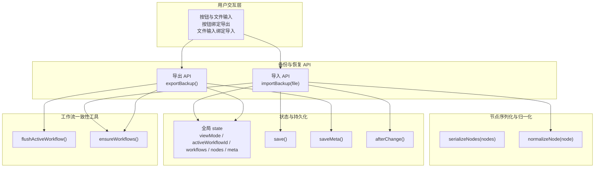
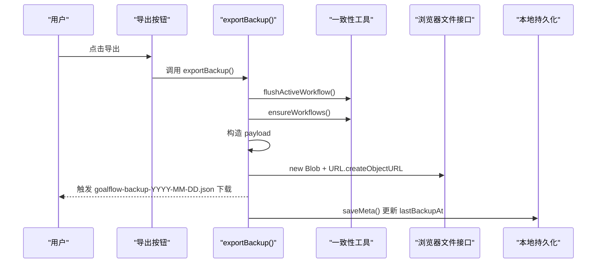
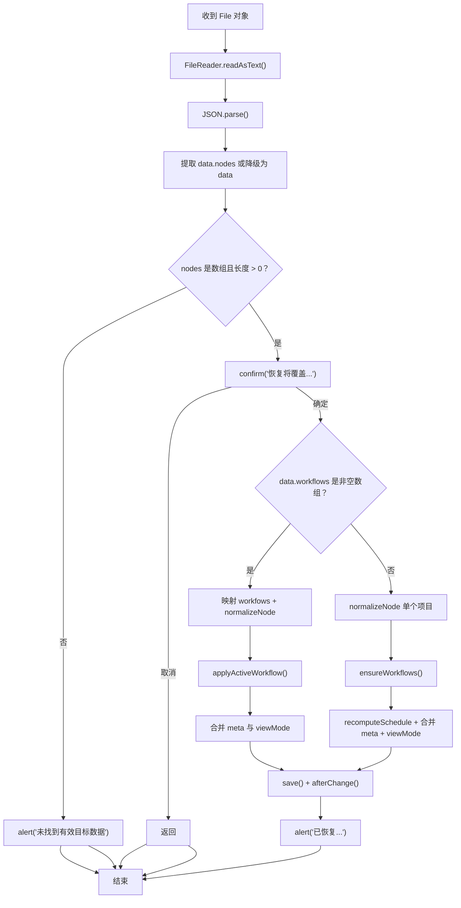
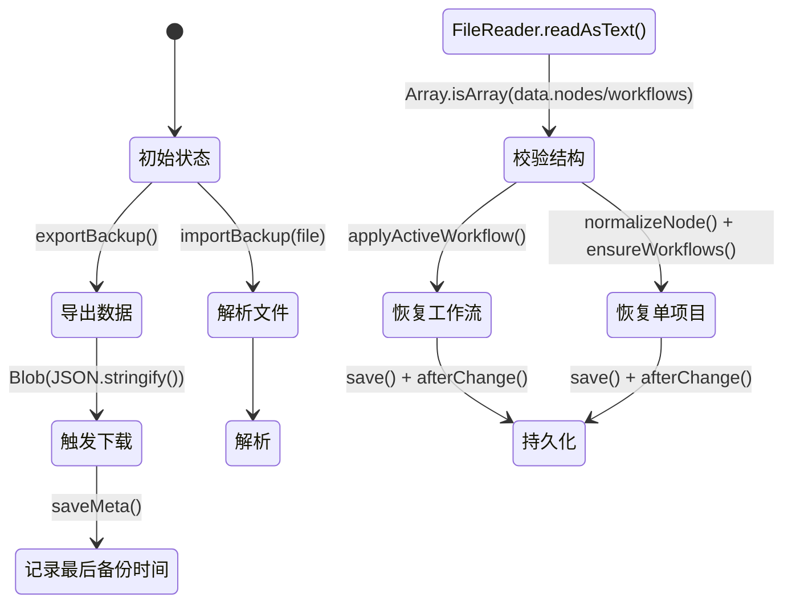
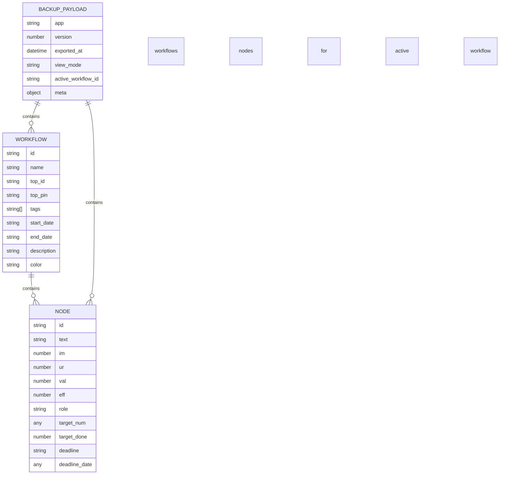
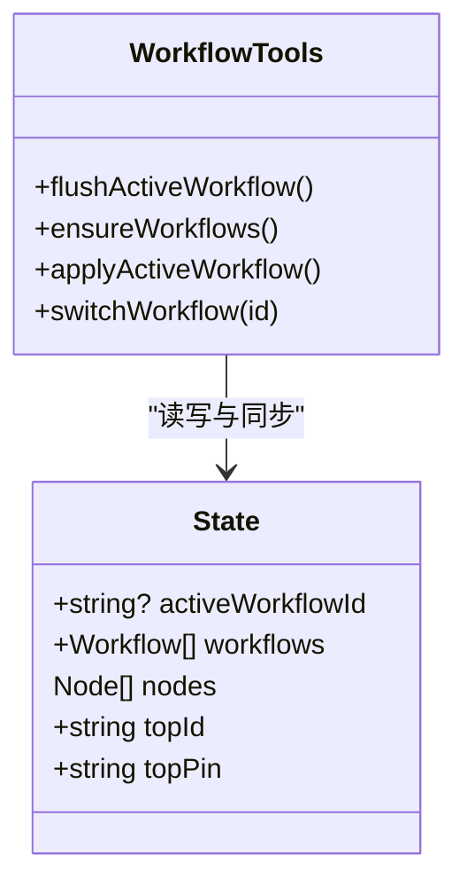
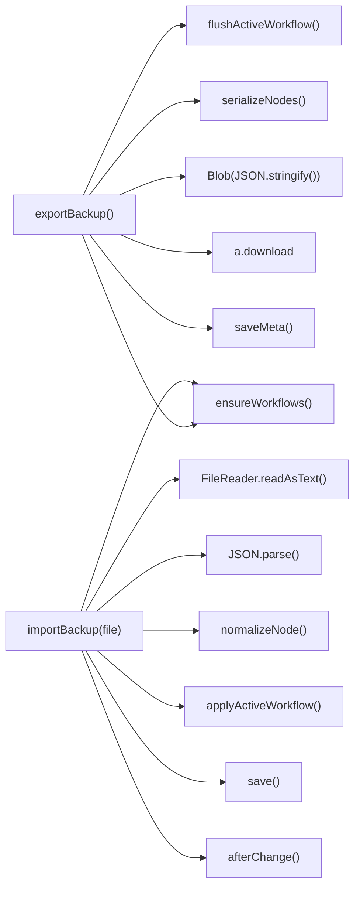
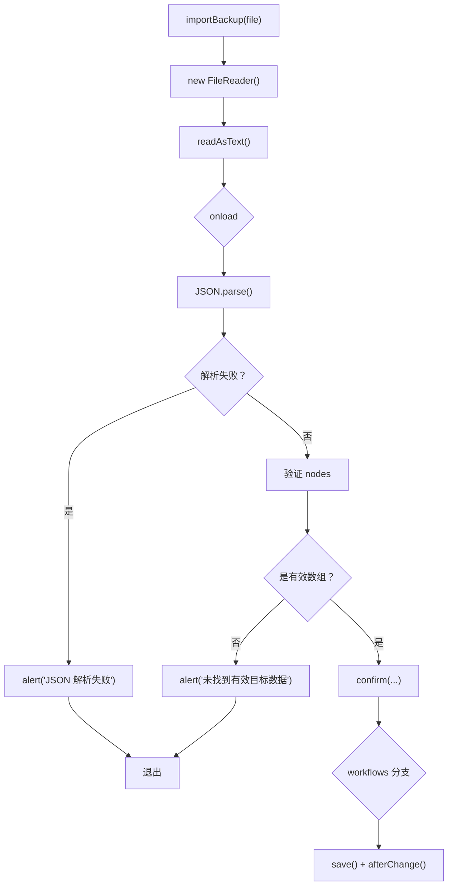

# JSON 备份与导入导出 API

<cite>
**本文引用的文件**   
- [assets/js/app.js](file://assets/js/app.js)
</cite>

## 目录

1. [简介](#简介)
2. [项目结构与职责划分](#项目结构与职责划分)
3. [核心入口函数](#核心入口函数)
4. [体系结构总览](#体系结构总览)
5. [详细组件分析](#详细组件分析)
6. [兼容性说明](#兼容性说明)
7. [依赖关系分析](#依赖关系分析)
8. [性能考虑](#性能考虑)
9. [安全与恢复前检查](#安全与恢复前检查)
10. [异常处理](#异常处理)
11. [最小可恢复示例](#最小可恢复示例)
12. [程序化调用方式](#程序化调用方式)
13. [故障排查指南](#故障排查指南)
14. [结论](#结论)

## 简介

目标流 GoalFlow 的备份与恢复能力围绕两个客户端入口函数展开：

| 函数 | 作用 | 输入 | 输出 / 副作用 |
|---|---|---:|---|
| `exportBackup()` | 导出当前全部目标流的增量式 JSON 快照，并触发浏览器下载 | 无 | 保存最近备份时间、生成 `.json` 文件下载 |
| `importBackup(file)` | 解析前端传入的文件对象，恢复多工作流或单项目兼容格式 | `File` | 覆盖当前应用状态、持久化、刷新渲染 |

该文档重点解释：

- `exportBackup()` 如何构造 `payload`。
- `workflows[]` 中每个项目的字段含义。
- `serializeNodes()` 负责节点序列化。
- `importBackup()` 对数据结构的分支判定与节点归一流程。
- 旧版单数组形式与现代 `workflows` 数组的兼容性。
- 版本字段 `version: 10` 的作用与迁移意义。
- 异常处理、安全建议以及测试环境下的模拟调用方法。

## 项目结构与职责划分

GoalFlow 的备份与恢复逻辑集中在单一前端脚本中，未拆分为独立模块，但职责仍然清晰：



图表来源

- [assets/js/app.js:5585-5646](file://assets/js/app.js#L5585-L5646)
- [assets/js/app.js:1347-1390](file://assets/js/app.js#L1347-L1390)
- [assets/js/app.js:1861-1891](file://assets/js/app.js#L1861-L1891)

本节是整体架构概览，不直接分析某段具体代码。

## 核心入口函数

### `exportBackup()`

`exportBackup()` 的职责不是简单地把内存对象写字符串，而是先保证“正在编辑的工作流”已经落回工作流集合，再导出一致快照。

主要流程：

1. 调用 `flushActiveWorkflow()`，把当前 `state.nodes`、`state.topId`、`state.topPin` 同步到 `state.workflows[state.activeWorkflowId]`。
2. 调用 `ensureWorkflows()`，确保至少有一个工作流，避免导出空集合。
3. 构造导出版本对象，包含以下键：

   | 键 | 类型 | 含义 |
   |---|---|---|
   | `app` | 字符串 | 固定为 `goalflow`，用于识别导出器 |
   | `version` | 数字 | 导出文件格式版本，当前固定为 `10` |
   | `exportedAt` | ISO 字符串 | 备份生成时间 |
   | `viewMode` | 任意 | 记录当前视图模式 |
   | `activeWorkflowId` | 字符串或空 | 激活的工作流标识 |
   | `workflows` | 对象数组 | 所有工作流的序列化结果 |
   | `nodes` | 对象数组 | 当前激活工作流的节点副本，仅保留序列化字段 |
   | `meta` | 对象 | 全局元信息，如能量日志、分数日志、容量配置等 |

4. 将 payload 用 `JSON.stringify(payload, null, 2)` 序列化为格式化的 JSON 文本。
5. 使用 `new Blob([...], {type:'application/json'})` 构造二进制对象。
6. 创建临时 `<a>` 链接并以 `URL.createObjectURL(blob)` 指向数据。
7. 设置 `download = 'goalflow-backup-YYYY-MM-DD.json'`，触发下载。
8. 尝试更新 `state.meta.lastBackupAt = Date.now()`，调用 `saveMeta()`。

重要特性：

- 下载文件名使用 ISO 日期的 `slice(0,10)`，结果为 `YYYY-MM-DD`。
- `nodes` 与 `workflows[].nodes` 都通过 `serializeNodes()` 得到，不会存储派生状态（如剩余天数、是否逾期）。
- 备份失败并不影响浏览器下载：只有 `lastBackupAt` 更新逻辑被包裹在 `try/catch` 中。

#### 导出时序



图表来源

- [assets/js/app.js:5585-5606](file://assets/js/app.js#L5585-L5606)

章节来源

- [assets/js/app.js:5585-5606](file://assets/js/app.js#L5585-L5606)
- [assets/js/app.js:3003-3004](file://assets/js/app.js#L3003-L3004)
- [assets/js/app.js:6692-6694](file://assets/js/app.js#L6692-L6694)

### `importBackup(file)`

`importBackup(file)` 是唯一暴露给用户的导入入口，典型参数是从 `<input type="file">` 的 `files[0]` 传进来。

其职责是读取文件、校验数据结构、选择兼容路径、归一化节点、合并元信息并刷新 UI。

核心行为如下：

1. 使用 `FileReader.readAsText(file)` 异步读取文件内容。
2. 在 `onload` 回调中使用 `JSON.parse(reader.result)` 解析文本。
3. 提取节点数据：如果 `data.nodes` 存在，则以 `data.nodes` 为准；否则回退为直接把整个 `data` 当作节点数组。
4. 验证是否为非空数组。不是数组或长度为 0 时，弹出 `未找到有效目标数据` 并返回。
5. 使用 `confirm(...)` 提示用户“恢复将覆盖当前全部目标流，是否继续？”。拒绝后直接返回。
6. 根据是否存在带长度的 `workflows` 数组进行分支：
   - **现代路径**：`Array.isArray(data.workflows)` 且长度大于 0。
     - 遍历每个 `w`，映射为新工作流对象，包含 `id`、`name`、`topId`、`topPin`、`tags`、`startDate`、`endDate`、`description`、`color`、`nodes`。
     - 对每个节点的子数组执行 `(w.nodes || []).map(normalizeNode)`。
     - 调用 `normalizeWorkflowMeta(wf)`。
     - 设置 `state.activeWorkflowId = data.activeWorkflowId || state.workflows[0].id`。
     - 调用 `applyActiveWorkflow()` 将当前活动工作流注入 `state.nodes`。
   - **兼容路径**：没有或多为空时使用旧版单项目结构。
     - 将根节点数组逐一 `normalizeNode`。
     - 清空 `state.workflows` 为空数组。
     - 清空 `state.activeWorkflowId`。
     - 调用 `ensureWorkflows()` 生成默认项目。
     - 调用 `recomputeSchedule(state.nodes)`。
7. 合并元信息：若 `data.meta` 存在，则按 `{...state.meta, ...data.meta}` 覆盖式合并。
8. 恢复视图模式：若 `data.viewMode` 存在，则赋值给 `state.viewMode`。
9. 调用 `save()` 和 `afterChange()`。
10. 弹出提示，显示恢复的工作流数量和当前节点数量。

注意：当前实现没有在 `FileReader.onerror` 上显式处理错误，也没有在 `onload` 外部捕获构造函数失败。

#### 导入流程图



图表来源

- [assets/js/app.js:5607-5646](file://assets/js/app.js#L5607-L5646)

章节来源

- [assets/js/app.js:5607-5646](file://assets/js/app.js#L5607-L5646)
- [assets/js/app.js:6699-6701](file://assets/js/app.js#L6699-L6701)

## 体系结构总览

从系统角度，可以把备份与恢复视为一个受保护的状态通道：



图表来源

- [assets/js/app.js:5585-5646](file://assets/js/app.js#L5585-L5646)
- [assets/js/app.js:1347-1390](file://assets/js/app.js#L1347-L1390)
- [assets/js/app.js:1861-1891](file://assets/js/app.js#L1861-L1891)

## 详细组件分析

### 导出数据结构

`exportBackup()` 输出的顶层对象键值如下：

| 键 | 来源 | 说明 |
|---|---|---|
| `app` | 常量字符串 | 标识这是 GoalFlow 导出的文件 |
| `version` | 常量数字 `10` | 导出格式版本，目前固定为 10 |
| `exportedAt` | `new Date().toISOString()` | 备份时间戳，符合 ISO 8601 |
| `viewMode` | `state.viewMode` | 当前视图模式，如今日、本周、本月等 |
| `activeWorkflowId` | `state.activeWorkflowId` | 备份时刻的活动工作流 ID |
| `workflows` | `state.workflows.map(...)` | 所有工作流序列化后的数组 |
| `nodes` | `serializeNodes(state.nodes)` | 当前活动工作流节点的序列化副本 |
| `meta` | `state.meta || {}` | 全局元信息，包括容量、日志、上次备份时间等 |

`workflows[]` 中每项映射为：

| 字段 | 来源 | 约束与默认行为 |
|---|---|---|
| `id` | `w.id` | 导入时可用，缺失则回退到 `newWorkflowId()` |
| `name` | `w.name` | 无效时可回退为中文名称 |
| `topId` | `w.topId \| null` | 缺少时使用 `null` |
| `topPin` | `w.topPin \| null` | 缺少时使用 `null` |
| `tags` | `w.tags \| []` | 支持字符串或空值 |
| `startDate` | `w.startDate` | 可为空 |
| `endDate` | `w.endDate` | 可为空 |
| `description` | `w.description` | 可为空 |
| `color` | `w.color` | 可为空 |
| `nodes` | `serializeNodes(w.nodes)` | 空节点数组会转为 `[]` |

#### 工作流导出映射模型



图表来源

- [assets/js/app.js:5585-5598](file://assets/js/app.js#L5585-L5598)

章节来源

- [assets/js/app.js:5585-5598](file://assets/js/app.js#L5585-L5598)
- [assets/js/app.js:1882-1891](file://assets/js/app.js#L1882-L1891)

### 节点序列化函数 `serializeNodes()`

`serializeNodes(nodes)` 的用途是把运行时节点对象转换为适合持久化的轻量对象数组。它遍历节点并使用 `{id, text, im, ur, val, eff, role, targetNum, targetDone, deadline, deadlineDate, ...}` 等字段组合成新对象。

关键设计原则：

- 不直接复制整个运行时节点对象，只拷贝需要持久化的字段。
- `deadlineDate` 是数值时间戳时才保留，否则写入空值。
- `targetNum` 允许空值，`targetDone` 有默认值。
- `daysLeft`、`overdue` 这类重新计算的派生状态不会被存储，避免导入后出现过期或不一致视图。

复杂度：

- 时间复杂度：$O(n)$，其中 $n$ 是节点数。
- 空间复杂度：$O(n)$，因为会为每个节点分配新对象。

章节来源

- [assets/js/app.js:1882-1891](file://assets/js/app.js#L1882-L1891)

### 节点归一化函数 `normalizeNode()`

`normalizeNode(n)` 负责把外部读入的数据修复为运行态可用的节点。例如：

- 初始化槽位字段。
- 字符串日期转 `Date`。
- 完成时间戳转换为毫秒时间。
- 自动推断循环策略。
- 修正 `touchedAt`。
- 补充估计值与度量指标。

这个函数在导入现代多工作流时每条节点都会被调用，是数据正确性的第一道防线。

章节来源

- [assets/js/app.js:1861-1881](file://assets/js/app.js#L1861-L1881)

### 工作流一致性函数

#### `flushActiveWorkflow()`

该函数的作用是确保活动工作流与当前视图一致：

1. 调用 `ensureWorkflows()`。
2. 查找 `workflowById(state.activeWorkflowId)`。
3. 若找不到直接返回。
4. 若 `w.nodes !== state.nodes`，将 `w.nodes` 指向当前的 `state.nodes` 引用。
5. 同步 `topId` 与 `topPin`。

这使 `exportBackup()` 不需要自己判断引用差异。

#### `ensureWorkflows()`

如果没有工作流或工作流为空，创建一个默认工作流，并把现有 `state.nodes` 放入默认项目中。然后确保 `activeWorkflowId` 指向该工作流。

#### `applyActiveWorkflow()`

将目标工作流的节点、置顶项指针加载到 `state.nodes`、`state.topId`、`state.topPin` 中，从而让后续渲染基于正确的节点集合。



图表来源

- [assets/js/app.js:1347-1390](file://assets/js/app.js#L1347-L1390)

章节来源

- [assets/js/app.js:1347-1390](file://assets/js/app.js#L1347-L1390)

## 兼容性说明

### 支持的两种导入形态

| 形态 | 特征 | 处理方式 |
|---|---|---|
| 现代格式 | 存在 `data.workflows` 且是非空数组 | 逐个映射为工作流，每个节点调用 `normalizeNode()` |
| 旧版单项目格式 | `data.workflows` 不存在、为 `null`、空数组或非数组 | 以 `data.nodes` 或 `data` 作为节点数组 |

### 单数组兼容路径

当不满足现代分支条件时，导入函数采用旧版兼容逻辑：

1. 节点来自 `data.nodes` 或整份 `data`。
2. 节点必须是数组且有元素，否则会进入“未找到有效目标数据”。
3. 每条节点经过 `normalizeNode()`。
4. `state.workflows` 设置为空数组。
5. `activeWorkflowId` 置空。
6. 调用 `ensureWorkflows()` 自动创建默认项目。
7. 计算计划调度并持久化。

这种兼容路径确保旧备份仍能被现代版本恢复，而不会因为缺少 `workflows` 直接崩溃。

### 版本字段

| 字段 | 当前值 | 用途 |
|---|---:|---|
| `exportedAt` | ISO 字符串 | 记录导出版本的生成时间 |
| `version` | 10 | 表示导出 schema 的版本号 |

版本字段目前固定为 `10`。未来升级时应根据 `data.version` 决定是否需要迁移步骤，例如字段更名、类型转换或删除废弃字段。目前实现没有显式做版本迁移分支，但可以扩展。

章节来源

- [assets/js/app.js:5607-5643](file://assets/js/app.js#L5607-L5643)
- [assets/js/app.js:5588-5598](file://assets/js/app.js#L5588-L5598)

## 依赖关系分析

下面的依赖图聚焦于导出与导入所依赖的核心函数与状态：



图表来源

- [assets/js/app.js:5585-5646](file://assets/js/app.js#L5585-L5646)
- [assets/js/app.js:1347-1390](file://assets/js/app.js#L1347-L1390)
- [assets/js/app.js:1861-1891](file://assets/js/app.js#L1861-L1891)

耦合特点：

- 导出与导入共享工作流一致性函数。
- 导入与导出共享 `serializeNodes()`、`normalizeNode()`、`ensureWorkflows()`、`afterChange()`、`save()`。
- 页面入口仅在事件绑定处调用这两个 API，因此它们属于稳定的客户端公开边界。

章节来源

- [assets/js/app.js:5585-5646](file://assets/js/app.js#L5585-L5646)
- [assets/js/app.js:1347-1390](file://assets/js/app.js#L1347-L1390)
- [assets/js/app.js:1861-1891](file://assets/js/app.js#L1861-L1891)
- [assets/js/app.js:6692-6701](file://assets/js/app.js#L6692-L6701)

## 性能考虑

- `serializeNodes()` 与导入时的 `normalizeNode()` 都会逐节点遍历。对于大型目标树，时间复杂度为 $O(n)$。
- 导出过程会在内存中构建完整 payload，再序列化一次；对大规模树会增加短期内存峰值。
- `afterChange()` 使用 `requestAnimationFrame` 防抖，可减少高频变更导致的重复渲染。
- 备份失败时（主要是 `saveMeta()`），不影响浏览器下载；这说明持久化失败与文件 IO 失败被部分隔离。

优化建议：

- 如果未来扩展大量冗余字段，应继续使用选择性拷贝而非 `Object.assign()` 全量克隆。
- 导入大文件时可以考虑分块显示进度，但目前只有一个确认对话框加最终弹窗。
- `JSON.stringify(payload, null, 2)` 会产生较大可读文本，适合人工审查和归档，但不适合高频传输。

本节提供一般性指导，不直接分析具体代码行。

## 安全与恢复前检查

### 必须提前备份

导入操作会覆盖当前目标流。官方引导强调：你的目标数据只保存在浏览器中，因此应定期通过 `exportBackup()` 备份。

推荐流程：

1. 导入前点击导出按钮或通过 `exportBackup()` 生成备份。
2. 确认浏览器已成功下载 `goalflow-backup-YYYY-MM-DD.json`。
3. 再进行 `importBackup()` 导入。

### 多人协作注意事项

- 不同人的工作流可能生成相同或冲突的 `id`、`topId`。
- 导入时会直接使用备份中的 `id`；若目标环境中已有同 ID 项目或节点，可能出现覆盖或混乱。
- 建议使用不同命名空间或统一后端分发备份，而不是直接把个人备份合并到他人设备上。

### 交互式确认

导入路径中使用 `confirm(...)` 要求用户明确同意覆盖。测试环境中若希望跳过对话框，应避免直接使用该路径，改为内部单元测试封装。

本章为概念性说明，不直接分析特定代码行。

## 异常处理

当前实现存在若干可改进的错误边界：

| 场景 | 当前行为 | 建议 |
|---|---|---|
| `reader.onerror` 未监听 | FileReader 错误可能被忽略 | 增加 `reader.onerror` 处理错误并提示 |
| JSON 无法解析 | 进入 `catch` 并提示 `JSON 解析失败` | 保留现有行为 |
| `data` 不是对象或数组 | 可能进入分支后导致错误判断 | 先检测 `typeof data === 'object'` |
| `data.nodes` 不是数组或为空 | 提示 `未找到有效目标数据` | 行为合理 |
| `data.workflows` 存在但不是非空数组 | 走兼容单项目路径 | 可考虑明确提示格式期望 |
| 无有效目标时 | 提前返回 | 行为合理 |
| `saveMeta()` 失败 | 外层 try/catch 忽略异常 | 已具备一定容错，可补充日志 |

#### 导入异常控制流



图表来源

- [assets/js/app.js:5607-5646](file://assets/js/app.js#L5607-L5646)

章节来源

- [assets/js/app.js:5607-5646](file://assets/js/app.js#L5607-L5646)

## 最小可恢复示例

要得到一个能被当前导入逻辑接受的“最小可恢复 JSON”，至少要满足以下条件：

- 顶层结构可以是被接受为 `nodes` 的数组，或者是一个含有 `nodes` 字段的对象。
- 节点数组至少有一条节点。
- 每条节点至少包含 `id` 和 `text`，这样才能被 `normalizeNode()` 接受并产生有意义的结果。

最小可恢复结构可以写成：

```json
{
  "version": 10,
  "nodes": [
    {
      "id": "x",
      "text": "A"
    }
  ],
  "meta": {}
}
```

说明：

- `version` 是导出版本，虽然导入不一定强制校验，但仍建议保持为 `10`。
- `meta` 可以为空对象。
- 不包含 `workflows`，因此导入会走兼容路径，随后由 `ensureWorkflows()` 生成默认工作流。

章节来源

- [assets/js/app.js:5607-5643](file://assets/js/app.js#L5607-L5643)

## 程序化调用方式

### 绑定 HTML 文件输入

应用中已经包含如下绑定：

- 导出按钮绑定到 `exportBackup()`。
- 导入按钮触发隐藏的 `importFile` 输入框。
- `fin.onchange` 会检查 `files[0]` 并调用 `importBackup(files[0])`，然后重置 input 值。

如果你要在自己的页面中添加导入功能，可以：

1. 添加 `<input type="file" id="myImportInput" accept=".json" />`。
2. 获取元素并绑定：

   ```js
   const myFin = document.getElementById('myImportInput');
   myFin.onchange = () => {
     if (myFin.files && myFin.files[0]) {
       importBackup(myFin.files[0]);
       myFin.value = '';
     }
   };
   ```

### 测试环境中模拟文件

在不涉及真实用户文件时，可以用 `Blob` 和 `URL.createObjectURL` 构造一个伪 `File` 对象，例如：

```js
const jsonText = JSON.stringify({
  version: 10,
  nodes: [{ id: 'x', text: 'A' }],
  meta: {}
}, null, 2);

const blob = new Blob([jsonText], { type: 'application/json' });
const fakeFile = new File([blob], 'goalflow-backup-2026-01-01.json', { type: 'application/json' });

importBackup(fakeFile);
```

这种方法能绕过真实的文件系统选择对话框，适合单元测试或演示。

章节来源

- [assets/js/app.js:5585-5646](file://assets/js/app.js#L5585-L5646)
- [assets/js/app.js:6692-6701](file://assets/js/app.js#L6692-L6701)

## 故障排查指南

| 现象 | 可能原因 | 处理方法 |
|---|---|---|
| 点击导出没有文件 | 页面中没有对应的导出按钮元素，或按钮事件未绑定 | 检查导出按钮是否在 DOM 中及 `btnExportJson`/`btnExportJson2` 是否绑定了 `exportBackup()` |
| 下载成功但没有 `lastBackupAt` | 浏览器的本地元信息写入失败或被静默捕获 | 检查浏览器存储限制；这不阻止下载成功 |
| 导入时报 `JSON 解析失败` | 上传的不是合法 JSON | 先用浏览器打开 JSON 文件检查格式，或使用程序化方式生成标准备份 |
| 导入后显示 `未找到有效目标数据` | `nodes` 不是数组，或数组为空 | 检查备份中的 `nodes`，或使用最小可恢复示例校验 |
| 导入后项目为空 | 兼容路径下默认项目被创建但无节点 | 确认 `data.nodes` 或 `data.nodes[0]` 是否有效 |
| 导入后视图不一致 | 忘记 `afterChange()` 或数据未被持久化 | 正常 API 会调用；自定义封装时应保留 `save()` 和 `afterChange()` |
| 多个工作流恢复后节点不对应激活项目 | 导入数据中的 `activeWorkflowId` 与备份不完全匹配 | 确认备份中 `activeWorkflowId` 是否等于某个 `workflows[i].id` |

章节来源

- [assets/js/app.js:5585-5646](file://assets/js/app.js#L5585-L5646)
- [assets/js/app.js:6692-6701](file://assets/js/app.js#L6692-L6701)

## 结论

GoalFlow 的 JSON 备份与恢复 API 提供了清晰的导出入口和安全导向的导入流程：

- `exportBackup()` 使用一致性工具确保工作流状态稳定，再生成结构化 payload。
- `importBackup(file)` 接受现代多工作流格式，同时兼容旧版单数组形式。
- 导出版本号固定为 `10`，适合未来通过 `data.version` 做迁移。
- 导入前会提示用户覆盖风险；实际恢复前仍需主动备份。
- 异常处理覆盖 JSON 解析失败和无效节点，但 `FileReader` 错误和输入类型校验仍有增强空间。
- 开发者可通过 `FileReader.readAsText`、`File` 与 `Blob` 组合在页面或测试环境中程序化调用。

在实际使用中，建议将 `exportBackup()` 纳入常规维护动作，并在导入前严格执行“先备份、再导入”的流程，以避免因多人协作、ID 冲突或误导入而丢失当前目标流。