# localStorage 数据键与结构

<cite>
**本文引用的文件**   
- [index.html](file://index.html)
- [assets/js/gf-tokens.js](file://assets/js/gf-tokens.js)
- [assets/js/app.js](file://assets/js/app.js)
</cite>

## 目录

1. [简介](#简介)
2. [适用范围与重要声明](#适用范围与重要声明)
3. [项目结构与职责划分](#项目结构与职责划分)
4. [存储键总览](#存储键总览)
5. [核心读写函数](#核心读写函数)
6. [各键详细说明](#各键详细说明)
7. [架构与数据流](#架构与数据流)
8. [容量、迁移与备份策略](#容量迁移与备份策略)
9. [性能建议](#性能建议)
10. [安全提示](#安全提示)
11. [故障排查](#故障排查)
12. [结论](#结论)

## 简介

GoalFlow（目标流）是一个纯前端本地优先产品。它的用户数据保存在当前页面所在的浏览器 `localStorage` 中，不主动上传到服务端，也没有统一的中心化数据库。主题、模式、工作区、节点、元数据等所有持久化信息都通过浏览器 Storage Area 实现。

在代码路径上，主题常量由轻量脚本加载；应用主逻辑在另一个文件中负责解析、保存和迁移这些键值。主题切换会重新刷新页面，而数据保存会在操作后触发。

## 适用范围与重要声明

- **纯前端接口**：以下所有键都由浏览器 `localStorage` 直接读取和写入，没有请求中转。
- **单浏览器绑定**：数据属于“当前浏览器 + 当前站点”的 Storage Area。换浏览器、换端口或关闭无痕浏览窗口后，通常看不到旧数据。
- **不是远程同步接口**：代码中存在与 DeepSeek 对话的网络请求入口，但 API Key 存储在本地键中；Key 本身不会自动发送。
- **向后兼容**：项目实现了从 v3 扁平节点结构和旧版工作区格式的读取/迁移逻辑，因此新代码仍能处理历史数据。

[无文件分析，本节为总体说明]

## 项目结构与职责划分

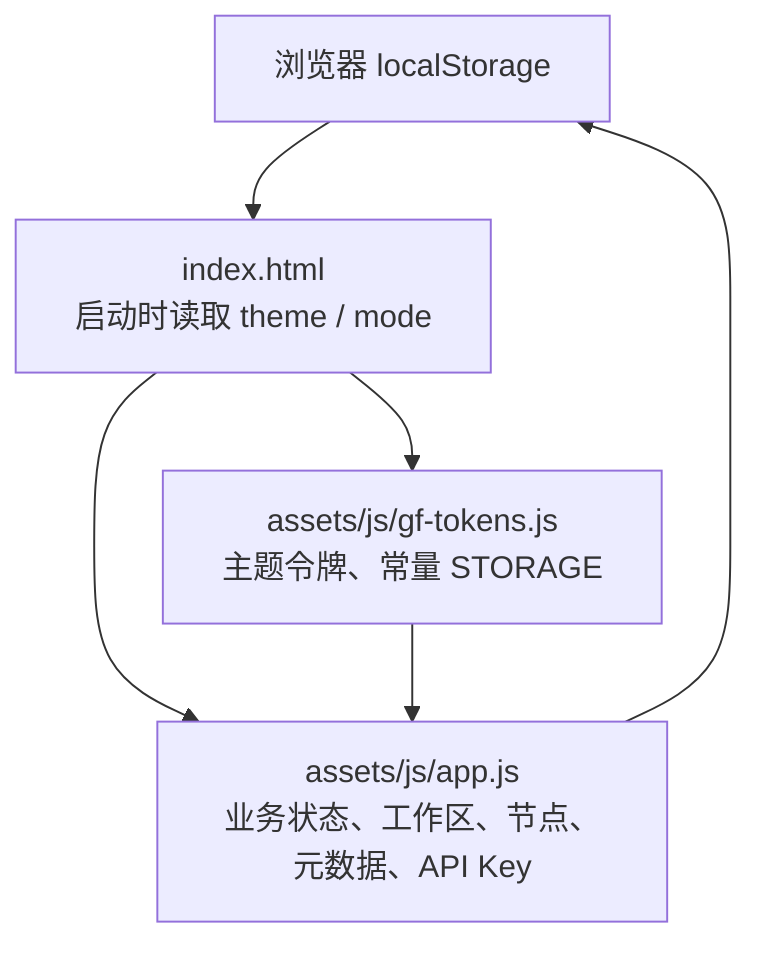

**图示来源**
- [index.html:14-14](file://index.html#L14-L14)
- [assets/js/gf-tokens.js:12-177](file://assets/js/gf-tokens.js#L12-L177)
- [assets/js/app.js:1-30](file://assets/js/app.js#L1-L30)

**章节来源**
- [assets/js/gf-tokens.js:1-20](file://assets/js/gf-tokens.js#L1-L20)
- [assets/js/app.js:1-30](file://assets/js/app.js#L1-L30)

## 存储键总览

| 键名 | 数据类型 | 含义 | 默认行为 | 主要消费者 |
|---|---|---|---|---|
| `goalfocus.v4` | JSON 数组 | 当前项目的扁平节点树 | 不存在时创建空工作区 | 保存节点 |
| `goalfocus.meta.v1` | JSON 对象 | 元数据：周回顾、每日完成、能量日志、容量、上次备份时间等 | 缺失字段会被补齐为空数组/空对象 | 元数据加载/保存 |
| `goalflow.theme` | 字符串 | 当前使用的主题名 | `linear` | 初始化脚本 |
| `goalflow.mode` | 字符串 | 明/暗模式 | `dark` | 初始化脚本 |
| `goalflow.view` | 字符串 | 当前视图名称 | 未指定时回退到内置视图表 | 视图选择 |
| `goalfocus.workflows.v2` | JSON 对象 | 多工作区配置及节点快照 | 加载失败时尝试镜像备份和旧键 | 保存/加载工作区 |
| `goalfocus.workflows.bak` | JSON 对象 | 主工作区键的冗余镜像 | 每 5 分钟写一次；可被删除 | 故障恢复 |
| `gf_llm_key` | 字符串或空 | DeepSeek API Key | 空字符串 | LLM 设置 |
| 其他辅助键 | 各种 | 今日行动、计划、树提示等界面状态 | 不存在则使用内存默认值 | UI 状态 |

**章节来源**
- [assets/js/gf-tokens.js:139-148](file://assets/js/gf-tokens.js#L139-L148)
- [assets/js/app.js:14-22](file://assets/js/app.js#L14-L22)

## 核心读写函数

### getStore(k)/setStore(k,v)

代码中没有名为 `getStore` 或 `setStore` 的全局公开方法。实际实现是直接在 `localStorage` 上调用：

| 内部实现 | 用途 |
|---|---|
| `localStorage.getItem(key)` | 读取某个键 |
| `localStorage.setItem(key, value)` | 写入字符串 |
| `JSON.parse(...)` | 把 JSON 文本反序列化为对象或数组 |
| `JSON.stringify(...)` | 把对象或数组序列化为 JSON 文本 |
| `try{...}catch(e){}` | 几乎所有存储调用都被包裹，以避免抛错中断 UI |
| `location.reload()` | 主题/模式变化时刷新页面应用样式 |

#### 典型读取模式

读取键的标准流程是：

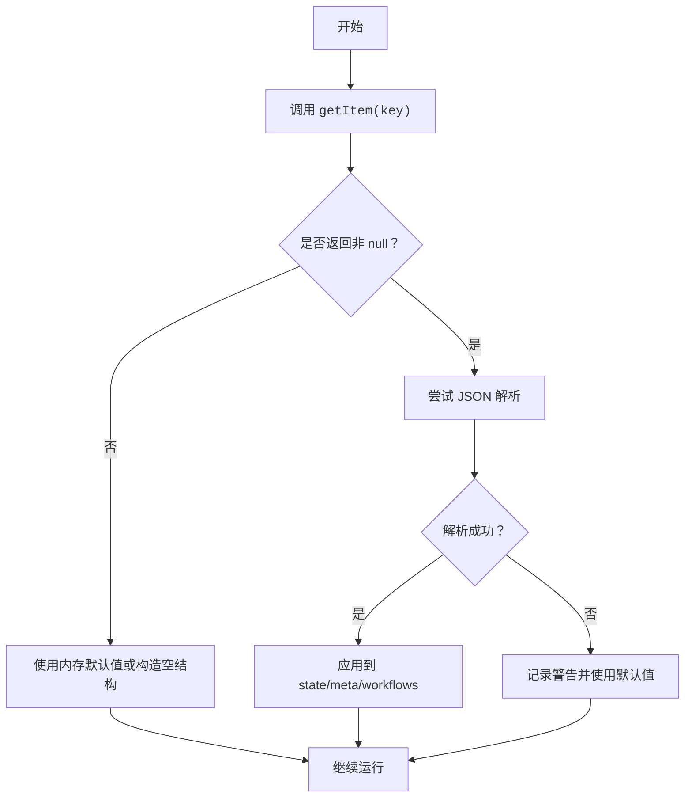

**图示来源**
- [assets/js/app.js:5258-5275](file://assets/js/app.js#L5258-L5275)
- [assets/js/app.js:5325-5399](file://assets/js/app.js#L5325-L5399)

#### 典型写入模式

写入通常发生在用户交互之后：

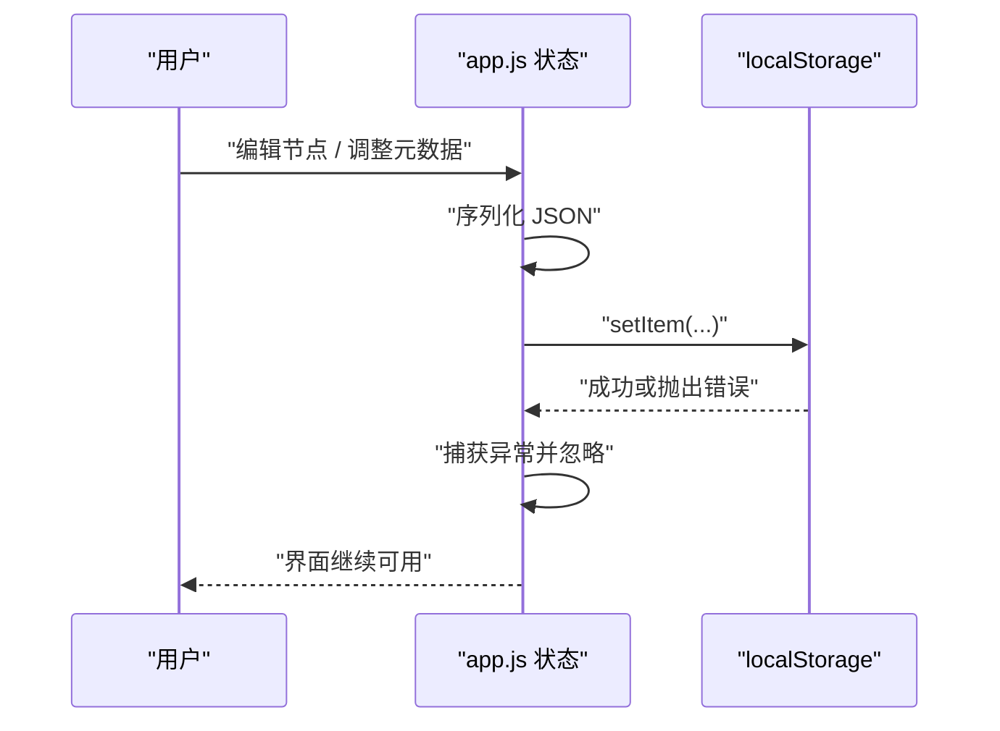

**图示来源**
- [assets/js/app.js:5325-5335](file://assets/js/app.js#L5325-L5335)
- [assets/js/gf-tokens.js:110-115](file://assets/js/gf-tokens.js#L110-L115)

**章节来源**
- [assets/js/gf-tokens.js:90-115](file://assets/js/gf-tokens.js#L90-L115)
- [assets/js/app.js:5258-5399](file://assets/js/app.js#L5258-L5399)

## 各键详细说明

### `goalfocus.v4` —— 扁平节点数组（v4/v5）

| 类别 | 说明 |
|---|---|
| JSON Schema | 以 JavaScript 表达为一个数组：`any[]`；每个元素代表一个节点，具备 `text`、`id`、`val`、`eff`、`ur`、`scale`、`parent`、`children` 等业务语义字段，具体结构由 `serializeNodes` / `normalizeNode` 定义。 |
| 含义 | 它是当前活动工作区的主节点列表。旧版本是扁平树，新版本与多工作区并存：主键中的节点仍参与序列化与展示逻辑。 |
| 写入时机 | `save()` 中调用 `serializeNodes(state.nodes)` 并写入。 |
| 读取时机 | `load()` 中如果没有有效工作区数据，就回退到这个键及其旧键 `goalfocus.v3`。 |
| 兼容性 | 如果这个键不存在，也不意味着应用启动失败；它会先加载工作区，再迁移旧数据，最后保证 `state.workflows` 至少有一个空工作区。 |

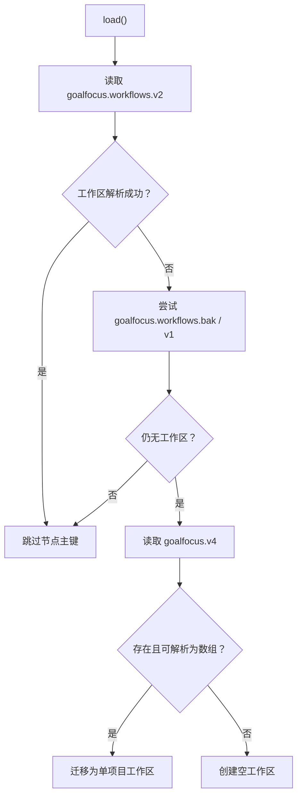

**图示来源**
- [assets/js/app.js:5366-5410](file://assets/js/app.js#L5366-L5410)

**章节来源**
- [assets/js/app.js:14-22](file://assets/js/app.js#L14-L22)
- [assets/js/app.js:5325-5410](file://assets/js/app.js#L5325-L5410)

### `goalfocus.meta.v1` —— 元数据

| 类别 | 说明 |
|---|---|
| JSON Schema | JavaScript 类型近似为 `Record<string, any>`；首次缺失时会按多个默认字段补齐。 |
| 含义 | 这是 GoalFlow 的用户行为数据和偏好数据容器。它不是单一实体，而是多种子模块共享的根对象。 |
| 关键字段 | `weekReviews`、`monthReviews`、`quarterReviews`、`bannerDismissedWeek`、`dailyCompletions`、`executionLog`、`habitStreaks`、`alarmFired`、`lastBackupAt`、`capacity` 等。 |
| 写入时机 | `saveMeta()` 中对整个 `state.meta` 做去重与序列化。 |
| 读取时机 | `loadMeta()` 中把已有数据合并进预设默认结构。 |

#### 字段参考表

| 字段 | 类型/形状 | 含义 | 典型写入场景 | 典型读取场景 |
|---|---|---|---|---|
| `weekReviews` | 数组 | 周回顾集合 | 标记某周已完成回顾 | 判断本周是否需要引导回顾 |
| `monthReviews` | 数组 | 月回顾集合 | 提交月度总结 | 显示最近月回顾入口 |
| `quarterReviews` | 数组 | 季度回顾集合 | 完成季度复盘 | 计算进度里程碑 |
| `bannerDismissedWeek` | 字符串 | 已隐藏周的标识 | 用户点击关闭周横幅 | 决定是否再次显示 |
| `dailyCompletions` | 对象 `日期→数量` | 每天完成条目数统计 | 完成任务后递增当日计数 | 渲染今日完成次数 |
| `energyLog` | 对象 `日期→对象` | 每日能量日志 | 用户调整当天精力评分 | 展示能量趋势 |
| `capacity` | 对象 | 按工作区或全局的日/周末工时容量 | 在项目设置中修改产能 | 计算“承诺总量 vs 容量” |
| `executionLog` | 对象 | 执行与跟踪相关日志 | 系统埋点或交互记录 | 调试或审计（可选） |
| `habitStreaks` | 对象 | 习惯连签状态 | 连续打卡/追踪 | 显示连续天数 |
| `alarmFired` | 对象 | 通知告警已触发记录 | 触发提醒后写入 | 避免重复弹窗 |
| `lastBackupAt` | 数字时间戳 | 最近一次外部备份操作时间 | 导入/导出完成后更新 | 提示用户数据新鲜度 |

#### 默认值补齐逻辑

加载时，代码先把旧数据合并到一个预设结构中：

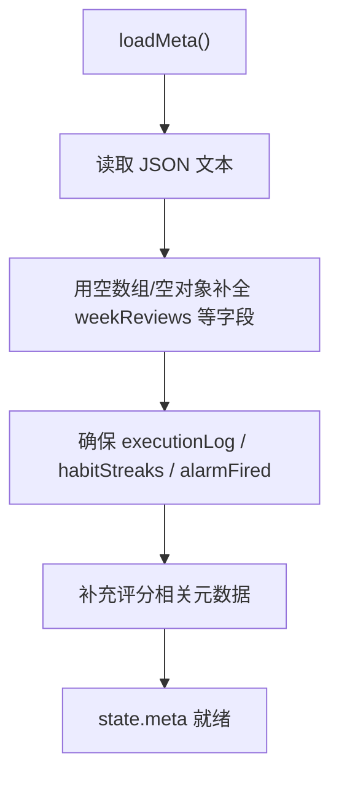

**图示来源**
- [assets/js/app.js:5258-5275](file://assets/js/app.js#L5258-L5275)

**章节来源**
- [assets/js/app.js:5258-5275](file://assets/js/app.js#L5258-L5275)

### `goalflow.theme` 与 `goalflow.mode` —— 主题与明/暗模式

| 类别 | 说明 |
|---|---|
| `goalflow.theme` | 主题名称，如 `linear`、`raycast`、`rpg`；无效值会被替换为 `linear`。 |
| `goalflow.mode` | 明/暗模式，值为 `dark` 或 `light`；无效值回退为 `dark`。 |
| 初始读取 | `<head>` 中同步读取，并在文档根元素设置 `data-theme` 与 `data-mode`。 |
| 变更行为 | 调用 `setTheme` / `setMode` / `toggleMode` 后会刷新页面，从而重新加载 CSS 主题。 |
| 错误处理 | 若 `localStorage` 不可用，页面上的 `try/catch` 会改为内联默认值，不影响 HTML 基本结构。 |

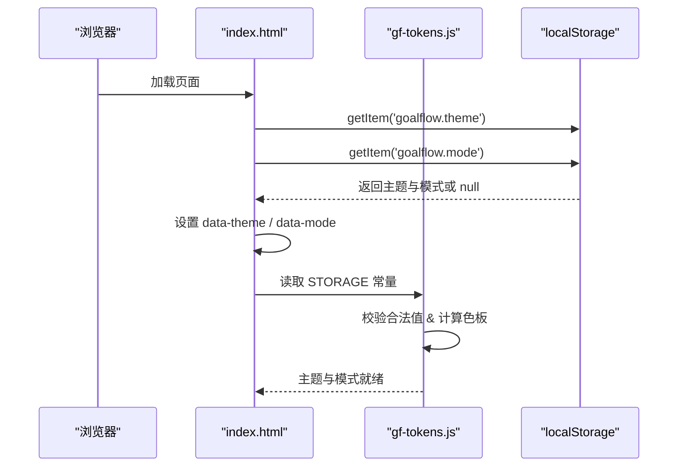

**图示来源**
- [index.html:14-14](file://index.html#L14-L14)
- [assets/js/gf-tokens.js:90-115](file://assets/js/gf-tokens.js#L90-L115)

**章节来源**
- [index.html:14-14](file://index.html#L14-L14)
- [assets/js/gf-tokens.js:14-20](file://assets/js/gf-tokens.js#L14-L20)
- [assets/js/gf-tokens.js:90-115](file://assets/js/gf-tokens.js#L90-L115)
- [assets/js/gf-tokens.js:139-148](file://assets/js/gf-tokens.js#L139-L148)

### `goalflow.view` —— 今日行动/目标规划/归纳洞察视图名

该键用于记住用户最近选择的视图。可能的键值来自应用的视图定义映射；若键存在但不在内置视图中，代码会回退到默认视图。

| 类别 | 说明 |
|---|---|
| 类型 | 字符串视图名 |
| 读取逻辑 | `getItem('goalflow.view')` → 查内置视图表 → 找不到则回到默认视图 |
| 写入逻辑 | 切换视图时 `setItem('goalflow.view', name)` |
| 错误防护 | 所有访问均包在 `try/catch` 中，避免 localStorage 出错影响界面 |

**章节来源**
- [assets/js/app.js:4355-4371](file://assets/js/app.js#L4355-L4371)

### `goalfocus.workflows.v2` —— 多工作区配置对象数组

这是目前应用的主力数据键。每次 `save()` 都会重新序列化并写入。

| 类别 | 说明 |
|---|---|
| JSON Schema | `{ workflows: Workflow[], activeWorkflowId?: string|null }` |
| 含义 | 保存多个项目（工作区）及其选中状态。每个工作区对应一组节点、标签、颜色和时间范围。 |
| 活跃节点优化 | 当保存的是当前活跃工作区时，代码复用已经序列化好的节点数组，避免双重 `map` 开销。 |

#### 工作区对象字段表

| 字段 | 类型 | 含义 | 写入示例语义 | 典型读取场景 |
|---|---|---|---|---|
| `id` | 字符串 | 工作区唯一标识 | 新建工作区生成 UUID | 切换工作区、计算节点索引 |
| `name` | 字符串 | 工作区名称 | “年度目标”、“个人成长” | 侧边栏或下拉选项显示 |
| `topId` | 字符串或空 | 顶层根节点 ID | 指定默认根任务 | 展开树结构 |
| `topPin` | 布尔或空 | 置顶状态 | 将根节点固定在顶部 | 控制折叠/置顶 |
| `tags` | 字符串数组 | 分类标签 | `["学习","AI","写作"]` | 筛选工作区列表 |
| `startDate` | 字符串 | 开始日期 | `"2026-01-01"` | 根据时间范围过滤节点 |
| `endDate` | 字符串 | 结束日期 | `"2026-12-31"` | 显示周期任务 |
| `description` | 字符串 | 工作区描述 | 简短文案 | 详情面板显示 |
| `color` | 字符串 | 工作区配色 | 十六进制颜色 | 工作区行高亮 |
| `nodes` | 对象数组 | 工作区内的扁平节点 | 同 `goalfocus.v4` 节点结构 | 渲染树、甘特图、日历等 |

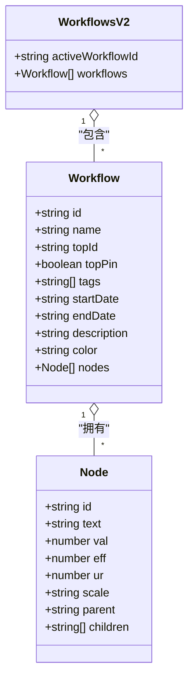

**图示来源**
- [assets/js/app.js:5307-5322](file://assets/js/app.js#L5307-L5322)

**章节来源**
- [assets/js/app.js:5307-5354](file://assets/js/app.js#L5307-L5354)

### 自动备份键：`goalfocus.workflows.bak`

这个键不是用户手动配置的独立数据结构，而是应用自己生成的冗余副本。

| 特性 | 说明 |
|---|---|
| 内容 | 与 `goalfocus.workflows.v2` 相同格式的 JSON 对象 |
| 写入条件 | 两次保存间隔达到 5 分钟时才写一次，减少存储压力 |
| 作用 | 当主工作区键损坏或被清空，应用会从镜像备份恢复 |
| 删除风险 | 手动删除该键通常无害；下次保存主工作区时会重建 |
| 注意 | 由于是冗余镜像，不要把它误认为“第三个独立工作区” |

**章节来源**
- [assets/js/app.js:18-20](file://assets/js/app.js#L18-L20)
- [assets/js/app.js:5325-5335](file://assets/js/app.js#L5325-L5335)
- [assets/js/app.js:5366-5410](file://assets/js/app.js#L5366-L5410)

### `gf_llm_key` —— DeepSeek API Key

| 类别 | 说明 |
|---|---|
| 类型 | 字符串；默认空字符串 |
| 含义 | 用户可选的 DeepSeek 模型调用凭证 |
| 存储位置 | 仅保存在本机浏览器 `localStorage` |
| 显示方式 | 设置页面会尝试读取并回填输入框 |
| 保存方式 | 用户点击保存按钮后写入本地；控制台弹出只存本地的提示 |
| 网络调用 | 调用 `https://api.deepseek.com/chat/completions`，使用 `deepseek-v4-flash` 模型 |
| 安全性要求 | 不应复制给第三方脚本；也不应提交到公共仓库、共享日志或远端服务器 |

#### API Key 操作流程

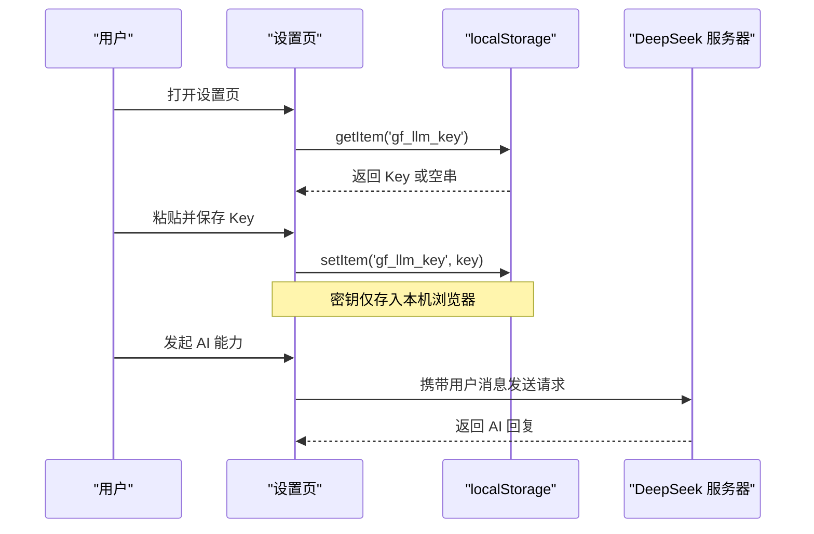

**图示来源**
- [assets/js/app.js:742-750](file://assets/js/app.js#L742-L750)
- [assets/js/app.js:6681-6685](file://assets/js/app.js#L6681-L6685)

**章节来源**
- [assets/js/app.js:21-22](file://assets/js/app.js#L21-L22)
- [assets/js/app.js:742-750](file://assets/js/app.js#L742-L750)
- [assets/js/app.js:1019-1019](file://assets/js/app.js#L1019-L1019)
- [assets/js/app.js:1122-1122](file://assets/js/app.js#L1122-L1122)
- [assets/js/app.js:4964-4964](file://assets/js/app.js#L4964-L4964)
- [assets/js/app.js:4980-4995](file://assets/js/app.js#L4980-L4995)
- [assets/js/app.js:6681-6685](file://assets/js/app.js#L6681-L6685)

## 架构与数据流

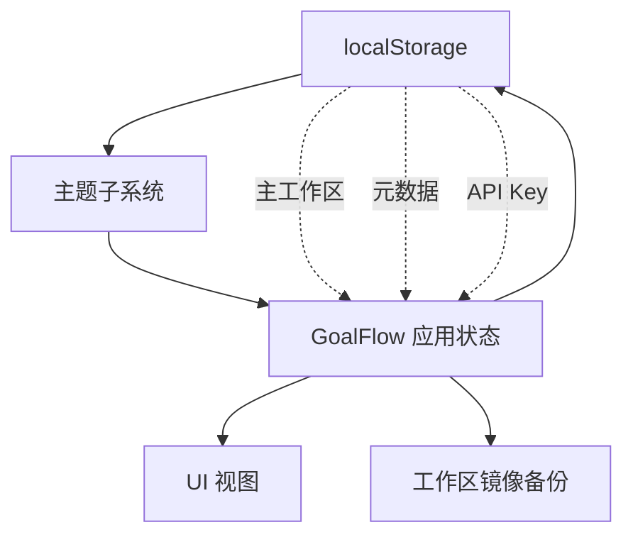

**图示来源**
- [assets/js/app.js:5258-5335](file://assets/js/app.js#L5258-L5335)
- [assets/js/gf-tokens.js:12-20](file://assets/js/gf-tokens.js#L12-L20)

**章节来源**
- [assets/js/app.js:5307-5399](file://assets/js/app.js#L5307-L5399)
- [assets/js/gf-tokens.js:90-148](file://assets/js/gf-tokens.js#L90-L148)

## 容量、迁移与备份策略

### 容量限制

- `localStorage` 通常有约 5–10 MB 的限制，不同浏览器实现略有差异。
- 一旦超过配额，`setItem` 会抛出异常；GoalFlow 中多处 `try/catch` 可以吞掉部分错误，但不代表容量问题完全消失。
- 如果频繁出现 `storage quota exceeded`，建议：
  - 归档旧工作区并删除不再使用的项目；
  - 清理不必要的历史记录或 AI 历史；
  - 压缩或导出需要长期保留的数据；
  - 不要在单个工作区中积累海量极小节点。

### 迁移顺序

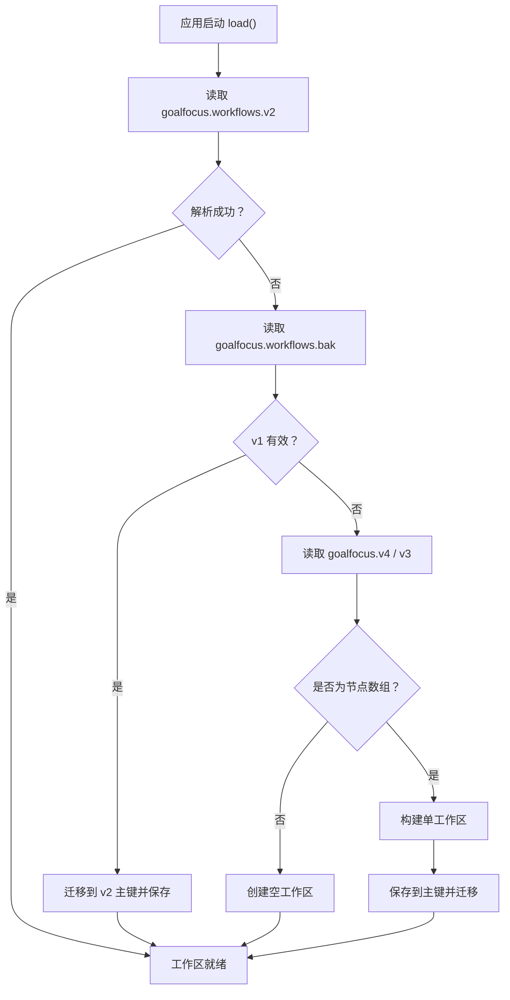

**图示来源**
- [assets/js/app.js:5366-5410](file://assets/js/app.js#L5366-L5410)

### 跨设备转移方案

官方强调数据保存在本机 `localStorage`，并提供“备份”作为跨浏览器、跨端口的迁移手段。建议流程如下：

1. 在旧浏览器中导出 JSON：
   - 导出 `goalfocus.workflows.v2` 的完整 JSON；
   - 如需恢复旧树结构，同时导出 `goalfocus.v4` 或 `goalfocus.v3`；
   - 如需保留统计数据，导出 `goalfocus.meta.v1`。
2. 备份时应包含 `workflows` 数组，不能只保存单个字段。
3. 在新浏览器中，把 JSON 文本粘贴到编辑器或使用开发工具写入对应键。
4. 刷新页面后检查：
   - 工作区是否恢复；
   - 是否激活了预期项目；
   - 节点数量和树结构是否正常。

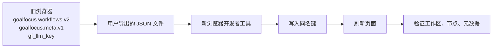

**图示来源**
- [assets/js/app.js:6500-6500](file://assets/js/app.js#L6500-L6500)
- [assets/js/app.js:5600-5606](file://assets/js/app.js#L5600-L5606)

**章节来源**
- [assets/js/app.js:5325-5399](file://assets/js/app.js#L5325-L5399)
- [assets/js/app.js:6500-6500](file://assets/js/app.js#L6500-L6500)

## 性能建议

1. **不要轮询存储键**：不要使用 `setInterval` 不断 `getItem` 所有键。读取应在用户切换视图、打开设置、保存后或需要状态一致性时触发。
2. **只在 `save()` 后读取**：工作区变更后应等待保存完成，而不是立即反复读本地。
3. **避免重复 JSON 序列化**：保存活跃工作区时会复用已经序列化的节点数组，减少额外 `map`。
4. **批量写入前先计算差异**：元数据保存中通过 `_lastMetaJson` 防止完全相同的结构重复写盘。
5. **大对象谨慎增量更新**：如果未来扩展更多子模块，应考虑字段级写入，而不是一味重写整个元数据。
6. **不要频繁写镜像备份**：现有实现已按 5 分钟节流，手动覆盖逻辑应保持同等节奏。

**章节来源**
- [assets/js/app.js:5325-5335](file://assets/js/app.js#L5325-L5335)
- [assets/js/app.js:5258-5267](file://assets/js/app.js#L5258-L5267)
- [assets/js/app.js:5307-5322](file://assets/js/app.js#L5307-L5322)

## 安全提示

| 风险 | 说明 | 建议 |
|---|---|---|
| API Key 泄漏 | `gf_llm_key` 仅存在用户本地，但若泄露可用于调用 DeepSeek 接口 | 不要把 Key 复制到控制台输出、共享笔记、公共仓库或第三方脚本 |
| 第三方脚本注入 | 任意嵌入页面的恶意脚本都可能读取 `localStorage` | 只信任可信域名下的 GoalFlow 页面；谨慎安装来源不明的浏览器扩展 |
| 共享设备 | 同一浏览器共享同一个 Storage Area | 退出登录或清除站点对应的本地数据 |
| 备份文件 | 导出的 JSON 可能包含节点、元数据和 API Key | 加密存储备份文件，或删除敏感字段后再共享 |
| 网络调用 | API Key 会随 HTTP 请求发送给 DeepSeek 官方服务 | 了解服务提供方条款，不要误以为“本地存储=无需第三方服务商” |

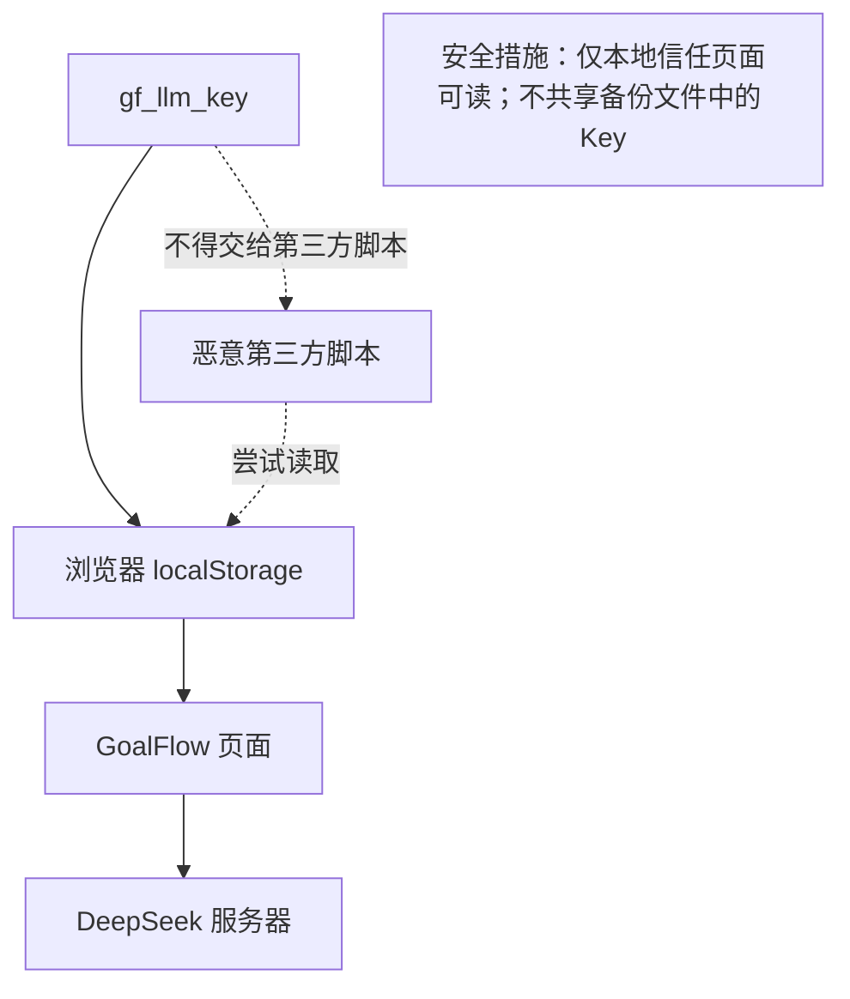

**图示来源**
- [assets/js/app.js:746-750](file://assets/js/app.js#L746-L750)
- [assets/js/app.js:6681-6685](file://assets/js/app.js#L6681-L6685)

**章节来源**
- [assets/js/app.js:6681-6685](file://assets/js/app.js#L6681-L6685)

## 故障排查

| 现象 | 可能原因 | 排查步骤 | 修复方式 |
|---|---|---|---|
| 打开页面没有工作区 | 全新环境、换了浏览器、使用无痕模式 | 检查 `goalfocus.workflows.v2`、`.bak`、`goalfocus.v4`、`goalfocus.v3` | 恢复备份或接受空工作区 |
| 主题始终是默认值 | `goalflow.theme` / `goalflow.mode` 无效 | 查看这两个键的值 | 设为 `linear` / `dark` 后刷新 |
| 切换视图没生效 | `goalflow.view` 指向未知视图名 | 在控制台列出视图键 | 删除该键让应用重新选择默认视图 |
| API Key 保存后不生效 | 变量缓存或写入异常 | 检查控制台和网络请求 | 重新保存 Key，确认 `getItem('gf_llm_key')` 返回值 |
| 数据丢失但仍能看到备份 | 主工作区键损坏 | 检查 `goalfocus.workflows.bak` | 手动从 `.bak` 恢复主键并刷新 |
| 容量不足 | 节点过多或元数据过大 | 使用 `console.table(storageReport())` 查看大小 | 清理旧工作区或导出数据后删除 |
| JSON 解析失败 | 存储内容被截断或手写修改 | 检查对应键的原始文本 | 恢复备份或重建空结构 |

**章节来源**
- [assets/js/app.js:5342-5354](file://assets/js/app.js#L5342-L5354)
- [assets/js/app.js:5366-5410](file://assets/js/app.js#L5366-L5410)
- [assets/js/app.js:5406-5410](file://assets/js/app.js#L5406-L5410)

## 结论

GoalFlow 的 localStorage API 是一个面向用户的纯前端本地存储契约。`goalfocus.v4` 保存主节点，`goalfocus.meta.v1` 保存行为与容量元数据，`goalfocus.workflows.v2` 组织多工作区，`goalflow.theme`、`goalflow.mode`、`goalflow.view` 管理界面状态，`goalfocus.workflows.bak` 提供容错镜像，`gf_llm_key` 保存可选的 DeepSeek API Key。

使用时应牢记：这些数据始终位于本机浏览器中，不自动同步；跨设备必须依靠手动导出和恢复；任何 API Key 都要当成本地机密保护；存储读写要尽量避免频繁轮询，并尊重 try/catch 提供的容错边界。

[无文件分析，本节为总结]