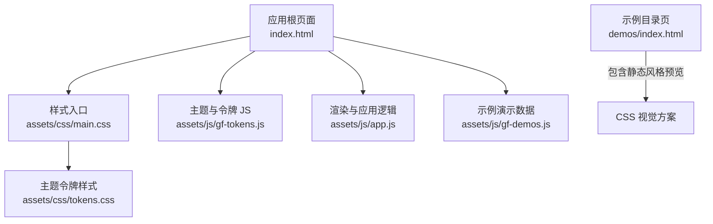
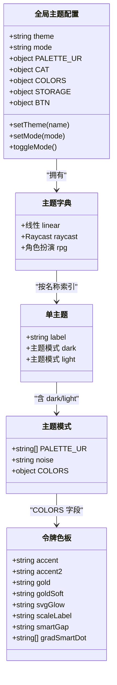
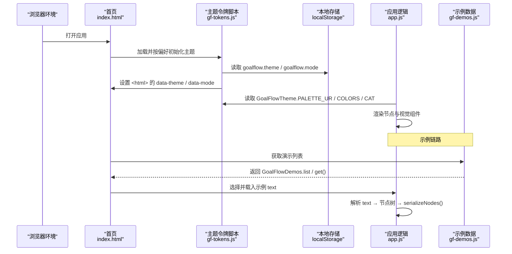
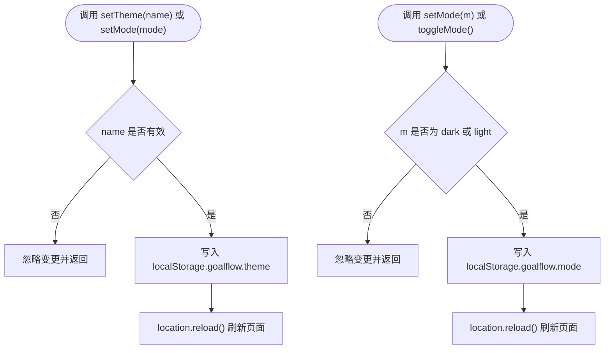
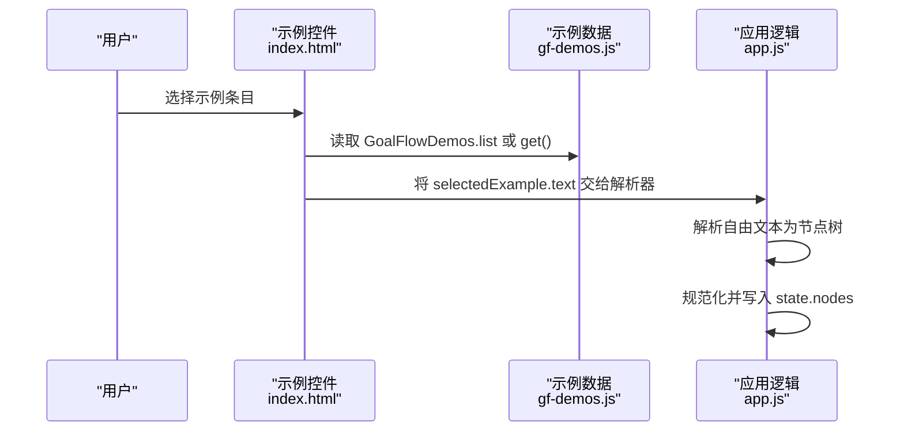
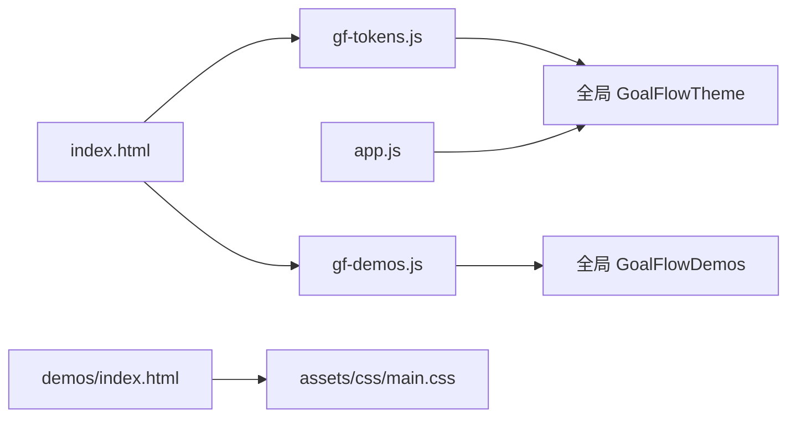

# 主题与示例数据 API

<cite>
**本文引用的文件**   
- [gf-tokens.js](file://assets/js/gf-tokens.js)
- [gf-demos.js](file://assets/js/gf-demos.js)
- [app.js](file://assets/js/app.js)
- [main.css](file://assets/css/main.css)
- [index.html](file://index.html)
- [demos/index.html](file://demos/index.html)
</cite>

## 目录

1. [简介](#简介)
2. [项目结构](#项目结构)
3. [核心组件](#核心组件)
4. [架构总览](#架构总览)
5. [详细组件分析](#详细组件分析)
6. [依赖分析](#依赖分析)
7. [性能注意事项](#性能注意事项)
8. [故障排除](#故障排除)
9. [结论](#结论)

## 简介

本集成文档聚焦 GoalFlow 的两项外部可集成点：

- **主题系统 API**：由 `gf-tokens.js` 暴露的全局对象，提供当前主题、明暗模式、颜色令牌与切换方法。
- **示例演示数据 API**：由 `gf-demos.js` 暴露的 demos 数组与访问函数，用于“载入示例”功能及示例页面的目标树初始化。

两者共同构成一个二维可视化产品的外观配置（主题 × 明暗）与演示内容（示例主题），并通过浏览器本地存储实现用户偏好持久化。

## 项目结构

- `assets/css/main.css` 是所有样式的聚合入口，导入 `tokens.css` 与各组件样式。
- `assets/js/gf-tokens.js` 在 `index.html` 早期执行，负责初始化主题并暴露全局 API。
- `assets/js/app.js` 通过读取 `GoalFlowTheme` 消费调色板、分类标签和存储键。
- `assets/js/gf-demos.js` 提供 demo 列表，被主界面的“示例下拉 + 载入示例”按钮使用。
- `demos/index.html` 是独立的主题展示页集合，不绑定业务渲染逻辑。

**图表来源**

- [main.css:5-11](file://assets/css/main.css#L5-L11)
- [index.html:12-18](file://index.html#L12-L18)
- [index.html:180-200](file://index.html#L180-L200)
- [demos/index.html:1-55](file://demos/index.html#L1-L55)

**章节来源**

- [main.css:5-11](file://assets/css/main.css#L5-L11)
- [index.html:12-18](file://index.html#L12-L18)
- [index.html:180-200](file://index.html#L180-L200)
- [demos/index.html:1-55](file://demos/index.html#L1-L55)

## 核心组件

本节按职责说明两个公共接口。

### 全局主题对象 `GoalFlowTheme`

`gf-tokens.js` 在全局作用域挂载 `GoalFlowTheme`，供渲染层直接消费，而不引入模块构建。其公开成员包括：

| 成员 | 类型 | 说明 |
|---|---|---|
| `THEMES` | 对象 | 所有可用主题的静态定义。每个主题至少包含 `label`、`dark`、`light`。 |
| `theme` | 字符串 | 当前从存储中恢复的主题名，如 `linear`、`raycast`、`rpg`。 |
| `mode` | 字符串 | 当前模式，值为 `dark` 或 `light`。 |
| `setTheme(name)` | 函数 | 设置主题名；无效值会被忽略；有效时会写入 `localStorage.goalflow.theme` 并刷新页面。 |
| `setMode(mode)` | 函数 | 设置模式；只有 `dark` 或 `light` 有效；成功后持久化并刷新页面。 |
| `toggleMode()` | 函数 | 在 `dark` 与 `light` 之间切换。 |
| `PALETTE_UR` | 五元素数组 | 当前主题当前模式下冷到暖的五色调色板，供桑基流、关系图、四象限等渲染。 |
| `CAT` | 对象 | 四象限分类：`now`、`core`、`distract`、`noise`，包含 key、label、color。 |
| `COLORS` | 对象 | 当前令牌色板，包含 accent、accent2、gold、goldSoft、svgGlow、scaleLabel、smartGap、gradSmartDot。 |
| `STORAGE` | 对象 | 各 localStorage key，如节点、工作流、主题、明暗模式、AI Key。 |
| `BTN` | 对象 | 按钮样式类名模板常量。 |

#### 主题配置结构

**图表来源**

- [gf-tokens.js:20-110](file://assets/js/gf-tokens.js#L20-L110)
- [gf-tokens.js:117-176](file://assets/js/gf-tokens.js#L117-L176)

当前内置主题如下：

| 主题名 | 显示标签 | 说明 |
|---|---|---|
| `linear` | Linear | 默认主题，对应深色高效工作台视觉方向。 |
| `raycast` | Raycast 玻璃（预览） | 命令面板风格的浅色/深色预览。 |
| `rpg` | RPG 游戏（预览） | 以深紫与金色为主的游戏化视觉方向。 |

#### 控制台切换方式

可以在浏览器开发者工具控制台中执行以下操作：

- 切换主题：调用 `GoalFlowTheme.setTheme('raycast')` 或 `'rpg'`。若传入的名称不在 `GoalFlowTheme.THEMES` 中，则不会生效。
- 切换到浅或深色：调用 `GoalFlowTheme.setMode('light')` 或 `GoalFlowTheme.setMode('dark')`。
- 快速翻转明暗：调用 `GoalFlowTheme.toggleMode()`。

这些方法会将值写入 `localStorage.goalflow.theme` 和 `localStorage.goalflow.mode`，并在切换主题后刷新整个页面，确保新主题在首次渲染前完成。

**章节来源**

- [gf-tokens.js:1-176](file://assets/js/gf-tokens.js#L1-L176)
- [index.html:15-18](file://index.html#L15-L18)

### 示例数据 API `GoalFlowDemos`

`gf-demos.js` 暴露一个名为 `GoalFlowDemos` 的全局对象，其中：

| 成员 | 类型 | 说明 |
|---|---|---|
| `list` | 数组 | 全部示例条目，共 10 个示例，例如销售体系、考研、健康、独立产品、转行 AI 产品经理、储蓄计划、雅思、技术管理、个人 IP、跨境小铺。 |
| `get(id)` | 函数 | 根据示例 id 查找条目；未找到时返回第一个示例。 |

每个 demo 的字段如下：

| 字段 | 必需性 | 类型 | 说明 |
|---|---|---|---|
| `id` | 是 | 字符串 | 示例标识符，用作示例下拉选项与检索键。 |
| `title` | 是 | 字符串 | 面向用户的示例标题。 |
| `text` | 是 | 字符串 | 示例正文，通常是自然语言描述的目标清单；解析器会据此生成结构化节点。 |

该示例 API 并不直接携带显式 `nodes` 树或 `workflow` 配置；它是“输入文本 → 解析为节点树”的数据源。真正序列化进生产数据的节点模型由 `app.js` 中的 `serializeNodes()` 与 `normalizeNode()` 维护。

**章节来源**

- [gf-demos.js:5-166](file://assets/js/gf-demos.js#L5-L166)

### Token 在 CSS 与 JavaScript 之间的使用关系

主题令牌是双端契约：

- JavaScript 侧通过 `GoalFlowTheme.PALETTE_UR`、`GoalFlowTheme.COLORS`、`GoalFlowTheme.CAT` 动态生成桑基流向、节点色彩、四象限颜色、智能间隙与渐变点。
- CSS 侧由 `main.css` 聚合加载 `tokens.css`，再由 CSS 变量把令牌应用到背景、边框、文字、描边、卡片、按钮等样式。

因此，新增或修改主题时，必须保证 `gf-tokens.js` 中同一主题的 `PALETTE_UR`、`noise`、`COLORS.*` 在 `dark` 与 `light` 两侧都完整出现，否则渲染器可能出现 undefined 色值，而 CSS 也可能无法得到预期的配色。

**章节来源**

- [main.css:5-11](file://assets/css/main.css#L5-L11)
- [gf-tokens.js:1-12](file://assets/js/gf-tokens.js#L1-L12)

## 架构总览

主题与示例数据的应用流程可分为两条链路：主题链路与示例链路。

**图表来源**

- [index.html:12-18](file://index.html#L12-L18)
- [gf-tokens.js:88-143](file://assets/js/gf-tokens.js#L88-L143)
- [app.js:3-30](file://assets/js/app.js#L3-L30)
- [gf-demos.js:5-166](file://assets/js/gf-demos.js#L5-L166)

## 详细组件分析

### 主题系统与主题切换机制

#### 启动阶段的行为

1. `gf-tokens.js` 定义主题集合与默认值：
   - 默认主题为 `linear`。
   - 默认模式为 `dark`。
2. 从 `localStorage.goalflow.theme` 与 `localStorage.goalflow.mode` 安全读取；如果值无效或被拒绝访问，则回退到默认值。
3. 根据主题名和模式选出当前配置对象；若对应组合缺失，则回退到该主题的 `dark` 配置。
4. 立即写入 `documentElement.dataset.theme` 和 `documentElement.dataset.mode`，从而在首次渲染之前确定 DOM 属性。
5. 将选出的 `PALETTE_UR`、`CAT`、`COLORS`、`STORAGE`、`BTN` 挂载为全局 `GoalFlowTheme`。

#### 主题切换流程

**图表来源**

- [gf-tokens.js:88-143](file://assets/js/gf-tokens.js#L88-L143)

#### 主题配置约定

每个主题应满足以下约定：

- 具备 `dark` 和 `light` 两套配置；缺少任意一侧都会导致回退逻辑或运行时缺值。
- `PALETTE_UR` 必须是长度为 5 的颜色数组。
- `noise` 是一个颜色字符串，用于噪音分类。
- `COLORS.accent`、`COLORS.accent2`、`COLORS.gold`、`COLORS.goldSoft`、`COLORS.svgGlow`、`COLORS.scaleLabel`、`COLORS.smartGap`、`COLORS.gradSmartDot` 应与主题意图一致。
  - 其中 `gradSmartDot` 预期是一个两段渐变色数组。

#### 新增自定义主题的方法

要新增名为 `your` 的自定义主题：

1. 在 `gf-tokens.js` 的 `THEMES` 对象中添加 `"your"` 条目。
2. 同时提供 `label`、`dark`、`light`。
3. 在 `dark` 和 `light` 中分别定义完整的 `PALETTE_UR`、`noise`、`COLORS`。
4. 如果需要出现在主题下拉菜单中，还应更新首页主题选择控件；当前首页示例仅列举 `linear`、`raycast`、`rpg`。
5. 验证主题切换后，JS 渲染与 CSS 样式均正常。

#### 状态标记说明

需要注意：题目描述中提到的 `GoalFlowMode.setMode()` 并不存在于当前代码；实际公开方法是 `GoalFlowTheme.setMode()` 和 `GoalFlowTheme.toggleMode()`。此外，主题切换后刷新页面，并非仅修改 DOM 属性；而 `documentElement.dataset.theme` 的确形如“`name`”，但 `data-mode` 才是当前明暗模式，不是复合字符串 `name-mode`。

**章节来源**

- [gf-tokens.js:20-176](file://assets/js/gf-tokens.js#L20-L176)
- [index.html:15-18](file://index.html#L15-L18)

### 示例数据与目标树注入

#### 从示例到节点树

主界面“载入示例”的流程大致为：

**图表来源**

- [index.html:180-200](file://index.html#L180-L200)
- [gf-demos.js:5-166](file://assets/js/gf-demos.js#L5-L166)
- [app.js:1861-1892](file://assets/js/app.js#L1861-L1892)

#### 将示例注入 `state.nodes`

如果你的页面已经在运行 GoalFlow，可以直接对目标树做程序化注入：

- 通过 `GoalFlowDemos.get('indie')` 取得一条示例，取其 `text` 字段进行解析。
- 解析完成后结果通常作为新的节点树赋值给 `state.nodes`。
- 如果已有现有节点树，可将其作为子任务树附加到某个父节点下。

注意：这种方式依赖应用内部的状态对象 `state.nodes`，属于应用运行时注入，而不是 `gf-demos.js` 直接提供的数据格式。

#### 序列化与兼容性的含义

`app.js` 提供两端的工具函数：

- `serializeNodes(nodes)`：从运行时节点结构生成可用于备份、导出、嵌入示例页面的稳定数据。
- `normalizeNode(node)`：把可能来自备份、导入或手工 JSON 的节点规范化为应用可使用的运行时格式。

生产环境兼容性要求：

- 如果你要把 demo 或用户数据序列化到页面源码、JSON 文件或后端存储，请使用 `serializeNodes()` 的输出结构。
- 恢复数据时，应使用 `normalizeNode()` 对节点逐项处理，再赋值给 `state.nodes`。
- `gf-demos.js` 本身输出的是演示文案，不是可直接作为节点的原始 JSON 数据结构；它的作用是演示输入文本，由解析器转换为节点。

**章节来源**

- [gf-demos.js:5-166](file://assets/js/gf-demos.js#L5-L166)
- [app.js:1861-1892](file://assets/js/app.js#L1861-L1892)
- [app.js:5324-5356](file://assets/js/app.js#L5324-L5356)
- [app.js:5624-5642](file://assets/js/app.js#L5624-L5642)

### 主题切换 UI 与 HTML 初始化

首页已经提供三个主题相关控件：

- 主题循环按钮。
- 主题选择下拉框，预置 `linear`、`raycast`、`rpg`。
- 明暗模式切换按钮。

这些控件最终应通过 `GoalFlowTheme.setTheme()` 和 `GoalFlowTheme.setMode()` 触发，而不是手动修改存储或直接改写 `dataset.theme`。

此外，`index.html` 在最顶部还有一段内联脚本，预先从 `localStorage.goalflow.theme` 与 `goalflow.mode` 初始化 `documentElement` 的属性，防止页面刷新前的主题闪烁。

**章节来源**

- [index.html:12-18](file://index.html#L12-L18)
- [index.html:180-200](file://index.html#L180-L200)

## 依赖分析

- `gf-tokens.js` 不依赖 `app.js`，它是基础配置层。
- `app.js` 通过读取 `GoalFlowTheme` 间接依赖 `gf-tokens.js`。
- `gf-demos.js` 是独立示例数据源，不依赖主题，但会被主界面结合主题展示。
- `demos/index.html` 是纯视觉目录页，与业务节点逻辑解耦。
- `main.css` 是主题样式聚合入口。

**图表来源**

- [gf-tokens.js:1-176](file://assets/js/gf-tokens.js#L1-L176)
- [gf-demos.js:5-166](file://assets/js/gf-demos.js#L5-L166)
- [index.html:12-18](file://index.html#L12-L18)
- [main.css:5-11](file://assets/css/main.css#L5-L11)

## 性能注意事项

1. **主题切换刷新成本**  
   `setTheme()` 和 `setMode()` 会重新加载整个页面。这是有意设计，目的是在初始渲染时统一写入 `<html>` 的 `data-theme`、`data-mode`，避免样式闪烁与二次计算。频繁切换应避免调用频率过高。

2. **本地存储异常容错**  
   主题读写使用 try/catch 包裹 `localStorage.getItem` 与 `setItem`，在私有模式、沙箱或受限环境中回退到默认值。

3. **默认降级路径**  
   如果某主题缺少所选模式，代码会退回同主题的 `dark` 配置，降低主题缺陷对应用的破坏面。

4. **示例数据体积较小**  
   `gf-demos.js` 仅是轻量常量定义，不会影响关键渲染路径。

[本节为通用建议，不直接分析具体代码片段]

## 故障排除

| 现象 | 可能原因 | 处理方式 |
|---|---|---|
| 调用 `GoalFlowTheme.setTheme('unknown')` 无变化 | 主题名不存在于 `GoalFlowTheme.THEMES` | 检查拼写，或使用 `linear`、`raycast`、`rpg` 等内置值。 |
| 调用 `setMode('midnight')` 无变化 | 模式不是 `dark` 或 `light` | 只传入这两个值之一。 |
| 切换主题后页面没有更新 | 主题切换会刷新页面，但某些浏览器环境可能阻止导航 | 确认页面允许重定向；也可手动刷新。 |
| 自定义主题一部分颜色缺失 | `dark` 与 `light` 的 `PALETTE_UR`、`noise`、`COLORS` 不完整 | 补齐两组配置，并确保 `gradSmartDot` 等期望字段类型正确。 |
| 导入 JSON 后节点渲染异常 | 节点结构不符合运行时格式 | 使用 `normalizeNode()` 转换后再赋值给 `state.nodes`。 |
| 示例载入为空或未生效 | 示例 ID 错误或示例选择控件未绑定 | 使用 `GoalFlowDemos.get(id)` 校验返回值；确保示例下拉包含目标 id。 |
| 添加新 demo 后目录未显示 | 忘记在示例目录或主页引用新示例 | 在需要列出示例的地方注册新条目，并更新对应链接或选择项。 |

**章节来源**

- [gf-tokens.js:88-143](file://assets/js/gf-tokens.js#L88-L143)
- [app.js:1861-1892](file://assets/js/app.js#L1861-L1892)
- [gf-demos.js:5-166](file://assets/js/gf-demos.js#L5-L166)

## 结论

GoalFlow 的主题系统通过 `gf-tokens.js` 暴露一个稳定的全局契约：前端渲染器不再关心主题从哪里来，只需读取 `GoalFlowTheme` 的调色板和令牌。示例系统则通过 `gf-demos.js` 把产品级自然语言任务样例作为测试与演示数据入口。

实际集成时应遵循以下原则：

- 始终通过 `GoalFlowTheme.setTheme()`、`setMode()`、`toggleMode()` 切换外观。
- 新增主题必须同时维护 `dark` 和 `light` 两套令牌，保持语义一致性。
- 将用户数据与工作流序列化时使用 `serializeNodes()`；恢复数据时使用 `normalizeNode()`。
- 示例数据适合从 `GoalFlowDemos.list` 或 `GoalFlowDemos.get(id)` 获取；demo 节点 `parentId` 需形成有向无环图，且新增 demo 需要在可见的目录或示例页中注册。

[本节为总结性内容，不直接分析具体代码片段]