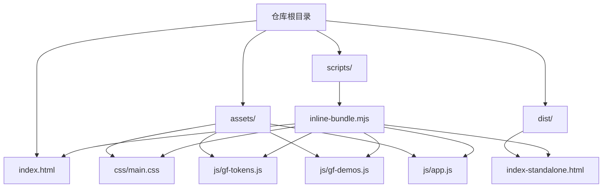
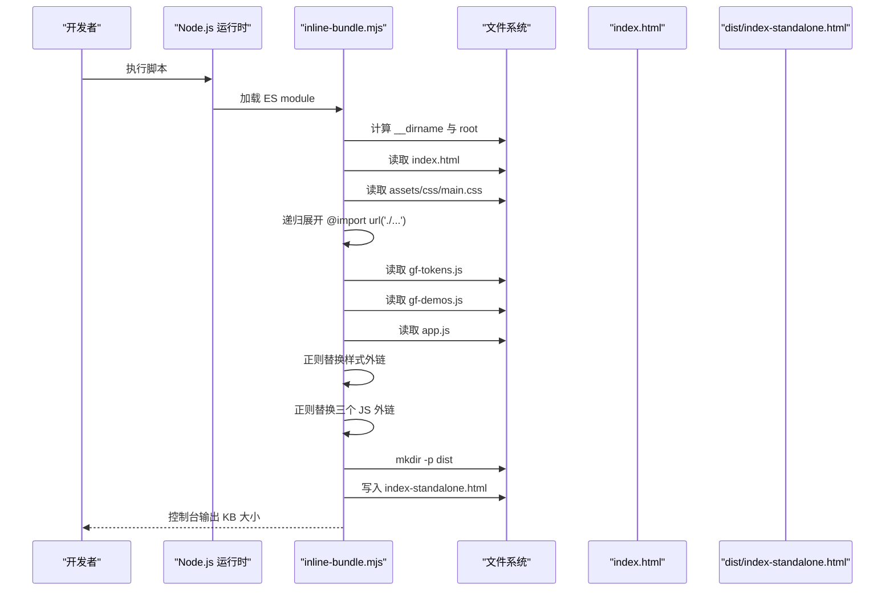
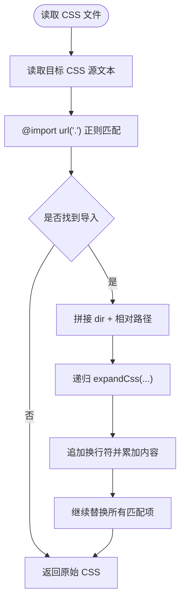
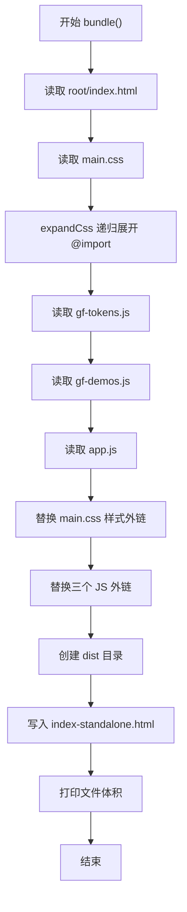

# 构建与打包脚本 API

<cite>
**本文引用的文件 **
- [scripts/inline-bundle.mjs](file://scripts/inline-bundle.mjs)
- [index.html](file://index.html)
- [README.md](file://README.md)
</cite>

## 目录
1. [简介](#简介)
2. [项目结构](#项目结构)
3. [核心组件](#核心组件)
4. [架构总览](#架构总览)
5. [详细组件分析](#详细组件分析)
6. [依赖关系分析](#依赖关系分析)
7. [运行方式](#运行方式)
8. [产物特征](#产物特征)
9. [版本兼容性](#版本兼容性)
10. [故障排查](#故障排查)
11. [结论](#结论)

## 简介
`scripts/inline-bundle.mjs` 是 GoalFlow 的一个 Node.js 构建脚本。它的职责很明确：读取仓库根目录下的 `index.html` 以及 `assets/css/main.css`、`assets/js/gf-tokens.js`、`assets/js/gf-demos.js`、`assets/js/app.js`，把样式和脚本内联到一份独立的 HTML 文件中，最终输出到 `dist/index-standalone.html`。

开发阶段通常直接打开 `index.html`；需要单个独立文件（例如双击运行或部署到 GitHub Pages、Netlify、Nginx 等静态服务器）时，则执行该脚本生成产出物。

## 项目结构
与本脚本直接相关的目录/文件如下：



**图表来源**
- [scripts/inline-bundle.mjs:7-52](file://scripts/inline-bundle.mjs#L7-L52)
- [index.html:1-22](file://index.html#L1-L22)

脚本不会扫描整个 `assets/` 树，而是以硬编码方式处理 `assets/css/main.css` 以及三个 JS 文件；其他 CSS、JS 资产不会被该脚本自动内联。

**节内来源**
- [scripts/inline-bundle.mjs:7-52](file://scripts/inline-bundle.mjs#L7-L52)
- [README.md:78-99](file://README.md#L78-L99)

## 核心组件
`scripts/inline-bundle.mjs` 只导出一个顶层调用：

| 名称 | 类型 | 参数 | 返回值 | 行为说明 |
|---|---|---|---|---|
| `bundle()` | 函数 | 无 | 无 | 读取 HTML 与资源、内联样式和脚本、创建 `dist`、写入 `dist/index-standalone.html`、打印文件大小 |

该文件没有使用命名导出、ES module export 语句，也没有对外暴露 `build()`、`inlineAssets()` 等辅助接口。当前实现以同步函数 `bundle()` 的形式定义后直接调用，因此不能通过 `require('./scripts/inline-bundle.mjs').bundle()` 等方式复用内部逻辑。若希望被其他 Node 模块复用，应显式添加导出语句；现有代码中不存在此类导出。

另外，入口顶部有一行 shebang：

- `#!/usr/bin/env node`

这使 Unix-like 系统可直接执行 `./scripts/inline-bundle.mjs`；Windows 下仍建议显式使用 `node scripts/inline-bundle.mjs`。

**节内来源**
- [scripts/inline-bundle.mjs:1-52](file://scripts/inline-bundle.mjs#L1-L52)

## 架构总览
下图展示构建时的主要数据流：从仓库根路径解析资源，逐步展开 CSS 并加载 JS，最终替换 HTML 中的外链标签并写出单文件。



**图表来源**
- [scripts/inline-bundle.mjs:7-52](file://scripts/inline-bundle.mjs#L7-L52)

## 详细组件分析

### 路径与工作区定位
脚本首先通过 `fileURLToPath(import.meta.url)` 获得当前模块的路径，再用 `path.dirname` 取 `scripts/`，最后 `path.join(__dirname, '..')` 得到仓库根目录 `root`。

这意味着脚本期望在 GoalFlow 仓库的标准目录布局下运行。如果把脚本移动到 `scripts/` 之外，或者把目标项目复制到非标准位置，工作区根就可能解析错误。

**节内来源**
- [scripts/inline-bundle.mjs:7-11](file://scripts/inline-bundle.mjs#L7-L11)

### CSS 展开函数 `expandCss(filePath)`
`expandCss` 的职责是把 `main.css` 中的相对路径 `@import url('./...')` 全部递归展开为合并后的完整 CSS。

核心流程如下：



需要注意的点：

- 该正则仅匹配 `@import url('./rel')` 这种形式；如果 CSS 中使用了引号、空格变体或不相对路径导入，可能不会被递归展开。
- 递归过程中每次匹配都会重新扫描整段文本，复杂度近似为 O(m × n)，其中 m 是匹配次数、n 是 CSS 体积；对少量嵌套的 Googlesource CSS 引用而言足够高效，但不适合深层或大规模嵌套场景。
- 它返回纯字符串，而不是再次走文件系统查找 URL，因此 CDN 地址不会被改写或拉取。

此外，当前仓库的 `assets/css/main.css` 实际负责引入组件样式；CSS 中的 `@import` 链会把多个组件样式合并进主样式。这是该脚本能够把“多文件 CSS”变成“单风格字符串”的关键机制。

**图表来源**
- [scripts/inline-bundle.mjs:13-22](file://scripts/inline-bundle.mjs#L13-L22)

**节内来源**
- [scripts/inline-bundle.mjs:13-22](file://scripts/inline-bundle.mjs#L13-L22)

### 打包函数 `bundle()`
`bundle()` 是整个构建流水线的主函数。其步骤可拆解如下：

#### 1. 读取 HTML 与资源
| 资源 | 输入路径 | 用途 |
|---|---|---|
| `index.html` | `root/index.html` | 作为模板 HTML |
| `assets/css/main.css` | `root/assets/css/main.css` | 通过 `expandCss` 展开后作为 `<style>` 主体 |
| `assets/js/gf-tokens.js` | `root/assets/js/gf-tokens.js` | 作为第一个内联 JS |
| `assets/js/gf-demos.js` | `root/assets/js/gf-demos.js` | 作为第二个内联 JS |
| `assets/js/app.js` | `root/assets/js/app.js` | 作为第三个内联 JS |

当前没有命令行参数解析逻辑。输入源、输出文件名都写死在函数体内；没有传入输出目录、匹配规则或排除列表的方式。

**节内来源**
- [scripts/inline-bundle.mjs:24-41](file://scripts/inline-bundle.mjs#L24-L41)

#### 2. 替换样式外链
脚本用正则匹配：

```regex
/<link rel="stylesheet" href="assets\/css\/main\.css(\?[^"]*)?">/i
```

并把匹配的 `<link>` 替换为包裹展开 CSS 的 `<style>` 块。这里保留了 query string，因此像 `href="assets/css/main.css?v=7.6"` 仍可被替换。

但正则要求 `href=` 的值完全等于 `assets/css/main.css` 加可选查询串；如果将来改为绝对路径、不同文件名、或其他属性顺序，就会失效。

**节内来源**
- [scripts/inline-bundle.mjs:41-46](file://scripts/inline-bundle.mjs#L41-L46)
- [index.html:16-20](file://index.html#L16-L20)

#### 3. 替换 JavaScript 外链
脚本用一个长正则匹配连续三段 `<script src>`：

```regex
src="assets\/js\/gf-tokens\.js"...src="assets\/js\/gf-demos\.js"...src="assets\/js\/app\.js"
```

并把它们替换为一个 `<script>`，按顺序包含 `gf-tokens.js`、`gf-demos.js`、`app.js` 的源代码。这也支持每个文件附带查询串。

同样，这是强耦合的固定匹配。新增 JS、删除 JS 或调整顺序后，需要同步修改这个正则和内联顺序。

**节内来源**
- [scripts/inline-bundle.mjs:43-52](file://scripts/inline-bundle.mjs#L43-L52)

#### 4. 写入输出
输出路径固定为：

1. `root/dist`
2. `root/dist/index-standalone.html`

脚本先用 `fs.mkdirSync(outDir, { recursive: true })` 确保 `dist` 存在，然后直接用 `fs.writeFileSync` 覆盖写入。

**节内来源**
- [scripts/inline-bundle.mjs:48-51](file://scripts/inline-bundle.mjs#L48-L51)

#### 5. 控制台输出
最后计算 UTF-8 字节长度并输出：

```text
Wrote <outFile> (<kb> KB)
```

例如在本地运行后通常会看到类似信息，用于确认输出位置和大致体积增长。

**节内来源**
- [scripts/inline-bundle.mjs:51-52](file://scripts/inline-bundle.mjs#L51-L52)

### 整体流程图
下面是 `bundle()` 的端到端控制流：



**图表来源**
- [scripts/inline-bundle.mjs:24-52](file://scripts/inline-bundle.mjs#L24-L52)

**节内来源**
- [scripts/inline-bundle.mjs:24-52](file://scripts/inline-bundle.mjs#L24-L52)

## 依赖关系分析

### 使用的内置模块
| 模块 | 用途 | 是否默认可用 |
|---|---|---|
| `fs` | 同步读 HTML/CSS/JS，同步写文件，同步创建目录 | 是 |
| `path` | 组合 `__dirname`、`root`、HTML 路径、CSS 路径、输出路径 | 是 |
| `url` | 提供 `fileURLToPath`，将 ES module 的 URL 转为文件系统路径 | 是 |
| `fs/promises` | **未使用** | — |
| `fs.createWriteStream` | **未使用** | — |

虽然需求描述中提到“dataURI / base64 编码”和“fs/promises、createWriteStream”，但该脚本并未使用这些机制：

- CSS 和 JS 都以 UTF-8 字符串形式直接内联，不做 base64 或 data URI 编码。
- 磁盘 I/O 全部采用同步方法：`fs.readFileSync`、`fs.writeFileSync`、`fs.mkdirSync`。
- 没有 `fs/promises` 或 `fs.createWriteStream`。

因此，这里的“基础 I/O 语义”更准确的描述是：**同步文件读写 + 目录创建**。

**节内来源**
- [scripts/inline-bundle.mjs:7-52](file://scripts/inline-bundle.mjs#L7-L52)

### 对仓库结构的隐性约定
脚本隐式依赖以下文件必须存在：

- `index.html`
- `assets/css/main.css`
- `assets/js/gf-tokens.js`
- `assets/js/gf-demos.js`
- `assets/js/app.js`

只要任一缺失，`readFileSync` 就会抛出异常，导致构建失败。

**节内来源**
- [scripts/inline-bundle.mjs:24-48](file://scripts/inline-bundle.mjs#L24-L48)

## 运行方式

### 基本命令
在项目根目录执行：

```bash
node scripts/inline-bundle.mjs
```

Unix-like 上也可使用：

```bash
./scripts/inline-bundle.mjs
```

### 支持的参数
当前脚本 **没有解析任何命令行参数**，包括：

| 常见参数期望 | 是否支持 | 说明 |
|---|---:|---|
| `--output` | 否 | 输出路径始终写死为 `dist/index-standalone.html` |
| `--input` | 否 | 输入 HTML 始终是 `index.html` |
| `--dir` / `--assets-dir` | 否 | 资源路径基于 `path.join(__dirname, '..')` 计算 |
| `--match` / `--glob` | 否 | 不使用 glob，也不扫描文件树 |
| `--minify` | 否 | 不进行压缩 |
| `--data-uri` | 否 | 不进行 base64/data URI 编码 |

若未来需要支持这些选项，应先增加参数解析层，再把硬编码路径拆成可配置字段。

**节内来源**
- [scripts/inline-bundle.mjs:24-52](file://scripts/inline-bundle.mjs#L24-L52)

### 开发工作流
1. 正常开发时使用 `index.html` 配合 `assets/` 目录。
2. 修改了 `assets/css/main.css`、`assets/js/gf-tokens.js`、`assets/js/gf-demos.js`、`assets/js/app.js` 后，需要重新执行：

```bash
node scripts/inline-bundle.mjs
```

3. 然后在浏览器中打开 `dist/index-standalone.html` 验证独立版效果。
4. 如果只想部署到静态服务器，可以把 `dist/index-standalone.html` 直接上传；如果仍需保留开发时的外链模式，则继续操作原 `index.html` 与 `assets/`。

### 部署方式
推荐把 `dist/index-standalone.html` 作为唯一 HTML 资源部署到：

- GitHub Pages
- Netlify
- Vercel
- Nginx 静态站点
- 任意静态 Web 服务

注意：脚本生成的 HTML 仍然会引用 Google Fonts CDN，并非把所有字体都内联成 base64。

**节内来源**
- [README.md:84-103](file://README.md#L84-L103)
- [index.html:6-15](file://index.html#L6-L15)

## 产物特征

### 优点
- 单一 HTML 文件，便于直接双击运行和快速分发。
- 不再依赖本地 `assets/` 目录即可运行独立版。
- CSS 通过递归展开合并，减少了 HTTP 请求数量。
- JS 顺序保持不变，`gf-tokens.js` → `gf-demos.js` → `app.js` 的顺序符合应用初始化依赖。

### 体积变化
原始 `index.html` 只引用外部资源；独立版会包含：

- 全部样式代码（含展开的 CSS）
- 全部 JS 源码

因此 HTML 体积会显著增大，但浏览器无需再请求这些静态文件。

### 外部资源依赖
根据 `index.html` 的内容，字体仍来自：

- `https://fonts.googleapis.com`
- `https://fonts.gstatic.com`

这意味着 `dist/index-standalone.html` 不是完全离线资源包；它能减少 JS/CSS 请求，但无法绕过字体 CDN。

**节内来源**
- [scripts/inline-bundle.mjs:24-52](file://scripts/inline-bundle.mjs#L24-L52)
- [index.html:6-15](file://index.html#L6-L15)
- [README.md:33-37](file://README.md#L33-L37)

## 版本兼容性

### ES Module 语法
脚本使用 `.mjs` 后缀和 ES module import 语法：

```javascript
import fs from 'fs'
import path from 'path'
import { fileURLToPath } from 'url'
```

因此运行环境必须支持 ES module，且允许在 `.mjs` 中使用 `import.meta.url`。

### Node.js 内置 API
脚本使用的都是长期可用的 Node.js built-in：

- `fs.readFileSync`
- `fs.writeFileSync`
- `fs.mkdirSync`
- `path.dirname`
- `path.join`
- `url.fileURLToPath`

这些 API 不需要较新的 Stage 提案，也不需要启用实验标志。不过 `.mjs` 支持和 `import.meta.url` 至少需要 Node.js 的 ES module 支持已经稳定的版本。

### README 声明
本仓库 README 明确说明：`node scripts/inline-bundle.mjs` 可用于生成单文件 HTML。文档建议遵循项目约定的 Node.js 运行环境；本项目没有单独的 engine 或 package.json 要求，因此应与团队实际使用的 Node.js 版本保持一致。

建议最低满足：

- 支持 ES module（`.mjs`）
- 支持 `import.meta.url`
- 可使用上述同步 fs 方法

如果需要官方最严格的 Node 最低版本范围，应查看项目的 `package.json`、GitHub Actions、CI 配置等；就本脚本本身而言，不依赖 `fs/promises` 或 `createWriteStream`。

**节内来源**
- [scripts/inline-bundle.mjs:7-11](file://scripts/inline-bundle.mjs#L7-L11)
- [scripts/inline-bundle.mjs:24-52](file://scripts/inline-bundle.mjs#L24-L52)
- [README.md:96-99](file://README.md#L96-L99)

## 故障排查

### EACCES 权限问题
如果在类 Unix 系统中执行 `./scripts/inline-bundle.mjs` 时报 `EACCES`，通常是脚本缺少可执行权限。解决方案：

```bash
chmod +x ./scripts/inline-bundle.mjs
```

或者继续用 `node scripts/inline-bundle.mjs` 执行。

**节内来源**
- [scripts/inline-bundle.mjs:1-1](file://scripts/inline-bundle.mjs#L1-L1)

### `dist` 目录不存在
脚本会通过 `fs.mkdirSync(outDir, { recursive: true })` 创建 `dist`。如果你看到的是“无法写入文件”的错误，更常见的原因是：

- `dist` 是一个普通文件而非目录
- 用户无权向仓库根写入
- Windows 上 `dist/index-standalone.html` 正被编辑器或浏览器占用

**节内来源**
- [scripts/inline-bundle.mjs:48-51](file://scripts/inline-bundle.mjs#L48-L51)

### `assets` 路径偏移
路径是由 `__dirname` 推导出 `root`，再 `path.join(root, '...')` 构造的。所以只要：

- 脚本位于 `scripts/`
- HTML/CSS/JS 仍在预期路径

就不会出现路径问题。常见问题场景：

- 移动了脚本位置，但没有改 `root` 构造逻辑。
- 复制脚本到其他项目时忘了同时复制 `index.html` 与 `assets/`。
- 改变了 `index.html` 中样式或 JS 的文件名。

**节内来源**
- [scripts/inline-bundle.mjs:7-11](file://scripts/inline-bundle.mjs#L7-L11)
- [scripts/inline-bundle.mjs:24-48](file://scripts/inline-bundle.mjs#L24-L48)

### 产出 HTML 无法被浏览器解析
如果出现语法错误或空白页面，优先检查：

1. HTML 中原先的内联 CSS 区域是否已被正确替换。
2. `main.css` 中是否存在未被递归展开的相对路径 `@import`。
3. 三个 JS 是否按正确顺序插入一个 `<script>` 中。
4. CSS 或 JS 是否包含 HTML 特殊字符，而这些字符原本由浏览器分片解析、现在却在内联上下文中影响 DOM。

由于当前脚本只做简单字符串替换，不涉及 AST 级别重构，因此维护正则时务必保证前后 HTML 语法完整。

**节内来源**
- [scripts/inline-bundle.mjs:41-46](file://scripts/inline-bundle.mjs#L41-L46)
- [scripts/inline-bundle.mjs:43-52](file://scripts/inline-bundle.mjs#L43-L52)

### 字体加载慢或被墙
`index.html` 预连接并加载 Google Fonts，而 `inline-bundle.mjs` 不会把字体嵌入 HTML。因此：

- 字体加载慢 ≠ 脚本出错
- CDN 不可用时字体回退系统字体，不影响应用基本功能
- 若需要完全离线字体，应在前端处理字体资源（例如内联 base64），而不是依赖该脚本

**节内来源**
- [index.html:6-15](file://index.html#L6-L15)
- [README.md:33-37](file://README.md#L33-L37)

### 新增 CSS 或 JS 后没有生效
该脚本没有动态扫描能力。如果新增：

- 新的 `assets/css/*.css`
- 新的 `assets/js/*.js`

需要手动扩展：

1. 在 `expandCss` 调用的 CSS 链中包含该文件。
2. 在 `bundle()` 中新增 `readFileSync` 与对应的内联位置。
3. 必要时更新替换正则。

当前只处理 `main.css` 以及三个已知 JS 文件，不会发现“未知的新文件”。

**节内来源**
- [scripts/inline-bundle.mjs:24-52](file://scripts/inline-bundle.mjs#L24-L52)

## 结论
`scripts/inline-bundle.mjs` 是一个轻量、确定性的 HTML 内联脚本。它适合 GoalFlow 当前的稳定结构：以 `index.html` 为壳，以 `assets/css/main.css` 为主样式入口，并以三个固定 JS 文件组成应用逻辑。

它的优点是简单直观；代价是扩展性有限——没有参数解析、没有文件树扫描、没有 data URI 编码，也没有对外导出的函数接口。如果需要更强壮的打包体验，可在此脚本基础上增加：

- CLI 参数解析
- 资源清单或 glob 匹配
- 可选压缩
- 可选 base64 内联
- 对 `bundle()` 的命名导出
- 对输入源的可配置化

但在当前版本中，最佳实践是保持仓库结构不变，按 `node scripts/inline-bundle.mjs` 的规则运行，并在修改 `assets/css/main.css` 或 `assets/js/*` 后手动重建独立版。