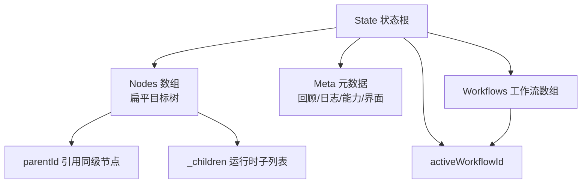
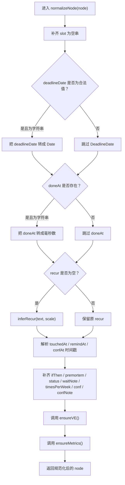
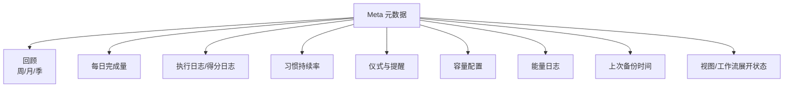
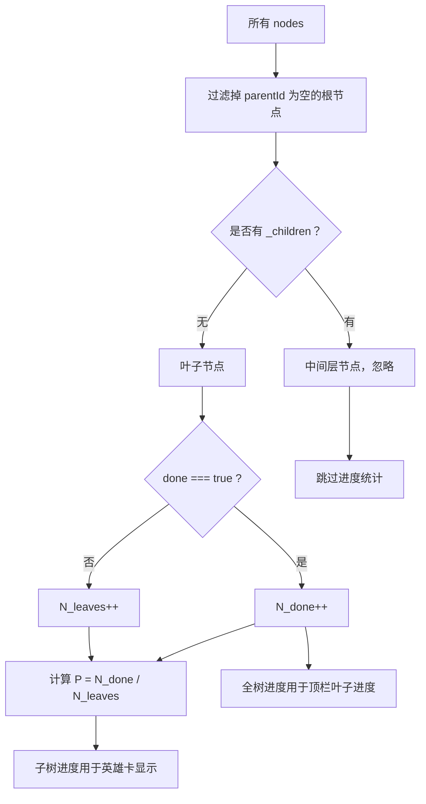
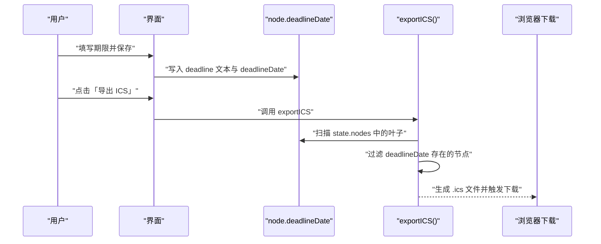

# 目标节点（node）与元数据（meta）数据模型

<cite>
**本文引用的文件**   
- [README.md](file://README.md)
- [PROGRESS-ROLLUP.md](file://docs/PROGRESS-ROLLUP.md)
- [assets/js/app.js](file://assets/js/app.js)
</cite>

## 目录

1. [引言](#引言)
2. [核心状态形状](#核心状态形状)
3. [扁平化 node 对象完整字段](#扁平化-node-对象完整字段)
4. [节点值与估算的约束规则](#节点值与估算的约束规则)
5. [load-time 归一化规则 normalizeNode()](#load-time-归一化规则-normalizenode)
6. [元数据 meta 对象字段语义](#元数据-meta-对象字段语义)
7. [完成度 rollup：从叶子到父节点的进度聚合](#完成度-rollup从叶子到父节点的进度聚合)
8. [常见操作流程](#常见操作流程)
9. [关系完整性与校验](#关系完整性与校验)
10. [错误降级与调试建议](#错误降级与调试建议)
11. [附录：JSON 实例说明](#附录像-json-实例说明)

## 引言

GoalFlow 把用户粘贴的目标文本、手工编辑和自动解析结果，统一收敛为一份“扁平化的节点数组 + 元数据对象”。所有可视化、评分、日历导出、备份恢复都依赖这套数据契约。

其高层结构是：

- `nodes`：所有节点按祖先 → 后代的顺序排列，通过 `parentId` 建立树形关系；运行时会把相同父节点的节点缓存进 `_children`，以加速树遍历。
- `meta`：与某个工作流 / 应用会话相关的全局记录，如周回顾、每日完成量、精力日志、容量配置、图表尺度、仪式设置等。

注意：文档中的 `repeat` 字段在实现里对应的是 `recur`（`false` 表示普通待办，`true` 表示日课 / 周报一类可推断重复习惯的任务）。`repeat` 在持久格式中不出现，但可读作“是否推断出循环任务”。

**本节来源**
- [README.md:1-103](file://README.md#L1-L103)
- [assets/js/app.js:1374-1380](file://assets/js/app.js#L1374-L1380)
- [assets/js/app.js:450-460](file://assets/js/app.js#L450-L460)

## 核心状态形状

系统加载后的根状态可以抽象为：

| 路径 | 类型 | 含义 |
|---|---|---|
| `state.nodes` | `GoalNode[]` | 当前工作流下的扁平节点列表 |
| `state.meta` | `MetaObject` | 元数据：回顾、日志、设置、时间戳 |
| `state.workflows` | `Workflow[]` | 项目 / 工作流集合，每个工作流有自己的 `nodes` |
| `state.activeWorkflowId` | `string|null` | 当前激活的工作流标识 |
| `state.scale` | `"all"|"day"|"week"|"month"` | 当前时间尺度 |
| `state.topId` | `string|null` | “英雄卡”所选任务的 id |
| `state.topPin` | `string|null` | 当前固定置顶任务的 id |



**图表来源**
- [assets/js/app.js:1374-1380](file://assets/js/app.js#L1374-L1380)
- [assets/js/app.js:1228-1230](file://assets/js/app.js#L1228-L1230)
- [assets/js/app.js:158-167](file://assets/js/app.js#L158-L167)

**本节来源**
- [assets/js/app.js:1228-1230](file://assets/js/app.js#L1228-L1230)
- [assets/js/app.js:1374-1380](file://assets/js/app.js#L1374-L1380)
- [assets/js/app.js:158-167](file://assets/js/app.js#L158-L167)

## 扁平化 node 对象完整字段

下面只列出“一个有效 node 可能出现的字段”，并说明其职责。实际 JSON 中不必保留全部空字段；`normalizeNode()` 会在读取时补齐。

| 字段 | 类型 | 默认行为或约束 | 说明 |
|---|---|---|---|
| `id` | `string` | 必须存在且在全局唯一 | 节点主键；用于定位、父子链接、撤销操作和目标链追踪 |
| `text` | `string` | 空字符串 | 人类可读的目标 / 任务名称；会被用来推断重要性、紧急性、估时、是否循环任务 |
| `parentId` | `string|null` | 新节点无父节点 | 指向同一 `nodes` 数组中另一个节点的 id；为空表示根节点（例如年度总目标） |
| `im` | `number` | `3` | 重要性 1–5；由四象限或 SMART 检查影响计算 |
| `ur` | `number` | `3` | 紧急性 1–5；越接近截止日期越大 |
| `val` | `number|null` | 缺失时用 `im` 补齐 | 价值维度数值 1–5 |
| `eff` | `number|null` | 缺失时基于 text/ur 启发式 + clamp 到 1–5 | 费力程度 1–5，决定 value-effort 分类 |
| `role` | `string` | 空字符串 | 角色标记，如 `O`、`KR`、`habit` |
| `targetNum` | `number|null` | 缺失时为 null | 量化目标总数 |
| `targetDone` | `number` | `0` | 已完成次数 |
| `deadline` | `string` | 空字符串 | 原始期限文案，例如 “周五前” |
| `deadlineDate` | `Date|string|null` | 缺失则为 null | 解析后的截止时刻；序列化时存为毫秒时间戳 |
| `daysLeft` | `number?` | 纯派生 | 运行期重算的剩余天数，不在存储格式保存 |
| `overdue` | `boolean` | false | 是否逾期 |
| `done` | `boolean` | `false` | 是否完成 |
| `doneAt` | `number|string|null` | 未完成的分支写 null | 完成时间戳；兼容历史字符串时间 |
| `touchedAt` | `number|string|null` | null | 最近被关注 / 触达的时间 |
| `estimateMinutes` | `number|null` | leaf 缺省时补为 30 | 计划分钟，0–999；可从 text 解析 |
| `actualMinutes` | `number|null` | null | 实际分钟，0–9999 |
| `recur` | `boolean` | 通过 `inferRecur(text, scale)` 推断 | 是否被识别为循环任务 |
| `scale` | `string|null` | 空或来自上下文 | `day`/`week`/`month`/`all` 等尺度上下文 |
| `slot` | `string` | 空字符串 | 时段槽位，比如小时块编号 |
| `ifThen` | `string` | 空字符串 | “如果……我就……”的执行意图 |
| `premortem` | `string` | 空字符串 | 事前验尸假设 |
| `status` | `string` | 空字符串 | 自定义状态 |
| `waitNote` | `string` | 空字符串 | 等待他人备注 |
| `timesPerWeek` | `number` | `0` | 每周次数；从 “每周 N 次” 文本解析 |
| `conf` | `number` | `0` | 信心值 0–5 |
| `confNote` | `string` | 空字符串 | 信心备注 |
| `confAt` | `number|string|null` | null | 信心打分时间戳 |
| `source` | `string` | 空字符串 | 数据导入来源标记 |
| `dropped` | `boolean` | false | 是否被晚总结放弃 / 丢弃 |
| `_manualIm` | `boolean` | false | 是否手动调整过 importance |
| `_manualUr` | `boolean` | false | 是否手动调整过 urgency |
| `_children` | `GoalNode[]` | 运行期缓存 | 运行时填充的同级子节点；不是可靠的外部输入字段 |

其中，`val` 的数值分类进一步映射到一个四维类别：

| 分类 | `val` | `eff` | 语义 |
|---|---|---|---|
| `quick` | ≥ 4 | ≤ 2 | 快速赢：高价值、低费力 |
| `major` | ≥ 4 | ≥ 3 | 主战役：高价值、高费力 |
| `easy` | ≤ 2 | ≤ 2 | 顺手活：低价值、低费力 |
| `trap` | ≤ 2 | ≥ 3 | 陷阱：低价值、高费力 |

中间值不会落入该映射边界；分类函数用 `val≥4` 与 `eff≥3` 划分四个象限。

**本节来源**
- [assets/js/app.js:45-75](file://assets/js/app.js#L45-L75)
- [assets/js/app.js:169-195](file://assets/js/app.js#L169-L195)
- [assets/js/app.js:450-460](file://assets/js/app.js#L450-L460)
- [assets/js/app.js:1861-1897](file://assets/js/app.js#L1861-L1897)

## 节点值与估算的约束规则

### ensureVE()

`ensureVE(node)` 负责保证价值与费力字段落在 1–5 范围内，并在缺失时补默认值。

规则：

1. 如果 `val` 为 `null`，则赋值为 `clamp(im, 1, 5)`。也就是说，初始价值默认等于重要性。
2. 如果 `eff` 为 `null`：
   - 若文本中包含 “只需 / 顺手 / 简单 / 5分钟 / 十分钟” 等提示词，推测费力为 2。
   - 若文本中包含 “复杂 / 深度 / 重构 / 搭建 / 体系” 等提示词，推测费力为 4。
   - 如果紧急性很高（`ur ≥ 4`），费力至少为 4。
   - 如果紧急性较低（`ur ≤ 2`），费力为 2。
   - 最终对估计值做 `clamp(eff, 1, 5)`。
3. 最后再对 `val` 和 `eff` 做一次强制 clamp，防止外部脏数据。

复杂度分析：

- 时间复杂度：O(L)，L 为文本长度（正则扫描）。
- 空间复杂度：O(1)。

优化机会：

- 预编译常用正则。
- 将短标签匹配转为白名单集合，减少正则开销。

**本节来源**
- [assets/js/app.js:49-60](file://assets/js/app.js#L49-L60)

### isQuickWin()

`isQuickWin(node)` 判断是否是快速赢任务：

- `val ≥ 4`
- `eff ≤ 2`

它是一个纯函数，不修改任何状态。

用途：筛选、周回顾叙述和优先策略辅助；它不影响叶子完成百分比的分母。

**本节来源**
- [assets/js/app.js:61](file://assets/js/app.js#L61)
- [assets/js/app.js:4474-L4475](file://assets/js/app.js#L4474-L4475)

### inferRecur()

`inferRecur(text, scale)` 根据任务文案和时间尺度推断是否应该视为循环任务：

| 文案特征 | 推断 |
|---|---|
| 每天 / 每日 / 天天 / 日课 / 日更 / 晨间 / 晚间习惯 | `true` |
| 每周 / 周报 / 周会 / 每星期 / 双周 / 周 N 次 | `true` |
| `scale === 'day'` 且包含 “固定数字 / 时段 / 集中回复” | `true` |
| `scale === 'week'` 且包含 “例行 / 周期” | `true` |

其余情况返回 `false`。

**本节来源**
- [assets/js/app.js:38-44](file://assets/js/app.js#L38-L44)
- [assets/js/app.js:1865](file://assets/js/app.js#L1865)

### estimate 解析与 ensureEstimate()

`parseEstimateMinutes(text)` 支持多种形式：

| 输入片段 | 输出分钟数 |
|---|---|
| “X 小时” | `Math.round(X × 60)` |
| “X 分钟” 或 “X min” | `X` |
| “半天” | 240 |
| “5 分钟 / 五分钟” | 5 |
| 其他 | `null` |

`ensureEstimate(node, isLeaf)` 的规则：

1. 如果 `estimateMinutes` 为空，先从 `text` 解析。
2. 解析不到且是叶子节点时，赋默认 30 分钟。
3. `estimateMinutes` 非空时对 0–999 范围做 clamp。
4. `actualMinutes` 非空时对 0–9999 范围做 clamp。
5. 解析不到仍允许保持 `null`，表示未预估。

`ensureAllEstimates()` 使用懒计算（内部 tick）避免每次渲染都重新扫描所有节点。

**本节来源**
- [assets/js/app.js:169-195](file://assets/js/app.js#L169-L195)

## load-time 归一化规则 normalizeNode()

`normalizeNode(n)` 在以下场景被调用：

- 从 localStorage 恢复节点。
- 导入旧的扁平 JSON 备份。
- 导入旧版工作流时的节点映射。

核心处理流程如下：



关键行为清单：

| 操作 | 规则 |
|---|---|
| `slot` | 缺失时补空字符串 |
| `deadlineDate` | 如果是字符串，转为 `Date` |
| `doneAt` | 如果是字符串，转为毫秒数 |
| `touchedAt` / `remindAt` / `confAt` | 如果是字符串，转为毫秒数；缺失时写 null |
| `recur` | 缺失则通过 `inferRecur(text, scale)` 推断 |
| `ifThen` / `premortem` / `status` / `waitNote` | 缺失时补空字符串 |
| `timesPerWeek` | 从 “每周 N 次 / 一周 N 次” 解析 |
| `conf` | 缺失时补 0 |
| `confNote` | 缺失时补空字符串 |
| `createdAt` | 缺失时写 null（而不是自动生成当前时间）——只有工厂新建节点才带 `Date.now()` |
| 最后 | 调用 `ensureVE()`、`ensureMetrics()` |

注意：`deadLine` 不是标准字段名；系统中主要使用的是 `deadline`（原始文本）和 `deadlineDate`（解析后的日期）。解析逻辑同时消费二者：

- `deadline` 作为人类可读文案保留。
- `deadlineDate` 作为计算依据（逾期、剩余天数、ICS 导出、节奏评估等）。
- `daysLeft`、`overdue` 是 `recomputeSchedule` 在载入后重新计算的派生值，不在存储格式中出现。

复杂度：

- 每次 normalize 最多进行若干次正则匹配和一次 `ensureVE`。
- 整体仍是 O(T+R)，T 为文本总长度，R 为规则数量。

**图表来源**
- [assets/js/app.js:1861-1880](file://assets/js/app.js#L1861-L1880)
- [assets/js/app.js:169-178](file://assets/js/app.js#L169-L178)
- [assets/js/app.js:38-48](file://assets/js/app.js#L38-L48)

**本节来源**
- [assets/js/app.js:1861-1880](file://assets/js/app.js#L1861-L1880)
- [assets/js/app.js:1861-1880](file://assets/js/app.js#L1861-L1880)

## 元数据 meta 字段语义

`meta` 不是节点本身，而是“这个项目 / 会话的附加记录”。它是通过本地持久化合并得到的，因此既有历史字段，也有初始化兜底字段。

| 字段 | 类型 | 语义 |
|---|---|---|
| `weekReviews` | `ReviewItem[]` | 周回顾历史记录，每条含 `week` 或 `period`、统计摘要、行动草稿等 |
| `monthReviews` | `ReviewItem[]` | 月度回顾历史 |
| `quarterReviews` | `ReviewItem[]` | 季度回顾历史 |
| `bannerDismissedWeek` | `string` | 本周提醒横幅已关闭的周键 |
| `dailyCompletions` | `Record<YYYY-MM-DD, number>` | 每日完成任务计数 |
| `executionLog` | `Record<YYYY-MM-DD, DayLog>` | 执行流水日志，含条目、按工作流汇总和当日完成计数 |
| `habitStreaks` | `Record<workflowId|nodeId, Streak>` | 习惯连续打卡记录 |
| `alarmFired` | `Record<string, boolean>` | 提醒已触发状态，避免同一天重复弹出 |
| `scoreLog` | `Record<string, ScoreEntry>` | 每项工作或每日自动评分记录 |
| `dayNotes` | `Record<string, string>` | 每日笔记 |
| `ritual` | `{ morning:string, evening:string, on:boolean }` | 早晚仪式闹钟设置 |
| `pendingActions` | `ActionItem[]` | 待确认行动（如周回顾自动生成的下一步） |
| `weekPlans` | `Record<weekKey, WeekPlanData>` | 大石头周计划 |
| `energyLog` | `Record<YYYY-MM-DD, EnergyBucket>` | 早/午/晚三段五级能量日志 |
| `inbox` | `any[]` | 收集箱暂存内容 |
| `planShare` | `object` | 分享计划快照 |
| `eveningDispo` | `Record<key, string>` | 晚总结处置决策状态 |
| `goodThings` | `Record<string, any>` | 三件好事记录 |
| `wfExpanded` | `Record<string, boolean>` | 各工作流展开状态 |
| `lastBackupAt` | `number` | 最近一次成功导出的时间戳 |
| `chartScale` | `any` | 图表尺度或视图尺度设置（具体值依组件而定） |
| `ritualHistory` | `any[]` | 仪式历史记录（不同界面或版本可能写入） |

需要注意的是，代码中并没有一个名为 `capacity` 的一级属性；容量通常通过 `meta.capacity` 访问，或者为了兼容性直接从 `meta[workflowId]` 读取。该结构是一个对象，可以包含：

| capacity 子字段 | 类型 | 含义 |
|---|---|---|
| `daysPerWeek` | number | 每周工作日数量 |
| `hoursPerDay` | number | 平均每天小时数 |
| `workdayHours` | number | 全局工作日日均时长 |
| `globalWorkdayHours` | number | 全局工作日总时长 |
| `globalWeekendHours` | number | 全局周末总时长 |
| `otherUsage` | object | 其他项目占用信息 |

此外，`meta` 在初始化时还确保以下嵌套结构存在：

- `executionLog`
- `habitStreaks`
- `alarmFired`
- `scoreLog`
- `dayNotes`
- `ritual`
- `pendingActions`
- `weekPlans`
- `energyLog`
- `inbox`
- `planShare`
- `eveningDispo`
- `goodThings`

这样上层逻辑可以直接读写这些字段，而不必每次都判空。



**图表来源**
- [assets/js/app.js:5266-5275](file://assets/js/app.js#L5266-L5275)
- [assets/js/app.js:245-264](file://assets/js/app.js#L245-L264)
- [assets/js/app.js:5585-5605](file://assets/js/app.js#L5585-L5605)

**本节来源**
- [assets/js/app.js:1228-1230](file://assets/js/app.js#L1228-L1230)
- [assets/js/app.js:245-264](file://assets/js/app.js#L245-L264)
- [assets/js/app.js:5266-5275](file://assets/js/app.js#L5266-L5275)
- [assets/js/app.js:3713-3754](file://assets/js/app.js#L3713-L3754)
- [assets/js/app.js:5585-5605](file://assets/js/app.js#L5585-L5605)

## 完成度 rollup：从叶子到父节点的进度聚合

GoalFlow 明确约定：**只有叶子节点计入完成进度**。根节点和有子节点的中间层上的勾选不会直接贡献分母。

定义：

- **叶子**：`parentId` 存在且非空，并且 `_children.length === 0`。
- **全树叶子进度**：在所有叶子中，`done === true` 的数量除以叶子总数，向上取整百分比显示在顶栏。
- **子树叶子进度**：以某节点为根的子树内，所有叶子完成数量的比例。

重要约束：

- 根节点不计入完成百分比。
- 有子节点的中间节点不计入完成百分比。
- 被聚焦模式过滤掉的节点仍参与完整树的叶子统计——统计基于完整的 `state.nodes`。
- 完成时间戳写在 `doneAt`；取消完成时清空它。
- “本周完成”只统计 `done === true` 且 `doneAt` 落在本周一到下周一下之前的叶子。
- `estimateMinutes` 和 `actualMinutes` 不参与完成百分比，仅用于容量与周回顾预估对比。

因此，Progress Rollup 的核心公式可以表达为：

$$P = \frac{N_{\text{done}}}{N_{\text{leaves}}}$$

其中：

- $N_{\text{leaves}}$：满足叶子条件的节点数。
- $N_{\text{done}}$：其中 `done === true` 的节点数。



**图表来源**
- [docs/PROGRESS-ROLLUP.md:1-37](file://docs/PROGRESS-ROLLUP.md#L1-L37)
- [assets/js/app.js:665-678](file://assets/js/app.js#L665-L678)

虽然节点对象的 `score` 字段没有在标准化 node 工厂里显式创建，但从业务角度看它通常是“该项自动评分”的记录载体。实际的滚动聚合接口由两个函数提供：

- `leafProgress()`：全树叶子完成比。
- `subtreeProgress(node)`：任意节点子树内的叶子完成比。

它们并不改变单个 node 的存储值，而是实时计算。

**本节来源**
- [docs/PROGRESS-ROLLUP.md:1-37](file://docs/PROGRESS-ROLLUP.md#L1-L37)
- [assets/js/app.js:354-363](file://assets/js/app.js#L354-L363)
- [assets/js/app.js:665-678](file://assets/js/app.js#L665-L678)
- [assets/js/app.js:1994-2003](file://assets/js/app.js#L1994-L2003)
- [assets/js/app.js:5535-5550](file://assets/js/app.js#L5535-L5550)

## 常见操作流程

### 新增节点

推荐走 `newNode(partial)` 工厂函数，这样可以保证所有字段都有一致初始值，例如：

- 新节点 `im`、`ur` 默认 3。
- `val`、`eff` 初始为 null，随后由 `ensureVE()` 推导。
- `createdAt` 默认为 `Date.now()`。
- `done` 默认 `false`。
- `parentId` 可为空（根）或已有父节点 id。

注意：`parent` 指针是单向引用，`children` 在运行时由 `_children` 维护。

**本节来源**
- [assets/js/app.js:450-460](file://assets/js/app.js#L450-L460)
- [assets/js/app.js:1878-1880](file://assets/js/app.js#L1878-L1880)

### 更新 done

直接对节点写：

- 设置 `node.done = true`
- 设置 `node.doneAt = Date.now()`
- 如果有 `estimateMinutes` 且没有 `actualMinutes`，会将其设为计划分钟
- 如果该节点位于当前 top 任务链中，设置 `touchedAt = Date.now()`
- 随后调用 `save()` 和 `afterChange()` 持久化和重算

批量更新应逐个调用此逻辑，或使用工具提供的树编辑器操作，以免漏写 `doneAt`、`touchedAt` 等状态。

**本节来源**
- [assets/js/app.js:354-363](file://assets/js/app.js#L354-L363)

### 调整 im / ur

直接修改 `node.im` 或 `node.ur` 即可；后续渲染会通过 focus score 与四象限分类重新计算布局、颜色、优先级。

建议同步标记 `node._manualIm` 或 `node._manualUr`，以避免算法覆盖用户手动校准的结果。

**本节来源**
- [assets/js/app.js:454-460](file://assets/js/app.js#L454-L460)

### 设置 deadlineDate 以触发 ICS 导出

ICS 导出只包含以下条件都满足的叶子：

1. 是叶子：`parentId` 存在且 `_children.length === 0`。
2. `deadlineDate` 存在且合法。

典型操作链：



**图表来源**
- [assets/js/app.js:5568-5582](file://assets/js/app.js#L5568-L5582)

如果没有带期限的叶子，`exportICS` 会提示用户先补充期限。

**本节来源**
- [assets/js/app.js:5568-5582](file://assets/js/app.js#L5568-L5582)

### 批量导入外部 JSON

有两种常见导入路径：

| 入口 | 处理方式 |
|---|---|
| 顶部工具栏的“恢复”按钮或 `<input type="file">` | 调用 `importBackup(file)` |
| 从旧版本扁平备份恢复 | 解析 JSON，如果主体是数组，则映射为 `nodes` |
| 新版工作流备份 | 解构出 `workflows`、`nodes`、`meta`、`viewMode` 等 |

导入时还会：

- 对工作流进行 `normalizeWorkflowMeta`。
- 对所有节点执行 `map(normalizeNode)`。
- 确保 workflows 与 active workflow。
- 对 old 格式再次 `recomputeSchedule`。
- 把外部 `data.meta` 浅合并进现有 `state.meta`。
- 更新并保存 `lastBackupAt`（导出备份时）。

**本节来源**
- [assets/js/app.js:5395-5401](file://assets/js/app.js#L5395-L5401)
- [assets/js/app.js:5607-5640](file://assets/js/app.js#L5607-L5640)
- [assets/js/app.js:6786-6797](file://assets/js/app.js#L6786-L6797)

## 关系完整性与校验

### node.id 必须唯一

`id` 是所有操作的主键：查找、撤销、top chain、焦点、ICS 事件关联等都依赖它。重复 id 会导致：

- `byId` 只找到第一个。
- 树缓存 `_children` 行为不一致。
- 删除、置顶、撤销操作可能影响错误的节点。

验证建议：

```js
const ids = [];
for (const n of state.nodes) {
  ids.push(n.id);
}
const unique = new Set(ids);
if (unique.size !== ids.length) {
  console.error("检测到重复 node.id:", unique, "与", ids);
}
```

### parentId 引用必须在同一个 nodes 数组内有效

`parentId` 只是一个字符串；应用不会自动校验它是否存在。无效引用可能导致：

- 根判定异常。
- 父子树构建异常。
- `goldChainIds` 中断。
- 删除整棵子树时遗漏。
- `isUnderTopNode` 误判。

验证思路：

```js
for (const node of state.nodes) {
  if (node.parentId == null) continue;
  const parent = state.nodes.find(p => p.id === node.parentId);
  if (!parent) {
    console.warn(`node ${node.id} 的 parentId=${node.parentId} 不存在`, node);
  }
}
```

### workflowId 与 state.workflows[] 对应

每个工作流拥有自己的 `nodes`、`topId`、`tags`、时间范围等。当前活动工作流由 `state.activeWorkflowId` 决定。

风险点：

- 如果 `activeWorkflowId` 不再存在于 `workflows`，切换工作流时会得到 undefined。
- `meta.capacity[wfId]` 旧格式会直接访问该 key，需要保证 wf id 是稳定字符串。
- 多工作流备份时，应避免混入另一个工作流的 stale nodes。

**本节来源**
- [assets/js/app.js:1228-1230](file://assets/js/app.js#L1228-L1230)
- [assets/js/app.js:158-167](file://assets/js/app.js#L158-L167)
- [assets/js/app.js:5084-5091](file://assets/js/app.js#L5084-L5091)
- [assets/js/app.js:5400-5407](file://assets/js/app.js#L5400-L5407)

## 错误降级与调试建议

### parseError 的降级策略

在多处读本地存储时，代码使用 try/catch：

- 解析失败时跳过，保留默认 state。
- 读取折叠状态失败时回退为空对象。
- 导入 JSON 文件解析失败时直接返回。
- 写入 localStorage 失败时静默 catch。

这意味着：单条脏字段不应该阻止整个页面渲染；系统倾向于补默认值或跳过异常记录。

### 节点字段降级行为总览

| 脏数据 | 降级行为 |
|---|---|
| `val` 缺失 | 用 `im` 替代 |
| `val` 超出范围 | clamp 到 1–5 |
| `eff` 缺失 | 启发式推断后 clamp |
| `estimateMinutes` 缺失且是叶子 | 补 30 |
| `estimateMinutes` / `actualMinutes` 非数字 | 转为 0 或 null |
| `deadlineDate` 字符串 | 转为 Date |
| `doneAt` 字符串 | 转为毫秒时间戳 |
| `recur` 缺失 | 根据文本推断 |
| 字符串型 date field 缺失 | 写 null |
| 文本字段缺失 | 写空字符串 |
| 计数类字段缺失 | 写 0 |
| `_children` 缺失 | 运行时构建或使用 `(n._children || [])` |

### 调试建议

在浏览器 Console 中可用以下方法检查当前状态：

| 目标 | 控制台命令 |
|---|---|
| 查看扁平 nodes | `state.nodes` |
| 查看叶子节点 | `state.nodes.filter(n => n.parentId && n._children.length === 0)` |
| 查看某节点父子关系 | `state.nodes.find(n => n.id === "<你的id>")` |
| 查看进度 | `leafProgress()` |
| 查看子树进度 | `subtreeProgress(state.nodes[0])` |
| 查看快速赢 | `state.nodes.filter(isQuickWin)` |
| 查看今日容量 | `dayCap()` |
| 查看每周容量 | `weekCap()` |
| 查看上次备份时间 | `state.meta.lastBackupAt` |
| 查看当前工作流 | `state.workflows.find(w => w.id === state.activeWorkflowId)` |

当发现节点异常时，首选复现路径：

1. 确认 `node.id` 唯一。
2. 确认 `parentId` 指向的有效节点存在。
3. 确认 `deadlineDate` 是合法 Date。
4. 确认 `doneAt` 是有效时间戳。
5. 对可疑节点单独调用 `normalizeNode(JSON.parse(JSON.stringify(node)))` 看是否会崩溃。
6. 对单个节点调用 `ensureVE(node)` 和 `ensureEstimate(node, isLeaf)` 观察变化。

**本节来源**
- [assets/js/app.js:5266-5275](file://assets/js/app.js#L5266-L5275)
- [assets/js/app.js:269-277](file://assets/js/app.js#L269-L277)
- [assets/js/app.js:5607-5640](file://assets/js/app.js#L5607-L5640)
- [assets/js/app.js:6786-6797](file://assets/js/app.js#L6786-L6797)

## 附录：JSON 实例说明

下面给出一个“完整的顶层数据结构概念示例”，包含根节点与三个叶子节点，以及常用元数据字段。这里不做逐行代码展示，而是逐项解释字段的取值含义。

```json
{
  "nodes": [
    {
      "id": "root-year",
      "text": "2026 年目标",
      "parentId": null,
      "im": 5,
      "ur": 3,
      "val": 5,
      "eff": 5,
      "role": "",
      "deadline": "2026-12-31",
      "deadlineDate": null,
      "done": false,
      "doneAt": null,
      "createdAt": 1767000000000,
      "estimateMinutes": null,
      "actualMinutes": null,
      "recur": false,
      "_children": ["leaf-a", "leaf-b", "leaf-c"]
    },
    {
      "id": "leaf-a",
      "text": "完成重点书籍阅读",
      "parentId": "root-year",
      "im": 4,
      "ur": 3,
      "val": 4,
      "eff": 3,
      "role": "major",
      "deadline": "",
      "deadlineDate": null,
      "done": false,
      "doneAt": null,
      "estimateMinutes": 30,
      "actualMinutes": null,
      "recur": false
    },
    {
      "id": "leaf-b",
      "text": "每天写日记 五分钟",
      "parentId": "root-year",
      "im": 4,
      "ur": 2,
      "val": 4,
      "eff": 2,
      "role": "habit",
      "deadline": "",
      "deadlineDate": null,
      "done": true,
      "doneAt": 1767003600000,
      "estimateMinutes": 5,
      "actualMinutes": 5,
      "recur": true
    },
    {
      "id": "leaf-c",
      "text": "周五前提交周报告",
      "parentId": "root-year",
      "im": 4,
      "ur": 5,
      "val": 4,
      "eff": 4,
      "deadline": "周五前提交周报告",
      "deadlineDate": 1767345600000,
      "done": false,
      "doneAt": null,
      "estimateMinutes": 30,
      "actualMinutes": null,
      "recur": false
    }
  ],
  "meta": {
    "weekReviews": [],
    "monthReviews": [],
    "quarterReviews": [],
    "bannerDismissedWeek": "",
    "dailyCompletions": {
      "2026-11-24": 1
    },
    "executionLog": {},
    "habitStreaks": {},
    "alarmFired": {},
    "scoreLog": {},
    "dayNotes": {},
    "ritual": {
      "morning": "08:30",
      "evening": "21:30",
      "on": true
    },
    "energyLog": {},
    "capacity": {
      "daysPerWeek": 5,
      "hoursPerDay": 8
    },
    "lastBackupAt": 1767007200000,
    "chartScale": null,
    "ritualHistory": []
  }
}
```

字段校验要点：

| 节点 | 说明 |
|---|---|
| `root-year` | 根节点；`parentId` 为 null；`_children` 列举三个叶子；`deadlineDate` 可以是未来某天，也可延迟到 recomputeSchedule 后再填 |
| `leaf-a` | 主战役；未完成；未预估实计；符合 `val≥4, eff≥3` |
| `leaf-b` | 习惯任务；已完成的快速赢；`recur=true`；`doneAt` 有值；`estimateMinutes=5` |
| `leaf-c` | 带期限的短期任务；适合生成 ICS 事件 |

| meta 字段 | 说明 |
|---|---|
| `weekReviews` | 尚未完成本周回顾 |
| `dailyCompletions` | 当天完成 1 项 |
| `ritual` | 早晚提醒默认时间 |
| `capacity` | 默认每周 5 天、每天 8 小时 |
| `lastBackupAt` | 最近备份时间戳 |
| `energyLog` | 暂未填入能量数据 |
| `chartScale` | 暂无特定图表尺寸偏好 |
| `ritualHistory` | 仪式历史记录占位 |

**本节来源**
- [assets/js/app.js:450-460](file://assets/js/app.js#L450-L460)
- [assets/js/app.js:1861-1897](file://assets/js/app.js#L1861-L1897)
- [docs/PROGRESS-ROLLUP.md:1-37](file://docs/PROGRESS-ROLLUP.md#L1-L37)