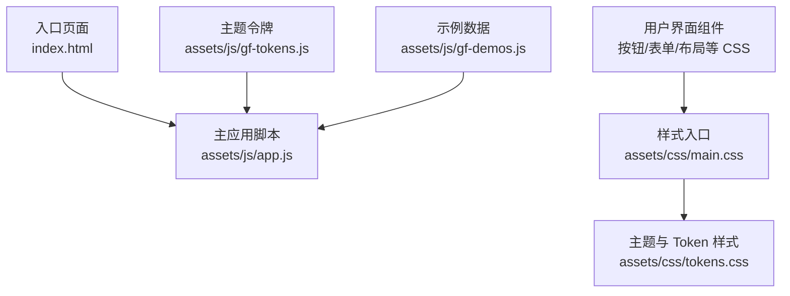
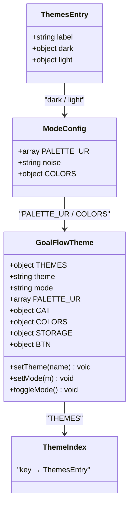
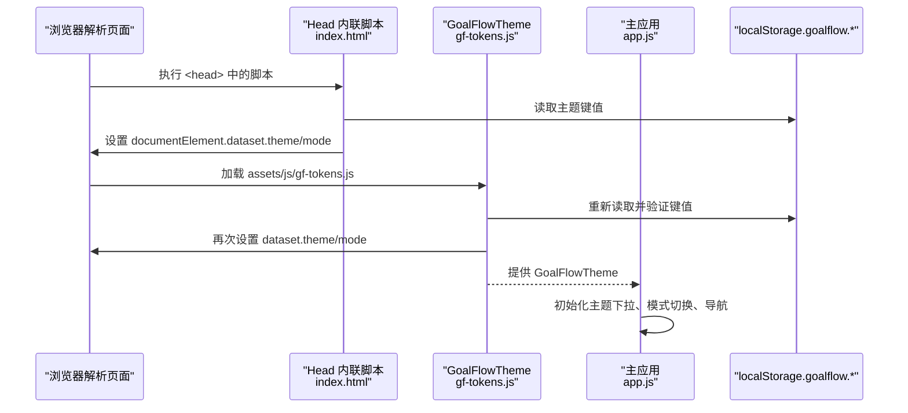
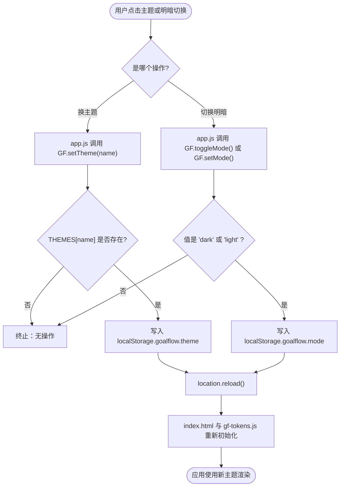
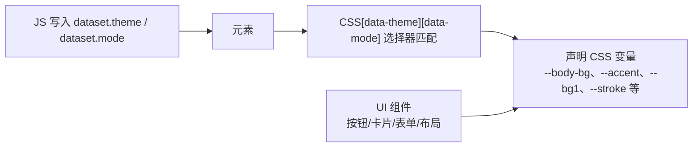
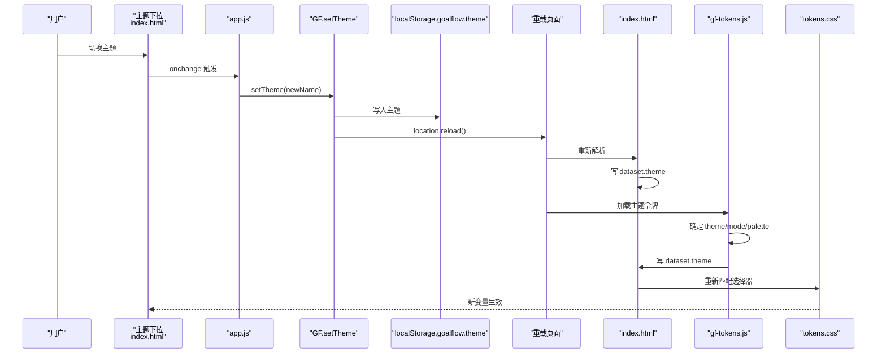

# 设计令牌与主题引擎

<cite>
**本文引用的文件**   
- [index.html](file://index.html)
- [gf-tokens.js](file://assets/js/gf-tokens.js)
- [app.js](file://assets/js/app.js)
- [gf-demos.js](file://assets/js/gf-demos.js)
- [main.css](file://assets/css/main.css)
- [tokens.css](file://assets/css/tokens.css)
</cite>

## 目录

1. [引言](#引言)
2. [项目结构中的主题相关代码](#项目结构中的主题相关代码)
3. [核心对象：GoalFlowTheme 的主题数据结构](#核心对象goalflowtheme-的主题数据结构)
4. [运行时初始化流程](#运行时初始化流程)
5. [主题切换与时序行为](#主题切换与时序行为)
6. [CSS 变量、选择器与明暗模式触发方式](#css-变量选择器与明暗模式触发方式)
7. [示例数据的职责边界](#示例数据的职责边界)
8. [新增主题的最小模板](#新增主题的最小模板)
9. [兼容性、容错与回退策略](#兼容性容错与回退策略)
10. [典型调用路径](#典型调用路径)
11. [故障排查清单](#故障排查清单)
12. [结论](#结论)

## 引言

GoalFlow 的主题系统由“设计令牌（JS）→ 文档状态（DOM dataset / localStorage）→ CSS 变量 → UI 组件”的单向流水线构成。其关键目标是：

- 把主题的色板、标签与键空间集中在 `assets/js/gf-tokens.js`；
- 通过 `<html>` 元素上的数据属性决定当前主题与明暗模式；
- 用 CSS 自定义属性承载颜色值，供应用组件以语义变量引用；
- 让业务逻辑无需关心配色细节，只消费 `COLORS`、`PALETTE_UR`、`CAT` 等稳定接口；
- 允许演示页与主应用共享同一套主题扩展模型。

需要注意：根据仓库实际源码，当前并没有名为 `GF.Theme.save` 或显式名为 `GF.initTheme` 的 API；真正的主题保存逻辑在 `GoalFlowTheme.setTheme`、`GoalFlowTheme.toggleMode`，以及 `app.js` 中的初始化函数里。本文会如实描述现有实现。

## 项目结构中的主题相关代码

下图给出主题相关文件的职责划分和依赖方向：



**图示来源**

- [index.html:8-18](file://index.html#L8-L18)
- [app.js:4-20](file://assets/js/app.js#L4-L20)
- [gf-tokens.js:140-177](file://assets/js/gf-tokens.js#L140-L177)
- [gf-demos.js:1-20](file://assets/js/gf-demos.js#L1-L20)
- [main.css:1-11](file://assets/css/main.css#L1-L11)
- [tokens.css:1-10](file://assets/css/tokens.css#L1-L10)

`index.html` 负责在最早期写入 `documentElement.dataset.theme` 与 `dataset.mode`，避免样式闪烁；`gf-tokens.js` 定义主题常量并导出全局 `GoalFlowTheme`；`app.js` 在其基础上绑定 UI 事件、初始化主题控件；CSS 层再根据 `[data-theme]` 与 `[data-mode]` 注入 CSS 变量。

**分节来源**

- [index.html:8-18](file://index.html#L8-L18)
- [main.css:1-11](file://assets/css/main.css#L1-L11)

## 核心对象：GoalFlowTheme 的主题数据结构

`assets/js/gf-tokens.js` 使用立即执行函数包裹自身，最终向全局暴露 `GoalFlowTheme`。该对象是主题系统的稳定契约：

| 字段 | 类型 | 作用 |
|---|---|---|
| `THEMES` | 对象 | 每个可用主题的完整配置，键为主题标识名，例如 `linear`、`raycast`、`rpg` |
| `theme` | 字符串 | 当前生效的主题名，从 `localStorage.goalflow.theme` 读取并按白名单校验 |
| `mode` | 字符串 | 当前生效的明暗模式，值为 `'dark'` 或 `'light'` |
| `setTheme(name)` | 函数 | 校验主题存在后保存到存储，并重载页面 |
| `setMode(mode)` | 函数 | 校验为 dark/light 后保存到存储，并重载页面 |
| `toggleMode()` | 函数 | 在 `dark` 与 `light` 之间切换 |
| `PALETTE_UR` | 数组 | 当前主题 × 当前模式的紧急度色阶数组 |
| `CAT` | 对象 | 四象限标签集合，包含 `now`、`core`、`distract`、`noise` |
| `COLORS` | 对象 | 当前色板的简化色元映射，含 `accent`、`accent2`、`gold`、`goldSoft`、`svgGlow`、`scaleLabel`、`smartGap`、`gradSmartDot` 等 |
| `STORAGE` | 对象 | 存储键命名集中管理，包含主题、模式和节点等业务键 |
| `BTN` | 对象 | UI 按钮类名预设 |

### THEMES 内部结构与语义

每个主题的 `THEMES[name]` 不是扁平色板，而是按主题 × 明暗模式组织的数据：

| 层级 | 字段 | 含义 |
|---|---|---|
| `THEMES[主题].label` | 字符串 | 主题显示名 |
| `THEMES[主题].dark.*` | 对象 | 深色模式配置 |
| `THEMES[主题].light.*` | 对象 | 浅色模式配置 |
| `.dark.PALETTE_UR` | 五色数组 | 从冷静到火急的颜色序列 |
| `.dark.noise` | 字符串 | 四象限噪声类别的颜色 |
| `.dark.COLORS` | 对象 | 当前模式的语义颜色对象 |

主题对象不包含固定名为 `color` 的顶层字段，也不存在名为 `presets` 的默认主题名集合。实际默认主题来自常量 `DEFAULT_THEME = 'linear'`，而可用主题集是 `THEMES` 对象自身的键集合。

对于四象限类别，当前实现的 `CAT` 固定包含以下四个键：

| 类别键 | 语义 | 对应色值来源 |
|---|---|---|
| `now` | 重要且紧急 · 立即做 | `PALETTE_UR[4]` |
| `core` | 重要不紧急 · 核心投入 | `PALETTE_UR[0]` |
| `distract` | 紧急不重要 · 干扰枝干 | `PALETTE_UR[3]` |
| `noise` | 不重要不紧急 · 噪音 | `palette.noise` |

注意：虽然问题中提及“默认 tags 数组”，但当前 `gf-tokens.js` 并未维护通用 `tag` 字段。`CAT` 是四象限语义类别，而不是通用标签库；`gf-demos.js` 中的 `sales`、`postgrad`、`health` 等也不是主题，而是目标树示例内容。

**分节来源**

- [gf-tokens.js:16-139](file://assets/js/gf-tokens.js#L16-L139)
- [gf-tokens.js:140-177](file://assets/js/gf-tokens.js#L140-L177)
- [app.js:4-20](file://assets/js/app.js#L4-L20)

### GoalFlowTheme 对象关系



**图示来源**

- [gf-tokens.js:16-139](file://assets/js/gf-tokens.js#L16-L139)
- [gf-tokens.js:140-177](file://assets/js/gf-tokens.js#L140-L177)

**分节来源**

- [gf-tokens.js:16-139](file://assets/js/gf-tokens.js#L16-L139)
- [gf-tokens.js:140-177](file://assets/js/gf-tokens.js#L140-L177)

## 运行时初始化流程

主题初始化发生在两个阶段：HTML 内联脚本阶段和 JS 初始化阶段。

### 第一阶段：页面加载前避免闪烁

在 `index.html` 的 `<head>` 中，有一个同步执行的 inline 脚本：

1. 读取 `localStorage.getItem('goalflow.theme')`，回退到 `'linear'`；
2. 读取 `localStorage.getItem('goalflow.mode')`，回退到 `'dark'`；
3. 直接把这两个值写入 `document.documentElement.dataset.theme` 和 `dataset.mode`；
4. 任何错误都被 `try/catch` 吞掉，确保仍降级使用默认主题。

这是防止第一次样式计算使用浏览器默认主题导致“闪屏”的关键措施。

### 第二阶段：脚本加载后的二次保证

`gf-tokens.js` 加载后会再次读取：

- `localStorage.goalflow.theme` → 只接受存在于 `THEMES` 中的键；
- `localStorage.goalflow.mode` → 只接受 `'dark'` 或 `'light'`；
- 若模式无效，则退回到 `'dark'`；
- 将当前主题的当前模式合并成 `palette`，并再写一次 `documentElement.dataset.theme` 与 `dataset.mode`；
- 同时把 `THEMES`、`setTheme`、`setMode`、`toggleMode`、`PALETTE_UR`、`CAT`、`COLORS`、`STORAGE`、`BTN` 挂载到 `window.GoalFlowTheme`。



**图示来源**

- [index.html:8-18](file://index.html#L8-L18)
- [gf-tokens.js:25-75](file://assets/js/gf-tokens.js#L25-L75)
- [gf-tokens.js:140-177](file://assets/js/gf-tokens.js#L140-L177)
- [app.js:4-20](file://assets/js/app.js#L4-L20)

**分节来源**

- [index.html:8-18](file://index.html#L8-L18)
- [gf-tokens.js:25-75](file://assets/js/gf-tokens.js#L25-L75)
- [gf-tokens.js:80-110](file://assets/js/gf-tokens.js#L80-L110)
- [gf-tokens.js:140-177](file://assets/js/gf-tokens.js#L140-L177)
- [app.js:4-20](file://assets/js/app.js#L4-L20)

## 主题切换与时序行为

### 切换主题：`GoalFlowTheme.setTheme`

当用户在「界面主题」下拉中选择新主题时，`app.js` 优先调用 `GF.setTheme(value)`。它的行为是：

1. 检查目标主题是否在 `THEMES` 中存在；
2. 不存在则直接返回，不做任何变更；
3. 存在则写入 `localStorage.goalflow.theme`；
4. 调用 `location.reload()` 刷新整个页面；
5. 刷新后 `index.html` 与 `gf-tokens.js` 重新读取新的主题名。

### 切换明暗：`GoalFlowTheme.toggleMode`

`toggleMode()` 根据当前 `mode` 写入另一个 key：

- 若当前是 `'dark'`，则保存 `goalflow.mode = 'light'`；
- 若当前不是 `'dark'`，则保存 `goalflow.mode = 'dark'`；
- 随后同样调用 `location.reload()`；
- `setMode` 也会拒绝非法值，仅接受 `'dark'` 或 `'light'`。

### 为什么是重载页面？

当前实现没有增量更新 CSS 变量的能力。它采用“写 localStorage + 整页重载”的策略，让初始加载脚本重新计算 `theme`、`mode`、`palette`，再一次性写出所有需要的 DOM 和存储状态。对大多数用户来说这是最稳健的实现，代价是每次切换都会经历一次页面重绘。



**图示来源**

- [gf-tokens.js:76-110](file://assets/js/gf-tokens.js#L76-L110)
- [app.js:6532-6565](file://assets/js/app.js#L6532-L6565)

**分节来源**

- [gf-tokens.js:76-110](file://assets/js/gf-tokens.js#L76-L110)
- [app.js:6532-6565](file://assets/js/app.js#L6532-L6565)

## CSS 变量、选择器与明暗模式触发方式

### CSS 主题触发机制

当前代码没有使用传统意义上的 `theme-dark`、`theme-light` 类名来控制主题。真正驱动主题的是 `<html>` 上的两个数据属性：

| 选择器片段 | 作用 |
|---|---|
| `[data-theme='linear']` | 应用 Linear 主题覆盖 |
| `[data-theme='raycast']` | 应用 Raycast 主题覆盖 |
| `[data-theme='rpg']` | 应用 RPG 主题覆盖 |
| `[data-mode='light']` | 启用浅色模式 |
| `[data-theme="..."][data-mode="light"]` | 某个主题的浅色变体 |

这些类名由 `index.html` 和 `gf-tokens.js` 写入 `documentElement.dataset.theme`、`documentElement.dataset.mode`。



**图示来源**

- [index.html:8-18](file://index.html#L8-L18)
- [gf-tokens.js:65-75](file://assets/js/gf-tokens.js#L65-L75)
- [tokens.css:15-75](file://assets/css/tokens.css#L15-L75)
- [tokens.css:180-220](file://assets/css/tokens.css#L180-L220)

### Color 字段与 CSS 变量映射

需要特别指出：**当前 gf-tokens.js 的 `THEMES[主题][模式].COLORS` 并不被自动遍历注入到 CSS 变量**。它目前主要作为 JS 端的色元来源。CSS 变量集中在 `assets/css/tokens.css` 中，以静态 CSS 选择器声明。

两者之间的关系应理解为“同一份调色方案的两边视图”：

| 语义 | JS 侧常用位置 | CSS 侧常见变量 |
|---|---|---|
| 强调色 | `COLORS.accent`、`PALETTE_UR[0..4]` | `--accent`、`--ur1..--ur5` |
| 背景层 | `PALETTE_UR`、`COLORS.smartGap` 参与图表 | `--body-bg`、`--bg0`、`--bg1`、`--bg2` |
| 边框描边 | — | `--stroke`、`--stroke-soft` |
| 文本 | — | `--ink`、`--ink-2`、`--muted`、`--muted-2` |
| 四象限 | `CAT[key].color` | `--quad-now`、`--quad-core`、`--quad-distract`、`--quad-noise` |
| 英雄卡高亮 | — | `--hero-border`、`--hero-glow` |
| 顶部栏 | — | `--topbar-bg` |
| 分段控件选中 | — | `--seg-on-bg`、`--seg-on-ink` |

当前代码中没有出现 `var(--goalflow.*)` 形式的使用；CSS 变量使用的是简洁名称如 `--body-bg`、`--accent`、`--stroke` 等，而不是带 `goalflow` 命名空间的变量。

### 明暗模式触发条件

| 模式 | data-mode 值 | CSS 行为 |
|---|---:|---|
| 深色 | `dark` | 保持默认深色系主题样式 |
| 浅色 | `light` | 启用 `[data-mode='light']` 下的变量覆盖块，包括 linear/raycast/rpg 浅色版 |

在 `tokens.css` 中可以看到类似规则：

- `:root` 声明基础结构与默认 Linear 深色；
- `[data-theme='linear']` 继承根结构；
- `[data-theme='raycast']`、`[data-theme='rpg']` 覆盖色值；
- `[data-mode='light']` 打开浅色模式；
- `[data-theme='xxx'][data-mode='light']` 指定某个主题的浅色版本。

所以并不是添加一个名为 `theme-dark` 或 `theme-light` 的类名来切换主题；而是通过修改 `documentElement.dataset.mode`，让浏览器重新匹配 CSS 规则。

**分节来源**

- [tokens.css:1-10](file://assets/css/tokens.css#L1-L10)
- [tokens.css:15-175](file://assets/css/tokens.css#L15-L175)
- [tokens.css:194-220](file://assets/css/tokens.css#L194-L220)
- [index.html:8-18](file://index.html#L8-L18)

## 示例数据的职责边界

`gf-demos.js` 中的 `DEMO` 数组并不是主题色板。它的内容是预置的目标树示例，包括：

| id | 标题 | 用途 |
|---|---|---|
| `sales` | 销售体系 · 月入 5 万 | 销售计划示例 |
| `postgrad` | 考研上岸 · 2027 研究生 | 考试规划示例 |
| `health` | 健康减脂 · 减 10 公斤 | 健康管理示例 |
| `indie` | 独立产品 · MVP 上线 | 创业 MVP 示例 |
| `ai-pm` | 转行 · AI 产品经理 | 职业转型示例 |
| `house` | 储蓄计划 · 攒首付 | 财务计划示例 |
| `english` | 英语 · 雅思 7 分 | 语言学习示例 |
| `lead` | 技术管理 · 带 8 人团队 | 技术管理示例 |
| `creator` | 个人 IP · 内容创作 | 自媒体创作示例 |
| `ecom` | 副业 · 跨境小铺 | 电商副业示例 |

这个模块的职责是“目标内容示例库”，不是“视觉主题库”。它不提供 `tags` 数组，也没有注册到 `Theme.presets`；主题预设则由 `gf-tokens.js` 中的 `THEMES` 承担。

不过，`index.html` 中确实有示例主题展示区域，但它是“可视化参考样张”页面 `demos/index.html`，列举线性、Things、Notion、Sunsama、Stripe、Raycast、Amie、Kinfolk、Vercel、RPG 等十种视觉风格。它们与运行时的 `GoalFlowTheme.THEMES` 并非完全一一对应；后者当前只有 `linear`、`raycast`、`rpg` 三个可用主题。

**分节来源**

- [gf-demos.js:1-166](file://assets/js/gf-demos.js#L1-L166)
- [demos/index.html:1-55](file://demos/index.html#L1-L55)

## 新增主题的最小模板

如果要新增一个名为 `mytheme` 的主机主题，最小操作步骤如下：

### 第一步：扩展 JavaScript 主题令牌

在 `gf-tokens.js` 的 `THEMES` 中添加条目，包含：

- 主题标识名，例如 `mytheme`；
- 可显示的 `label`；
- `dark` 和 `light` 两套模式；
- 每套模式中的 `PALETTE_UR`（五色调色板）；
- 每套模式中的 `noise`；
- 每套模式中的 `COLORS`，至少包含语义化的 `accent`、`accent2`、`gold`、`goldSoft` 等字段。

必须保证任意当前主题下读取到的 `PALETTE_UR[0..4]`、`CAT`、`COLORS` 都是有效值，否则后续图表、标签、按钮颜色可能出现空值或未定义颜色。

### 第二步：扩展 CSS 选择器

在 `assets/css/tokens.css` 中追加：

- `[data-theme='mytheme']`：深色主题覆盖；
- `[data-theme='mytheme'][data-mode='light']`：浅色主题覆盖；
- 至少覆盖语义变量：背景、文字、强调、描边、四象限、英雄卡等。

这是因为 CSS 不会自动根据 JS 中的 `COLORS` 生成变量。

### 第三步：让 UI 能选择它

当前主题选择下拉框是硬编码在 `index.html` 中的：

```html
<select id="themeSelect">
  <option value="linear">Linear</option>
  <option value="raycast">Raycast 玻璃 · 预览</option>
  <option value="rpg">RPG 游戏 · 预览</option>
</select>
```

因此要让用户能从界面选择新主题，还需要在该下拉框中添加对应 `<option>`。

### 第四步：通过路由或页面跳转打开

当前代码中没有根据 URL fragment `#/theme/$id` 读取并切换主题的逻辑。若要实现这个需求，可以在页面初始化或 router hook 中：

1. 解析 `location.hash`；
2. 若符合 `#/theme/mytheme`，调用 `GoalFlowTheme.setTheme('mytheme')`；
3. 等待页面重载；
4. 检查 `localStorage.goalflow.theme` 是否为 `'mytheme'`。

### 第五步：验证持久化

切换后可检查：

| 断言 | 预期 |
|---|---|
| `documentElement.dataset.theme` | 等于新主题标识名 |
| `documentElement.dataset.mode` | 等于当前明暗模式 |
| `localStorage.goalflow.theme` | 等于新主题标识名 |
| `localStorage.goalflow.mode` | 等于当前明暗模式 |
| 对应 `[data-theme='mytheme']` 的 CSS 变量已应用 | 颜色变化可见 |
| 四象限、图表、按钮等组件颜色正常 | 无空值或透明白/黑 |

### 新增主题模板要点清单

| 步骤 | 必须完成项 | 风险 |
|---|---|---|
| JS 令牌 | 在 `THEMES` 中注册 `mytheme.dark` 与 `mytheme.light` | 缺失任一模式会导致 fallback 到另一模式 |
| JS 色板 | `PALETTE_UR` 长度为 5；`COLORS` 包含语义键 | 图表和标签会取不到正确颜色 |
| CSS 主题 | 提供 `[data-theme='mytheme']` 与浅色覆盖 | 其他主题可能未定义变量 |
| UI 选项 | 给下拉菜单增加选项 | 用户无法通过界面切换 |
| 持久化 | 确认 `localStorage.goalflow.theme` 被改写 | 刷新后主题丢失 |
| 兼容旧缓存 | 保留原默认值和行为 | 老用户本地缓存可能失效 |

**分节来源**

- [gf-tokens.js:16-139](file://assets/js/gf-tokens.js#L16-L139)
- [tokens.css:194-318](file://assets/css/tokens.css#L194-L318)
- [index.html:112-130](file://index.html#L112-L130)

## 兼容性、容错与回退策略

### 存储访问失败

`gf-tokens.js` 中的 `read` 与 `store` 都包裹了 `try/catch`。当 `localStorage` 不可用时：

- 读主题回退到 `DEFAULT_THEME`；
- 读模式回退到 `DEFAULT_MODE`；
- 写存储失败也不会抛出异常。

这保证了单页应用在沙箱、私有浏览模式或禁用 localStorage 的场景下仍可运行。

### 未知主题名

`read` 对主题名的校验条件是 `!!THEMES[v]`。如果本地缓存保存了一个已经删除或拼写的主题名，它会落回 `'linear'`。

### 未知模式

模式校验要求严格等于 `'dark'` 或 `'light'`。非法值会回退到 `'dark'`。

### 全局对象不存在

`app.js` 在开头使用了：

```js
const GF = typeof GoalFlowTheme !== 'undefined' ? GoalFlowTheme : {};
const PALETTE_UR = GF.PALETTE_UR || ['默认五色'];
const CAT = GF.CAT || { 默认四象限 };
const COLORS = GF.COLORS || {};
```

这意味着即使 `gf-tokens.js` 加载失败或被替换，`app.js` 也能通过兜底数组和对象继续渲染，只是会使用默认线性风格。

### 旧缓存兼容

主题选择器的 change 处理器在没有 `GF.setTheme` 时，也会直接尝试写入 localStorage 并重载页面。这表明系统在开发期可以容忍“令牌未挂载”的情况，只要主题值合法即可恢复。

### 首次加载防闪烁

`index.html` 在 CSS 文件之前运行脚本，直接写出默认主题值。这避免了浏览器先用内置暗色模式算出样式，再被 JS 替换导致的瞬时闪烁。

**分节来源**

- [gf-tokens.js:75-110](file://assets/js/gf-tokens.js#L75-L110)
- [gf-tokens.js:162-177](file://assets/js/gf-tokens.js#L162-L177)
- [app.js:4-20](file://assets/js/app.js#L4-L20)
- [app.js:6532-6565](file://assets/js/app.js#L6532-L6565)
- [index.html:8-18](file://index.html#L8-L18)

## 典型调用路径

下面列出三种典型路径，并说明它们与当前源码的对应关系。

### 路径一：用户主动切换主题

1. 用户点击「◈ 循环主题」或更改「界面主题」下拉框；
2. `app.js` 找到 `GF.setTheme`，调用它；
3. `GF.setTheme` 校验主题名，写入 `localStorage.goalflow.theme`；
4. 刷新页面；
5. `index.html` 重新写入 `documentElement.dataset.theme`；
6. `gf-tokens.js` 重新计算 `theme`、`mode`、`palette`；
7. `documentElement.dataset.theme` 再次被赋值为新主题；
8. CSS 选择器匹配新主题，变量重算，组件显示新配色。



**图示来源**

- [app.js:6532-6565](file://assets/js/app.js#L6532-L6565)
- [gf-tokens.js:76-110](file://assets/js/gf-tokens.js#L76-L110)
- [index.html:8-18](file://index.html#L8-L18)

### 路径二：用户切换明暗模式

1. 用户点击「☾/☀ 明暗切换」；
2. `app.js` 先尝试 `GF.toggleMode()`；
3. `GF.toggleMode()` 调 `setMode(next)`；
4. `setMode` 保存 `localStorage.goalflow.mode`；
5. 页面重载；
6. `documentElement.dataset.mode` 变为 `'light'` 或 `'dark'`；
7. CSS 中对应的 `[data-mode='light']` 或默认深色规则生效；
8. 组件读取的 CSS 变量自动更换。

**分节来源**

- [app.js:6542-6553](file://assets/js/app.js#L6542-L6553)
- [gf-tokens.js:90-110](file://assets/js/gf-tokens.js#L90-L110)
- [tokens.css:194-220](file://assets/css/tokens.css#L194-L220)

### 路径三：组件消费主题色

组件端并不直接从 token 对象读颜色，而是消费 CSS 变量：

| 读取方 | 实际消费方式 |
|---|---|
| 按钮组件 | `var(--btn-on-dark)` 等 CSS 变量 |
| 背景层 | `var(--body-bg)`、`var(--bg1)`、`var(--panel)` |
| 文字层 | `var(--ink)`、`var(--muted)` |
| 强调层 | `var(--accent)`、`var(--gold)` |
| 四象限 | `var(--quad-now)`、`var(--quad-core)` 等 |
| 紧急度 | `var(--ur1)` 到 `var(--ur5)` |
| JS 逻辑 | `GF.COLORS`、`GF.PALETTE_UR`、`GF.CAT` |

也就是说，典型调用链是：

```
GoalFlowTheme.setTheme / toggleMode
→ localStorage.goalflow.theme / goalflow.mode
→ documentElement.dataset.theme / dataset.mode
→ CSS[data-theme][data-mode] 选择器
→ CSS 自定义属性变量
→ 各组件 CSS 与 JS 消费
```

**分节来源**

- [app.js:4-20](file://assets/js/app.js#L4-L20)
- [tokens.css:15-175](file://assets/css/tokens.css#L15-L175)
- [main.css:1-11](file://assets/css/main.css#L1-L11)

## 故障排查清单

| 现象 | 可能原因 | 排查方式 |
|---|---|---|
| 切换主题后刷新仍然回到旧主题 | `localStorage` 被阻止或第三方清理插件清空存储 | 检查控制台权限与 `localStorage.goalflow.theme` |
| 选择了一个不在界面的主题 | 下拉框选项是硬编码的 | 同时修改 `index.html` 中的 `<select>` |
| 新主题部分字段颜色为空 | 缺少 `PALETTE_UR`、`noise` 或 `COLORS` 字段 | 对比现有 `linear`、`raycast`、`rpg` |
| 新主题深色正常、浅色崩坏 | 未编写 `[data-theme='x'][data-mode='light']` | 补充浅色覆盖块 |
| 首帧出现闪烁 | `index.html` 的 head 脚本未执行或顺序异常 | 确认内联脚本位于 CSS 之前 |
| 主题 ID 拼写错误 | `THEMES['xxx']` 为 undefined，fallback 到默认主题 | 检查 js 中 theme name 与 option value 一致 |
| 明暗切换无效 | 调用的是 `setTheme` 而非 `toggleMode` / `setMode` | 检查事件监听 |
| 组件使用 `var(--goalflow.*)` 不生效 | 仓库实际变量没有 `goalflow` 前缀 | 改用 `--body-bg`、`--accent` 等真实变量名 |
| 旧用户升级到新主题 | 本地缓存主题不再存在于 `THEMES` | `read` 会自动回退到默认主题 |

## 结论

GoalFlow 的主题系统是一个小型但清晰的“令牌 → 状态 → 变量 → 组件”管道：

- **主题定义**集中在 `gf-tokens.js`，通过 `THEMES[主题][深色/浅色]` 组织色板；
- **状态写入**在 `index.html` 与 `gf-tokens.js` 的双重保障下进行，并使用 `documentElement.dataset.theme` / `dataset.mode`；
- **持久化键**是 `localStorage.goalflow.theme` 与 `localStorage.goalflow.mode`；
- **视觉效果**由 `tokens.css` 中基于 `[data-theme]` 和 `[data-mode]` 的 CSS 变量控制；
- **业务组件**消费语义变量，而不直接消费主题键名；
- **新增主题**需要同步修改 JS 的 `THEMES`、CSS 的选择器，以及 UI 的下拉选项，最后通过重载页面验证持久化。

需要特别纠正两个容易混淆的点：

1. 当前没有名为 `GF.Theme.save` 的 API，对应职责由 `GoalFlowTheme.setTheme` 与 `GF.toggleMode`/`setMode` 承担；
2. 当前主题切换不使用 `theme-dark`、`theme-light` 类名，而是基于 `[data-theme]` 与 `[data-mode='light']` 选择器；也没有看到 `var(--goalflow.*)` 的使用，真实变量是简洁的语义名；
3. `gf-demos.js` 中的内容是目标示例，不是主题预设；真正的主题预设是 `gf-tokens.js` 中的 `THEMES`。

按照本文新增主题的最小模板逐项核对，基本可以避免“token 缺失导致空值”“样式未覆盖”“无法从界面选择”三类最常见的集成问题。