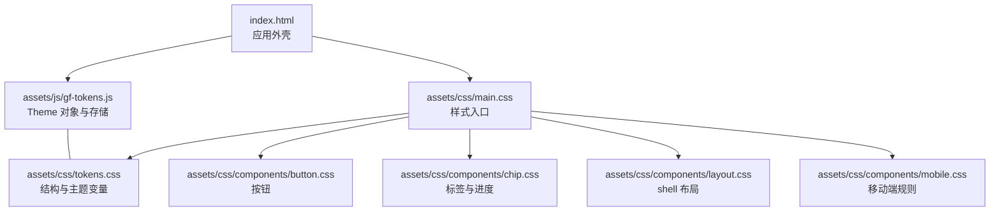
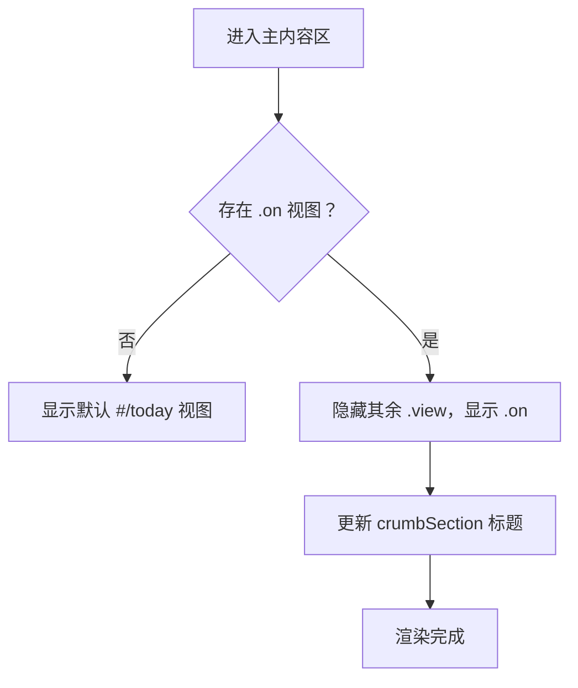
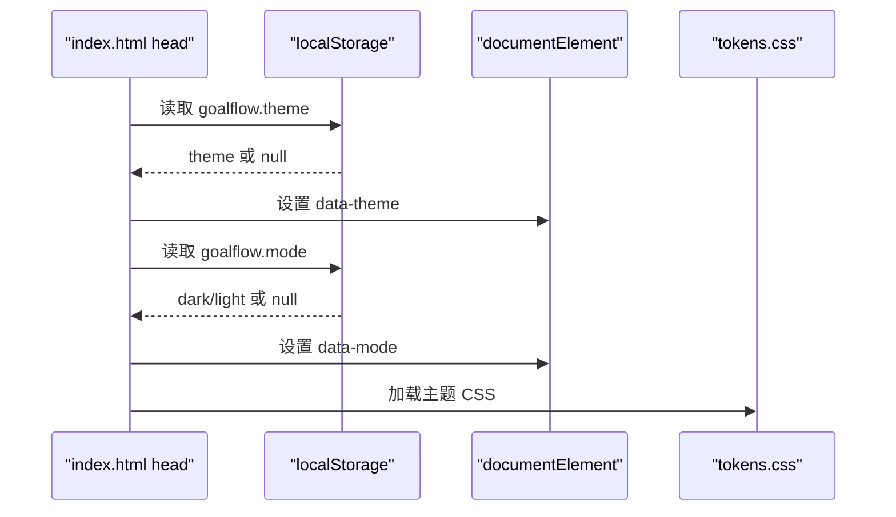
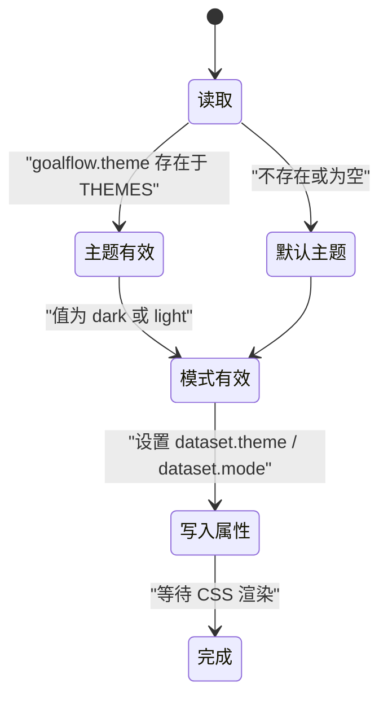
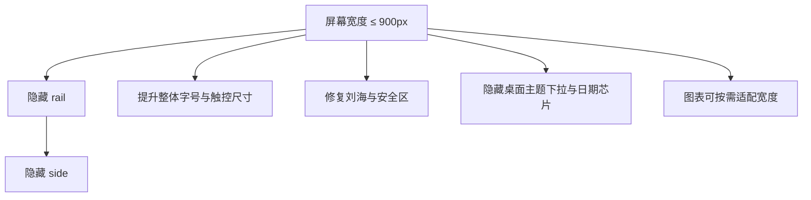

# UI 组件与主题系统

<cite>
**本文引用的文件**   
- [index.html](file://index.html)
- [gf-tokens.js](file://assets/js/gf-tokens.js)
- [main.css](file://assets/css/main.css)
- [tokens.css](file://assets/css/tokens.css)
- [layout.css](file://assets/css/components/layout.css)
- [button.css](file://assets/css/components/button.css)
- [chip.css](file://assets/css/components/chip.css)
- [mobile.css](file://assets/css/components/mobile.css)
</cite>

## 目录
1. [引言](#引言)
2. [项目结构](#项目结构)
3. [Shell 布局与视图](#shell-布局与视图)
4. [CSS 类与组件约定](#css-类与组件约定)
5. [Theme 令牌模型](#theme-令牌模型)
6. [主题切换机制](#主题切换机制)
7. [JS Token 与 CSS Token 的同步约束](#js-token-与-css-token-的同步约束)
8. [移动端适配](#移动端适配)
9. [新增示例主题的完整步骤](#新增示例主题的完整步骤)
10. [兼容性注意事项](#兼容性注意事项)
11. [常见问题排查](#常见问题排查)
12. [总结](#总结)

## 引言
GoalFlow 的 UI 采用“图标轨 + 侧栏 + 主内容”的 Shell 布局，通过四个 `data-view` 路由值组织页面：`#/today`、`#/plan`、`#/insights`、`#/ai`。视觉体系由一组设计令牌（design tokens）驱动：JS 文件提供当前主题、色板与类别语义，CSS 文件基于 `data-theme` 与 `data-mode` 应用颜色。

这套体系适合三类工作：
- 在 shell 中扩展导航与侧边业务块；
- 基于 `gf-btn` / `chip` 等基础样式创建界面元素；
- 按固定格式新增一个预览主题，使颜色同时影响 JS 图表和 CSS 渲染。

## 项目结构
项目以单页 HTML 作为入口，样式统一从 `assets/css/main.css` 导入，主题定义拆分为 JS 令牌与 CSS token 两个文件，移动端规则放在独立的 mobile 组件层。



**图表来源**
- [index.html:1-30](file://index.html#L1-L30)
- [index.html:400-416](file://index.html#L400-L416)
- [main.css:1-11](file://assets/css/main.css#L1-L11)

**Section sources**
- [main.css:1-11](file://assets/css/main.css#L1-L11)

## Shell 布局与视图

### DOM 外壳
根容器使用 `.app-shell`，内部由三列组成：
- 左侧主导航 `.rail`；
- 左侧信息侧栏 `.side`；
- 右侧主内容 `.main`，其顶部是顶栏 `header.topbar`。

HTML 文档首行设置了中文语言标识，viewport 声明开启安全区域适配，`color-scheme` 显式支持明暗两种模式，避免浏览器自动反转错误配色。

实际外壳片段如下：
- 外层壳：[Shell 容器](file://index.html#L14-L18)
- 图标轨：[主导航 rail](file://index.html#L19-L34)
- 侧栏：[aside.side](file://index.html#L36-L66)
- 主区与顶栏：[div.main + header.topbar](file://index.html#L67-L112)

#### 图标轨 rail
`.rail` 是垂直居中的窄导航轨，核心类为 `.ric`：
- 按钮默认状态无背景、半透明文字；
- 激活按钮增加 `.on`，表现为高亮文字、面板背景与内描边。
- 导航键值为 `data-nav="today|plan|insights|ai"`；底部还有一个链接到 demos 的入口。

典型节点：
- Logo 标记：[Rail Logo](file://index.html#L21-L27)
- 今日按钮：[ric.on data-nav=today](file://index.html#L28-L28)
- 规划按钮：[ric data-nav=plan](file://index.html#L29-L29)
- 洞察按钮：[ric data-nav=insights](file://index.html#L30-L30)
- AI 按钮：[ric data-nav=ai](file://index.html#L31-L31)
- 风格实验室：[rail-bottom](file://index.html#L32-L32)

布局样式：
- 轨道宽度固定为 52px；
- `.ric` 宽度高度 32px，使用网格居中；
- hover 时显示 `.panel-strong` 背景；
- `.rail-mark` 使用渐变色与微光阴影突出品牌标识。

**Section sources**
- [index.html:19-34](file://index.html#L19-L34)
- [layout.css:17-60](file://assets/css/components/layout.css#L17-L60)

#### 侧栏 side
`.side` 宽度固定为 230px，垂直滚动。内部包含以下区域：
| 类 | 职责 |
|---|---|
| `.side-ws` | 本地工作区标识与小标题 |
| `.wf-bar` | 工作流或项目列表挂载点 |
| `.ws-store` | 仓库/存储空间元信息展示 |
| `.slabel` | 分组标签，如“视图”“目标树” |
| `.si` | 侧栏选项按钮；`.on` 表示当前视图 |
| `.side-tree` | 解析后生成的目标树容器 |

重点交互类：
- `.si.on` 会加粗正文、使用深色文字、添加浅色边框阴影；
- `.sidx` 是步骤徽章，用于序号标注；
- `.side-tree` 通过层级缩进表达目标树结构，`root` 和 `child` 区分层级。

对应 HTML 片段位置：
- 工作区信息：[side-ws](file://index.html#L36-L47)
- 工作流容器：[id=wfBar](file://index.html#L48-L48)
- 视图按钮组：[si on today → ai](file://index.html#L52-L56)
- 仪式按钮：[晨计划/晚总结/周计划/周回顾](file://index.html#L57-L60)
- 目标树头部：[slabel 目标树](file://index.html#L61-L63)
- 目标树容器：[side-tree](file://index.html#L64-L66)

CSS 约定：
- 轨道侧栏共享背景 `.bg1`，并与主区用 1px 细边分隔；
- 按钮型 `.si` 全宽左对齐，hover 显示面板高亮；
- 布局断点在 900px：`.rail` 和 `.side` 在小于等于该宽度时隐藏，由底部 mtab 替代。

**Section sources**
- [index.html:36-66](file://index.html#L36-L66)
- [layout.css:62-120](file://assets/css/components/layout.css#L62-L120)
- [layout.css:120-150](file://assets/css/components/layout.css#L120-L150)
- [layout.css:235-270](file://assets/css/components/layout.css#L235-L270)

#### 主内容 main 与 topbar
`.main` 是弹性增长的主列，包含可滚动的 `.main-scroll`，以及顶栏 `header.topbar`。

顶栏关键区域：
- 面包屑：[`.crumb`](file://index.html#L71-L71)，含动态节段标题；
- 进度标签：[`.progress-chip`](file://index.html#L72-L77)；
- 操作区：[`.topbar-actions`](file://index.html#L80-L107)；
- 主题控件：[`.topbar-theme`](file://index.html#L99-L107)；
- 当天日期条：[`.today-chip`](file://index.html#L108-L108)。

典型 DOM 片段：
```text
<header class="topbar">
  <span class="crumb">目标流 <i>/</i> <b id="crumbSection">今日行动</b></span>
  <div class="progress-chip" ...>...</div>
  <div class="spacer"></div>
  <div class="topbar-actions">
    ...按钮...
    <span class="topbar-theme">
      <button ...>◈</button>
      <select ...>Linear / Raycast / RPG</select>
      <button ...>☾</button>
    </span>
  </div>
</header>
```

顶栏布局：
- flex 排列，自动换行；
- 背景带模糊效果，并由 `--topbar-bg` 控制透明度；
- `.topbar-actions` 右对齐，按钮间距较小；
- `.topbar-theme` 左侧有分隔线，把“主题选择 + 明暗切换”独立成小组。

**Section sources**
- [index.html:67-108](file://index.html#L67-L108)
- [layout.css:270-340](file://assets/css/components/layout.css#L270-L340)

#### 页面路由：#/today、#/plan、#/insights、#/ai
应用没有传统后端路由，而是使用 URL hash + 四片 `<section>` 实现前端视图切换：

```html
<section class="view on" id="view-today"   data-view="today"></section>
<section class="view"       id="view-plan"   data-view="plan"></section>
<section class="view"       id="view-insights" data-view="insights"></section>
<section class="view"       id="view-ai"     data-view="ai"></section>
```

规则如下：
1. 视图容器位于 `.main-scroll > .view`；
2. 未激活的 `.view` 默认隐藏；
3. 仅当具备 `.on` 时才显示；
4. 各导航控件统一使用 `data-nav="today|plan|insights|ai"`；
5. 移动端底部导航也使用 `mtab-btn` + `data-nav` 控制同一套 `#` 路由。

因此，URL 片段应为：
- `#/today`
- `#/plan`
- `#/insights`
- `#/ai`

注意：不要只写 `/plan`，必须是 `#/plan`。如果 JavaScript 逻辑尚未处理 hash 匹配，请确保浏览器地址栏以 `#` 开头。

关联 HTML 片段：
- 今日视图：[view-today](file://index.html#L114-L140)
- 规划视图：[view-plan](file://index.html#L192-L220)
- 洞察视图：[view-insights](file://index.html#L224-L298)
- AI 视图：[view-ai](file://index.html#L304-L390)
- 移动端导航：[nav.mtab](file://index.html#L392-L403)

**Section sources**
- [index.html:112-403](file://index.html#L112-L403)
- [layout.css:198-228](file://assets/css/components/layout.css#L198-L228)

## CSS 类与组件约定

### app-shell、rail、side、main、topbar
| 类名 | 含义 | 重要特性 |
|---|---|---|
| `.app-shell` | 全屏 Flex 外壳 | 高度为视口高度，不可整体滚动 |
| `.rail` | 左侧图标轨 | 固定宽度、居中标签、激活态 `.ric.on` |
| `.side` | 左侧工作区侧栏 | 固定宽度、可纵向滚动 |
| `.main` | 右侧主内容 | 自适应宽度，纵向布局 |
| `header.topbar` | 页面顶部导航栏 | 固定于主内容区顶部，带模糊背景 |
| `.topbar-actions` | 顶栏右侧按钮组 | 小间距、可换行、含主题选择 |

这些类的布局职责已在 `layout.css` 中分层说明；新增布局区块应优先复用已有变量，而不是硬编码尺寸。

**Section sources**
- [layout.css:9-30](file://assets/css/components/layout.css#L9-L30)
- [layout.css:235-340](file://assets/css/components/layout.css#L235-L340)

### ric 与 si
- `.ric`：图标轨按钮；
- `.si`：侧栏导航按钮；
- 两者都有 hover 背景过渡；
- 激活类 `.on` 均用于表示当前选中项；
- `.si .sidx` 用于序号或状态徽章；
- `.dim` 表示禁用或未就绪的可读占位项。

建议使用方式：
```text
<button class="ric on" data-nav="today" title="..."></button>
<button class="si" data-nav="plan"><span class="sidx">🎯</span>目标规划</button>
<div class="side-tree">
  <div class="child dim">暂未解析</div>
</div>
```

**Section sources**
- [index.html:28-31](file://index.html#L28-L31)
- [index.html:52-66](file://index.html#L52-L66)
- [layout.css:62-147](file://assets/css/components/layout.css#L62-L147)
- [layout.css:187-204](file://assets/css/components/layout.css#L187-L204)

### gf-btn 系列
按钮基类为 `.gf-btn`，配合 BEM 修饰类表达变体：

| 类 | 视觉效果 |
|---|---|
| `.gf-btn` | 默认按钮：面板背景、圆角、1px 描边、浅过渡 |
| `.gf-btn--sm` | 小尺寸按钮 |
| `.gf-btn--pill` | 药丸形按钮，配合 small 常用于顶栏 |
| `.gf-btn--ghost` | 幽灵按钮：无背景、悬停显示面板高亮 |
| `.gf-btn--primary` | 强调按钮，使用金色渐变 |
| `.gf-btn--cool` | 强调冷色渐变 |
| `.gf-btn--ai` | AI 专用渐变按钮 |

兼容旧写法：原始 `.primary`、`.ghost`、`.small`、`.ai`、`.cool` 仍能作用于原生 `button`，但推荐统一使用 `.gf-btn*`。

典型组合：
```text
<button class="gf-btn gf-btn--sm gf-btn--pill gf-btn--ghost">项目</button>
<button class="gf-btn gf-btn--primary">解析并生成</button>
```

焦点与可访问性：
- 所有 button 类型元素都有指针和过渡；
- `:focus-visible` 使用 `accent` 调色的轮廓偏移，提高键盘可操作性；
- 按钮默认字号约 12.5px，small 缩小至 11.5px。

**Section sources**
- [button.css:1-40](file://assets/css/components/button.css#L1-L40)
- [button.css:40-108](file://assets/css/components/button.css#L40-L108)

### chip
项目有两类 chip：

| 类 | 用途 |
|---|---|
| `.gf-chip` | 通用标签，圆形角落，半透明背景与描边 |
| `.today-chip` | 顶栏日期 chips，毛玻璃感数字文本 |
| `.progress-chip` | 进度条标签，带渐变填充动画 |

`.progress-chip` 内部子节点 `.bar` 和 `i` 共同实现横向进度：
- 外层 width/height 设定比例；
- 内层 `i` 设置背景渐变，并通过 width 实现完成度；
- 动画缓动使用全局 `--ease-out`。

**Section sources**
- [chip.css:1-64](file://assets/css/components/chip.css#L1-L64)

### layout 与移动端断点
`layout.css` 不仅承担三栏布局，还承担多视图开关和响应式断点：
- 默认隐藏所有 `.view`；
- 仅 `.view.on` 可见；
- 大于 900px 显示 `.rail` 和 `.side`；
- 小于等于 900px 隐藏图标轨与侧栏；
- 主内容区的 `.today-grid` 在 900px 下从三列变为单列。

此外，`mobile.css` 在更深层的交互和可读性上做补充：
- 触屏设备增大输入字号；
- 触摸目标最小 40px；
- 强制 `touch-action: manipulation`；
- 窄屏重排字号、隐藏冗余控件、增加安全区。



该流程描述的是“当前代码已暴露的 DOM 契约”，具体路由匹配逻辑由 JavaScript 负责；CSS 只规定“带 `.on` 的 `.view` 才能显示”。

**Section sources**
- [layout.css:198-218](file://assets/css/components/layout.css#L198-L218)
- [layout.css:235-270](file://assets/css/components/layout.css#L235-L270)

## Theme 令牌模型

### GF Theme 对象结构
JS 令牌通过自执行函数暴露全局 `GoalFlowTheme`，关键成员如下：

| 属性或方法 | 含义 |
|---|---|
| `THEMES` | 所有主题定义集合，键名即合法主题名 |
| `theme` | 当前加载的主题名，例如 `linear` |
| `mode` | 当前明暗模式，`dark` 或 `light` |
| `setTheme(name)` | 切换到有效主题并刷新页面 |
| `setMode(m)` | 切换到合法明暗模式并刷新页面 |
| `toggleMode()` | 翻转明暗模式 |
| `PALETTE_UR` | 紧急度色阶数组，通常长度为 5 |
| `CAT` | 四象限分类对象，key 包括 `now/core/distract/noise` |
| `COLORS` | 当前主题当前模式的辅助色表 |
| `STORAGE` | 持久化键名常量，包括 theme 与 mode 存储键 |
| `BTN` | 常用按钮类名字符串常量 |

Token 读取顺序：
1. 尝试从 `localStorage.getItem('goalflow.theme')`；
2. 若值不在 `THEMES` 内，回退为 `linear`；
3. 同理读取 `goalflow.mode`，仅在 `dark` 或 `light` 之间回退；
4. 根据当前主题 + 模式取值失败时，回退到该主题的 `dark` 配置；
5. 最后把 theme 和 mode 写入 `document.documentElement.dataset`。

这意味着 CSS 可以通过 `[data-theme]` 和 `[data-mode]` 精确选择颜色，而 JS 可直接使用 `GOALFLOW_COLOR_*` 级别的常量。

**Section sources**
- [gf-tokens.js:11-47](file://assets/js/gf-tokens.js#L11-L47)
- [gf-tokens.js:101-177](file://assets/js/gf-tokens.js#L101-L177)

### 预设主题
目前预置三个主题：

| 主题键 | label | 特点 |
|---|---|---|
| `linear` | Linear | 默认主题，偏深灰紫蓝工作区 |
| `raycast` | Raycast 玻璃（预览） | 命令面板玻璃质感、粉紫配色 |
| `rpg` | RPG 游戏（预览） | 游戏感主任务色，金与柔紫搭配 |

每个主题至少需要：
- `label`；
- `dark.PALETTE_UR`；
- `dark.noise`；
- `dark.COLORS.accent`、`accent2`、`gold`、`goldSoft`、`svgGlow`、`scaleLabel`、`smartGap`、`gradSmartDot`；
- `light.*` 的同构对象。

这些字段不是装饰字段：`PALETTE_UR` 驱动图例与四象限，`noise` 驱动噪音类别颜色，`COLORS` 被图形渲染使用。

**Section sources**
- [gf-tokens.js:18-100](file://assets/js/gf-tokens.js#L18-L100)

### 颜色 token 与 tag 列表
JS 侧的分类由 `CAT` 定义：
- `now`：立即做 · 重要且紧急；
- `core`：核心投入 · 重要不紧急；
- `distract`：干扰枝干 · 紧急不重要；
- `noise`：噪音 · 不重要不紧急。

它们的颜色来源于当前主题的 `PALETTE_UR` 与 `noise`：
- `now` 使用第 4 个紧急度；
- `core` 使用第 1 个紧急度；
- `distract` 使用第 3 个紧急度；
- `noise` 使用噪声色。

CSS 侧使用同语义的变量：
- `--ur1` 到 `--ur5`；
- `--quad-now`、`--quad-core`、`--quad-distract`、`--quad-noise`。

这个映射保证 JS 生成的图和 CSS 显示的类别颜色保持一致。

**Section sources**
- [gf-tokens.js:112-148](file://assets/js/gf-tokens.js#L112-L148)
- [tokens.css:120-190](file://assets/css/tokens.css#L120-L190)

## 主题切换机制

### documentElement.dataset
主题与模式通过 `data-*` 属性生效：
- `documentElement.dataset.theme`；
- `documentElement.dataset.mode`。

`index.html` 在 head 中有兜底初始化脚本：
1. 尝试读取 `goalflow.theme` 和 `goalflow.mode`；
2. 写入 `document.documentElement.dataset.theme/mode`；
3. 如果 localStorage 不可用，降级为 `linear` + `dark`；
4. 之后再加载 `assets/css/main.css`，这样可尽量避免首次渲染闪烁。

随后 `gf-tokens.js` 再次做一次相同逻辑，最终把当前值暴露给全局。



**图表来源**
- [index.html:6-9](file://index.html#L6-L9)

**Section sources**
- [index.html:6-9](file://index.html#L6-L9)
- [gf-tokens.js:67-83](file://assets/js/gf-tokens.js#L67-L83)

### localStorage 键
| 键 | 默认值 | 有效值 | 说明 |
|---|---|---|---|
| `goalflow.theme` | `linear` | 任意 THEME key | 当前主题，无效值会被忽略 |
| `goalflow.mode` | `dark` | `dark` 或 `light` | 明暗模式，非法值回退 dark |

这些键名来自 `STORAGE.theme` 和 `STORAGE.mode`，也是 JS 读写入口。



**图表来源**
- [gf-tokens.js:12-43](file://assets/js/gf-tokens.js#L12-L43)
- [gf-tokens.js:85-99](file://assets/js/gf-tokens.js#L85-L99)

**Section sources**
- [gf-tokens.js:12-43](file://assets/js/gf-tokens.js#L12-L43)
- [gf-tokens.js:101-L120](file://assets/js/gf-tokens.js#L101-L120)

## JS Token 与 CSS Token 的同步约束

### 同步边界
JS token 与 CSS token 需要同步的地方并非“每一个颜色都必须写成完全相同的十六进制”，而是：
1. **主题键名必须一致**；
2. **主题结构中 PALETTE_UR、noise、COLORS 的结构必须一致**；
3. **JS CAT 与 CSS --quad-* 语义顺序必须一致**；
4. **CSS 必须在 `[data-theme='x']` 下覆盖全部相关 token**；
5. **若主题区分深浅两版，需在 CSS 中增加 `[data-theme='x'][data-mode='light']`**。

`tokens.css` 头注释明确说明：它是“唯一色值源”，新增主题需要在其中追加 `[data-theme='x']` 覆盖块，并在 JS 中添加相同 key。

### 关键变量族
CSS 暴露的 token 主要分四类：
- 结构与排版：`--radius`、`--space-*`、`--font-ui/display/mono`；
- 层次颜色：`--body-bg`、`--bg0/1/2`、`--panel`、`--panel-strong`、`--stroke`、`--stroke-soft`；
- 文本颜色：`--ink`、`--ink-2`、`--muted`、`--muted-2`；
- 业务色：`--accent`、`--accent-2`、`--gold*`、`--ur1` 到 `--ur5`、`--quad-*`、`--idx-*`、`--topbar-bg`。

JS 端则暴露：
- `THEMES[name][mode].PALETTE_UR`；
- `THEMES[name][mode].COLORS`；
- `GoalFlowTheme.CAT`；
- `GoalFlowTheme.COLORS`。

### 风险清单
| 风险 | 表现 | 处理方式 |
|---|---|---|
| 只改 JS 没改 CSS | 主题下拉能选，但界面仍使用旧颜色 | 在 tokens.css 添加同名 data-theme 块 |
| 只改 CSS 没改 JS | 界面颜色变了，但图表颜色仍然使用旧色板 | 在 THEMES 中注册对应 PALETTE_UR 和 COLORS |
| light 模式缺变量 | 白天模式出现反色、文字不可读 | 补全 `[data-theme='x'][data-mode='light']` |
| PALETTE_UR 长度不足 | 图表类别或图例丢失 | 保持五个色阶 |
| CAT 顺序变化 | 四象限颜色与图例不一致 | 保持 now/core/distract/noise 顺序语义 |

**Section sources**
- [tokens.css:1-20](file://assets/css/tokens.css#L1-L20)
- [gf-tokens.js:11-47](file://assets/js/gf-tokens.js#L11-L47)
- [gf-tokens.js:112-148](file://assets/js/gf-tokens.js#L112-L148)

## 移动端适配

### 交互层：触摸设备优先
`mobile.css` 首先通过媒体查询 `(hover: none) and (pointer: coarse)` 定位触屏设备，启用：
- 点击延迟去除与双击缩放屏蔽；
- `touch-action: manipulation` 应用到关键交互控件；
- 表单字号至少 16px，避免 iOS 聚焦放大；
- 按钮、标签、卡片、步骤按钮的最小高度 40px；
- 复选框/单选框增大尺寸；
- 将 hover 才出现的控件强制显示；
- 为 `:active` 添加缩放和透明度反馈；
- 四象限卡片用轻触代替 hover 高亮。

这属于“无论屏幕宽度多少，只要是触屏就生效”的规则。

**Section sources**
- [mobile.css:1-30](file://assets/css/components/mobile.css#L1-L30)
- [mobile.css:32-122](file://assets/css/components/mobile.css#L32-L122)

### 窄屏断点 ≤900px
在此断点下，布局层面隐藏图标轨与侧栏，主内容单独展开。同时：
- 整体字体和组件字号增大；
- 隐藏桌面端的主题下拉菜单，改用 cycle 按钮；
- 隐藏顶栏 `.today-chip`；
- 为 `safe-area-inset-left/right` 增加 padding，适配刘海/手势条；
- SVG 画布可通过 `.fit` 控制是否适应宽度；
- 看板网格从多列改为单列。



**图表来源**
- [layout.css:235-270](file://assets/css/components/layout.css#L235-L270)
- [mobile.css:124-200](file://assets/css/components/mobile.css#L124-L200)

### 超窄屏断点 ≤480px
针对小屏手机进一步调整字号，并把今日行操作按钮换行到底部，避免文案与动作挤压。必要时还有更小断点的样式继续缩减字号和触控区尺寸。

**Section sources**
- [mobile.css:124-200](file://assets/css/components/mobile.css#L124-L200)

## 新增示例主题的完整步骤

下面用一个假想主题 `example` 演示新增主题的完整流程。请注意这是模板步骤，不应理解为代码仓库已存在的真实主题名。

### 第一步：在 CSS 中注册主题变量
在 `assets/css/tokens.css` 追加类似结构的覆盖块：

```text
[data-theme='example'] {
  /* 覆盖 body-bg、bg0/bg1/bg2 */
  /* 覆盖 panel / panel-strong */
  /* 覆盖 stroke / stroke-soft */
  /* 覆盖 ink / ink-2 / muted / muted-2 */
  /* 覆盖 accent / accent-2 / gold / gold-soft / gold-deep */
  /* 覆盖 ur1~ur5 */
  /* 覆盖 quad-noise 与 idx 系变量 */
  /* 覆盖 topbar-bg 与 seg-on-* */
  /* 可选：hero-border / hero-glow */
}
```

然后为浅色模式追加：

```text
[data-theme='example'][data-mode='light'] {
  /* 重复上述变量族，适配浅色背景、深色文字和高对比强调色 */
}
```

### 第二步：在 JS 中注册主题色板
在 `assets/js/gf-tokens.js` 的 `THEMES` 对象中添加：

```text
example: {
  label: '示例预览',
  dark: {
    PALETTE_UR: ['...'],
    noise: '...',
    COLORS: {
      accent: '...',
      accent2: '...',
      gold: '...',
      goldSoft: '...',
      svgGlow: '...',
      scaleLabel: '...',
      smartGap: '...',
      gradSmartDot: ['...', '...'],
    },
  },
  light: {
    /* 结构与 dark 相同 */
  },
},
```

请确保：
- `PALETTE_UR` 有五元素；
- `COLORS.gradSmartDot` 有两个颜色；
- `dark` 与 `light` 的键完全对称；
- `label` 是人类可读的描述。

### 第三步：加入下拉选择项
在 `index.html` 的主题 select 中加入新的 option，例如：

```html
<option value="example">示例预览</option>
```

### 第四步：验证四个维度
| 检查项 | 验证方式 |
|---|---|
| JS 主题键 | 控制台打印 `GoalFlowTheme.THEMES.example.label` |
| 主题键校验 | 主题选择后主题名不被回退成 `linear` |
| 色彩映射 | 桑基图/关系图/四象限使用新色板 |
| 文本可读性 | 浅色模式下文字不飘白 |
| 图标轨与侧栏 | `.rail`、`.side` 背景与文字正常 |
| 按钮与 chip | `.gf-btn--primary`、`.progress-chip` 不反色 |
| 移动端 | 900px 以下 no-rail/side 切换后仍可切换主题 |

### 第五步：命名约定
建议遵循现有约定：
- 主题 key 使用小写字母单词，如 `linear`、`raycast`、`rpg`；
- label 使用用户可见中文名；
- 若预览性质强，可在 label 中保留“预览”字样；
- CSS 和 JS 中的 key 必须严格一致。

**Section sources**
- [index.html:97-L106](file://index.html#L97-L106)
- [gf-tokens.js:18-L100](file://assets/js/gf-tokens.js#L18-L100)
- [tokens.css:73-L200](file://assets/css/tokens.css#L73-L200)

## 兼容性注意事项

### 历史类兼容
`button.css` 显式保留旧类兼容：
- `.primary`；
- `.ghost`；
- `.small`；
- `.ai`；
- `.cool`；
以及 `.pill` 用于某些 pill 型 chip。

迁移建议：
- 新建组件一律使用 `.gf-btn` + 修饰类；
- 老 `button.primary` 可逐步替换为 `button.gf-btn--primary`；
- 不改旧类也不会直接破坏运行，但未来维护时应收敛。

### CSS 变量依赖
几乎所有组件都依赖 `tokens.css` 中的变量。如果自定义组件或主题遗漏某个变量，可能出现：
- 背景透明或不可见；
- 文字与背景对比度过低；
- 按钮无法区分 hover/active；
- 图例与数据颜色不一致。

解决思路：
1. 确认缺失的是哪个变量；
2. 在正确主题覆盖块中补齐；
3. 分别检查 dark 与 light 两套；
4. 用 dev tools 打开 CSS Variables 面板快速定位失效变量。

### 明暗模式兼容性
`color-scheme: dark` 与 `[data-mode='light'] { color-scheme: light; }` 会提示浏览器使用正确的滚动条和原生控件配色。切换主题后 JS 会触发页面刷新，因此不能假设运行时只通过 CSS class 完成完整主题切换——JS 侧修改主题后会刷新整页，这保证了 CSS 重新计算。

**Section sources**
- [button.css:1-L108](file://assets/css/components/button.css#L1-L108)
- [tokens.css:25-L38](file://assets/css/tokens.css#L25-L38)
- [tokens.css:190-L200](file://assets/css/tokens.css#L190-L200)

## 常见问题排查

### 问题一：地址栏只有 `/plan`，页面没有跳转
**现象：** URL 末尾没有 `#`，四视图未切换。  
**原因：** 路由使用 hash 模式，期望的是 `#/plan`。  
**修复：** 导航行为应设置 `window.location.hash = '#plan'`，或直接访问 `https://host/path/#plan`。

**Section sources**
- [layout.css:198-L218](file://assets/css/components/layout.css#L198-L218)

### 问题二：点击主题下拉后主题没变
可能原因：
1. 主题 key 没有在 `THEMES` 中注册；
2. `setTheme` 参数非预期字符串；
3. 主题名与 option `value` 不一致；
4. 浏览器 localStorage 不可用导致 fallback 一直返回默认主题。

诊断顺序：
1. 检查 `GoalFlowTheme.THEMES['xxx']`；
2. 检查 localStorage 中 `goalflow.theme`；
3. 查看下拉选项的 `value`；
4. 确认 `setTheme` 调用发生在主题初始化之后。

**Section sources**
- [gf-tokens.js:12-L43](file://assets/js/gf-tokens.js#L12-L43)
- [gf-tokens.js:85-L99](file://assets/js/gf-tokens.js#L85-L99)

### 问题三：浅色模式下按钮或文字看不清
常见原因：
- 只增加了 dark 主题，没有增加 `[data-theme='x'][data-mode='light']`；
- 浅色背景太亮，而 `--ink` / `--muted` 太浅；
- 使用了硬编码白色文字而非 CSS 变量。

建议修复：
- 复制对应 theme 的 dark 变量结构到 light 覆盖块；
- 在 light 模式下加深 `--ink`、`--ink-2` 或降低 `--bg0/1/2` 亮度；
- 对强调按钮的 `--gold`、`--btn-on-gold` 重新调色。

**Section sources**
- [tokens.css:190-L200](file://assets/css/tokens.css#L190-L200)
- [button.css:20-L40](file://assets/css/components/button.css#L20-L40)

### 问题四：移动端按钮太小或点不到
`mobile.css` 已经把交互控件最小高度提升到 40px，并设置触摸命中优化。如果出现仍可误点，请检查：
- 按钮是否用了过小的 padding；
- 是否把控件放在折叠区域且缺少足够文本；
- 是否在 custom CSS 中覆盖了 `min-height`。

**Section sources**
- [mobile.css:32-L122](file://assets/css/components/mobile.css#L32-L122)

### 问题五：新增主题后图表颜色不对
请同时检查：
- JS `THEMES.xxx.dark.PALETTE_UR` 是否为 5 个颜色；
- JS `THEMES.xxx.dark.COLORS.svgGlow`、`smartGap`、`gradSmartDot` 是否存在；
- CSS 是否在该 theme 下重新定义了 `--ur1` 到 `--ur5`；
- CSS 是否重新定义 `--quad-noise` 与 `--idx-*` 变量。

**Section sources**
- [gf-tokens.js:18-L100](file://assets/js/gf-tokens.js#L18-L100)
- [tokens.css:80-L190](file://assets/css/tokens.css#L80-L190)

## 总结
GoalFlow 的 UI 与主题系统可以概括为三层：
- **结构层**：`app-shell`、`rail`、`side`、`main`、`topbar`、`.view` 形成稳定外壳；
- **组件层**：`gf-btn`、`gf-chip`、`.topbar-actions`、`.topbar-theme` 提供一致的按钮与标签语义；
- **主题层**：`gf-tokens.js` 管理当前主题与色板，`tokens.css` 把主题映射成 CSS 变量，`data-theme` 与 `data-mode` 决定渲染结果。

开发时最安全的做法是：
- 优先复用现有 class 和 CSS 变量；
- 新增主题必须同步修改 JS `THEMES` 和 CSS `[data-theme]` 覆盖块；
- 始终验证 dark/light 两套方案；
- 通过 `#/today|plan|insights|ai` 控制视图；
- 在移动端验证 40px 触控目标和文字可读性。