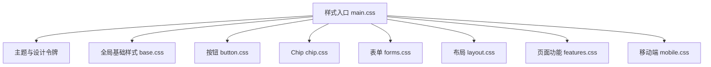
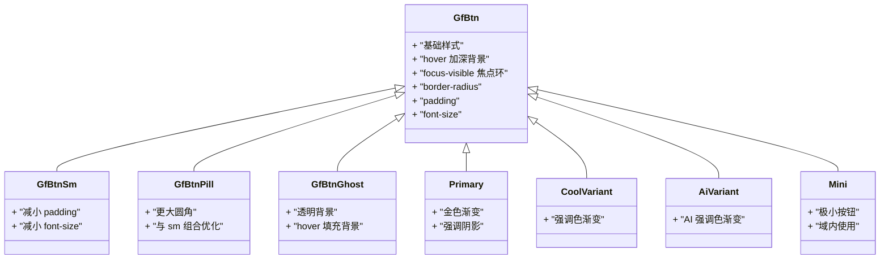
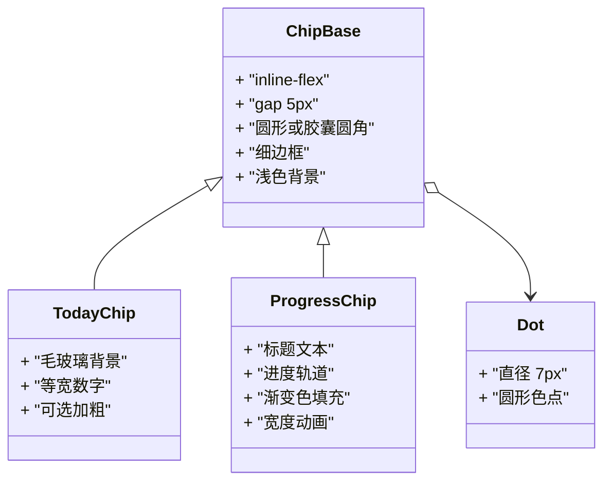
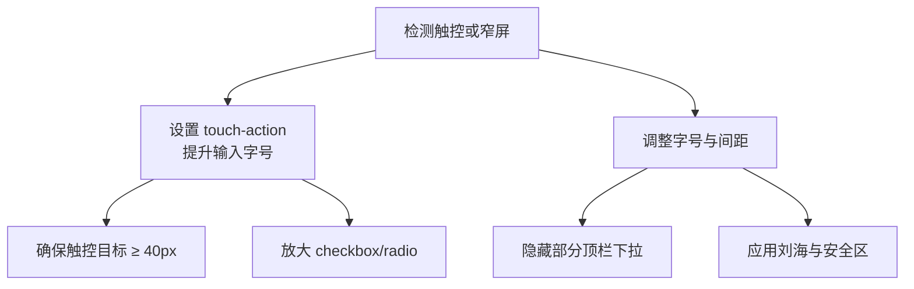
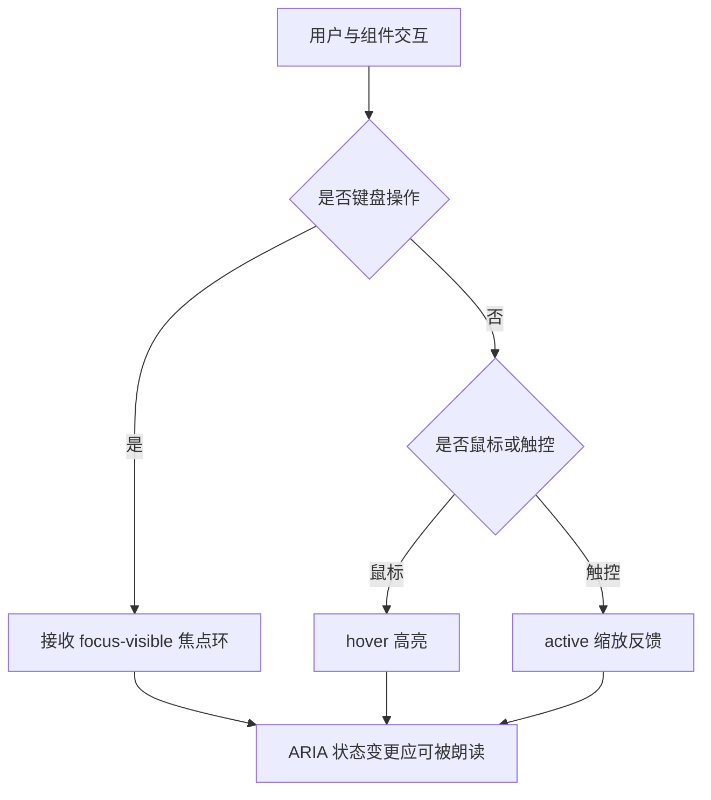
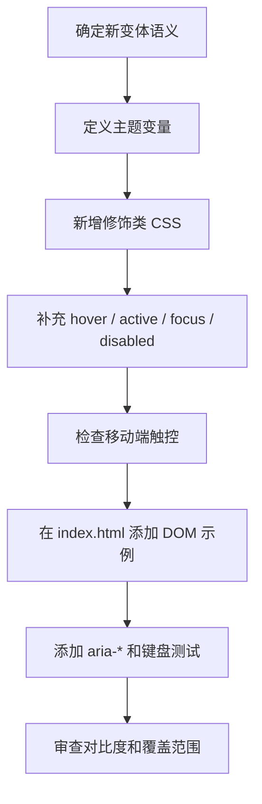

# 可复用 UI 组件类 API 参考

<cite>
**本文引用的文件**   
- [index.html](file://index.html)
- [button.css](file://assets/css/components/button.css)
- [chip.css](file://assets/css/components/chip.css)
- [forms.css](file://assets/css/components/forms.css)
- [main.css](file://assets/css/main.css)
- [mobile.css](file://assets/css/components/mobile.css)
- [base.css](file://assets/css/base.css)
</cite>

## 目录
1. [文档目标与命名约定](#文档目标与命名约定)
2. [样式加载顺序与覆盖规则](#样式加载顺序与覆盖规则)
3. [按钮组件 gf-btn](#按钮组件-gf-btn)
4. [标签组件 Chip](#标签组件-chip)
5. [表单组件](#表单组件)
6. [移动端与触屏适配](#移动端与触屏适配)
7. [无障碍建议](#无障碍建议)
8. [扩展新变体的步骤](#扩展新变体的步骤)
9. [常见使用示例清单](#常见使用示例清单)
10. [故障排查](#故障排查)
11. [总结](#总结)

## 文档目标与命名约定
本参考文档面向 GoalFlow 前端中的可复用 UI 组件类，重点说明以下内容：
- 按钮 `gf-btn` 及其尺寸、胶囊和幽灵变体。
- `gf-chip`、`pill`、进度条 chip 和今日 chip 的用法。
- `input`、`textarea`、`select` 的通用样式类与交互。
- 实际 DOM 示例来自项目根目录的 `index.html`，用于展示 class、`data-*` 属性以及 JS 绑定点。
- 移动端处理策略和无障碍注意事项。
- 如何安全扩展现有变体，而不破坏 `gf-` 命名空间的核心样式。

本参考不包含任何业务逻辑代码的实现细节，只描述组件样式类和语义职责。

## 样式加载顺序与覆盖规则

GoalFlow 的入口样式通过 `assets/css/main.css` 按依赖顺序引入基础样式、按钮、Chip、表单、布局、功能页面样式和移动端样式。加载链如下所示。



**图表来源**
- [main.css:1-11](file://assets/css/main.css#L1-L11)

关键结论：
- `mobile.css` 位于加载链末尾，因此它可以覆盖前面定义的桌面端样式。
- 自定义覆盖也应优先放在移动端断点和主题变量之后，避免被基础类或框架默认规则反向覆盖。
- 不要直接为 `.gf-btn`、`.gf-chip`、`.gf-input` 等核心选择器写全量样式；只添加修饰类或使用更高层级的容器限定作用域。

**本节来源**
- [main.css:1-11](file://assets/css/main.css#L1-L11)

## 按钮组件 gf-btn

### 组件定位
`gf-btn` 是 GoalFlow 中通用的按钮样式基类。它基于原生的 `button` 元素构建，提供小圆角、细边框、浅背景、渐变主色和聚焦环，整体风格接近 Linear 设计语言。

HTML 基本结构是：
```html
<button type="button" class="gf-btn [变体]">按钮文案</button>
```

其中 `[变体]` 由尺寸修饰符、形状修饰符和行为语义组合而成。

### 可用 class 与语义

| class | 语义 | 默认行为 | 交互状态 |
|---|---|---|---|
| `gf-btn` | 基础按钮 | 半透明面板背景 + 细边框 + 中等字体 | hover 加深背景，focus-visible 显示外描边焦点环 |
| `gf-btn--sm` | 小型按钮 | 减少内边距和字号 | 保持 hover/focus 行为 |
| `gf-btn--pill` | 胶囊形状 | 配合 `gf-btn--sm` 使用时更自然 | 圆角更大，触控区域更圆滑 |
| `gf-btn--ghost` | 幽灵按钮 | 透明背景、浅色文字 | hover 时填充面板背景并提高文字对比度 |
| `primary` | 主要动作按钮 | 金色渐变背景、强调阴影 | hover 略提亮度，通常用于“解析”“保存”“开始”类操作 |
| `cool` | 强调型主要按钮 | 以主题强调色为主调 | hover 去边框，突出强调色 |
| `ai` | AI 相关动作 | 二次强调色渐变 | 适用于 AI 分析或智能动作入口 |
| `gf-btn--mini` | 域内迷你按钮 | 更小内边距，适合卡片或行列内部操作 | 常用于四象限、工具栏等紧凑上下文 |

需要特别注意：项目中并未实现独立的 `secondary`、`tertiary` 修饰符类。当前颜色语义主要由以下类表达：

- **Primary（主要）**：`gf-btn--primary` 或原生命名兼容的 `button.primary`。
- **Ghost（次要/弱化）**：`gf-btn--ghost`，用于辅助操作，如“稍后”“关闭”。
- **Cool / AI（强调）**：`gf-btn--cool` 和 `gf-btn--ai`，用于差异化重要行为。

如果希望引入明确的 `secondary`、`tertiary` 语义，应新增对应修饰类，而不是让业务页面重复写出复杂渐变。

### 按钮尺寸与形状关系

- `gf-btn--sm` 定义较小内边距和字号。
- 当 `gf-btn--sm` 与 `gf-btn--pill` 同时出现，或在顶栏 `.topbar-actions .gf-btn--sm` 中出现时，会使用更合适的胶囊内边距和圆角。
- `gf-btn--mini` 不继承胶囊形状语义，更适合紧凑网格内部的操作。



**图表来源**
- [button.css:1-108](file://assets/css/components/button.css#L1-L108)

### 实际 DOM 示例（来自 index.html）

以下为两个可直接观察到的 DOM 片段路径：

1. 设置按钮（幽灵 + 小型 + 胶囊 + 固定 id）  
   - class：`gf-btn gf-btn--sm gf-btn--pill gf-btn--ghost`  
   - id：`btnSettings`  
   - title：`"⚙ 设置"`  
   - 语义：次要操作，进入系统设置页。  
   - 绑定点：脚本可通过 `document.getElementById('btnSettings')` 获取。  
   - 示例位置：[index.html:顶部工具栏区域](file://index.html#L36-L66)

2. 周回顾横幅主按钮（小型 + 主要颜色）  
   - class：`gf-btn gf-btn--sm gf-btn--primary`  
   - id：`btnReviewBanner`  
   - 语义：确认完成本周回顾的主要动作。  
   - 绑定点：脚本可通过 `document.getElementById('btnReviewBanner')` 获取。  
   - 示例位置：[index.html:需要关注区域](file://index.html#L82-L120)

其他可观察按钮包括：
- “备份数据”：`gf-btn gf-btn--sm gf-btn--pill`
- “恢复数据”：`gf-btn gf-btn--sm gf-btn--pill`
- “解析并生成”：`gf-btn gf-btn--primary`
- “载入示例”：`gf-btn`
- “清空”：`gf-btn gf-btn--ghost`

这些示例体现了同一个 `gf-btn` 基类下，通过不同修饰类形成完整主次层次。

### hover、focus 与禁用状态

| 状态 | 视觉表现 | 建议 |
|---|---|---|
| 默认 | 细边框 + 面板背景 + 文本颜色 | 避免自行加入大阴影 |
| hover | 边框颜色变化，背景混合深色 | 不改变可访问性对比度 |
| focus-visible | 外描边焦点环，偏移 2px | 保留键盘可达性，不要把 outline 全局移除 |
| active（移动端） | 缩放至 0.96、透明度 0.85 | 由移动端规则补充 |
| disabled | 原生 disabled 按钮不可点击 | 仍需降低对比度，并在 tooltip 或 title 中说明原因 |

注意：
- 样式文件中对 `disabled` 没有额外特殊状态类；如需统一禁用样式，可在业务层追加 `.is-disabled` 之类的新类，但不要覆盖 `.gf-btn:focus-visible` 的焦点环。

**本节来源**
- [button.css:1-108](file://assets/css/components/button.css#L1-L108)
- [index.html:顶部工具栏和需要关注区域](file://index.html#L30-L120)

## 标签组件 Chip

### 组件定位
Chip 在 GoalFlow 中承担三类角色：
1. 普通标签：表示分类、状态或轻量元信息。
2. 今日 chip：展示日期或时间片段。
3. 进度 chip：在顶栏展示叶子任务完成进度，包含进度条。

基础样式类是 `.gf-chip` 和兼容选择器 `.pill`，二者共享相同布局。

### class 与作用

| class | 用途 | 特性 |
|---|---|---|
| `.gf-chip` | 通用标签 | 行内 flex、圆角、细边框、轻背景、带 dot 子元素 |
| `.pill` | 兼容旧版 pill 语义 | 与 `.gf-chip` 完全一致 |
| `.today-chip` | 顶栏今日标签 | 毛玻璃背景、等宽数字、可搭配加粗高亮 |
| `.progress-chip` | 进度 chip | 含标题、进度轨道和内嵌进度填充动画 |
| `.progress-chip .bar` | 进度轨道 | 浅背景、隐藏溢出、宽度由 JS 控制 |
| `.progress-chip .bar i` | 进度填充块 | 渐变色、宽度过渡动画 |



**图表来源**
- [chip.css:1-64](file://assets/css/components/chip.css#L1-L64)

### Chip 的实际 DOM 示例（来自 index.html）

1. 顶栏进度 chip  
   - class：`progress-chip`  
   - id：`progressChip`  
   - 内部子元素：
     - 标题节点：`id="progressLbl"`
     - 进度条轨道：`.bar`
     - 进度填充节点：`id="progressFill"`，通过内联样式 `width: 0%` 控制百分比  
   - 语义：在目标解析后显示叶子任务的完成进度。  
   - 绑定点：JS 通过 `progressChip`、`progressLbl`、`progressFill` 三个 ID 更新文本与进度宽度。  
   - 示例位置：[index.html:顶部工具栏右侧](file://index.html#L16-L35)

2. 通用 chip 容器（今日线提示）  
   - class：`today-chip`  
   - id：`todayLine`  
   - 语义：用于展示“今日关键条目”或日期提示区。  
   - 绑定点：JS 可动态替换其内部 HTML 或文本。  
   - 示例位置：[index.html:今日视图头部附近](file://index.html#L67-L85)

如果需要表示“选中态”，当前 Chip 样式未内置专门的选中类。推荐做法：
- 新增 `.gf-chip--active` 或 `.is-selected` 作为修饰类。
- 通过主题色增强背景或边框。
- 保持与其他 chip 相同的对齐结构和 dot 位置。

Chip 关闭按钮的行为不在现有 CSS 中统一实现。若需要在筛选 chip 中添加关闭图标，建议使用：
- 一个 `button` 或 `<span tabindex="0" role="button">` 作为关闭图标。
- 使用 `aria-label` 说明关闭的标签名称。
- 通过 JavaScript 触发移除逻辑。

**本节来源**
- [chip.css:1-64](file://assets/css/components/chip.css#L1-L64)
- [index.html:顶部工具栏与今日视图头部](file://index.html#L10-L85)

## 表单组件

GoalFlow 的表单样式集中在 `forms.css`，并辅以全局基础样式和移动端断点。

### input 与 textarea

| 元素或类 | class / 元素 | 说明 |
|---|---|---|
| 输入框 | `gf-input` | 宽屏 100% 宽度、圆角、内边距、深色半透明背景 |
| 多行输入 | `textarea` | 默认高度约 150px，垂直可调整大小 |
| 增长式输入 | `gf-input--grow` | `flex: 1`，最小宽度 140px，适合弹性布局内的输入 |
| 提示文字 | placeholder | 使用较浅的 muted 颜色 |

交互特征：
- 焦点态会切换边框到强调色，并带有 3px 扩散的柔和高光。
- placeholder 使用 muted 色，避免误导为用户输入内容。
- 焦点 outline 由表单样式接管，因此不要再为输入框添加全局 `outline: none` 而不移除聚焦效果。

#### 实际 DOM 示例

1. 自由文本输入区  
   - 元素：`<textarea>`  
   - id：`input`  
   - placeholder：包含中文提示，演示目标和计划文本格式  
   - 绑定点：JS 通过 `document.getElementById('input')` 读取用户输入文本  
   - 示例位置：[index.html:目标规划输入面板](file://index.html#L120-L170)

2. 主题下拉选择框  
   - 元素：`<select>`  
   - class：`gf-input gf-select`  
   - id：`themeSelect`  
   - aria-label：`"界面主题"`  
   - 选项值：`linear`、`raycast`、`rpg`  
   - 绑定点：脚本监听 `change` 事件并根据 value 设置主题  
   - 示例位置：[index.html:主题切换区域](file://index.html#L28-L45)

### select 样式规范

- `select.gf-input` 与 `.gf-select` 共享下拉样式。
- 删除浏览器默认外观。
- 使用双箭头 SVG 风格的背景图。
- 右向箭头由伪元素背景的 CSS linear-gradient 合成。
- `.gf-select--demo` 是示例专用样式，扩大宽度并限制最大宽度。

### checkbox 与 radio

CSS 文件中没有为 checkbox 和 radio 定义独立样式，但移动端样式针对它们做了触控适配。因此：
- 桌面端行为由浏览器原生复选框样式决定。
- 移动端会把 checkbox 和 radio 放大到至少 `20px × 20px`，便于触摸。
- 四象限等特定区域的 checkbox 也有局部尺寸调整。

#### 实际 DOM 示例

由于本项目主页面的表单示例集中在 `input`、`textarea` 和 `select`，checkbox 和 radio 更多出现在功能视图中，而非首页。你可以这样扩展 Demo：

1. 多选 checkbox  
   ```html
   <label>
     <input type="checkbox" class="gf-checkbox" />
     <span>启用自动备份</span>
   </label>
   ```

2. 单选 radio  
   ```html
   <fieldset class="gf-radio-group">
     <legend>输出格式</legend>
     <label><input type="radio" name="format" value="json" checked /> JSON</label>
     <label><input type="radio" name="format" value="ics" /> ICS</label>
   </fieldset>
   ```

虽然这两段不是 `index.html` 中的现有 DOM，但它们遵循 `gf-` 命名约定，适合作为未来组件库的稳定示例。

**本节来源**
- [forms.css:1-86](file://assets/css/components/forms.css#L1-L86)
- [mobile.css:移动端触控区域与输入字号规则](file://assets/css/components/mobile.css#L1-L100)
- [index.html:textarea 和 select 示例](file://index.html#L120-L170)

## 移动端与触屏适配

GoalFlow 的移动端规则由 `mobile.css` 管理，目标是让按钮可读、触控可达、输入框不被 iOS 自动放大、hover 控件不消失、视口安全区不被吃掉。

### 关键行为

| 场景 | 行为 |
|---|---|
| 触屏设备 | 禁用 300ms 点击延迟，禁用自动高亮，保留双指缩放 |
| 输入框 | 强制最小字号 16px，防止 iOS 聚焦时自动放大画面 |
| 触控目标 | 按钮和常用交互控件最小高度 40px |
| checkbox/radio | 宽高至少 20px |
| hover 控件 | 在触屏上常驻显示，避免永远点不到 |
| 点击反馈 | `:active` 缩放 0.96，透明度 0.85 |
| 窄屏 | 提升基础字号，缩小组件字号和间距 |
| 超窄屏 | 将行内操作换行，避免挤压文本 |



**图表来源**
- [mobile.css:触屏基线与窄屏规则](file://assets/css/components/mobile.css#L1-L120)

### 对按钮和 Chip 的影响

- 按钮在移动设备上会获得更大内边距和字号，且 `active` 反馈明显。
- `gf-btn--sm` 在窄屏会继续微调，不会因过小导致误触。
- `.today-chip` 在窄屏会被隐藏，因为顶栏空间紧张，日期信息可由 hero 区域替代。
- 如果自定义 Chip 需要显示关闭按钮，必须确保它是原生 `button` 或通过 `tabindex="0"` 暴露到键盘树，并且触控区域足够大。

**本节来源**
- [mobile.css:1-200](file://assets/css/components/mobile.css#L1-L200)
- [base.css:1-85](file://assets/css/base.css#L1-L85)

## 无障碍建议

### 按钮

- 所有按钮元素都应有明确的类型：`<button type="button">`。
- 非导航按钮不要使用 `type="submit"`，以免意外提交父表单。
- `title` 可作为额外说明；不能代替 `aria-label`。
- 图标按钮若无可见文本，应使用 `aria-label`。
- 始终保留 `:focus-visible` 焦点环。

### 表单

- 每个 `<input>`、`<textarea>`、`<select>` 应尽量关联 `<label>`，或使用 `aria-label` / `aria-labelledby`。
- 错误态应：
  - 将输入框边框改为明显的错误色。
  - 增加 `aria-invalid="true"`。
  - 用 `<div class="gf-hint gf-error">` 放置错误提示。
  - 用 `aria-describedby` 链接到错误消息。
- placeholder 不应代替 label。

### Chip

- 如果 Chip 是可选择的，建议使用：
  - `role="option"`（列表中选择项）或 `role="switch"`（开关）。
  - `aria-checked="true|false"`。
  - 如果是筛选 chip，则 `role="checkbox"` 和 `aria-checked`。
- 关闭按钮应：
  - 使用 `button` 或 `role="button"`。
  - 设置 `aria-label="关闭标签"`。
  - 支持 Enter 和 Space 触发。

### 键盘可达性

- `tabindex` 仅用于无原生可聚焦元素的包裹容器。
- 不要随意使用负值把已有可聚焦元素从键盘导航移除。
- 屏幕阅读器用户可能无法理解 emoji-only 按钮，需要 aria 文本。



[此图为概念流程，不直接映射具体源文件]

## 扩展新变体的步骤

如果你要为按钮或 Chip 添加新变体，请按以下步骤进行：

1. 在设计令牌中定义新的语义颜色或主题变量，例如 `--color-secondary`、`--chip-active-bg`。
2. 在对应 CSS 文件中新增修饰类，例如：
   - `.gf-btn--secondary`
   - `.gf-btn--danger`
   - `.gf-chip--active`
3. 复用已有样式变量，不要硬编码颜色和阴影。
4. 为 hover、active、focus、disabled 补充对应状态。
5. 在移动端文件中检查触控目标大小和活跃反馈。
6. 在 `index.html` 或 demo 页面添加可验证的 DOM 示例。
7. 为新变体编写无障碍要求：
   - 可聚焦。
   - 可键盘操作。
   - 颜色对比度符合 WCAG 标准。
   - 状态变更可被屏幕阅读器感知。
8. 不要覆盖 `.gf-btn` 的基础样式；只在修饰选择器中追加差异。



[此图为概念流程图，不直接映射具体源文件]

**本节来源**
- [button.css:1-108](file://assets/css/components/button.css#L1-L108)
- [chip.css:1-64](file://assets/css/components/chip.css#L1-L64)
- [mobile.css:1-200](file://assets/css/components/mobile.css#L1-L200)
- [index.html:真实按钮与表单示例](file://index.html#L10-L170)

## 常见使用示例清单

### 按钮示例

| 示例 | class | id / data-* | 绑定点 | 使用场景 |
|---|---|---|---|---|
| 项目菜单按钮 | `gf-btn gf-btn--sm gf-btn--pill gf-btn--ghost` | `id="btnProjects"` | `document.getElementById('btnProjects')` | 打开项目下拉或新建项目 |
| 导出 JSON 备份 | `gf-btn gf-btn--sm gf-btn--pill` | `id="btnExportJson"` | `document.getElementById('btnExportJson')` | 本地导出数据备份 |
| 解析并生成 | `gf-btn gf-btn--primary` | `id="btnParse"` | `document.getElementById('btnParse')` | 解析用户输入的目标文本 |
| 关闭横幅 | `gf-btn gf-btn--sm gf-btn--ghost` | `id="btnDismissBanner"` | `document.getElementById('btnDismissBanner')` | 忽略提醒或关闭 banner |

**本节来源**
- [index.html:顶部工具栏与操作区](file://index.html#L20-L120)

### Chip 示例

| 示例 | class | id | 绑定点 | 说明 |
|---|---|---|---|---|
| 进度 chip | `progress-chip` | `progressChip` | 根据内部 `progressLbl`、`progressFill` 更新 | 显示叶子任务完成百分比 |
| 今日 chip | `today-chip` | `todayLine` | JS 可动态写入 | 展示今日主线或关键提示 |

如果需要新增“标签筛选 Chip”或“选中 Chip”，可参考以上结构并在外层添加 `.is-selected` 或新增 `.gf-chip--active` 修饰类。

**本节来源**
- [chip.css:1-64](file://assets/css/components/chip.css#L1-L64)
- [index.html:顶栏与今日头部](file://index.html#L10-L60)

### 表单示例

| 示例 | 元素或类 | id / class | binding | 说明 |
|---|---|---|---|---|
| 自由文本输入 | `textarea` | `id="input"` | 读取 value 并传给解析逻辑 | 输入目标或计划文本 |
| 主题下拉 | `select` + `gf-input gf-select` | `id="themeSelect"` | 根据 value 切换主题 | 用户界面主题选择 |
| 示例主题下拉 | `select.gf-input.gfslect.gfslect--demo` | `id="demoSelect"` | 渲染示例主题并加载示例 | 演示区示例选择 |

注意：上述第三个示例的实际 class 字符串中存在排版占位；实际源码使用的是 `gf-input gf-select gf-select--demo`，开发者应以源码为准。

**本节来源**
- [forms.css:1-86](file://assets/css/components/forms.css#L1-L86)
- [index.html:主题选择与示例区](file://index.html#L28-L66)
- [index.html:目标规划区](file://index.html#L120-L170)

## 故障排查

| 问题 | 可能原因 | 解决方法 |
|---|---|---|
| 按钮焦点环消失 | 全局样式覆盖了 `:focus-visible` 或设置了 `outline: none` | 保留或恢复焦点环，不要直接覆盖 `.gf-btn:focus-visible` |
| 按钮在小屏幕上太小 | 未按移动端规范增加触控高度 | 使用 `gf-btn--sm`，并确保移动端 min-height 生效 |
| 输入框在 iOS 聚焦时放大画面 | 字体小于 16px 触发系统缩放 | 依靠移动端规则或显式设置输入框字号 |
| Chip 内容过长无法判断含义 | 缺少截断或省略提示 | 对长文本使用 CSS 文本省略 + tooltip，或在侧面板展开详情 |
| Chip 无法被关闭 | 关闭元素不是可聚焦或可点击元素 | 改用 `button` 或赋予 `tabindex="0" role="button"` |
| checkbox 在移动端难以点击 | 原生控件尺寸太小 | 确保移动端 20px 尺寸生效，必要时在业务层扩展 checkbox 样式 |
| placeholder 看起来像已输入 | placeholder 颜色过深 | 复用 `var(--muted-2)`，并保持 placeholder 与 label 分离 |
| 新增变体被意外覆盖 | 修改了基础 `.gf-btn` 或样式加载顺序不正确 | 只在修饰类上覆盖，并把业务覆盖放到主题与移动端之后 |

**本节来源**
- [button.css:1-108](file://assets/css/components/button.css#L1-L108)
- [forms.css:1-86](file://assets/css/components/forms.css#L1-L86)
- [mobile.css:1-200](file://assets/css/components/mobile.css#L1-L200)

## 总结

GoalFlow 的可复用 UI 组件基于清晰的命名空间和模块化的样式文件：
- `gf-btn` 是按钮基类，支持 `--sm`、`--pill`、`--ghost`、`--ai`、`--mini` 以及 `primary`、`cool` 等行为语义。
- `gf-chip` 和 `pill` 提供通用标签语义，并派生出 `today-chip`、`progress-chip` 等专业形态。
- `gf-input`、`textarea`、`gf-select` 提供统一的深色表单风格、焦点环和 placeholder 规范。
- 移动端通过 `mobile.css` 保证触控可达、输入框稳定、窄屏排版合理。
- 无障碍要求是所有组件扩展的前置条件：必须明确 `aria-*`、keyboard behavior、contrast 和屏幕阅读器语义。
- 扩展新变体时应采用主题变量和修饰类，而不是直接改写 `.gf-` 基础类。

最终目标是让用户能用最少 class 组合出可访问、可维护、风格一致的界面，同时让开发者能清晰区分按钮、标签和表单三种基础交互模型。