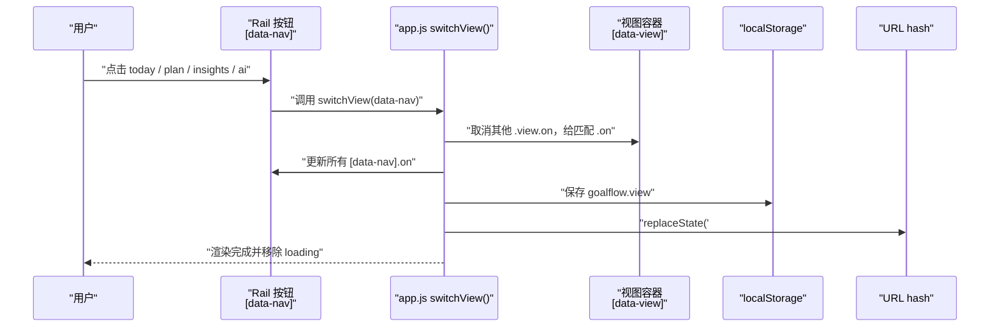
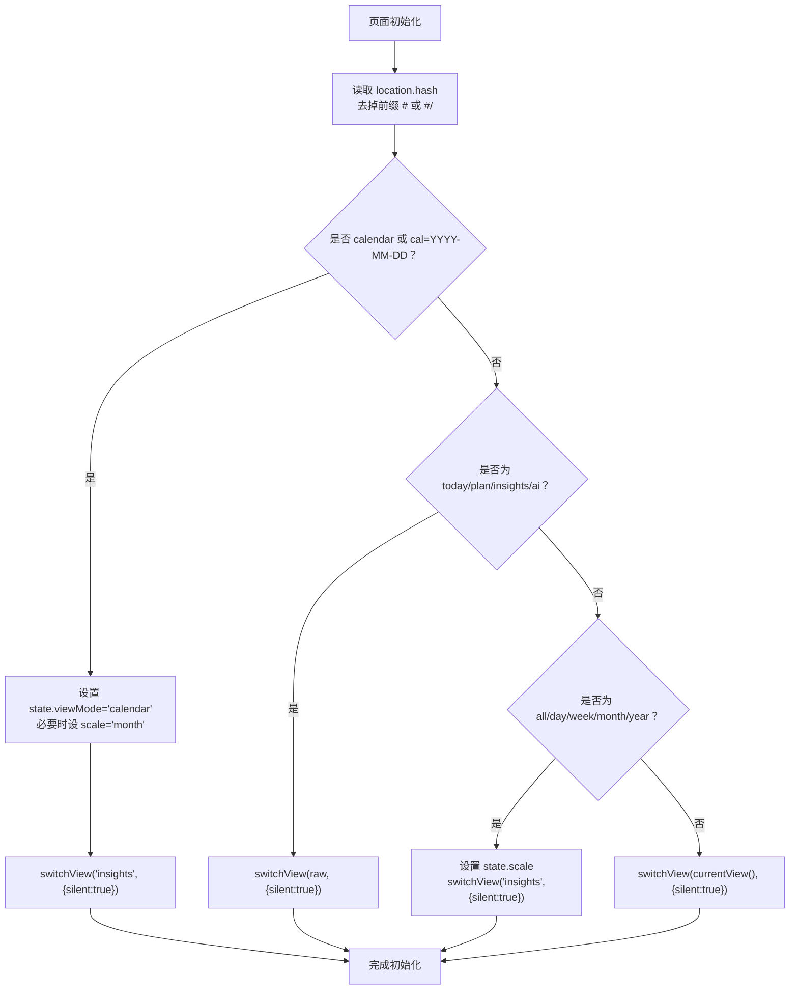
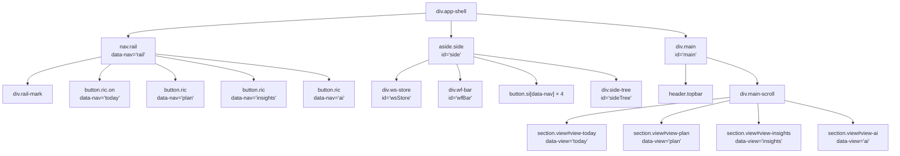
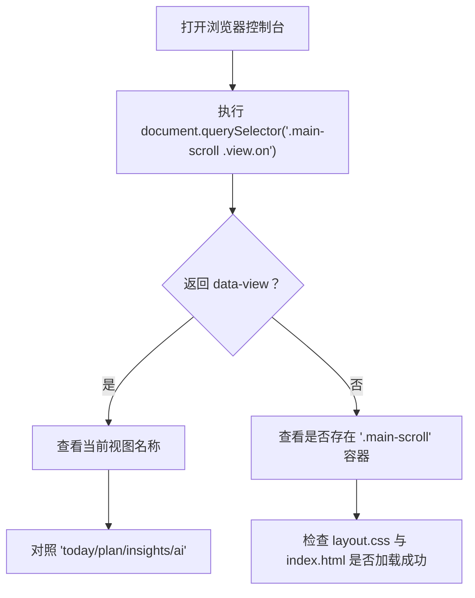

# 应用 Shell 与三栏布局

<cite>
**本文引用的文件**
- [index.html](file://index.html)
- [layout.css](file://assets/css/components/layout.css)
- [app.js](file://assets/js/app.js)
</cite>

## 目录
1. [概述](#概述)
2. [Shell 总结构](#shell-总结构)
3. [左侧图标轨：Rail](#左侧图标轨rail)
4. [左侧边栏：Side](#左侧边栏side)
5. [主内容区：Main](#主内容区main)
6. [三栏 CSS 变量与尺寸](#三栏-css-变量与尺寸)
7. [路由 hash、导航高亮与视图切换](#路由-hash导航高亮与视图切换)
8. [DOM 树示意图](#dom-树示意图)
9. [典型 Class 与用途清单](#典型-class-与用途清单)
10. [调试方法](#调试方法)
11. [常见问题与修复](#常见问题与修复)
12. [结论](#结论)

## 概述
GoalFlow 的桌面 Shell 采用「左图标轨 + 中侧栏 + 右主内容」的三栏布局。Shell 由 `index.html` 中的 `<div class="app-shell">` 提供骨架，CSS 文件定义各栏宽度、Flex 排布与滚动行为，JavaScript 根据 `data-nav` 属性和 URL `#`hash 切换 today / plan / insights / ai 四个视图，并把选中态同步到 Rail 与 Side。

本文件重点说明以下职责分工：
- HTML：声明 Shell 区域、视图容器与导航按钮。
- CSS：定义 Rail、Side、Main 的固定宽度与 Flex 协作关系。
- JS：解析 hash、定位 `[data-view]` 视图、更新 `[data-nav].on` 高亮、持久化当前视图。

**章节来源**
- [index.html:13-45](file://index.html#L13-L45)
- [layout.css:3-30](file://assets/css/components/layout.css#L3-L30)
- [app.js:4357-4390](file://assets/js/app.js#L4357-L4390)

## Shell 总结构
Shell 根节点是 `body` 下的单个 `<div class="app-shell">`。它包含三类子元素：
1. `<nav class="rail" data-nav="rail">`：左侧图标导航轨。
2. `<aside class="side" id="side">`：工作区标题、工作流/仓库区域、视图标签、目标树等。
3. `<div class="main" id="main">`：顶部工具栏与滚动视口 `.main-scroll`，内部放置所有视图 `<section class="view">`。

```mermaid
graph TB
    body["<body>"] --> shell["<div class=\"app-shell\">"]
    shell --> rail["<nav class=\"rail\" data-nav=\"rail\">"]
    shell --> side["<aside class=\"side\" id=\"side\">"]
    shell --> main_el["<div class=\"main\" id=\"main\">"]
    main_el --> topbar["<header class=\"topbar\">...<div class=\"topbar-actions\">...</div></header>"]
    main_el --> scroll["<div class=\"main-scroll\">"]
    scroll --> vtoday["<section id=\"view-today\" data-view=\"today\">"]
    scroll --> vplan["<section id=\"view-plan\" data-view=\"plan\">"]
    scroll --> vinsights["<section id=\"view-insights\" data-view=\"insights\">"]
    scroll --> vai["<section id=\"view-ai\" data-view=\"ai\">"]
```

**图表来源**
- [index.html:13-45](file://index.html#L13-L45)
- [index.html:47-79](file://index.html#L47-L79)
- [index.html:82-120](file://index.html#L82-L120)

**章节来源**
- [index.html:13-120](file://index.html#L13-L120)

## 左侧图标轨：Rail
Rail 是 `<nav class="rail" data-nav="rail">`，主要功能：
- 展示品牌标识 `.rail-mark`。
- 提供 four 个主视图按钮：
  - `data-nav="today"`：今日行动。
  - `data-nav="plan"`：目标规划。
  - `data-nav="insights"`：归纳洞察。
  - `data-nav="ai"`：AI 分析。
- 每个按钮都有类 `ric`，被激活时会追加 `on`（例如 Rail 上默认显示 `class="ric on"` 对应 today）。
- 底部有风格实验室入口 `<span class="rail-bottom">`。

Rail 不是传统意义上的“单行水平”导航；它是纵向堆叠的图标轨道，宽度固定为 52px，使用 flex 垂直排列，并通过 `.ric.on` 给出当前选中的视觉反馈。

关键点：
- 触发来源：Rail 按钮最终通过 `switchView(b.dataset.nav)` 调用同一视图切换逻辑。
- 状态来源：点击后会同步 `location.hash`，并把对应按钮加 `on`。



**图表来源**
- [index.html:20-35](file://index.html#L20-L35)
- [app.js:4361-4381](file://assets/js/app.js#L4361-L4381)
- [app.js:6665-6678](file://assets/js/app.js#L6665-L6678)

**章节来源**
- [index.html:20-35](file://index.html#L20-L35)
- [app.js:4361-4381](file://assets/js/app.js#L4361-L4381)
- [app.js:6665-6678](file://assets/js/app.js#L6665-L6678)

## 左侧边栏：Side
Side 是 `<aside class="side" id="side">`，承载多组 UI 区域：

| 区块 | 关键 class/id | 作用 |
| --- | --- | --- |
| 工作区头部 | `.ws-store`、`.ws-dot`、`.ws-tx` | 显示工作区名称“目标流 · GoalFlow”和本地数据提示。 |
| 工作流条 | `.wf-bar`，id=`wfBar` | 可展开多个项目/工作流列表区域。 |
| 仓库存储入口 | `.ws-store`，id=`wsStore` | 与项目/数据存储相关区域（标题和交互由 JS 填充）。 |
| 视图分组标签 | `.slabel` | 小标题，如“视图”、“仪式”、“目标树”。 |
| 视图操作按钮 | `.si[data-nav="today|plan|insights|ai"]` | 与 Rail 对应的 Side 视图按钮。 |
| 仪式入口 | `.si#sideMorning/#sideEvening/#sideWeekPlan/#sideWeekReview` | 打开晨计划、晚总结、周计划、周回顾。 |
| 目标树容器 | `.side-tree`，id=`sideTree` | 解析后显示树形结构；初始占位含“解析后在此显示目标树”。 |

Side 的常用样式特性：
- 宽度固定为 230px。
- 背景与 Rail 一致，用于表达左侧两个面板的统一风格。
- 自身允许纵向滚动（`overflow-y: auto`），主列则独立滚动。
- 子项 `.si` 支持悬停高亮；被选中时通常与 `data-nav` 高亮逻辑配合（实际高亮主要靠 Rail 的 `.ric.on`，但 Side 也参与事件绑定）。

**章节来源**
- [index.html:37-79](file://index.html#L37-L79)
- [layout.css:65-188](file://assets/css/components/layout.css#L65-L188)

## 主内容区：Main
Main 是 `<div class="main" id="main">`，分为两层：

1. 顶部区域：
   - `<header class="topbar">`：面包屑标题（`crumbSection`）、进度条、主题选择、设置菜单等。
   - `.topbar-actions`：存放项目、更多操作、导出、导入、主题切换等按钮。

2. 滚动视口：
   - `<div class="main-scroll">`：真正承载所有 `view` 容器的滚动区域。
   - `<section class="view" id="view-today" data-view="today">`：默认主页。
   - `<section class="view" id="view-plan" data-view="plan">`：输入/树形维护。
   - 同结构还有 `view-insights` 与 `view-ai`。

`.main` 的职责不是计算自身 width：它作为 flex 子项自动填充剩余空间，并通过 `.main-scroll` 处理内容溢出滚动。`min-width: 0` 防止子内容破坏 Flex 收缩行为。

```mermaid
flowchart TD
    A["<div class=\"main\" id=\"main\">"] --> B["<header class=\"topbar\">"]
    A --> C["<div class=\"main-scroll\">"]
    C --> D["<section id=\"view-today\" data-view=\"today\">"]
    C --> E["<section id=\"view-plan\" data-view=\"plan\">"]
    C --> F["<section id=\"view-insights\" data-view=\"insights\">"]
    C --> G["<section id=\"view-ai\" data-view=\"ai\">"]
```

**图表来源**
- [index.html:47-79](file://index.html#L47-L79)
- [index.html:82-120](file://index.html#L82-L120)

**章节来源**
- [index.html:47-120](file://index.html#L47-L120)

## 三栏 CSS 变量与尺寸
在当前源码中，三栏的关键布局实现如下：

| 组件 | 关键 CSS 行为 | 说明 |
| --- | --- | --- |
| `.app-shell` | `display: flex; height: 100vh; height: 100dvh; overflow: hidden` | 作为 Shell 主轴，占据整屏高度，不产生外壳滚动。 |
| `.rail` | `width: 52px; flex: 0 0 auto; border-right: 1px solid var(--stroke); background: var(--bg1); display: flex; flex-direction: column` | 固定 52px 图标轨道，不可伸缩。 |
| `.side` | `width: 230px; flex: 0 0 auto; border-right: 1px solid var(--stroke); background: var(--bg1); display: flex; flex-direction: column; padding: 14px 10px 10px; overflow-y: auto; overflow-x: hidden` | 固定 230px 侧栏，自身纵向滚动。 |
| `.main` | `flex: 1 1 0; min-width: 0; display: flex; flex-direction: column; overflow: auto; padding: 0` | 弹性填充剩余宽度；`.main-scroll` 负责内层滚动。 |

关于文档目标中提到的三个 CSS 变量：

- `--rail-w`：用于表示 Rail 宽度的语义化变量。**在该布局文件中，Rail 直接硬编码了 `width: 52px`，并未读取 `--rail-w`**。因此若需要统一用变量控制 Rail 宽度，可在 `.rail` 中改为 `width: var(--rail-w, 52px)` 或在其它 CSS 文件中覆盖该变量。
- `--side-w`：用于表示 Side 宽度的语义化变量。**当前代码同样未引用 `--side-w`**，而是直接在 `.side` 中设置 `width: 230px`。
- `--content-x1`：文档中标注为主内容起始横坐标，但当前源码中没有发现对 `--content-x1` 的赋值或计算。**当前主内容位置是 flex 自动分配剩余空间的语义结果**，而非依靠某个 `left: --content-x1` 类型的偏移。

换句话说：
- 当前三栏总占用宽度约为 52px + 230px + 主内容剩余宽度。
- 如果需要扩展主题系统让 Rail/Side 宽度成为全局变量，建议把这两处 width 改写为 `var(--rail-w, ...)` 和 `var(--side-w, ...)`，并在 CSS 主题层定义该变量。
- 如果希望用 `--content-x1` 作为“主内容左边缘”，则还需要在 `.main` 或父容器中加入基于该变量的布局逻辑；目前主内容并非通过 `left` 或 `margin-left` 手动定位。

**章节来源**
- [layout.css:6-12](file://assets/css/components/layout.css#L6-L12)
- [layout.css:15-30](file://assets/css/components/layout.css#L15-L30)
- [layout.css:65-90](file://assets/css/components/layout.css#L65-L90)
- [layout.css:200-216](file://assets/css/components/layout.css#L200-L216)

## 路由 hash、导航高亮与视图切换
视图切换的核心函数是 `switchView(name, opts)`：

1. **校验视图名**：不在 `VIEWS = { today, plan, insights, ai }` 中则回退到 `today`。
2. **查找目标视图**：通过 selector `.main-scroll .view[data-view="${name}"]` 定位当前要显示的视图。
3. **更新视图可见性**：遍历所有 `.main-scroll .view`，仅给 `dataset.view === name` 的那个添加 `on`，其余移除。
4. **同步 Rail 和 Side 高亮**：对所有 `[data-nav]` 按钮执行 `classList.toggle('on', b.dataset.nav === name)`。
5. **更新面包屑**：根据 `VIEWS[name]` 更新 `crumbSection` 文本。
6. **持久化状态**：保存到 `localStorage.goalflow.view`。
7. **滚回顶部**：滚动 `.main-scroll` 到顶部。
8. **写入 hash**：调用 `history.replaceState(null, '', '#/' + name)`，除非选项开启 `{ silent: true }`。
9. **懒渲染**：如果被标记为脏视图，则按组重新渲染；300ms 后移除加载态。

### Hash 到视图的初始化流程
页面初始化时，应用会检查 `location.hash`：

- 如果 raw hash 等于 `calendar` 或匹配 `cal=YYYY-MM-DD`：
  - 进入 insights 视图，模式设为 `calendar`；带日期时还会切换到月尺度。
- 如果 raw hash 是 `today` / `plan` / `insights` / `ai`：
  - 直接 `switchView(raw, { silent: true })`，不改变 URL。
- 如果是 `all` / `day` / `week` / `month` / `year`：
  - 设置 `state.scale`，再进入 insights 视图。
- 否则：
  - 从 localStorage 的 `goalflow.view` 回退到已保存视图，默认是 `today`。



**图表来源**
- [app.js:4357-4381](file://assets/js/app.js#L4357-L4381)
- [app.js:6665-6678](file://assets/js/app.js#L6665-L6678)

注意：
- 普通点击 Rail/Side 按钮会通过 `switchView` 把 hash 写进 URL；
- 页面首次解析 hash 时使用 `{ silent: true }`，避免把旧 hash 误写到 URL。

**章节来源**
- [app.js:4357-4381](file://assets/js/app.js#L4357-L4381)
- [app.js:6665-6678](file://assets/js/app.js#L6665-L6678)

## DOM 树示意图
下面给出 Shell 下的核心 DOM 层级示意，突出三栏、view 容器和 nav-link 关联点：



**图表来源**
- [index.html:20-35](file://index.html#L20-L35)
- [index.html:37-79](file://index.html#L37-L79)
- [index.html:82-120](file://index.html#L82-L120)

## 典型 Class 与用途清单
| 模块 | 典型 Class/id | 用途 |
| --- | --- | --- |
| Shell | `.app-shell` | 三栏布局容器，占据全屏高度。 |
| Rail | `.rail`, `.rail-mark`, `.ric` | 图标轨道、Logo、Rail 按钮基础样式。 |
| Rail 激活态 | `.ric.on` | Rail 中被选中按钮的高亮样式。 |
| Side | `.side`, `.side-ws`, `.ws-store`, `.wf-bar`, `.slabel`, `.si`, `.side-tree` | 工作区头部、工作流、仓库、侧边视图按钮、目标树。 |
| Main | `.main`, `.topbar`, `.topbar-actions` | 主列容器、顶栏、动作按钮组。 |
| 滚动容器 | `.main-scroll` | 主内容滚动区域。 |
| 视图容器 | `.view` | 每个 `data-view` 视图的外部容器；被激活时增加 `.on`。 |
| 视图属性 | `id="view-today|view-plan|view-insights|view-ai"`、`data-view="..."` | JS 定位当前要显示的视图。 |
| 导航属性 | `data-nav="today|plan|insights|ai"` | Rail 与 Side 上的视图导航键值。 |

**章节来源**
- [index.html:20-120](file://index.html#L20-L120)
- [layout.css:6-30](file://assets/css/components/layout.css#L6-L30)
- [layout.css:65-188](file://assets/css/components/layout.css#L65-L188)
- [layout.css:200-216](file://assets/css/components/layout.css#L200-L216)

## 调试方法
建议在浏览器 DevTools 中使用以下步骤快速定位 Shell 和视图问题：

1. 打开 Elements 面板，搜索 `#app-shell`、`.rail`、`.side`、`.main`。
2. 在 Console 中验证当前视图：
   - `document.querySelector('.main-scroll .view.on')?.dataset.view`
   - 应返回 `today` / `plan` / `insights` / `ai`。
3. 验证 URL hash：
   - `location.hash`
   - 正常应类似 `#/today`、`#/plan`、`#/insights`、`#/ai`。
4. 验证本地缓存视图：
   - `localStorage.getItem('goalflow.view')`
5. 检查 Rail/Side 按钮高亮：
   - `document.querySelectorAll('[data-nav].on')`
   - 应只有一条记录对应 `today` / `plan` / `insights` / `ai`。
6. 临时强制切视图：
   - `switchView('insights')`
   - 观察 `.main-scroll .view.on` 是否正确切换。
7. 检查宽度：
   - `.rail`：约 52px。
   - `.side`：约 230px。
   - `.main`：Flex 剩余宽度。
   - 可使用 Computed 面板查看计算后的 width 和 box model。
8. 检查视图内容是否被隐藏：
   - 所有非活动 `.view` 会被移除 `on`。
   - 可搜索 `.view:not(.on)`，确认只有当前视图有 `on`。



**图表来源**
- [app.js:4361-4381](file://assets/js/app.js#L4361-L4381)

**章节来源**
- [app.js:4357-4381](file://assets/js/app.js#L4357-L4381)
- [layout.css:6-12](file://assets/css/components/layout.css#L6-L12)
- [layout.css:15-30](file://assets/css/components/layout.css#L15-L30)
- [layout.css:65-90](file://assets/css/components/layout.css#L65-L90)
- [layout.css:200-216](file://assets/css/components/layout.css#L200-L216)

## 常见问题与修复
| 现象 | 可能原因 | 排查与修复 |
| --- | --- | --- |
| 整个 Shell 不可见或异常 | `.app-shell` 或其父级被隐藏，或 CSS 未加载 | 检查 DevTools 中是否有 `app-shell`、`.rail`、`.side`、`.main`；确认 `assets/css/main.css` 加载成功。 |
| Rail 被压缩为极窄或全消失 | `.rail` 被第三方样式覆盖，或被外层 `max-width`/`margin` 限制 | 检查 `.rail` 的计算样式是否为 `width: 52px`，并确认没有被 `display:none`、`visibility:hidden` 或极端 margin/padding。 |
| Side 被隐藏 | 可能被媒体查询或主题 CSS 收起，或被 `.side` 的父容器裁剪 | 检查 `.side` 是否仍在文档流；确认不是移动端仅保留 icon rail 的状态；查看 Computed Panel 的 width。 |
| 主内容被裁剪或滚动异常 | `.main` 或 `.main-scroll` 的 `overflow` 被覆盖 | 检查 `.main-scroll` 是否为 `.main` 的子容器，且未被隐藏；确保当前 `.view.on` 的内容没有被 `display:none`。 |
| 点击 Rail/Side 没有切换视图 | `[data-nav]` 按钮事件未绑定，或 `switchView` 参数无效 | 在 Console 中运行 `document.querySelectorAll('[data-nav]').length`；测试 `switchView('plan')`。 |
| URL hash 与实际视图不一致 | 页面初始化时 hash 无法解析，或 `history.replaceState` 被静默忽略 | 刷新页面后再次检查 `location.hash`；在 Console 执行 `switchView('today')` 看是否能恢复。 |
| 今日视图没有渲染 | `_viewStale.today` 没有被标记，或目标 DOM 不存在 | 检查 `#view-today` 是否存在；尝试先 `switchView('today', {silent:false})` 强制渲染流程。 |
| 希望自定义 Rail 宽度 | 当前 CSS 使用硬编码 52px | 在外部 CSS 中为 `.rail` 设置更优先的 `width`，或将样式改为 `width: var(--rail-w, 52px)` 以便统一管理。 |
| 希望用 `--content-x1` 控制主内容起点 | 当前代码未使用这个变量 | 需要新增 CSS 规则，将主内容 `left` 或父容器 padding 与 `var(--content-x1)` 关联；同时保持 Flex 布局不至于失效。 |

**章节来源**
- [index.html:20-120](file://index.html#L20-L120)
- [layout.css:6-12](file://assets/css/components/layout.css#L6-L12)
- [layout.css:15-30](file://assets/css/components/layout.css#L15-L30)
- [layout.css:65-90](file://assets/css/components/layout.css#L65-L90)
- [layout.css:200-216](file://assets/css/components/layout.css#L200-L216)
- [app.js:4361-4381](file://assets/js/app.js#L4361-L4381)
- [app.js:6665-6678](file://assets/js/app.js#L6665-L6678)

## 结论
GoalFlow 的应用 Shell 由三层清晰协作构成：
- `.app-shell` 提供固定高度的 Flex 容器。
- `.rail` 以 52px 固定图标轨道承载主视图入口。
- `.side` 以 230px 侧栏承载项目、仓库、视图标签和目标树。
- `.main` 自适应剩余宽度，并由 `.main-scroll` 承载四个 `data-view` 视图。

视图切换的逻辑集中在 `app.js` 的 `switchView` 与页面初始化阶段：
- 点击 Rail/Side 的 `[data-nav]` → `switchView` → 切换 `.view.on`、`[data-nav].on`、面包屑、hash 与 localStorage。
- 页面初始化解析 hash → 可能进入 `calendar` / `insights` / `today` / `plan` 等场景。
- 当前 CSS 没有使用 `--rail-w`、`--side-w`、`--content-x1` 这三个命名变量，而是直接设定 Rail 和 Side 宽度；如需扩展主题能力，应在 CSS 层把这些硬编码迁移到 CSS 变量。

对于调试，最快捷的路径是检查：
- `.main-scroll .view.on` 的 `data-view`。
- `[data-nav].on` 的按钮集合。
- `location.hash`。
- `.rail/.side/.main` 的实际 computed width。

**章节来源**
- [index.html:20-120](file://index.html#L20-L120)
- [layout.css:6-12](file://assets/css/components/layout.css#L6-L12)
- [layout.css:15-30](file://assets/css/components/layout.css#L15-L30)
- [layout.css:65-90](file://assets/css/components/layout.css#L65-L90)
- [layout.css:200-216](file://assets/css/components/layout.css#L200-L216)
- [app.js:4357-4390](file://assets/js/app.js#L4357-L4390)
- [app.js:6665-6678](file://assets/js/app.js#L6665-L6678)