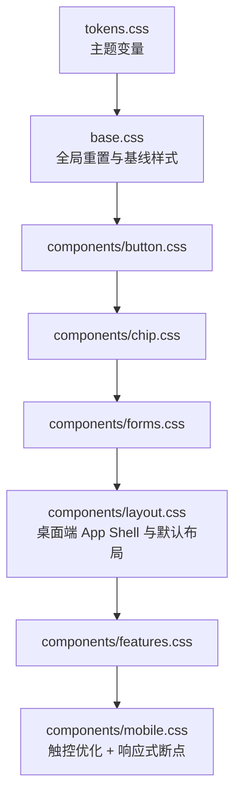
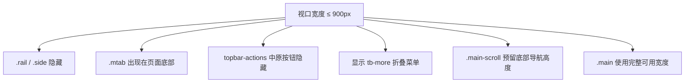
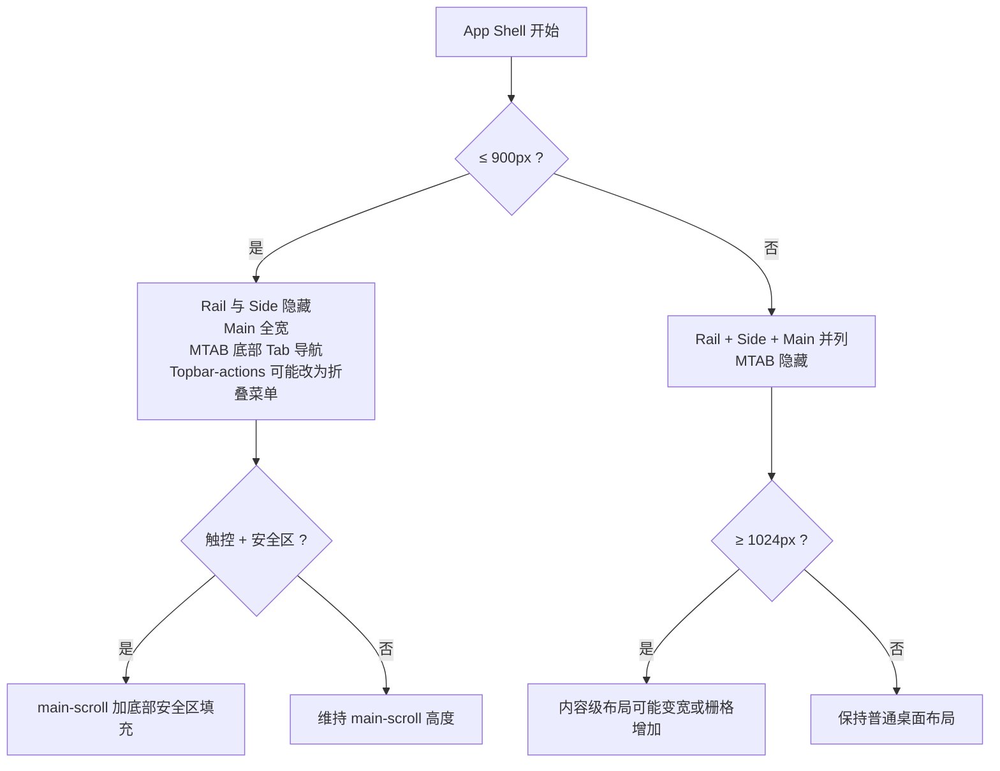

# 移动端适配与响应式规则

<cite>
**本文引用的文件 **
- [main.css](file://assets/css/main.css)
- [base.css](file://assets/css/base.css)
- [layout.css](file://assets/css/components/layout.css)
- [mobile.css](file://assets/css/components/mobile.css)
</cite>

## 目录
1. [引言](#引言)
2. [项目结构与加载顺序](#项目结构与加载顺序)
3. [断点总览](#断点总览)
4. [app-shell 布局行为：rail、side、main、mtab、topbar](#app-shell-布局行为rail-side-main-mtab-topbar)
5. [图表与组件响应式规则](#图表与组件响应式规则)
6. [CSS 优先级与变量冲突处理](#css-优先级与变量冲突处理)
7. [按视口宽度判断 app-shell 形态](#按视口宽度判断-app-shell-形态)
8. [浏览器开发者工具模拟设备最佳实践](#浏览器开发者工具模拟设备最佳实践)
9. [常见移动端问题与修复方案](#常见移动端问题与修复方案)
10. [结论](#结论)

## 引言
本文说明 GoalFlow 在移动端与响应式场景下的核心行为，重点围绕 `mobile.css` 中的触控优化与安全区处理，以及 `layout.css` 中 `<900px` 断点对 app-shell（Rail、Side、Main、Topbar）和底部 Mtab 的影响。文档还给出各断点的排布流程图、CSS 加载优先级说明，以及窄屏常见的误触、溢出、Sankey 缩放异常与 Topbar Actions 横向滚动不完整等问题的定位方法。

需要特别说明的是：经过对仓库样式的检索确认，代码中不存在 `sankey-container`、`chart-row`、`list-item` 的专用断点样式；这些类名不在当前桌面端或移动端 CSS 中被条件化渲染。它们在移动端的最终外观由桌面态默认规则与通用重置共同决定，不会被 `@media (max-width: ...)` 单独改写为单栏或折叠形态。

## 项目结构与加载顺序
GoalFlow 通过 `main.css` 以固定顺序引入样式，确保基础层 → 组件层 → 移动端覆盖层依次生效：

这个链路的意义是：

| 层级 | 主要职责 | 断言位置 |
| --- | --- | --- |
| tokens.css | 定义 `--accent`、`--bg1`、`--stroke`、`--font-ui` 等 CSS 变量 | [main.css](file://assets/css/main.css#L1-L11) |
| base.css | 重置 box model、字体、body 高度、`dvh` 兼容、触摸基线 | [base.css](file://assets/css/base.css#L1-L85) |
| layout.css | 定义 rail / side / main / topbar / .mtab / 今日面板等默认桌面行为 | [layout.css](file://assets/css/components/layout.css#L1-L244) |
| mobile.css | 覆盖触控体验、安全区、窄屏字号与操作区域、顶栏“更多”折叠菜单 | [mobile.css](file://assets/css/components/mobile.css#L1-L40) |

因此，移动端规则会“晚于”桌面端规则计算并具备更高优先级。

**章节来源**
- [main.css:1-11](file://assets/css/main.css#L1-L11)

## 断点总览
仓库中与当前目标相关的响应式断点如下：

| 断点形式 | 触发条件 | 主要影响范围 | 是否用于 Rail / Side / Main |
| --- | --- | --- | --- |
| `(hover: none) and (pointer: coarse)` | 非悬停设备且主指针粗糙（典型触屏） | 触控高亮、点击延迟、按钮最小高度、输入框字号、悬浮控件常驻 | 否；这是能力检测，不是视口宽度断点 |
| `max-width: 900px` | 视口宽度 ≤ 900px | rail/side 隐藏；Mtab 出现；今日三区分成单栏；Topbar Actions 切换为“⋯ 更多”菜单；字号缩小；画布适配 | 是 |
| `min-width: 1024px` | 视口宽度 ≥ 1024px | layout.css 中某些内容网格、侧边树等增强布局 | 是 |
| `min-width: 1440px` | 视口宽度 ≥ 1440px | 更大屏幕的内容增宽或间距放大 | 否，不直接改变 rail/side 可见性 |
| `max-width: 480px` | 视口宽度 ≤ 480px | body 与按钮继续缩小字号；今日行动动作按钮换行到底部 | 否；此断点未单独控制 rail/side/mtab 可见性 |

注意：代码中没有仅针对 `sankey-container`、`chart-row`、`list-item` 的断点；它们在不同宽度下的表现通常来自桌面态默认 CSS 及通用媒体查询（例如 `<900px` 中的全局字号变化）。

**章节来源**
- [mobile.css:11-34](file://assets/css/components/mobile.css#L11-L34)
- [mobile.css:71-170](file://assets/css/components/mobile.css#L71-L170)
- [mobile.css:174-218](file://assets/css/components/mobile.css#L174-L218)
- [mobile.css:238-300](file://assets/css/components/mobile.css#L238-L300)
- [layout.css:235-239](file://assets/css/components/layout.css#L235-L239)
- [layout.css:340-345](file://assets/css/components/layout.css#L340-L345)
- [layout.css:512-530](file://assets/css/components/layout.css#L512-L530)
- [layout.css:1500-1510](file://assets/css/components/layout.css#L1500-L1510)
- [layout.css:1592-1650](file://assets/css/components/layout.css#L1592-L1650)

## app-shell 布局行为：rail、side、main、mtab、topbar

### 桌面端默认行为
在任意宽度下，除非被 media query 或 `position` 覆盖，app-shell 的基本结构是：

| 元素 | 默认行为 |
| --- | --- |
| `.app-shell` | Flex 容器，占满视口高度，使用 `100vh` 与 `100dvh` |
| `.rail` | 左侧图标轨，固定宽度 `52px` |
| `.side` | 左侧信息树，固定宽度 `230px` |
| `.main` | 右侧内容区，`flex: 1`，可自适应剩余空间 |
| `header.topbar` | 页面顶部工具栏，包含面包屑与 `topbar-actions` |
| `.mtab` | 桌面端隐藏 |

关键结构参考路径：[layout.css:6-27](file://assets/css/components/layout.css#L6-L27)、[layout.css:77-115](file://assets/css/components/layout.css#L77-L115)、[layout.css:200-219](file://assets/css/components/layout.css#L200-L219)。

### `<900px` 时：Rail 与 Side 隐藏，Main 独占
在视口 ≤ 900px 时，Rail 与 Side 会被整体隐藏，Main 成为主布局列：

- `.rail` 与 `.side` 设置 `display: none`。
- `.main-scroll` 获得触控滚动和安全区相关的 padding-bottom。
- `.mtab` 变为固定在底部的底部导航条。
- `topbar-actions` 中部分按钮隐藏，替换为“⋯ 更多”折叠菜单。

这个行为的两个文件都参与：

**图示来源**
- [layout.css:235-239](file://assets/css/components/layout.css#L235-L239)
- [layout.css:1592-1614](file://assets/css/components/layout.css#L1592-L1614)
- [mobile.css:238-300](file://assets/css/components/mobile.css#L238-L300)

### 底部 Tab 与顶部工具栏的关系
`mtab` 是移动端的主要导航替代，而不是 Rail 或 Side 的抽屉式折叠。它的实际作用更接近“底部导航栏”，用于在页面内切换主要视图。它并没有让 Rail 变成抽屉；相反，Rail 和 Side 直接被隐藏。

Topbar 本身仍位于页面顶部，但其中部分按钮：

- `#btnWeekReview`、`#btnSettings`、`#btnExportIcs`、`#btnExportJson`、`#btnImportJson` 会隐藏。
- 新增一个 `.tb-more` “⋯” 折叠菜单承载这些操作。
- 主题选择器下拉在极窄场景会被进一步隐藏或简化。

参考路径：[mobile.css:238-300](file://assets/css/components/mobile.css#L238-L300)、[layout.css:1610-1614](file://assets/css/components/layout.css#L1610-L1614)。

### 关于“侧边是否折叠成抽屉或隐藏”
明确回答：**当前代码没有实现抽屉式侧栏**。在 ≤ 900px 下，Rail 与 Side 只是被隐藏，没有任何 transform/translate/margin-left/right 的抽屉展开逻辑。如果未来需要抽屉行为，需要新增动画与状态类；现有样式只负责切换可见性与底部 Tab。

**章节来源**
- [layout.css:6-11](file://assets/css/components/layout.css#L6-L11)
- [layout.css:14-27](file://assets/css/components/layout.css#L14-L27)
- [layout.css:77-115](file://assets/css/components/layout.css#L77-L115)
- [layout.css:200-219](file://assets/css/components/layout.css#L200-L219)
- [layout.css:235-239](file://assets/css/components/layout.css#L235-L239)
- [layout.css:1592-1614](file://assets/css/components/layout.css#L1592-L1614)
- [mobile.css:238-300](file://assets/css/components/mobile.css#L238-L300)

## 图表与组件响应式规则

### Sankey 图、Sankey Container、Chart Row、List Item
对以下类名的实际行为做明确澄清：

| 类名 | 是否有专用断点 | 移动端处理方式 | 说明 |
| --- | --- | --- | --- |
| `sankey-container` | 否 | 无特殊规则 | 未在当前仓库中检索到该选择器的媒体查询 |
| `chart-row` | 否 | 无特殊规则 | 同上 |
| `list-item` | 否 | 无特殊规则 | 同上 |
| `.canvas-wrap.fit #diagram-svg` | 是，属于 `<900px` 附近触控优化语境 | SVG 保持原始尺寸，添加 `.fit` 时可缩放到容器宽度 | 用于解决“图表字太小”与双指缩放导致整页滚动的体验问题 |

因此，Sankey、Chart Row、List Item 若出现“单栏/折叠/缩放”等行为，应优先检查：

1. 业务 HTML 中是否添加了 `.fit`、`.view.on`、`.zone[open]` 等修饰类。
2. 父容器 `.canvas-wrap`、`.main-scroll`、`.today-panel`、`.zone-body` 的尺寸是否被更外层 CSS 覆盖。
3. JavaScript 运行时是否注入了内联宽高或 Canvas/SVG 属性。
4. 浏览器开发者工具是否误用了桌面模式。

不要假设这些类名存在独立的 1280px、1024px、768px、480px 规则——当前样式库没有这样的断点映射。

**章节来源**
- [mobile.css:148-170](file://assets/css/components/mobile.css#L148-L170)
- [mobile.css:201-238](file://assets/css/components/mobile.css#L201-L238)

## CSS 优先级与变量冲突处理

### 样式加载顺序决定的优先级
由于 `main.css` 把 `layout.css` 放在 `mobile.css` 之前加载，相同权重的选择器中，`mobile.css` 会覆盖 `layout.css`。这满足“桌面端写基础布局，移动端覆盖”的预期。

此外：

- `base.css` 中定义了 `html`、`body`、全局 box model、`100dvh` 基线、触控基线 `touch-action`。
- `mobile.css` 在触屏能力模式下再次设置一组元素的 `touch-action`，并通过 `!important` 强制输入框 `font-size` 不低于 `16px`。
- `mobile.css` 用显式注释声明：“放在 main.css 的 @import 链最后，确保覆盖桌面规则”。

### 与桌面端 CSS 变量的冲突原则
GoalFlow 使用 CSS 自定义属性作为主题系统，而不是直接在移动端硬编码颜色。常见的变量包括：

| 变量 | 典型用途 | 是否由移动端直改 |
| --- | --- | --- |
| `--bg1` | Rail、Side、Panel 背景色 | 否 |
| `--stroke` | 边框、分割线 | 否 |
| `--panel-strong` | 按钮、卡片次级背景 | 否 |
| `--ink` | 正文墨色 | 否 |
| `--muted` | 次要文字色 | 否 |
| `--topbar-bg` | 顶部工具栏背景 | 否 |
| `--accent` / `--accent-2` | 强调色与渐变终点 | 否 |
| `--safe-area-inset-*` | 安全区边距 | 否，通过 `env()` 使用 |

因此，“冲突”一般不是桌面变量被移动端覆盖，而是：

1. 移动端媒体查询改变了布局属性，使桌面变量产生的视觉效果被隐藏或压缩。
2. 主题色变量值过小或对比度不足，导致小屏触控后难以识别。
3. 业务自定义 CSS 或内联样式使用了更高优先级。

排查建议：

- 在开发者工具中将样式来源切换到 `mobile.css`，观察具体生效的规则。
- 使用 `var(--xxx)` 解析查看面板确认变量值。
- 对疑似被覆盖的选择器添加临时断言测试，不要盲目追加 `!important`。

**章节来源**
- [main.css:1-11](file://assets/css/main.css#L1-L11)
- [base.css:1-15](file://assets/css/base.css#L1-L15)
- [mobile.css:1-13](file://assets/css/components/mobile.css#L1-L13)
- [layout.css:14-27](file://assets/css/components/layout.css#L14-L27)
- [layout.css:244-272](file://assets/css/components/layout.css#L244-L272)

## 按视口宽度判断 app-shell 形态
下面的流程图帮助读者判断在 320px、480px、768px、1024px、1280px 时，app-shell 的实际布局形态。核心断点是 `900px`，而 `layout.css` 中另有 `1024px`、`1440px` 的内容级断点。

| 视口宽度 | app-shell 形态 | 说明 |
| --- | --- | --- |
| 320px | Mobile Layout | `≤900px` 已激活；Rail、Side 隐藏；MTAB 底部导航；Topbar 功能收缩为折叠菜单 |
| 480px | Mobile Layout | 仍在 `<900px`；额外字号与今日行排版调整；Rail/Side 仍然隐藏 |
| 768px | Mobile Layout | 仍在 `<900px`；平板竖屏也走移动端布局 |
| 1024px | Desktop Layout + 宽屏增强 | Rail/Side 显示；内容级断点可能启用更宽布局 |
| 1280px | Desktop Layout + 更宽内容 | Rail/Side 显示；若有 `>1280px` 的栅格扩展逻辑，则进一步增大可视内容 |

需要再次提醒：上述 1024px、1280px 的影响主要来自 `layout.css` 中的 `min-width` 内容断点，而非 Rail/Side 的可见性规则。Rail/Side 的可见性仍以 `900px` 为界限。

**图示来源**
- [layout.css:235-239](file://assets/css/components/layout.css#L235-L239)
- [layout.css:512-530](file://assets/css/components/layout.css#L512-L530)
- [layout.css:1592-1614](file://assets/css/components/layout.css#L1592-L1614)
- [mobile.css:238-300](file://assets/css/components/mobile.css#L238-L300)

## 浏览器开发者工具模拟设备最佳实践
为保证调试结果与实际移动端一致，请遵循以下实践：

1. 使用设备模拟时的横纵屏切换，分别检查 `<900px` 下的 Topbar、MTAB 与 Side Tree。
2. 开启“传感器选项”中的 `User agent = iOS 14 iPhone X` 或 Android Pixel 类型 UA，以匹配 Safari/Chrome on mobile 的行为。
3. 启用 `Viewport units -> safe area`，否则刘海、手势栏和 `env(safe-area-inset-*)` 无法真实展示。
4. 打开 `Emulation -> Device pixel ratio`，从 1× 逐步提升到 2×、3×，验证 SVG/Canvas 在高分辨率屏幕上是否仍清晰。
5. 检查 Touch/Mobile Events 模拟，尤其是触摸事件与 `touch-action: manipulation` 是否阻止了 300ms 延迟。
6. 对 iOS 真机，特别关注键盘弹出时输入框是否滚动进视口，因为样式中只保证容器可滚动，JS 中由 `focusin` 处理滚动。
7. 对于图表相关调试，先关闭任何 JS 自动计算的宽高，仅看 CSS 是否将 `.canvas-wrap.fit #diagram-svg` 设为 `width: 100%`。

**章节来源**
- [mobile.css:238-251](file://assets/css/components/mobile.css#L238-L251)
- [layout.css:1592-1614](file://assets/css/components/layout.css#L1592-L1614)
- [base.css:5-10](file://assets/css/base.css#L5-L10)

## 常见移动端问题与修复方案

### 1. 触控区域太小导致误触或难以点击
现象：

- 小按钮不易点击。
- 复选框太小。
- hover 操作的控件在触屏上不可见或无反馈。

原因：

- 桌面端按钮尺寸不符合人体工程学触控目标。
- 触控设备缺少 `:hover` 效果。
- 默认 input 字号小于 16px 可能触发 iOS 自动放大。

修复要点：

- 依赖 `mobile.css` 中对 `.gf-btn`、按钮族、`.ric`、`.si`、四象限按钮的最小高度 `40px`。
- 复选框/单选框尺寸被放大到 `20px` 左右。
- 将鼠标悬停才出现的控件在触屏上改为常驻。
- 输入框强制 `font-size: 16px !important`，避免 iOS 聚焦放大带来的意外视口变化。
- 给活跃状态增加缩放和透明度反馈。

排查清单：

- 在开发者工具中切换到 `Coarse Pointer` 模式。
- 确认元素没有被 `pointer-events: none` 或过小的 z-index 遮挡。
- 确认业务自定义样式没有把 `min-height` 覆盖为更小值。

**章节来源**
- [mobile.css:11-34](file://assets/css/components/mobile.css#L11-L34)
- [mobile.css:68-147](file://assets/css/components/mobile.css#L68-L147)

### 2. 侧边树在窄屏下溢出
现象：

- Side 树在窄屏或长列表中水平滚动、被裁切或与内容重叠。
- 树节点文字过长时挤占 Main 宽度。

原因：

- 在 ≤ 900px 时，Side 已被隐藏，因此严格意义上不再发生“侧边树溢出撑破布局”。
- 但若用户通过开发者工具强制保留 `.side`，或开发阶段移除该规则，可能出现旧布局行为。
- Side 内部 `child` 节点使用左内边距表示层级，长文本仍需正确处理最小宽度。

修复建议：

- 正常 ≤ 900px 下，保持 `.rail` 与 `.side` 隐藏，不要强行恢复。
- 如需自行扩展侧边行为，不要在 `<900px` 下破坏 `.main{ min-width: 0; flex: 1 }`。
- 对超长节点文本改用截断与省略，而不是强制不换行。
- 若未来实现抽屉式侧栏，确保 Drawer 使用 overlay 或 transform，不要让 Side 与 Main 同时挤压。

**章节来源**
- [layout.css:183-204](file://assets/css/components/layout.css#L183-L204)
- [layout.css:235-239](file://assets/css/components/layout.css#L235-L239)

### 3. Sankey 图缩放异常
现象：

- 图表在手机上字太小。
- 双指缩放时整页跟着缩放。
- 图表宽度不正确或超出容器。

修复要点：

- 确保图表容器处于 `.canvas-wrap` 之下。
- 若希望 SVG 自动适应容器宽度，可为根 SVG 添加 `.fit` 类，对应规则会把宽度设为 `100%`、高度设为 `auto`。
- 使用 `overscroll-behavior: contain` 减少双指缩放导致的页面滚动。
- 避免在移动端 JS 中为 SVG 设置固定像素宽高，除非确认容器宽度不再变化。

**章节来源**
- [mobile.css:148-170](file://assets/css/components/mobile.css#L148-L170)
- [mobile.css:240-247](file://assets/css/components/mobile.css#L240-L247)

### 4. Topbar Actions 横向滚动不完整
现象：

- Topbar Actions 在手机上没有全部显示。
- 多个按钮形成两行或横向滚动时手指滑动不顺畅。
- 导出 ICS/JSON、主题下拉等功能找不到。

修复要点：

- 正常情况下，≤ 900px 的原按钮会被隐藏，并统一进入 `.tb-more` 的“⋯”折叠菜单。
- 如果看到多个按钮挤在一起，确认 `.tb-drop` 的 `z-index: 70` 未被覆盖。
- 检查 `header.topbar` 的内边距是否被其他规则覆盖。
- 如果希望某些按钮在移动端仍显示，不要把它们的样式改为固定宽度，应允许其在 `topbar-actions` 的 flex 布局中自然排列。
- 对于确实需要横向滚动的场景，使用带 `-webkit-overflow-scrolling: touch` 的可滚动容器，并为子项设置 `white-space: nowrap` 和 `flex: 1 1 auto`。

参考相关行为位置：

- `tb-more` 折叠菜单与隐藏的原按钮规则。
- `viewbar` 与 `zoombar` 在窄屏下的横向滚动示例模式。

**章节来源**
- [mobile.css:238-300](file://assets/css/components/mobile.css#L238-L300)
- [mobile.css:201-238](file://assets/css/components/mobile.css#L201-L238)
- [layout.css:1610-1614](file://assets/css/components/layout.css#L1610-L1614)
- [layout.css:244-277](file://assets/css/components/layout.css#L244-L277)

### 5. 输入法弹出后底部内容被遮挡
现象：

- 输入框弹出虚拟键盘后，按钮或表单被遮挡。
- 滚动区域高度异常。

处理现状：

- `mobile.css` 显式为 `.main-scroll` 预留底部安全区填充。
- `layout.css` 在 ≤ 900px 时也为 `.main-scroll` 设置底部 padding，以容纳 Mtab。
- 真正的输入框焦点滚动逻辑由 `app.js` 的 `focusin` 处理。

修复建议：

- 首先确认容器 `.main-scroll` 有 `overflow-y: auto` 且未被 `overflow: hidden` 覆盖。
- 不要在不了解 JS 行为的前提下手动调大 padding，以免出现空白区域。
- 如果仍遮挡，检查页面是否存在新的 fixed/bottom 浮层或 Toast 未被考虑在安全区中。

**章节来源**
- [mobile.css:240-251](file://assets/css/components/mobile.css#L240-L251)
- [layout.css:207-219](file://assets/css/components/layout.css#L207-L219)
- [layout.css:1611-1614](file://assets/css/components/layout.css#L1611-L1614)

## 结论
GoalFlow 的移动端适配核心是一个较简单但清晰的策略：

- 桌面端由 `layout.css` 定义 Rail + Side + Main 三栏布局。
- ≤ 900px 时，Rail 与 Side 隐藏，Main 独占宽度，底部 Mtab 承担导航职责，Topbar Actions 切换为“⋯”折叠菜单。
- `mobile.css` 重点优化触控体验、安全区、字号、点击反馈与窄屏交互，不引入抽屉式侧栏。
- 目前不存在 `sankey-container`、`chart-row`、`list-item` 的专用响应式断点；它们的移动端形态主要由桌面默认样式与通用媒体查询决定。
- 若需要完善移动端体验，优先检查触控目标、底部安全区、输入框键盘遮挡与图表容器自适应，而不是为不存在的断点制造新样式。