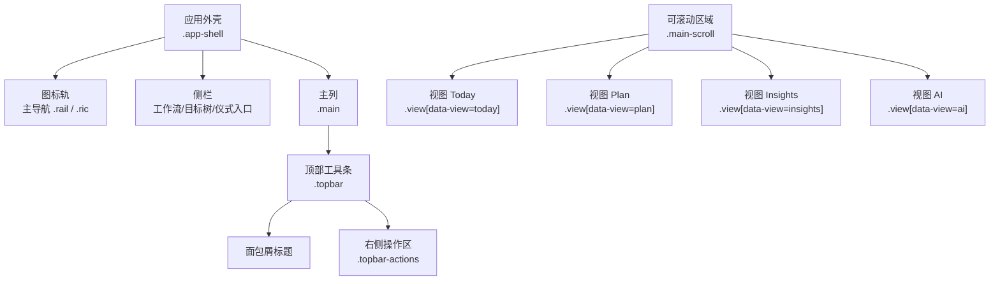
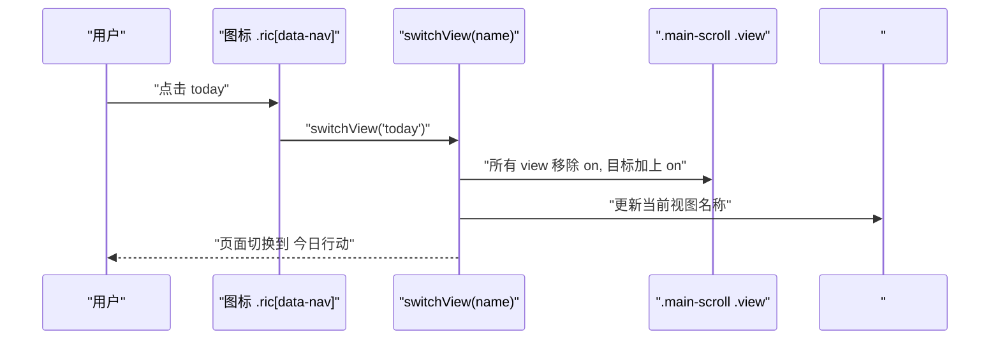
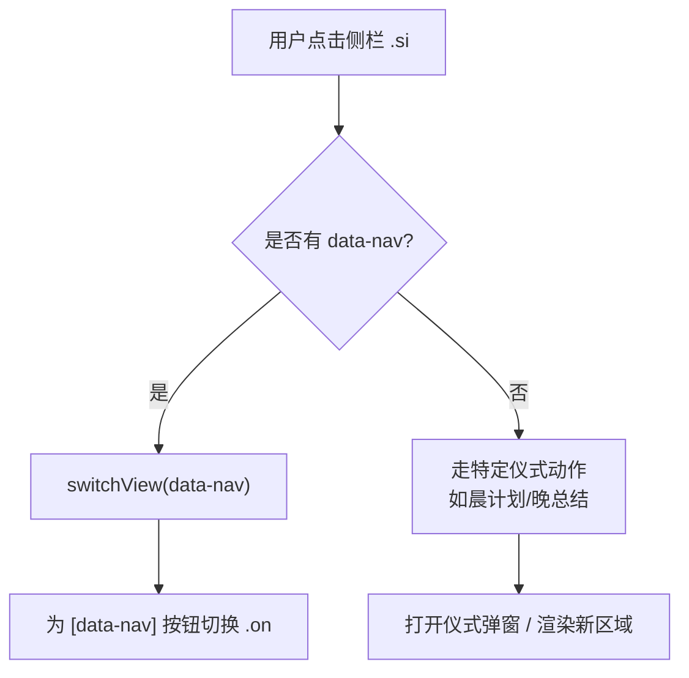
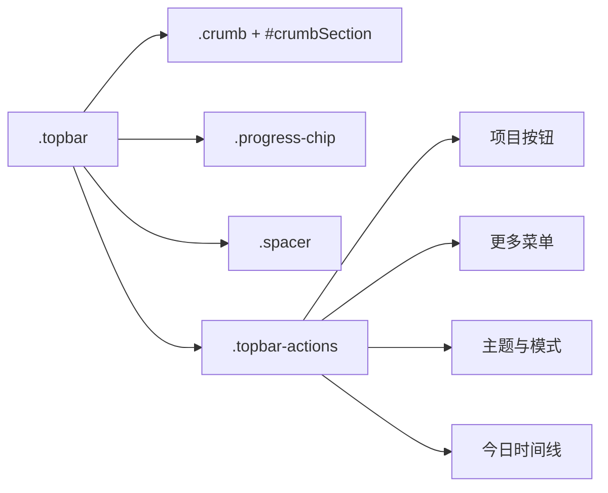
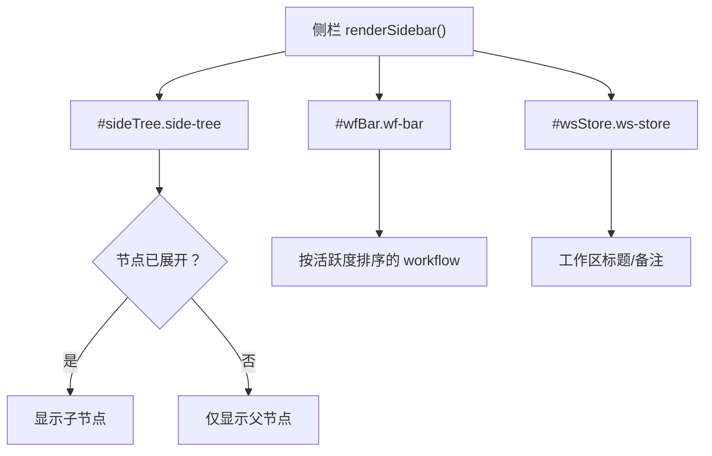
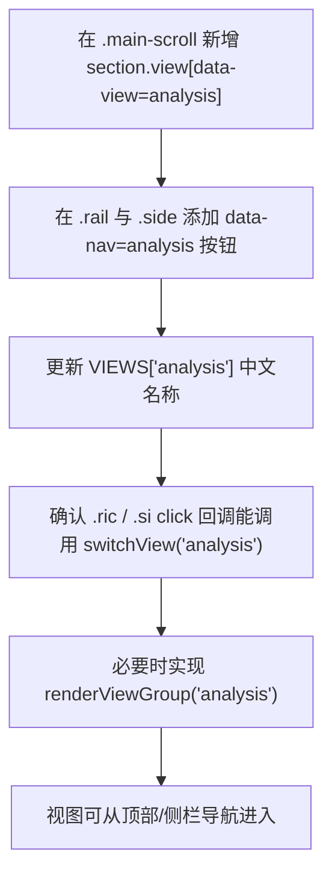
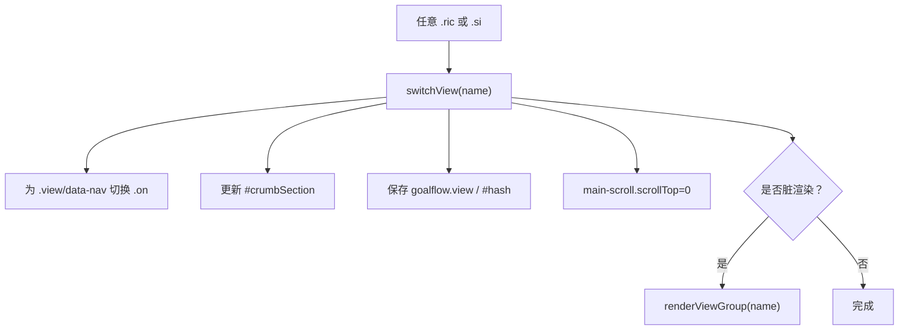

# 页面结构 ric / si / topbar

<cite>
**本文引用的文件**   
- [index.html](file://index.html)
- [layout.css](file://assets/css/components/layout.css)
- [app.js](file://assets/js/app.js)
</cite>

## 目录
1. [介绍](#介绍)
2. [项目结构与关键容器](#项目结构与关键容器)
3. [ric：主导航与视图外层](#ric主导航与视图外层)
4. [si：侧栏工作空间列表](#siside侧栏工作空间列表)
5. [topbar：标题、状态与右侧操作区](#topbar标题状态与右侧操作区)
6. [side 子区域：slabel、side-tree、wfBar、wsStore、bottom-bar](#side-子区域slabelsidetree-wfbar-wsstore-bottom-bar)
7. [典型页面快照：class 与数据属性标注](#典型页面快照class-与数据属性标注)
8. [新增视图的模板插入流程](#新增视图的模板插入流程)
9. [依赖关系与事件链路](#依赖关系与事件链路)
10. [性能与响应式要点](#性能与响应式要点)
11. [常见问题排查](#常见问题排查)
12. [结论](#结论)

## 介绍
GoalFlow 的主页采用“图标轨 + 侧栏 + 主内容”三列布局。本组件级文档聚焦于三个层级结构：
- **`.rail .ric`**：主导航图标，选择“今日行动 / 目标规划 / 归纳洞察 / AI 分析”四大视图。
- **`.main-scroll > .view[data-view=…]`**：页面主视图外层容器，承载同一份 `main-scroll` 滚动容器中的多个视图。
- **`.main > header.topbar`**：顶部标题栏，显示当前视图、进度芯片与主题、导出等操作按钮。

同时说明侧栏中 `.si`、`.slabel`、`.side-tree`、`.wfBar`、`.wsStore` 等元素的作用，并解释如何在 `app.js` 中处理顶栏和侧栏的事件。

## 项目结构与关键容器

**图表来源**
- [index.html:10-48](file://index.html#L10-L48)
- [index.html:100-185](file://index.html#L100-L185)
- [index.html:185-416](file://index.html#L185-L416)

本节仅描述整体骨架；更细粒度的 class 与 data 属性在“典型页面快照”中逐项标注。

**节来源**
- [index.html:1-416](file://index.html#L1-L416)
- [layout.css:10-340](file://assets/css/components/layout.css#L10-L340)

## ric：主导航与视图外层

### 作用
- `.rail .ric` 是左侧图标轨上的四个导航按钮，对应 `data-nav="today" | "plan" | "insights" | "ai"`。
- 当某个 `.ric.on` 处于激活态时，表示当前选中的主视图。
- `.main .view` 不是 ric，而是右侧主内容的每个视图外层；`switchView(name)` 会把目标 `.view[data-view=name]` 加上 `.on`，同时为所有 `[data-nav]` 按钮切换 `.on`。

### 协作关系
- 点击 `.ric[data-nav=today]` → `switchView('today')` → `.view[data-view=today]` 变为可见。
- 同样适用于 plan、insights、ai；目前代码中没有 `data-type=all|done|pending` 或 `data-workflow=*` 驱动这些视图可见性的逻辑。
- 如果未来需要引入“按类型过滤”，通常不应直接修改 `.ric` HTML，而应在目标视图内维护 `state.type`（例如 all/done/pending）并触发视图重渲染。

**图表来源**
- [app.js:4361-4384](file://assets/js/app.js#L4361-L4384)

**节来源**
- [index.html:14-36](file://index.html#L14-L36)
- [layout.css:39-77](file://assets/css/components/layout.css#L39-L77)
- [layout.css:200-219](file://assets/css/components/layout.css#L200-L219)
- [app.js:4361-4384](file://assets/js/app.js#L4361-L4384)

## si：侧栏工作空间列表

### 作用
`.si` 是侧栏中的所有行为按钮。它既用于视图入口，也用于“仪式”入口和示例提示节点：
- 视图入口：`.si[data-nav="today"|"plan"|"insights"|"ai"]`
- 仪式入口：`#sideMorning`、`#sideEvening`、`#sideWeekPlan`、`#sideWeekReview`
- 空提示：`.side-tree .si.dim`，表示解析后才会显示真实目标树。

### active 状态
- CSS 中 `.si.on` 使选中项变粗体、高亮背景，并带边框阴影。
- JS 中切换主要发生在两处：
  - 侧栏按钮点击监听器：把自身加 `.on`，并调用 `switchView(b.dataset.nav)`。
  - `switchView` 本身也会同步所有 `[data-nav]` 按钮的状态。

### 与 data 属性的协作
- `data-nav` 统一表示“要跳转到哪个主视图”。
- 当前首页没有使用 `data-type=all|done|pending` 或 `data-workflow=*` 来控制 `.si` 显隐；如需按类型/工作区过滤，建议扩展侧栏渲染逻辑，在生成 `.si` 节点时按规则决定是否添加该类，而不是依赖全局隐藏类。

**图表来源**
- [index.html:48-90](file://index.html#L48-L90)
- [app.js:6649-6649](file://assets/js/app.js#L6649-L6649)
- [layout.css:135-179](file://assets/css/components/layout.css#L135-L179)

**节来源**
- [index.html:48-90](file://index.html#L48-L90)
- [layout.css:135-179](file://assets/css/components/layout.css#L135-L179)
- [app.js:6649-6649](file://assets/js/app.js#L6649-L6649)

## topbar：标题、状态与右侧操作区

### 结构总览
`.topbar` 由以下部分组成：
- **面包屑**：`.crumb` 含文本与 `#crumbSection`。
- **进度芯片**：`.progress-chip #progressChip`，按需显示叶子任务完成度。
- **弹性留白**：`.spacer` 占满横向剩余空间，把后续按钮推到右侧。
- **右侧操作区**：`.topbar-actions`，包含项目按钮、更多菜单、主题设置和“今天行”。

注意：当前 HTML 中没有名为 `title`、`search`、`tagFilter`、`workspacePicker` 的标准子节点；它们应理解为概念性分区名。实际代码对应如下：

| 概念名称 | 实际对应 | 作用 |
|---|---|---|
| title | `.crumb b#crumbSection` | 展示当前视图名：“今日行动”“目标规划”“归纳洞察”“AI 分析”。 |
| search | 无标准搜索框 | 未在当前首页找到全局搜索输入。若新增搜索，建议放在 `.topbar-actions` 中，并用 focus/click/input 监听过滤任务。 |
| tagFilter | 无标签筛选器 | 未发现 `tagFilter` 相关 DOM 或 JS 监听。若需支持“重要/紧急/快速赢”筛选，应先在 `main` 或视图内部增加筛选控件。 |
| workspacePicker | `.today-chip#todayLine` / `#tbMoreMenu` / `btnProjects` | “项目列表 / 切换 / 新建 / 总览”通过项目按钮和弹窗实现，不在 topbar 中存在名为 workspacePicker 的元素。 |

### 右侧操作区 `.topbar-actions`
包含：
- `#btnProjects`：打开项目列表。
- `#tbMoreMenu`：下拉“更多”，内含回顾、设置、ICS 导出、备份恢复等按钮。
- `#themeCycle`、`#themeSelect`、`#modeToggle`：主题与明暗切换。
- `#todayLine`：日期显示芯片。

`.topbar-actions` 使用 Flex 布局并允许换行；在小屏下可能产生多行堆叠。见“响应式行为”一节。

**图表来源**
- [index.html:60-100](file://index.html#L60-L100)
- [layout.css:244-304](file://assets/css/components/layout.css#L244-L304)

### JS 事件监听位置
- `#crumbSection` 不主动绑定点击；其文本在 `switchView` 中更新。
- `#tbMoreMenu` 及其下拉项：通过各自 id 绑定 click；例如回顾、设置、导入导出。
- `#btnThemeCycle`、`#modeToggle`、`#themeSelect`：主题系统会读取 `goalflow.theme` 与 `goalflow.mode`。
- 其他 action 按钮：例如 `#btnExportIcs`、`#btnExportJson`、`#btnImportJson`、`#settingsModal` 等，均位于 `.topbar-actions` 或其子菜单内。

如果需要新增“搜索”或“标签筛选”，建议在 `.topbar-actions` 中加入 `<input>` 与筛选项，并在页面初始化时注册 input/change/click 监听，然后触发当前视图的数据刷新函数。

**节来源**
- [index.html:60-100](file://index.html#L60-L100)
- [index.html:200-416](file://index.html#L200-L416)
- [layout.css:244-304](file://assets/css/components/layout.css#L244-L304)
- [app.js:4361-4384](file://assets/js/app.js#L4361-L4384)

## side 子区域：slabel、side-tree、wfBar、wsStore、bottom-bar

| 元素 | class/id | 作用 | 显示条件与交互 |
|---|---|---|---|
| 视图区块标题 | `.slabel` | 分组标签，如“视图”“仪式”“目标树”。 | 始终存在于侧栏，随侧栏显示。 |
| 目标树容器 | `#sideTree.side-tree` | 展示解析后的目标树节点；根节点与子节点分别有样式。 | 解析出节点后清空提示文本，渲染树。 |
| 工作流快捷条 | `#wfBar.wf-bar` | 列出最近活跃的工作流或项目，支持展开。 | 有工作流数据时渲染；否则为空。 |
| 工作区存储入口 | `#wsStore.ws-store` | 作为工作区集合入口，JS 会写入 title 等元信息。 | 工作区存在即渲染。 |
| 底部栏 | `.bottom-bar` | 首页 HTML 未直接定义此区域。常见做法是放在侧栏底部或主内容底部。 | 若新增底部操作区，应在 `renderSidebar` 或 `renderBottomBar` 中管理。 |

### side-tree
- 初始状态下，树中有提示文本：“解析后在此显示目标树”，并带有 `.dim` 样式，表示不可交互。
- 树中根节点用 `.root`，子节点用 `.child`，并通过缩进区分层次。
- JS 在 `renderSidebar()` 附近更新目标树；同时 `_treeRowExpanded` 保存已展开节点。

### wfBar 与 wsStore
- `wfBar` 渲染工作流列表，并根据活跃时间统计排序。
- `wsStore` 提供当前工作区或项目的快捷入口；JS 会设置它的 title 等元数据，便于 hover 提示。

### 侧边展开收起状态字段
- UI 层面使用 CSS 类控制：`.si.on`、`.expanded` 等。
- JS 层面：
  - 当前视图：`localStorage.getItem('goalflow.view')`，回退到 `"today"`。
  - 展开状态：
    - `_treeRowExpanded`：树行展开 Set。
    - 侧栏分组或 zone 折叠由对应 DOM 的 `open` 属性及偏好键管理。
  - 暂无独立的“侧栏宽度开关字段”；桌面端侧栏固定 230px，移动端隐藏。

**图表来源**
- [index.html:40-90](file://index.html#L40-L90)
- [layout.css:119-206](file://assets/css/components/layout.css#L119-L206)
- [app.js:6271-6329](file://assets/js/app.js#L6271-L6329)
- [app.js:6418-6493](file://assets/js/app.js#L6418-L6493)

**节来源**
- [index.html:40-90](file://index.html#L40-L90)
- [layout.css:119-206](file://assets/css/components/layout.css#L119-L206)
- [app.js:6270-6329](file://assets/js/app.js#L6270-L6329)
- [app.js:6418-6493](file://assets/js/app.js#L6418-L6493)

## 典型页面快照：class 与数据属性标注

下面给出一个精简的页面快照语义图，标注各 class 与数据属性，并解释其职责。该图对应首页加载后的稳定结构：

```mermaid
graph TB
    subgraph "应用外壳"
        shell["div.app-shell"]
    end

    shell --> navRail["nav.rail<br/>主导航图标轨"]
    shell --> asideSide["aside.side<br/>侧栏"]
    shell --> divMain["div.main<br/>主内容区"]

    navRail --> ricToday["button.ric[data-nav='today']"]
    navRail --> ricPlan["button.ric[data-nav='plan']"]
    navRail --> ricInsights["button.ric[data-nav='insights']"]
    navRail --> ricAi["button.ric[data-nav='ai']"]

    asideSide --> slabel1["span.slabel '视图'"]
    asideSide --> siToday["button.si[data-nav='today']"]
    asideSide --> siPlan["button.si[data-nav='plan']"]
    asideSide --> siInsights["button.si[data-nav='insights']"]
    asideSide --> siAi["button.si[data-nav='ai']"]
    asideSide --> wfBar["div.wf-bar#wfBar"]
    asideSide --> wsStore["div.ws-store#wsStore"]
    asideSide --> slabelTree["span.slabel '目标树'"]
    asideSide --> sideTree["div.side-tree#sideTree"]

    divMain --> headerTopbar["header.topbar"]
    headerTopbar --> crumb["span.crumb"]
    crumb --> crbSec["b#crumbSection"]
    headerTopbar --> progress["div.progress-chip#progressChip"]
    headerTopbar --> spacer["div.spacer"]
    headerTopbar --> actions["div.topbar-actions"]

    divMain --> mainScroll["div.main-scroll"]
    mainScroll --> viewToday["section.view[data-view='today'].on"]
    mainScroll --> viewPlan["section.view[data-view='plan']"]
    mainScroll --> viewInsights["section.view[data-view='insights']"]
    mainScroll --> viewAi["section.view[data-view='ai']"]
```

### 关键字段说明表

| 节点 | class 或 id | 数据属性 | 含义 |
|---|---|---|---|
| 主导航图标 | `rail .ric` | `data-nav` | 点击切换主视图 today/plan/insights/ai。 |
| 激活的主导航 | `ric.on` | — | 当前选中视图标。 |
| 侧栏按钮 | `side .si` | `data-nav` | 同 ric，但属于侧栏视图入口。 |
| 激活的侧栏按钮 | `si.on` | — | 视觉上突出当前视图按钮。 |
| 分组标题 | `slabel` | — | “视图”“仪式”“目标树”等区块标签。 |
| 目标树容器 | `side-tree` | `id="sideTree"` | 渲染目标树；`.dim` 表示空状态。 |
| 工作流条 | `wf-bar` | `id="wfBar"` | 近期工作流/项目汇总。 |
| 工作区入口 | `ws-store` | `id="wsStore"` | 显示当前工作区元信息。 |
| 顶部标题区 | `.crumb` | `id="crumbSection"` | 显示“目标流 / 当前视图”。 |
| 右侧操作区 | `.topbar-actions` | — | 项目、更多菜单、主题、模式控制。 |
| 视图外层 | `view` | `data-view` | 值 today/plan/insights/ai，由 JS 切换 `.on`。 |

当前 HTML **没有** 名为 `title`、`search`、`tagFilter`、`workspacePicker` 的直接子节点，因此这些词宜视为功能分区，而非现有 DOM class。

**节来源**
- [index.html:14-100](file://index.html#L14-L100)
- [index.html:100-185](file://index.html#L100-L185)
- [layout.css:39-219](file://assets/css/components/layout.css#L39-L219)
- [layout.css:244-304](file://assets/css/components/layout.css#L244-L304)

## 新增视图的模板插入流程

假设要为 GoalFlow 新增一个名为 `analysis` 的视图，应依次做三类修改：

### 步骤一：在 main-scroll 插入视图模板
- 在 `
` 中添加新的 `section.view`。
- 为该视图分配：
  - `id="view-analysis"`
  - `data-view="analysis"`
  - 至少一个 `view-inner` 容器。
- 参考现有视图写法：今日、规划、归纳洞察都遵循这个结构。

### 步骤二：在侧栏与顶部导航加入入口
- 在 `.rail` 中新增 `.ric` 按钮，值为 `data-nav="analysis"`。
- 在 `.side` 的视图块中新增 `.si` 按钮，值也为 `data-nav="analysis"`。
- 可选：在移动端底部导航 `.mtab-btn` 中新增对应条目。

### 步骤三：让 switchView 识别该视图
- `VIEWS` 对象负责映射视图 key 与中文名称。新增时需添加 `'analysis': '分析...'`。
- 如果不希望自动跳转历史 URL，可在调用时使用 `{ silent: true }`。
- 如果需要在切换后立即渲染分析内容，应实现 `renderViewGroup('analysis')` 或使用现有渲染钩子；否则会保持空白直到被显式刷新。

### 推荐流程图

**图表来源**
- [index.html:100-416](file://index.html#L100-L416)
- [app.js:4361-4384](file://assets/js/app.js#L4361-L4384)

**节来源**
- [index.html:100-416](file://index.html#L100-L416)
- [app.js:4361-4384](file://assets/js/app.js#L4361-L4384)

## 依赖关系与事件链路

### 核心依赖链
1. HTML 提供 `.ric`、`.si`、`.view[data-view=...]`、`.topbar`。
2. CSS 根据 `.on`、`.dim`、`.view.on` 控制视觉与显隐。
3. `switchView(name)`：
   - 校验 `VIEWS[name]`，非法时回退到 `'today'`。
   - 从 `.main-scroll .view[data-view=name]` 取出目标 DOM。
   - 给目标视图加 `.loading`（非静默时）。
   - 遍历所有 `.view` 和所有 `[data-nav]`，同步 `.on`。
   - 更新 `#crumbSection`。
   - 保存 `goalflow.view`。
   - 滚动到 `main-scroll` 顶部。
   - 若有脏标记 `_viewStale[name]`，则调用 `renderViewGroup(name)`。
   - 延时移除 `.loading`。

### 事件归属
- `.ric`、`.si`：通过 `data-nav` 驱动导航，最终调用 `switchView`。
- `#crumbSection`：只输出标题，不处理点击。
- `.topbar-actions` 内的按钮由各自 id 绑定的监听器处理；与 `switchView` 松耦合。

**图表来源**
- [app.js:4361-4384](file://assets/js/app.js#L4361-L4384)

**节来源**
- [app.js:4361-4384](file://assets/js/app.js#L4361-L4384)

## 性能与响应式要点

### 响应式：顶部操作区行为
- 桌面端：`.topbar-actions` 使用 Flex，允许换行，按钮按行排列。
- 小屏断点（≤900px）：`.rail` 与 `.side` 隐藏；底部出现 `.mtab` 移动端导航。
- `.topbar-actions` 没有设置横向 `overflow-x: auto`，所以新增按钮过多时会自然换行并挤压布局，这比“可滚动隐藏按钮”更容易出现内容重叠问题。
- 若希望在小屏上对 `.topbar-actions` 做右滚，可以在 CSS 中为 mobile breakpoint 添加可滚动容器，但应避免影响 Flex 基线对齐。

### 性能特点
- 视图切换通过切换 class 而非销毁 DOM，有利于保留输入状态。
- `switchView` 只在视图内容为“脏”时才重渲染：
  - 当前代码中有 `_viewStale` 标志和 `renderViewGroup`。
  - 这对大型 canvas/桑基图尤其重要，避免每次切到 insights 都重建整个图形。
- 侧栏树 `_treeRowExpanded` 用 Set 保存展开状态，避免重复计算。

**节来源**
- [layout.css:214-304](file://assets/css/components/layout.css#L214-L304)
- [layout.css:1596-1615](file://assets/css/components/layout.css#L1596-L1615)
- [app.js:4361-4384](file://assets/js/app.js#L4361-L4384)

## 常见问题排查

| 现象 | 可能原因 | 处理方法 |
|---|---|---|
| 点击 .ric 不切换视图 | HTML 缺少 `data-nav`，或 JS 未正确调用 `switchView`。 | 确认 `data-nav` 与 VIEWS 中包含相同键值。 |
| `.si.on` 不生效 | 既有 JS 监听覆盖了 `.on`，又有手动修改样式。 | 检查侧栏点击监听逻辑与 `switchView` 对 `[data-nav]` 的统一处理。 |
| `.view-insights` 切换后空白 | 视图脏渲染未被触发，或未实现对应渲染函数。 | 检查 `_viewStale['insights']` 与 `renderViewGroup`。 |
| topbar-actions 在小屏挤在一起 | Flex 换行正常，但缺少容器滚动或截断策略。 | 在小屏媒体查询中为 `.topbar-actions` 或包裹容器添加横滚样式。 |
| 目标树不显示 | 尚未解析目标或 `#sideTree` 仍显示空提示。 | 先执行目标解析，再观察 `renderSidebar()` 是否清空 `.dim` 提示。 |

**节来源**
- [layout.css:214-304](file://assets/css/components/layout.css#L214-L304)
- [app.js:4361-4384](file://assets/js/app.js#L4361-L4384)
- [app.js:6270-6329](file://assets/js/app.js#L6270-L6329)

## 结论
- `.ric` 是主导航图标，`.si` 是侧栏操作与视图入口。它们共同通过 `data-nav` 驱动 `switchView`。
- `.view[data-view=...]` 是 today、plan、insights、ai 四个视图的外层容器；当前页面没有使用 `data-type=all|done|pending` 或 `data-workflow=*` 控制这些容器的显示。
- `.topbar` 的真实子结构是 `.crumb`、`.progress-chip`、`.spacer` 和 `.topbar-actions`；其中不存在名为 `title`、`search`、`tagFilter`、`workspacePicker` 的现成子节点。
- side 区域以 `.slabel` 分组，`.side-tree` 展示目标树，`#wfBar` 与 `#wsStore` 展示工作流与工作区入口。
- 新增视图应同时修改 HTML 模板、侧栏与主导航、`VIEWS` 映射，并按需补充 `renderViewGroup` 渲染钩子。
- 当前 topbar-actions 在小屏下会换行，但未设置为可滚动容器；若新增大量操作按钮，需在响应式样式中明确滚动或隐藏次要操作。