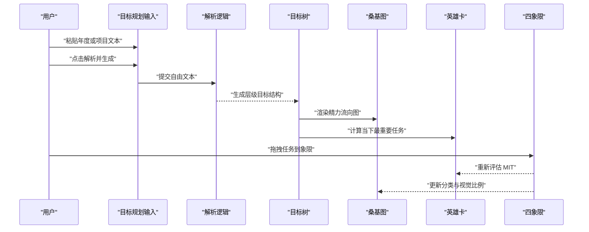

# 快速开始

<cite>
**本文引用文件**
- [README.md](file://README.md)
- [index.html](file://index.html)
- [app.js](file://assets/js/app.js)
- [inline-bundle.mjs](file://scripts/inline-bundle.mjs)
</cite>

## 目录
1. [简介](#简介)
2. [两种使用方式](#两种使用方式)
3. [第一次打开：从零起步](#第一次打开从零起步)
4. [基础任务：四步上手](#基础任务四步上手)
5. [数据存储、备份与恢复](#数据存储备份与恢复)
6. [生成单文件版本（进阶）](#生成单文件版本进阶)
7. [常见疑问](#常见疑问)
8. [注意事项](#注意事项)

## 简介
目标流 GoalFlow 是一个本地运行的可视化时间管理应用。它把一整段年度或项目目标粘贴进去，自动生成“目标树”和“桑基图”，帮你直观看到精力流向，并通过“当下最重要”算法、英雄卡、四象限等工具让真正重要的事浮出水面。

核心特点：
- 纯本地：没有账号、没有云端，数据保存在浏览器中。
- 双击即用：通过 `index.html` 加 `assets/` 即可运行。
- 示例驱动：首次为空状态，可从侧边栏选择 10 个示例主题快速获得预填充数据。

本节为新手快速上手指南，不引入高级配置。

## 两种使用方式

### 方式一：在线体验
1. 在浏览器中打开：
   ```
   https://guichangcoder.github.io/goalflow/
   ```
2. 无需安装，页面加载后即可使用。
3. 所有数据仅存储在当前浏览器的 `localStorage`，不会上传到服务器。

适合场景：
- 不想下载仓库，直接测试核心流程。
- 临时查看效果、分享思路，或在公共设备上快速体验。

### 方式二：下载到本地
1. 克隆或下载整个仓库。
2. 保留根目录下的 `index.html` 与其同级目录 `assets/`。
3. 直接在文件中双击 `index.html` 打开。
4. 如果当前网络不可用，字体 CDN 会回退到系统字体，界面仍可正常使用。

适用说明：
- 离线环境可用，只要资源路径不被破坏。
- 需要长期记录个人目标时推荐使用这种方式，减少依赖外部链接。

**章节来源**
- [README.md:68-81](file://README.md#L68-L81)
- [index.html:9-16](file://index.html#L9-L16)

## 第一次打开：从零起步

无论选择在线还是本地方式，初次打开都会进入空白状态。这是正常现象，因为应用默认不会自动灌入示例数据。

推荐第一步：载入一个示例主题。

操作步骤：
1. 打开页面后，找到左侧的侧边栏。
2. 在侧边栏中找到示例主题下拉菜单或入口。
3. 从 10 个示例主题中选择其中一个。
4. 点击「载入示例」。
5. 页面将填充演示数据，包括目标树、示例文本和相关可视化。

成功标志：
- 左侧显示解析后的目标树。
- 右侧出现目标规划输入面板与树形维护面板。
- 今日行动区域不再是完全空白。

如果需要清空，可以使用示例输入区中的「清空」按钮。

**章节来源**
- [README.md:27-57](file://README.md#L27-L57)
- [README.md:83-103](file://README.md#L83-L103)
- [index.html:166-200](file://index.html#L166-L200)

## 基础任务：四步上手

下面按最小可行流程操作，目标是完成一次“粘贴目标 → 自动生成 → 查看分析 → 分类管理”的体验。

### 第一步：粘贴一段年度或项目文本
1. 切换到「目标规划」视图。
2. 在顶部输入框中粘贴你的文本。
3. 文本可以是：
   - 年度目标
   - 项目计划
   - 多行缩进的任务列表
4. 支持编号、缩进和项目符号来分层。
5. 点击「解析并生成」。

要点：
- 首行通常会被识别为目标根节点。
- 短横线、数字、自然语言日期也能被尝试识别。

**章节来源**
- [index.html:166-196](file://index.html#L166-L196)
- [app.js:50-65](file://assets/js/app.js#L50-L65)

### 第二步：查看自动生成的目标树与桑基图
应用会根据你粘贴的目标文本生成树形结构，并将重要度、紧急度等维度映射成可视化的桑基图。

你可以观察：
- 分支宽度是否反映重要性。
- 颜色变化是否体现紧急程度或能量分布。
- 目标之间的层级关系是否合理。

如果布局不符合预期，可以稍后进入树形维护面板调整。

**章节来源**
- [README.md:31-34](file://README.md#L31-L34)
- [app.js:1-20](file://assets/js/app.js#L1-L20)

### 第三步：查看“MIT 英雄卡”
「MIT」指“当下最重要的任务”。该任务会突出展示在首页的英雄卡位置。

典型判断依据包括：
- 重要度高
- 期限临近
- 长期主线需要提前投入

当你修改任务分值、期限或完成状态后，英雄卡和今日聚焦清单会重新计算。

**章节来源**
- [README.md:35-41](file://README.md#L35-L41)
- [index.html:73-165](file://index.html#L73-L165)

### 第四步：在四象限中拖拽分类
四象限帮助你把待办事项分为四类：

| 象限 | 含义 | 建议动作 |
|---|---|---|
| 立即做 | 重要且紧急 | 优先处理 |
| 核心投入 | 重要不紧急 | 安排时间，避免拖延 |
| 干扰 | 紧急不重要 | 尽量委派或压缩 |
| 噪音 | 不重要不紧急 | 删除或放到未来 |

操作流程：
1. 打开「归纳洞察」视图。
2. 找到四象限区域。
3. 拖动任务卡到对应象限。
4. 重要度与紧急度分值会自动归位。
5. 桑基图、英雄卡、聚焦清单会随之更新。

注意：在手机端四象限主要用于查看；如需拖拽归类，建议在桌面浏览器中使用。

**章节来源**
- [README.md:42-50](file://README.md#L42-L50)
- [app.js:6-33](file://assets/js/app.js#L6-L33)



**图示来源**
- [index.html:130-200](file://index.html#L130-L200)
- [app.js:1-40](file://assets/js/app.js#L1-L40)

## 数据存储、备份与恢复

### 数据存在哪里？
所有任务与目标数据都保存在当前浏览器的 `localStorage` 中。这意味着：
- 数据不会自动上传到远端服务。
- 清除浏览器缓存或站点数据时，可能丢失未备份的内容。
- 不同浏览器、不同设备之间不会自动同步。

### 定期备份
建议养成以下习惯：
1. 在顶部工具栏找到「💾 备份数据」或「备份 JSON」。
2. 导出 `goalflow-backup-*.json` 类型的文件。
3. 将该文件保存到网盘、移动硬盘或其他可靠位置。
4. 每次完成重要修改后都可以再次备份。

### 恢复数据
如果你更换浏览器、清理了缓存或重装系统：
1. 准备之前导出的 JSON 备份文件。
2. 在页面顶部打开「更多」菜单。
3. 点击「📂 恢复数据」或类似导入入口。
4. 选择对应的 JSON 文件。
5. 应用会从备份文件重建本地目标数据。

注意：
- 恢复前请确认当前浏览器中没有更需要的数据。
- 恢复后刷新页面，检查目标树与四象限是否正确。

**章节来源**
- [README.md:83-95](file://README.md#L83-L95)
- [index.html:43-71](file://index.html#L43-L71)
- [index.html:186-200](file://index.html#L186-L200)

## 生成单文件版本（进阶）

如果你希望把 GoalFlow 打包成一个独立的 HTML 文件，方便离线分发或嵌入现有系统，可使用内置脚本生成 `dist/index-standalone.html`。

前提条件：
- 已安装 Node.js。
- 保持仓库原始目录结构不变。

操作步骤：
1. 打开终端。
2. 进入仓库根目录。
3. 执行命令：
   ```bash
   node scripts/inline-bundle.mjs
   ```
4. 等待脚本输出完成后，打开：
   ```
   dist/index-standalone.html
   ```
5. 该文件会把主要样式与脚本内联到单个 HTML 中，不再依赖原 `assets/` 引用路径。

适用场景：
- 需要将应用作为单文件发布给他人。
- 需要离线交付且不方便维护多个资源文件。

不适用场景：
- 日常编辑 CSS/JS 源码后频繁调试，建议使用原始的 `index.html` + `assets/` 结构。
- 非开发环境普通用户，可直接使用在线版或本地双开模式。

**章节来源**
- [README.md:96-103](file://README.md#L96-L103)
- [inline-bundle.mjs:1-52](file://scripts/inline-bundle.mjs#L1-L52)

## 常见疑问

### 为什么第一次打开是空白页？
应用初始就是空状态。你需要先粘贴目标文本，或者从侧边栏选择一个示例主题并点击「载入示例」。

### 我选择了示例，但没有保存怎么办？
示例只是预填充数据；只有「💾 导出 JSON」才是真正的备份。建议先体验再正式记录，不要把示例长期当作工作数据。

### 清除了浏览器缓存之后数据丢了怎么办？
请使用「📂 恢复数据」导入之前的 JSON 备份。如果没有备份，`localStorage` 中的数据无法恢复。

### 能不能跨设备同步？
GoalFlow 本身不提供云端同步。可以通过手动复制 JSON 备份文件在不同设备间迁移。

### 不需要 AI、设置、ICS、番茄钟这些功能吗？
本指南只覆盖基础任务。高级功能如 SMART 体检、周回顾、日程提醒、估算与评分等属于进阶用法，可在熟悉主流程后再探索。

## 注意事项
- 数据可靠性取决于浏览器本地存储行为。
- 重要内容务必定期导出 JSON。
- 本地使用时不要移动或删除 `assets/` 目录，否则会丢失样式与脚本。
- 字体缺失时界面仍可运行，只是外观可能与在线预览略有差异。
- 移动端四象限以查看为主；复杂操作建议在桌面浏览器中完成。

[无具体代码片段引用；本小节为通用使用提示]