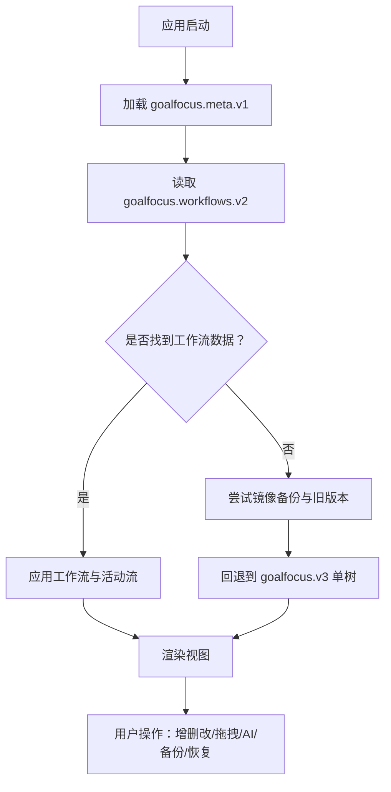

# 故障排查与常见问题

<cite>
**本文引用的文件**   
- [index.html](file://index.html)
- [README.md](file://README.md)
- [app.js](file://assets/js/app.js)
</cite>

## 目录
1. [简介](#简介)
2. [适用对象与使用方式](#适用对象与使用方式)
3. [问题清单总览](#问题清单总览)
4. [逐项排查与解决](#逐项排查与解决)
5. [数据键位与关键路径索引](#数据键位与关键路径索引)
6. [常见维护操作](#常见维护操作)
7. [结论](#结论)

## 简介
本手册面向目标流 GoalFlow 的终端用户，聚焦“能打开、能看到、能保存、能用 AI”的最常用场景。GoalFlow 是纯本地应用：页面壳 `index.html` 依赖 `assets/` 下的样式与脚本，所有用户数据默认保存在浏览器的 `localStorage`；AI 功能通过 DeepSeek API 调用你的密钥完成拆解或 SMART 体检。

## 适用对象与使用方式
- **在线优先**：直接访问项目托管地址，无需下载。
- **本地运行**：克隆/下载整个仓库后双击 `index.html`，并保留 `assets/` 同级目录。
- 首次打开为空白工作区，可粘贴目标文本生成任务树，也可从示例主题导入。

**章节来源**
- [README.md:80-90](file://README.md#L80-L90)

## 问题清单总览
| 序号 | 典型现象 | 核心原因 | 首选动作 |
|---:|---|---|---|
| 1 | 双击 `index.html` 无法显示内容 | 未保留 `assets/`，或浏览器对 `file://` 协议限制 | 改用在线地址或在本地启一个 HTTP 服务 |
| 2 | 字体渲染异常或回退 | Google Fonts CDN 不可用时自动退回系统字体 | 检查网络或改用在线地址 |
| 3 | 换浏览器/清理缓存后数据丢失 | 数据存储在 `localStorage`，清理缓存会移除 | 定期用 💾 备份 JSON，再用 📂 恢复 |
| 4 | AI 或智能拆解不可用 | DeepSeek API Key 为空、无效或网络不通 | 在设置中填写 API Key，检查网络与密钥有效期 |
| 5 | 移动端四象限不能拖拽 | 手机仅查看模式，桌面端才支持拖拽归位 | 用手机查看，用电脑调整重要度/紧急度 |
| 6 | 备份 JSON 无法恢复 | 文件版本不兼容、缺少必要字段或结构损坏 | 检查导出版本与字段完整性 |
| 7 | 时间轴容量、评分不符合预期 | 周天数 × 每天小时影响容量预算 | 通过 ⚙ 设置校准，并用审计面板核对估实偏差 |
| 8 | 删除节点后撤销无效 | 仅在删除节点或清空全部后约 10 秒窗口内有效 | 立即点击撤销 toast 中的按钮 |

## 逐项排查与解决

### ① 双击打开 `index.html` 无法显示内容
**现象**  
双击 `index.html` 后，页面无主界面、左侧导航、右侧面板缺失，或者提示资源加载失败。

**原因分析**
- 只复制了 `index.html`，未把 `assets/` 连同 `index.html` 一起放在同一目录下。
- 某些环境下的 `file://` 协议会对跨目录资源或外部请求加严格限制。
- 如果 `assets/css/main.css?v=...` 等静态资源未被正确解析，也会表现为白屏或部分样式缺失。

**复现步骤**
1. 单独将 `index.html` 复制到另一个文件夹。
2. 双击该独立 `index.html`。
3. 观察是否缺少左侧轨、视图面板或 CSS 失效。

**解决方案**
- 推荐方式一（在线）：直接用项目提供的在线地址访问，避免因本地文件路径引发的问题。
- 推荐方式二（本地）：确保 `index.html` 与 `assets/` 目录并列存放后再打开。
- 如仍受限，可在同目录起一个本地 HTTP 服务，让浏览器以 HTTP 而非 `file://` 加载资源。

**预防建议**
- 始终将整个仓库目录作为最小部署单元拷贝。
- 长期本地使用时优先考虑在线地址或本地服务器，而不是反复移动单个 `index.html`。

**相关定位**
- 入口与资源外链位于首页头部，声明字体与主样式链接。

**章节来源**
- [index.html:8-24](file://index.html#L8-L24)
- [README.md:86-91](file://README.md#L86-L91)

### ② 字体加载失败，文字形状变化
**现象**  
界面标题、标签、数值没有预期的 Inter 或 JetBrains Mono 字体，变成系统默认字体。

**原因分析**
- 首页头部通过 Google Fonts 预连接和加载 Inter、JetBrains Mono。
- 当前环境无外网、DNS 被屏蔽或浏览器策略阻止时，CDN 字体无法下载。
- 代码层面允许离线降级：当字体不可用时，回退到系统可用字体，应用仍可运行。

**复现步骤**
1. 断开网络或开启严格隔离模式。
2. 本地打开 `index.html`。
3. 观察文字是否变粗、间距或行高与联网时不同。

**解决方案**
- 正常联网即可自动加载；若已联网仍失败，尝试刷新页面。
- 如需彻底离线且自定义字体，需自行替换字体源并把字体文件纳入本地目录——此方案超出默认离线降级范围。
- 对大多数用户而言，只要不影响阅读，保留系统字体即可。

**预防建议**
- 常规使用建议使用项目托管地址或能访问 Google Fonts 的网络。
- 对离线机，先确认系统本身包含相似字体家族，避免差异过大。

**相关定位**
- 字体 `<preconnect>` 与 `<link rel="stylesheet">` 均在页面 `<head>` 顶部。
- 应用说明也明确提到“离线可用；字体 CDN 可选”。

**章节来源**
- [index.html:8-14](file://index.html#L8-L14)
- [README.md:89-91](file://README.md#L89-L91)

### ③ 数据丢失，目标树不见了
**现象**  
换浏览器、新标签页、关闭再打开，甚至重启浏览器后，原来的目标树为空。

**原因分析**
- GoalFlow 的所有节点数据默认存入浏览器 `localStorage`。
- 若清理浏览器缓存、站点数据、无痕模式退出，或换到另一台设备，这些数据不会自动跟随。
- 代码中对本地存储写入均包裹 `try/catch`，因此写失败不会导致整页崩溃，但也不会弹出警告。

**复现步骤**
1. 在浏览器 A 中创建若干目标。
2. 在浏览器 B 打开同一网页。
3. 发现数据为空；或在浏览器 A 中清除站点数据。

**解决方案**
1. 先在还能看到数据的原环境中点击顶栏的 💾 **备份数据**。
2. 下载得到形如 `goalflow-backup-*.json` 的文件。
3. 回到目标环境，点击顶栏的 📂 **恢复数据**，选择该 JSON。
4. 确认恢复弹窗后重新渲染数据。

**预防建议**
- 每次修改完重要计划后导出一次备份。
- 不要把备份文件只存在临时目录，应保存到文档或云盘同步文件夹。
- 如需跨设备使用，手动迁移 JSON 比依赖 `localStorage` 更可靠。

**相关定位**
- 主节点存储键：`goalfocus.v4`。
- 旧单树兼容键：`goalfocus.v3`。
- 元数据键：`goalfocus.meta.v1`。
- 项目与工作流键：`goalfocus.workflows.v2` 及镜像备份键。
- 备份导出函数构造结构化 JSON，恢复函数校验数组结构并合并元数据。

**章节来源**
- [app.js:9-14](file://assets/js/app.js#L9-L14)
- [app.js:5580-5657](file://assets/js/app.js#L5580-L5657)
- [app.js:5658-5680](file://assets/js/app.js#L5658-L5680)
- [app.js:5368-5410](file://assets/js/app.js#L5368-L5410)
- [README.md:83-88](file://README.md#L83-L88)

### ④ AI 或智能拆解不可用
**现象**  
点击 “SMART 体检”、“对话拆解” 或某个节点的 🤖 按钮后无响应，或返回空结果。

**原因分析**
- 智能功能通过 `fetch('https://api.deepseek.com/chat/completions', ...)` 调用 DeepSeek。
- 调用前会读取本机 localStorage 中的 `gf_llm_key`；若为空则直接返回空结果。
- 即使有 Key，也可能因网络不可达、Key 过期、配额用完或响应格式不符而失败。
- 代码中对网络请求使用 try/catch，并把非成功响应视为空结果，不会抛错到 UI。

**复现步骤**
1. 打开 AI 分析或某个节点的对话拆解。
2. 检查是否在设置面板中看到 API Key。
3. 如无 Key，确认后在设置中填入 DeepSeek API Key 并保存。
4. 再次发起拆解；若仍失败，更换网络环境后重试。

**解决方案**
1. 打开 ⚙ **设置**。
2. 找到 DeepSeek API Key 输入框。
3. 从 DeepSeek 开放平台获取有效 Key，粘贴并保存。
4. 回到需要拆解的目标，再次发起拆解。
5. 如仍失败，检查浏览器开发者工具的 Console 与 Network 是否有跨域或鉴权错误。

**预防建议**
- 首次安装后立即填写密钥，不要在第一次使用才配置。
- 定期检查密钥有效期与账户额度。
- 不要泄露 Key；它仅保存在本机浏览器中，不上传服务器。

**相关定位**
- LLM Key 存储键：`gf_llm_key`。
- Key 读取函数用于智能拆解与设置面板回填。
- 实际请求模型为 `deepseek-v4-flash`，返回体依赖 `choices[0].message.content`。

**章节来源**
- [app.js:21](file://assets/js/app.js#L21)
- [app.js:742-760](file://assets/js/app.js#L742-L760)
- [app.js:1122-1155](file://assets/js/app.js#L1122-L1155)
- [app.js:4960-4999](file://assets/js/app.js#L4960-L4999)
- [app.js:6680-6690](file://assets/js/app.js#L6680-L6690)

### ⑤ 移动端 H5 中四象限不可拖拽
**现象**  
在手机浏览器或微信里进入归纳洞察，四象限卡片无法按住拖动，只能点选或滚动。

**原因分析**
- 官方说明明确指出：“四象限手机端仅查看，拖拽归位请回桌面端。”
- 桌面端通过 DOM Drag/Drop 事件处理拖放；手机上的长压触摸行为主要用于辅助交互，并不替代完整拖拽体验。
- 代码中存在触屏分支逻辑，并在鼠标事件上显式判断指针类型，以区分键盘/鼠标与触摸事件。

**复现步骤**
1. 在手机中打开 GoalFlow。
2. 进入归纳洞察 → 四象限。
3. 尝试长按并拖动任务卡，观察到无拖尾效果。

**解决方案**
- 手机端：用来查看重要且紧急、核心投入、干扰、噪音四项分布。
- 桌面端：用鼠标拖动卡片到对应象限，或直接调整重/急数值、日期时段。
- 如果在手机上只需分类，可使用卡片展开区域的 +/− 控制重要度和紧急度，或使用日视图时段下拉框。

**预防建议**
- 把“拖拽归位”明确归类为桌面端任务。
- 把手机端定位为“快速查看、勾选完成、记录估算与实际时长”的执行终端。

**相关定位**
- 四象限容器的 dragstart/dragover/drop 委托绑定。
- 四象限节点过滤与类别分桶逻辑。
- README 明确标注移动端仅查看。

**章节来源**
- [README.md:19-24](file://README.md#L19-L24)
- [app.js:2538-2710](file://assets/js/app.js#L2538-L2710)
- [app.js:6746-6750](file://assets/js/app.js#L6746-L6750)

### ⑥ 备份 JSON 无法恢复
**现象**  
点击 📂 恢复 JSON 后提示“未找到有效目标数据”或“JSON 解析失败”，也可能恢复后数据为空。

**原因分析**
- 恢复逻辑要求导入的 JSON 中必须存在数组类型的 `nodes` 字段，并且数组非空。
- 如果是旧版单树结构，只有顶层数组而没有对象包装结构，旧迁移路径也可能不再生效。
- 文件内容被截断、编码错误或人为删除关键字段后，恢复流程会拒绝覆盖。

**复现步骤**
1. 打开 📂 恢复数据。
2. 选择一个不是由 GoalFlow 导出的空文件、HTML 文件或损坏的 JSON。
3. 查看是否出现“未找到有效目标数据”或“JSON 解析失败”。

**解决方案**
1. 确认文件扩展名为 `.json`。
2. 用文本编辑器打开，确认最外层是对象且包含 `"nodes": [...]` 或 `"workflows": [...]`。
3. 如果怀疑损坏，从之前的备份副本恢复；如果没有，尝试用最近可用的 `goalfocus.workflows.v2` 镜像恢复。
4. 恢复前务必备份当前数据，因为确认恢复后会覆盖当前全部内容。

**预防建议**
- 命名带日期的 `goalflow-backup-YYYY-MM-DD.json`。
- 至少保留上一版本的备份，直到确认新版本完全可用。
- 不在编辑 JSON 的过程中进行恢复。

**相关定位**
- 导出结构：`version`、`exportedAt`、`activeWorkflowId`、`workflows[]`、`nodes[]`、`meta`。
- 恢复函数首先取 `data.nodes`，校验是否为数组且长度大于 0。
- 同时支持恢复 workflows 或回退到旧单树形态。

**章节来源**
- [app.js:5580-5618](file://assets/js/app.js#L5580-L5618)
- [app.js:5619-5675](file://assets/js/app.js#L5619-L5675)

### ⑦ 时间轴或评分计算不符合预期
**现象**
- 今日容量看起来太大或太小。
- 计划日程塞不下，但“已规划任务”看起来不多。
- 完成一项任务后评分偏低，或长时间专注后评分不够高。

**原因分析**
- 每日容量由“每周可投入天数 × 每天小时”计算，也受全局工作日/周末小时设置影响。
- 时间轴可做完性基于节点预估分钟与当前周期容量做比较。
- 评分会考虑完成项的重要度、期限是否逾期、是否按时长达标、番茄钟是否达到完整时长、是否为习惯打卡等。
- 时间审计面板展示近 7 天“计划 vs 实际”，可据此校准预估。

**复现步骤**
1. 打开 ⚙ 设置，查看“每周可投入天数”“每天小时”或全局工作日/周末小时。
2. 打开今日状态区域的时间容量与评分。
3. 检查某叶子节点的预估分钟和实计分钟。
4. 打开时间审计，看近期估实差异是否与直觉一致。

**解决方案**
- 在设置中调整 `daysPerWeek` / `hoursPerDay` 或全局工作日/周末小时，使容量预算贴近真实时间。
- 对持续低估的任务，参考时间审计的平均偏差增大预估分钟。
- 对番茄钟评分偏低，确认已完成完整时长，并与目标节点关联。

**预防建议**
- 每月回顾时根据真实完成情况修正容量参数。
- 对大任务拆分到较小叶子，减少“估短干久”的计划谬误。
- 利用“时间审计 + 计划谬误校准”缓冲下一次计划。

**相关定位**
- 容量计算函数按 v7.0/v7.5 两种路径汇总工作日/周末小时或项目级设置。
- 每日容量函数以分钟为单位，`DAY_CAPACITY_MIN` 给出默认下限常量说明。
- 评分函数根据重要度、期限、估实差、番茄时长打 S/A/B/C 等级。
- 历史日志裁剪函数说明执行日志与评估明细的生命周期。

**章节来源**
- [app.js:41-108](file://assets/js/app.js#L41-L108)
- [app.js:5263-5410](file://assets/js/app.js#L5263-L5410)
- [app.js:286-330](file://assets/js/app.js#L286-L330)

### ⑧ 撤销操作无效
**现象**  
删除任务、子树或清空全部后，找不到撤销按钮，点击也无效果。

**原因分析**
- 撤销是基于“危险操作前快照 + Toast 自动消失”的短期机制。
- 删除节点时会先深拷贝当前 `state.nodes`、`topId`、`topPin`，然后真正删除，并显示带有“撤销”按钮的 toast。
- 撤销 toast 使用定时器在约 10 秒后隐藏；超时后用户来不及点击，撤销便不可用。
- 其他普通编辑（改文案、改数值、切换视图）不会产生这个 10 秒撤销窗口。

**复现步骤**
1. 打开今日行动或树形维护。
2. 点击某任务的删除按钮，或执行清空全部。
3. 等待超过 10 秒不点击撤销。
4. 关闭 toast 后再尝试寻找撤销入口，发现不可用。

**解决方案**
- 操作完成后立即留意底部 toast，点击其中的“撤销”。
- 若已过期，应从上次导出的 💾 备份文件中恢复，或重建该分支节点。

**预防建议**
- 批量删除前先做一次备份。
- 删除根节点通常不被允许，其他分支删除要谨慎。
- 重要项目采用多工作流隔离，避免一次性清掉所有目标。

**相关定位**
- 撤销 toast 使用 10 秒 `setTimeout`，超时后移除显示类。
- 删除节点函数在删前保存快照并调用撤销回调。
- 删除按钮 title 中明确标注“10 秒内可撤销”。
- 清空全部也有对应的快照和撤销提示路径。

**章节来源**
- [app.js:280-310](file://assets/js/app.js#L280-L310)
- [app.js:4425-4470](file://assets/js/app.js#L4425-L4470)
- [app.js:6350-6365](file://assets/js/app.js#L6350-L6365)
- [app.js:3820-3826](file://assets/js/app.js#L3820-L3826)

## 数据键位与关键路径索引

### 主要 `localStorage` 键名
| 用途 | 键名 | 说明 |
|---|---|---|
| 主节点数据 | `goalfocus.v4` | 当前版本节点扁平化存储 |
| 旧单树兼容 | `goalfocus.v3` | 早期单树结构兼容读取 |
| 应用元数据 | `goalfocus.meta.v1` | 评分、备份时间、执行日志等 |
| 工作流与项目 | `goalfocus.workflows.v2` | 多工作流数据 |
| 工作流镜像备份 | `goalfocus.workflows.bak` | 冗余镜像，用于主键损坏恢复 |
| 旧工作流 v1 | `goalfocus.workflows.v1` | 旧格式兼容路径 |
| LLM API Key | `gf_llm_key` | DeepSeek API Key，仅存本机 |
| 视图记忆 | `goalflow.view` | 记住最近打开的视图 |
| 折叠区记忆 | `goalflow.zone.<id>` | 各折叠区展开/收起状态 |
| 教学条是否看过 | `goalflow.flowSeen` | 今日引导流程图是否已见 |
| 新手树提示是否看过 | `goalflow.treeHintSeen` | 树编辑说明是否已关闭 |
| AI 技能文本 | `goalflow.aiSkill` | 自定义拆解 prompt |

**章节来源**
- [app.js:9-22](file://assets/js/app.js#L9-L22)
- [app.js:4120-4140](file://assets/js/app.js#L4120-L4140)
- [app.js:4321-4330](file://assets/js/app.js#L4321-L4330)
- [app.js:4358-4371](file://assets/js/app.js#L4358-L4371)
- [app.js:4676-4680](file://assets/js/app.js#L4676-L4680)
- [app.js:4960-4999](file://assets/js/app.js#L4960-L4999)
- [app.js:5368-5410](file://assets/js/app.js#L5368-L5410)

### 关键处理路径摘要

**图表来源**
- [app.js:5263-5410](file://assets/js/app.js#L5263-L5410)
- [app.js:5390-5410](file://assets/js/app.js#L5390-L5410)
- [app.js:5580-5680](file://assets/js/app.js#L5580-L5680)

## 常见维护操作

### 1. 导出备份
1. 打开任一页面，确认能看到已有数据。
2. 点击顶栏更多菜单中的 💾 **备份数据**（规划页也有同样按钮）。
3. 浏览器下载 `goalflow-backup-YYYY-MM-DD.json`。
4. 将该文件存入稳定位置。

### 2. 从 JSON 恢复
1. 打开 📂 **恢复数据**。
2. 选择之前导出的 `.json` 文件。
3. 确认弹窗中的“覆盖当前全部目标流”提示。
4. 等待提示成功条数后刷新或继续使用。

### 3. 查看 localStorage 使用情况
当不确定数据在哪时，可在控制台打印各键是否存在与大小，帮助定位是主存储、工作流存储还是元数据丢失。

### 4. 检查 AI 配置
1. 打开 ⚙ 设置。
2. 确认 DeepSeek API Key 是否已保存。
3. 保存后，回到任意待拆解目标，再次触发拆解。
4. 若仍失败，结合浏览器网络面板验证 `https://api.deepseek.com/chat/completions` 是否可达。

**章节来源**
- [app.js:5580-5680](file://assets/js/app.js#L5580-L5680)
- [app.js:5368-5410](file://assets/js/app.js#L5368-L5410)
- [app.js:6680-6695](file://assets/js/app.js#L6680-L6695)
- [app.js:742-760](file://assets/js/app.js#L742-L760)

## 结论
GoalFlow 的核心风险集中在三个地方：**文件结构、本地存储、API Key 与网络**。  
- 运行层：保持 `index.html` 与 `assets/` 在一起，或用在线/HTTP 方式访问。  
- 数据层：把“定期导出 JSON”当成日常计划的一部分，而不是出问题后才补救。  
- 智能层：首次即用即填 DeepSeek API Key，并确保密钥有效、网络可通。  
- 交互层：明确手机查看、桌面调整的定位边界；理解撤销只是短期安全网，不是无限后悔药。  
- 容量层：用设置校准“周天数 × 天小时”，用时间审计校准“预估时长 vs 实际时长”。  

当再次遇到问题时，请先对照本篇八个条目；多数情况下可通过检查本地文件、localStorage 键值、备份文件和 API Key 四个位置定位根因。