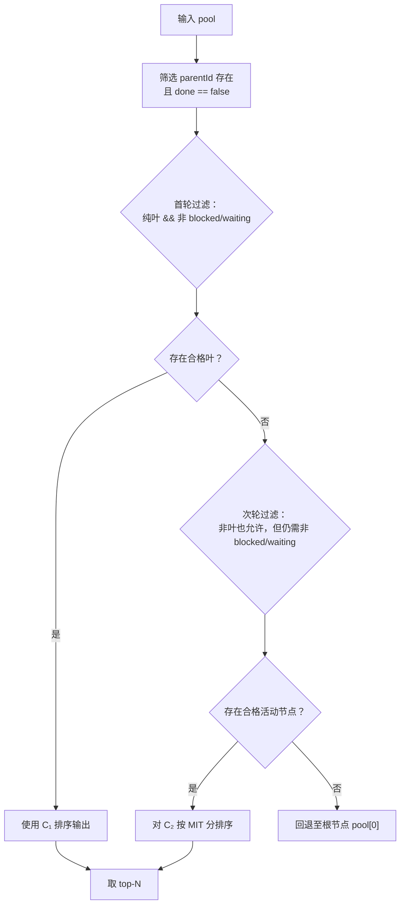
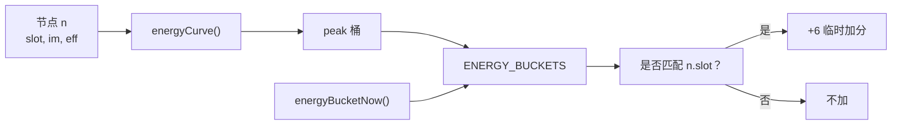

# MIT 选择与评分算法

<cite>
**本文引用的文件**   
- [assets/js/app.js](file://assets/js/app.js)
</cite>

## 目录
1. [引言](#引言)
2. [关键概念与边界](#关键概念与边界)
3. [候选池过滤数学公式](#候选池过滤数学公式)
4. [MIT 分数公式与分解](#mit-分数公式与分解)
5. [排序稳定键与 pickRanked 流程](#排序稳定键与-pickranked-流程)
6. [pickTop 与缓存 _rankSlot](#picktop-与缓存-rankslot)
7. [与四象限、日程时段、能量曲线的协作](#与四象限日程时段能量曲线的协作)
8. [与 todayScore/scoreDoneItem 的区别](#与-todayscorescoredoneitem-的区别)
9. [典型打分示例与负分场景](#典型打分示例与负分场景)
10. [伪代码与实现注释](#伪代码与实现注释)
11. [测试矩阵](#测试矩阵)
12. [性能与可靠性](#性能与可靠性)
13. [排障指南](#排障指南)
14. [结论](#结论)

## 引言

该项目是一个桌面或浏览器端的“目标流 / GoalFlow”应用，围绕“当前最重要的待办（MIT，Most Important Task）”提供候选筛选、排序和展示。MIT 的核心不是简单按重要度排序，而是一套以 `focusScore` 为核心的优先级系统：它把重要度、截止日期、阻塞/等待状态、长期任务激励以及个人精力高峰都综合进一个打分模型，并在此基础上执行稳定的多选排序。

MIT 相关能力由以下函数暴露给用户接口：

| 符号 | 职责 |
|---|---|
| `focusScore(n)` | 计算单个节点的 MIT 得分 |
| `focusScoreParts(n)` | 返回 MIT 得分及其加分/减分项说明 |
| `pickRanked(pool, limit)` | 按 MIT 策略从候选池中选出 top-N |
| `pickTop(pool)` | 等价于 `pickRanked(pool, 1)` |

它们与以下内容协作：

| 外部机制 | 作用 |
|---|---|
| `category(im, ur)` | 将重要度 `im` 与紧急度 `ur` 分为四象限，用于颜色、分类统计、噪音识别等 |
| `recomputeSchedule(nodes)` | 为节点填充 `deadlineDate`、`daysLeft`、`overdue` |
| `energyCurve()` / `energyBucketNow()` / `ENERGY_BUCKETS` | 根据能量日志推断峰值时段，并与 `node.slot` 对齐 |
| `_rankSlot` 与 `_tickN` | tick 级缓存，避免同一次重绘中重复排名 |

**本节来源**  
- [assets/js/app.js:300-369](file://assets/js/app.js#L300-L369)
- [assets/js/app.js:557-670](file://assets/js/app.js#L557-L670)
- [assets/js/app.js:3070-3106](file://assets/js/app.js#L3070-L3106)

## 关键概念与边界

MIT 机制作用于“当前未完成、且可参与行动”的节点，而非全量任务集。具体而言，基础候选定义如下：

| 字段 | 含义 | 影响 |
|---|---|---|
| `parentId` | 父节点标识 | 根节点无此字段；根节点在回退时才参与结果 |
| `done` | 是否已完成 | 已完成的 `focusScore` 固定返回 `-1000` |
| `_children.length === 0` | 是否为叶节点 | 初始筛选优先纯叶 |
| `status === 'blocked'` | 被依赖阻塞 | 减去 `-60` |
| `status === 'waiting'` | 等待他人 | 减去 `-45` |
| `deadline` / `deadlineDate` | 截止时间字符串与解析后的日期 | 决定逾期和临近奖励 |
| `daysLeft` | 距截止的天数 | ≤1、≤3、≤7、≤14、其余分别加不同分 |
| `overdue` | 是否已过期 | +30 |
| `slot` | 日程时段（如 `h0`～`h6`） | 与能量高峰时段匹配时临时 +6 |
| `im` | 重要度等级（默认值 3） | 基础分为 `im × 10` |
| `eff` | 费力度估算（默认 3） | ≥4 的任务才可能获得能量高峰临时加分 |

注意两个重要的语义边界：

1. **MIT ≠ 四象限。** `category(im, ur)` 主要用于视觉分组、噪音过滤和布局，不直接写入 MIT 分数；MIT 分数只使用 `im`，不使用 `ur`。
2. **MIT ≠ 完成成就。** `scoreDoneItem` 是对“已完成动作”的事后评分和记录，MIT 选的是“当前要做哪个”，两者是决策期与复盘期的两套分数。

**本节来源**  
- [assets/js/app.js:300-340](file://assets/js/app.js#L300-L340)
- [assets/js/app.js:374-395](file://assets/js/app.js#L374-L395)
- [assets/js/app.js:520-540](file://assets/js/app.js#L520-L540)
- [assets/js/app.js:557-670](file://assets/js/app.js#L557-L670)
- [assets/js/app.js:3070-3106](file://assets/js/app.js#L3070-L3106)

## 候选池过滤数学公式

设输入候选集合为 `pool`，节点集合记为 `n ∈ pool`。MIT 的筛选过程不是单公式，而是三步过滤器。

### 基础 MIT 候选定义

MIT 的基本候选满足：

```
n.parentId ≠ undefined
AND n.done == false
```

即：**不是根节点**，并且**未完成**。根节点不会成为正常叶子排序结果，但可在没有合适子项时作为回退。

### 第一轮过滤：优选纯叶且未被阻塞

```text
C₁ = { n ∈ pool :
         n.parentId ≠ undefined
         AND n.done == false
         AND n._children.length == 0
         AND isNodeParked(n) == false }
```

其中：

- `isNodeParked(n) = isNodeBlocked(n) ∨ isNodeWaiting(n)`
- `isNodeBlocked(n) ⇔ n.status == 'blocked'`
- `isNodeWaiting(n) ⇔ n.status == 'waiting'`

因此，第一轮剔除：

- 非叶节点（有子项）
- 已完成的节点
- 被阻塞的节点
- 等待中的节点

### 第二轮过滤：保留未阻塞的普通活动节点

若 `C₁` 为空，则放宽到：

```text
C₂ = { n ∈ pool :
         n.parentId ≠ undefined
         AND n.done == false
         AND isNodeParked(n) == false }
```

这仍继续剔除“阻塞 / 等待”的节点，但不要求必须是叶子。也就是说，“等待中”和“阻塞中”的任务不会进入正常的 MIT 候选排序。

### 第三阶段：回退根节点

如果 `C₂` 仍为空，则从 `pool[0]` 取出根节点，并依据 `limit` 返回根节点或其数组形式。此时不计算 MIT 分数，也不执行排序。

```text
if C₁ 为空 and C₂ 为空 :
    r = pool[0]
    return (limit > 1) ? [r] : r
```

### 过滤流程图



**图示来源**  
- [assets/js/app.js:587-645](file://assets/js/app.js#L587-L645)

**本节来源**  
- [assets/js/app.js:557-670](file://assets/js/app.js#L557-L670)
- [assets/js/app.js:587-645](file://assets/js/app.js#L587-L645)

## MIT 分数公式与分解

### 总公式

`focusScore(n)` 的计算可写成分段函数：

```
score(n) = base(n) + deadlineScore(n) + parkedPenalty(n) + energyPeakBonus(n)
```

其中各分项分别为：

| 分项 | 规则 |
|---|---|
| `base(n)` | `im × 10`，未提供时使用默认 `im=3`，即 30 |
| `deadlineScore(n)` | 根据 `deadlineDate`、`overdue`、`daysLeft` 分段取值 |
| `parkedPenalty(n)` | `blocked` −60，`waiting` −45，否则 0 |
| `energyPeakBonus(n)` | 仅当节点钉在能量高峰对应时段、任务费力度高、且当前时刻处于该峰段时 +6 |

### 基础分

```
base(n) = 10 × im
```

项目实现中对缺失的 `im` 使用默认值 3，但在 `focusScore` 原始分支中没有兜底；`focusScoreParts` 则显式使用 `(n.im || 3)`。为了保持解释一致性，文档把“有效重要度”记作 `im' = n.im ?? 3`。

因此更严谨地写为：

```
base(n) = 10 × im' ，其中 im' = n.im 或 3
```

### 截止期权重

```
deadlineScore(n) =
    if n.deadlineDate not exist : 0
    else if overdue               : +30
    else if daysLeft ≤ 1          : +26
    else if daysLeft ≤ 3          : +20
    else if daysLeft ≤ 7          : +13
    else if daysLeft ≤ 14         : +7
    else                          : +3
```

该设计强调“短期紧迫性”：距离截止日期越近，权重越高；逾期虽已是失败态，仍给正激励使其尽快从 MIT 队列中移出。

### 无截止期的长期主线激励

如果节点没有 `deadlineDate`，且其重要度足够高：

```
longTermBonus(n) =
    if im' ≥ 5 : +4
    else if im' ≥ 4 : +2
    else            : 0
```

这是对长期战略目标的隐性补贴：没有截止日期的高重要任务，仍能获得小幅优先权，以避免长期主线被短期事务淹没。

### 阻塞与等待惩罚

```
parkedPenalty(n) =
    if status == 'blocked'   : -60
    else if status == 'waiting' : -45
    else                   : 0
```

这是 MIT 筛选中最强的单一减分项，确保不能执行的计划不会抢占真正可行动任务。

### 能量高峰临时加成

当以下条件全部成立时，+6：

1. 全局状态中存在 `state.meta.energyLog`；
2. 节点指定了 `n.slot`；
3. 节点费力度 `n.eff` 或默认值 `≥ 4`；
4. `energyCurve().peak` 指向某个能量桶；
5. 该能量桶对应的槽位列表中包含 `n.slot`；
6. 当前时间所属桶与峰值桶相同。

```
energyPeakBonus(n) =
    if all above conditions hold : +6
    else                         : 0
```

注意这是“临时加权”：它只在当前时间点使该任务更易成为 MIT，并不代表该任务的结构性重要性更高。

### focusScoreParts 分解公式

`focusScoreParts(n)` 返回两部分结构：

| 字段 | 含义 |
|---|---|
| `parts` | 每个加分或减分项的描述对象 |
| `total` | 调用 `focusScore(n)` 得到的整数分数 |

各部分描述使用标签和分值表示，包括：

| 条目 | 分值 |
|---|---:|
| “重要 i” | `i × 10` |
| “已逾期” | `+30` |
| “1天内到期” | `+26` |
| “3天内到期” | `+20` |
| “本周到期” | `+13` |
| “两周内” | `+7` |
| “有期限” | `+3` |
| “长期主线” | `+4` 或 `+2` |
| “阻塞中” | `-60` |
| “等待中” | `-45` |
| “停滞 s 天” | `0`（仅展示，不影响总分） |

**本节来源**  
- [assets/js/app.js:307-369](file://assets/js/app.js#L307-L369)
- [assets/js/app.js:587-640](file://assets/js/app.js#L587-L640)
- [assets/js/app.js:3070-3106](file://assets/js/app.js#L3070-L3106)

## 排序稳定键与 pickRanked 流程

### 排序键

当进入过滤候选后，`pickRanked` 使用多键稳定排序。比较函数顺序为：

1. MIT 分数递减：`focusScore(b) - focusScore(a)`
2. 重要度 `im` 递减：`b.im - a.im`
3. 剩余天数递增：`a.daysLeft ?? 999` 小于等于 `b.daysLeft ?? 999`

数学上，候选排序键可以看作三元组比较：

```
sortKey(n) = (-score(n), -im', daysLeft' )
```

其中：

```
daysLeft'(n) = n.daysLeft ?? 999
```

这种设计的意图是：

- 首要是 MIT 得分；
- 分数相同时，优先更重要任务；
- 又同重要度时，先处理更早截止的任务；
- 对无限期任务用极大值处理，使其排在有限期之后。

### pickRanked 完整流程

```
function pickRanked(pool, limit):
    1. pool ← pool 或 state.nodes
    2. 若缓存命中 _rankSlot，返回缓存结果
    3. 计算 C₁：纯叶 ∧ 未阻塞 ∧ 未完成
    4. 若 C₁ 非空：
         对 C₁ 按 (-score, -im, daysLeft) 排序
         返回 slice(0, limit)
    5. 否则计算 C₂：非阻塞 ∧ 未完成
    6. 若 C₂ 非空：
         对 C₂ 按 (-score, -im, daysLeft) 排序
         返回 slice(0, limit)
    7. 否则回退：
         r ← pool[0]
         if r 且未完成：
             return (limit > 1) ? [r] : r
        否则：
            return (limit > 1) ? [] : null
    8. 写入 _rankSlot 并返回
```

注意回退逻辑返回的是根节点本身，而不是根节点的 MIT 排序结果。这是因为根节点通常代表一天、工作流或主题容器，并不适合像叶任务一样参与常规优先级竞争。

**本节来源**  
- [assets/js/app.js:619-663](file://assets/js/app.js#L619-L663)

## pickTop 与缓存 _rankSlot

### pickTop

```javascript
function pickTop(pool) {
    return pickRanked(pool, 1);
}
```

它只是 `pickRanked` 的单选封装，语义与 MIT 主流程一致：首选候选池中最重要的可执行任务。

### 缓存失效条件

`_rankSlot` 是一个 tick 级别的内存缓存：

```text
_rankSlot = { pool, limit, tick: _tickN, out }
```

只有当以下三个值全部相等时才复用：

| 比较项 | 含义 |
|---|---|
| `_rankSlot.pool === pool` | 同一数组引用 |
| `_rankSlot.limit === limit` | 同一 limit 值 |
| `_rankSlot.tick === _tickN` | 同一重绘 tick |

缓存失效发生在：

1. 新的 `beginTick()`；
2. 任意节点变更调用 `invalidateTreeCache()`，后者会调用 `beginTick()`；
3. 输入 `pool` 或 `limit` 变化；
4. 同 tick 内多次调用 `pickRanked` 时复用；
5. 同一 tick 中不同 `limit` 也会相互覆盖最终 slot。

这意味着该缓存**不是持久化缓存**，而是单次绘制批次内的去重优化。它的代价很小，因为 MIT 排序只在 `vis` 和少数视图计算路径中出现。

**本节来源**  
- [assets/js/app.js:557-590](file://assets/js/app.js#L557-L590)
- [assets/js/app.js:619-663](file://assets/js/app.js#L619-L663)

## 与四象限、日程时段、能量曲线的协作

### 四象限 category(im, ur)

`category` 以 `im` 和 `ur` 生成四象限：

| 条件 | 类别 | 典型行为 |
|---|---|---|
| `im ≥ 4 且 ur ≥ 4` | “现在做” | 最高可见性和紧迫感 |
| `im ≥ 4 且 ur < 4` | “核心” | 长期主线，易被 MIT 长期主线奖励补偿 |
| `im < 4 且 ur ≥ 4` | “干扰” | 可能被误以为紧急但不是真正重要 |
| 其他 | “噪声” | 低重要度、低紧急度任务 |

关键点：MIT 分数不使用 `ur`。也就是说，“紧急但不重要”的任务不会因为 `ur` 而在 MIT 排序中获得额外分数。它们的紧急感体现在 UI 分类上，而不是 MIT 数学模型中。

**本节来源**  
- [assets/js/app.js:374-384](file://assets/js/app.js#L374-L384)

### 日程 slot 与 DAYSLOTS

`DAYSLOTS` 定义了用户可将节点钉到的时段：

| 代号 | 名称 |
|---|---|
| `` | 未钉时段 |
| `h0` | 清晨 |
| `h1` | 上午 |
| `h2` | 中午 |
| `h3` | 午后 |
| `h4` | 下午 |
| `h5` | 傍晚 |
| `h6` | 夜间 |

`focusScore` 仅在以下条件下检查 `n.slot`：

- 节点有 `slot`；
- 节点费力度 ≥ 4；
- 当前时间落在能量曲线峰值桶；
- 该桶映射出的槽位包含 `n.slot`。

### 能量曲线

能量模块维护三个主桶：

| 键 | 标签 | 包含时段 |
|---|---|---|
| `am` | 上午 | `h0`, `h1`, `h2` |
| `pm` | 下午 | `h3`, `h4`, `h5` |
| `eve` | 晚上 | `h6` |

`energyBucketNow()` 根据当前时间确定所属桶；`energyCurve()` 计算历史能量日志中的峰值桶。二者共同决定是否应给当前正在高峰时段的任务加上 `+6`。

这个设计的意义是：同一个任务可能在上午因处在高峰而被暂时提亮，到下午则失去这一临时加分。它体现的是“在当前精力状态下最合适的任务”，而不是绝对不变的重要性。



**图示来源**  
- [assets/js/app.js:3070-3106](file://assets/js/app.js#L3070-L3106)
- [assets/js/app.js:587-640](file://assets/js/app.js#L587-L640)

**本节来源**  
- [assets/js/app.js:374-384](file://assets/js/app.js#L374-L384)
- [assets/js/app.js:384-395](file://assets/js/app.js#L384-L395)
- [assets/js/app.js:3070-3106](file://assets/js/app.js#L3070-L3106)
- [assets/js/app.js:587-640](file://assets/js/app.js#L587-L640)

## 与 todayScore/scoreDoneItem 的区别

很多读者容易混淆 MIT 评分和完成评奖。它们在项目中属于不同阶段：

| 维度 | `focusScore / pickRanked / pickTop` | `scoreDoneItem / scorePomoItem / todayScore` |
|---|---|---|
| 阶段 | 决策期：选下一个该做什么 | 复盘期：已经完成后评价表现 |
| 触发时机 | 构建视图、英雄卡、推荐任务时 | 标记完成、番茄钟结束时 |
| 主要目的 | 找出“当前最重要且可执行”的任务 | 记录当日行动质量、习惯打卡、专注时长 |
| 计分方向 | 正值越大越优先；阻塞/等待为大幅负值 | 正向为主，逾期完成会扣少量分 |
| 典型分值范围 | 可为负数，最低典型值为 -60，已完成 -1000 | `scoreDoneItem` 截断至 0～100；`scorePomoItem` 截断至 0～40 |
| 与 `state.meta.scoreLog` 关系 | 不直接写入 | 写入日评分日志 |
| 对 `pickRanked` 的影响 | 直接影响 MIT 候选排序 | 不直接影响 MIT 选择 |

#### scoreDoneItem 概要

- 基础分：`(im 或 3) × 10`
- 期限完成：+12；逾期完成：−8
- 时长评估：不超过估计 +15；1.5 倍以内 +6；超过较多 0
- 习惯打卡：+5
- 结果夹钳至 0～100

#### todayScore 概要

聚合当天所有 `scoreLog.entries`，累加分数，统计番茄数和完成数，并给出等级。它是当日整体成就指标，而不是 MIT 候选评分。

**本节来源**  
- [assets/js/app.js:300-369](file://assets/js/app.js#L300-L369)
- [assets/js/app.js:6791-6797](file://assets/js/app.js#L6791-L6797)

## 典型打分示例与负分场景

以下示例假设除标注外，其余字段为默认或无；`im' = n.im ?? 3`。

| 场景 | 参数说明 | 加分明细 | 总分 | 说明 |
|---|---|---|-----:|---|
| 高重要无限期主线 | `im=5, no deadline, not parked, effort≥4` | 基础 50 + 长期主线 +4 | 54 | 无限期高重要任务仍可领先低重要但有截止的任务 |
| 一周内到期普通任务 | `im=3, daysLeft=5, normal` | 基础 30 + 本周到期 +13 | 43 | 短限期能显著拉高分数 |
| 已逾期高重要 | `im=5, overdue` | 基础 50 + 逾期 +30 | 80 | 逾期任务会出现在 MIT 前端以便快速关闭 |
| 被阻塞高重要 | `im=5, status=blocked` | 基础 50 - 阻塞 -60 | -10 | 即使很重要，也不能行动，因此被严重降级 |
| 等待中中等重要 | `im=4, status=waiting` | 基础 40 - 等待 -45 | -5 | 同样不会进入正常 MIT 候选 |
| 低重要 +14 天后截止 | `im=2, daysLeft=14` | 基础 20 + 两周 +7 | 27 | 低重要但临近截止仍可能被有限期优先机制挤出前部 |
| 无限期低重要 | `im=2, no deadline` | 基础 20 | 20 | 若无更紧急任务，可能排在中后部 |
| 能量高峰匹配的费力任务 | `im=4, slots match peak now` | 基础 40 + 有期限 +3 ~ +26 + 高峰 +6 | 49～72 | 视截止区间的基准 +6 高峰临时分 |

### 极端负分

| 情况 | 计算方式 | 结果 |
|---|---|-----:|
| 阻塞高重要 | `5×10 − 60` | −10 |
| 等待高重要 | `5×10 − 45` | +5（仍为正，但低于未阻塞同类） |
| 已完成任意任务 | `focusScore` 直接返回 −1000 | −1000 |

值得注意的是：阻塞是最强减分项；等待惩罚较小，所以某些极高重要度的等待任务仍可能是正分，但仍然不会通过过滤阶段的 `isNodeParked` 检查，因此不会进入 `C₁` / `C₂` 的正常排序。

### focusScoreParts 典型分解结果

以“被阻塞的重要任务”为例，`focusScoreParts` 的结果近似为：

| parts 条目 | pts |
|---|---:|
| 重要 5 | 50 |
| 阻塞中 | −60 |
| total | −10 |

再以“本周到期、无限期高重要”为例：

| parts 条目 | pts |
|---|---:|
| 重要 5 | 50 |
| 本周到期 | +13 |
| total | 63 |

这些分解用于英雄卡等界面解释 MIT 为什么被选中，而不仅仅是显示一个黑箱分数。

**本节来源**  
- [assets/js/app.js:307-369](file://assets/js/app.js#L307-L369)
- [assets/js/app.js:587-640](file://assets/js/app.js#L587-L640)

## 伪代码与实现注释

### focusScore 伪代码

```text
function focusScore(node):
    if node.done:
        return -1000

    im = node.im 或 3
    score = im × 10

    if 节点有 deadlineDate:
        if overdue:
            score += 30
        else if daysLeft ≤ 1:
            score += 26
        else if daysLeft ≤ 3:
            score += 20
        else if daysLeft ≤ 7:
            score += 13
        else if daysLeft ≤ 14:
            score += 7
        else:
            score += 3
    else if im ≥ 5:
        score += 4
    else if im ≥ 4:
        score += 2

    if status == 'blocked':
        score -= 60
    else if status == 'waiting':
        score -= 45

    if 全局状态存在 energyLog
       and node.slot 存在
       and node.eff 或 3 ≥ 4:
        curve = energyCurve()
        if curve 有 peak:
            bucket = 找到 peak 对应桶
            nowBucket = energyBucketNow()
            if bucket 与 nowBucket 相同
               and bucket.timeSlots 包含 node.slot:
                score += 6

    return score
```

### focusScoreParts 伪代码

```text
function focusScoreParts(node):
    parts ← []
    im = node.im 或 3
    parts.push({ label: "重要" + im, pts: im × 10 })

    if 节点有 deadlineDate:
        根据 overdue / daysLeft 追加对应期限描述与分数
    else if im ≥ 4:
        追加“长期主线”，分数为 im≥5 时 4、else 2

    if 被阻塞:
        追加 {label: "阻塞中", pts: -60}
    else if 等待中:
        追加 {label: "等待中", pts: -45}

    sd ← stagnantDays(node)
    if 0 < sd < 999 and im ≥ 4:
        追加 {label: "停滞" + sd + "天", pts: 0}

    return {
        total: focusScore(node),
        parts: parts
    }
```

### pickRanked 伪代码

```text
function pickRanked(pool, limit):
    pool = pool 或 state.nodes

    // 缓存命中
    if _rankSlot.pool == pool
       and _rankSlot.limit == limit
       and _rankSlot.tick == _tickN:
        return _rankSlot.out

    // 首轮：纯叶且未被阻塞/等待
    cand = filter(pool,
        node.parentId exists
        and node.done == false
        and node._children length == 0
        and not isNodeParked(node))

    if cand 为空:
        // 次轮：允许非叶，但仍需未被阻塞/等待
        cand = filter(pool,
            node.parentId exists
            and node.done == false
            and not isNodeParked(node))

    if cand 为空:
        root = pool[0]
        early = (root exists and not root.done)
                    ? (limit > 1 ? [root] : root)
                    : (limit > 1 ? [] : null)
        _rankSlot = { pool, limit, tick: _tickN, out: early }
        return early

    sort cand by:
        primary: focusScore(b) - focusScore(a)
        secondary: b.im - a.im
        tertiary: (a.daysLeft or 999) - (b.daysLeft or 999)

    out = (limit > 1) ? firstN(cand, limit) : cand[0]
    _rankSlot = { pool, limit, tick: _tickN, out: out }
    return out
```

### 真实实现片段定位

| 功能 | 实现位置 |
|---|---|
| `scoreDoneItem`、`todayScore` | [assets/js/app.js:307-369](file://assets/js/app.js#L307-L369) |
| `category` | [assets/js/app.js:374-384](file://assets/js/app.js#L374-L384) |
| 调度重算与树结构初始化 | [assets/js/app.js:520-540](file://assets/js/app.js#L520-L540) |
| tick 缓存与 `_rankSlot` | [assets/js/app.js:557-590](file://assets/js/app.js#L557-L590) |
| MIT 主评分与部件分解 | [assets/js/app.js:587-640](file://assets/js/app.js#L587-L640) |
| `pickRanked` / `pickTop` | [assets/js/app.js:619-663](file://assets/js/app.js#L619-L663) |
| `ENERGY_BUCKETS` / `energyBucketNow` / `energyCurve` | [assets/js/app.js:3070-3106](file://assets/js/app.js#L3070-L3106) |

**本节来源**  
- [assets/js/app.js:307-369](file://assets/js/app.js#L307-L369)
- [assets/js/app.js:520-590](file://assets/js/app.js#L520-L590)
- [assets/js/app.js:587-663](file://assets/js/app.js#L587-L663)
- [assets/js/app.js:3070-3106](file://assets/js/app.js#L3070-L3106)

## 测试矩阵

下面列出面向 MIT 算法的最小测试矩阵。建议同时验证 `focusScore`、`focusScoreParts`、`pickRanked`、`pickTop` 三种入口，以及 `_rankSlot` 缓存是否按 tick 失效。

### 测试分类表

| 用例 ID | 输入特征 | 期望行为 | 关注点 |
|---|---|---|---|
| T1 | 普通无限期、`im=4`、无阻塞 | 分数不含期限分；含长期主线 +2；进入候选 | 基础分 + 长期主线 |
| T2 | 已逾期、`im=3` | `focusScore` 加 +30；`focusScoreParts` 含“已逾期” | 逾期正激励 |
| T3 | `daysLeft=0` 且非逾期 | 应落入 ≤1 天区间 +26 | 临界到期 |
| T4 | `daysLeft=1` | 应为 +26，而非 +20 | 边界精确 |
| T5 | `daysLeft=3` | 应为 +20，而非 +13 | 边界精确 |
| T6 | `daysLeft=7` | 应为 +13，而非 +7 | 边界精确 |
| T7 | `daysLeft=14` | 应为 +7 | 边界精确 |
| T8 | `daysLeft=15` | 应为 +3 | 长截止低奖励 |
| T9 | 无限期、`im=5` | 应获得长期主线 +4 | 高重要无限期优先 |
| T10 | 无限期、`im=4` | 长期主线 +2 | 中等长期主线 |
| T11 | 无限期、`im=2` | 无长期主线加分 | 低重要无限期 |
| T12 | `status=blocked`、`im=5` | 总分 −60 偏移，不应进入正常候选 | 阻塞惩罚与过滤 |
| T13 | `status=waiting`、`im=5` | 总分 −45 偏移，不应进入正常候选 | 等待惩罚 |
| T14 | 非叶节点 | 第一轮不选中；若在 `C₂` 中则仍可用 | 子任务回退 |
| T15 | 已完成节点 | `focusScore` 返回 −1000 | 已完成排除 |
| T16 | 能量高峰时段匹配费力任务 | 增加 +6 | 临时加分生效 |
| T17 | 能量高峰时段不匹配 | 不增加 +6 | 时段必须匹配 |
| T18 | `eff < 4` | 不检查高峰加分 | 仅高费力任务受益 |
| T19 | 无 `state.meta.energyLog` | 不抛异常且不加 ±6 | 防御性保护 |
| T20 | `pickRanked(vis, 1)` | 应等同于 `pickTop(vis)` | 单选语义 |
| T21 | 同 `pool` 同 `limit` 同 tick 内二次调用 | 返回缓存结果 | `_rankSlot` 命中 |
| T22 | 新 tick 后再次调用 | 不返回旧结果 | tick 失效 |
| T23 | 所有候选被阻塞或等待 | 回退到根节点或空结果 | fallback |
| T24 | 根节点已完成 | 返回空或 null，取决于 `limit` | 根节点无效 |
| T25 | 多个节点 MIT 分相同 | 按 `im` 降序；再按 `daysLeft` 升序 | 稳定排序键 |

### 重点边界

| 边界 | 风险 | 测试建议 |
|---|---|---|
| `daysLeft` 为 1、3、7、14 | 阈值错误会改变任务优先级 | 分别测试下界和上界 |
| 无截止 vs 有截止但未达任何阈值 | 前者走长期主线分支，后者走“有期限”分支 | 对比 `im=4` 的两条路径 |
| 阻塞 vs 等待 | 二者均会被过滤，但分数不同 | 确认 UI 解释与分数一致 |
| 高峰时段 | 需要模拟当前时间与峰值桶匹配 | 构造能量曲线后再测 |
| 缓存 | 若缓存污染会导致下一次 rank 直接返回旧数据 | 显式验证 tick 失效 |

**本节来源**  
- [assets/js/app.js:587-663](file://assets/js/app.js#L587-L663)
- [assets/js/app.js:3070-3106](file://assets/js/app.js#L3070-L3106)

## 性能与可靠性

MIT 路径的性能特点如下：

| 项目 | 特点 |
|---|---|
| 过滤复杂度 | O(n)，最多两次线性扫描 |
| 排序复杂度 | O(k log k)，k 为过滤后候选数量 |
| 分数计算开销 | `energyCurve()` 每次调用可能访问历史能量日志，受 try-catch 包裹 |
| 缓存命中 | 同 tick、同 `pool`、同 `limit` 命中一次 |
| 失效频率 | 节点变更 → `invalidateTreeCache` → `beginTick` → 下次 `pickRanked` 必重建 |
| 典型场景 | 视图渲染中的 hero 卡、任务列表排序、今日推荐等，都会调用 `pickRanked` |

潜在风险与建议：

1. **能量曲线频繁调用：** `focusScore` 中若启用 energy bonus，每个候选可能调用 `energyCurve`。由于该操作位于 try-catch 中，异常不会影响整体排序，但会浪费计算。若候选集很大，可考虑将 `curve` 与 `nowBucket` 提升到候选循环外缓存。
2. **`_rankSlot` 使用数组引用：** 它依赖 `pool` 引用相等，这意味着同一逻辑但不同数组对象不会被复用。对于大型视图，这是可接受的权衡，但若外层创建大量临时数组，应谨慎。
3. **负分可见性：** `focusScore` 会返回负分，但已完成任务强制 −1000。消费方若直接取最大值，应避免把未完成低分节点误判为“最优”。实际使用中一般结合候选过滤。
4. **稳定排序键缺失字段：** `daysLeft` 可能为 `null`，比较时使用 999 兜底，保证无限期任务排在有限期之后。

**本节来源**  
- [assets/js/app.js:557-670](file://assets/js/app.js#L557-L670)
- [assets/js/app.js:3070-3106](file://assets/js/app.js#L3070-L3106)

## 排障指南

### 问题一：今天 MIT 永远是某个长期高重要任务

可能原因：

- 任务 `im=4` 或 `5`，且无截止，导致长期主线加分；
- 其他任务被 `blocked`/`waiting` 惩罚；
- 其他任务期限较短但重要度低；
- 高重要无限期任务比“低重要但临近截止”的任务总分更高。

排查步骤：

1. 打印 `focusScoreParts(top)`；
2. 核对是否有“阻塞中”“等待中”减分项；
3. 检查期限加分是否确实低于长期主线分；
4. 尝试将该任务临时设为阻塞或降低重要度验证因果。

### 问题二：阻塞任务仍出现在 MIT 顶部

应先理解：真正的阻塞任务不会通过 `pickRanked` 过滤阶段；但若 `pool` 只包含根节点且根未完成，回退逻辑会返回根。此外，如果数据层错误地将 `status` 字段写错，也可能绕过 `isNodeBlocked`。

排查要点：

- 确认 `n.status` 是否为 `'blocked'`；
- 确认节点仍是叶节点且有父节点；
- 确认输入 `pool` 确实是 `vis` 或 `nodes`；
- 检查回退路径是否被触发。

### 问题三：能量加分总是出现或不出现

可能原因：

- `state.meta.energyLog` 不存在；
- `n.slot` 为空或未设置；
- `n.eff` 小于 4；
- `energyCurve()` 没有 `peak`；
- 当前时段不属于峰值桶；
- 节点时段不在该桶映射的时间槽。

排查要点：

- 单独检查 `energyBucketNow()`；
- 单独检查 `energyCurve().peak`；
- 检查 `ENERGY_BUCKETS` 中该 peak 桶的时段列表；
- 确认 `n.slot` 是否在列表中。

### 问题四：MIT 结果在连续刷新中未变化

预期行为：在同一 tick 内，只要 `pool`、`limit`、`tick` 三者都不变，就会命中 `_rankSlot`。这是正确优化。

如果要强制重新计算：

- 等待一次视图变更，使 `beginTick` 被调用；
- 或通过上层逻辑改变 `pool` 引用。

**本节来源**  
- [assets/js/app.js:557-670](file://assets/js/app.js#L557-L670)
- [assets/js/app.js:3070-3106](file://assets/js/app.js#L3070-L3106)

## 结论

MIT 机制在该项目中承担“从当日活跃任务中挑选当前最重要行动”的职责。它不是简单的 EAI 矩阵或 urgent-important 四象限排序，而是在基础重要度之上，叠加了：

1. 截止日期紧迫性奖励；
2. 长期主线激励；
3. 阻塞与等待的大额惩罚；
4. 基于个人能量曲线的临时匹配加分；
5. 多层候选过滤与稳定排序；
6. tick 级缓存以避免同批次重复计算。

这与 `scoreDoneItem` / `todayScore` 完全不同：前者选择“接下来做什么”，后者评价“今天做得怎样”。MIT 帮助控制当下注意力，成就分数帮助维持动量和自我反馈。两者配合，形成完整的“选择 → 执行 → 评奖 → 复盘”闭环。