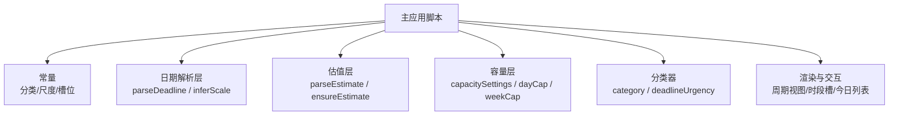
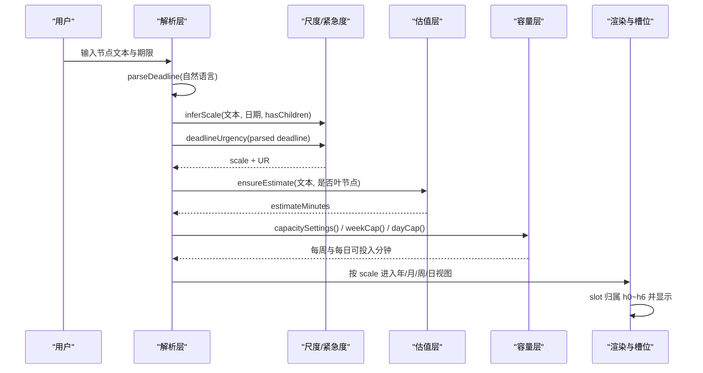
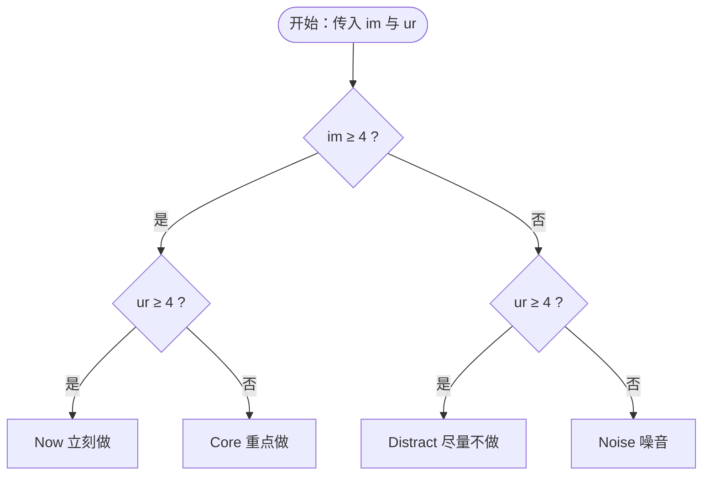
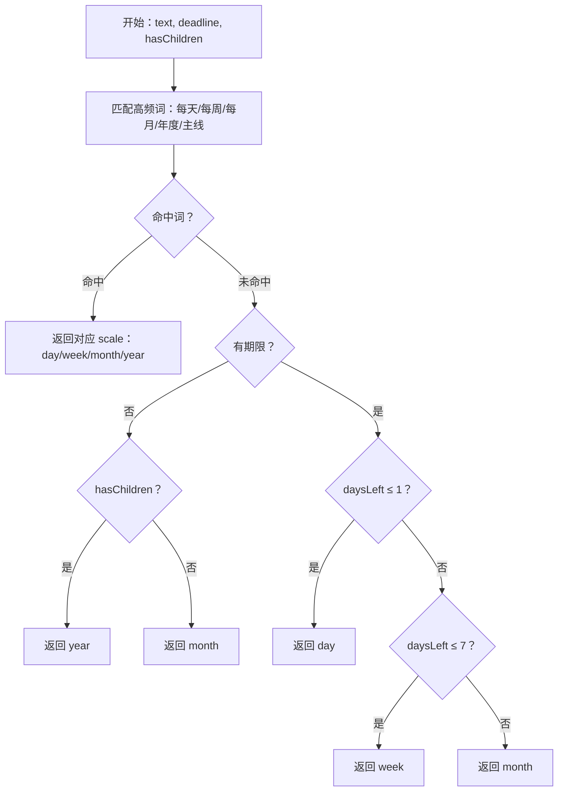
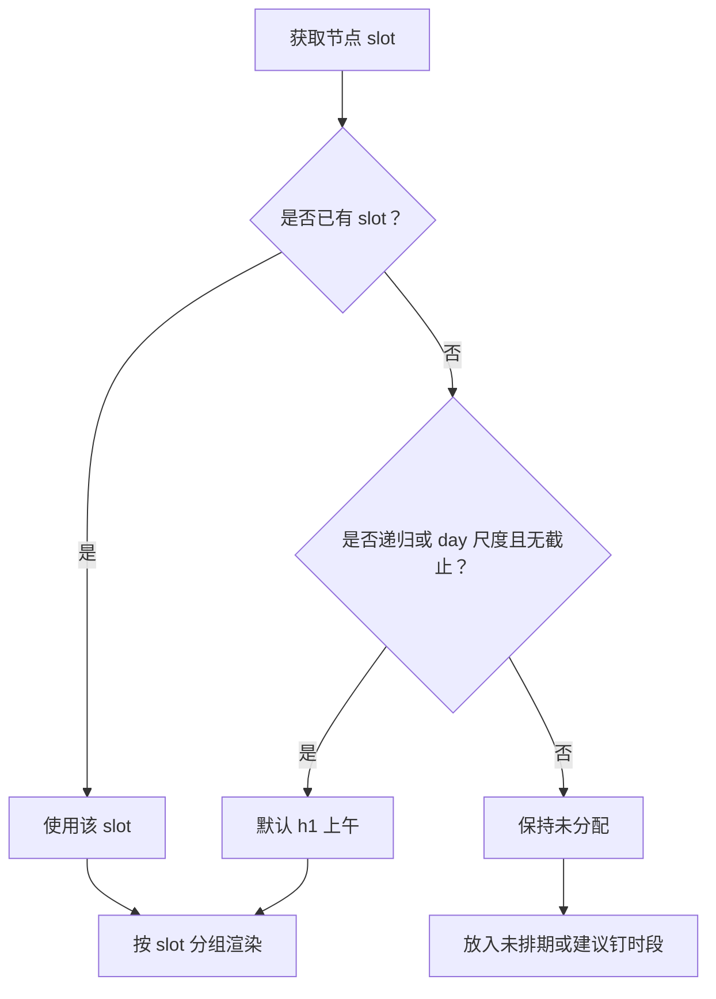
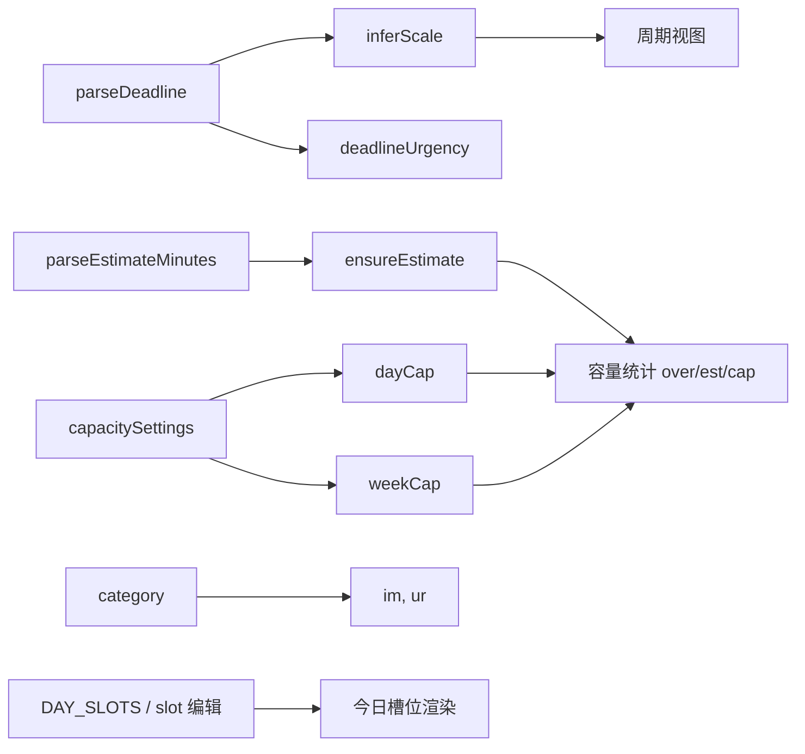

# 四象限分类与时间容量计算

<cite>
**本文引用的文件**   
- [assets/js/app.js](file://assets/js/app.js)
</cite>

## 目录
1. [引言](#引言)
2. [项目结构定位](#项目结构定位)
3. [核心组件](#核心组件)
4. [架构总览](#架构总览)
5. [详细算法说明](#详细算法说明)
6. [依赖关系分析](#依赖关系分析)
7. [性能与复杂度](#性能与复杂度)
8. [故障排查](#故障排查)
9. [结论](#结论)

## 引言
本文面向 GoalFlow（目标流）中的规划引擎，系统化文档化以下能力：

- 四象限分类规则 `category(im, ur)`。
- 从文本和期限推导任务尺度的 `inferScale(text, deadlineDate, daysLeft, hasChildren)`。
- 容量模型：把 `estimateMinutes` 聚合为每周、每日可排程容量，并按日/周/月/年视图分配。
- 截止日期紧急度 `deadlineUrgency(dl)` 与任务优先级 `im`、内部紧急度 `ur` 的关系。
- slot（h0~h6）归属冲突处理及可视化占位规则。
- 典型输入输出场景，包括长期无期限项目、多 slot 习惯打卡、周末不可用等。

该实现位于前端主逻辑文件中，所有调度、容量、分类与渲染均在同构的 JavaScript 模块内完成。

## 项目结构定位
GoalFlow 的关键调度代码集中在主应用脚本中，通过常量对象维护主题、分类、尺度、槽位等信息；各类解析与计算函数以工具形式组织，被界面交互、日历渲染和今日面板复用。



**图表来源**
- [assets/js/app.js:7-68](file://assets/js/app.js#L7-L68)
- [assets/js/app.js:169-197](file://assets/js/app.js#L169-L197)
- [assets/js/app.js:78-167](file://assets/js/app.js#L78-L167)
- [assets/js/app.js:378-455](file://assets/js/app.js#L378-L455)

**节内引用**
- [assets/js/app.js:7-68](file://assets/js/app.js#L7-L68)
- [assets/js/app.js:169-197](file://assets/js/app.js#L169-L197)
- [assets/js/app.js:78-167](file://assets/js/app.js#L78-L167)
- [assets/js/app.js:378-455](file://assets/js/app.js#L378-L455)

## 核心组件
本节聚焦五个关键能力：四象限分类、尺度推断、截止紧急度、估时与容量、slot 分配。

| 能力 | 主要函数或字段 | 职责 | 输入 | 输出 |
|---|---|---|---|---|
| 四象限分类 | `category(im, ur)` | 根据重要性和内部紧急度选择立即做、重点做、干扰、噪音四类 | 重要性 `im`、内部紧急度 `ur` | 分类对象 |
| 截止时间解析 | `parseDeadline(text)` | 中文自然语言到带剩余天数与是否逾期的截止日期 | 截止时间文本 | 包含 label、date、daysLeft、overdue 的对象 |
| 尺度嗅探 | `inferScale(text, deadlineDate, daysLeft, hasChildren)` | 判断任务是每日、每周、每月还是年度事项 | 文本、日期信息、子节点状态 | `'day' | 'week' | 'month' | 'year'` |
| 紧急度映射 | `deadlineUrgency(dl)` | 将外部截止日期映射为数字 UR | 解析后的截止日期对象 | 数字 `null` 或 `1..5` |
| 容量建模 | `capacitySettings()` / `dayCap()` / `weekCap()` | 依据用户设定的工作日/周末耗时计算周容量和日容量 | 项目元数据与工作流上下文 | 分钟级容量 |
| 估时聚合 | `parseEstimateMinutes()` / `ensureEstimate()` | 从文本或默认规则生成或归一化 `estimateMinutes` | 节点及其叶子属性 | 规范化的估计分钟数 |
| Slot 分配 | `DAY_SLOTS` / slot 相关 UI 与布局逻辑 | 清晨到夜间七格的时间段归属与可视展示 | 节点 `slot` 值 | 槽键与槽标签 |

**节内引用**
- [assets/js/app.js:378-386](file://assets/js/app.js#L378-L386)
- [assets/js/app.js:399-424](file://assets/js/app.js#L399-L424)
- [assets/js/app.js:426-455](file://assets/js/app.js#L426-L455)
- [assets/js/app.js:169-197](file://assets/js/app.js#L169-L197)
- [assets/js/app.js:78-167](file://assets/js/app.js#L78-L167)
- [assets/js/app.js:2300-2310](file://assets/js/app.js#L2300-L2310)

## 架构总览
下图展示调度链路的主要数据流向：自然语言 → 截止时间 → 尺度与紧急度 → 估值 → 容量 → 视图与 slot 占用。



**图表来源**
- [assets/js/app.js:399-455](file://assets/js/app.js#L399-L455)
- [assets/js/app.js:169-197](file://assets/js/app.js#L169-L197)
- [assets/js/app.js:78-167](file://assets/js/app.js#L78-L167)
- [assets/js/app.js:4853-4888](file://assets/js/app.js#L4853-L4888)

## 详细算法说明

### 一、四象限分类 `category(im, ur)`
分类基于两个 1 至 5 的数字评分：

- **重要性 `im`**：衡量业务价值与战略影响。
- **内部紧急度 `ur`**：任务自身节奏带来的紧迫性，例如重复型习惯、固定日程或短期到期会抬高它。

分类决策表如下：

| im | ur | 类别 key | 类别含义 | 行为建议 |
|---|---|---|---|---|
| ≥4 | ≥4 | `now` | 立刻做 | 高重要高紧急，优先安排进当日或近期 slot |
| ≥4 | <4 | `core` | 重点做 | 重要不紧急，应纳入月度/年度主线，防止滑成紧急项 |
| <4 | ≥4 | `distract` | 干扰/尽量不做 | 紧急但不重要，尽量委托、简化或延后 |
| <4 | <4 | `noise` | 噪音再做或不做的噪声 | 可批量处理、取消或放在低精力槽 |

实现规则非常简洁：先判高重要分支，再判高紧急分支，其余全部归于噪音。该设计符合四象限矩阵的典型决策路径。

#### 决策树图示



**图表来源**
- [assets/js/app.js:378-383](file://assets/js/app.js#L378-L383)

**节内引用**
- [assets/js/app.js:378-383](file://assets/js/app.js#L378-L383)

### 二、尺度嗅探 `inferScale(text, deadlineDate, daysLeft, hasChildren)`
尺度决定任务在哪个时间窗口被计划：日、周、月或年。推断分为四条优先级较高的规则，再加回退规则。

| 优先级 | 条件 | 结果 |
|---|---|---|
| 1 | 文本含“每天”“每日”“天天”“日课”“日更”等 | `day` |
| 2 | 文本含“每周”“周报”“双周”“每星期”等 | `week` |
| 3 | 文本含“每月”“月报”“半月”等 | `month` |
| 4 | 文本含“今年”“年度”“长期”“主线”“终身”等长期关键词 | `year` |
| 5 | 有明确期限且 `daysLeft ≤ 1` | `day` |
| 6 | 有明确期限且 `daysLeft ≤ 7` | `week` |
| 7 | 有明确期限但更长 | `month` |
| 8 | 没有期限但 `hasChildren = true` | `year` |
| 9 | 没有期限且是叶节点 | `month` |

注意：如果用户已经为日常习惯显式设置 `slot`，即使推断为 `month`，也会保留原 day 维度以便槽位展示；这一点由后续修改逻辑对 `month` 与非空 `slot` 进行保护。

#### 决策流程



**图表来源**
- [assets/js/app.js:426-436](file://assets/js/app.js#L426-L436)
- [assets/js/app.js:3737-3739](file://assets/js/app.js#L3737-L3739)

**节内引用**
- [assets/js/app.js:426-436](file://assets/js/app.js#L426-L436)
- [assets/js/app.js:509-510](file://assets/js/app.js#L509-L510)
- [assets/js/app.js:3737-3739](file://assets/js/app.js#L3737-L3739)

### 三、容量模型：周容量、日容量与 `estimateMinutes`
容量模型的输入来自两部分：

1. **用户设置**
   - 每周可投入天数与每天小时数。
   - 工作日小时数 `globalWorkdayHours`、周末小时数 `globalWeekendHours`。
2. **项目估计**
   - 每条任务的 `estimateMinutes`，可从中文文本解析，也可默认为叶节点 30 分钟。

#### 容量规则

| 场景 | 计算公式或行为 |
|---|---|
| 设置了全局工作日/周末耗时 | 先从全局工作日内减其他项目占用，得到可用工作日用量；再折算为 7 天平均每小时数 |
| 旧版本项目级工作/周末配置 | 使用 `(工作日 × 5 + 周末 × 2) × 60` 计算周容量 |
| 仅设置每周几天与每天几小时 | 使用 `daysPerWeek × hoursPerDay × 60` |
| 最低约束 | 每天至少 0.5 小时，避免极端过低容量 |
| 单日出力上限 | `dayCap()` 返回当前项目的每日分钟容量 |
| 周总量 | `weekCap()` 返回 5 个工作日加 2 个周末的总分钟容量 |
| 未估计的任务 | 叶节点默认为 30 分钟；也可通过“五分钟”“半天”“X小时/X分钟”等文本自动解析 |

#### 容量计算伪代码

```
function 计算容量():
    读取 meta.capacity
    若存在全局工作日用时或周末用时:
        other = 其它所有工作流的已占用工时
        可用工作日 = max(0, 全局工作日用时 - other.workdayPerDay)
        可用周末   = max(0, 全局周末用时 - other.weekendPerDay)
        日均小时   = (可用工作日×5 + 可用周末×2) / 7
        返回 { daysPerWeek: 7, hoursPerDay: max(0.5, 日均小时), ... }

    否则若项目级存在工作日或周末设置:
        return (workdayHours×5 + weekendHours×2)×60

    否则使用经典设置:
        return daysPerWeek × hoursPerDay × 60

function dayCap():
    return round(hoursPerDay × 60)

function weekCap():
    如果使用工作/周末分别设置:
        return workdayHours×5×60 + weekendHours×2×60
    否则:
        return daysPerWeek × hoursPerDay × 60
```

#### 估计分钟聚合与排程容量
在周期视图中，系统会对候选任务调用估计函数，累计其 `estimateMinutes`，并与 `dayCap()` 或 `weekCap()` 比较，得出：

- `est`：计划执行总时长。
- `act`：实际执行总时长。
- `count`：参与评估的任务数量。
- `over`：预估总量是否超过当日容量。
- `cap`：参考容量。

这样，容量不是只存在于一个公式里，而是贯穿渲染、负荷提示、拖拽排序与周期汇总。

**节内引用**
- [assets/js/app.js:78-167](file://assets/js/app.js#L78-L167)
- [assets/js/app.js:169-197](file://assets/js/app.js#L169-L197)
- [assets/js/app.js:3542-3634](file://assets/js/app.js#L3542-L3634)
- [assets/js/app.js:1935-1938](file://assets/js/app.js#L1935-L1938)

### 四、截止日期紧急度 `deadlineUrgency(dl)` 与 UR 的关系
`deadlineUrgency` 将解析后的截止日期映射为数字 UR，用于反映真实期限压力。

| 条件 | UR 值 | 含义 |
|---|---:|---|
| 无有效期限 | `null` | 不存在外部紧急度压力 |
| 已逾期 | 5 | 超过截止日期，具有最高紧急度 |
| `daysLeft ≤ 2` | 5 | 非常接近截止，等同于严重紧急 |
| `daysLeft ≤ 4` | 4 | 近期紧急 |
| `daysLeft ≤ 7` | 4 | 一周内截止 |
| `daysLeft ≤ 14` | 3 | 两周内 |
| 其他 | 2 | 远期截止 |

需要注意：这里的 `deadlineUrgency` 与任务内部的 `ur` 字段并不总是完全一致。`deadlineUrgency` 是从日期推导出的纯函数；而 `ur` 还会受到任务角色、文本启发、用户编辑和历史状态的影响。两者共同组成综合紧迫信号。

**节内引用**
- [assets/js/app.js:438-449](file://assets/js/app.js#L438-L449)
- [assets/js/app.js:456-484](file://assets/js/app.js#L456-L484)

### 五、Slot 归属冲突处理与可视化规则
系统定义了七个槽位键：

| 键 | 标签 |
|---|---|
| `` | 未钉时段 |
| `h0` | 清晨 |
| `h1` | 上午 |
| `h2` | 中午 |
| `h3` | 午后 |
| `h4` | 下午 |
| `h5` | 傍晚 |
| `h6` | 夜间 |

槽位的归属与冲突处理规则如下：

1. **已有 slot：**
   - 直接使用该槽键。
   - 若设置了 `slot` 但未显式设置 `scale`，则视为日视图任务。
2. **没有 slot 的日常任务：**
   - 若是周期性任务或明确为 `day` 尺度且无截止期限，默认分配给 `h1`（上午），作为易执行的启动槽。
3. **多槽并行：**
   - 每个 slot 列可包含多个任务；同一时刻可能仍有容量冲突，但系统提供“预计占用 vs 日容量”的比较。
4. **视觉标识：**
   - 已排时段行显示槽标签。
   - 今日面板按槽分组渲染，未分配到槽的任务显示“未排期”。
5. **拖拽与编辑：**
   - 拖入某个 slot 即写入 `node.slot`。
   - 下拉菜单允许用户从所有槽中选择。
6. **周期混排：**
   - 当周视图出现日尺度任务，或日视图出现周尺度任务时，仍会展示循环标志，表示这类任务不属于当天唯一切片，而是在周期上持续回归。



**图表来源**
- [assets/js/app.js:388-395](file://assets/js/app.js#L388-L395)
- [assets/js/app.js:3482-3490](file://assets/js/app.js#L3482-L3490)
- [assets/js/app.js:4217-4261](file://assets/js/app.js#L4217-L4261)
- [assets/js/app.js:3852-3857](file://assets/js/app.js#L3852-L3857)

**节内引用**
- [assets/js/app.js:388-395](file://assets/js/app.js#L388-L395)
- [assets/js/app.js:3482-3490](file://assets/js/app.js#L3482-L3490)
- [assets/js/app.js:4217-4261](file://assets/js/app.js#L4217-L4261)
- [assets/js/app.js:3852-3857](file://assets/js/app.js#L3852-L3857)

### 六、typical planning scenarios: input and expected output

下面给出五类典型规划场景。为避免直接粘贴代码，各节点字段均以表格描述。

#### 场景一：无期限长周期项目
| 字段 | 示例值 |
|---|---|
| text | “重建产品技术主线” |
| deadline | 空 |
| deadlineDate | null |
| daysLeft | null |
| hasChildren | true |
| estimateMinutes | 父节点通常留空，由子任务分担 |
| inferred scale | `year` |

**期望输出**：
- 出现在年度或总览视角。
- 不被塞进 day 或 week 的单日容量。
- 可继续展开为月度里程碑与具体任务。
- `deadlineUrgency` 为 `null`，但若其下属任务短期到期，局部 UR 仍可升高。

#### 场景二：多 slot 混合习惯打卡
| 字段 | 示例值 |
|---|---|
| text | “晨间阅读” |
| slot | `h0` |
| is leaf | true |
| estimateMinutes | 常见为 10~30 分钟 |
| scale | `day`，因为 slot 非空且日常习惯倾向日维度 |
| recurring | 可通过“每天”“晨间”等词推断 |

**期望输出**：
- 固定在“清晨”槽。
- 今日面板列出该槽。
- 若连续打卡，可形成习惯连续天数指标。
- 容量计入 `dayCap()`，但不应因单次短耗时误判超负荷；真正超限需要累加同日多个任务。

#### 场景三：周末不可用
| 字段 | 示例值 |
|---|---|
| globalWorkdayHours | 设为正数 |
| globalWeekendHours | 设为 0 |
| daysPerWeek | 不一定使用，因为全局工作/周末模式优先 |
| estimateMinutes | 各项周任务估计合计 |
| inferred schedule | 更多集中在工作日 |

**期望输出**：
- `weekCap()` 主要来源于工作日乘以 5 的结果。
- 周末可用时间为 0，系统不会把大量任务错误地推到周六周日。
- 若其他项目已占用部分工作日，当前项目会在可用工作日后递减自己的容量。

#### 场景四：短期临近任务与紧急跃迁
| 字段 | 示例值 |
|---|---|
| text | “提交季度汇报” |
| deadline | “本周四” |
| deadlineDate | 未来某一天 |
| daysLeft | 1~4 |
| estimated minutes | 约 120~240 分钟 |
| inferred scale | `week` 或 `day`（取决于 `daysLeft` 是否 ≤1） |

**期望输出**：
- `deadlineUrgency` 应为 4 或 5。
- 若同时 `im≥4`，`category` 应输出 `now`。
- 日视图应提示靠近或即将超出日容量。
- 若已创建习惯或常规任务，临时高紧任务应优先占据较早、较高质量的 slot。

#### 场景五：噪声项批量清理
| 字段 | 示例值 |
|---|---|
| text | “整理收藏夹” |
| deadline | 空 |
| hasChildren | false |
| est | 短耗时常小于或等于 10 分钟 |
| category | `noise` |
| slot | 可留给低谷时段或暂不钉 |

**期望输出**：
- 不抢占高价值 slot。
- 可作为零碎任务挂到未排期区域。
- 累积短时任务时可考虑统一清空，而不是分散打乱高峰时段。

## 依赖关系分析



**图表来源**
- [assets/js/app.js:399-455](file://assets/js/app.js#L399-L455)
- [assets/js/app.js:169-197](file://assets/js/app.js#L169-L197)
- [assets/js/app.js:78-167](file://assets/js/app.js#L78-L167)
- [assets/js/app.js:388-395](file://assets/js/app.js#L388-L395)
- [assets/js/app.js:3542-3634](file://assets/js/app.js#L3542-L3634)

### 耦合性与风险点
- **耦合点**
  - `category` 依赖 `im` 与 `ur`，而 `ur` 又会被多种输入改写，因此分类结果不是纯输入函数的稳定投影。
  - `inferScale` 既看 deadline，又看 hasChildren，还与已有的 day/slot 设置发生回退冲突。
  - 容量统计与渲染多处共享 `dayCap()`、`weekCap()`，一旦用户调整设置，会影响今日负担、周计划和负荷标签。
- **解耦点**
  - `parseDeadline`、`deadlineUrgency`、`inferScale`、`parseEstimateMinutes` 均为相对独立的纯函数，便于测试与替换。
  - `DAY_SLOTS` 定义与槽位 UI 分离，槽键只是字符串标识。

## 性能与复杂度
- 解析层：每次文本编辑最多触发若干正则匹配，属于 O(1)。
- 估计与容量：遍历时对节点集合做线性扫描，整体近似 O(N)。
- 视图渲染：主要开销来自 DOM 更新；槽位分组和周期单元格生成也随节点数和视图规模增长。
- 优化空间：
  - 缓存频繁调用的容量结果，只在容量设置变化时重新计算。
  - 将槽分组提前缓存，减少滚动或重绘时的分组成本。
  - 对超大数据集增加分页或延迟渲染，避免单日过多任务阻塞主线程。

**节内引用**
- [assets/js/app.js:3482-3490](file://assets/js/app.js#L3482-L3490)
- [assets/js/app.js:3542-3634](file://assets/js/app.js#L3542-L3634)
- [assets/js/app.js:4217-4273](file://assets/js/app.js#L4217-L4273)

## 故障排查

| 现象 | 可能原因 | 检查与修复 |
|---|---|---|
| 分类永远是噪音 | `im` 与 `ur` 始终低于 4 | 提高重要性；或使用高紧急词让 `ur` 上升；检查是否误将短期任务写成远期文本 |
| 长项目自动进周视图 | `hasChildren` 未正确传播或文本触发了周匹配 | 确认根节点确实有子节点；检查是否包含“每周”“周报”等关键词 |
| 日常习惯显示为月 | 推断为 `month` 且 slot 未覆盖 | 手动填写 `slot`；或把文本写为“每天/日课” |
| 周末仍出现大量任务 | 未启用工作/周末分开的容量设置 | 设置 `globalWorkdayHours` 为正数、`globalWeekendHours` 为 0 |
| 今日任务看起来超负荷 | `estimateMinutes` 总和超过 `dayCap()` | 拆分任务、延长合理估计、或调整每日小时数 |
| slot 不生效 | 节点未保存 slot，或被重置为空 | 在槽位下拉中选择时段；确保拖拽后保存；刷新查看 `slot` 字段 |
| 截止日期不正确 | 自然语言未被识别 | 使用“今天/明天/后天/X月X日/下周一/YYYY-MM-DD”格式 |

**节内引用**
- [assets/js/app.js:399-424](file://assets/js/app.js#L399-L424)
- [assets/js/app.js:426-436](file://assets/js/app.js#L426-L436)
- [assets/js/app.js:78-167](file://assets/js/app.js#L78-L167)
- [assets/js/app.js:3482-3490](file://assets/js/app.js#L3482-L3490)

## 结论
GoalFlow 的四象限分类与时间调度算法以轻量、可读、可扩展的方式构建：

- 四象限由 `im` 与 `ur` 清晰切分，适合大多数个人和项目管理直觉。
- `inferScale` 先尊重高频自然语言词，再回到日期边界，最后用 hasChildren 区分工程级长线任务与单点任务。
- 容量模型同时支持传统“每周多少天、每天多少小时”和更细化的“工作日/周末小时”，并考虑多项目占用。
- `deadlineUrgency` 提供了独立于任务内在紧迫性的外部时间压力信号。
- slot 机制让计划从“要做什么”落到“什么时候做”，并通过视觉分组呈现冲突与余量。

对于后续演进，推荐继续强化三项能力：明确 `im` 与 `ur` 的自动化来源、扩展 slot 的精力峰值偏好、以及提供更精细的多周滚动容量预测。