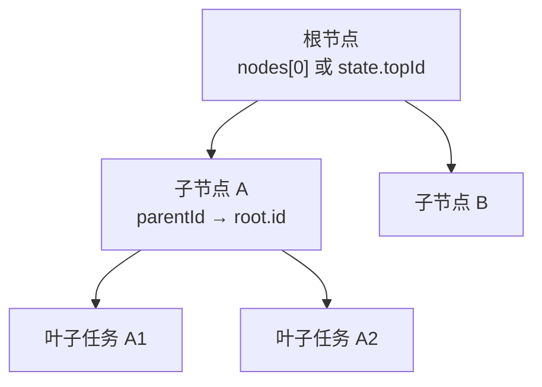
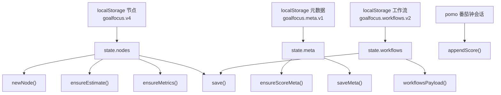

# 持久化数据模型

<cite>
**本文引用的文件 **
- [app.js](file://assets/js/app.js)
- [gf-tokens.js](file://assets/js/gf-tokens.js)
</cite>

## 目录
1. [引言](#引言)
2. [存储契约与版本键](#存储契约与版本键)
3. [全局状态快照](#全局状态快照)
4. [节点对象定义](#节点对象定义)
5. [元数据结构定义](#元数据结构定义)
6. [工作流结构定义](#工作流结构定义)
7. [番茄钟会话结构定义](#番茄钟会话结构定义)
8. [校验与默认值规则](#校验与默认值规则)
9. [根节点与父子关系约定](#根节点与父子关系约定)
10. [最小可验证 JSON 样例](#最小可验证-json-样例)
11. [非法输入处理策略](#非法输入处理策略)
12. [与初始化函数的契约一致性](#与初始化函数的契约一致性)
13. [主题切换与版本升级的安全回退方案](#主题切换与版本升级的安全回退方案)
14. [字段速查表](#字段速查表)
15. [架构总览图](#架构总览图)
16. [常见问题排查](#常见问题排查)
17. [结论](#结论)

## 引言
GoalFlow 的本地持久化层围绕 `localStorage` 中的四类数据展开：目标树节点、用户元数据、工作流配置以及当前番茄钟会话。核心数据通过 `state.nodes`、`state.meta`、`state.workflows` 和 `pomo` 对象在内存中组合，并由同一份逻辑负责创建、校验、落盘和加载。

本文件的目标是建立权威的数据字典与契约说明：明确每个字段的含义、类型约束、默认值、必填性与变更影响；解释重复任务、估算时长、完成累计等关键业务语义；并提供面向兼容性修复的最小可验证示例和迁移指引。文档中的所有行为均来自 `assets/js/app.js` 的实现。

## 存储契约与版本键
GoalFlow 将不同类型的数据写入不同的 `localStorage` 键空间：

| 数据类别 | 键来源 | 原始键名 | 说明 |
|---|---|---|---|
| 目标树节点 | `STORAGE.nodes` | `goalfocus.v4` | 以字符串化数组形式保存 `state.nodes` |
| 旧版节点（兼容） | `STORAGE.nodesLegacy` | `goalfocus.v3` | 历史格式兼容读取 |
| 元数据 | `STORAGE.meta` | `goalfocus.meta.v1` | 评分、日志、排班、健康等扩展元数据 |
| 工作流 | 固定键 | `goalfocus.workflows.v2` | 项目集合及其周期、标签、颜色等 |
| 工作流备份 | 固定键 | `goalfocus.workflows.bak` | 工作流列表的备份数据，用于恢复 |
| LLM 密钥 | `STORAGE.llmKey` | `gf_llm_key` | 独立于 GoalFlow 主题的 AI 密钥存储键 |

所有键都允许被覆盖：如果外部注入的主题令牌定义了 `GF.STORAGE`，则优先使用其提供的键名。这为多主题共享或隔离存储提供了兼容基础。

**实现位置**
- 存储键解析：[app.js:12-37](file://assets/js/app.js#L12-L37)

## 全局状态快照
系统运行时维护的核心内存状态如下：

| 字段 | 含义 | 类型 | 默认值 / 来源 | 必需性 |
|---|---|---|---|---|
| `state.nodes` | 扁平节点数组；包含根节点及所有子节点 | `Node[]` | 从 `save()` 写出的 `nodes` 字段加载 | 存在性受整体初始化保护；若为空数组或空对象将被规范化为数组 |
| `state.meta` | 用户元数据聚合对象 | `Meta` | 加载时合并旧元数据并补齐空字段 | 缺失时会被构建为 `{}` |
| `state.workflows` | 已保存的工作流列表 | `Workflow[]` | 从 `goalfocus.workflows.v2` 加载 | 不存在时由 `ensureWorkflows` 初始化为 `[]` |
| `state.activeWorkflowId` | 当前活跃工作流 ID | `string` | 从工作流负载中读取 | 可为空；界面可降级处理无工作流场景 |
| `state.topId` | 当前视图根节点 | `string` | 渲染或交互逻辑设置 | 非必填 |
| `pomo` | 当前番茄钟会话 | `PomoSession` | 新建时构造，含 `active`、`endAt`、`minutes`、`nodeId`、`wfId` | 可选；仅在执行专注流程时使用 |

`state.meta` 加载时会进行浅合并与后续字段补齐，因此新增字段不会影响旧版本产生的元数据。`state.workflows` 加载后会调用 `ensureWorkflows`，再在工作流内部合并 `topNodes`、`topPin` 等字段。

**实现位置**
- 元数据加载：[app.js:5243-5260](file://assets/js/app.js#L5243-L5260)
- 工作流载荷序列化：[app.js:5268-5278](file://assets/js/app.js#L5268-L5278)
- 工作流结构：见第 6 节
- 根节点选择：[app.js:1068-1085](file://assets/js/app.js#L1068-L1085)、[app.js:5076-5088](file://assets/js/app.js#L5076-L5088)

## 节点对象定义
`Node` 是 GoalFlow 中最复杂的记录类型。它既是 UI 节点，也是时间预算、进度、习惯、KPI、日程和评分计算的基础。

### 完整字段表

| 字段 | 类型 | 默认值 | 必需性 | 范围 / 约束 | 业务含义与来源 |
|---|---|---:|---|---|---|
| `id` | `string` | `'n' + idc` 递增 | 必需 | 字符串；新 ID 通常以 `n` 开头，后跟数字 | 节点唯一标识；父子关系通过 `parentId` 引用 |
| `text` | `string` | `''` | 显示必需 | 任意文本；长度不限；可被修剪后再推断 | 目标或任务的中文自然语言描述 |
| `parentId` | `string|null` | `null` | 非必需 | 引用某个 `byId(id)`；空表示顶层候选 | 父子层级指针；`parentId` 不应循环指向后代 |
| `im` | `number` | `3` | 建议存在 | `1–5` | 重要性（Importance）；与 `ur` 共同决定象限分类 |
| `ur` | `number` | `3` | 建议存在 | `1–5` | 紧急度（Urgency）；高重要低紧急属于“核心投入” |
| `val` | `number|null` | `clamp(im, 1, 5)` | 非必需 | `1–5` | 价值维；未显式提供时退化为 `im` |
| `eff` | `number|null` | `2–4`（启发式） | 非必需 | `1–5` | 努力维；根据关键词或 `ur` 自动推测；`val/eff` 用于 Quick/Major/Easy/Trap 分类 |
| `role` | `string` | `''` | 非必需 | 常见值：`O`、`KR`、`habit`；其它为空字符串 | 角色标记；O/KR/Habit 触发不同指标与预算行为 |
| `targetNum` | `number|null` | `null` | 非必需 | `≥0` | 目标次数，例如“本月健身 12 次” |
| `targetDone` | `number` | `0` | 非必需 | `≥0` | 已完成次数；习惯、KR 等会在完成勾选时递增 |
| `deadline` | `string` | `''` | 非必需 | 自由文本；会进入解析器 | 人类可读期限描述 |
| `deadlineDate` | `Date|string|null` | `null` | 非必需 | ISO 日期字符串或有效 `Date`；否则视为无截止日 | 机器可用截止时间 |
| `daysLeft` | `number|null` | `null` | 派生 | 正数、零或负数 | 距截止日期剩余天数 |
| `overdue` | `boolean` | `false` | 派生 | — | 是否已过期 |
| `done` | `boolean` | `false` | 非必需 | — | 是否标记完成 |
| `doneAt` | `number|null` | `null` | 非必需 | 毫秒时间戳 | 完成时刻；取消完成时为 `null` |
| `touchedAt` | `number|null` | `null` | 非必需 | 毫秒时间戳 | 最近被修改时间；与当前根路径关联时使用 |
| `createdAt` | `number` | `Date.now()` | 非必需 | 毫秒时间戳 | 创建时间；导入时可显式传入 |
| `estimateMinutes` | `number|null` | 叶子任务 `30` 或解析结果 | 非必需 | `0–999`；超出被截断或归零 | 计划估计分钟数 |
| `actualMinutes` | `number|null` | 完成时可回填 `estimateMinutes` | 非必需 | `0–9999`；超出被截断或归零 | 实际消耗分钟数 |
| `recur` | `boolean` | `false` | 非必需 | — | 是否为重复任务；会影响习惯路径与容量计算 |
| `scale` | `string|null` | 可能推导为 `day/week/month/year` | 非必需 | 建议从 `{'now', 'day', 'week', 'month', 'year'}` 取值 | 任务尺度；也参与本周纳入评估条件 |
| `slot` | `string` | `''` | 非必需 | 建议来自时段常量或时间槽 | 时间段分配，如上午、午后等 |
| `isRoot` | boolean（概念字段） | 无代码默认值 | 无 | — | 根节点约定通过 `nodes[0]` 或 `state.topId` 表达，并非强制字段 |
| `isLine` | boolean（概念字段） | 无代码默认值 | 无 | — | 线状展示相关；源码未作为持久化字段写入 |
| `isLeaf` | boolean（概念字段） | 无代码默认值 | 无 | — | 叶节点判断依赖 `parentId` + `_children.length === 0` |
| `parentType` | `string|null` | 无默认值 | 无 | — | 父类类型未在工厂或序列化处写入；可视为预留或业务自定义字段 |
| `depth` | number（概念字段） | 无默认值 | 无 | `≥0` | 层级深度通常为渲染时推导；未在工厂内赋默认值 |
| `rollupState` | `object|null` | 无默认值 | 无 | — | 汇总状态可能是派生字段或 UI 附加状态 |
| `workflowId` | `string|null` | 无默认值 | 无 | — | 可标记节点所属工作流；但序列化载荷使用 `workflows[].nodes` |
| `tag` | `string` | `''` | 非必需 | — | 标签文本，可用于快速过滤或分组 |
| `planNotes` | `string` | `''` | 非必需 | — | 计划备注 |
| `execIntent` | `string` | `''` | 非必需 | — | 执行意图字段；当前实现不直接使用该字段做校验 |
| `predictedStartDate` | `Date|string|null` | `null` | 非必需 | 日期型 | 预测开始日期；可与 `deadlineDate` 构成计划区间 |
| `ifThen` | `string` | `''` | 非必需 | — | if-then 执行条件 |
| `premortem` | `string` | `''` | 非必需 | — | 事前失败预设备注 |
| `status` | `string` | `''` | 非必需 | — | 通用状态；默认空串 |
| `waitNote` | `string` | `''` | 非必需 | — | 等待说明 |
| `timesPerWeek` | `number` | `0` | 非必需 | `0–7` | 每周执行次数；部分重复任务按周解析 |
| `conf` | `number` | `0` | 非必需 | 非负 | 信心值；用于主观确认强度 |
| `confNote` | `string` | `''` | 非必需 | — | 信心备注 |
| `confAt` | `number|null` | `null` | 非必需 | 毫秒时间戳 | 信心记录时间 |
| `source` | `string` | `''` | 非必需 | — | 来源标记，如 `insert`、`parse`、`wizard`、`ai-decompose` |
| `dropped` | `boolean` | `false` | 非必需 | — | 是否被丢弃；不影响主树正常渲染 |
| `_manualIm` | `boolean` | `false` | 非必需 | — | 标记 `im` 是否手动调整过 |
| `_manualUr` | `boolean` | `false` | 非必需 | — | 标记 `ur` 是否手动调整过 |

#### `im/ur` 与 `val/eff` 的语义区分
- `im`（重要性）+ `ur`（紧急度）决定象限：立即做、核心投入、干扰、噪音。
- `val`（价值）+ `eff`（费力程度）决定能量分类：Quick、Major、Easy、Trap。
- 当 `val` 缺失时，默认用 `clamp(im, 1, 5)` 补偿。
- `eff` 默认通过文本关键词、重要性或紧急度猜测；超过范围会被钳制到 `1–5`。

**实现位置**
- 节点工厂：[app.js:451-470](file://assets/js/app.js#L451-L470)
- V/E 修正：[app.js:60-78](file://assets/js/app.js#L60-L78)
- 象限与分类常量：[app.js:9-37](file://assets/js/app.js#L9-L37)、[app.js:114-133](file://assets/js/app.js#L114-L133)
- 根节点生成：[app.js:1068-1085](file://assets/js/app.js#L1068-L1085)、[app.js:5076-5088](file://assets/js/app.js#L5076-L5088)

## 元数据结构定义
`Meta` 是 GoalFlow 中与具体目标树解耦的长期用户数据。它采用逐块合并的方式加载，并在新版本上线后补齐新字段。

### 核心字段表

| 字段 | 类型 | 默认值 | 说明 |
|---|---|---|---|
| `weekReviews` | `array` | `[]` | 周复盘条目 |
| `monthReviews` | `array` | 合并后填充 | 月复盘条目；旧键仍被兼容读取 |
| `quarterReviews` | `array` | 合并后填充 | 季度复盘条目；旧键仍被兼容读取 |
| `bannerDismissedWeek` | `string` | `''` | 横幅忽略周编号 |
| `dailyCompletions` | `object<string,number>` | `{}` | 按日期累加的完成项计数 |
| `executionLog` | `object<string,array>` | `{}` | 执行日志映射 |
| `habitStreaks` | `object<string,object>` | `{}` | 习惯连续打卡状态 |
| `alarmFired` | `object<string,any>` | `{}` | 提醒标记，防止当天重复触发 |
| `scoreLog` | `object<string,object>` | `{ entries: [] }` | 按日期组织的评分条目 |
| `dayNotes` | `object<string,string>` | `{}` | 日记或每日备注 |
| `ritual` | `object` | `{ morning: '08:30', evening: '21:30', on: true }` | 早晚例行提醒开关与时间 |
| `pendingActions` | `array` | `[]` | 待办动作队列 |
| `weekPlans` | `object` | `{}` | 周计划容器 |
| `capacity` | `object` | `{}` | 时间容量配置，支持项目级与全局模式 |
| `inbox` | `array` | `[]` | 收件箱暂存任务 |
| `planShare` | `object` | `{}` | 计划分享相关数据 |
| `eveningDispo` | `object` | `{}` | 晚间安排数据 |
| `goodThings` | `object` | `{}` | 好事记录容器 |
| `energyLog` | `object<string,any>` | `{}` | 精力日志映射；会按天裁剪 |

`Meta` 加载顺序非常重要：先读取旧键数据，然后浅合并到内置默认结构中，最后再通过 `ensureScoreMeta` 补齐评分模块所需字段。这种顺序保证旧版本数据始终被保留。

**实现位置**
- 元数据加载：[app.js:5243-5260](file://assets/js/app.js#L5243-L5260)
- 评分字段补齐：[app.js:248-271](file://assets/js/app.js#L248-L271)
- 日志滚动裁剪：[app.js:5270-5311](file://assets/js/app.js#L5270-L5311)

## 工作流结构定义
工作流是 GoalFlow 的项目维度容器。一个工作流对应一个命名项目，拥有起止时间、标签、颜色、置顶状态和一组节点。

| 字段 | 类型 | 默认值 | 说明 |
|---|---|---:|---|
| `id` | `string` | 生成时分配 | 工作流唯一 ID |
| `name` | `string` | `'项目'` | 工作流名称；若省略会降级为默认名称 |
| `tags` | `string[]` | `[]` | 标签数组 |
| `color` | `string` | `''` | 项目主题色 |
| `topPin` | `boolean` | `false` | 是否固定为主页根节点 |
| `startDate` | `string` | `null` 或省略 | 项目开始日期字符串 |
| `endDate` | `string` | `null` 或省略 | 项目结束日期字符串；AI 分解会使用它推算截止日期 |
| `meta` | `object` | `{}` | 工作流级元数据 |
| `topId` | `string|null` | `null` | 根节点 ID；由 `ensureWorkflows` 补齐 |
| `topNodes` | `object` | `{}` | 顶节点映射，由工作流装载逻辑补充 |

工作流的 `name`、`topId`、`topPin` 在序列化输出时被保留；其他字段可通过 `ensureWorkflows` 做增量补齐。这样既允许旧工作流少字段加载，又避免覆盖现有值。

**实现位置**
- 工作流载荷序列化：[app.js:5268-5278](file://assets/js/app.js#L5268-L5278)
- 工作流载入与补齐：[app.js:5313-5348](file://assets/js/app.js#L5313-L5348)

## 番茄钟会话结构定义
`pomo` 不是完整的 `Meta` 子字段；它在功能上表示当前活跃的番茄钟状态，包含当前是否活跃、结束时间、累计分钟、目标节点和工作流来源。

| 字段 | 类型 | 默认值 | 必填性 | 说明 |
|---|---|---:|---|---|
| `active` | `boolean` | `false` | 必需 | 是否正在专注 |
| `endAt` | `number|null` | `null` | 启动时设置 | 结束时间戳，用于倒计时 |
| `minutes` | `number` | `0` | 累计必需 | 当前会话累计分钟 |
| `nodeId` | `string|null` | `null` | 可选 | 绑定的目标节点 ID |
| `wfId` | `string|null` | `null` | 可选 | 当前工作流 ID |

番茄钟在计分和评价逻辑中参考 `node.im` 和累计分钟；会话结束或完成后会追加评分记录到 `state.meta.scoreLog`。

**实现位置**
- 会话状态使用点：[app.js:309-318](file://assets/js/app.js#L309-L318)
- 评分追加：[app.js:322-348](file://assets/js/app.js#L322-L348)

## 校验与默认值规则

### 数值范围与截断
| 校验函数 | 目标字段 | 默认行为 |
|---|---|---|
| `clamp(v, a, b)` | 多处整数 | 限制在 `[a, b]` 范围内 |
| `ensureVE(n)` | `n.val`、`n.eff` | 缺失 `val` 时用 `im` 填；两者均钳制到 `1–5` |
| `ensureMetrics(n)` | `n.targetNum`、`n.targetDone` | `targetNum` 保留 null；`targetDone` 缺失时补 `0`，其余钳制到 `0–9999` |
| `ensureEstimate(n, isLeaf)` | `n.estimateMinutes`、`n.actualMinutes` | 叶子未估计时设为 `30`；`estimateMinutes` 上限 `999`，`actualMinutes` 上限 `9999` |

### 默认值与安全类型
- `targetDone` 默认 `0`。
- `createdAt` 默认为插入时刻。
- `estimateMinutes` 可由文本中“X 小时”“X 分钟”“半天”“五分钟”等自然语言推断。
- `scale` 可能通过文本与截止日期自动推断为 `day/week/month/year`。
- `role` 在指标清理后默认留空字符串，而不是 undefined。

**实现位置**
- `ensureVE`：[app.js:60-78](file://assets/js/app.js#L60-L78)
- `ensureMetrics`：[app.js:219-224](file://assets/js/app.js#L219-L224)
- `ensureEstimate`：[app.js:179-187](file://assets/js/app.js#L179-L187)
- 估算解析器：[app.js:142-156](file://assets/js/app.js#L142-L156)
- 尺度推断：[app.js:396-416](file://assets/js/app.js#L396-L416)

## 根节点与父子关系约定

### 根节点约定
系统没有把根节点标记为一个绝对固定的常量名，而是通过以下两种方式体现根语义：

1. 新工作流初始化为以单个目标节点作为树根，并将其直接放入 `state.nodes`。
2. 常规编辑入口通过插入子任务的方式让 `parentId` 指向已有节点。

因此，`nodes[0]` 代表当前工作流刚创建时的年度总目标或根任务，而后续由 `parentId` 组织完整树形结构。

### 父子关系约定
- `n.parentId` 必须指向另一个节点的 `id`。
- 真正的叶节点通过 `(n.parentId && n._children.length === 0)` 判断。
- 父链查询通过 `goldChainIds(state.topId)` 沿 `parentId` 向上回溯。
- 根路径判断依赖 `isUnderTopNode(n, state.topId)`。



**图示来源**
- [app.js:1068-1085](file://assets/js/app.js#L1068-L1085)
- [app.js:5076-5088](file://assets/js/app.js#L5076-L5088)

**章节来源**
- [app.js:1068-1085](file://assets/js/app.js#L1068-L1085)
- [app.js:160-171](file://assets/js/app.js#L160-L171)
- [app.js:5076-5088](file://assets/js/app.js#L5076-L5088)

## 最小可验证 JSON 样例

### GoalFlow 节点数组
以下为一份最少可用的 `nodes` 示例：

```json
[
  {
    "id": "n1",
    "text": "2026 年目标",
    "im": 4,
    "ur": 3,
    "scale": "year",
    "estimateMinutes": 480
  },
  {
    "id": "n2",
    "text": "每周一练跑步",
    "parentId": "n1",
    "im": 4,
    "ur": 2,
    "role": "habit",
    "recur": true,
    "timesPerWeek": 1,
    "estimateMinutes": 30
  },
  {
    "id": "n3",
    "text": "2026-06-30",
    "parentId": "n1",
    "im": 4,
    "ur": 3,
    "deadline": "2026-06-30",
    "deadlineDate": "2026-06-30T00:00:00.000Z",
    "estimateMinutes": 120
  }
]
```

校验要点：
- 节点必须具有字符串 `id`。
- `parent` 关系应由 `parentId` 指向已存在的 `id`。
- `estimateMinutes` 可以是数字；未提供且 `ensureEstimate` 认为它是叶子时将补 `30`。
- 重复任务可通过 `recur=true` 表达；角色为习惯时也可走习惯路径。

### GoalFlow 元数据
```json
{
  "dailyCompletions": {
    "2026-11-24": 3
  },
  "scoreLog": {
    "2026-11-24": {
      "entries": []
    }
  },
  "ritual": {
    "morning": "08:30",
    "evening": "21:30",
    "on": true
  }
}
```

### GoalFlow 工作流载荷
```json
{
  "activeWorkflowId": "wf1",
  "workflows": [
    {
      "id": "wf1",
      "name": "个人成长",
      "tags": ["成长"],
      "color": "#5e6ad2",
      "topPin": false,
      "startDate": "2026-01-01",
      "endDate": "2026-12-31",
      "meta": {}
    }
  ]
}
```

### 番茄钟会话
```json
{
  "active": true,
  "endAt": 1732588800000,
  "minutes": 25,
  "nodeId": "n2",
  "wfId": "wf1"
}
```

## 非法输入处理策略

| 输入异常 | 预期处理 | 依据 |
|---|---|---|
| `node.text` 缺失或为空字符串 | 使用 `''`；不会阻止节点创建，但可能产生弱建议 | 工厂默认值 |
| `node.id` 缺失 | 默认 `'n0'`，随后由递增 ID 机制覆盖 | 工厂与插入逻辑 |
| `node.im` / `ur` 越界 | 经 `ensureVE` 钳制到 `1–5` | [app.js:60-78](file://assets/js/app.js#L60-L78) |
| `node.val` / `eff` 缺失 | `val` 退化到 `im`；`eff` 由启发式生成 | [app.js:60-78](file://assets/js/app.js#L60-L78) |
| `targetNum` < 0 | 被 `ensureMetrics` 转为 `0` 或 null 后清空 | [app.js:219-224](file://assets/js/app.js#L219-L224) |
| `estimateMinutes` 超范围 | 超出 `999` 被截断；负数归零 | [app.js:185](file://assets/js/app.js#L185) |
| `actualMinutes` 超范围 | 超出 `9999` 被截断；负数归零 | [app.js:186](file://assets/js/app.js#L186) |
| `deadlineText` 无法解析 | 返回空 deadline 对象，不中断节点创建 | [app.js:362-415](file://assets/js/app.js#L362-L415) |
| 元数据 JSON 解析失败 | catch 中忽略错误，最终构造默认 `state.meta = {}` | [app.js:5243-5260](file://assets/js/app.js#L5243-L5260) |
| 目标树 localStorage 损坏 | 加载失败时应回退到空数组；工作流初始化会兜底 | 工作流保障逻辑 |
| `localStorage` 写入抛错 | 多数 write 操作包在 try/catch 中吞掉错误 | 多次 `try/catch` 落盘逻辑 |

## 与初始化函数的契约一致性

### `newNode(partial)`
负责统一创建节点，是所有插入路径的共同入口。职责包括：
- 赋值基础字段：`id`、`text`、`im`、`ur`、`val`、`eff`、`role`。
- 初始化指标字段：`targetNum=null`，`targetDone=0`。
- 初始化时间与状态：`deadline` 字符串、`deadlineDate=null`、`done=false`、`createdAt=Date.now()`。
- 初始化时长字段：`estimateMinutes=null`，`actualMinutes=null`。
- 初始化行为字段：`recur=false`、`scale=null`、`slot=''`、`timesPerWeek=0`。
- 初始化备注与来源：`tag`、`planNotes`、`execIntent`、`predictedStartDate`、`ifThen`、`premortem`、`status`、`waitNote`、`conf`、`confNote`、`confAt`、`source`、`dropped`。
- 保留手工调整标记：`_manualIm`、`_manualUr`。

所有新增节点字段必须同时出现在这里，才能避免新旧混合状态导致 UI 或计算异常。

**实现位置**
- [app.js:451-470](file://assets/js/app.js#L451-L470)

### `ensureEstimate(n, isLeaf)`
只负责时长相关字段的稳定化，不会触碰任务语义字段。
- 若 `estimateMinutes` 缺失且任务是叶子节点，赋予默认 `30` 分钟。
- 对 `estimateMinutes` 应用 `0–999` 截断。
- 对 `actualMinutes` 应用 `0–9999` 截断。
- 支持从 `text` 中解析“X 小时”“X 分钟”“半天”“五分钟”。

**实现位置**
- [app.js:179-187](file://assets/js/app.js#L179-L187)

### `ensureMetrics(n)`
负责目标指标字段。
- 缺失 `role` 时补齐空字符串。
- `targetNum` 存在时钳制到 `0–9999` 或清空为 `null`。
- `targetDone` 缺失时补齐 `0`，存在时同样钳制。

注意：当前工厂未给 `role` 预置默认值，因此 `ensureMetrics` 承担了补齐空字符串的职责。这是一个需要保持的依赖契约。

**实现位置**
- [app.js:219-224](file://assets/js/app.js#L219-L224)

### 与元数据初始化的配合
`ensureScoreMeta` 不负责初始化整个 `state.meta`，只补齐评分、日记、例行、待办、周计划、精力、收件箱、分享、晚间安排、好事等模块字段；真正的全局空壳由 `loadMeta` 提供。

**实现位置**
- 评分与日志模块补齐：[app.js:248-271](file://assets/js/app.js#L248-L271)
- 全局 meta 默认结构：[app.js:5243-5260](file://assets/js/app.js#L5243-L5260)

## 字段速查表
下表聚焦用户最常面对的关键字段，并按“字段名 — 含义 — 范围 — 变更影响”组织。

| 字段名 | 含义 | 范围 | 变更影响 |
|---|---|---|---|
| `id` | 节点唯一标识 | 非空字符串 | 改 id 会破坏 `parentId` 或其他外键引用 |
| `parentId` | 父节点引用 | 空字符串或目标 `id` | 改变会移动节点；不能形成环 |
| `im` | 重要性评分 | `1–5` | 象限、自动颜色、优先级都可能变化 |
| `ur` | 紧急度评分 | `1–5` | 象限、紧急判断、eff 推测都会变化 |
| `val` | 价值评分 | `1–5`；默认回退 `im` | 影响 Quick/Major/Easy/Trap 分类 |
| `eff` | 努力难度评分 | `1–5`；启发式默认 | 同上；高 effort 低 value 容易被标为陷阱 |
| `role` | 节点角色 | 空、`O`、`KR`、`habit` 或自定义 | 触发习惯打卡、OKR 指标、容量排除等路径 |
| `targetNum` | 目标次数 | `≥0`；null 表示不使用 | 大于 `0` 时启用进度百分比 |
| `targetDone` | 已完成次数 | `≥0` | 完成勾选时可自增；超限仅截断，不报错 |
| `deadline` | 期限描述 | 自由文本 | 不直接进入计算；解析结果才影响 `deadlineDate/daysLeft/overdue` |
| `deadlineDate` | 期限日期 | Date 或 ISO 字符串 | 逾期检查、节奏状态、视觉 urgency 依赖它 |
| `estimateMinutes` | 计划耗时 | `0–999` 分钟 | 影响今日与本周能力判定、超时评分、溢出提示 |
| `actualMinutes` | 实计耗时 | `0–9999` 分钟 | 完成后默认等于 estimate；超时越多评分越低 |
| `recur` | 重复标记 | boolean | 习惯路径、时间预算排除、指标累计条件可能受影响 |
| `scale` | 任务尺度 | day/week/month/year/null | 参与日期筛选与计划可行性判断 |
| `done` | 完成标记 | boolean | 完成路径触发完成时间、日常统计、评分、习惯 streak |
| `doneAt` | 完成时间戳 | timestamp | 记录完成事实；取消完成时重置为 null |
| `createdAt` | 创建时间戳 | timestamp | 常用于排序或审计；人工导入时可控制 |
| `touchedAt` | 最新触摸时间 | timestamp | 与根路径相关，用于追踪根下活跃节点 |
| `slot` | 时间槽 | 如上午、中午、下午 | 主要用于时间调度或展示槽位 |
| `workflowId` | 工作流关联 | string/null | 序列化通过工作流包裹；可作为业务增强字段 |
| `tag` | 标签文本 | 字符串 | 常用于快速筛选，不改变核心计算 |
| `planNotes` | 计划备注 | 字符串 | 纯展示或辅助信息 |
| `execIntent` | 执行意图 | 字符串 | 当前未参与校验逻辑，可作为规划增强字段 |
| `predictedStartDate` | 预测开始时间 | Date 或字符串 | 可用于未来计划；需前端显式消费 |
| `dailyCompletions` | 当日完成总数 | 日期→数字 | 用户完成项勾选后递增 |
| `scoreLog` | 评分日志 | 日期→条目数组 | 影响今日总分、S/A/B/C 等级 |
| `ritual` | 早晚例行提醒 | 早/晚时间 + on 开关 | 控制例行提醒行为和 UI 默认值 |
| `capacity` | 时间容量配置 | 工作日/周末/每日小时数 | 决定 `dayCap`、`weekCap`、超载警告 |
| `activeWorkflowId` | 当前工作流 | string/null | 决定 UI 显示的节点与工作流上下文 |

## 架构总览图



**图示来源**
- [app.js:451-470](file://assets/js/app.js#L451-L470)
- [app.js:179-187](file://assets/js/app.js#L179-L187)
- [app.js:219-224](file://assets/js/app.js#L219-L224)
- [app.js:5243-5278](file://assets/js/app.js#L5243-L5278)

## 问题排查指南

### 节点字段丢失
症状：新 UI 未读取到某个字段，或渲染后字段回到空。  
诊断步骤：
1. 检查是否所有新增节点字段都在 `newNode` 中提供默认值。
2. 检查该字段是否在 `ensureEstimate` / `ensureMetrics` / `ensureVE` 中被意外覆盖。
3. 检查序列化载荷是否显式写出该字段。

### 重复任务未完成
症状：勾选完成不增加 `targetDone`。  
可能原因：
- 节点不是叶子任务：源码判断完成时要求是叶节点。
- 没有 `targetNum > 0`：累计逻辑只在有目标数量时生效。
- 设置了 `timesPerWeek`：此时不走 habit 类的目标累计分支。

### 元数据加载后被清空
症状：升级到新版本后某些键消失。  
应检查：
- 是否替换了默认的 `...JSON.parse(s)` 合并方式。
- 是否删除了 `weekReviews/monthReviews/quarterReviews` 等旧键兼容。
- 是否在 `loadMeta` 之后调用了会覆盖 `state.meta` 的初始化函数。

### 主题或版本键冲突
症状：换主题后数据混入其他主题。  
解决方案：
- 通过 `GF.STORAGE` 为不同主题配置不同的 `nodes`、`meta`、`nodesLegacy` 键。
- 不要硬编码 `goalfocus.*` 字符串，除非需要永久兼容旧数据。

**章节来源**
- [app.js:451-470](file://assets/js/app.js#L451-L470)
- [app.js:219-224](file://assets/js/app.js#L219-L224)
- [app.js:179-187](file://assets/js/app.js#L179-L187)
- [app.js:5243-5278](file://assets/js/app.js#L5243-L5278)

## 主题切换与版本升级的安全回退方案

### 主题切换
推荐做法：
1. 通过 `GF.STORAGE` 暴露 `nodes`、`meta`、`nodesLegacy`、`llmKey`。
2. 主题只覆盖键名，不改业务结构与默认值。
3. 如果希望主题间完全隔离，则全部复用 Theme 提供的 key，例如 `goalfocus.${theme}.v4`。

风险点：
- 多个主题共享同一 `nodes` 键时，树的 `topId` 可能与工作流不一致。应在加载后校验当前工作流是否存在，并在必要时重新选择根节点。

### 版本升级
推荐做法：
1. 为每条数据单独保留“旧键”，并通过加载函数做浅合并。
2. 默认结构放在加载逻辑中，永远位于后端数据之后。
3. 字段清理或裁剪放在独立的 `trimLogs` 中，并带有日期标记，防止重复运行导致误删。
4. 新增 UI 字段应先给 `newNode` 添加默认值，再消费。
5. 对 `localStorage.setItem` / `JSON.parse` 包裹 try/catch，避免单条脏数据破坏整个应用。

安全原则：
- 读侧宽松：能解析就解析，缺字段用默认。
- 写侧精确：每次写前确保结构满足契约。
- 废弃字段延迟清除：至少保留几个大版本后再移除旧键。

**章节来源**
- [app.js:12-37](file://assets/js/app.js#L12-L37)
- [app.js:5243-5311](file://assets/js/app.js#L5243-L5311)

## 结论
GoalFlow 的持久化契约以 `state.nodes` 为核心、以 `state.meta` 为扩展、以 `state.workflows` 为项目边界、以 `pomo` 为瞬时专注会话。对于开发者与维护者来说，最重要的三条规则是：

1. 所有新增节点字段必须同时在 `newNode` 中提供默认值。
2. 数值字段必须考虑 clamp 范围，特别是 `im/ur`、`val/eff`、`targetNum/targetDone`、`estimateMinutes/actualMinutes`。
3. 任何元数据和结构的向后兼容都应遵循“旧键优先、合并到默认结构、增量补齐”的顺序。

只要遵循上述契约，新的时间槽、预测开始日期、标签或工作流元数据都可以在不破坏现有数据的条件下加入 GoalFlow 的本地模型。