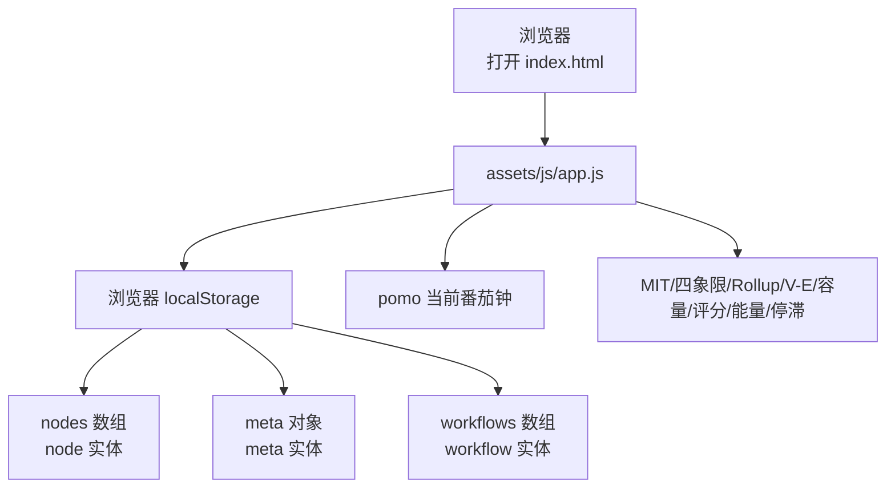
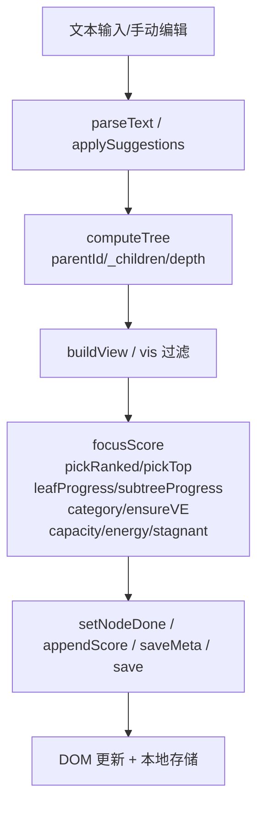
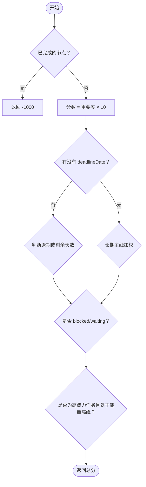
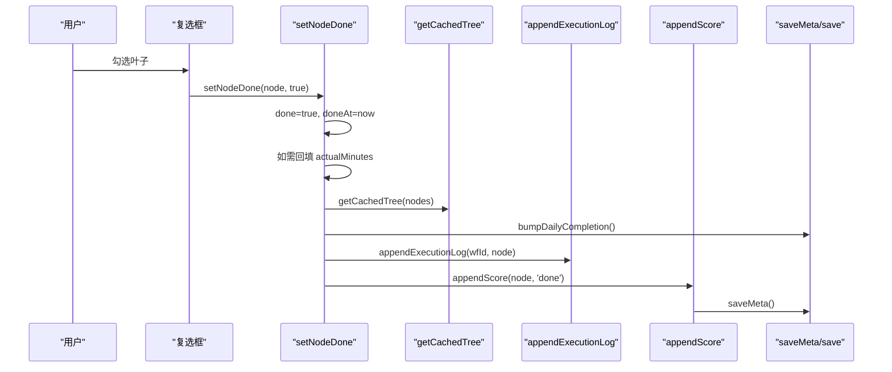
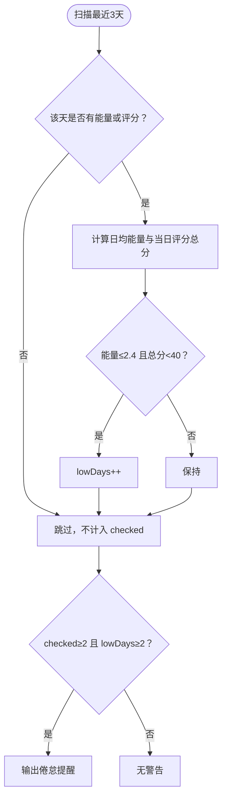
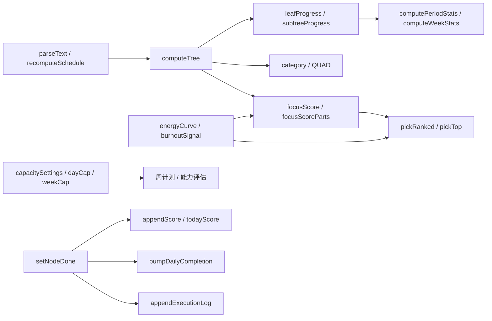

# 数据模型与算法

<cite>
**本文引用的文件**   
- [README.md](file://README.md)
- [PROGRESS-ROLLUP.md](file://docs/PROGRESS-ROLLUP.md)
- [app.js](file://assets/js/app.js)
</cite>

## 目录
1. [引言](#引言)
2. [项目结构](#项目结构)
3. [数据模型总览](#数据模型总览)
4. [持久化实体规范](#持久化实体规范)
5. [架构总览](#架构总览)
6. [关键算法详解](#关键算法详解)
7. [依赖关系分析](#依赖关系分析)
8. [性能与容错](#性能与容错)
9. [故障排查](#故障排查)
10. [结论](#结论)

## 引言
本文件面向目标流 GoalFlow 的底层数据模型与核心算法，聚焦两类读者：  
- 需要修改实现的开发者；  
- 希望理解“MIT、四象限、进度、能量曲线、停滞与倦怠预警”等业务语义的用户。

GoalFlow 是纯本地时间管理应用，节点与元数据存储在浏览器 `localStorage`，不涉及远端服务。完整状态由 `state.nodes`、`state.meta`、`state.activeWorkflowId`、`state.pomo`、`state.workflows` 等字段构成，并通过 `assets/js/app.js` 中的解析器、树构建函数和各类算法统一维护。

## 项目结构
仓库的核心实现集中在 `assets/js/app.js`。README 将工程描述为“双击即用”的静态页面组合；文档约定以 `index.html` 启动、以 `assets/js/app.js` 承载应用逻辑，并由 `README.md` 与 `docs/PROGRESS-ROLLUP.md` 共同说明业务语义。



图表来源
- [README.md:1-103](file://README.md#L1-L103)
- [app.js:1-120](file://assets/js/app.js#L1-L120)

节内来源
- [README.md:1-103](file://README.md#L1-L103)

## 数据模型总览

GoalFlow 的数据可分为四层：

| 层级 | 含义 | 主要字段 | 主键或标识 |
|---|---|---|---|
| Node | 单个目标或任务节点 | `id`、`text`、`parentId`、`im`、`ur`、`estimateMinutes`、`actualMinutes`、`done`、`doneAt`、`overdue`、`vScore`、`uScore`、`energyLog`、`workflows`、`tag`、`estimateActualRatio`、`dailyCompletions`、`predictedStartDate`、`planNotes`、`execIntent`、`isRoot`、`isLine`、`isLeaf`、`isStuck`、`parentType`、`depth`、`rollupState`、`role`、`scale`、`slot`、`targetNum`、`targetDone`、`timesPerWeek` | `id`（字符串） |
| Meta | 用户级元数据与审计日志 | `weekReviews`、`monthReviews`、`quarterReviews`、`bannerDismissedWeek`、`dailyCompletions`、`executionLog`、`habitStreaks`、`alarmFired`、`scoreLog`、`dayNotes`、`ritual`、`pendingActions`、`weekPlans`、`energyLog`、`inbox`、`planShare`、`eveningDispo`、`goodThings`、`capacity`、`onboarded` 等 | 无传统主键，作为 JSON 对象保存 |
| Workflow | 工作流/项目维度元数据 | `name`、`tags`、`color`、`topPin`、`startDate`、`endDate`、`meta` | `id`（由 `ensureWorkflows` 与工作流程列表保证存在时引用） |
| Pomo | 当前番茄钟临时状态 | `active`、`endAt`、`minutes`、`nodeId`、`wfId` | 非持久化主键，按 `app.js` 运行期状态使用 |

注意：本节中 `node` 字段名直接来自需求描述；而 `app.js` 的实际默认节点工厂还会包含更多运行时/派生字段（见下一节）。需求字段如 `vScore`、`uScore`、`energyLog`、`workflows`、`tag`、`estimateActualRatio`、`dailyCompletions`、`predictedStartDate`、`planNotes`、`execIntent`、`isRoot`、`isLine`、`isLeaf`、`isStuck`、`parentType`、`depth`、`rollupState` 可作为扩展位供 UI、外部插件或未来版本写入；实现层必须避免在解析新节点时覆盖已有值。

## 持久化实体规范

### Node 节点

| 类别 | 字段 | 类型 | 必填 | 默认值 / 取值规则 | 约束与用途 |
|---|---|---|---:|---|---|
| 标识 | `id` | 字符串 | 是 | 新节点通常为 `'n' + 序号`，也可复用传入 `partial.id` | 节点唯一主键 |
| 内容 | `text` | 字符串 | 是 | `''` | 显示名称、计划文案、估时与期限来源文本 |
| 结构 | `parentId` | 字符串或空 | 根为空，其余通常有值 | 根节点为 `null`；子节点必须指向已存在的父节点 | 树结构主关系 |
| 结构 | `_children` | 数组 | 否 | 运行时计算得到 | `computeTree` 重建 |
| 结构 | `depth` | 数字 | 否 | 运行时计算 | 用于布局层次 |
| 权重 | `im` | 数字 | 否 | `3` | 重要度 1–5；受 `applySuggestions` 与 `category` 影响 |
| 权重 | `ur` | 数字 | 否 | `3` | 紧急度 1–5 |
| V/E | `val`、`eff` | 数字或空 | 否 | `null` | 经 `ensureVE` 钳制到 1–5，用于价值/费力分类 |
| 角色 | `role` | 字符串 | 否 | `''`；可被解析为 `'O'`、`'KR'`、`'habit'` | SMART/度量相关 |
| 完成 | `done` | 布尔 | 否 | `false` | 叶子完成参与 Rollup |
| 完成时间 | `doneAt` | 毫秒时间戳或空 | 否 | 完成时设置，取消时置空 | 周完成统计只统计带时间戳的完成 |
| 逾期 | `overdue` | 布尔 | 否 | `false` | 由期限解析得出 |
| 期限 | `deadline`、`deadlineDate`、`daysLeft` | 字符串/日期/数字 | 否 | 解析失败时空；`daysLeft < 0` 时为过期 | 支持“今天/明天/月/周/YYYY-MM-DD”等 |
| 预估 | `estimateMinutes` | 数字或空 | 叶节点建议存在 | 文本含“小时/分钟/min/半天/5分钟”时可解析；未填叶默认为 30 分钟；范围 0–999 | 参与日/周容量评估 |
| 实计 | `actualMinutes` | 数字或空 | 否 | 初始空；完成或番茄结束后可能回填；0–9999 | 不参与叶子完成百分比 |
| 计划 | `schedule`、`scale`、`slot` | 多种 | 否 | `schedule: null`、`slot: ''` | `scale` 可为 `day/week/month/year`，`slot` 为日视图时段 |
| 周期习惯 | `recur`、`timesPerWeek`、`targetNum`、`targetDone` | 布尔/数字/数字/数字 | 否 | `recur:false`、`timesPerWeek:0`、`targetDone:0` | 习惯/KR 计数用 |
| 其他 | `createdAt`、`touchedAt`、`source`、`dropped`、`status`、`ifThen`、`premortem`、`waitNote`、`conf`、`confNote`、`confAt`、`_manualIm`、`_manualUr` | 多种 | 否 | 由创建/交互触发 | 辅助流程；`_manualIm/_manualUr` 保留手动调过的权重 |

#### 父子关系与叶节点定义
- 根节点：`parentId` 为空，且 `computeTree` 后一般位于 `state.nodes[0]`。
- 中间节点：有子节点，不计入 Rollup 的分母。
- 叶子节点：`parentId` 非空，且 `_children.length === 0`。
- `isLeaf`、`isRoot`、`isLine`、`isStuck`、`parentType`、`rollupState` 可由 UI 或插件写入；但核心 `leafProgress/subtreeProgress` 以 `parentId && _children.length === 0` 为准。

#### 必填性与验证
- `id` 和 `text` 应视为必填；若缺失，解析器和 UI 可能出现空节点。
- `im`、`ur`、`val`、`eff` 必须钳制到 `[1, 5]`。
- `estimateMinutes`：0 被视为空，超过 999 截断；`actualMinutes` 最多 9999。
- `targetNum >= 0`、`targetDone >= 0` 且 `targetDone <= targetNum`。
- `deadlineDate` 若存在，需与 `daysLeft`、`overdue` 一致；可通过 `recomputeSchedule` 重新对齐。
- 若 `parentId` 指向不存在节点，`computeTree` 不会把它挂入任何子列表；该节点将成为悬挂节点。

节内来源
- [app.js:431-504](file://assets/js/app.js#L431-L504)
- [app.js:379-430](file://assets/js/app.js#L379-L430)
- [app.js:184-218](file://assets/js/app.js#L184-L218)
- [app.js:219-254](file://assets/js/app.js#L219-L254)
- [PROGRESS-ROLLUP.md:1-37](file://docs/PROGRESS-ROLLUP.md#L1-L37)

### Meta 元数据

| 分组 | 关键字段 | 行为 |
|---|---|---|
| 回顾 | `weekReviews`、`monthReviews`、`quarterReviews`、`bannerDismissedWeek` | 存储周期回顾记录；周完成统计与展示读取这些数组 |
| 完成率 | `dailyCompletions` | 键为 `YYYY-MM-DD`，值为当天完成任务数；`bumpDailyCompletion` 递增 |
| 执行日志 | `executionLog` | 记录勾选或动作日志；`appendExecutionLog` 追加 |
| 习惯追踪 | `habitStreaks` | 记录习惯性节点连续打卡状态 |
| 评分 | `scoreLog` | 每日条目数组，含 `kind`、`nodeId`、`score`、`reason` |
| 精力 | `energyLog` | 键为日期，值为 `{am?, pm?, eve?}` 1–5 分值 |
| 容量 | `capacity` | v7.5 起支持 `globalWorkdayHours`、`globalWeekendHours` 或每 workflow 项目级别的 `workdayHours`、`weekendHours` |
| 引导/UI | `onboarded`、`ritual`、`pendingActions`、`weekPlans`、`inbox`、`planShare` 等 | 前端引导、晨晚闹钟、待确认调整项等 |

校验要点：
- `ensureScoreMeta` 会补齐缺失的子字段；`saveMeta` 负责持久化。
- 历史数据可能缺少某些键，因此读取时应先确保 meta 结构。
- 备份与恢复代码会对 `executionLog`、`scoreLog`、`dailyCompletions`、`energyLog` 做特殊处理。

节内来源
- [app.js:261-312](file://assets/js/app.js#L261-L312)
- [app.js:1228-1247](file://assets/js/app.js#L1228-L1247)
- [app.js:5269-5290](file://assets/js/app.js#L5269-L5290)

### Workflow 工作流

每个工作流代表一个独立项目或场景。规范如下：

| 字段 | 类型 | 必填 | 默认 | 约束 |
|---|---|---:|---|---|
| `id` | 字符串 | 是 | 解析时生成 | 工作流唯一标识 |
| `name` | 字符串 | 否 | 空串 | 显示名称 |
| `tags` | 字符串数组 | 否 | 空数组 | 可选标签分类 |
| `color` | 字符串 | 否 | 空 | 工作流配色 |
| `topPin` | 多种或空 | 否 | 空 | 置顶任务等上下文标记 |
| `startDate`、`endDate` | 日期或空 | 否 | 空 | 项目起止时间 |
| `meta` | 对象 | 否 | 空对象 | 工作流级别附加元数据 |

工作流还通过 `state.activeWorkflowId` 决定当前上下文，并在容量计算、执行日志、评分日志、Backlog、Top3 渲染中使用。

节内来源
- [app.js:1228-1247](file://assets/js/app.js#L1228-L1247)
- [app.js:5269-5290](file://assets/js/app.js#L5269-L5290)

### Pomo 番茄钟状态

Pomo 是运行期内联状态，表示当前番茄钟是否活跃及其归属。

| 字段 | 类型 | 说明 |
|---|---|---|
| `active` | 布尔 | 是否正在计时 |
| `endAt` | 数字或空 | 预计结束时间戳 |
| `minutes` | 数字 | 本次番茄时长，默认约 25 分钟 |
| `nodeId` | 字符串或空 | 关联节点 ID |
| `wfId` | 字符串或空 | 所属工作流 |

完成一个完整番茄钟后会增加 `actualMinutes`、写入执行与评分日志，并刷新界面。

节内来源
- [app.js:2795-2810](file://assets/js/app.js#L2795-L2810)
- [app.js:2990-3004](file://assets/js/app.js#L2990-L3004)

## 架构总览

GoalFlow 的计算流程可以抽象为：输入 → 文本/树解析 → 结构推导 → 视图过滤 → 算法 → state 更新 → 持久化。



图表来源
- [app.js:455-504](file://assets/js/app.js#L455-L504)
- [app.js:557-677](file://assets/js/app.js#L557-L677)
- [app.js:354-410](file://assets/js/app.js#L354-L410)

## 关键算法详解

### MIT 选择：`focusScore`、`focusScoreParts`、`pickRanked`、`pickTop`

#### 语义
MIT 从可用节点中选出“当下最重要”的一个或若干个。优先级主要基于重要度与期限临近程度，同时对“已完成”“阻塞”“等待”做出显著降权。

#### 输入与返回值
| 函数 | 输入 | 返回值 | 说明 |
|---|---|---|---|
| `focusScore(n)` | `node` | 数字 | 单一节点竞争分数 |
| `focusScoreParts(n)` | `node` | 对象 `{ total, parts }` | 给英雄卡解释加分原因 |
| `pickRanked(pool, limit)` | 节点池、排序限制 | 单个节点或节点数组 | 返回候选池中按得分排前 limit 的节点 |
| `pickTop(pool)` | 节点池 | 单节点或空 | 等价 `pickRanked(pool, 1)` |

#### 伪代码

```
function focusScore(node):
    if node.done:
        return -1000
    score = node.im * 10
    if node.deadlineDate exists:
        if node.overdue: score += 30
        else if daysLeft ≤ 1: score += 26
        else if daysLeft ≤ 3: score += 20
        else if daysLeft ≤ 7: score += 13
        else if daysLeft ≤ 14: score += 7
        else: score += 3
    else:
        if im ≥ 5: score += 4
        else if im ≥ 4: score += 2

    if node.status == blocked: score -= 60
    else if node.status == waiting: score -= 45

    if node.slot is set and eff ≥ 4 and current time matches energy peak:
        score += 6

    return score
```

#### 边界情况
- 已完成节点始终排在最后。
- `blocked` 比 `waiting` 更严重；两者都可能把 MIT 推向普通任务甚至根节点。
- 没有期限但 `im ≥ 4` 仍会获得少量正向分，让长期主线有机会进入 Top 推荐。
- 过期节点获得大幅加分，体现“逾期补优先”。
- 当前时段与高费力任务高峰匹配时，可获得额外提升。



图表来源
- [app.js:597-663](file://assets/js/app.js#L597-L663)

#### `pickRanked` 筛选顺序
1. 默认只选叶子：`parentId` 存在、未完成、无子节点、未被阻塞或等待。
2. 若无合格叶子，降级为任意未完成且未被阻塞/等待的子节点。
3. 若仍为空，考虑根节点作为“早期选项”，但只在请求多个结果或允许返回根节点时出现。
4. 排序依据：`focusScore` 降序 → `im` 降序 → `daysLeft` 升序。

节内来源
- [app.js:597-663](file://assets/js/app.js#L597-L663)

### 进度 Rollup：`leafProgress`、`subtreeProgress`、`setNodeDone`

#### 权威语义
根据 `docs/PROGRESS-ROLLUP.md`：
- 只有叶子节点计入完成进度。
- 根节点和有子节点的中间节点上的勾选不参与顶栏百分比。
- “聚焦模式”隐藏节点**仍计入**统计，因为统计基于完整 `state.nodes`。
- 周回顾“本周完成”要求：`done === true` 且 `doneAt` 落在本周一 0:00 到下周一 0:00。
- `estimateMinutes`/`actualMinutes` 不影响叶子完成百分比。
- 快速赢筛选不改变 rollup 分母。



图表来源
- [app.js:354-410](file://assets/js/app.js#L354-L410)
- [app.js:328-353](file://assets/js/app.js#L328-L353)

#### 复杂度
- `leafProgress`：一次全节点扫描，时间复杂度 O(N)。
- `subtreeProgress`：先 DFS 收集子树，再统计叶子，时间复杂度 O(K)，K 为该子树节点数。

节内来源
- [app.js:665-677](file://assets/js/app.js#L665-L677)
- [PROGRESS-ROLLUP.md:1-37](file://docs/PROGRESS-ROLLUP.md#L1-L37)

### 四象限分类：`category` 与 QUAD/CAT 常量

四象限由 `im`（重要度）与 `ur`（紧急度）两个阈值判定：

| 象限 key | 条件 | 说明 |
|---|---|---|
| `now` | `im ≥ 4` 且 `ur ≥ 4` | 立即做 · 重要且紧急 |
| `core` | `im ≥ 4` 且 `ur < 4` | 核心投入 · 重要不紧急 |
| `distract` | `im < 4` 且 `ur ≥ 4` | 干扰枝干 · 紧急不重要 |
| `noise` | `im < 4` 且 `ur < 4` | 噪音 · 不重要不紧急 |

注意：
- 四象限判定使用的是 `im` 和 `ur`，而不是 `val`、`eff`。
- UI 拖拽归位后会写回 `im`、`ur`，随后重算 `focusScore`、MIT 列表、桑基图颜色与聚合条。
- `QUAD` 常量用于界面与排序，`CAT` 常量用于颜色/标签显示。

```mermaid
flowchart TD
    A["im、ur"] --> Now{"im≥4 且 ur≥4？"}
    Now -->|是| C1["立即做 now"]
    Now -->|否| Core{"im≥4？"}
    Core -->|是| C2["核心投入 core"]
    Core -->|否| D distract["干扰枝干 distract"]
    D --> Noise{"ur≥4？"}
    Noise -->|是| D
    Noise -->|否| C4["噪音 noise"]
```

图表来源
- [app.js:1-30](file://assets/js/app.js#L1-L30)
- [app.js:373-377](file://assets/js/app.js#L373-L377)
- [app.js:4389-4400](file://assets/js/app.js#L4389-L4400)

节内来源
- [app.js:1-30](file://assets/js/app.js#L1-L30)
- [app.js:373-377](file://assets/js/app.js#L373-L377)
- [app.js:4389-4400](file://assets/js/app.js#L4389-L4400)

### V/E 评估与快速赢：`ensureVE`、`veKey`、`isQuickWin`

V/E 指 Value（价值）与 Effort（费力），字段为 `val` 与 `eff`，均钳制到 1–5。

#### 推断规则
- `val` 缺省时取 `clamp(im, 1, 5)`。
- `eff` 推断先扫描文本关键词：
  - “只需/顺手/简单/5分钟/十分钟” → 低费力。
  - “复杂/深度/重构/搭建/体系” → 高费力。
  - `ur ≥ 4` → 倾向高费力。
  - `ur ≤ 2` → 倾向低费力。
- 最终都 clamp 到 1–5。

#### 分类键
| 分类 | val ≥ 4 | eff ≥ 3 | 说明 |
|---|---:|---:|---|
| `quick` | 是 | 否 | 快速赢 |
| `major` | 是 | 是 | 主战役 |
| `easy` | 否 | 否 | 顺手活 |
| `trap` | 否 | 是 | 陷阱 |

快速赢仅用于筛选与周回顾叙述，不参与 rollup 分母。

节内来源
- [app.js:33-58](file://assets/js/app.js#L33-L58)
- [PROGRESS-ROLLUP.md:28-32](file://docs/PROGRESS-ROLLUP.md#L28-L32)

### 容量计算：`capacitySettings`、`dayCap`、`weekCap`

#### 目标
把“每周可投入天数 × 每天小时”换算为分钟容量，用于衡量今日/本周预估工作量是否合理。

#### 规则
1. **全局容量优先**：如果 `state.meta.capacity.globalWorkdayHours` 或 `globalWeekendHours` 大于 0，则按工作日 5 天 + 周末 2 天平均，并减去其他项目的占用。
2. **项目级兼容**：如果旧版项目中定义了 `workdayHours`/`weekendHours`，按该项目单独计算。
3. **基础默认**：否则使用 `daysPerWeek`（默认 5，范围 1–7）与 `hoursPerDay`（默认 8，范围 0.5–16）。
4. `dayCap()`：`round(hoursPerDay × 60)`，最低 30 分钟。
5. `weekCap()`：工作日 × 5 + 周末 × 2，再乘以小时，转为分钟。

#### 复杂度
常数时间；每次调用只做几次算术与一次其他项目累加。

节内来源
- [app.js:77-144](file://assets/js/app.js#L77-L144)

### 完成率与自动评分

#### 今日完成率
`dailyCompletions` 是以日期为键的数字映射。每当叶子被勾选，`bumpDailyCompletion` 将当天计数加 1；取消勾选时不清零当日总数，只移除当天的评分条目。

#### 自动评分
每次完成或完成一个番茄后，调用 `appendScore`，向当天 `scoreLog` 追加一条记录。评分条目包括时间戳、任务、工作流、分数和理由。`todayScore` 会累计当天所有条目，给出总分、等级、完成次数和专注分钟数。

#### 边界情况
- 历史中已勾选但无 `doneAt` 的叶子不会进入“本周完成”。
- 取消完成会删除对应评分条目，避免分数虚高。
- 习惯/重复/KR 节点在符合 `targetNum > 0` 条件下会同时更新 `targetDone`。

节内来源
- [app.js:239-254](file://assets/js/app.js#L239-L254)
- [app.js:328-353](file://assets/js/app.js#L328-L353)
- [app.js:354-410](file://assets/js/app.js#L354-L410)

### 能量曲线与倦怠预警

#### 能量打卡
用户按上午/下午/晚上分别打分 1–5；能量被记录到 `state.meta.energyLog[dateKey()]` 中，并按当前时间段落入 `am/pm/eve` 三组。

#### 能量曲线
`energyCurve` 只看近 14 天的能量记录，对三个时段分别求均值，并找出样本数至少为 3 时的最佳峰值时段；当有峰时，`focusScore` 会为钉在高峰时段的高费力任务加分。

#### 倦怠预警
`burnoutSignal` 检查昨天往前 3 天：
- 跳过完全没有能量或当天无任何评分记录的日期。
- 当天能量均值 ≤ 2.4，且当日评分总分 < 40，记为低产低能量。
- 若检查天数 ≥ 2 且其中至少 2 天低产低能量，则输出倦怠警告。



图表来源
- [app.js:3005-3031](file://assets/js/app.js#L3005-L3031)
- [app.js:603-620](file://assets/js/app.js#L603-L620)
- [app.js:3085-3145](file://assets/js/app.js#L3085-L3145)

节内来源
- [app.js:3005-3031](file://assets/js/app.js#L3005-L3031)
- [app.js:3085-3145](file://assets/js/app.js#L3085-L3145)

### 停滞预警触发条件：`stagnantDays`

#### 目标
长时间无动静的重要任务应该浮出来。实现上由 `stagnantDays` 提供基础判断，并在关注点处（如英雄卡部件、停滞面板、Top3 或周回顾）转换为告警信息。

#### 伪代码思路
```
function stagnantDays(node):
    if 节点从未 touchedAt:
        return 至今天数
    else:
        return (today - touchedAt) 的天数
```

#### 边界与用法
- 停滞检测主要针对重要度较高的节点；`focusScoreParts` 会在重要叶子显示“停滞 N 天”的解释项。
- 若节点刚被触碰，停滞天数为 0。
- 实际告警数量与展示入口依赖 UI 中对 `stagnantDays` 结果的消费逻辑。
- 停止标准通常为 7 天以上无动静的重点叶子，但具体阈值属于 UI 展示层而非 `stagnantDays` 内部强制值。

节内来源
- [app.js:2951-2968](file://assets/js/app.js#L2951-L2968)
- [app.js:627-644](file://assets/js/app.js#L627-L644)

## 依赖关系分析



图表来源
- [app.js:455-504](file://assets/js/app.js#L455-L504)
- [app.js:557-677](file://assets/js/app.js#L557-L677)
- [app.js:354-410](file://assets/js/app.js#L354-L410)
- [app.js:3085-3145](file://assets/js/app.js#L3085-L3145)
- [app.js:5508-5540](file://assets/js/app.js#L5508-L5540)

### 耦合与风险
- `applySuggestions` 同时改变 `im`、`ur`、`deadline*`、`role`、`estimateMinutes`、`targetNum/Done`；后续调用者应假设文本变更后整个节点已部分重组。
- `focusScore` 直接读 `state.meta.energyLog`；如果能量数据损坏，异常捕获保证评分退化为不含能量加成。
- `setNodeDone` 会同时改动 node 本身、`meta.scoreLog`、`meta.dailyCompletions`、习惯与执行日志；撤销或批量操作需要显式清理。
- `computeTree` 是许多缓存的失效源；结构变更后应调用 `invalidateTreeCache`。

节内来源
- [app.js:431-504](file://assets/js/app.js#L431-L504)
- [app.js:557-587](file://assets/js/app.js#L557-L587)
- [app.js:354-410](file://assets/js/app.js#L354-L410)

## 性能与容错

| 方面 | 现状与建议 |
|---|---|
| 树缓存 | `getCachedTree` 复用上一次 `nodes` 地址；结构变更必须清缓存。 |
| tick 级缓存 | `_tickN`、`_rankSlot`、`_estTick` 防止单次重绘重复排序或重算估计。 |
| 滚动保存 | 通过 `_saveTimer` 合并多次写入，降低 `localStorage` 压力。 |
| 防抖重绘 | `debouncedAfterChange` 使用 `requestAnimationFrame` 减少频繁 DOM 更新。 |
| 日期缓存 | `dateKey` 缓存当天 `YYYY-MM-DD`，避免重复计算。 |
| 估算归一 | `ensureAllEstimates` 一次性修正所有节点的预估/实计范围。 |
| 错误保护 | 能量曲线、焦点分数、撤销等操作中有 try/catch 保护；损坏的能量日志不会使整页崩溃。 |

## 故障排查

### 进度一直不变
- 检查目标是否被识别为叶子：必须有 `parentId` 且 `_children.length === 0`。
- 检查是否勾选了非叶子节点：非叶子不会贡献 rollup 百分比。
- 检查 `doneAt`：历史数据如果没有完成时间戳，“本周完成”不会被计入。

**节内来源**
- [PROGRESS-ROLLUP.md:1-24](file://docs/PROGRESS-ROLLUP.md#L1-L24)
- [app.js:665-677](file://assets/js/app.js#L665-L677)

### MIT 总是选到错误或遗漏
- 已完成节点会被压到底部。
- `blocked` 比 `waiting` 惩罚更大；阻塞或等待节点可能被排除。
- 过期节点会有强加分。
- 未设期限时，只有重要度 ≥4 才有小幅加分。
- 如果能量曲线有峰值且任务钉在高峰时段，高费力任务可能获得额外加分。

**节内来源**
- [app.js:597-663](file://assets/js/app.js#L597-L663)

### 四象限颜色不对
- 四象限由 `im` 和 `ur` 决定；拖拽归类时会写回这两个字段。
- 如果是 AI 或自动解析生成的 `val`/`eff`，不等于四象限判定。

**节内来源**
- [app.js:1-30](file://assets/js/app.js#L1-L30)
- [app.js:33-58](file://assets/js/app.js#L33-L58)
- [app.js:373-377](file://assets/js/app.js#L373-L377)

### 倦怠提示频繁或不提示
- 最近 3 天内只要有某一天完全无能量和评分记录，会被跳过。
- 能量均值需 ≤ 2.4，且当日评分总分 < 40。
- 至少要有 2 个有效检查日且其中 2 天低产低能量才会报警。

**节内来源**
- [app.js:3005-3031](file://assets/js/app.js#L3005-L3031)

### 预估与实计偏差异常
- 文本中包含“X小时/X分钟/min/半天/5分钟”会被解析为 `estimateMinutes`。
- 未解析成功的叶节点默认预估 30 分钟。
- 勾完叶子且已有 `estimateMinutes` 但未写 `actualMinutes` 时，会自动回填预估分钟数。
- 番茄钟完成后增加的是 `actualMinutes`，不是完成状态。

**节内来源**
- [app.js:148-183](file://assets/js/app.js#L148-L183)
- [app.js:354-375](file://assets/js/app.js#L354-L375)
- [app.js:2795-2810](file://assets/js/app.js#L2795-L2810)

## 结论
GoalFlow 的数据模型围绕“叶子节点完成的进度语义”和“以 MIT 为核心的日程决策”展开：  
- 结构层面，`node.parentId` 与 `computeTree` 构成树骨架；  
- 指标层面，`focusScore`、四象限、V/E、Rollup、容量、能量、停滞、倦怠预警共同支撑从“看到”到“做完”的执行闭环。  

开发修改时，应优先保证以下契约不被破坏：
1. 叶子定义为“有父且无子”；  
2. Rollup 分母始终是叶子集合；  
3. `im`/`ur` 是四象限与 MIT 的主要驱动；  
4. 预估值只影响容量与计划合理性，不改变完成百分比；  
5. 能量与倦怠预警依赖近期有数据的日志，不能当作瞬时健康检查。