# 节点生命周期与字段校验

<cite>
**本文引用的文件**
- [assets/js/app.js](file://assets/js/app.js)
</cite>

## 目录
1. [引言](#引言)
2. [项目结构](#项目结构)
3. [核心组件总览](#核心组件总览)
4. [系统架构：从文本到落库的生命周期](#系统架构从文本到落库的生命周期)
5. [阶段一：输入与解析 deadline](#阶段一输入与解析-deadline)
6. [阶段二：computeTree 构建父子树与深度](#阶段二computetree-构建父子树与深度)
7. [阶段三：inferScale 推断时间尺度](#阶段三inferencescale-推断时间尺度)
8. [阶段四：recomputeSchedule 填充期限状态](#阶段四recomputeschedule-填充期限状态)
9. [阶段五：ensureEstimate 补齐预计时长](#阶段五ensureestimate-补齐预计时长)
10. [阶段六：ensureMetrics 归一目标度量](#阶段六ensurmetrics-归一目标度量)
11. [完成链：setNodeDone 的副作用顺序与可逆性](#完成链setnodeside-effect-副作用顺序与可逆性)
12. [边界情况与校验规则](#边界情况与校验规则)
13. [时序图与流程图](#时序图与流程图)
14. [依赖关系分析](#依赖关系分析)
15. [性能与缓存](#性能与缓存)
16. [单元测试用例设计](#单元测试用例设计)
17. [故障排查](#故障排查)
18. [结论](#结论)

## 引言
本文聚焦 `assets/js/app.js` 中单棵目标树的完整生命周期：用户输入文本后，经过日期解析、节点工厂、子树重建、尺度推断、排期重算、估计值补齐、指标归一，直至勾选完成后触发打卡、习惯连续记录、执行日志、评分和持久化。文档以函数为锚点，逐阶段说明入参、返回值、副作用和对全局 `state` 的影响，并结合真实代码片段给出时序图和校验流程。

## 项目结构
仓库是单页面前端实现，UI 样式位于 `assets/css`，演示页在 `demos/`。核心业务逻辑集中在一份长文件中：

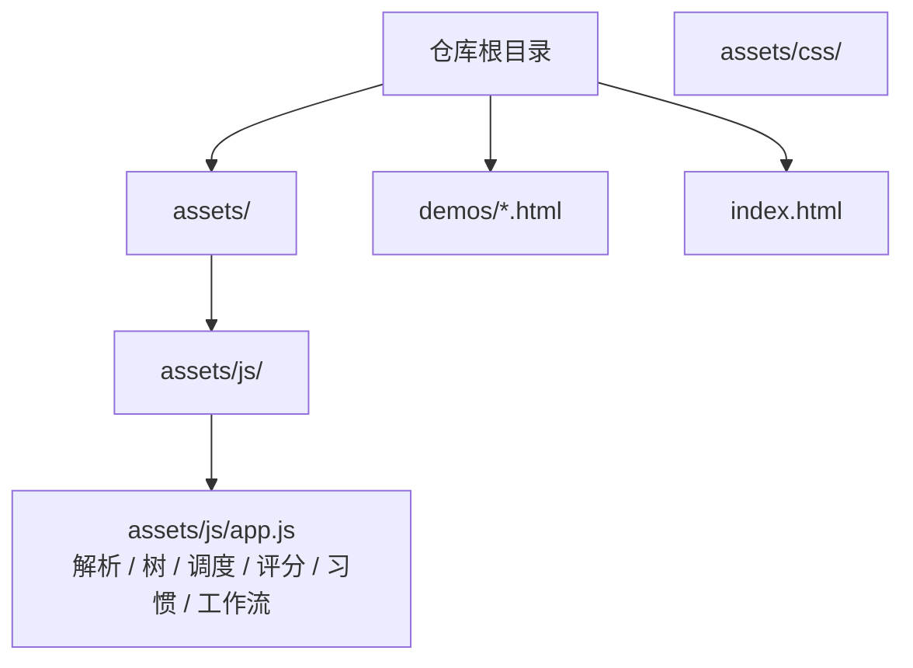

本分析仅依赖 `assets/js/app.js`，其他文件仅提供运行上下文，不做行为约定。

**章节来源**
- [assets/js/app.js:1-120](file://assets/js/app.js#L1-L120)

## 核心组件总览
| 组件 | 主要职责 | 入参与关键副作用 | 返回值 |
|---|---|---|---|
| `parseText` | 按行构造节点并应用建议、建树、二次尺度推断 | 接收原始文本；副作用：写入全局 `TODAY`、生成数组节点并调用 `applySuggestions/computeTree` | 返回已处理的节点数组 |
| `applySuggestions` | 从文本推断重要度、紧急度、期限、重复节奏、估计值和角色指标 | 修改传入 node 对象 | 无 |
| `newNode` | 统一初始字段 | 接受部分字面量 | 返回新节点 |
| `parseDeadline` | 解析中文/数字日期语义 | 修改字符串；产生 `label/date/daysLeft/overdue` 元组 | 期限对象或空结果 |
| `inferScale` | 根据文本、期限和是否含子节点推断年/月/周/日尺度 | 不直接改 state | `'year'/'month'/'week'/'day'` |
| `computeTree` | 建立 `_children` 数组与 `depth`，触发 tick | 清空旧 children；读取 `parentId` | 无，但调用 `beginTick()` |
| `recomputeSchedule` | 对整棵节点列表重新计算期限状态并刷新子树 | 写回 `deadlineDate/daysLeft/overdue` | 无 |
| `ensureEstimate` | 从文本补齐 estimateMinutes，归一 actualMinutes | 钳制取值范围 | 无，直接修改节点 |
| `ensureMetrics` | 归一 `role/targetNum/targetDone` | 初始化默认值、限制上限 | 无 |
| `setNodeDone` | 切换 done/doneAt，回填实际时长、更新习惯与统计 | 多路副作用：bumpDailyCompletion、targetDone 自增、appendExecutionLog、appendScore、updateHabitStreak、logHabitCheck | 无，但对 `state.meta` 多次持久化 |

**章节来源**
- [assets/js/app.js:450-590](file://assets/js/app.js#L450-L590)
- [assets/js/app.js:615-720](file://assets/js/app.js#L615-L720)
- [assets/js/app.js:1230-1440](file://assets/js/app.js#L1230-L1440)

## 系统架构：从文本到落库的生命周期
整体流程可分为三条主线：

1. **构建阶段**：`parseText → applySuggestions → newNode → computeTree`
2. **增强阶段**：`inferScale → recomputeSchedule → ensureEstimate → ensureMetrics`
3. **完成阶段**：`setNodeDone → bumpDailyCompletion → targetDone 自增 → appendExecutionLog → appendScore → updateHabitStreak → logHabitCheck`

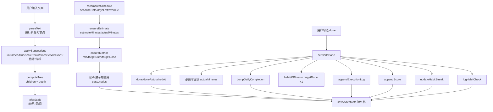

图中所有箭头均对应源码中的函数调用；渲染与存储是调用方在管线结束后触发的外围操作，而 `appendExecutionLog`、`appendScore` 会在其内部调用 `save`/`saveMeta`。

**图表来源**
- [assets/js/app.js:540-720](file://assets/js/app.js#L540-L720)
- [assets/js/app.js:1230-1440](file://assets/js/app.js#L1230-L1440)

## 阶段一：输入与解析 deadline
### parseDeadline：日期语义表
| 输入模式 | 语义解释 | 输出 label | 结果说明 |
|---|---|---|---|
| `今天`/`今日` | 当天零点 | `今天` | `daysLeft=0`，不过期 |
| `明天` | 后天 = today+1 | `明天` | `daysLeft=1` |
| `后天` | today+2 | `后天` | `daysLeft=2` |
| `YYYY-MM-DD` | 绝对日期 | 该日期字符串 | `daysLeft` 相对今天零点 |
| `M月D日` | 当年本月当日 | `M月D日` | 若日期已过则取明年同月同日 |
| `周X`/`星期X` | 最近一次该星期几 | `周X` | 周日作为 0，算法取 `nextWeekday` |
| `本周内` | 本周末 | `本周内` | 本周最后一天 |
| `下周` | 下个周末 | `下周` | 当前周 + 7 天后的一周末日 |
| `月底前`/`月底`/`月末` | 本月最后一天 | `月底` | `daysLeft` 由当天起算 |
| `下月底`/`下月末` | 下月最后一天 | `下月底` | 下月首日加 0 天即上月末下一月最后一日 |
| `第N周` | 今天起第 N 个七天 | `第N周` | daysLeft 按比例推进 |
| 无法匹配 | 空期限 | `""` | `date=null,daysLeft=null,overdue=false` |

注意：`parseDeadline` 的“空结果”只表示未识别出期限，不代表任务无截止时间。后续 `applySuggestions` 会使用这些字段更新节点，并在 `recomputeSchedule` 中做最终修正。

**章节来源**
- [assets/js/app.js:360-430](file://assets/js/app.js#L360-L430)

## 阶段二：computeTree 构建父子树与深度
`parseText` 基于缩进栈为每个节点赋予 `parentId`，然后交给 `computeTree`：

1. 对所有节点重置 `_children=[]`。
2. 用 `byId` 索引。
3. 仅当父节点存在于节点表中时才追加到 `_children`。
4. 通过递归 `walk(node[0], 0)` 赋值 `depth`。
5. 调用 `beginTick()` 失效 tick 级派生缓存。

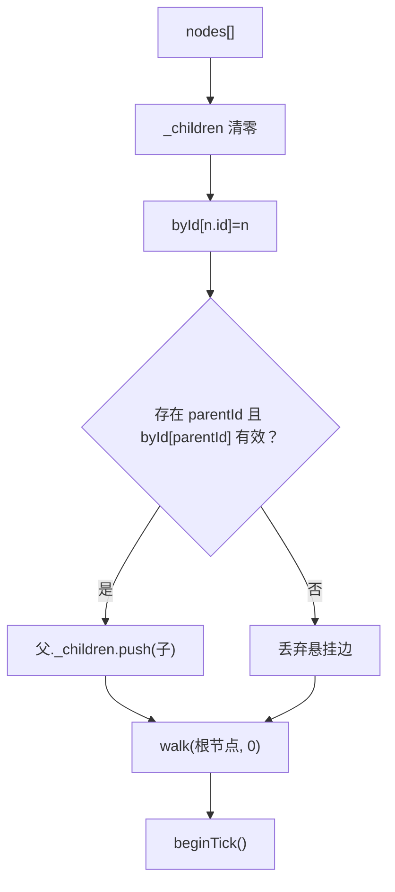

**图表来源**
- [assets/js/app.js:570-610](file://assets/js/app.js#L570-L610)

**边界处理：**
- 空父指针：首个节点被当作隐式根。
- 环形 `parentId`：`computeTree` 不检测环，仅按 parent 引用挂载；若出现环，下游 `goldChainIds`、递归遍历可能无限循环。应在 UI 层避免将自身设成自己的祖先。
- 无根节点：当 `nodes[0]` 缺失或根 `depth` 未被正确计算时，渲染层需防御性降级，但 `walk` 仍会从 `nodes[0]` 开始。

**章节来源**
- [assets/js/app.js:540-610](file://assets/js/app.js#L540-L610)

## 阶段三：inferScale 推断时间尺度
`scales` 包括 `day/week/month/year`，推断优先级如下：

1. 文本显式词汇匹配（每天、每周、每月、年度等）。
2. 若有期限：
   - `daysLeft≤1` → `day`
   - `daysLeft≤7` → `week`
   - 否则 → `month`
3. 无期限时：
   - 有子节点 → `year`
   - 无子节点 → `month`

此外还有二次推断：当节点拥有子节点时，会以 `hasChildren=true` 再次调用 `inferScale`，使分支倾向长期尺度。

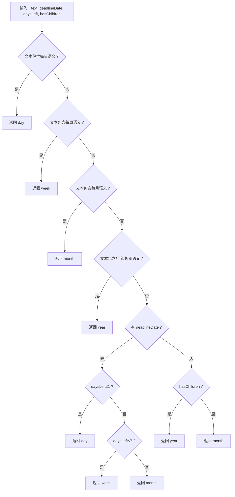

**图表来源**
- [assets/js/app.js:430-470](file://assets/js/app.js#L430-L470)
- [assets/js/app.js:545-565](file://assets/js/app.js#L545-L565)

**章节来源**
- [assets/js/app.js:430-470](file://assets/js/app.js#L430-L470)

## 阶段四：recomputeSchedule 填充 deadlineDate/daysLeft/overdue
该函数是“期限权威源”，覆盖 `parseDeadline` 的一次性语义：

- 有 `deadline` 字符串：用当前日期再次 `parseDeadline`，写回 `deadlineDate/daysLeft/overdue`。
- 无 `deadline`：强制清零期限字段。
- 之后再调用 `computeTree(nodes)` 重建子树。

因此，`parseText → applySuggestions → recomputeSchedule` 是标准落库前的安全路径；仅解析不重算会导致过期判断滞后于今天。

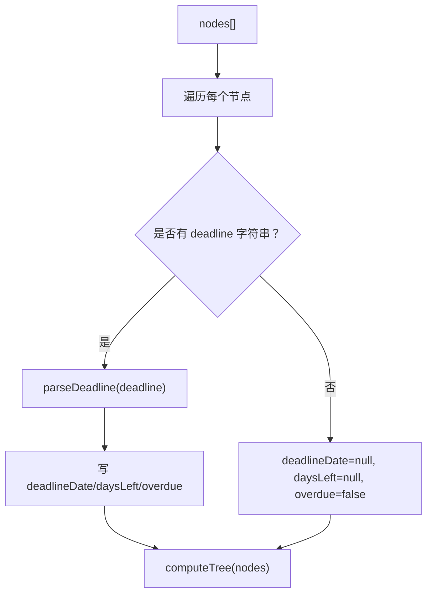

**图表来源**
- [assets/js/app.js:610-625](file://assets/js/app.js#L610-L625)

**章节来源**
- [assets/js/app.js:610-625](file://assets/js/app.js#L610-L625)

## 阶段五：ensureEstimate 补齐预计时长
`ensureEstimate` 的逻辑是“优先解析，其次默认，最后归一”：

1. 如果 `estimateMinutes` 为空：
   - 尝试从文本解析；支持“X小时”“X分钟”“X min”“半天”“五分钟”。
   - 若是叶子节点，默认设为 30 分钟。
2. 如果字段非空，则 clamp 到 `[0, 999]`；结果为 0 时归一为 `null`。
3. `actualMinutes` 同样 clamp 并去零。

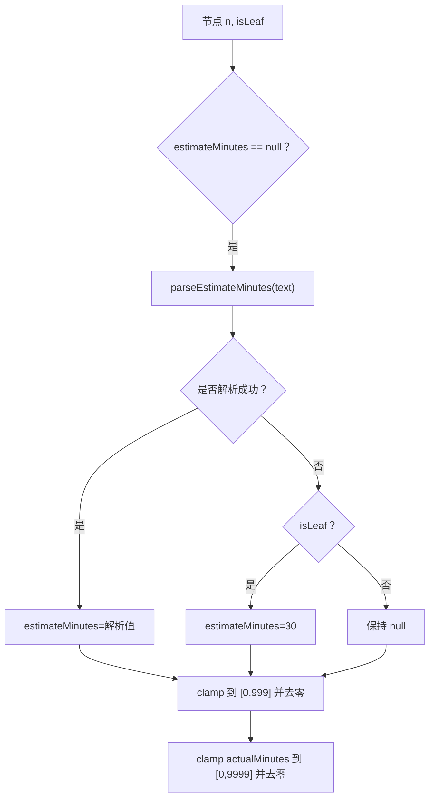

**图表来源**
- [assets/js/app.js:90-120](file://assets/js/app.js#L90-L120)

**边界情况：**
- `negative minutes`：正则不会解析负数；数值进入 clamp 后会变为 0，随后去零为 `null`。
- 正整数超限：最大归一到 999。
- 非叶子节点没有解析到的估计值，会保留 `null`，不自动补 30。

**章节来源**
- [assets/js/app.js:85-145](file://assets/js/app.js#L85-L145)

## 阶段六：ensureMetrics 归一 targetNum/targetDone
`parseMetrics` 先解析语义角色和目标文字：

- `O:...` → `role='O'`
- `KR:...`/`关键结果` → `role='KR'`
- 含“习惯/打卡/日课/日更”→ 可能标记 `role='habit'`
- `A/B` → `targetDone=targetNum=B`
- “目标N”“共N次”“×N” → `targetNum=N`

`ensureMetrics` 再做归一：

| 字段 | 默认值 | 约束 | 异常处理 |
|---|---:|---:|---|
| `role` | `''` | 字符串化后清理 | 未设置时留空 |
| `targetNum` | `null` | `[0,9999]`，0 转为 null | `NaN` 或负数归零后变 null |
| `targetDone` | `0` | `[0,9999]` | `NaN` 或负数归零 |

注意：归一并不强制 `targetDone ≤ targetNum`，因此界面展示需要容忍超额完成；进度百分比也可能 ≥100%。

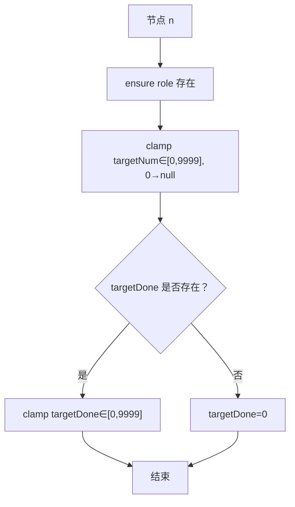

**图表来源**
- [assets/js/app.js:220-250](file://assets/js/app.js#L220-L250)

**章节来源**
- [assets/js/app.js:220-250](file://assets/js/app.js#L220-L250)

## 完成链：setNodeDone 的副作用顺序与可逆性
`setNodeDone(n, checked)` 的副作用可按方向分两类：

- **写回节点字段**：
  1. `n.done = checked`
  2. `n.doneAt = checked ? Date.now() : null`
  3. 已勾选且已有估计值但未填实际值：`actualMinutes = estimateMinutes`
  4. 如果在 `topId` 子树或 gold chain 上：设置 `touchedAt = Date.now()`

- **叶子节点增量副作用**（仅在 `n.parentId && n._children.length===0`）：
  1. `bumpDailyCompletion()`
  2. 满足 `(recur || role==='habit' || role==='KR') && targetNum > 0 && timesPerWeek==0` 时，`targetDone++`
  3. `appendExecutionLog(state.activeWorkflowId, n)`
  4. `appendScore(n, 'done')`
  5. `updateHabitStreak(n, wfId, true)`
  6. `logHabitCheck(n, wfId, true)`

取消勾选时相反：

1. `removeTodayScore(n.id, 'done')`
2. `updateHabitStreak(n, wfId, false)`
3. `logHabitCheck(n, wfId, false)`

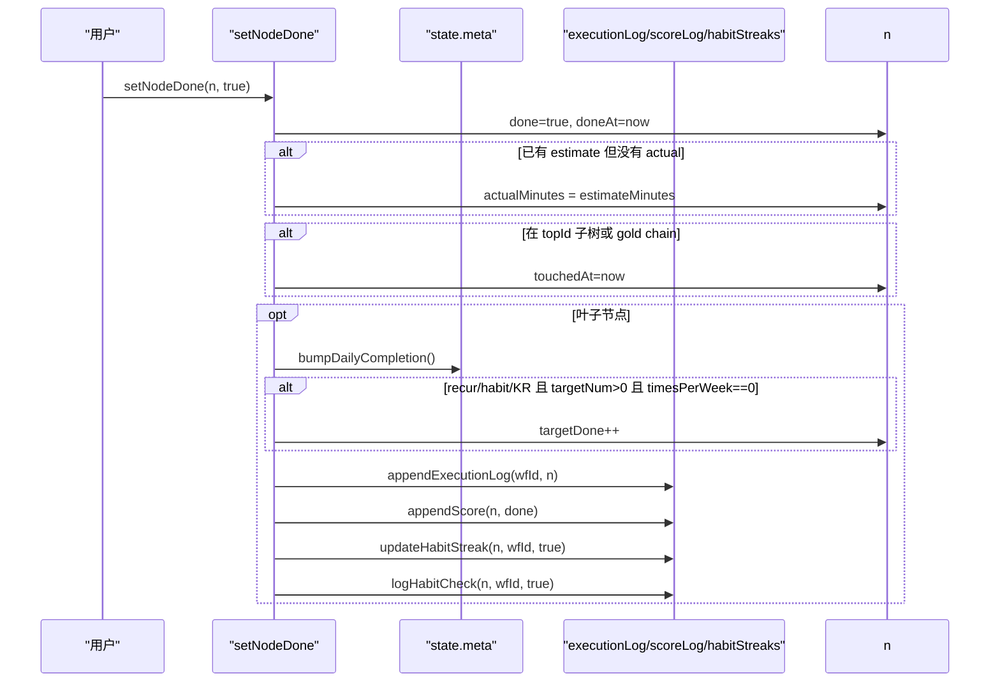

**图表来源**
- [assets/js/app.js:270-330](file://assets/js/app.js#L270-L330)
- [assets/js/app.js:1230-1440](file://assets/js/app.js#L1230-L1440)

#### 可逆性评估
| 副作用 | 可逆吗 | 说明 |
|---|---|---|
| `done/doneAt` | 可逆 | 取消勾选会置空 `doneAt` |
| `touchedAt` | 可逆但不还原历史时间 | 仅改为空；不恢复上次值 |
| `actualMinutes` | 半可逆 | 自动回填时取消不会恢复原值，应配合撤销 toast 或外部快照 |
| `dailyCompletions` | 不可逆 | 只加不减，代表当日累计完成次数 |
| `targetDone` | 有条件可逆 | habit 计数型通过 `logHabitCheck` 减 1；普通 habit/KR 不反向减 |
| `executionLog.entries` | 不可逆 | 每次追加新条目 |
| `scoreLog` | 仅移除当日同类项 | 用 `removeTodayScore` 删除今日本节点的本类打分 |
| `habitStreaks.cur/best` | 近似可逆 | 取消时会清空今日记录并使 streak 归零，但不恢复历史 best 前一步快照 |

**章节来源**
- [assets/js/app.js:270-330](file://assets/js/app.js#L270-L330)
- [assets/js/app.js:1230-1440](file://assets/js/app.js#L1230-L1440)

## 边界情况与校验规则

### 输入层
| 情况 | 行为 | 推荐校验 |
|---|---|---|
| 空文本 | `parseText` 过滤空白行后返回空数组 | 阻止提交并提示输入内容 |
| 只有缩进无首行 | 首行 `parentId` 为 `null`，其余行都挂到 `nodes[0]` 上 | 防止把真正子项误放为首行之前的缩进块 |
| 首行自身就是子级 | 首行仍会被赋予 `parentId=null`，变成根 | UI 应拒绝首行缩进 |

### 树结构
| 情况 | 现状 | 风险 |
|---|---|---|
| 空父指针 | 合法，首个节点成为根 | 需确保用户预期 |
| 环形 `parentId` | 不检测环 | `goldChainIds`、递归遍历、排序可能死循环 |
| 父节点被删后残留引用 | `computeTree` 会忽略无效 `byId[parentId]` | 子节点丢失挂接；显示上可能表现为孤岛 |
| 多个根节点 | `computeTree` 只对 `nodes[0]` 赋深度 | 其他根 `_children` 仍存在，但 `treeOrder`/视图逻辑可能不完整 |

### 期限与过期
| 情况 | 结果 |
|---|---|
| 未设期限 | `deadline=null, deadlineDate=null, daysLeft=null, overdue=false` |
| 日期今天 | `daysLeft=0, overdue=false` |
| 日期明天 | `daysLeft=1, overdue=false` |
| 日期昨天 | `daysLeft=-1, overdue=true` |
| “M月D日”过去月份日期 | 年份跳到下一年 |
| “第N周” | N=0 等价今天；N<0 未显式禁止，应由输入层 clamp |

### 估计值
| 情况 | 行为 |
|---|---|
| negative minutes | clamp 到 0，再去零为 `null` |
| 0.5 小时 | `parseFloat * 60`，round 后 clamp |
| 非叶子且无法解析 | 保持 `null` |
| 已 done 且 `actualMinutes==null` | 自动等于 `estimateMinutes` |

### 指标
| 情况 | 行为 |
|---|---|
| `targetDone > targetNum` | 允许，进度百分比 ≥100% |
| `targetNum=0, role!=O` | 普通计数任务通常用 habit/KR 或显式目标标识 |
| `role='O'` | 子树进度改用叶子完成率聚合 |
| `targetDone` 不存在 | 补为 `0` |
| 已完成后再取消打卡 | habit 计数型减少；普通任务不回滚 `targetDone` |

**章节来源**
- [assets/js/app.js:85-145](file://assets/js/app.js#L85-L145)
- [assets/js/app.js:220-250](file://assets/js/app.js#L220-L250)
- [assets/js/app.js:360-430](file://assets/js/app.js#L360-L430)
- [assets/js/app.js:540-610](file://assets/js/app.js#L540-L610)

## 时序图与流程图

### 完整解析到渲染时序
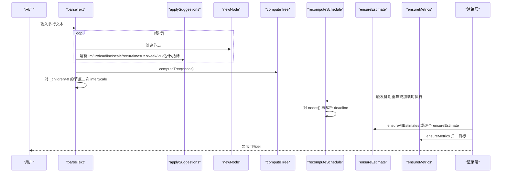

**图表来源**
- [assets/js/app.js:540-590](file://assets/js/app.js#L540-L590)
- [assets/js/app.js:610-625](file://assets/js/app.js#L610-L625)
- [assets/js/app.js:110-140](file://assets/js/app.js#L110-L140)
- [assets/js/app.js:220-240](file://assets/js/app.js#L220-L240)

### 校验流程图
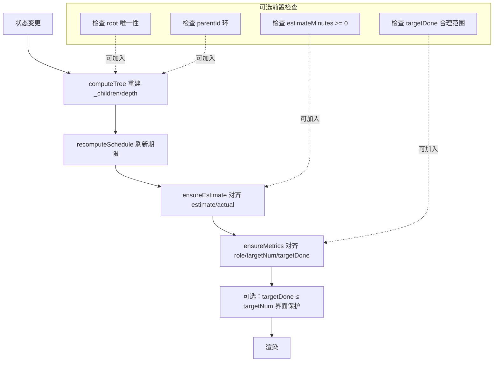

**图表来源**
- [assets/js/app.js:570-625](file://assets/js/app.js#L570-L625)
- [assets/js/app.js:110-145](file://assets/js/app.js#L110-L145)
- [assets/js/app.js:220-240](file://assets/js/app.js#L220-L240)

## 依赖关系分析
核心函数间的调用依赖如下：

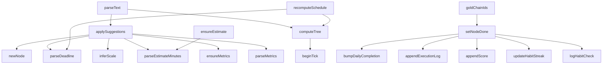

**图表来源**
- [assets/js/app.js:85-145](file://assets/js/app.js#L85-L145)
- [assets/js/app.js:360-470](file://assets/js/app.js#L360-L470)
- [assets/js/app.js:540-625](file://assets/js/app.js#L540-L625)
- [assets/js/app.js:270-330](file://assets/js/app.js#L270-L330)
- [assets/js/app.js:1230-1440](file://assets/js/app.js#L1230-L1440)

强耦合点：

- `parseText` 既负责解析又触发一次树构建，承担较重职责。
- `setNodeDone` 耦合了统计、日志、习惯和评分多条横切逻辑，修改任一分支都需验证副作用。
- 全局状态 `TODAY`、`state.nodes`、`state.topId`、`state.activeWorkflowId`、`state.meta` 被多处直接读写，缺少中央状态机。
- `recomputeSchedule` 复用 `computeTree`，但只传顶层 `nodes[]`，内部仍对每个节点重置 `_children`；若多个局部子树混在同一数组，需谨慎。

**章节来源**
- [assets/js/app.js:540-625](file://assets/js/app.js#L540-L625)
- [assets/js/app.js:270-330](file://assets/js/app.js#L270-L330)
- [assets/js/app.js:1230-1440](file://assets/js/app.js#L1230-L1440)

## 性能与缓存
代码中已实现多层优化：

| 机制 | 作用 | 范围 |
|---|---|---|
| `beginTick/_tickN` | 失效 rank/估算/视图 slot 缓存 | 跨多个计算路径 |
| `_treeCache/_treeCacheNodes` | 避免重复建树 | 由 `getCachedTree` 控制 |
| `_dkCache` | 缓存 `dateKey` 结果 | 每日变化 |
| `requestAnimationFrame` 防抖 | `debouncedAfterChange` | 频繁交互后批量更新 |
| 延迟保存 | `throttledSave` 合并 save | 降低 localStorage 频率 |

影响复杂度的关键点：

- `parseText`：线性扫描行并维护栈，`O(n)`。
- `computeTree`：遍历节点 + 一次 DFS 深度计算，`O(n)`；但递归对深树可能造成调用栈压力。
- `recomputeSchedule`：对 `nodes[]` 全量重算期限，即使只有一个节点变化也可能重扫全部。
- `setNodeDone`：对叶子节点涉及多次 write 和 JSON/LocalStorage 写，属于 I/O 密集型路径。

优化建议：
- 为大目标树增加增量 `_children` 更新，避免全量重算。
- `recomputeSchedule` 应接受节点 ID 集合，仅重算受影响节点的期限。
- `setNodeDone` 可合并多次 meta 写入，在事务结束时一次性 `saveMeta`。
- 对 `recursive dfs` 提供迭代版本或使用栈，避免极深嵌套。

**章节来源**
- [assets/js/app.js:625-720](file://assets/js/app.js#L625-L720)
- [assets/js/app.js:1230-1440](file://assets/js/app.js#L1230-L1440)

## 单元测试用例设计

以下用例描述面向 `parseDeadline`、`parseText`、`ensureEstimate`、`ensureMetrics`、`recomputeSchedule`、`setNodeDone`；可作为真实测试框架输入规范。为遵循“不粘贴源代码内容”原则，用例采用结构化输入/期望而非代码正文。

### 测试一：parseDeadline — 今天/明天/后天
- **输入**：今天  
  **期望**：`label="今天"`，`daysLeft=0`，`overdue=false`
- **输入**：明天  
  **期望**：`label="明天"`，`daysLeft=1`，`overdue=false`
- **输入**：后天  
  **期望**：`label="后天"`，`daysLeft=2`，`overdue=false`

### 测试二：parseDeadline — M月D日与越界
- **输入**：“6月1日”，当前日期在 6月1日之前  
  **期望**：`date` 为该年 6月1日零点
- **输入**：“6月1日”，当前日期在 6月1日之后  
  **期望**：`date` 为次年 6月1日零点

### 测试三：parseDeadline — 周几
- **输入**：“周一”  
  **期望**：返回下一个“周一”的日期；若今天是周一，也应为下一个周一（算法中使用差模+7）
- **输入**：“下周周五”  
  **期望**：比本周五晚一周

### 测试四：parseDeadline — 周/月底
- **输入**：“本周内”  
  **期望**：日期为本周末
- **输入**：“月底前”  
  **期望**：日期为本月最后一天

### 测试五：parseDeadline — 失败用例
- **输入**：“尽快”“马上”“截止日期临近”  
  **期望**：返回 `{label:"", date:null, daysLeft:null, overdue:false}`

### 测试六：parseText — 基本层级
- **输入**：
  - 第一行不带缩进：主任务
  - 第二行两空格缩进：子任务一
  - 第三行四空格缩进：子任务二的细分
- **期望**：
  - 第一个节点 `parentId=null`
  - 第二个节点挂接到第一个
  - 第三个节点挂接到第二个
  - `_children` 正确建立，`depth` 正确分配

### 测试七：parseText — 空文本
- **输入**：空字符串或多行仅空白字符  
  **期望**：返回空数组

### 测试八：ensureEstimate — 默认 30 分钟
- **输入**：非叶子节点文本不含估计  
  **期望**：`estimateMinutes` 保持 `null`
- **输入**：叶子节点文本不含估计  
  **期望**：`estimateMinutes=30`

### 测试九：ensureEstimate — 解析估计
- **输入**：“2小时”  
  **期望**：`estimateMinutes=120`
- **输入**：“30分钟”  
  **期望**：`estimateMinutes=30`
- **输入**“-5分钟”  
  **期望**：`estimateMinutes=null`

### 测试十：ensureMetrics — 目标进度
- **输入**：“目标3次”，未给 `targetDone`  
  **期望**：`targetNum=3, targetDone=0`
- **输入**：“O:提升转化率，目标10%/5%，打10个电话”  
  **期望**：`role="O"`，`targetNum=10`，`targetDone=5`
- **输入**：`targetDone=100, targetNum=10`  
  **期望**：不被 `ensureMetrics` 强制裁剪，可出现超额完成

### 测试十一：recomputeSchedule — 过期任务
- **预置**：节点 `deadline="昨天"`  
- **动作**：`recomputeSchedule([node])`  
- **期望**：`deadlineDate=昨天的零点`, `daysLeft<0`, `overdue=true`

### 测试十二：recomputeSchedule — 未设期限
- **预置**：节点仅有文本，无 `deadline`  
- **期望**：`deadline=null, deadlineDate=null, daysLeft=null, overdue=false`

### 测试十三：setNodeDone — 已 done 后误删 doneAt
- **动作**：将 `done=true, doneAt=null` 手动回退  
- **期望**：下一次 `setNodeDone(true)` 应能重新设置 `doneAt` 到当前时间戳，而不是保持 null  
- **注意**：代码不会主动检测“已 done 但 doneAt=null”，应由 UI/导入器保证一致性

### 测试十四：setNodeDone — habit 与 KR targetDone 自增
- **场景 A**：`role='habit'`，`timesPerWeek=0`，`targetNum=7`  
  **期望**：勾选后 `targetDone++`
- **场景 B**：`role='KR'`，`timesPerWeek=0`，`targetNum>0`  
  **期望**：勾选后 `targetDone++`
- **场景 C**：`timesPerWeek=3`  
  **期望**：不走此分支，而是由 `logHabitCheck` 管理计数

### 测试十五：setNodeDone — 取消勾选的回滚
- **动作**：对 habit 计数型任务取消勾选  
- **期望**：`logHabitCheck` 将该日记录删除并使 `targetDone` 减 1（仅当 `timesPerWeek>0 && targetNum>0`）

### 测试十六：环形 parentId
- **预置**：A 的 `parentId=B`，B 的 `parentId=A`  
- **期望**：现有 `computeTree` 不报错，但后续递归可能不稳定  
- **要求**：应在 UI 或数据层增加“父不可为自身及后代”的校验

**章节来源**
- [assets/js/app.js:85-145](file://assets/js/app.js#L85-L145)
- [assets/js/app.js:220-240](file://assets/js/app.js#L220-L240)
- [assets/js/app.js:360-430](file://assets/js/app.js#L360-L430)
- [assets/js/app.js:540-625](file://assets/js/app.js#L540-L625)
- [assets/js/app.js:1230-1440](file://assets/js/app.js#L1230-L1440)

## 故障排查

| 现象 | 可能原因 | 定位位置 | 处理建议 |
|---|---|---|---|
| 勾选后目标进度没动 | 不是叶子节点，或不是 habit/KR/ recur，或 `targetNum=0`，或 habit 为 `timesPerWeek>0` | `setNodeDone` | 确认节点是否为叶子；检查 role/recur/targetNum/timesPerWeek |
| 取消打卡却 still 计完成 | habit 非计数型，不反向减 targetDone | `setNodeDone` 常规分支 vs `logHabitCheck` | 对计数型 habit 使用 `timesPerWeek` 语义 |
| `done=true` 但看不到 `doneAt` | 手动编辑或导入数据导致丢失 | 自定义编辑路径 | 补充校验，或下次勾选修复 |
| 任务一直显示过期 | `deadline` 字符串未随今天刷新，或之前解析的 `daysLeft<0` | `recomputeSchedule` 必须执行 | 加载或文本变更后调用 `recomputeSchedule` |
| 实际时长未回填 | `estimateMinutes` 为空 | `setNodeDone` 条件 | 先设估计值再勾选，或在编辑时强制补估计 |
| 渲染布局错乱 | 树未重建 | `computeTree` | 任何 `parentId` 变更后调用 `computeTree` 或 `invalidateTreeCache` |
| 内存或卡顿 | 大树上频繁 rebuild | `computeTree`/`recomputeSchedule` | 合并批量变更、使用增量计算、减少中间状态更新 |

**章节来源**
- [assets/js/app.js:270-330](file://assets/js/app.js#L270-L330)
- [assets/js/app.js:570-625](file://assets/js/app.js#L570-L625)
- [assets/js/app.js:625-720](file://assets/js/app.js#L625-L720)

## 结论
`assets/js/app.js` 以一条清晰的主线把自然语言目标转化为结构化节点：  
`parseText` 负责入口解析，`applySuggestions` 收敛语义，`computeTree` 构建物理树结构，`inferScale` 和时间维度共同决定任务视野，`recomputeSchedule` 提供期限权威结果，`ensureEstimate` 和 `ensureMetrics` 完成字段完整性，最后 `setNodeDone` 把一次勾选扩展成打卡、习惯、执行记录和评分的多维反馈。

为保证健壮性，建议在现有管道之外增加两层防护：
1. **输入校验**：防止环形 parentId、多重根、非法 `timesPerWeek`、负数估计值、超大目标数。
2. **变更事务**：将 `setNodeDone` 中的多步 side effect 放在一个可撤销单元中，确保 `doneAt`、`actualMinutes`、`dailyCompletions`、`targetDone`、习惯 streak 与执行日志保持一致。