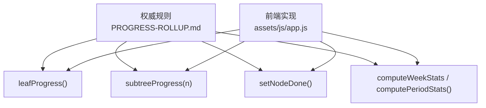
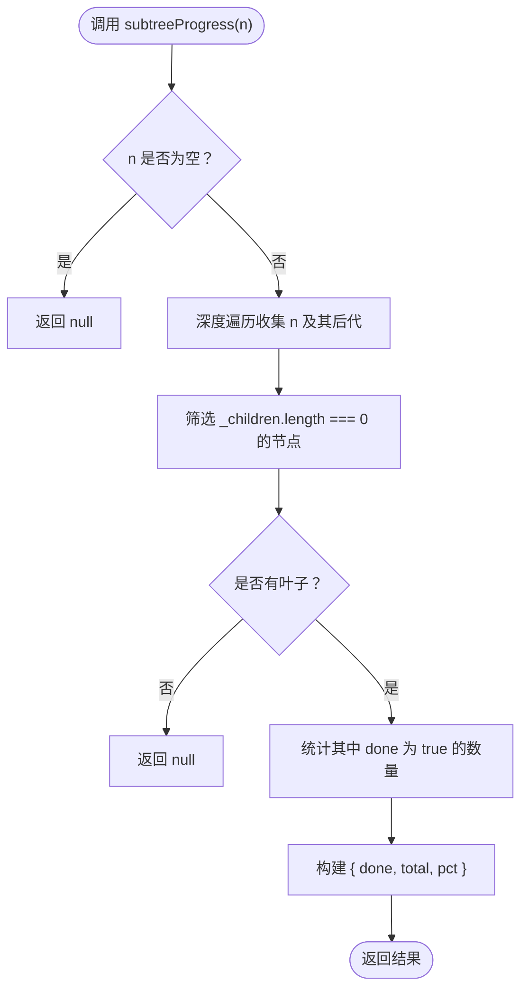
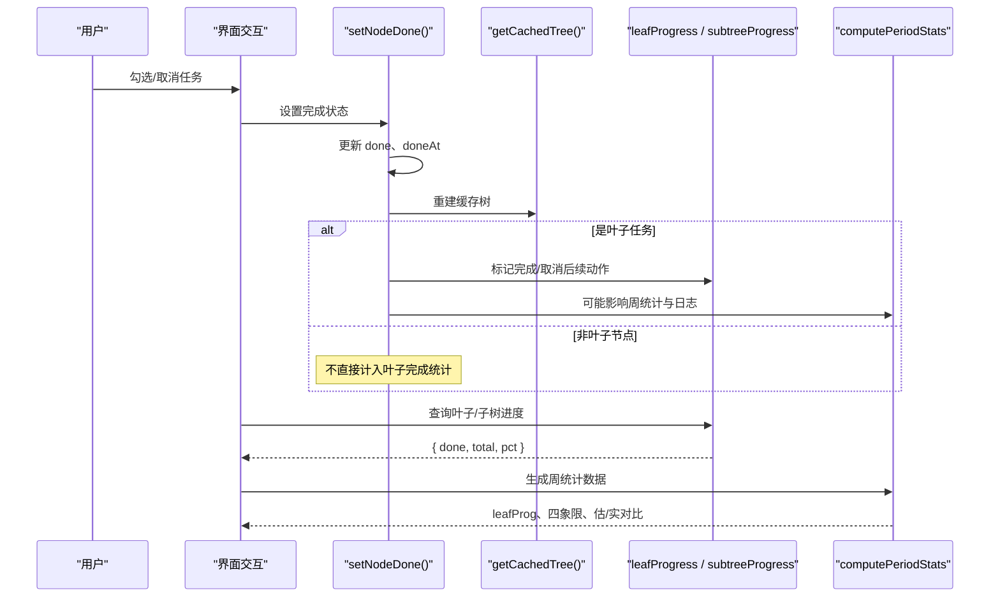
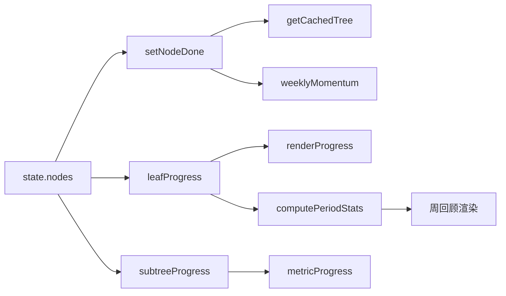

# 进度 Rollup 与统计指标

<cite>
**本文引用的文件**
- [docs/PROGRESS-ROLLUP.md](file://docs/PROGRESS-ROLLUP.md)
- [assets/js/app.js](file://assets/js/app.js)
</cite>

## 目录
1. [引言](#引言)
2. [项目结构中的相关文件](#项目结构中的相关文件)
3. [权威语义：Rollup 规则总览](#权威语义rollup-规则总览)
4. [核心实现验证](#核心实现验证)
5. [架构视图](#架构视图)
6. [详细组件分析](#详细组件分析)
7. [依赖关系分析](#依赖关系分析)
8. [边界用例](#边界用例)
9. [性能特征与建议](#性能特征与建议)
10. [故障排查](#故障排查)
11. [结论](#结论)

## 引言
本文件以 `docs/PROGRESS-ROLLUP.md` 为权威契约，逐项映射到前端实现 `assets/js/app.js` 中的 `leafProgress()`、`subtreeProgress(n)`、`setNodeDone`、`computePeriodStats`、`weeklyMomentum` 等逻辑。目标是让读者理解：GoalFlow 的“叶子进度”到底怎么算、为什么只数叶子、如何体现到顶栏百分比、如何在周回顾中与四象限和时长指标解耦展示，以及常见异常数据如何处理。

## 项目结构中的相关文件
| 文件 | 职责 | 与本主题相关的关键位置 |
|---|---|---|
| `docs/PROGRESS-ROLLUP.md` | 定义 rollup 语义、字段含义和实现位置约定 | 全文 |
| `assets/js/app.js` | 实现节点完成状态更新、叶子子树进度、周期统计、UI 渲染调用 | `setNodeDone`、`leafProgress`、`subtreeProgress`、`metricProgress`、`computePeriodStats`、`weeklyMomentum` |

**图表来源**
- [docs/PROGRESS-ROLLUP.md:1-37](file://docs/PROGRESS-ROLLUP.md#L1-L37)
- [assets/js/app.js:354-386](file://assets/js/app.js#L354-L386)
- [assets/js/app.js:665-685](file://assets/js/app.js#L665-L685)
- [assets/js/app.js:5449-5508](file://assets/js/app.js#L5449-L5508)

**章节来源**
- [docs/PROGRESS-ROLLUP.md:1-37](file://docs/PROGRESS-ROLLUP.md#L1-L37)
- [assets/js/app.js:354-386](file://assets/js/app.js#L354-L386)

## 权威语义：Rollup 规则总览
根据权威文档，规则如下：

| 概念 | 规则 |
|---|---|
| **叶子节点** | `parentId` 非空，且 `_children.length === 0` |
| **分母来源** | 仅叶子节点计入；根节点、任意有子节点的中间层不计入 |
| **分子来源** | 已勾选且属于当前统计范围的叶子数量 |
| **聚焦模式隐藏节点** | 不参与桑基图过滤，但仍参与基于完整 `state.nodes` 的叶子统计 |
| **完成时间戳** | 勾选写入毫秒时间戳 `doneAt`；取消清空；历史已有勾选但缺 `doneAt` 的记录不计入「本周完成」 |
| **完成区间** | 「本周完成」要求 `doneAt` 落入本周一 0:00 至下周一 0:00 |
| **Value/Effort** | quick-win（价值≥4、费力≤2）只用于筛选和叙述，不改变 rollup 分母 |
| **时长字段** | `estimateMinutes`、`actualMinutes` 仅影响日容量与预估 vs 实计对比，不进入叶子完成百分比 |

**章节来源**
- [docs/PROGRESS-ROLLUP.md:1-37](file://docs/PROGRESS-ROLLUP.md#L1-L37)

## 核心实现验证
### leafProgress 语义契约与代码对照
权威语义要求：
- 仅数叶子；
- 根和中间层不参与；
- 返回 `{ done, total, pct }`；
- 无叶子时返回 null；
- 被聚焦模式隐藏的节点仍应统计；
- `estimateMinutes`/`actualMinutes` 不进入百分比。

对应实现位于 `assets/js/app.js`：
- 先缓存树；
- 从完整 `state.nodes` 中筛选满足 `parentId` 非空且 `_children.length === 0` 的节点；
- 若没有叶子返回 `null`；
- 否则用 `done` 计数除以叶子总数并取整。

该实现完全遵循权威语义：筛选条件与文档定义一致；输出结构为 `{ done, total, pct }`；零叶子返回 `null`；未使用时长字段；也未受 UI 层过滤影响。

**章节来源**
- [assets/js/app.js:665-675](file://assets/js/app.js#L665-L675)
- [docs/PROGRESS-ROLLUP.md:7-17](file://docs/PROGRESS-ROLLUP.md#L7-L17)

### subtreeProgress 语义契约与代码对照
权威语义要求：
- 针对某个节点 `n`，计算其子树内所有叶子的完成比；
- 同样只考虑叶子；
- 输出同构结构 `{ done, total, pct }`；
- 不存在叶子时应返回 `null`；
- 不应把父节点自身误计入分子或分母。

对应实现位于 `assets/js/app.js`：
- 对 `n` 做深度优先遍历，收集 `collect`；
- 从 `collect` 中筛选 `_children.length === 0` 的项作为叶子；
- 若无叶子返回 `null`；
- 再按 `done` 统计并取整百分比。

这里有一个值得注意的细节：遍历过程中会把根节点本身加入 `collect`，但随后通过 `_children.length === 0` 过滤出真正的叶子。因此，根节点即使 `_children` 为空也不会被误认为是叶子；只有满足“无子节点且是叶子目标对象”的节点才会进入统计。结合 `setNodeDone` 中对叶子判断使用 `parentId && _children.length === 0` 的模式，业务上通常将「无 parent 的根」视为项目顶级容器，而不是普通任务叶子，从而避免顶层目标容器成为百分比分母。

**图表来源**
- [assets/js/app.js:676-685](file://assets/js/app.js#L676-L685)

**章节来源**
- [assets/js/app.js:676-685](file://assets/js/app.js#L676-L685)

### setNodeDone：状态变更如何影响 Rollup
`setNodeDone` 是 rollup 数据变化的源头。关键行为包括：
- 更新 `n.done`；
- 勾选时写入 `doneAt = Date.now()`，取消时置空；
- 当选中目标范围节点且是金线节点时，记录 `touchedAt`；
- 重建缓存树；
- 判定当前节点是否为叶子；
- 仅叶子触发当日完成计数、目标次数累计、执行日志、得分、习惯打卡等副作用；
- 取消勾选时清理当天已完成分数及习惯相关状态。

这与 rollup 规则一致：`setNodeDone` 对叶子和非叶子的区分依据同样是 `parentId` 与 `_children.length`；同时确认 `doneAt` 只在勾选/取消时被写入或清空，符合文档对完成时间戳的要求。

**章节来源**
- [assets/js/app.js:354-386](file://assets/js/app.js#L354-L386)
- [docs/PROGRESS-ROLLUP.md:19-28](file://docs/PROGRESS-ROLLUP.md#L19-L28)

### computeWeekStats：周维度与 rollup 的关系
`computePeriodStats` 的核心流程：
1. 缓存树并保证估计时长存在；
2. 通过 `periodRange(cycle)` 得到周期起止时间；
3. 从完整 `state.nodes` 中再次筛选叶子；
4. 进一步筛选已完成且 `doneAt` 落在周期内的叶子；
5. 按四象限分类计数；
6. 计算核心/救火比例；
7. 调用 `leafProgress()` 取得全局叶子进度；
8. 统计快速赢待办数量、金线完成/触碰、估算分钟总和与实际分钟总和；
9. 输出包含 `leafProg`、`quickWins`、`estSum`、`actSum` 等的周报数据。

关键点：
- 周期完成只基于 `done` + 落入区间的 `doneAt`；
- 分类使用 `category(n.im, n.ur)`，与 rollup 分母解耦；
- `leafProg` 直接复用 `leafProgress()`；
- quick-win 统计只用于辅助数字，不是 rollup 分母；
- `estimateMinutes`/`actualMinutes` 累计但不进入百分比。

这体现了 rollup 的两个解耦面：完成比率只看布尔完成状态与周期时间窗口；时长与四象限是统计维度的不同投影。

**章节来源**
- [assets/js/app.js:5449-5508](file://assets/js/app.js#L5449-L5508)
- [docs/PROGRESS-ROLLUP.md:21-37](file://docs/PROGRESS-ROLLUP.md#L21-L37)

### weeklyMomentum：执行节奏数据的另一种视角
`weeklyMomentum` 不从树结构直接统计本周完成，而是读取元数据 `meta.executionLog` 中最近七天的日志条目。它聚合 `completedCount`、每日条目中的估算与实际耗时，并统计活跃习惯条数。这是“周执行节奏”数据源，与 rollup 的“结构完成比”不同：rollup 看树结构完成态，momentum 看日志侧的实际执行轨迹。

**章节来源**
- [assets/js/app.js:2830-2865](file://assets/js/app.js#L2830-L2865)

## 架构视图
以下从系统层面说明数据流动：UI 操作 → 状态修改 → 滚动统计 → 周回顾。

**图表来源**
- [assets/js/app.js:354-386](file://assets/js/app.js#L354-L386)
- [assets/js/app.js:665-685](file://assets/js/app.js#L665-L685)
- [assets/js/app.js:5449-5508](file://assets/js/app.js#L5449-L5508)

## 详细组件分析

### 叶子判定逻辑
| 来源 | 判定条件 | 作用 |
|---|---|---|
| `setNodeDone` | `n.parentId && n._children.length === 0` | 决定勾选后的完成类副作用是否发生 |
| `ensureAllEstimates` | `n.parentId && n._children.length === 0` | 决定默认估计时长策略 |
| `leafProgress` | `n.parentId && n._children.length === 0` | 确定全树统计分母 |
| `subtreeProgress` | `x._children.length === 0` | 在遍历后筛选叶子 |

一致性评价：整体统一采用“父子关系 + 无子节点”的方式识别叶子；唯一区别是 `subtreeProgress` 遍历时先收集全部后代再按子数组长度过滤。由于遍历收集的是 `node` 对象引用，不会意外创建 `_children`，因此判断稳定。

**章节来源**
- [assets/js/app.js:354-370](file://assets/js/app.js#L354-L370)
- [assets/js/app.js:207-217](file://assets/js/app.js#L207-L217)
- [assets/js/app.js:665-685](file://assets/js/app.js#L665-L685)

### 输出结构与 null 语义
| 场景 | `leafProgress()` | `subtreeProgress(n)` |
|---|---|---|
| 正常叶子集 | 返回 `{ done, total, pct }` | 返回 `{ done, total, pct }` |
| 零叶子 | 返回 `null` | 返回 `null` |
| 传入空节点 | 不适用（函数无需参数） | 返回 `null` |
| 有节点但没有叶子后代 | 不适用 | 返回 `null` |
| UI 未显示但仍在 `state.nodes` 中的节点 | 仍可被统计 | 可被统计 |

调用处应对 `null` 进行判空。例如 `renderProgress` 在无 `p` 或无树节点时隐藏进度 Chip；`metricProgress` 也会直接返回 `null` 再交由上层处理。

**章节来源**
- [assets/js/app.js:665-685](file://assets/js/app.js#L665-L685)
- [assets/js/app.js:5487-5504](file://assets/js/app.js#L5487-L5504)

### 伪代码：leafProgress
1. 加载缓存树；
2. 遍历 `state.nodes`，取出所有满足 `parentId` 非空且 `_children.length === 0` 的节点；
3. 如果数量为 0，返回 `null`；
4. 否则统计这些叶子中 `done` 为真的数量 `done`；
5. 返回 `{ done, total, pct }`，其中 `pct = round(100 × done / total)`。

### 伪代码：subtreeProgress(n)
1. 如果 `n` 为空，返回 `null`；
2. 加载缓存树；
3. 初始化空集合；
4. 定义递归函数 `walk(node)`：
   - 将 `node` 加入集合；
   - 对 `node._children` 中每个子节点递归执行 `walk`；
5. 调用 `walk(n)`；
6. 从集合中筛选 `_children.length === 0` 的项作为子树叶子；
7. 如果叶子数为 0，返回 `null`；
8. 统计其中 `done` 为真的数量；
9. 返回 `{ done, total, pct }`。

**章节来源**
- [assets/js/app.js:354-386](file://assets/js/app.js#L354-L386)
- [assets/js/app.js:665-685](file://assets/js/app.js#L665-L685)

## 依赖关系分析

**图表来源**
- [assets/js/app.js:354-386](file://assets/js/app.js#L354-L386)
- [assets/js/app.js:665-685](file://assets/js/app.js#L665-L685)
- [assets/js/app.js:2830-2865](file://assets/js/app.js#L2830-L2865)
- [assets/js/app.js:5449-5508](file://assets/js/app.js#L5449-L5508)

### 耦合点与解耦点
| 维度 | 耦合方式 | 解耦说明 |
|---|---|---|
| 叶子进度 | 依赖树结构 | 只依赖 `parentId` 和 `_children`，不依赖四象限、快速赢、时长字段 |
| 周统计完成 | 依赖 `doneAt` | 依赖周期起止时间和 `executionLog`，但与 `leafProgress` 的分母统计分离 |
| 四象限 | 依赖 `im`/`ur` | 用于分类和叙述，不参与 rollup 分母 |
| 快速赢 | 依赖 `val`/`eff` | 仅用于筛选和周回顾叙述，不改变完成率 |
| 时长 | 依赖 `estimateMinutes`/`actualMinutes` | 影响容量、预估 vs 实计偏差，不参与叶子百分比 |
| UI 过滤 | 焦点模式隐藏节点 | 仍统计在 `state.nodes` 中，不因 UI 过滤而改变 rollup |

**章节来源**
- [assets/js/app.js:225-235](file://assets/js/app.js#L225-L235)
- [assets/js/app.js:2830-2865](file://assets/js/app.js#L2830-L2865)
- [assets/js/app.js:5449-5508](file://assets/js/app.js#L5449-L5508)
- [docs/PROGRESS-ROLLUP.md:9-37](file://docs/PROGRESS-ROLLUP.md#L9-L37)

## 边界用例

| 用例 | 期望行为 | 实现匹配情况 |
|---|---|---|
| **零叶子** | `leafProgress()` 和 `subtreeProgress()` 返回 `null` | 两者均显式返回 `null` |
| **空树** | 无叶子；顶栏进度卡片应隐藏 | `renderProgress` 在空结果时隐藏卡片 |
| **部分完成的子树** | `subtreeProgress` 按子树内叶子完成数量计算 | 遍历后再筛选叶子并按 `done` 计数 |
| **根节点不计入** | 根不在叶子列表中 | `leafProgress` 要求 `parentId` 非空；根通常无父级 |
| **中间层不计入** | 父节点不作为分母 | 只统计 `_children.length === 0` 的节点 |
| **聚焦模式隐藏** | 仍参与完整统计 | 统计基于完整 `state.nodes`，而非 UI 可见过滤 |
| **历史已勾选缺 doneAt** | 不计入本周完成，重新勾选补戳 | `computePeriodStats` 要求 `done` 且合法 `doneAt` |
| **doneAt 跨周** | 归入正确周 | 使用周期起止时间比较，落周由周期函数决定 |
| **target 指标类节点** | O/KR 的目标值单独走 `metricProgress`，不按普通叶子百分比统计 | O/KR 走 `metricProgress`；普通叶子走 `leafProgress/subtreeProgress` |
| **只有父节点没有叶子** | `subtreeProgress` 返回 `null` | 过滤后没有叶子即返回 `null` |
| **重复勾选同一叶子** | `done` 保持真，`doneAt` 刷新 | 每次勾选都写入当前时间戳 |
| **取消勾选后重新勾选** | `done` 变真，`doneAt` 再次写入 | `setNodeDone` 在选中和取消路径分别写/清 |

关于 target 指标类节点：
- `metricProgress` 先检查 `targetNum > 0`，使用 `targetDone/targetNum`；
- 如果角色为 `O`，则转为 `subtreeProgress(n)`，并标注 `kind: 'leaf'`；
- 其他节点返回 `null`，表示不由 metricProgress 负责百分比；
- 这保证了指标目标和常规叶子任务共用“完成”概念，但计算口径明确分开。

**章节来源**
- [assets/js/app.js:354-386](file://assets/js/app.js#L354-L386)
- [assets/js/app.js:5449-5508](file://assets/js/app.js#L5449-L5508)
- [assets/js/app.js:225-235](file://assets/js/app.js#L225-L235)
- [docs/PROGRESS-ROLLUP.md:9-37](file://docs/PROGRESS-ROLLUP.md#L9-L37)

## 性能特征与建议
- 时间复杂度：
  - `leafProgress`：一次线性扫描 `state.nodes`，复杂度 O(n)；
  - `subtreeProgress`：遍历指定子树节点，复杂度 O(k)，k 为该子树节点数量；
  - `computePeriodStats`：同样会扫描完整 nodes 构建叶子列表和完成集合，复杂度 O(n)；
  - `weeklyMomentum`：按最近七天迭代日志，复杂度 O(logs)。
- 空间复杂度：
  - `subtreeProgress` 维护 `collect` 数组，最坏 O(k)；
  - 周期统计维护完成集合和各维度计数，额外空间较小。
- 优化建议：
  - 频繁重渲染时可复用已缓存树，避免重复解析；
  - 大型目标树上频繁调用 `subtreeProgress` 可考虑对热点节点做增量缓存；
  - 周报统计可在节点变更时增量更新，减少对完整列表的全量过滤。

**章节来源**
- [assets/js/app.js:665-685](file://assets/js/app.js#L665-L685)
- [assets/js/app.js:5449-5508](file://assets/js/app.js#L5449-L5508)
- [assets/js/app.js:2830-2865](file://assets/js/app.js#L2830-L2865)

## 故障排查
| 现象 | 可能原因 | 检查位置 |
|---|---|---|
| 顶栏不显示 “叶子 x%” | 返回值为 `null`；或树为空 | `leafProgress`、`renderProgress` |
| 子树百分比一直为空 | 子树中没有叶子；或传入节点为空 | `subtreeProgress`、调用方判空逻辑 |
| 历史勾选任务不计入本周完成 | `doneAt` 缺失或不属于本周周期 | `computePeriodStats` 中的完成过滤 |
| 取消后重新勾选时间戳改变 | `doneAt` 每次勾选都会写当前时间 | `setNodeDone` |
| 隐藏任务突然影响百分比变化不大 | 隐藏只是 UI 过滤，统计仍基于完整 nodes | `PROGRESS-ROLLUP.md` 与统计入口 |
| 指标任务百分比异常 | 使用了目标值路径而非普通叶子路径 | `metricProgress` |
| 预估 vs 实计差异很大 | 日志中实际时长偏大或未填写实际时长 | `weeklyMomentum`、`computePeriodStats` 时长合计 |

**章节来源**
- [assets/js/app.js:354-386](file://assets/js/app.js#L354-L386)
- [assets/js/app.js:665-685](file://assets/js/app.js#L665-L685)
- [assets/js/app.js:5449-5508](file://assets/js/app.js#L5449-L5508)
- [docs/PROGRESS-ROLLUP.md:19-37](file://docs/PROGRESS-ROLLUP.md#L19-L37)

## 结论
GoalFlow 的进度 rollup 设计清晰且解耦：
- **完成比率** 严格限定为“叶子节点完成度”，并以 `{ done, total, pct }` 表达；
- **统计基础** 始终是完整 `state.nodes`，与 UI 层的聚焦过滤无关；
- **周完成** 不仅要求 `done`，还要求 `doneAt` 落入指定周期；
- **四象限分类、Quick Win、时长预估** 分别承担叙述、筛选和能力评估职责，不混入叶子百分比；
- `leafProgress` 提供全局叶子进度，`subtreeProgress` 提供子树局部进度，二者共同支撑 top bar 的“叶子 xx%”和 hero card 或 O/KR 指标的“子树 xx%”。

这套语义既保持了进度指标的稳定性，又为周报、节奏分析、能力校准留出独立扩展空间。