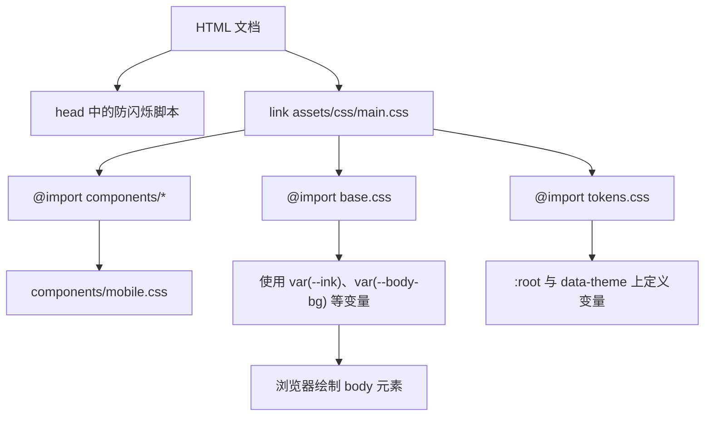
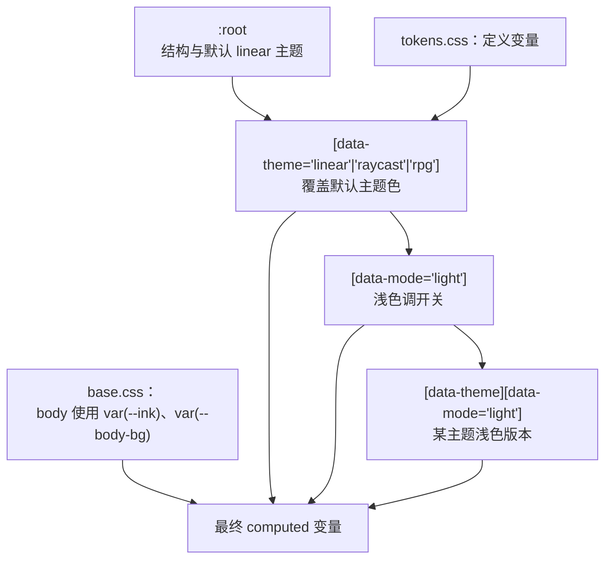
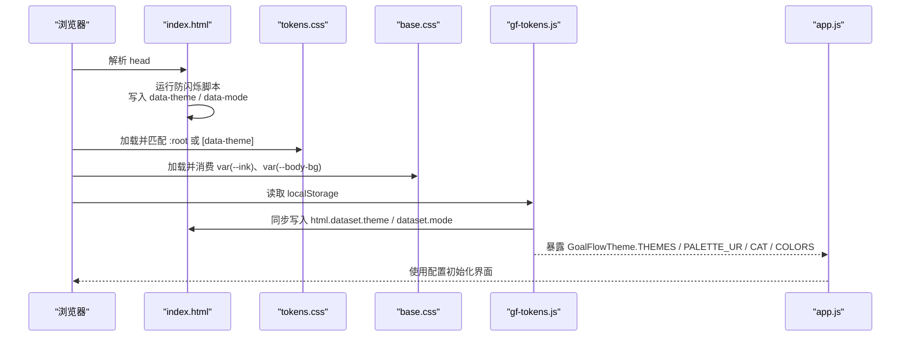
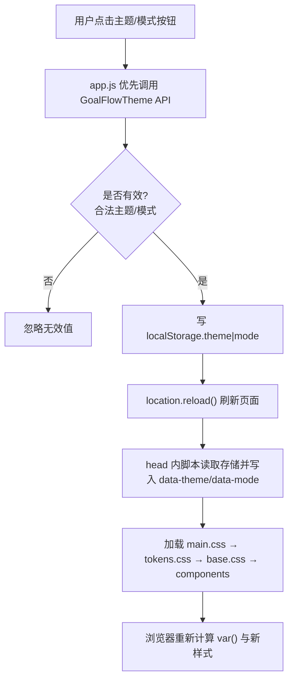
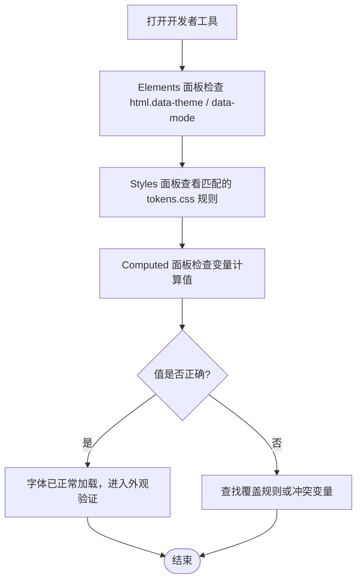

# CSS 变量与主题注入机制

<cite>
**本文引用的文件 **
- [index.html](file://index.html)
- [assets/css/main.css](file://assets/css/main.css)
- [assets/css/tokens.css](file://assets/css/tokens.css)
- [assets/css/base.css](file://assets/css/base.css)
- [assets/js/gf-tokens.js](file://assets/js/gf-tokens.js)
- [assets/js/app.js](file://assets/js/app.js)
- [scripts/inline-bundle.mjs](file://scripts/inline-bundle.mjs)
</cite>

## 目录
1. [简介](#简介)
2. [入口样式与导入顺序](#入口样式与导入顺序)
3. [CSS 变量命名约定](#css-变量命名约定)
4. [主题选择器覆盖优先级](#主题选择器覆盖优先级)
5. [JS 令牌与首次渲染流程](#js-令牌与首次渲染流程)
6. [主题切换时的重计算过程](#主题切换时的重计算过程)
7. [组件层与响应式适配](#组件层与响应式适配)
8. [调试主题变量的步骤](#调试主题变量的步骤)
9. [常见问题排查清单](#常见问题排查清单)
10. [架构总结](#架构总结)

## 简介
本仓库的主题系统以 “CSS 设计令牌 + JS 主题配置” 的双轴方式实现。CSS 层把颜色、字体、圆角、间距等值收敛为 `--*` 变量；JS 层在页面启动时确定当前 `data-theme` 和 `data-mode`，并把色板平铺为 `GoalFlowTheme.PALETTE_UR / CAT / COLORS`，供业务逻辑复用。整个系统的核心目标是：主题切换时只改变少数顶层变量，组件只需消费语义变量，而不需要关心主题名称。

## 入口样式与导入顺序
样式加载起点是 `index.html` 的 `<head>`：首先生成防闪烁脚本，再引入 `assets/css/main.css`。`main.css` 按依赖顺序使用 `@import` 引入后续样式：

1. `tokens.css` — 设计令牌与默认主题
2. `base.css` — 全局重置、`html/body`、噪点背景、工具类
3. `components/button.css`
4. `components/chip.css`
5. `components/forms.css`
6. `components/layout.css`
7. `components/features.css`
8. `components/mobile.css`

这个顺序非常重要：`tokens.css` 必须先声明 `:root[data-theme='...']` 上的所有语义变量，然后 `base.css` 才能通过 `var(--ink)`、`var(--body-bg)` 等引用它们；组件层再依次覆盖按钮、表单、布局、特性、移动端行为。如果任意后导入的文件提前定义更高优先级的变量，就会出现“先渲染旧主题、后被错误覆盖”的问题。

**图示来源**
- [index.html:14-21](file://index.html#L14-L21)
- [assets/css/main.css:4-11](file://assets/css/main.css#L4-L11)

**章节来源**
- [assets/css/main.css:1-11](file://assets/css/main.css#L1-L11)
- [index.html:14-21](file://index.html#L14-L21)

## CSS 变量命名约定
GoalFlow 的 CSS 变量并不强制全部采用 `--gf-` 前缀；实际约定是按用途分层：

| 类别 | 命名方式 | 说明 |
|---|---|---|
| 结构 token | `--radius`、`--space-*`、`--font-ui`、`--ease-out`、`--btn-radius` | 跨主题共享，通常定义在 `:root`，不随主题变化 |
| 页面级语义变量 | `--body-bg`、`--panel`、`--stroke`、`--ink` | 由 default theme 提供基础值 |
| 品牌强调色 | `--accent`、`--accent-2`、`--gold` | 用于主按钮、选中态、高亮 |
| 紧急度色阶 | `--ur1` … `--ur5` | 从冷静到火急，对应色板索引 1–5 |
| 四象限语义色 | `--quad-now`、`--quad-core`、`--quad-distract`、`--quad-noise` | 与 JS 侧 `CAT` 分类对齐 |
| 状态衍生变量 | `--idx-*`、`--topbar-bg`、`--seg-on-*`、`--hero-border` | 组件衍生状态变量 |

对于业务逻辑中的动态颜色（如桑基图、关系图、四象限节点），JS 侧不使用纯 CSS `--gf-accent-*` 引用；而是通过 `GoalFlowTheme.PALETTE_UR`、`GoalFlowTheme.CAT.color`、`GoalFlowTheme.COLORS` 拿到具体色值。因此，“主题变量如何映射为 `var(--gf-bg-primary)`”这类严格前缀风格在 GoalFlow 中并不是强制规范；更准确的说法是：

- 通用 UI 层使用无 `--gf-` 语义前缀的变量，如 `--body-bg`、`--ink`、`--bg1`、`--accent`。
- 应用层 JS 使用 `PALETTE_UR[x]`、`COLORS.accent`、`CAT.now.color` 等对象字段生成颜色，常用于 SVG、动画或运行时计算的场景。
- 第三方扩展可以通过覆盖 `:root` 或 `[data-theme]` 来注入自己的变量，再由组件消费。

**章节来源**
- [assets/css/tokens.css:15-66](file://assets/css/tokens.css#L15-L66)
- [assets/js/gf-tokens.js:20-156](file://assets/js/gf-tokens.js#L20-L156)
- [assets/js/app.js:3-14](file://assets/js/app.js#L3-L14)

## 主题选择器覆盖优先级
主题系统基于两个属性：

- `data-theme`：例如 `linear`、`raycast`、`rpg`
- `data-mode`：仅允许 `dark` 或 `light`

CSS 层优先级大致如下：

| 优先级 | 选择器 | 作用 |
|---:|---|---|
| 最低 | `:root` | 定义结构 token、默认配色；同时承担“无 JS 时即线性深色”的降级角色 |
| 中等 | `[data-theme='...']` | 覆盖某个主题的默认配色 |
| 较高 | `[data-mode='light']` | 全局切换到浅色模式，设置 `color-scheme: light` |
| 最高 | `[data-theme='x'][data-mode='light']` | 某主题下的浅色版本，覆盖该主题的默认深色系变量 |

这意味着：

- 新增一个主题时，必须同时提供默认（通常等价于 dark）块和 `[data-mode='light']` 覆盖块。
- `GF-CAT`、`PALETTE_UR`、`COLORS` 等 JS 值不会自动变成 CSS 变量名；它们只是 JS 色板数据。CSS 中仍需用 `--accent`、`--ur1` 等方式消费这些语义。
- 若只改 JS 色板不改 CSS `tokens.css`，或者反过来，会出现“界面用一套颜色，图表用另一套颜色”的不一致问题。

**图示来源**
- [assets/css/tokens.css:1-12](file://assets/css/tokens.css#L1-L12)
- [assets/css/tokens.css:31-200](file://assets/css/tokens.css#L31-L200)
- [assets/css/base.css:9-26](file://assets/css/base.css#L9-L26)

**章节来源**
- [assets/css/tokens.css:1-12](file://assets/css/tokens.css#L1-L12)
- [assets/css/tokens.css:31-200](file://assets/css/tokens.css#L31-L200)
- [assets/css/base.css:9-26](file://assets/css/base.css#L9-L26)

## JS 令牌与首次渲染流程
`gf-tokens.js` 的职责是读取本地存储、确定初始主题和明暗模式，并在浏览器真正绘制前写出 `data-theme` 与 `data-mode`，从而避免样式闪烁。

首次渲染的关键步骤：

1. `index.html` 在 `<head>` 内执行一段内联脚本，尝试从 `localStorage` 读取 `goalflow.theme` 与 `goalflow.mode`，并立即写入 `documentElement.dataset.theme` 与 `dataset.mode`。
2. 接着加载 `assets/css/main.css`，此时 CSS 已经可以按目标主题和模式匹配对应的 `:root` 或 `[data-theme]` 规则。
3. 然后加载 `assets/js/gf-tokens.js`，再次从 `localStorage` 读取用户偏好，写入 `document.documentElement.dataset.theme`、`dataset.mode`，并构建 `GoalFlowTheme` 全局对象。
4. 随后加载 `app.js`，它从 `window.GoalFlowTheme` 获取 `PALETTE_UR`、`CAT`、`COLORS`、`STORAGE`、`BTN` 等对象，不再直接读 `localStorage`。

**图示来源**
- [index.html:14-21](file://index.html#L14-L21)
- [index.html:409-411](file://index.html#L409-L411)
- [assets/css/main.css:4-11](file://assets/css/main.css#L4-L11)
- [assets/js/gf-tokens.js:101-135](file://assets/js/gf-tokens.js#L101-L135)
- [assets/js/gf-tokens.js:160-177](file://assets/js/gf-tokens.js#L160-L177)
- [assets/js/app.js:3-14](file://assets/js/app.js#L3-L14)

**章节来源**
- [index.html:14-21](file://index.html#L14-L21)
- [index.html:409-411](file://index.html#L409-L411)
- [assets/js/gf-tokens.js:101-135](file://assets/js/gf-tokens.js#L101-L135)
- [assets/js/app.js:3-14](file://assets/js/app.js#L3-L14)

## 主题切换时的重计算过程
切换主题与模式的方式是更新本地存储并刷新页面。这种策略避免直接操作 DOM 上大量 CSS 变量，但代价是会有短暂闪烁和整页重新加载。

### 主题切换
点击主题循环按钮后，`app.js` 会根据下拉菜单选择的新主题调用 `GF.setTheme(name)`。该方法会：

1. 校验主题名是否在 `THEMES` 中。
2. 将主题名保存到 `localStorage.goalflow.theme`。
3. 执行 `location.reload()`。

### 明暗模式切换
点击明暗模式按钮后，`app.js` 优先调用 `GF.toggleMode()`，否则回退到自身兼容逻辑；其核心行为相同：

1. 校验模式是否为 `dark` 或 `light`。
2. 保存到 `localStorage.goalflow.mode`。
3. 调用 `location.reload()`。

页面刷新后，`index.html` 的 head 内联脚本再次读取 `localStorage`，写出 `data-theme` / `data-mode`，然后样式加载新主题和模式。

**图示来源**
- [assets/js/gf-tokens.js:116-129](file://assets/js/gf-tokens.js#L116-L129)
- [assets/js/app.js:6531-6547](file://assets/js/app.js#L6531-L6547)
- [index.html:14-21](file://index.html#L14-L21)

需要注意：`app.js` 中对主题按钮的处理存在多处兼容判断（包括旧缓存场景）。当 `GF.setTheme` 或 `GF.toggleMode` 不可用时，应检查是否成功加载了 `gf-tokens.js`，以及是否存在脚本顺序或内联打包差异。

**章节来源**
- [assets/js/gf-tokens.js:116-129](file://assets/js/gf-tokens.js#L116-L129)
- [assets/js/app.js:6531-6547](file://assets/js/app.js#L6531-L6547)

## 组件层与响应式适配
组件样式位于 `assets/css/components/` 下，其中除 `mobile.css` 外，都是针对功能模块的样式片段：

- `button.css`：按钮样式，使用 `--accent`、`--bg1`、`--stroke` 等语义变量。
- `chip.css`：标签类组件样式。
- `forms.css`：输入框、下拉等表单元素的基础视觉。
- `layout.css`：布局容器、面板、栅格等基础结构。
- `features.css`：业务特性相关的展示样式。
- `mobile.css`：移动端响应式适配，如侧边栏、顶部栏、触控交互等。

因为 `mobile.css` 排在最后，它会覆盖前面组件对移动端尺寸、边距和布局行为的默认假设。这也符合常规响应式原则：先写通用组件，再在媒体查询中处理不同设备宽度。

变量覆盖在此分层下很安全，前提是：

- 组件不应硬编码 `#0b0c10` 这类主题色，而应通过 `var(--bg1)` 或 `var(--panel)` 引用。
- 如需在全局主题之外覆盖某个组件的颜色，建议使用更具体的选择器，而不是直接修改 `:root`，除非确实要换整体主题。

**章节来源**
- [assets/css/main.css:6-11](file://assets/css/main.css#L6-L11)
- [assets/css/base.css:9-26](file://assets/css/base.css#L9-L26)

## 调试主题变量的步骤
在浏览器开发者工具中调试主题变量时，建议按以下顺序检查：

1. 打开 Elements（元素）面板，选中 `html` 元素。
2. 确认 `html` 是否含有 `data-theme="linear"`、`data-theme="raycast"` 或 `data-theme="rpg"`。
3. 确认是否含有 `data-mode="dark"` 或 `data-mode="light"`。
4. 在 Styles（样式）面板查看 `html` 的规则列表：
   - 先看 `:root` 上的结构变量是否生效。
   - 再看 `[data-theme='...']` 是否覆盖了默认主题颜色。
   - 再看 `[data-mode='light']` 或组合选择器是否替换了浅色变量。
5. 选中一个直接使用变量（如 `--ink`、`--body-bg`、`--accent`）的元素，查看 Computed（计算值）面板中变量是否解析为实际颜色。
6. 如果在样式面板看到变量名但计算值为空，说明该变量未在匹配的 `:root` 或 `[data-theme]` 块中定义。
7. 如果变量存在但不生效，检查是否有其他样式使用了更高优先级的选择器覆盖它。
8. 如果使用第三方字体后颜色不一致，重点检查：
   - `assets/css/tokens.css` 中字体变量是否指向正确字族。
   - 网络面板中 Google Fonts 是否加载失败或被拦截。
   - 浏览器是否对本地文件或嵌入式站点启用自动暗色模式或反色增强。
   - `index.html` 是否设置了 `meta color-scheme`，它与 CSS `color-scheme` 共同决定部分控件颜色。
9. 如果怀疑是首次渲染闪烁导致，检查 Elements 中 `html` 元素的 `data-*` 属性是否在内联脚本和 `gf-tokens.js` 执行期间变化过。

**图示来源**
- [assets/css/tokens.css:15-66](file://assets/css/tokens.css#L15-L66)
- [assets/css/base.css:9-26](file://assets/css/base.css#L9-L26)
- [index.html:4-20](file://index.html#L4-L20)

**章节来源**
- [assets/css/tokens.css:15-66](file://assets/css/tokens.css#L15-L66)
- [assets/css/base.css:9-26](file://assets/css/base.css#L9-L26)
- [index.html:4-21](file://index.html#L4-L21)

## 常见问题排查清单

| 现象 | 可能原因 | 排查与修复 |
|---|---|---|
| 变量未生效 | `tokens.css` 中未定义该变量，或主题块未包含该变量名 | 在 `tokens.css` 中搜索变量名，确认 `:root` 与 `[data-theme='x']` 是否都有定义 |
| 切换主题后界面仍保持原色 | `data-theme` 未被更新 | 在 Elements 面板检查 `html` 的属性；检查 `GF.setTheme` 是否能被 `app.js` 调用 |
| 首次渲染出现闪烁 | 主题属性写入太晚 | 确认 `index.html` 的内联主题脚本位于样式之前，且没有被内联打包移除 |
| 浅色模式下对比度过低 | 缺少 `[data-theme='...'][data-mode='light']` 变量覆盖 | 补充浅色主题变量，尤其是背景、文字、描边和次要文字 |
| 颜色完全反色 | 浏览器自动暗色模式、强制深色或反色增强干扰 | 关闭浏览器反色设置；检查 `meta color-scheme` 与 CSS `color-scheme` |
| 第三方字体加载后才变灰或变淡 | 字体异步加载延迟，导致首帧显示回退字体的颜色和字号 | 确认 Google Fonts 加载成功；必要时添加占位样式或在字体可用后再应用完整样式 |
| 图形/SVG 颜色与主题不一致 | JS 侧色板没有同步到 CSS 变量 | 同时更新 `gf-tokens.js` 的 `THEMES[x].dark/light` 与 `tokens.css` 的同名主题块 |
| 四象限分类颜色错乱 | JS `CAT` 与 CSS `--ur*` / `--quad-*` 不同步 | 检查 `gf-tokens.js` 中 `PALETTE_UR` 顺序与 `tokens.css` 中紧急度变量的对应关系 |
| 移动端样式异常 | `mobile.css` 覆盖顺序或媒体查询断点不合适 | 检查是否在正确断点触发，是否覆盖了组件布局变量 |
| 内联打包后主题失效 | 内联脚本顺序错误，或正则未匹配主题脚本标签 | 检查 `scripts/inline-bundle.mjs` 的正则是否仍匹配当前 `index.html` 的脚本标签顺序 |
| `setTheme` / `toggleMode` 报错 | 主题名无效或 `GoalFlowTheme` 尚未注入 | 确认 `gf-tokens.js` 在 `app.js` 之前加载，且 `GF` 对象存在 |
| 主题切换后缓存不清 | 存储键名变化或旧缓存键未迁移 | 检查 `STORAGE` 配置及代码中是否兼容旧键 |
| 自定义组件继承不了新主题 | 组件直接写死颜色而非使用变量 | 将硬编码十六进制替换为语义 `var(--*)`，并通过 `:root` 或 `[data-theme]` 集中管理 |

**章节来源**
- [assets/js/gf-tokens.js:101-135](file://assets/js/gf-tokens.js#L101-L135)
- [assets/js/gf-tokens.js:160-177](file://assets/js/gf-tokens.js#L160-L177)
- [assets/js/app.js:6531-6547](file://assets/js/app.js#L6531-L6547)
- [scripts/inline-bundle.mjs:29-41](file://scripts/inline-bundle.mjs#L29-L41)

## 架构总结
GoalFlow 的主题机制可以概括为三层：

1. **HTML 层**：`index.html` 的 head 内联脚本在样式加载前尽可能写出 `data-theme` 和 `data-mode`。
2. **CSS 层**：`tokens.css` 是唯一颜色与结构源，分别定义结构 token、默认主题和各预览主题；`base.css`、`components/*`、`mobile.css` 消费这些变量。
3. **JS 层**：`gf-tokens.js` 维护二维主题表 `THEMES[name][mode]`，并在启动时持久化选择；`app.js` 读取 `GoalFlowTheme` 提供的应用色板和按钮样式字符串，负责业务逻辑与 UI 行为。

这套设计的关键优势是：

- 主题切换不需要复杂的 DOM 变量替换逻辑，主要通过更改 attribute 并刷新页面完成。
- 组件和视图只消费语义变量，降低与具体颜色的耦合。
- JS 侧拥有同一份色板的数据来源，便于 SVG、图表和运行时计算复用颜色。
- 新增主题需要在 CSS 和 JS 两处同步扩展，保证了视觉层与运行层的颜色一致。

潜在改进方向包括：

- 考虑在无刷新状态下更新关键 CSS 变量，减少 `location.reload()` 带来的闪烁。
- 对无法可靠通过 CSS `var()` 使用的复杂渐变或滤镜，封装统一的 CSS-in-JS 或预处理器管线。
- 将 `tokens.css` 与 `gf-tokens.js` 的同步约束纳入自动化测试，防止两边色板漂移。
- 对第三方字体增加字体加载状态钩子，确保主题颜色在字体可用后稳定呈现。

[本节为总结性内容，不直接分析特定源码行]