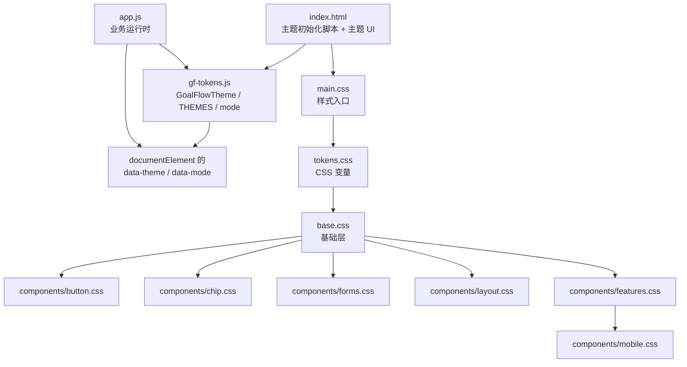
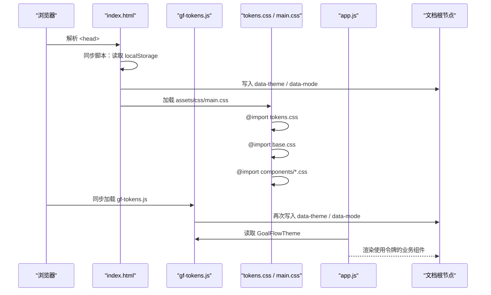
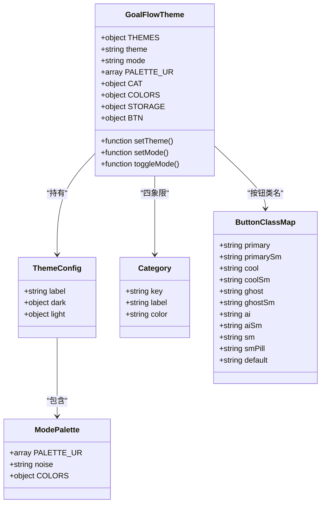
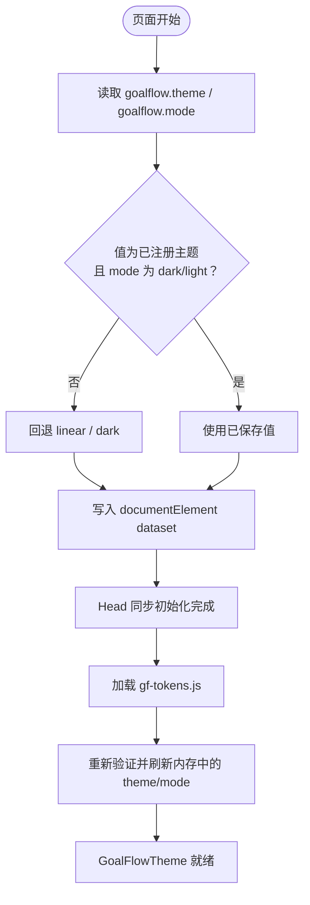
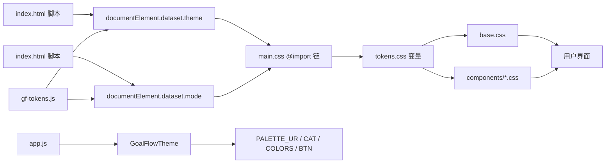

# 主题与样式系统

<cite>
**本文引用的文件 **
- [assets/js/gf-tokens.js](file://assets/js/gf-tokens.js)
- [assets/css/main.css](file://assets/css/main.css)
- [assets/css/tokens.css](file://assets/css/tokens.css)
- [assets/css/base.css](file://assets/css/base.css)
- [assets/css/components/button.css](file://assets/css/components/button.css)
- [assets/css/components/chip.css](file://assets/css/components/chip.css)
- [assets/css/components/forms.css](file://assets/css/components/forms.css)
- [assets/css/components/layout.css](file://assets/css/components/layout.css)
- [assets/css/components/features.css](file://assets/css/components/features.css)
- [assets/css/components/mobile.css](file://assets/css/components/mobile.css)
- [assets/js/app.js](file://assets/js/app.js)
- [index.html](file://index.html)
</cite>

## 目录

1. [引言](#引言)
2. [项目结构](#项目结构)
3. [核心令牌与对象](#核心令牌与对象)
4. [架构总览](#架构总览)
5. [详细组件分析](#详细组件分析)
6. [依赖关系分析](#依赖关系分析)
7. [性能考虑](#性能考虑)
8. [故障排除指南](#故障排除指南)
9. [结论](#结论)
10. [附录：添加新主题步骤](#附录添加新主题步骤)

## 引言

GoalFlow 的主题与样式系统采用“设计令牌优先”的方式：所有颜色、语义标签色、按钮类名、图标语义、布局尺寸都通过明确声明的令牌暴露，而不是散落在业务 CSS 中。这套系统的核心职责是：

1. 用 JavaScript 定义主题数据模型，并通过 `GoalFlowTheme` 全局对象对外暴露。
2. 在页面加载前将当前主题和模式写入 HTML 根节点的数据属性。
3. 用 CSS 变量在默认主题、浅色/深色模式上完成可视化渲染。
4. 由 `main.css` 按依赖顺序导入令牌、基础样式、组件样式与移动端适配规则。
5. 供业务逻辑与演示页面复用同一份主题源，避免 JS 与 CSS 配色脱节。

这套机制允许定制者在不重写全部样式的前提下扩展主题，也保证了“重要且紧急”“核心投入”等四象限标签在不同主题下仍使用一致语义。

**章节来源**
- [assets/js/gf-tokens.js:1-177](file://assets/js/gf-tokens.js#L1-L177)
- [assets/css/main.css:1-11](file://assets/css/main.css#L1-L11)
- [index.html:1-18](file://index.html#L1-L18)

## 项目结构

主题与样式相关文件集中在两个目录：

| 路径 | 职责 |
|---|---|
| `assets/js/gf-tokens.js` | 设计令牌的 JavaScript 定义与状态切换；向 `globalThis` 暴露 `GoalFlowTheme` |
| `assets/css/tokens.css` | CSS 变量的唯一视觉令牌源，覆盖线性主题、预览主题、浅色模式 |
| `assets/css/main.css` | 样式入口，按依赖顺序 `@import` 各层 CSS |
| `assets/css/base.css` | 全局重置、字体、背景噪点、过渡动画、工具类 |
| `assets/css/components/*` | 可复用组件样式：按钮、标签、表单、布局、通用功能、移动端适配 |
| `index.html` | 主题初始化的最小脚本、主题切换 UI、主题选择下拉框 |
| `assets/js/app.js` | 业务运行时从 `GoalFlowTheme` 读取令牌并生成 DOM 与行为 |

**图表来源**
- [assets/js/gf-tokens.js:53-99](file://assets/js/gf-tokens.js#L53-L99)
- [assets/css/main.css:7-11](file://assets/css/main.css#L7-L11)
- [assets/css/tokens.css:1-18](file://assets/css/tokens.css#L1-L18)
- [index.html:7-18](file://index.html#L7-L18)
- [assets/js/app.js:4-14](file://assets/js/app.js#L4-L14)

**章节来源**
- [assets/js/gf-tokens.js:1-177](file://assets/js/gf-tokens.js#L1-L177)
- [assets/css/main.css:1-11](file://assets/css/main.css#L1-L11)

## 核心令牌与对象

### `GoalFlowTheme` 暴露的内容

`gf-tokens.js` 通过 IIFE 将主题能力挂到全局，浏览器环境中等价于挂载到 `window` 或 `globalThis`。其对外契约如下：

| 键名 | 类型 | 含义 |
|---|---|---|
| `THEMES` | 对象 | 可用主题集合，key 为 theme 名称，值包含显示名称、深色色板与浅色色板 |
| `theme` | 字符串 | 当前持久化主题键，如 `linear`、`raycast`、`rpg` |
| `mode` | 字符串 | 当前持久化明暗模式，仅允许 `dark` 或 `light` |
| `setTheme(name)` | 函数 | 设置合法主题后刷新页面 |
| `setMode(m)` | 函数 | 设置合法明暗模式后刷新页面 |
| `toggleMode()` | 函数 | 在 `dark` 与 `light` 之间切换 |
| `PALETTE_UR` | 数组 | 从冷静到紧急的五级色阶，默认含冷色系到暖色系 |
| `CAT` | 对象 | 四象限语义标签：`now`、`core`、`distract`、`noise` |
| `COLORS` | 对象 | 主题品牌色与专用色：强调色、次强调色、金色系、图形发光色、刻度标签色、间隔色、渐变点 |
| `STORAGE` | 对象 | 本地存储键集合，包括节点、工作流备份、主题、模式和 LLM 密钥 |
| `BTN` | 对象 | 预组合按钮类名字符串，供业务渲染器复用 |

这些字段让 JavaScript 侧可以：

- 根据 `theme` 和 `mode` 选择正确的色板。
- 用 `PALETTE_UR` 渲染四象限、进度条、图表、紧急度色带。
- 用 `COLORS.accent`、`COLORS.gold` 等统一强调区域。
- 把 CAT 的 `color` 绑定到标签、卡片、任务标记等语义元素。
- 直接拼接 `BTN.primary` 等类名字符串，保证样式一致性。

### CSS 变量与主题层次

CSS 侧的令牌集中在 `tokens.css`，采用三层组织：

1. **结构令牌：** `--radius`、`--space-*`、`--font-ui`、`--ease-out` 等不随主题变化的基础值。
2. **默认主题 `linear`：** 通过 `:root` 与 `[data-theme='linear']` 共同提供完整颜色映射。
3. **其他主题块：** `[data-theme='raycast']`、`[data-theme='rpg']` 只覆盖所需变量，继承结构令牌。
4. **浅色模式：** `[data-mode='light']` 关闭深色 scheme，再按主题提供浅色列表。

主要变量类别：

| 变量类别 | 示例变量 | 用途 |
|---|---|---|
| 背景 | `--body-bg`、`--bg0`、`--bg1`、`--bg2` | 页面背景、面板背景、层级底色 |
| 表面与描边 | `--panel`、`--panel-strong`、`--stroke`、`--stroke-soft` | 卡片面板、边框、轻量分隔 |
| 文字 | `--ink`、`--ink-2`、`--muted`、`--muted-2` | 主次文本与提示文本 |
| 品牌强调 | `--accent`、`--accent-2`、`--accent-soft` | 主按钮、链接、焦点高亮 |
| 金色体系 | `--gold`、`--gold-soft`、`--gold-deep`、`--btn-on-gold` | 关键操作、徽章、对比色前景 |
| 紧急度色阶 | `--ur1` 到 `--ur5` | 对应五元色板的冷静 → 火急 |
| 四象限语义色 | `--quad-now`、`--quad-core`、`--quad-distract`、`--quad-noise` | 标签、象限标记与卡片主题 |
| 索引徽章 | `--idx-bg`、`--idx-ink`、`--idx-border` | 步骤标记和优先级标记 |
| 顶部栏 | `--topbar-bg` | 顶栏半透明背景 |
| 分割控件 | `--seg-on-bg`、`--seg-on-ink` | Linear 风格的选中分段控件 |
| 英雄卡 | `--hero-border`、`--hero-glow` | “当下最重要”区域的金色边界与光晕 |

需要注意：**JavaScript 的 `GoalFlowTheme` 并没有把 CSS 变量名注入到 `:root`。** 它的工作是：

- 读本地存储，决定 `theme` 和 `mode`。
- 写 `document.documentElement.dataset.theme` 与 `document.documentElement.dataset.mode`。
- 把选中的色板作为 JS 常量（`PALETTE_UR`、`COLORS`、`CAT`、`BTN`）暴露给应用。

真正控制 CSS 渲染的是 `documentElement` 上的 `data-theme` 与 `data-mode`，以及已经存在的 CSS 变量值。如果后续要由 JS 动态计算变量，应自行维护一套映射；当前实现保持 CSS 变量与 JS 令牌“同义不同源”。

**章节来源**
- [assets/js/gf-tokens.js:53-177](file://assets/js/gf-tokens.js#L53-L177)
- [assets/css/tokens.css:1-45](file://assets/css/tokens.css#L1-L45)
- [assets/css/tokens.css:60-130](file://assets/css/tokens.css#L60-L130)

## 架构总览

主题系统在时间维上分为三条主线：

1. **同步初始化：** `index.html` 在 `<head>` 中尽早尝试读取本地存储并把 theme/mode 写入根节点，防止首次渲染闪烁。
2. **脚本加载与刷新策略：** `gf-tokens.js` 在 `<head>` 同步加载；切换主题会重刷页面，从而重新执行 head 中的同步初始化。
3. **样式加载：** 浏览器解析 `main.css`，依次导入 tokens、base、组件与移动端规则，随后 `body.is-ready` 驱动入场动画。

**图表来源**
- [index.html:7-18](file://index.html#L7-L18)
- [assets/js/gf-tokens.js:64-99](file://assets/js/gf-tokens.js#L64-L99)
- [assets/css/main.css:7-11](file://assets/css/main.css#L7-L11)
- [assets/css/base.css:50-68](file://assets/css/base.css#L50-L68)
- [assets/js/app.js:4-14](file://assets/js/app.js#L4-L14)

**章节来源**
- [index.html:7-18](file://index.html#L7-L18)
- [assets/js/gf-tokens.js:1-99](file://assets/js/gf-tokens.js#L1-L99)
- [assets/css/main.css:1-11](file://assets/css/main.css#L1-L11)
- [assets/css/base.css:50-68](file://assets/css/base.css#L50-L68)

## 详细组件分析

### `gf-tokens.js`：主题状态与设计令牌

#### 关键数据结构

- `THEMES`：每个主题的 `dark` 和 `light` 配置中包含 `PALETTE_UR`、`noise`、`COLORS`。这是主题切换时的实际色板来源。
- `DEFAULT_THEME`、`DEFAULT_MODE`：无持久化值时的回退值，默认为 `linear` 深色主题。
- `read(key, fallback, valid)`：安全读取本地存储，非法值直接回退到默认值。
- `store(key, val)`：捕获写入异常，避免第三方 Cookie 或私有模式限制导致崩溃。
- `setTheme(name)`、`setMode(m)`：校验后写入本地存储并调用 `location.reload()`。
- `BTN`：按钮类名的稳定命名空间，前端不需要拼写原始字符串。

**图表来源**
- [assets/js/gf-tokens.js:20-99](file://assets/js/gf-tokens.js#L20-L99)
- [assets/js/gf-tokens.js:125-177](file://assets/js/gf-tokens.js#L125-L177)

#### 主题持久化与加载时序

**图表来源**
- [index.html:10-15](file://index.html#L10-L15)
- [assets/js/gf-tokens.js:64-99](file://assets/js/gf-tokens.js#L64-L99)

**章节来源**
- [assets/js/gf-tokens.js:12-177](file://assets/js/gf-tokens.js#L12-L177)

### `main.css`：样式入口与加载顺序

`main.css` 的职责非常纯粹：按照依赖顺序导入样式文件，不再承担具体样式实现。顺序具有语义意义：

1. `tokens.css`：必须先加载，否则后续样式无法正确解析变量。
2. `base.css`：定义基础容器、背景、字体和常用工具类。
3. `components/button.css`：按钮基础与变体。
4. `components/chip.css`：标签、进度标签等。
5. `components/forms.css`：输入框、文本域、选择器和说明文案。
6. `components/layout.css`：左侧轨道、侧栏、主列与应用壳布局。
7. `components/features.css`：通用功能特性样式。
8. `components/mobile.css`：响应式覆盖，必须排在最后以保证桌面层先定义、移动端后覆盖。

如果新增一个组件，例如 `components/diagram.css`，推荐插入到 `features.css` 之前，因为通用功能样式通常不应被底层布局覆盖。

**章节来源**
- [assets/css/main.css:1-11](file://assets/css/main.css#L1-L11)

### `tokens.css`：视觉令牌与主题分层

该文件是唯一真正的 CSS 颜色与变量来源。它的分层规则如下：

| 层次 | 选择器范围 | 变更影响 |
|---|---|---|
| 结构层 | `:root` | 定义圆角、间距、字体、缓动曲线等不随主题变化的值 |
| 默认主题 | `:root`、`[data-theme='linear']` | 默认提供完整配色，离线或 JS 失效时仍有合理外观 |
| 预览主题 | `[data-theme='raycast']`、`[data-theme='rpg']` | 覆盖颜色、背景、描边、强调色，但保留结构层变量 |
| 浅色模式 | `[data-mode='light']` | 切换 `color-scheme`，并引入各主题的浅色变量 |

#### 主题变量参考表

| 类别 | 代表性变量 | 是否跨主题共享 |
|---|---|---|
| 圆角 | `--radius`、`--radius-sm`、`--radius-pill` | 是 |
| 间距 | `--space-1` 至 `--space-4` | 是 |
| 字体 | `--font-ui`、`--font-display`、`--font-mono` | 是 |
| 背景 | `--body-bg`、`--bg0`、`--bg1`、`--bg2` | 否 |
| 表面 | `--panel`、`--panel-strong`、`--stroke`、`--stroke-soft` | 否 |
| 文字 | `--ink`、`--ink-2`、`--muted`、`--muted-2` | 否 |
| 强调色 | `--accent`、`--accent-2`、`--accent-soft` | 否 |
| 金色 | `--gold`、`--gold-soft`、`--gold-deep`、`--btn-on-gold` | 否 |
| 紧急度 | `--ur1` 到 `--ur5` | 否 |
| 四象限 | `--quad-now`、`--quad-core`、`--quad-distract`、`--quad-noise` | 否 |
| 索引徽章 | `--idx-bg`、`--idx-ink`、`--idx-border` | 否 |
| 顶栏 | `--topbar-bg` | 否 |
| 选中态 | `--seg-on-bg`、`--seg-on-ink` | 否 |
| 英雄卡 | `--hero-border`、`--hero-glow` | 否 |

**章节来源**
- [assets/css/tokens.css:1-130](file://assets/css/tokens.css#L1-L130)

### `base.css`：基础层

`base.css` 负责应用最基础的视觉和体验基线：

- 盒模型重置。
- `html` 和 `body` 尺寸与字体。
- 禁用 Android 字体放大但仍保留双指缩放。
- 通过伪元素注入颗粒噪点纹理，透明度由 `--grain-opacity` 控制。
- 保证 `body > *` 位于噪点之上。
- 在应用未就绪时隐藏 hero、面板和顶栏，并用 `is-ready` 类驱动淡入动画。
- 尊重 `prefers-reduced-motion`，将动画时长压到极短。
- 提供 `.gf-hint`、`.gf-btns`、`.gf-kbd` 等常见工具类。

其中 `color-scheme: dark` 在 tokens 层更准确，但这里也配合了深色调的背景和文字方案。自定义主题时如需支持自动跟随系统深浅模式，应谨慎处理这一处，并与 `tokens.css` 中的 `color-scheme` 保持一致。

**章节来源**
- [assets/css/base.css:1-85](file://assets/css/base.css#L1-L85)

### `button.css`：按钮组件

按钮是样式系统中对主题敏感最多的交互元素之一。它遵循 BEM 风格：

| 类名 | 含义 |
|---|---|
| `gf-btn` | 基础按钮 |
| `gf-btn--primary` | 金色主按钮 |
| `gf-btn--cool` | 强调色冷调按钮 |
| `gf-btn--ghost` | 幽灵按钮 |
| `gf-btn--ai` | AI 相关渐变按钮 |
| `gf-btn--sm` | 小尺寸 |
| `gf-btn--pill` | 药丸形 |
| `gf-btn--mini` | 更小区域微型按钮 |

此外还兼容部分旧类名，如 `button.primary`、`button.ghost`、`button.ai`、`button.small`，以兼容历史 HTML。

按钮主题绑定方式：

- 主按钮使用 `--gold-soft` 到 `--gold` 的渐变，前景用 `--btn-on-gold`。
- 冷调按钮使用 `--accent` 与阴影混合色。
- AI 按钮使用 `--accent-2` 到 `--accent` 的渐变。
- 幽灵按钮透明背景，悬停时改为面板强化背景。
- 焦点使用 `color-mix(in srgb, var(--accent) 70%, transparent)` 做可见焦点环。

可访问性关键点：

- 所有按钮默认有 `cursor: pointer`。
- 提供明确的 `focus-visible` 轮廓。
- 主按钮和 AI 按钮使用渐变和高对比前景，减少纯颜色传达信息。

建议新增按钮变体时同时考虑：

1. 悬停态是否清晰。
2. `focus-visible` 是否可读。
3. 在 `raycast`、`rpg` 及浅色模式下是否仍满足对比度。
4. 是否需要添加到 `GoalFlowTheme.BTN` 中以便 JS 渲染器复用。

**章节来源**
- [assets/css/components/button.css:1-108](file://assets/css/components/button.css#L1-L108)

### `chip.css`：标签组件

`chip.css` 主要承载两类标签：

| 组件 | 语义 |
|---|---|
| `.gf-chip` | 通用标签，常用于分类、状态或轻量标识 |
| `.today-chip` | 今日顶部日期或主题标识，强调数字与黄金重点 |
| `.progress-chip` | 带有进度条的标签，用于完成任务比例 |

其中进度条通过 `--ur2` 作为背景，渐变使用 `--accent-2` 到 `--accent`，使其既能表达趋势又能融入当前强调色。

**章节来源**
- [assets/css/components/chip.css:1-64](file://assets/css/components/chip.css#L1-L64)

### `forms.css`：表单控件

表单样式关注输入可用性，而不只是美观：

- 输入框、文本域和聊天输入统一使用 `var(--stroke)` 边框和 `var(--ink)` 前景。
- 聚焦时使用 `--accent` 外发光和背景加深，提升可见焦点。
- placeholder 使用二级 muted 文字，避免干扰正式内容。
- `select` 使用自定义背景箭头而非浏览器默认装饰，使下拉方向指示符合整体风格。
- `.gf-input--grow` 与 `.gf-select--demo` 提供灵活的弹性宽度场景。
- `.hint` 与 `.gf-btns` 在表单底部辅助说明和批量动作时反复出现。

可访问性注意点：

- 自定义下拉箭头由背景渐变绘制，不要移除 `aria-label`，否则屏幕阅读器可能无法理解其状态。
- 聚焦高光不应仅依靠颜色变化，应保持足够对比度和可见轮廓。

**章节来源**
- [assets/css/components/forms.css:1-86](file://assets/css/components/forms.css#L1-L86)

### `layout.css`：应用外壳与布局

`layout.css` 负责应用的整体骨架：图标轨道、侧栏、主区域。它与主题的主要关系在于：

- 轨道、侧栏、主区使用背景层 `--bg1`。
- 分隔线使用 `--stroke` 或 `--stroke-soft`。
- 左侧 Logo 与状态点使用强调色渐变。
- 导航项使用 muted 文字和 panel 强背景的高亮态。
- 步骤徽章直接使用 `--idx-bg`、`--idx-ink`、`--idx-border`。

因此，新增主题时应确保至少覆盖背景、描边和文字三元组，以避免布局区域出现不合适的灰黑色或白黑反差。

**章节来源**
- [assets/css/components/layout.css:1-60](file://assets/css/components/layout.css#L1-L60)

### `features.css`：通用功能样式

`features.css` 承载编辑器行、操作条、徽章、进度条、复选框、状态行等功能性样式。它不是某个单一组件，而是多个视图共用的展示语法。

主题相关要点：

- 行状卡片使用强调色作为悬停边框和背景混合色。
- 高亮行使用金色边界和背景。
- 进度条通过粗细渐变表现强度。
- 复选框和开关使用 `accent-color: var(--accent)`，使原生控件与主题强调色对齐。

**章节来源**
- [assets/css/components/features.css:1-120](file://assets/css/components/features.css#L1-L120)

### `mobile.css`：移动端适配规则

`mobile.css` 是响应式策略的最后防线，它按三个维度适配：

| 断点或媒体查询 | 目标 |
|---|---|
| `(hover: none) and (pointer: coarse)` | 触屏设备：触控目标、点击反馈、禁用悬浮陷阱 |
| `max-width: 900px` | 手机竖屏与小平板：整体字号抬升、窄屏排列、隐藏次要元素 |
| `max-width: 480px` | 超小手机：动作按钮换行、进一步缩小按钮与说明字号 |

关键规则包括：

- 触控目标高度不小于 40px。
- 输入框字体强制 16px 以防止 iOS 自动放大。
- hover 才出现的操作控件在触屏设备上常驻。
- 增加 `:active` 缩放与透明度反馈补偿缺乏 `:hover`。
- 顶栏和底部标签区域启用 `env(safe-area-inset-left/right)`，适配刘海屏和手势条。
- 主题选择下拉在小屏被隐藏，改用循环按钮替代。

新增移动样式时，应尽量避免在 `components/layout.css` 中写出大量窄屏规则；布局层专注于桌面结构，移动端行为由 `mobile.css` 集中接管。

**章节来源**
- [assets/css/components/mobile.css:1-120](file://assets/css/components/mobile.css#L1-L120)

## 依赖关系分析

### 主题加载与变量使用关系

**图表来源**
- [index.html:10-18](file://index.html#L10-L18)
- [assets/js/gf-tokens.js:64-99](file://assets/js/gf-tokens.js#L64-L99)
- [assets/css/main.css:7-11](file://assets/css/main.css#L7-L11)
- [assets/js/app.js:4-14](file://assets/js/app.js#L4-L14)

### 模块耦合关系

- `gf-tokens.js` 只依赖全局对象和 `localStorage`，不依赖任何业务组件。
- `app.js` 弱依赖 `GoalFlowTheme`；若该对象不存在，它会提供回退常量和空对象。
- `main.css` 通过 `@import` 形成单向依赖，没有反向引用。
- `tokens.css` 是最内层依赖；所有组件文件仅消费其变量。
- `mobile.css` 对其他组件文件存在隐式耦合，因为它需要覆盖已有类名。

潜在风险：

- `gf-tokens.js` 使用 `location.reload()` 切换主题，这会使页面完全重建；适合简单项目，但不适合需要保留应用状态的场景。
- 如果未来要支持运行时 CSS 变量注入，应避免一次性 `location.reload()`，改为直接修改变量和缓存主题状态。
- `index.html` 的早期脚本与 `gf-tokens.js` 都会写入 `dataset.theme` / `dataset.mode`，后者刷新后再次执行并不会出错，但属于重复赋值。

**章节来源**
- [assets/js/gf-tokens.js:64-120](file://assets/js/gf-tokens.js#L64-L120)
- [assets/js/app.js:4-14](file://assets/js/app.js#L4-L14)
- [assets/css/main.css:7-11](file://assets/css/main.css#L7-L11)

## 性能考虑

1. **同步脚本避免闪烁：** `index.html` 中立即执行的脚本在样式加载前写入主题，减少了 `data-theme` 和 `data-mode` 从默认到最终值的抖动。
2. **头部同步加载令牌：** `gf-tokens.js` 在 head 中同步加载，便于立刻设置主题，避免 JS 阻塞后的重绘。
3. **刷新代价：** `setTheme` 与 `setMode` 使用 `location.reload()`，会丢失内存中的运行时状态。对于大型应用应考虑增量更新主题变量，而不是整页刷新。
4. **样式开销：** `@import` 是串行加载，现代浏览器虽然可能并发请求某些资源，但仍不如内联导入或构建工具合并高效。生产环境可通过构建脚本合并 CSS。
5. **背景与噪点：** 大面积渐变和 `background-attachment: fixed` 在高密度屏上有一定开销；如需优化，可将噪点改为 Canvas 或降低分辨率 SVG。
6. **运动偏好：** 已通过 `prefers-reduced-motion` 压缩动画，应避免在无动画需求时叠加更多复杂过渡。

**章节来源**
- [assets/css/base.css:50-76](file://assets/css/base.css#L50-L76)
- [assets/js/gf-tokens.js:93-120](file://assets/js/gf-tokens.js#L93-L120)

## 故障排除指南

### 主题不生效

排查顺序：

1. 检查浏览器控制台是否有 `localStorage` 权限报错。
2. 打开开发者工具 Elements，查看 `documentElement` 是否存在 `data-theme` 和 `data-mode`。
3. 若只有 `data-theme='linear'`，说明浅显或浅色模式尚未切换。
4. 检查 `tokens.css` 是否被正确加载。
5. 若预览主题不生效，确认 `gf-tokens.js` 中的 `THEMES` 是否包含对应 key。

常见原因：

- `goalflow.theme` 保存了一个无效主题 key。
- `goalflow.mode` 保存了除 `dark` 和 `light` 之外的值。
- 自定义主题只写了 CSS 但没有在 `THEMES` 中注册 JS 色板。
- `localstorage` 不可用时，脚本会静默降级到默认主题。

**章节来源**
- [assets/js/gf-tokens.js:64-77](file://assets/js/gf-tokens.js#L64-L77)
- [index.html:10-15](file://index.html#L10-L15)

### 浅色模式对比度异常

`GF_TOKENS` 只负责语义色板和 JS 常量，并未自动生成浅色 CSS 变量。浅色变量需由 `tokens.css` 提供。常见问题包括：

- 新主题定义了深色色板，但未补全 `[data-theme='x'][data-mode='light']` 区块。
- `--ink` 过浅或 `--bg1` 过亮，导致正文可读性下降。
- 主按钮前景色未设置合适的反色前景，例如金色按钮在浅色背景下仍保持深色前景。
- 焦点环颜色与背景太接近。

建议检测方式：

- 使用浏览器 DevTools 切换 `Emulate preference for reduced motion` 和 `Dark/Light` 模式。
- 逐个检查 `--ink`、`--muted`、`--muted-2` 与背景色的对比度。
- 对按钮、输入框、四象限标签分别测试 hover、focus 和 active 态。

**章节来源**
- [assets/css/tokens.css:1-18](file://assets/css/tokens.css#L1-L18)

### 按钮类名不匹配

如果 JS 渲染出的按钮没有预期颜色：

1. 检查是否正确使用了 `GF.BTN.primary` 等常量，或是否拼错了手动类名。
2. 检查 `button.css` 是否被 `main.css` 正确导入。
3. 如果是迷你按钮，注意区分 `gf-btn--mini` 与 `gf-btn--sm`。
4. 如果使用旧类名，确认宿主元素是否为原生 `button`。
5. 在移动端，注意 `mobile.css` 覆盖了尺寸与字号，但不会改变语义颜色。

**章节来源**
- [assets/js/gf-tokens.js:144-173](file://assets/js/gf-tokens.js#L144-L173)
- [assets/css/components/button.css:1-108](file://assets/css/components/button.css#L1-L108)
- [assets/css/components/mobile.css:1-60](file://assets/css/components/mobile.css#L1-L60)

### app.js 与 gf-tokens.js 状态不一致

`app.js` 会从 `GoalFlowTheme` 读取令牌；如果该对象缺失，它有回退数组和默认对象。但这只是防御性编程，不应成为主题缺失的长期解决方案。

排查要点：

- 确认 `gf-tokens.js` 在 `app.js` 之前加载。
- 不要在业务代码中随意覆盖 `GoalFlowTheme`。
- 如果需要运行时更改主题变量，应优先更新 `tokens.css` 和 `GoalFlowTheme` 的持久化值，而不是只改单个变量的 CSS。

**章节来源**
- [assets/js/app.js:4-14](file://assets/js/app.js#L4-L14)
- [assets/js/gf-tokens.js:160-177](file://assets/js/gf-tokens.js#L160-L177)

## 结论

GoalFlow 的主题系统是一个典型的“双源同步”设计：JavaScript 提供可序列化、可扩展的色板与运行时常量，CSS 提供可视化的变量与组件实现。`gf-tokens.js` 暴露的 `GoalFlowTheme` 是业务代码的权威主题接口；`tokens.css` 是样式的权威变量源；`main.css` 负责把它们按依赖顺序装配起来。

对于定制者而言，最佳实践是：

- 尽量通过增加新的 `THEMES` 项和 CSS 主题块扩展主题，而不是硬编码颜色。
- 保持 `PALETTE_UR`、`COLORS`、`CAT` 与 CSS 变量语义一致。
- 始终覆盖浅色模式，并确保关键交互元素满足可访问性要求。
- 新增组件时遵守现有目录职责划分，把基础样式放在对应的 `components/*` 文件中。

**章节来源**
- [assets/js/gf-tokens.js:1-177](file://assets/js/gf-tokens.js#L1-L177)
- [assets/css/main.css:1-11](file://assets/css/main.css#L1-L11)
- [assets/css/tokens.css:1-130](file://assets/css/tokens.css#L1-L130)

## 附录：添加新主题步骤

### 第一步：确定主题名称与显示名称

选择一个不会冲突的主题 key，例如 `obsidian`，并在 `THEMES` 中注册 `label`。该值会出现在主题选择下拉框的标题和调试输出中。

参考位置：`gf-tokens.js` 中每个主题的 `label` 与外层 key。

**章节来源**
- [assets/js/gf-tokens.js:20-99](file://assets/js/gf-tokens.js#L20-L99)

### 第二步：定义 JS 色板

为新主题的 `dark` 和 `light` 配置：

1. `PALETTE_UR`：五元色板，从冷静到火急。
2. `noise`：噪声标签或默认四象限噪音色。
3. `COLORS`：`accent`、`accent2`、`gold`、`goldSoft`、`svgGlow`、`scaleLabel`、`smartGap`、`gradSmartDot`。

确保浅色版本的 `PALETTE_UR` 和 `COLORS` 不是简单的复制粘贴深色值。

**章节来源**
- [assets/js/gf-tokens.js:20-99](file://assets/js/gf-tokens.js#L20-L99)

### 第三步：注册 CSS 主题块

在 `tokens.css` 中添加新主题选择器，至少覆盖以下变量：

- 背景：`--body-bg`、`--bg0`、`--bg1`、`--bg2`
- 表面：`--panel`、`--panel-strong`、`--stroke`、`--stroke-soft`
- 文字：`--ink`、`--ink-2`、`--muted`、`--muted-2`
- 强调与金色：`--accent`、`--accent-2`、`--accent-soft`、`--gold`、`--gold-soft`、`--gold-deep`
- 色阶：`--ur1` 到 `--ur5`
- 四象限：`--quad-noise`
- 可选：`--idx-*`、`--topbar-bg`、`--seg-on-*`、`--hero-*`

然后在相同主题下创建 `[data-theme="obsidian"][data-mode="light"]` 区块，为浅色模式定义同样的变量集。

**章节来源**
- [assets/css/tokens.css:60-130](file://assets/css/tokens.css#L60-L130)

### 第四步：设置按钮与卡片色彩

按钮不需要直接硬编码 HEX 值；应通过 `--accent`、`--gold`、`--accent-2` 等变量生效。如果你希望新增按钮变体绑定到新主题强调色，请同时更新：

- 按钮样式中使用正确的变量。
- `GoalFlowTheme.BTN` 中是否需要新的语义按钮常量。
- `app.js` 或业务渲染逻辑中是否在必要处引用该常量。

**章节来源**
- [assets/css/components/button.css:30-108](file://assets/css/components/button.css#L30-L108)
- [assets/js/gf-tokens.js:144-173](file://assets/js/gf-tokens.js#L144-L173)

### 第五步：注册语义标签色

四象限的 JS 语义来自 `CAT`，CSS 语义来自 `--quad-*`。新主题至少应确保：

- `CAT.now.color` 使用紧急色 `PALETTE_UR[4]`。
- `CAT.core.color` 使用冷静突出色 `PALETTE_UR[0]`。
- `CAT.distract.color` 使用警告暖色 `PALETTE_UR[3]`。
- `CAT.noise.color` 使用中性噪声色 `palette.noise`。
- CSS 的 `--quad-now`、`--quad-core`、`--quad-distract`、`--quad-noise` 与 JS 语义保持一致。

**章节来源**
- [assets/js/gf-tokens.js:113-143](file://assets/js/gf-tokens.js#L113-L143)
- [assets/css/tokens.css:90-118](file://assets/css/tokens.css#L90-L118)

### 第六步：验证深色模式对比度

对新主题进行以下对比度检查：

| 场景 | 检查方法 |
|---|---|
| 正文 | 检查 `--ink` 相对于 `--bg1` 的对比度，至少达到普通文本的可访问标准 |
| 次要文字 | 检查 `--muted-2` 相对于 `--bg1` 的对比度 |
| 主按钮 | 检查金色或强调色按钮的前景 `--btn-on-gold` 是否可读 |
| 幽灵按钮 | 检查 hover 态的 `--panel-strong` 背景与文本对比度 |
| 焦点环 | 检查 `focus-visible` 轮廓相对于背景是否明显 |
| 四象限标签 | 检查每象限色点、背景与文字组合是否仍可分辨 |

可使用浏览器开发者工具的 Accessibility 面板或独立 WCAG 对比度检测工具，但不要过度依赖自动化工具，还需人工判断真实使用场景。

**章节来源**
- [assets/css/base.css:50-76](file://assets/css/base.css#L50-L76)
- [assets/css/components/button.css:18-60](file://assets/css/components/button.css#L18-L60)

### 第七步：通过主题预览页面验证

GoalFlow 提供了主题控制面板：

- 主题循环按钮可轮播预设主题。
- 主题下拉菜单列出已注册的 theme key。
- 深色/浅色切换按钮切换 `data-mode`。
- 所有选项最终通过 `GoalFlowTheme.setTheme()` 与 `setMode()` 触发刷新。

验证流程：

1. 切换到新主题。
2. 分别打开深色与浅色模式。
3. 检查首页、今日、规划、洞察、四象限和表单输入。
4. 在手机横屏和竖屏下观察布局与字号。
5. 在移动端确认触摸目标大小和点击反馈。
6. 必要时检查 `index.html` 中的主题 UI 是否需要将新主题 key 加入下拉选项。

注意：当前下拉列表中的 option 值应与 `THEMES` 的 key 一致；若未出现在下拉列表中，可能仅是 HTML 演示页面未同步，不影响程序逻辑。

**章节来源**
- [assets/js/gf-tokens.js:93-120](file://assets/js/gf-tokens.js#L93-L120)
- [index.html:33-46](file://index.html#L33-L46)
- [assets/css/components/mobile.css:60-120](file://assets/css/components/mobile.css#L60-L120)