# 响应式布局与移动端适配

<cite>
**本文引用的文件**   
- [index.html](file://index.html)
- [main.css](file://assets/css/main.css)
- [base.css](file://assets/css/base.css)
- [layout.css](file://assets/css/components/layout.css)
- [mobile.css](file://assets/css/components/mobile.css)
- [gf-tokens.js](file://assets/js/gf-tokens.js)
</cite>

## 目录
1. [引言](#引言)
2. [项目结构](#项目结构)
3. [核心布局机制](#核心布局机制)
4. [栅格、间距与组件区域](#栅格间距与组件区域)
5. [四象限与 Sankey 流的视觉与交互](#四象限与-sankey-流的视觉与交互)
6. [时间轴、番茄钟与进度条的响应式行为](#时间轴番茄钟与进度条的响应式行为)
7. [侧边栏、导航与小屏折叠策略](#侧边栏导航与小屏折叠策略)
8. [主题变量在响应式上下文中的可访问性](#主题变量在响应式上下文中的可访问性)
9. [触控、拖拽与键盘导航](#触控拖拽与键盘导航)
10. [依赖关系分析](#依赖关系分析)
11. [性能与安全区注意](#性能与安全区注意)
12. [调试指南](#调试指南)
13. [常见问题修复](#常见问题修复)
14. [扩展建议](#扩展建议)
15. [结论](#结论)

## 引言
本文说明目标流 GoalFlow 的响应式布局与移动端适配机制，重点覆盖以下方面：

- `assets/css/components/layout.css` 中的基础页面壳、Flex/Grid 布局、侧边栏、主列、今日任务网格、折叠区块和面板系统。
- `assets/css/components/mobile.css` 中针对触屏设备与窄屏幕（≤900px、≤480px）的断点策略，包括字号提升、触控目标最小尺寸、安全区、顶部“更多”菜单与底部固定导航。
- Sankey 图、四象限视图、任务列表、时间轴、导航在小屏下的布局变化。
- 移动端特有的交互变更：点击替代悬停、拖拽禁用或降级、输入框字体放大防止自动缩放、焦点与活动状态。
- 主题变量在桌面端和移动端的一致性保障，以及背景色、分割线、阴影、标签颜色的可访问性要求。
- Chrome DevTools 设备模式下的调试方法、常见布局异常定位步骤，以及新增页面区块的扩展流程。

GoalFlow 使用单一入口样式表加载所有模块样式；移动端的特殊规则集中在两个文件中，避免在业务 HTML 中散落内联响应式样式。

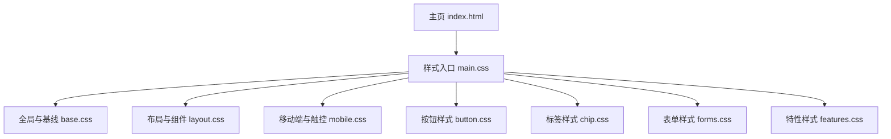

**图表来源**  
- [index.html:1-14](file://index.html#L1-L14)
- [main.css:1-11](file://assets/css/main.css#L1-L11)

**章节来源**  
- [index.html:1-14](file://index.html#L1-L14)
- [main.css:1-11](file://assets/css/main.css#L1-L11)

## 项目结构
GoalFlow 的样式组织采用“入口按依赖顺序导入 + 功能按组件分文件”的结构：

| 层级 | 文件 | 职责 |
|---|---|---|
| 页面入口 | `index.html` | 声明视口、语言、主题初始脚本，并加载 `assets/css/main.css?v=7.6` |
| 样式入口 | `assets/css/main.css` | 依次导入主题变量、基础重置、按钮、标签、表单、布局、特性与移动端样式 |
| 基础层 | `assets/css/base.css` | 全局盒模型、字体、底色、安全提示、动画降级等通用样式 |
| 布局层 | `assets/css/components/layout.css` | App Shell、图标轨、侧栏、主列、顶栏、今日三区、面板、折叠区块等 |
| 移动端层 | `assets/css/components/mobile.css` | 触屏设备基线、≤900px、≤480px 断点、触控优化、Sankey/四象限小屏处理、菜单与底部导航 |
| 设计令牌 | `assets/js/gf-tokens.js` | JavaScript 主题配置、浅色/深色色板、类别色、颜色输出对象，由 JS 设置 `data-theme` 与 `data-mode` |

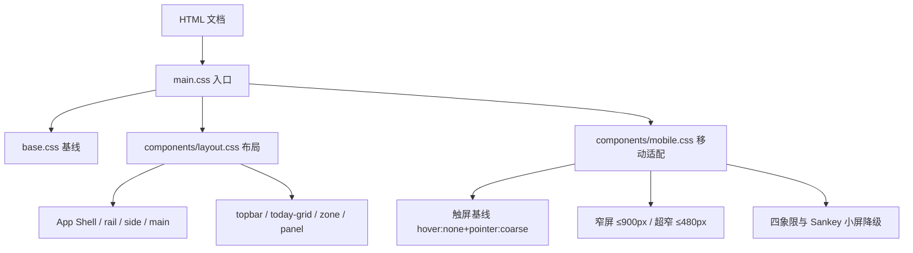

**章节来源**  
- [main.css:1-11](file://assets/css/main.css#L1-L11)
- [base.css:1-85](file://assets/css/base.css#L1-L85)
- [layout.css:1-200](file://assets/css/components/layout.css#L1-L200)
- [mobile.css:1-200](file://assets/css/components/mobile.css#L1-L200)
- [gf-tokens.js:1-177](file://assets/js/gf-tokens.js#L1-L177)

## 核心布局机制
GoalFlow 的核心布局基于 Flexbox 和少量 Grid，围绕“图标轨道 + 左侧栏 + 主内容”的应用外壳展开。

### 应用外壳与三区域
- `body` 通过全局样式提供字体、颜色和背景，并确保根容器高度接近视口高度。
- `.app-shell` 是横向 Flex 容器，高度为 `100vh` 和 `100dvh`，保证现代移动浏览器地址栏变化时仍能正确使用视口高度。
- 三个主要子区域如下：
  - `.rail`：左侧图标轨道，固定宽度，用于在主导航、工作区和视图切换之间跳转。
  - `.side`：左侧信息栏，显示当前工作区标题、项目树、视图按钮与元信息。
  - `.main`：右侧主列，承载顶栏、滚动区和视图内容。

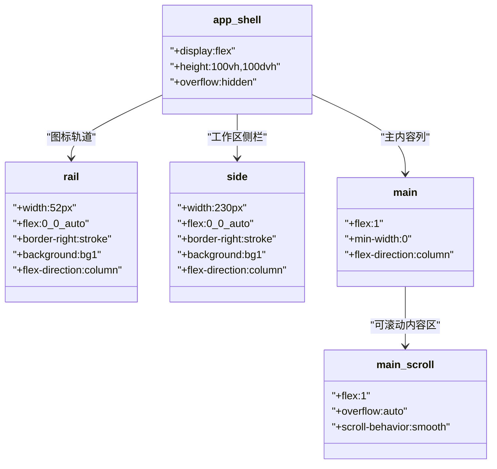

**图表来源**  
- [layout.css:1-200](file://assets/css/components/layout.css#L1-L200)
- [layout.css:201-260](file://assets/css/components/layout.css#L201-L260)

### 主列与多视图
- `.main` 使用 Flex 纵向排列，内部通过 `.main-scroll` 管理滚动。
- 页面包含多个视图区块，例如“今日行动”“目标规划”“归纳洞察”“AI 分析”，它们以 `view` 元素组织。
- 默认隐藏非活跃视图，激活视图通过 `.on` 类显示。

这种结构的优点是结构稳定：无论某个视图里绘制多少 SVG 节点或渲染多少任务行，布局容器本身保持简单，缩放与溢出问题更容易在内容层而非框架层解决。

**章节来源**  
- [layout.css:201-240](file://assets/css/components/layout.css#L201-L240)

## 栅格、间距与组件区域
GoalFlow 没有使用外部 CSS 框架，而是用少量自定义栅格表达主要内容分区。核心组合包括 Flex 行、Grid 列、间距变量和可折叠区块。

### 三大栅格区域
| 区域 | 规则 | 目的 |
|---|---|---|
| 桌面侧布局 | `.today-grid` 为三列 Grid：MIT 执行项、时段任务、微习惯 | 让重要项居中突出，两侧辅助操作不挤占核心路径 |
| 时段栅格 | `.today-slot-grid` 在桌面 ≥1024px 为三列，否则为两列 | 匹配一天通常 2-3 个时间块的使用场景 |
| 时间审计 | `.ta-cols` 在两列布局，≤640px 变为单列 | 统计指标在手机下避免左右压缩 |

### 间距与容器边界
- 主体内容最大宽度为 `1440px`，并通过 `.view-inner` 限制。
- 大面板 `.panel` 使用统一圆角和细边框，体现 Linear 风格。
- 折叠区块 `.zone` 使用 `<details>` 语义，适合无障碍阅读。

### 今日任务区块
- MIT 任务强调视觉优先级。
- 执行清单展示时间段内的任务。
- 微习惯使用小标签和轻量标记。
- 这些区块都继承 `.panel` 的统一风格，从而在不同主题、不同视口中保持一致的层次关系。

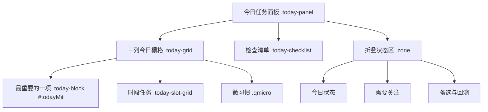

**图表来源**  
- [layout.css:250-560](file://assets/css/components/layout.css#L250-L560)
- [layout.css:700-1200](file://assets/css/components/layout.css#L700-L1200)
- [layout.css:1200-1480](file://assets/css/components/layout.css#L1200-L1480)

**章节来源**  
- [layout.css:241-620](file://assets/css/components/layout.css#L241-L620)
- [layout.css:1200-1480](file://assets/css/components/layout.css#L1200-L1480)

## 四象限与 Sankey 流的视觉与交互
四象限视图将目标分为四个类别，每个类别对应一个语义类别和一组颜色。Sankey 流向图则用于可视化的目标流转关系。

### 语义与颜色映射
从 JavaScript 主题令牌可以看出，四个象限分别映射如下：

| 象限键 | 语义 | 主要角色 | 典型用途 |
|---|---|---|---|
| `now` | 立即做 · 重要且紧急 | 高优先行动 | 当前要完成的任务 |
| `core` | 核心投入 · 重要不紧急 | 长期增长 | 技能、产品、关系等深潜 |
| `distract` | 干扰枝干 · 紧急不重要 | 次要压力 | 回复、会议、杂事 |
| `noise` | 噪音 · 不重要不紧急 | 低价值干扰 | 消遣、拖延、碎片信息 |

这些类别通过 `goalflow.theme × goalflow.mode` 二维配置输出具体颜色，因此同一视觉逻辑可以应用于浅色、深色和不同主题，如 Linear、Raycast 玻璃、RPG 游戏预览。

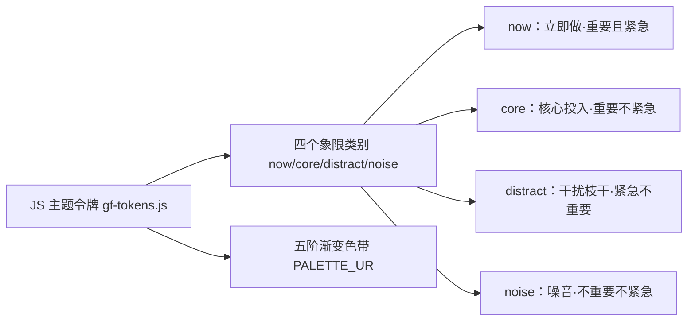

**图表来源**  
- [gf-tokens.js:9-63](file://assets/js/gf-tokens.js#L9-L63)

### Sankey 图的视觉一致性
Sankey 图的发光、渐变节点、标签、智能间隙等颜色来自 `COLORS` 对象，例如：

- 主题强调色 `accent` 与次强调色 `accent2`
- 金色 `gold` 用于最高优先级或评分
- `svgGlow` 控制 SVG 发光效果
- `scaleLabel` 控制刻度标签颜色
- `smartGap` 表示智能间隔的背景

这些值随主题与明暗模式切换而变化，因此响应式布局不仅要关心位置和缩放，还要保证在小屏幕上文字可读、关键路径颜色对比足够。

### 四象限的小屏退化
在小屏下，GoalFlow 对四象限做了明确退化：

| 维度 | 行为 | 原因 |
|---|---|---|
| 拖拽 | 关闭拖拽反馈 | 手指拖动与轻触语义冲突，容易误操作 |
| 卡片悬停 | 改为无高亮 | 触屏缺乏可靠悬停 |
| 操作方式 | 优先使用 ± 按钮调整象限 | 保证可操作性 |
| 卡片按压 | 移除变形和阴影，只保留可感知的点击态 | 避免与拖拽视觉混淆 |

对于 Sankey 画布，移动端允许画布在容器内左右滑动，也可以给容器加上适配类使 SVG 缩放到容器宽度。这样可以同时保留“精细查看大图”和“快速扫读整体流向”两种需求。

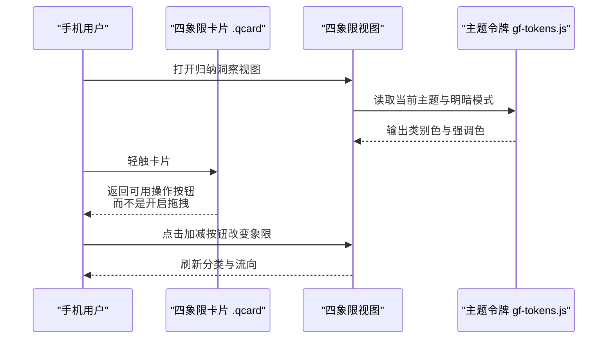

**图表来源**  
- [mobile.css:201-300](file://assets/css/components/mobile.css#L201-L300)
- [gf-tokens.js:24-72](file://assets/js/gf-tokens.js#L24-L72)

**章节来源**  
- [gf-tokens.js:9-120](file://assets/js/gf-tokens.js#L9-L120)
- [mobile.css:200-300](file://assets/css/components/mobile.css#L200-L300)

## 时间轴、番茄钟与进度条的响应式行为
GoalFlow 的时间相关信息主要体现在今日任务的时间预算、估计时长、提醒设置、执行时段和时间审计区域。虽然具体的计时器 DOM 可能由 JS 动态生成，但布局容器和视觉约束已有明确的响应式假设。

### 时间预算与估算
- 每行任务可通过 `today-time-lbl`、`today-remind`、`today-est` 表现时间提示、提醒值和估计时间。
- 这些控件使用紧凑的内联布局，在小屏下通过 flex-wrap 换行，避免被截断。
- 时间审计区域 `.ta-cols` 在 ≥640px 使用双列，≤640px 回到单列。

### 四象限时间刻度和数字
移动端为了阻止 iOS 自动放大输入内容，将一般输入框设为至少 16px 字体；但对四象限刻度等纯展示性数字明确排除这一规则，以保持紧凑刻度不被拉大。这类选择性继承通过类名实现，避免把可读性增强破坏掉密集数字排版。

### 进度条与评分
- 今日进度条由顶部的进度芯片驱动，填充宽度取决于叶子任务完成情况。
- 今日评分区域使用半透明的金边背景和梯度条形进度，强调当前状态。
- 在移动端，这些区域的字号和间距会被调小，以避免在小屏上产生过多滚动。

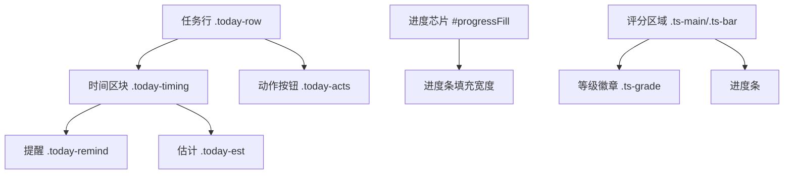

**图表来源**  
- [layout.css:560-740](file://assets/css/components/layout.css#L560-L740)
- [layout.css:920-1120](file://assets/css/components/layout.css#L920-L1120)
- [index.html:23-55](file://index.html#L23-L55)

**章节来源**  
- [layout.css:560-740](file://assets/css/components/layout.css#L560-L740)
- [layout.css:920-1120](file://assets/css/components/layout.css#L920-L1120)
- [index.html:23-55](file://index.html#L23-L55)

## 侧边栏、导航与小屏折叠策略
GoalFlow 在宽屏下展示完整的三列布局，在窄屏下逐步收起非核心区域。

### 断点策略
| 断点 | 触发条件 | 主要变化 |
|---|---|---|
| ≤900px | 平板竖屏、手机横屏、普通手机 | 隐藏图标轨道 `.rail` 和侧栏 `.side`；底部出现固定导航 `.mtab` |
| ≤480px | 小屏手机 | 进一步降低字号、压缩按钮尺寸、将任务动作换行到下方 |
| ≤640px | 局部统计模块 | 时间审计列从双列变单列 |
| 触屏设备 | `hover: none` 且 `pointer: coarse` | 应用点击反馈、触控目标最小尺寸、禁止 300ms 延迟 |

### 底部固定导航
在小屏下，`.mtab` 成为固定的底部导航栏，带有回退缓冲空间以适配刘海屏和手势条。其中还包含一个浮动功能按钮样式，便于在小屏下快速创建重要任务或执行主要动作。

### “更多”菜单
当 ≤900px 时，顶栏右侧的主题选择、备份、恢复和 ICS 导出按钮被隐藏，改用一个 `<details>` 折叠菜单。这样避免顶栏堆叠过多按钮，同时仍保持所有功能可达。

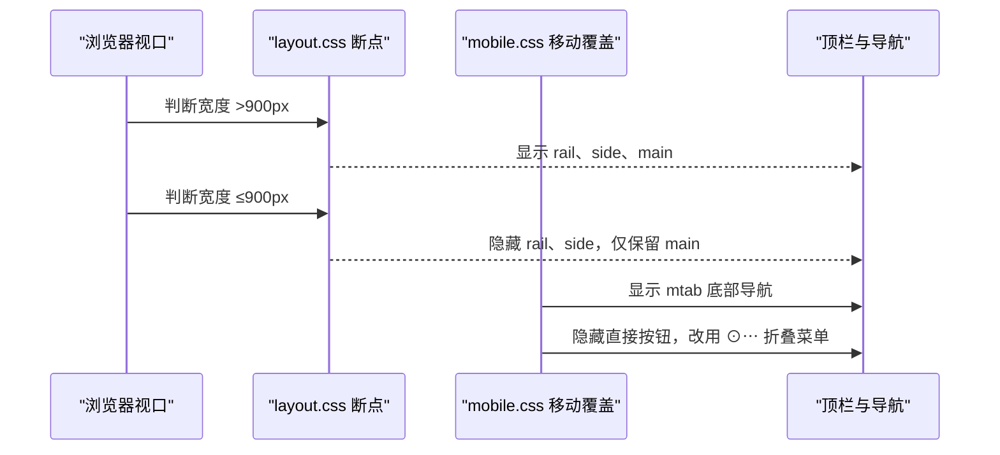

**图表来源**  
- [layout.css:241-260](file://assets/css/components/layout.css#L241-L260)
- [layout.css:1480-1652](file://assets/css/components/layout.css#L1480-L1652)
- [mobile.css:450-640](file://assets/css/components/mobile.css#L450-L640)

**章节来源**  
- [layout.css:241-260](file://assets/css/components/layout.css#L241-L260)
- [layout.css:1480-1652](file://assets/css/components/layout.css#L1480-L1652)
- [mobile.css:200-640](file://assets/css/components/mobile.css#L200-L640)

## 主题变量在响应式上下文中的可访问性
主题系统主要由 JavaScript 初始化，CSS 通过 CSS 变量消费这些值。因此，响应式布局改变的是布局和字号，而不是重新发明一套颜色体系。

### 主题初始化链
1. 页面 `<script>` 尝试从 `localStorage` 读取主题和明暗模式，写入 `documentElement` 的 `data-theme` 与 `data-mode`。
2. `assets/js/gf-tokens.js` 再次校验并同步这些数据属性，然后生成 `GoalFlowTheme` 对象。
3. 主题色板包含每个主题的浅色/深色配置，最终映射到 CSS 变量供布局与组件使用。

### 响应式上下文中的可访问性要求
| 设计属性 | 桌面要求 | 移动要求 | 可访问性要点 |
|---|---|---|---|
| 背景色 | 使用 `var(--bg1)`、`var(--body-bg)` | 一致使用同一变量族 | 不应因宽度改变而引入额外背景 |
| 分割线 | 使用 `var(--stroke)`、`var(--stroke-soft)` | 同样变量 | 确保与前景色有足够对比度 |
| 阴影 | 面板默认扁平，Hero 使用可控光晕 | 小屏可适当减少大面积阴影 | 避免遮挡触控目标 |
| 标签颜色 | 使用 `var(--muted)`、`var(--ink)` | 保持语义一致 | 不要只在 hover 时才表达重要含义 |
| 焦点状态 | `.today-txt-in:focus` 等可见边框 | 点击态也要清晰 | 支持键盘导航的用户应能感知 |

### 可访问性相关变量族
主题变量族主要包括：

- 背景系列：`--bg0`、`--bg1`、`--body-bg`、`--panel`、`--panel-strong`
- 描边系列：`--stroke`、`--stroke-soft`、`--hero-border`
- 文本系列：`--ink`、`--ink-2`、`--muted`、`--muted-2`
- 强调系列：`--accent`、`--accent2`、`--gold`、`--gold-soft`
- 其他：`--radius`、`--radius-sm`、`--space-*`、`--font-ui`、`--font-mono`

由于这些变量由主题控制，新增响应式规则时应优先复用变量，而不是直接写死十六进制颜色。

**章节来源**  
- [index.html:4-11](file://index.html#L4-L11)
- [gf-tokens.js:9-120](file://assets/js/gf-tokens.js#L9-L120)
- [base.css:8-30](file://assets/css/base.css#L8-L30)
- [layout.css:1-100](file://assets/css/components/layout.css#L1-L100)

## 触控、拖拽与键盘导航
### 触屏设备识别
移动端样式的关键前提是：

```css
@media (hover: none) and (pointer: coarse)
```

这意味着它专门针对既不支持可靠悬停、又使用手指操控的设备。该规则会应用到按钮、链接、表格头、四象限卡片、日历控件、番茄钟按钮、视图切换和缩放控件等大量交互元素。

### 主要触控优化
| 问题 | 处理方式 |
|---|---|
| 点击延迟 | 为可点击元素设置 `touch-action: manipulation`，保留双指缩放 |
| 点击高亮 | 移除 `-webkit-tap-highlight-color`，避免安卓上常见的青色闪烁 |
| 输入框自动放大 | 输入框、下拉框和文本域统一设置为至少 16px |
| 数值刻度放大 | 对四象限刻度等展示型数字显式 `inherit` 字号 |
| 按钮太小 | 为常见按钮强制最小 40px 触控高度 |
| 复选框太小 | 复选框和单选框宽高提升到 18-20px |
| 只有 hover 的控件不可点 | 把悬浮菜单、删除按钮等常驻显示 |
| 缺少按压反馈 | 为按钮和卡片添加 `active` 缩放与透明度变化 |
| 拖拽卡片不可靠 | 在触屏下禁用拖拽反馈，改为点击态 |

### 键盘导航与焦点
- 输入框 `focus` 时使用强调色边框和浅色背景，避免完全失去焦点指示。
- 全局动画遵循 `prefers-reduced-motion: reduce`，将动画与过渡缩短到几乎不可察觉。
- 触摸设备并不自动获得更好的键盘导航体验，所以不应把“只有 hover 才出现的控件”作为唯一操作路径。

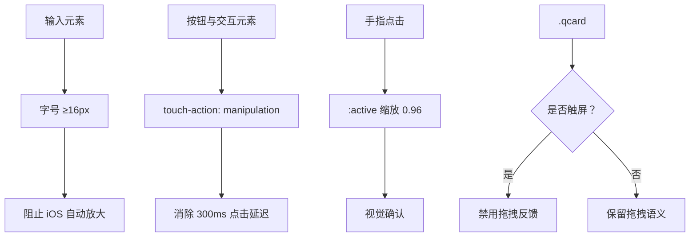

**图表来源**  
- [mobile.css:12-100](file://assets/css/components/mobile.css#L12-L100)
- [mobile.css:200-300](file://assets/css/components/mobile.css#L200-L300)
- [mobile.css:300-400](file://assets/css/components/mobile.css#L300-L400)

**章节来源**  
- [mobile.css:12-140](file://assets/css/components/mobile.css#L12-L140)
- [mobile.css:200-320](file://assets/css/components/mobile.css#L200-L320)
- [base.css:1-40](file://assets/css/base.css#L1-L40)

## 依赖关系分析
样式加载顺序很重要，因为后面的规则可以覆盖前面的规则。GoalFlow 明确通过 `@import` 维护这一顺序：

1. `tokens.css`（主题变量）
2. `base.css`（全局重置与基线）
3. `components/button.css`
4. `components/chip.css`
5. `components/forms.css`
6. `components/layout.css`
7. `components/features.css`
8. `components/mobile.css`

这个顺序的含义是：**移动端样式必须在最后加载，以便在不破坏桌面布局的前提下覆盖小屏行为。**

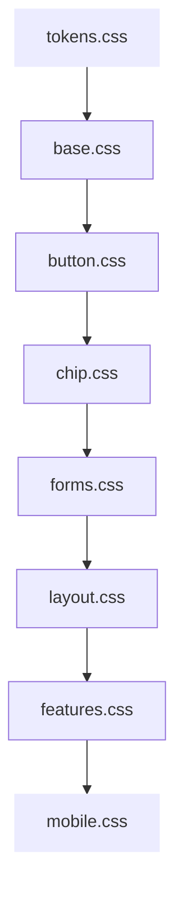

**图表来源**  
- [main.css:1-11](file://assets/css/main.css#L1-L11)

### 样式作用域耦合
- `base.css` 影响所有页面元素，尤其 `html`、`body`、全局字号和动效。
- `layout.css` 依赖基础变量定义，定义 App Shell、顶栏、任务区和面板结构。
- `mobile.css` 依赖前面所有样式，负责响应式覆盖与触控增强。
- 业务 HTML 应尽量保持干净的类名结构，不要让内联样式绕开这套覆盖链。

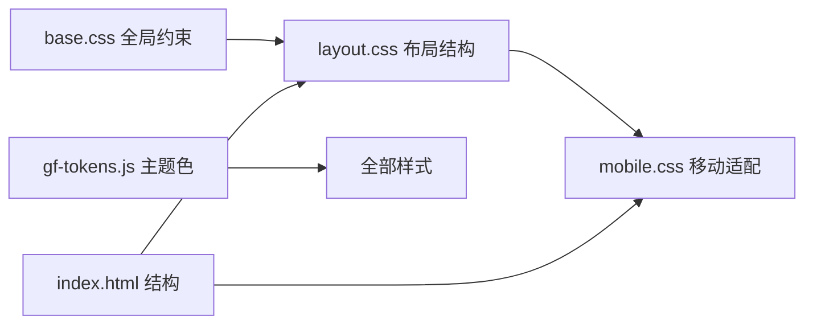

**图表来源**  
- [main.css:1-11](file://assets/css/main.css#L1-L11)
- [index.html:4-14](file://index.html#L4-L14)

**章节来源**  
- [main.css:1-11](file://assets/css/main.css#L1-L11)
- [gf-tokens.js:1-22](file://assets/js/gf-tokens.js#L1-L22)

## 性能与安全区注意
### `100dvh` 与 Safari 地址栏
在非桌面平台，特别是 iOS Safari、微信内置浏览器等场景中，`100vh` 可能被工具栏或地址栏错误裁剪。代码同时使用 `100vh` 和 `100dvh`，移动端更进一步的样式将 `.app-shell` 和 `body` 的高度基准切换到 `100dvh`，以贴合动态视口高度。

### 橡皮筋滚动与视口保护
- `.main-scroll` 启用 `-webkit-overflow-scrolling: touch` 并限制垂直越界滚动。
- `.canvas-wrap` 在双指缩放时防止整页跟着滑动。
- 底部固定导航增加 `safe-area-inset-bottom`，避免 Android 手势条或 iPhone 底部横条吞掉按钮。
- 顶栏和小屏布局也使用 `safe-area-inset-left/right`，保证按钮不会贴到刘海边缘。

### 小屏安全缓冲
- 小屏下 `.main-scroll` 底部留出约 80px 内边距，给底部导航留下空间。
- 底部 tab 的内边距加入环境变量安全区偏移。
- 画布容器允许内部水平滚动，避免大图或小字被迫缩放导致模糊。

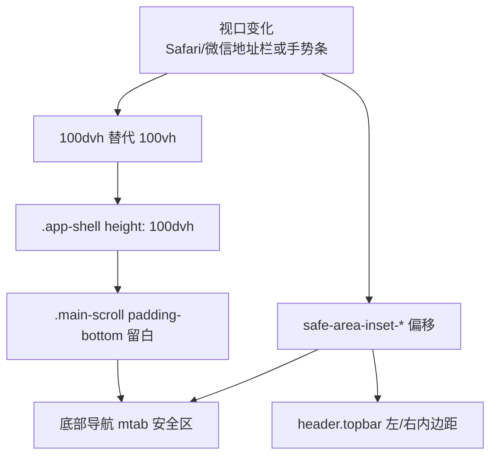

**图表来源**  
- [mobile.css:400-520](file://assets/css/components/mobile.css#L400-L520)
- [layout.css:1520-1652](file://assets/css/components/layout.css#L1520-L1652)

**章节来源**  
- [mobile.css:400-520](file://assets/css/components/mobile.css#L400-L520)
- [layout.css:1520-1652](file://assets/css/components/layout.css#L1520-L1652)

## 调试指南
### 在 Chrome DevTools 设备模式中观察
推荐按以下顺序检查：

| 检查对象 | 调试要点 | 期望结果 |
|---|---|---|
| Sankey 流图 | 切换设备宽度，观察 SVG 是否溢出容器 | 可左右滚动，或通过 `.fit` 类自适应容器宽度 |
| 四象限对齐 | 缩小到 375px、430px、768px、1024px | 四象限卡片不重叠，标签文字可读 |
| 今日三区 | 观察 `.today-grid` 从三列降到一列 | 重要任务始终在最显眼位置 |
| 时段任务 | 观察 `.today-slot-grid` 列数变化 | 时间段不挤压，数字完整显示 |
| 番茄钟进度条 | 观察 `#progressFill` 宽度 | 宽度与百分比一致，不被父容器截断 |
| 时间刻度 | 确认未因移动端 16px 输入放大而失控 | 展示型刻度使用继承字号，不被强制放大 |
| 侧边栏 | 跨越 900px 断点 | >900px 显示 rail/side，≤900px 隐藏并使用 mtab |
| 顶栏菜单 | 点击“更多” | 移动端只显示 ⊙⋯ 下拉，桌面端直接显示按钮 |
| 底部导航 | 滚动到底部 | 不遮挡最后一行任务或按钮 |
| 横竖屏切换 | 从竖屏旋转到横屏 | 布局不出现错位、空白或重复内容 |

### 推荐调试面板
- **Elements**：检查元素是否意外获得 `!important` 覆盖，尤其是移动端临时样式。
- **Styles**：查看是否命中 `max-width: 900px` 或 `hover: none and pointer: coarse` 的媒体查询。
- **Layers**：复杂 SVG 和大量 DOM 节点可能触发重绘，必要时暂时减少演示数据。
- **Performance**：模拟低端设备时观察是否出现长任务，特别是解析 JSON、渲染 Sankey 图或大量四象限卡片时。

### 快速验证命令
如果需要在控制台检查当前视口和安全区，可使用：

- `window.innerWidth`
- `window.innerHeight`
- `getComputedStyle(document.documentElement).getPropertyValue('--spacing')`（若 theme 文件暴露变量）
- `document.documentElement.dataset.theme`
- `document.documentElement.dataset.mode`

注意：上述检测仅为排查思路，不在生产代码中使用硬编码阈值。

[本节为调试方法论说明，不直接分析特定代码片段]

## 常见问题修复
### 1. 容器溢出
**现象**：Sankey 图、四象限或任务列表向右溢出，出现水平滚动条但不直观。  
**排查步骤**：

1. 检查 `.canvas-wrap` 是否为内容提供了足够的宽度。
2. 确认 SVG 没有被外层容器强制缩放。
3. 如果需要缩放显示，确认是否在适当容器上添加了适配类，例如 `.fit`。
4. 若不需要缩放，确保容器的 `overflow-x` 可滚动，并提示用户横向查看大图。

**定位参考**  
- [mobile.css:180-220](file://assets/css/components/mobile.css#L180-L220)
- [mobile.css:400-480](file://assets/css/components/mobile.css#L400-L480)

### 2. 文字截断
**现象**：任务名、时间预算、审计标签在一行中被省略。  
**排查步骤**：

1. 检查是否有 `white-space: nowrap` 被用在过长文本上。
2. 对于 `.ta-lbl`、`.stale-t` 等确实需要省略的场景，确认 `text-overflow: ellipsis` 配合父容器 `min-width` 正常工作。
3. 在小屏下，优先让动作按钮和次要标签换行，而不是截断任务正文。
4. 避免在中文文案上使用过短的最小宽度。

**定位参考**  
- [layout.css:760-900](file://assets/css/components/layout.css#L760-L900)
- [layout.css:980-1080](file://assets/css/components/layout.css#L980-L1080)

### 3. 触摸区域过小
**现象**：小图标、迷你按钮、单选框难以点中。  
**排查步骤**：

1. 确认该元素命中 `hover: none and pointer: coarse` 规则。
2. 检查是否有布局样式覆盖 `min-height: 40px`。
3. 对于复选框/单选框，确保尺寸未被自定义样式缩小到不可点。
4. 不要把按钮包裹在没有点击区域的空 div 中。

**定位参考**  
- [mobile.css:12-140](file://assets/css/components/mobile.css#L12-L140)

### 4. 横竖屏切换布局错乱
**现象**：从竖屏旋转到横屏后，Sankey 图错位、四象限重叠、或底部导航位置错误。  
**排查步骤**：

1. 清除浏览器缓存后再测试，避免旧版样式缓存。
2. 检查旋转后的视口宽度是否仍在预期断点范围内。
3. 检查是否存在内联样式覆盖了 `.app-shell`、`.main-scroll` 或 `.mtab`。
4. 如果使用虚拟键盘弹出，检查 `focusin` 滚动逻辑是否把输入框滚出视口。
5. 在横屏模式下特别检查 Sankey 图是否需要手动横向滚动或缩放显示。

**定位参考**  
- [mobile.css:400-520](file://assets/css/components/mobile.css#L400-L520)
- [layout.css:1480-1652](file://assets/css/components/layout.css#L1480-L1652)

### 5. 四象限卡片无法用拖拽调整
**现象**：用户在手机上无法拖动卡片到另一个象限。  
**说明**：这是有意的设计。触屏点击和拖拽冲突，代码明确在 ≤900px 时禁用拖拽视觉反馈和拖拽光标，并要求使用界面提供的 ± 按钮。  
**排查步骤**：

1. 确认当前视口是否命中 `max-width: 900px`。
2. 检查是否使用了不支持触屏的设备模拟器，导致判断不一致。
3. 指导用户使用显式调整按钮，而不是拖放。

**定位参考**  
- [mobile.css:620-720](file://assets/css/components/mobile.css#L620-L720)

### 6. 番茄钟或时间刻度字号异常
**现象**：部分数字突然变大，影响紧凑布局。  
**排查步骤**：

1. 如果是普通输入框，这是为了避免 iOS 自动放大。
2. 如果是刻度、倒计时数字、分数标签等展示型内容，应确保它命中“继承字号”的规则。
3. 不要在展示型数字上直接写 `font-size`，否则会覆盖继承行为。

**定位参考**  
- [mobile.css:12-40](file://assets/css/components/mobile.css#L12-L40)

**章节来源**  
- [mobile.css:12-220](file://assets/css/components/mobile.css#L12-L220)
- [mobile.css:400-720](file://assets/css/components/mobile.css#L400-L720)
- [layout.css:560-1120](file://assets/css/components/layout.css#L560-L1120)

## 扩展建议
为新的页面区块开发响应式能力时，请遵循以下流程：

### 第一步：在 layout.css 中声明布局约束
新组件应在布局层确定：

- 使用 Flex 还是 Grid。
- 列数、列宽、间距。
- 最大容器宽度和内边距。
- 是否应参与 `.view-inner` 的最大宽度约束。
- 是否与 `.panel` 或 `.zone` 共用样式。
- 如何响应不同屏幕，例如通过断点更改列数，而不是写绝对宽度。

### 第二步：在 mobile.css 中补充小屏覆盖
移动覆盖应优先做“退化和增强”，而不是复制布局：

- 缩小字号，但保持语义一致。
- 将多列转为单列。
- 增大触控目标至至少 40px。
- 用底部导航或顶部“更多”菜单收纳次要操作。
- 为 Sankey、流程图、四象限等大密度图形提供缩放或横向滚动方案。
- 为触屏增加点击反馈，替代 hover。

### 第三步：避免在业务 HTML 中写内联样式
理由：

- 内联样式优先级过高，容易被 `!important` 或媒体查询覆盖。
- 内联样式难以集中维护，容易导致不同设备的视觉差异。
- 内联样式不利于主题变量和可访问性的统一检查。
- 构建流程更难发现废弃或冲突的样式。

### 第四步：新增主题敏感样式时的规范
如果需要新增颜色相关的样式，请按以下顺序：

1. 先确认是否已有合适的 CSS 变量，如 `--stroke`、`--panel-strong`、`--muted`。
2. 如果没有，先在主题系统（tokens 与 JS 令牌）中添加，再让 CSS 消费变量。
3. 不要仅在 `mobile.css` 中为小屏重写配色，除非确有必要。
4. 对于强调色、警告色和成功色，确保满足 WCAG 建议的文本与背景对比度。

### 第五步：新增交互时的可访问性与触控检查
- 确认按钮至少有 40px 触控高度。
- 确认点击操作不限于 hover。
- 确认键盘可聚焦、有可见焦点态。
- 确认触摸设备和键盘设备都能理解当前状态。
- 确认屏幕阅读器不会读到不必要的装饰性标签。

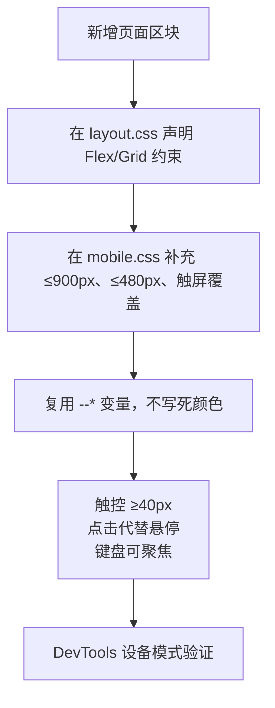

**图表来源**  
- [main.css:1-11](file://assets/css/main.css#L1-L11)
- [layout.css:1-260](file://assets/css/components/layout.css#L1-L260)
- [mobile.css:1-200](file://assets/css/components/mobile.css#L1-L200)

**章节来源**  
- [main.css:1-11](file://assets/css/main.css#L1-L11)
- [layout.css:1-260](file://assets/css/components/layout.css#L1-L260)
- [mobile.css:1-200](file://assets/css/components/mobile.css#L1-L200)

## 结论
GoalFlow 的响应式布局采用“基础布局统一 + 移动端独立覆盖”的策略：

- `layout.css` 负责稳定的桌面布局和主要组件结构。
- `mobile.css` 负责触屏设备、窄屏、超窄屏、安全区和触控体验。
- 四象限和 Sankey 图在移动端不是简单缩小，而是根据交互特征进行退化：关闭拖拽、提供替代按钮、允许横向滚动或按需缩放。
- 主题变量由 JS 与 CSS 共同维护，响应式层复用变量，保持背景、分割线、阴影和标签颜色在多设备下的一致性和可读性。
- 最佳实践是在布局层声明约束，在移动层补充覆盖，尽量避免在业务 HTML 中写入内联样式。

这样既能保证桌面端的高效布局，又能让手机用户在触控、字号、触控目标和安全区环境下获得稳定可用的体验。

[本节为总结性内容，不直接分析特定文件]