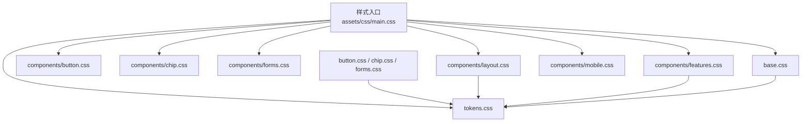
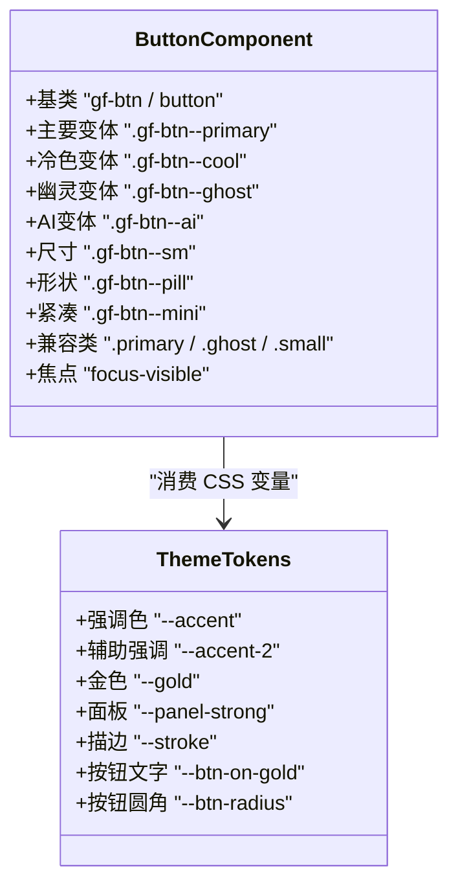
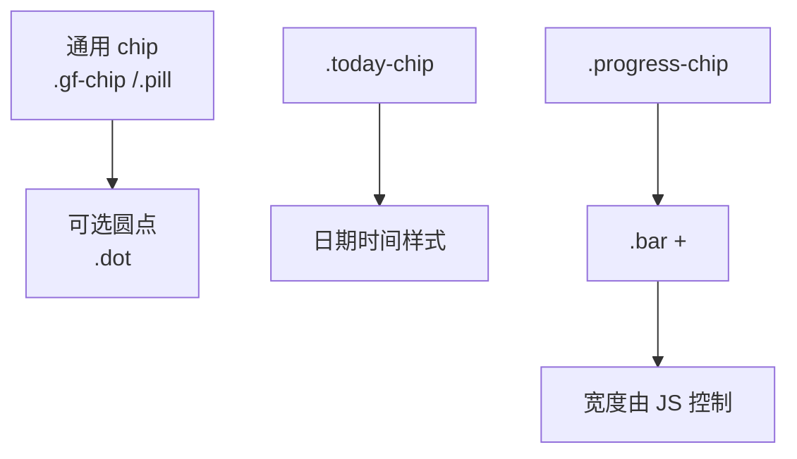
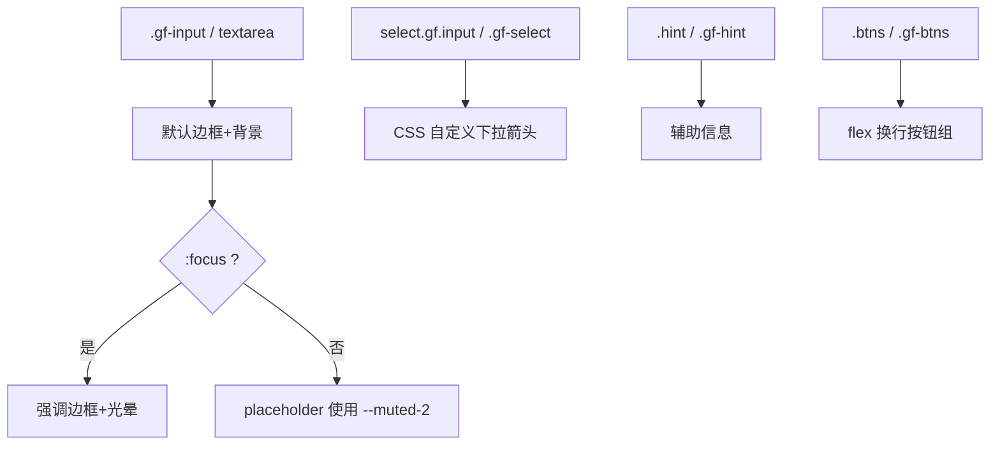
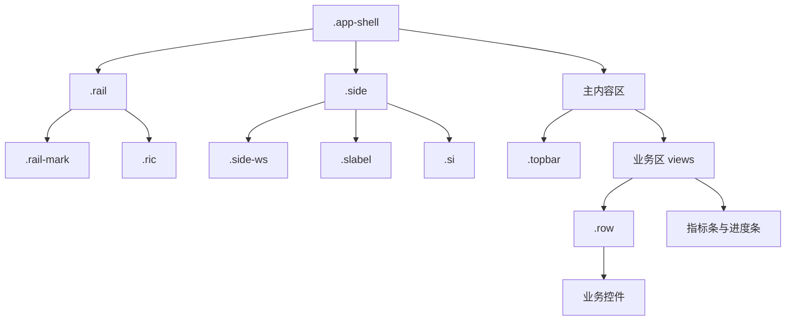
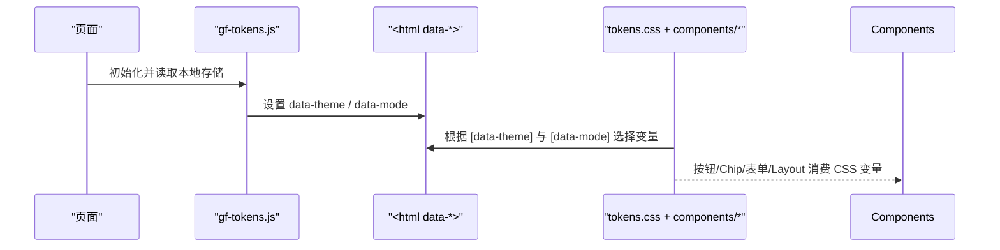

# 组件样式模块与规范

<cite>
**本文引用的文件**
- [main.css](file://assets/css/main.css)
- [tokens.css](file://assets/css/tokens.css)
- [base.css](file://assets/css/base.css)
- [button.css](file://assets/css/components/button.css)
- [chip.css](file://assets/css/components/chip.css)
- [forms.css](file://assets/css/components/forms.css)
- [layout.css](file://assets/css/components/layout.css)
- [features.css](file://assets/css/components/features.css)
- [index.html](file://index.html)
- [gf-tokens.js](file://assets/js/gf-tokens.js)
</cite>

## 目录
1. [引言](#引言)
2. [项目结构与样式入口](#项目结构与样式入口)
3. [设计令牌与主题机制](#设计令牌与主题机制)
4. [按钮组件样式](#按钮组件样式)
5. [标签组件 Chip 样式](#标签组件-chip-样式)
6. [表单控件样式](#表单控件样式)
7. [布局与业务特性样式分工](#布局与业务特性样式分工)
8. [视觉状态与 DOM 绑定约定](#视觉状态与-dom-绑定约定)
9. [具体定制示例](#具体定制示例)
10. [新增组件样式规则](#新增组件样式规则)
11. [常见问题排查](#常见问题排查)
12. [总结](#总结)

## 引言
本文件面向目标流 GoalFlow 的组件样式层，聚焦 `button.css`、`chip.css`、`forms.css`、`layout.css` 和 `features.css`。这些文件分别承担：

- 按钮组件的基类、尺寸和变体样式。
- 通用标签 chip、今日进度标签、进度条标签等可视化标记。
- 输入框、文本域、下拉菜单及表单反馈信息的基础主题化。
- 应用外壳、侧栏、主列等全局布局容器、间距、圆角和基础层级结构。
- 面向“目标规划、四象限、任务行、指标条”等业务区域的扩展样式。

样式加载由 `main.css` 统一管理，主题色值来自 `tokens.css`，页面运行态由 `gf-tokens.js` 写入 `data-theme` 与 `data-mode` 控制。所有可定制位置应优先通过 CSS 变量完成，而不是硬编码颜色或局部覆盖基础元素样式。

**节来源**
- [main.css:1-11](file://assets/css/main.css#L1-L11)
- [index.html:14](file://index.html#L14)
- [gf-tokens.js:1-26](file://assets/js/gf-tokens.js#L1-L26)

## 项目结构与样式入口
GoalFlow 的主样式入口是 `assets/css/main.css`。它会按依赖顺序导入以下文件：



**图示来源**
- [main.css:1-11](file://assets/css/main.css#L1-L11)
- [tokens.css:1-30](file://assets/css/tokens.css#L1-L30)

该加载顺序非常关键：

| 类型 | 文件 | 职责 |
|---|---|---|
| 主题源 | `tokens.css` | 定义全局 CSS 变量，包括颜色、圆角、阴影、字体、强调色、紧急度阶梯、四象限语义色等 |
| 页面基础 | `base.css` | 重置 box-sizing、body 默认主题、颗粒噪点、初始过渡工具类、键盘快捷键键帽等 |
| 交互组件 | `button.css`、`chip.css`、`forms.css` | 定义可复用 UI 控件的默认外观、状态和变体 |
| 布局容器 | `layout.css` | 定义应用外壳、图标轨、侧栏、工作区、主内容区域 |
| 业务区特性 | `features.css` | 定义任务行、指标条、步骤标识、进度条等业务区可见样式 |
| 移动端适配 | `mobile.css` | 在小屏幕下调整布局与控件表现 |

**节来源**
- [main.css:1-11](file://assets/css/main.css#L1-L11)
- [base.css:1-85](file://assets/css/base.css#L1-L85)

## 设计令牌与主题机制

### 主题维度
GoalFlow 的主题支持两个正交维度：

| 维度 | 取值 | 影响范围 |
|---|---|---|
| 主题 | `linear`、`raycast`、`rpg` | 决定背景、描边、文字、强调色、紧急度色阶、四象限色、顶栏、徽章等颜色 |
| 明暗模式 | `dark`、`light` | 决定每个主题的明/暗配色，以及 `color-scheme` |

HTML `<head>` 中会先写入当前主题的 `data-theme` 与 `data-mode`，之后才加载完整样式表，从而减少首次渲染闪烁。

### CSS 变量分层
- `:root` 声明结构 token，如圆角、间距、字体、缓动函数、按钮基础圆角。
- `:root` 与 `[data-theme='linear']` 提供默认 Linear 深色主题。
- `[data-theme='raycast']`、`[data-theme='rpg']` 覆盖主题色。
- `[data-mode='light']` 及组合选择器覆盖浅色系配色。

组件样式主要使用以下变量类别：

| 变量类别 | 代表变量 | 通常用途 |
|---|---|---|
| 背景 | `--body-bg`、`--bg0`、`--bg1`、`--bg2` | 页面、轨道、侧栏、面板背景 |
| 表面与描边 | `--panel`、`--panel-strong`、`--stroke`、`--stroke-soft` | 面板面、边框、分隔线 |
| 文字 | `--ink`、`--ink-2`、`--muted`、`--muted-2` | 主文、次文、弱提示 |
| 品牌强调 | `--accent`、`--accent-2`、`--gold`、`--gold-soft` | 主色、辅色、黄金色渐变 |
| 紧急度 | `--ur1` … `--ur5` | 从冷静到紧急的五级颜色 |
| 四象限语义 | `--quad-now`、`--quad-core`、`--quad-distract`、`--quad-noise` | 四象限任务分类 |
| 布局结构 | `--radius`、`--radius-sm`、`--radius-pill`、`--space-*` | 圆角、药丸标签半径、间距 |
| 阴影 | `--shadow`、`--shadow-soft` | 面板、卡片阴影 |
| 交互焦点 | 结合 `var(--accent)` 通过 `color-mix` 生成描边或发光 |
| 动画缓动 | `--ease-out` | 进度条、展开收起等缓动曲线 |

### JavaScript 令牌同步
`gf-tokens.js` 暴露 `GoalFlowTheme.THEMES`、`PALETTE_UR`、`CAT`、`COLORS` 与按钮类名常量 `BTN`。它与 `tokens.css` 并非直接互相解析，而是保持语义一致：JS 用色板构建图表、指标和按钮类，CSS 用 CSS 变量驱动最终像素值。修改主题色时，需要保证两侧语义对齐；纯样式定制优先改 `tokens.css`。

**节来源**
- [tokens.css:1-20](file://assets/css/tokens.css#L1-L20)
- [tokens.css:30-120](file://assets/css/tokens.css#L30-L120)
- [tokens.css:120-318](file://assets/css/tokens.css#L120-L318)
- [gf-tokens.js:1-26](file://assets/js/gf-tokens.js#L1-L26)
- [gf-tokens.js:28-90](file://assets/js/gf-tokens.js#L28-L90)
- [index.html:14](file://index.html#L14)

## 按钮组件样式

### 职责边界
`button.css` 的职责是统一按钮的外观和行为，不处理业务逻辑。它同时支持新式类名和少量旧版兼容写法。

- **基类**：`.gf-btn` 与原生 `button` 共享基础样式。
- **修饰符类**：`.gf-btn--primary`、`.gf-btn--cool`、`.gf-btn--ghost`、`.gf-btn--ai`、`.gf-btn--sm`、`.gf-btn--pill`、`.gf-btn--mini`。
- **兼容类**：原生的 `.primary`、`.ghost`、`.small`、`.ai`、`.cool`、`.pill` 仍被保留。

### 可用变体

| 样式组合 | 语义 | 关键行为 |
|---|---|---|
| 无修饰符 | 默认按钮 | 使用 `--panel-strong` 背景、`--stroke` 边框、`--ink` 文字 |
| `.gf-btn--primary` | 主按钮 | 金色渐变、加粗、阴影、按钮文字用 `--btn-on-gold` |
| `.gf-btn--cool` | 冷色主按钮 | 以 `--accent` 为底色的渐变色主按钮 |
| `.gf-btn--ghost` | 幽灵按钮 | 透明背景、悬停后显示浅色背景和正常文字色 |
| `.gf-btn--ai` | AI 按钮 | 双色强调渐变，适合 AI 相关操作 |
| `.gf-btn--sm` | 小按钮 | 更小 padding 和字号 |
| `.gf-btn--pill` | 药丸形状 | 配合 `.topbar-actions .gf-btn--sm` 时采用更大圆角 |
| `.gf-btn--mini` | 迷你按钮 | 用于四象限或其他紧凑区域 |
| `.primary.cool` | 旧类兼容冷主按钮 | 对应新版 `.gf-btn--primary.gf-btn--cool` |

### 视觉状态
- **默认状态**：普通 `button` 或带 `.gf-btn` 的元素拥有 cursor、描边、背景、字号、字重、内边距、过渡动画。
- **悬停状态**：
  - 默认按钮边框变为 `--muted-2`，背景轻微混合墨色。
  - 主按钮增加亮度滤镜。
  - 幽灵按钮背景变为 `--panel-strong`，文字变为主文色。
- **聚焦状态**：使用 `focus-visible`，外轮廓基于 `--accent` 通过 `color-mix` 计算，避免在触摸设备上出现不合适的外轮廓。
- **禁用状态**：样式文件中未定义独立的 `disabled` 钩子；实际 JS 应通过移除事件、添加 `aria-disabled` 或外层包装来控制可用性，样式层不强制禁止用户交互。
- **选中/激活状态**：按钮组件没有专用的 `:active`、`:checked` 或 `is-active` 样式块；如需交互反馈，应在业务区使用其他组件或显式叠加额外状态类。

### 与 HTML 和 JavaScript 的关系
`index.html` 大量使用如下组合：

- `.gf-btn gf-btn--sm gf-btn--pill gf-btn--ghost`：顶部工具栏中的幽灵风格小药丸按钮。
- `.gf-btn gf-btn--sm gf-btn--pill`：导出备份等功能主按钮。
- `.gf-btn gf-btn--primary`：解析并生成按钮等核心行动按钮。
- `.gf-btn gf-btn--ghost`：清空、退出预览等操作按钮。
- `.gf-btn gf-btn--ai`：AI 分析相关按钮。
- `.gf-btns`：按钮组容器，用于 flex 换行排列。

JavaScript 的 `GF.BTN` 预定义了常用按钮类名串，例如 `primarySm`、`smPill`、`ghostSm`、`coolSm`、`aiSm` 等，以减少业务代码拼接字符串时的错误。

### 推荐使用的类映射

| 场景 | 推荐使用类 |
|---|---|
| 主要操作按钮 | `.gf-btn--primary` |
| 次要或可撤销操作 | `.gf-btn--ghost` |
| 小型工具按钮 | `.gf-btn--sm` |
| 胶囊形导航或顶部工具 | `.gf-btn--pill` |
| AI 相关操作 | `.gf-btn--ai` |
| 紧凑布局中的小按钮 | `.gf-btn--mini` |
| 按钮容器 | `.gf-btns` |
| 展示型或非提交按钮 | `<button type="button" class="gf-btn">` |



**图示来源**
- [button.css:1-108](file://assets/css/components/button.css#L1-L108)
- [tokens.css:30-120](file://assets/css/tokens.css#L30-L120)

**节来源**
- [button.css:1-108](file://assets/css/components/button.css#L1-L108)
- [index.html:71-95](file://index.html#L71-L95)
- [gf-tokens.js:150-177](file://assets/js/gf-tokens.js#L150-L177)

## 标签组件 Chip 样式

### 职责边界
`chip.css` 不是通用数据表格列头组件，而是轻量标签组件。它包含：

1. **通用 chip / pill**：用于标签、状态、简短说明。
2. **今日 chip**：顶栏右侧日期行的 `.today-chip`。
3. **进度 chip**：顶栏任务完成度提示的 `.progress-chip`。

### 可用变体

| 类名 | 作用 | 视觉说明 |
|---|---|---|
| `.gf-chip` 或 `.pill` | 通用标签 | 内联弹性布局、灰色半透明背景、细边框、次要文字色 |
| `.dot` | chip 内小圆点 | 常用于区分类别，宽度高度约 7px |
| `.today-chip` | 今日日期标签 | 深色半透明背景、模糊 backdrop-filter、数字等宽排版 |
| `.progress-chip` | 进度标签 | 基于 `--ur2` 透明度生成柔和边框和背景，内部带进度条 |

### 视觉状态
Chip 组件没有内置悬停、选中、禁用、完成、警告、错误等复合状态。其“状态”主要通过外部类（例如 `.hot`、`.best`）和 JavaScript 动态内容表达：

- `.today-chip`：用于显示“今天”这一静态语义。
- `.progress-chip` 内部带有 `.bar` 和 `<i>` 元素，表示进度数值。
- JavaScript 渲染出的 `.cal-chip`、`.ps-chip`、`.rock-chip`、`.ms-pill` 等不属于这个组件文件的核心 API；其中部分类可能由其他样式文件或业务逻辑负责。

因此，**不要假设所有 span 上的 chip 类都会具备完整交互态**。只有 `.gf-chip` 和 `.pill` 是稳定的核心契约。

### 与 HTML 和 JavaScript 的关系
- `index.html` 中使用 `.progress-chip` 作为顶部进度标签，配合 `<span class="bar"><i></i></span>` 展示进度条。
- `app.js` 输出多种 chip 类名，例如 `.cal-chip`、`.ps-chip`、`.rock-chip`、`.ms-pill`，它们属于业务区动态渲染产物；有些有附加类（如 `.hot`、`.best`、`.done`），但样式含义需要看对应业务样式块或 CSS 后续定义。
- 对于需要稳定颜色映射的 chip，最佳方式是给基础 `.gf-chip` 加上业务语义类（如 `.chip-warning`、`.chip-error`、`.chip-success`），再由业务样式文件单独定义，而不破坏通用 chip 样式。



**图示来源**
- [chip.css:1-64](file://assets/css/components/chip.css#L1-L64)
- [index.html:66-71](file://index.html#L66-L71)

**节来源**
- [chip.css:1-64](file://assets/css/components/chip.css#L1-L64)
- [index.html:66-71](file://index.html#L66-L71)

## 表单控件样式

### 职责边界
`forms.css` 定义输入控件及其反馈信息的主题化规则，包括：

- 文本输入框 `.gf-input`
- 文本域 `textarea`
- 聊天输入框选择器 `input.chat input`
- 下拉菜单 `select.gf.input` 与 `.gf-select`
- 表单提示 `.hint`、`.gf-hint`
- 按钮容器 `.btns`、`.gf-btns`

注意：`.btns`、`.gf-btns` 同时在 `base.css` 中定义，forms.css 再次声明一组相似布局类；调用方应尽量使用更贴近上下文的类名，避免重复覆盖。

### 可用控件与变体

| 控件或类 | 职责 | 重要行为 |
|---|---|---|
| `.gf-input` | 主题化输入框 | 继承 body 字体、边框、圆角、背景、文案色、过渡动画 |
| `textarea` | 多行输入 | 固定高度、竖向可缩放、更大的内边距 |
| `.chat-input input` | 聊天区域输入 | 自动宽度并参与 flex |
| `.gf-input--grow` | 可伸缩输入 | 用于搜索栏、命令栏等横向空间场景 |
| `select.gf.input`、`.gf-select` | 下拉菜单 | 去除浏览器默认箭头，替换为 CSS 箭头 |
| `.gf-select--demo` | 示例下拉 | demo 专用，允许更宽和较小字号 |
| `.hint`、`.gf-hint` | 表单辅助文本 | 次要文字色、上边距、较长行高 |
| `.btns`、`.gf-btns` | 按钮容器 | flex 换行，按钮之间留间隙 |

### 视觉状态
| 状态 | 实现方式 | 说明 |
|---|---|---|
| 默认状态 | 边框、背景、文字色、圆角、过渡 | 默认使用半透明深色背景与 `--stroke` 边框 |
| 聚焦状态 | `:focus` | 边框变为 `--accent`，并出现基于 `--accent` 光晕 |
| 占位符 | `::placeholder` | 使用 `--muted-2` 作为占位文字色 |
| 禁用状态 | 样式文件中未定义 `:disabled` | 应通过属性控制语义，若需视觉变化需扩展样式 |
| 验证失败 | 未在本文件中定义 | 建议在业务表单上增加 `.has-error` 等语义类并由业务样式或扩展样式处理 |

### 暗色模式下的可读性建议
虽然整体主题系统已经通过 `data-theme` 和 `data-mode` 切换色板，但在扩展 dark/light 主题时应确认：

1. `--stroke` 在浅色模式下具有足够对比度。
2. `--muted-2` 作为 placeholder 颜色在两种模式下都清晰可读。
3. 下拉箭头的 `background-image` 使用了浅色与 `--muted` 的线性渐变，浅色背景下可能需要重新设计箭头色值。
4. `textarea` 和输入框的 `rgba(0, 0, 0, ...)` 背景适合深色，浅色主题可能需要改用浅色半透明背景或使用主题变量。
5. `appearance: none` 的下拉在部分操作系统或浏览器中仍有平台默认样式差异，测试时要关注 Windows、macOS 的差异。



**图示来源**
- [forms.css:1-86](file://assets/css/components/forms.css#L1-L86)

**节来源**
- [forms.css:1-86](file://assets/css/components/forms.css#L1-L86)
- [base.css:60-85](file://assets/css/base.css#L60-L85)

## 布局与业务特性样式分工

### layout.css 的职责
`layout.css` 是 GoalFlow 主应用壳的核心布局文件，承担：

- **应用外壳**：`.app-shell` 全屏 flex 容器。
- **图标轨**：`.rail`，左侧窄导航栏，包含主导航与快捷操作。
- **侧栏**：`.side`，展示工作流、视图、目标树、主题入口等。
- **主列**：`section.main` 或其容器，承载不同 view。
- **栅格/网格结构**：例如 `.today-grid`、`.today-block`，用于“现在做什么”三列区块。
- **间距**：侧栏、导航项、分组标题、进度、工作区头部等间距。
- **阴影**：主要应用于 Logo 块、工作区色点等，而非每行卡片；整体遵循 Linear 风格的轻阴影或无阴影风格。
- **圆角**：多数组件使用项目定义的圆角变量，如 `--radius`、`--radius-sm`、`--radius-pill`。
- **z-index 策略**：`base.css` 将 `body > *` 设置成相对定位且 z-index 为 1，背景噪点设为 0，确保正文内容浮于噪点之上；业务弹出层、顶栏、抽屉应由业务样式进一步细化。

`layout.css` 不应成为某个具体业务的详细样式库；如果某个样式只出现在“四象限”“计划视图”“统计区”等场景中，应放入 `features.css`。

### features.css 的职责
`features.css` 是业务区特性的补充样式，包含：

- 折叠摘要 `details`、`summary`。
- 选项栏 `.optbar`。
- 编辑器滚动条。
- 任务行 `.row`，含悬浮高亮和特殊高亮 `.hl`。
- 行标题 `.tt`、描述、分类圆点。
- 控制面板 `.ctls`。
- 步骤 `.step`、徽章 `.badge`。
- 进度条 `.thick i`。
- 完成复选框 `.done-c`。
- 缩放选择器 `.scale-sel`。
- 智能按钮及其他演示控件。

这些样式依赖 `layout.css` 提供的布局环境和 `tokens.css` 提供的主题变量，但它们本身不构成全局布局基础设施。



**图示来源**
- [layout.css:1-200](file://assets/css/components/layout.css#L1-L200)
- [features.css:1-200](file://assets/css/components/features.css#L1-L200)

**节来源**
- [layout.css:1-200](file://assets/css/components/layout.css#L1-L200)
- [features.css:1-200](file://assets/css/components/features.css#L1-L200)

## 视觉状态与 DOM 绑定约定

### 组件状态总结

| 组件 | 默认 | 悬停 | 聚焦 | 禁用 | 激活 | 选中 | 完成 | 警告 | 错误 |
|---|---|---|---|---|---|---|---|---|---|
| 按钮 `.gf-btn` | 边框+面板背景 | 边框变浅、背景加深 | `focus-visible` 外轮廓 | 未在样式中定义 | 未定义独立态 | 未定义独立态 | 未定义 | 未定义 | 未定义 |
| 主按钮 `.gf-btn--primary` | 金色渐变 | 增加亮度 | 同按钮基础聚焦 | 同上 | 未定义 | 未定义 | 未定义 | 未定义 | 未定义 |
| 幽灵按钮 `.gf-btn--ghost` | 透明背景 | 显示浅色面板背景 | 同按钮基础聚焦 | 同上 | 未定义 | 未定义 | 未定义 | 未定义 | 未定义 |
| 芯片 `.gf-chip` / `.pill` | 半透明背景+细边框 | 未定义悬停 | 未定义 | 未定义 | 未定义 | 未定义 | 未定义 | 未定义 | 未定义 |
| 输入框 `.gf-input` | 深色半透明背景 | 无特别样式 | 强调边框+光晕 | 未定义 | 同聚焦 | 不适用 | 不适用 | 未定义 | 未定义 |
| 文本域 `textarea` | 同输入框 | 无特别样式 | 同输入框 | 未定义 | 同聚焦 | 不适用 | 不适用 | 未定义 | 未定义 |
| 下拉 `.gf-select` | 隐藏系统箭头+自定义三角 | 未定义 | 通常受默认 select 或父控件聚焦影响 | 未定义 | 未定义 | 不适用 | 不适用 | 未定义 | 未定义 |
| 业务行 `.row` | 细边框+极淡背景 | 强调边框和浅色背景 | 未定义 | 未定义 | 未定义 | 未定义 | `.hl` 高亮 | 未专门语义类 | 未定义 |

### DOM class 与 data-* 约定
- **按钮**：主要通过 class 组合表达变体和尺寸；`data-*` 在首页主要用于导航标识（例如 `data-nav="today"`），不是按钮组件的状态契约。
- **Chip**：`.progress-chip` 通过 `<i>` 元素的 `width` 百分比表达进度。`app.js` 还会渲染 `.rock-chip` 等结构，并通过 `data-rock-done`、`data-wf` 传递业务语义。
- **表单**：表单组件本身不提供验证状态 class；如果需要错误或警告反馈，建议为父容器增加语义类，例如 `.form-group.has-error`、`.form-group.has-warning`，并在业务样式中覆盖边框颜色和提示文字。
- **主题绑定**：`data-theme` 与 `data-mode` 写在 `<html>` 上，CSS 通过这些属性切换主题，JavaScript 负责读取/写入 `localStorage`。
- **业务状态**：许多复杂状态（如完成、热区、最佳日、任务完成进度）是由 `app.js` 注入类名和数据属性后，再由布局或特性样式处理的；不要把 JS 动态生成的类名误认为是稳定公共 API。



**图示来源**
- [index.html:14](file://index.html#L14)
- [gf-tokens.js:28-60](file://assets/js/gf-tokens.js#L28-L60)
- [tokens.css:30-200](file://assets/css/tokens.css#L30-L200)

**节来源**
- [index.html:66-99](file://index.html#L66-L99)
- [chip.css:1-64](file://assets/css/components/chip.css#L1-L64)
- [button.css:1-108](file://assets/css/components/button.css#L1-L108)
- [app.js:6237-6240](file://assets/js/app.js#L6237-L6240)
- [app.js:2200-2205](file://assets/js/app.js#L2200-L2205)

## 具体定制示例

### 示例一：修改按钮主色
如果你只想改变主按钮或强调色的色调，不要逐个修改 `button.css` 中的 `var(--gold)` 或 `var(--accent)` 引用。优先调整 `tokens.css`：

1. 在 `:root` 或对应主题的 `[data-theme='xxx'][data-mode='xxx']` 块中覆盖强调色变量。
2. 如果只改变 Linear 深色主色，可在该主题块中修改 `--accent`、`--accent-2`、`--gold` 等。
3. 若需要新的按钮变体，优先复制现有 `.gf-btn--primary` 的逻辑，新建类似 `.gf-btn--new-brand`，并使用新的变量名，如 `--brand-primary`、`--brand-on-dark`。
4. 谨慎覆盖：按钮主按钮的渐变和阴影已经耦合 `--gold` 等变量；直接改 `filter: brightness(...)` 可能影响不同主题下的高亮效果。

安全做法：引入新变量并创建新变体类，而不是把原 `.gf-btn--primary` 的语义改为另一个品牌色。

### 示例二：替换 Chip 标签的颜色映射
Chip 的通用样式是中性灰调，不直接绑定某一种业务语义色。若要让不同业务类别拥有不同颜色，可按以下步骤操作：

1. 为 chip 追加语义类，例如 `.chip-warning`、`.chip-success`、`.chip-error`、`.chip-brand`。
2. 在组件扩展样式或业务样式中定义这些类：
   - 使用主题变量，例如 `--ur4`（警告）、`--ur3`（成功倾向）、`--ur5`（危险）。
   - 如果使用自定义颜色，请提供明暗模式两套方案。
3. 不要在 `.gf-chip` 基础类上强绑死颜色，以免破坏其他非语义 chip。
4. 对进度 chip 的条形填充，应通过 JS 设置 `<i>` 的宽度，而不是把进度百分比写在 CSS 中；颜色则使用 `--accent-2` 到 `--accent` 渐变。

### 示例三：调整暗色模式下表单字段的边框与 placeholder 可读性
表单控件目前直接使用硬编码的 `rgba(0, 0, 0, ...)` 背景，这更适合深主题。在浅主题或新主题中，需要检查：

1. `textarea` 与 `.gf-input` 的背景是否过暗。
2. `::placeholder` 颜色是否可读。
3. 下拉菜单的箭头渐变是否足够明显。
4. `select` 在浅色主题中的边框和焦点光晕是否与背景冲突。

改进思路：

- 将输入背景改为基于主题变量的半透明色，例如 `color-mix(in srgb, var(--bg1), transparent, 60%)`，或在新主题中覆盖默认的 `rgba(0, 0, 0, 0.22)`。
- 将 placeholder 颜色保持在 `--muted-2`，并确保该变量在浅色模式下不是过于浅的颜色。
- 为 `.gf-select` 增加浅色主题分支，调整箭头渐变的透明度，使其在白底上仍可识别。
- 如需错误与警告反馈，可扩展 `.has-error`、`.has-warning`，让边框、提示文案和 aria 属性共同体现语义，而不是只做颜色变化。

### 示例四：在不破坏交互状态的前提下添加新状态
如果想增加“禁用”“选中”“完成”三类状态，建议：

- 按钮禁用：新增 `.gf-btn.is-disabled` 或属性选择器 `:disabled`，设置 `opacity`、`pointer-events: none`、`cursor: default`，并保留聚焦与过渡规则的一致性。
- Chip 选中：新增 `.gf-chip.is-selected`，改变边框和高亮背景，但不要覆盖 `.dot` 的基本圆形尺寸。
- 表单完成：不在输入框上加“完成态”，应为业务表单容器添加 `.task-item.is-done`，让勾选、背景淡化、删除线等业务组合呈现完成语义。

这样不会破坏现有的 hover、focus、primary、ghost 等状态。

**节来源**
- [tokens.css:30-200](file://assets/css/tokens.css#L30-L200)
- [button.css:1-108](file://assets/css/components/button.css#L1-L108)
- [chip.css:1-64](file://assets/css/components/chip.css#L1-L64)
- [forms.css:1-86](file://assets/css/components/forms.css#L1-L86)

## 新增组件样式规则

### 1. 优先使用 CSS 变量
新增组件颜色应来源于以下层次：

- 通用结构 token：`--radius`、`--radius-sm`、`--radius-pill`、`--space-*`、`--ease-out`、`--font-ui`、`--font-mono`。
- 主题 token：`--accent`、`--accent-2`、`--gold`、`--ink`、`--muted`、`--panel-strong`、`--stroke`。
- 语义 token：`--ur1`…`--ur5`、`--quad-*`、`--idx-*`。

绝对尽量避免在新组件中重新写死 HEX 颜色；如确有新品牌色，应在 `tokens.css` 中注册变量后再消费。

### 2. 遵循现有类名风格
当前项目没有严格 BEM 要求，但有清晰惯例：

- 组件基类前缀使用 `gf-`。
- 修饰符使用双横线：`.gf-btn--primary`、`.gf-btn--sm`。
- 组件内子元素使用简单类名：`.dot`、`.bar`。
- 兼容旧类保留，但不鼓励继续新增旧类；新项目类名应使用 `.gf-*`。

### 3. 不要直接覆盖全局 base 样式
`base.css` 定义的是页面基础体验，例如全局字体、背景、噪声、键盘键帽、通用 hint 类。组件样式应：

- 使用自身作用域类名包裹。
- 避免裸写 `button`、`input`、`textarea`、`select` 的全局选择器，除非你确实要统一某个原生元素的主题。
- 如果必须覆盖原生元素，应明确注释并限定主题范围。

### 4. 通过组件类隔离副作用
新增组件的 CSS 应写成：

```css
.gf-component {
  /* 容器 */
}
.gf-component__title {
  /* 标题 */
}
.gf-component--variant {
  /* 变体 */
}
```

不要写成无作用域的样式，例如在全局 `.row`、`.btn`、`.chip` 上增加未经声明的附加行为。

### 5. 状态必须明确
每个新组件应公开：

- 默认状态
- 悬停状态
- 聚焦状态
- 禁用状态
- 可选的选中/完成/激活状态

这些状态应体现在 class 名称、伪类或数据属性中，并由文档说明谁负责读写。

### 6. 主题与明暗一致性
新增变量时需考虑：

- Linear 深色、Raycast、RPG 三种主题。
- 每种主题的浅/暗模式。
- 可访问性：焦点轮廓、占位符颜色、边框颜色、前景与背景对比度。
- 平台差异：`appearance: none` 下拉、滚动条、系统字体。

**节来源**
- [base.css:1-85](file://assets/css/base.css#L1-L85)
- [tokens.css:30-120](file://assets/css/tokens.css#L30-L120)
- [button.css:1-108](file://assets/css/components/button.css#L1-L108)

## 常见问题排查

### 问题一：更换主题后按钮主色不对
可能原因：

- 覆盖了错误的变量：例如改了 `--accent` 却期望只影响主按钮。
- 直接在 `button.css` 中写死了 HEX 颜色，绕过主题变量。
- 新主题的浅/暗模式下没有设置足够的文字与背景对比度。

解决：

- 优先通过 `tokens.css` 覆盖 `--accent`、`--gold` 或新增品牌变量。
- 若仅主题局部不同，使用 `[data-theme='raycast']` 等组合选择器。
- 在浅色模式下检查 `--btn-on-dark`、`--btn-on-gold`、`--ink`、`--muted`。

### 问题二：Chip 颜色不可控
可能原因：

- 把业务语义色写进了 `.gf-chip`。
- 期待 `.progress-chip` 能自动反映各种任务状态，但它只代表通用的进度标签。
- JS 输出的动态 chip 类（如 `.cal-chip`、`.ps-chip`）未被正确样式化。

解决：

- 为 chip 增加语义类。
- 为进度条配置正确的宽度更新逻辑，而不是把数据放进 CSS。
- 为 JS 渲染的 chip 类补全必要样式。

### 问题三：暗色模式下表单 placeholder 看不清
可能原因：

- `--muted-2` 太浅或太深。
- 输入框背景 `rgba(0, 0, 0, 0.22)` 与新主题背景对比异常。
- 自定义下拉箭头渐变在浅色背景上不清晰。

解决：

- 调整主题中对应的 `--muted-2`、背景色变量。
- 为新主题补充下拉箭头样式。
- 必要时增加浅色模式分支的表单覆盖规则。

### 问题四：新增按钮后悬停或 focus 不符合预期
可能原因：

- 未继承 `.gf-btn` 的基础样式。
- 使用了旧类但没有匹配到新规则。
- 自定义覆盖了 `transition` 或 `cursor`，破坏了过渡体验。

解决：

- 使用 `.gf-btn` 作为基类。
- 通过修饰符类添加变体。
- 保留 `transition: 0.15s` 和 `cursor: pointer`。

### 问题五：z-index 穿透或遮挡
可能原因：

- 业务弹出层放在 `layout.css` 的 `body > *` z-index 1 之下。
- 弹窗、顶栏、抽屉没有显式设置更高层级。
- 组件嵌套层级不够明确。

解决：

- 在 `base.css` 中，背景噪声为 z-index 0，正文元素为 z-index 1。
- 顶层界面结构由布局层管理。
- 弹出层、模态框由业务特性样式显式设置合理层级，避免全局 `z-index: 9999`。

**节来源**
- [tokens.css:30-318](file://assets/css/tokens.css#L30-L318)
- [base.css:20-85](file://assets/css/base.css#L20-L85)
- [button.css:1-108](file://assets/css/components/button.css#L1-L108)
- [chip.css:1-64](file://assets/css/components/chip.css#L1-L64)
- [forms.css:1-86](file://assets/css/components/forms.css#L1-L86)

## 总结
GoalFlow 的组件样式模块是一个以主题 CSS 变量为核心的层次化系统：

- `tokens.css` 是唯一合法的色彩和结构主题源。
- `base.css` 提供全局基础体验。
- `button.css`、`chip.css`、`forms.css` 提供可复用组件样式。
- `layout.css` 定义应用结构和基础布局环境。
- `features.css` 承接业务区具体展示细节。
- `gf-tokens.js` 与 `index.html` 共同维护主题运行时。

新增样式时，最重要的是遵守四个原则：

1. 先问是否可以用现有 CSS 变量表达，而不是直接写死颜色。
2. 使用组件类作用域封装样式，不污染全局基础元素。
3. 明确公开每个组件支持的视觉状态和 DOM class/data-* 契约。
4. 在所有主题和明暗模式下验证可读性与交互状态。

只要遵循上述约定，GoalFlow 的按钮、Chip、表单、布局和特性样式就可以在不破坏现有交互的前提下持续演进。