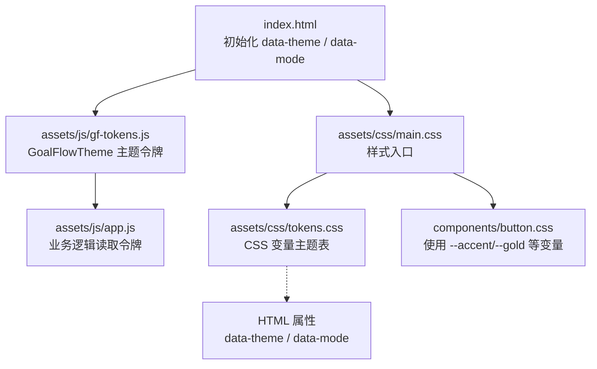
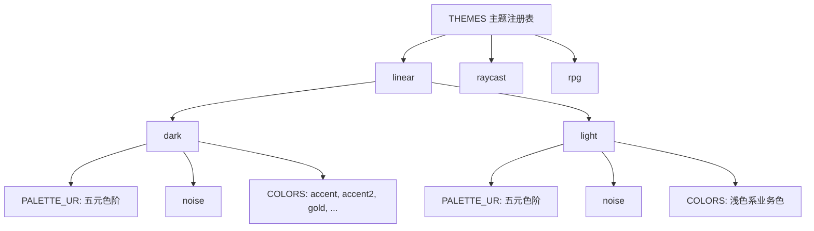
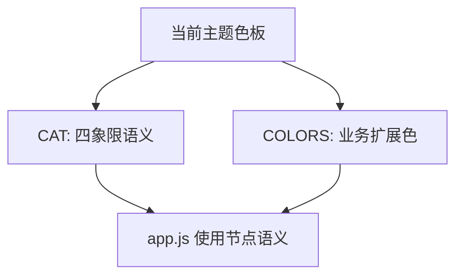
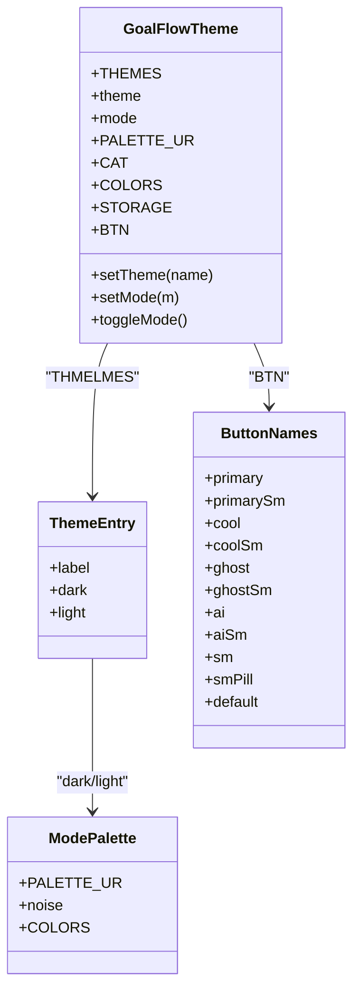
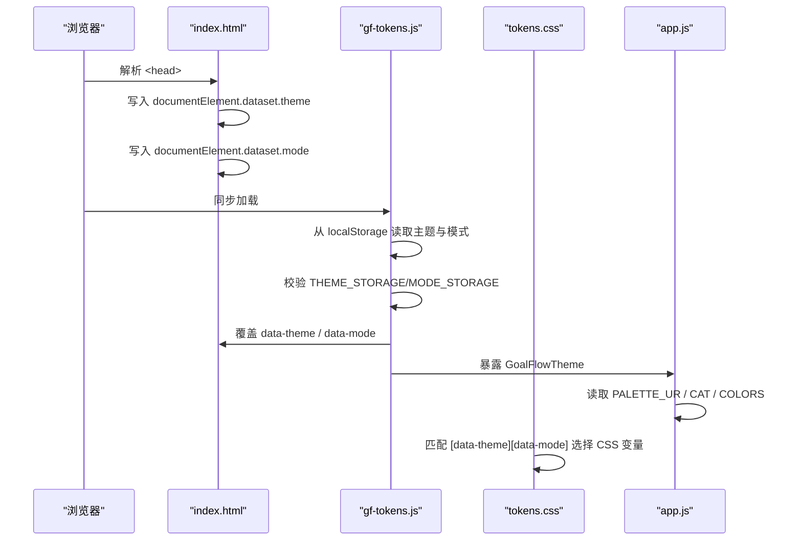
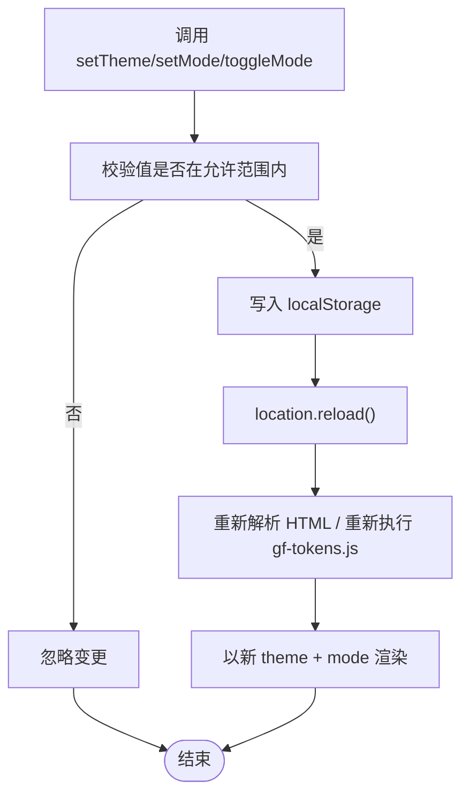
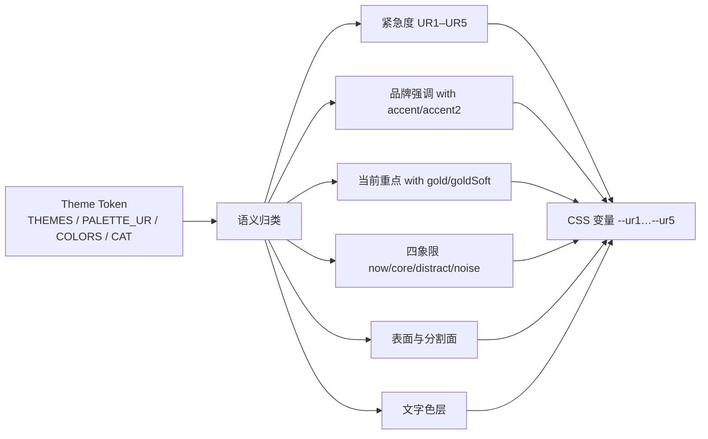
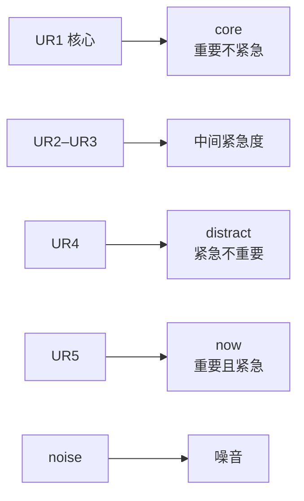
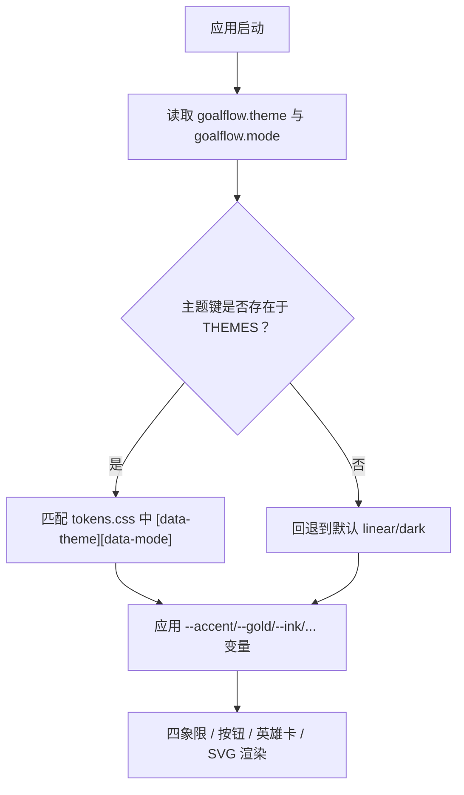
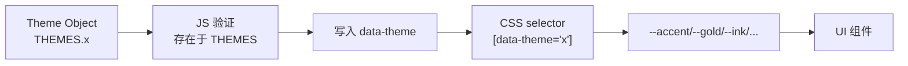

# 设计令牌与主题配置

<cite>
**本文引用的文件**   
- [gf-tokens.js](file://assets/js/gf-tokens.js)
- [app.js](file://assets/js/app.js)
- [main.css](file://assets/css/main.css)
- [tokens.css](file://assets/css/tokens.css)
- [button.css](file://assets/css/components/button.css)
- [index.html](file://index.html)
- [demos/index.html](file://demos/index.html)
</cite>

## 目录

1. [引言](#引言)
2. [项目结构](#项目结构)
3. [核心组件：GoalFlowTheme 对象](#核心组件goalflowtheme-对象)
4. [主题机制与运行时行为](#主题机制与运行时行为)
5. [CSS 变量映射图](#css-变量映射图)
6. [现有预置主题分析](#现有预置主题分析)
7. [UI 状态与主题的对应关系](#ui-状态与主题的对应关系)
8. [从零添加新主题](#从零添加新主题)
9. [可访问性与对比度验证](#可访问性与对比度验证)
10. [命名约定、契约与维护建议](#命名约定契约与维护建议)
11. [故障排查](#故障排查)
12. [结论](#结论)

## 引言

目标流 GoalFlow 的主题系统围绕“设计令牌”组织，而不是让 UI 代码直接写出硬编码颜色。它由两部分协同构成：

| 层级 | 职责 | 入口文件 |
|---|---|---|
| JS 令牌层 | 声明主题配置、标签语义、按钮类名、存储键等运行时常量；暴露全局 `GoalFlowTheme` | [gf-tokens.js](file://assets/js/gf-tokens.js) |
| CSS 变量层 | 定义页面结构令牌、默认主题、预览主题及其明/暗两套外观 | [tokens.css](file://assets/css/tokens.css) |

这种双源设计意味着：JS 决定“选中哪个主题和哪种明暗模式”，CSS 决定“这些主题看起来是什么”。应用主逻辑通过读取 `GoalFlowTheme` 来生成视图语义（例如四象限、紧急度、任务分类），同时依赖 CSS 中的 `var(--*)` 完成实际渲染。

## 项目结构



**图表来源**
- [index.html:10-17](file://index.html#L10-L17)
- [gf-tokens.js:1-177](file://assets/js/gf-tokens.js#L1-L177)
- [main.css:1-11](file://assets/css/main.css#L1-L11)
- [tokens.css:1-20](file://assets/css/tokens.css#L1-L20)

**章节来源**
- [main.css:1-11](file://assets/css/main.css#L1-L11)
- [index.html:1-17](file://index.html#L1-L17)

## 核心组件：GoalFlowTheme 对象

`assets/js/gf-tokens.js` 在立即执行函数末尾挂载 `global.GoalFlowTheme`，提供以下导出成员。

### 主题注册表 THEMES

`THEMES` 是主题的配置中心，当前包含三个键：

| 键名 | 展示标签 | 定位 |
|---|---|---|
| `linear` | Linear | 深色桌面风格主主题 |
| `raycast` | Raycast 玻璃（预览） | 命令面板玻璃风格预览主题 |
| `rpg` | RPG 游戏（预览） | 游戏化主线任务风格预览主题 |

每个主题对象包含：

| 字段 | 类型 | 是否必需 | 含义 |
|---|---|---:|---|
| `label` | 字符串 | 必须 | 主题显示名称，用于下拉列表和调试 |
| `dark.PALETTE_UR` | 五元色数组 | 必须 | 从冷到暖的五个紧急度色阶 |
| `dark.noise` | 十六进制色值 | 必须 | “噪音”四象限颜色 |
| `dark.COLORS` | 对象 | 必须 | SVG 发光、缩放标签、渐变端点等业务色 |
| `light.PALETTE_UR` | 五元色数组 | 必须 | 浅色模式的紧急度色阶 |
| `light.noise` | 十六进制色值 | 必须 | 浅色模式下的噪音色 |
| `light.COLORS` | 对象 | 必须 | 浅色模式的业务色 |

#### 每套色板内部结构

| 字段 | 说明 |
|---|---|
| `PALETTE_UR` | “重要-紧急”两维色阶，索引为 `PALETTE_UR[1]…PALETTE_UR[5]` |
| `noise` | 不重要的四象限灰色调 |
| `COLORS.accent` | 品牌强调主色 |
| `COLORS.accent2` | 辅助强调色 |
| `COLORS.gold` | 当前最重要的金色 |
| `COLORS.goldSoft` | 金色柔和变体 |
| `COLORS.svgGlow` | SVG 发光相关 |
| `COLORS.scaleLabel` | 时间尺度标签色 |
| `COLORS.smartGap` | 智能间隙颜色 |
| `COLORS.gradSmartDot` | 渐变控制点颜色对 |



**图表来源**
- [gf-tokens.js:22-96](file://assets/js/gf-tokens.js#L22-L96)

### 标签语义 CAT

`CAT` 将紧急度四象限映射为带中文描述的对象：

| 键 | key | label | color |
|---|---|---|---|
| `now` | `now` | 立即做 · 重要且紧急 | `PALETTE_UR[4]` |
| `core` | `core` | 核心投入 · 重要不紧急 | `PALETTE_UR[0]` |
| `distract` | `distract` | 干扰枝干 · 紧急不重要 | `PALETTE_UR[3]` |
| `noise` | `noise` | 噪音 · 不重要不紧急 | `palette.noise` |

注意：这里的数组索引与 CSS 中 `--ur1`…`--ur5` 存在语义偏移。JS 用 `PALETTE_UR[0]` 表示低频高重投入，而 CSS 中 `--ur1` 才是这个位置。

**章节来源**
- [gf-tokens.js:98-128](file://assets/js/gf-tokens.js#L98-L128)

### 通用 COLORS

`COLORS` 直接透传当前主题色板中的业务色彩对象，供 JavaScript 中需要精确颜色的逻辑使用。常见用途包括：

- SVG 图形的发光或描边
- 时间尺度标签
- 智能断点与插值点
- 桑基图、关系图等可视化着色



**图表来源**
- [gf-tokens.js:98-122](file://assets/js/gf-tokens.js#L98-L122)

**章节来源**
- [gf-tokens.js:129-145](file://assets/js/gf-tokens.js#L129-L145)

### 按钮样式 BTN

`BTN` 是一组面向模板与 JSX 风格的完整类名字符串集合，不是颜色 token。常用组合包括：

| 键 | 完整类名组合 | 典型用途 |
|---|---|---|
| `primary` | `gf-btn gf-btn--primary` | 强调操作 |
| `primarySm` | `gf-btn gf-btn--primary gf-btn--sm` | 小型强调按钮 |
| `cool` | `gf-btn gf-btn--primary gf-btn--cool` | 冷色调强调按钮 |
| `coolSm` | `gf-btn gf-btn--primary gf-btn--cool gf-btn--sm` | 小型冷色调按钮 |
| `ghost` | `gf-btn gf-btn--ghost` | 轻量占位按钮 |
| `ghostSm` | `gf-btn gf-btn--ghost gf-btn--sm` | 小型幽灵按钮 |
| `ai` | `gf-btn gf-btn--ai` | AI 功能按钮 |
| `aiSm` | `gf-btn gf-btn--ai gf-btn--sm` | 小型 AI 按钮 |
| `sm` | `gf-btn gf-btn--sm` | 通用小型按钮 |
| `smPill` | `gf-btn gf-btn--sm gf-btn--pill` | 药丸形状小按钮 |
| `default` | `gf-btn` | 默认基础按钮 |

按钮的视觉差异来自 `button.css`，它引用 `--gold`、`--accent`、`--accent-2`、`--btn-on-dark`、`--panel-strong` 等 CSS 变量。



**图表来源**
- [gf-tokens.js:22-177](file://assets/js/gf-tokens.js#L22-L177)

**章节来源**
- [gf-tokens.js:147-160](file://assets/js/gf-tokens.js#L147-L160)
- [button.css:1-108](file://assets/css/components/button.css#L1-L108)

### 存储键 STORAGE

`STORAGE` 集中定义了本地存储键：

| 字段 | 含义 |
|---|---|
| `nodes` | 当前节点数据键 |
| `nodesLegacy` | 旧版节点兼容键 |
| `meta` | 元数据存储键 |
| `llmKey` | LLM 密钥缓存键 |
| `theme` | 主题键：`goalflow.theme` |
| `mode` | 模式键：`goalflow.mode` |

应用主逻辑通过这些键读取主题，确保用户偏好跨刷新保留。

**章节来源**
- [gf-tokens.js:132-146](file://assets/js/gf-tokens.js#L132-L146)

## 主题机制与运行时行为

### 主题选择流程



**图表来源**
- [index.html:10-17](file://index.html#L10-L17)
- [gf-tokens.js:20-118](file://assets/js/gf-tokens.js#L20-L118)
- [tokens.css:1-20](file://assets/css/tokens.css#L1-L20)

### DOM 属性与样式选择器

| 作用域 | 属性名 | 取值范围 | 说明 |
|---|---|---|---|
| `<html>` | `data-theme` | 空、`linear`、`raycast`、`rpg` 或新增主题键 | 决定主题颜色族 |
| `<html>` | `data-mode` | `dark`、`light` | 切换深浅两套外观 |

- `index.html` 在脚本中先用 `localStorage` 的值设置 `documentElement.dataset`，避免首次渲染闪烁。
- `gf-tokens.js` 再次读取并写入相同的属性，作为统一的主题引擎。
- `tokens.css` 通过 `[data-theme='...']` 与 `[data-theme='...'][data-mode='light']` 选择变量。

### 主题与模式 API

| 方法 | 参数 | 行为 |
|---|---|---|
| `GoalFlowTheme.setTheme(name)` | 主题键 | 若 `THEMES[name]` 不存在则静默忽略；否则写入 `goalflow.theme` 并调用 `location.reload()` |
| `GoalFlowTheme.setMode(m)` | `dark` 或 `light` | 非法值被忽略；合法值写入 `goalflow.mode` 并重载 |
| `GoalFlowTheme.toggleMode()` | 无参 | 在 `dark` 与 `light` 之间翻转 |

重载策略简单直接：每次变更都刷新页面。好处是实现极简、副作用少；代价是没有过渡动画，也不会异步更新已渲染内容。



**图表来源**
- [gf-tokens.js:118-160](file://assets/js/gf-tokens.js#L118-L160)

**章节来源**
- [gf-tokens.js:98-160](file://assets/js/gf-tokens.js#L98-L160)
- [index.html:10-17](file://index.html#L10-L17)

## CSS 变量映射图

### 从 Token 到 CSS 变量的概念映射

主题对象本身并不把 `GF.THEMES.linear.dark.COLORS.accent` 自动写入 `--accent`。实际工作方式是：

1. JS 维护语义模型：紧急度色板、四象限标签、按钮类名、业务色对象。
2. CSS 维护视觉模型：`--accent`、`--gold`、`--ink`、`--panel` 等变量。
3. 二者共享同一份“主题意图”——即每种主题有自己的一套色值集合。
4. `tokens.css` 中通过 `[data-theme]` 覆盖变量实现视觉切换。

下面是主要语义类别及其对应的设计令牌：

| 类别 | JS 侧来源 | CSS 侧变量示例 |
|---|---|---|
| 页面背景 | `THEMES.*.*.PALETTE_UR` 的背景组合 | `--body-bg` |
| 背景层级 | `bg0/bg1/bg2` 分层 | `--bg0`, `--bg1`, `--bg2` |
| 表面与分割线 | `panel/panel-strong/stroke` | `--panel`, `--panel-strong`, `--stroke`, `--stroke-soft` |
| 文字层次 | `ink/ink-2/muted/muted-2` | `--ink`, `--ink-2`, `--muted`, `--muted-2` |
| 品牌强调 | `COLORS.accent / COLORS.accent2` | `--accent`, `--accent-2`, `--accent-soft` |
| 黄金强调 | `COLORS.gold / COLORS.goldSoft` | `--gold`, `--gold-soft`, `--gold-deep` |
| 紧急度色阶 | `PALETTE_UR` | `--ur1`…`--ur5` |
| 四象限语义 | `CAT.now/core/distract/noise` | `--quad-now`, `--quad-core`, `--quad-distract`, `--quad-noise` |
| 按钮前景 | `--btn-on-dark / --btn-on-gold` | `--btn-on-dark`, `--btn-on-gold` |
| 顶栏背景 | 界面布局 | `--topbar-bg` |
| 分段控件前景 | 交互状态 | `--seg-on-bg`, `--seg-on-ink` |
| 英雄卡强调 | 关键卡片 | `--hero-border`, `--hero-glow` |



**图表来源**
- [gf-tokens.js:22-145](file://assets/js/gf-tokens.js#L22-L145)
- [tokens.css:21-190](file://assets/css/tokens.css#L21-L190)

需要注意：**主题对象没有内置“将每个字段映射成 CSS 变量”的反射机制**。新增一个 JS token 不会自动产出对应的 CSS 变量；必须由开发者在 `tokens.css` 中添加相应 `[data-theme=...]` 覆盖块。

**章节来源**
- [tokens.css:1-200](file://assets/css/tokens.css#L1-L200)
- [tokens.css:200-318](file://assets/css/tokens.css#L200-L318)

## 现有预置主题分析

### 内置主题矩阵

| 主题键 | 深色模式主色 | 深色模式强调二 | 深色黄金 | 浅色模式主色 | 浅色模式强调二 |
|---|---|---|---|---|---|
| `linear` | `#5e6ad2` | `#3fb9b3` | `#e8b84a` | `#5a64d0` | `#2ea8a0` |
| `raycast` | `#ff6363` | `#8a63ff` | `#e8b84a` | `#e04848` | `#7a52e8` |
| `rpg` | `#a78bfa` | `#4ade80` | `#f5c518` | `#7c5cd6` | `#2fa35c` |

这三个主题都遵循相同结构：

1. JS 侧 `THEMES` 中登记标签、深色色板、浅色色板。
2. CSS 侧 `tokens.css` 中提供深/浅两套变量覆盖。
3. UI 层通过 `data-theme` 自动匹配样式。
4. `demos/index.html` 在视觉方向实验室中列举十个产品风格样例，其中部分对应应用内主题。

**章节来源**
- [gf-tokens.js:22-96](file://assets/js/gf-tokens.js#L22-L96)
- [tokens.css:62-190](file://assets/css/tokens.css#L62-L190)
- [tokens.css:200-318](file://assets/css/tokens.css#L200-L318)
- [demos/index.html:33-50](file://demos/index.html#L33-L50)

## UI 状态与主题的对应关系

GoalFlow 并非把所有 UI 状态都表现为单一“主题切换”。它是多个概念的组合：

| UI 维度 | 主题侧表达 | 语义含义 |
|---|---|---|
| 主题族 | `linear`、`raycast`、`rpg` | 品牌色彩家族 |
| 明暗模式 | `dark`、`light` | 背景/文字明暗策略 |
| 紧急度 | `PALETTE_UR` | 低紧急→高紧急五阶梯 |
| 四象限 | `CAT` | now/core/distract/noise |
| 优先级评分 | app.js 中 `VE.quick/major/easy/trap` | 价值×努力计算出的评估态 |
| 当前最重任务 | 金色体系 `--gold` / `--gold-soft` | 当下最重要、主线任务感 |
| 品牌强调 | `--accent` / `--accent-2` | 操作强调、AI、第二品牌色 |
| 按钮状态 | `--btn-on-dark` / `--btn-on-gold` | 按钮上文字在不同背景上的可读性 |

### 四象限与紧急度对应表

| JS 语义 | CSS 变量 | PALETTE_UR 索引 | 视觉趋势 |
|---|---|---:|---|
| `core` | `--quad-core` | `PALETTE_UR[0] → --ur1` | 低频高重、冷静、蓝紫系 |
| `distract` | `--quad-distract` | `PALETTE_UR[3] → --ur4` | 较高紧急但价值较低、橙黄系 |
| `now` | `--quad-now` | `PALETTE_UR[4] → --ur5` | 最高紧急、红色系 |
| `noise` | `--quad-noise` | `palette.noise` | 低信息密度灰 |



**图表来源**
- [gf-tokens.js:98-128](file://assets/js/gf-tokens.js#L98-L128)
- [tokens.css:52-65](file://assets/css/tokens.css#L52-L65)

**章节来源**
- [gf-tokens.js:98-145](file://assets/js/gf-tokens.js#L98-L145)
- [tokens.css:48-71](file://assets/css/tokens.css#L48-L71)

## 从零添加新主题

下面以新增主题键 `custom` 为例，给出端到端步骤。

### 第一步：在 JS 中登记主题色板

编辑 `assets/js/gf-tokens.js`，在 `THEMES` 中添加一个键。该对象必须至少包含：

```json
{
  "label": "自定义主题",
  "dark": {
    "PALETTE_UR": ["#深蓝","#青","#绿","#橙","#红"],
    "noise": "#中性灰",
    "COLORS": {
      "accent": "#强调主色",
      "accent2": "#次要强调色",
      "gold": "#当前重要金",
      "goldSoft": "#柔和金",
      "svgGlow": "#SVG 光晕",
      "scaleLabel": "#尺度标签色",
      "smartGap": "#间隔色",
      "gradSmartDot": ["#起点","#终点"]
    }
  },
  "light": {
    "PALETTE_UR": ["#浅深蓝","#浅青","#浅绿","#浅橙","#浅红"],
    "noise": "#浅色中性灰",
    "COLORS": {
      "accent": "#浅色强调主色",
      "accent2": "#浅色次要强调色",
      "gold": "#浅色金",
      "goldSoft": "#浅色柔金",
      "svgGlow": "#浅色 SVG 光晕",
      "scaleLabel": "#浅色尺度标签色",
      "smartGap": "#浅色间隔色",
      "gradSmartDot": ["#浅色起点","#浅色终点"]
    }
  }
}
```

关键点：

- `PALETTE_UR` 必须是长度正好为 5 的颜色数组。
- `COLORS` 字段尽量保持与已有主题一致，以便 SVG 和业务逻辑不崩溃。
- `dark` 与 `light` 应成对出现；如果只写其中一个，代码会回退到 `dark` 分支，但这不符合预期。

### 第二步：在 CSS 中添加同名主题块

编辑 `assets/css/tokens.css`，分别添加：

1. 深色主题覆盖块：`[data-theme='custom']`
2. 浅色主题覆盖块：`[data-theme='custom'][data-mode='light']`

深色块至少要覆盖所有被 CSS 引用的变量；浅色块同样要覆盖完整语义族。最低限度至少包括：

- 页面背景 `--body-bg`
- 背景层级 `--bg0` / `--bg1` / `--bg2`
- 表面 `--panel` / `--panel-strong`
- 分割线 `--stroke` / `--stroke-soft`
- 文字 `--ink` / `--ink-2` / `--muted` / `--muted-2`
- 强调 `--accent` / `--accent-2` / `--accent-soft`
- 黄金 `--gold` / `--gold-soft` / `--gold-deep`
- 紧急度 `--ur1`…`--ur5`
- 四象限 `--quad-noise`
- 徽章 `--idx-bg` / `--idx-ink` / `--idx-border`
- 顶栏 `--topbar-bg`
- 分段控件 `--seg-on-bg` / `--seg-on-ink`
- 英雄卡 `--hero-border` / `--hero-glow`

### 第三步：将主题加入界面

如果需要让 `index.html` 的顶部工具栏能够选择新主题，应在主题选择下拉框中添加 `custom` 选项。当前 `index.html` 中有三个选项键值：`linear`、`raycast`、`rpg`；新增项需保持一致的键值语义。

### 第四步：验证运行时行为

打开应用后应满足：

1. 初始载入时，根据 `localStorage['goalflow.theme']` 和 `goalflow.mode` 显示正确主题与明暗。
2. 切换 `data-mode="light"` 后，页面进入浅色主题。
3. 切换 `data-theme="custom"` 后，所有 `--*` 变量变为自定义主题值。
4. 刷新页面后偏好保持不变。
5. JS 侧 `GoalFlowTheme.THEMES.custom` 存在。
6. 四象限、紧急度、按钮、SVG、英雄卡等组件均能正确继承新色值。



**图表来源**
- [gf-tokens.js:20-118](file://assets/js/gf-tokens.js#L20-L118)
- [tokens.css:1-20](file://assets/css/tokens.css#L1-L20)

**章节来源**
- [gf-tokens.js:22-96](file://assets/js/gf-tokens.js#L22-L96)
- [tokens.css:62-318](file://assets/css/tokens.css#L62-L318)

## 可访问性与对比度验证

添加新主题后，不能只看“好看”，还必须验证：

### 必测元素

| 场景 | 对比检查 |
|---|---|
| 正文文字 | `--ink` 相对于 `--body-bg` 或 `--bg1` 的文本对比度 ≥ 4.5:1 |
| 次要文字 | `--ink-2` / `--muted` 不应低于普通可见文字的相对阈值 |
| 按钮文字 | `--btn-on-dark`、`--btn-on-gold` 与按钮背景色的对比度足够 |
| 警告和紧急色 | `--ur4` / `--ur5` 不只是变亮，还应搭配合适的边框、阴影或上下文 |
| 四象限标签 | 不同 `--urX` 之间应有明确区分 |
| 焦点状态 | 键盘 Focus 使用 `color-mix(in srgb, var(--accent) 70%, transparent)`，应与主题强调色一致 |
| 图标与细边线 | `--stroke` / `--stroke-soft` 不能与背景融成一体 |

### 推荐验证流程

1. 启用深色模式和浅色模式分别测试。
2. 关闭 GPU 加速或在不同屏幕上观察，确保透明度没有意外变化。
3. 检查 `--gold` 用于当前重要任务的场景，因为金色在多数背景上都较难达到 WCAG AA。
4. 使用浏览器开发工具查看最终 computed 值，确认 `--ur1…--ur5` 与 JS 中 `PALETTE_UR` 的语义顺序一致。
5. 如无法达到对比度，优先调整 CSS 变量，而非修改业务 token。

**章节来源**
- [button.css:10-40](file://assets/css/components/button.css#L10-L40)
- [tokens.css:48-71](file://assets/css/tokens.css#L48-L71)

## 命名约定、契约与维护建议

### 命名约定

| 层级 | 约定 |
|---|---|
| JS 主题键 | 短横线命名或小写多词，如 `linear`、`raycast`、`rpg` |
| JS 色板数组 | `PALETTE_UR`，固定 5 个色，从左到右冷→暖 |
| JS 标签对象 | `CAT` 使用语义键：`now`、`core`、`distract`、`noise` |
| JS 业务色 | `COLORS` 使用下划线或短横，见 `accent`、`accent2`、`goldSoft` |
| JS 按钮类名 | 使用 CSS 模块风格字符串 `gf-btn gf-btn--xxx` |
| CSS 变量 | 全小写、短横线连接，语义先于视觉，如 `--card-bg`、`--text-main` |
| CSS 主题选择器 | `[data-theme="键名"]` |
| CSS 明暗选择器 | `[data-theme="键名"][data-mode="light"]` |

### 必须字段与可选字段契约

#### JS 主题对象契约

| 字段 | 必需性 | 变更风险 |
|---|---|---|
| `label` | 必需 | 低风险 |
| `dark` | 必需，除非你理解回退逻辑 | 高风险；缺失将强制使用 dark 分支 |
| `light` | 强烈建议必须 | 影响浅色可用性 |
| `dark.PALETTE_UR` | 必需，长度 5 | 超出或被截断会影响四象限 |
| `dark.noise` | 必需 | 低–中等风险 |
| `dark.COLORS` | 必需，字段稳定 | 高；缺少字段可能影响可视化 |
| `light` 子对象 | 同上 | 同 high risk |

#### CSS 主题块契约

对于任意 `[data-theme="x"]` 或 `[data-theme="x"][data-mode="light"]`：

- 不应仅覆盖几个颜色，而应覆盖全部被组件使用的 token。
- 若希望复用默认主题的结构 token（字体、圆角、间距），可将主题块放在 `:root` 之后，只覆盖颜色相关变量。
- 若某个 CSS 文件后续引入新的变量，主题扩展者也必须补齐，否则某些组件会在旧主题中使用未定义变量。



**图表来源**
- [gf-tokens.js:22-22](file://assets/js/gf-tokens.js#L22-L22)
- [tokens.css:1-20](file://assets/css/tokens.css#L1-L20)

**章节来源**
- [gf-tokens.js:20-177](file://assets/js/gf-tokens.js#L20-L177)
- [tokens.css:1-318](file://assets/css/tokens.css#L1-L318)

## 故障排查

| 现象 | 可能原因 | 处理方式 |
|---|---|---|
| 切换主题无效 | `setTheme` 传入的键不在 `THEMES` 中 | 核对下拉选项值和 `THEMES` 键 |
| 切换模式无效 | 模式不是 `dark` 或 `light` | 只允许这两个值 |
| 初次加载仍有闪烁 | `index.html` 早期脚本失败或被缓存 | 检查 `try/catch` 分支及网络请求 |
| 按钮在金色背景上不可读 | 使用了错误的按钮前景 token | 确认 `--btn-on-dark` 或 `--btn-on-gold` 值 |
| 新增主题后只有 JS 变色 | 未在 `tokens.css` 中添加对应 `[data-theme]` 块 | 按本节步骤补充 CSS 变量 |
| 四象限颜色异常 | `PALETTE_UR` 顺序或 `CAT` 映射不正确 | 对照 `now/core/distract/noise` 语义核查 |
| 浅色模式下背景太亮 | `--body-bg`、`--bg0`、`--ink` 未调整 | 调整浅色主题块对应变量 |
| 主题变更后没有立即更新 | 当前 API 调用 `location.reload()` | 这是预期行为；不要期待原地渐进更新 |
| 第三方组件读取不到变量 | 变量定义在 `:root` 之外但未生效 | 确认 `document.documentElement.dataset` 是否正确 |

**章节来源**
- [gf-tokens.js:118-177](file://assets/js/gf-tokens.js#L118-L177)
- [index.html:10-17](file://index.html#L10-L17)

## 结论

GoalFlow 的设计令牌体系通过 `gf-tokens.js` 的 `GoalFlowTheme` 暴露一套稳定的 JS 主题模型，并通过 `tokens.css` 的 `data-theme` 与 `data-mode` 机制驱动 CSS 变量。它的优点是：

- 主题与业务逻辑解耦。
- 预设主题复用同一结构。
- 紧急度、四象限、品牌强调、黄金强调都有独立语义空间。
- 按钮、卡片、英雄卡等组件只读取 CSS 变量，不需要感知具体主题。

需要注意的是：

- 新增主题必须同步维护 JS `THEMES` 与 CSS `[data-theme]` 两套。
- 目前没有自动将 `GoalFlowTheme.COLORS` 写入 CSS 变量的运行时注入逻辑。
- 主题切换采用页面重载策略，简单可靠但没有原生过渡。
- 新增 token 时应同时考虑明暗对比、焦点可见性和四象限识别度。