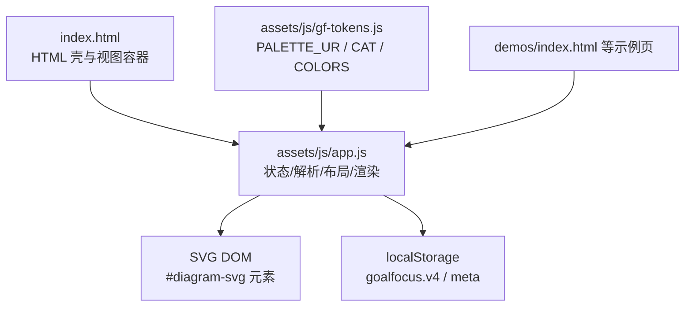
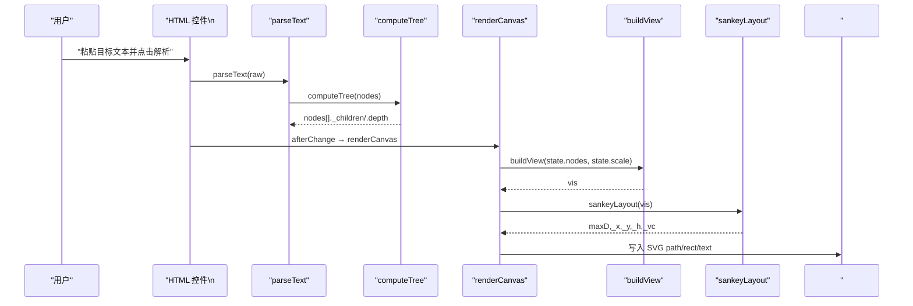
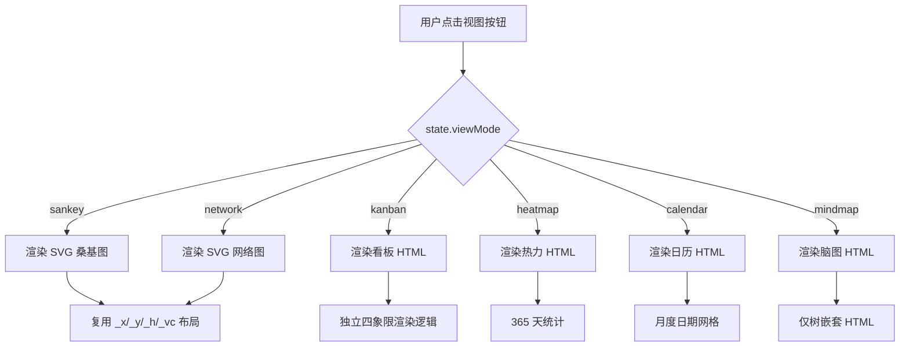
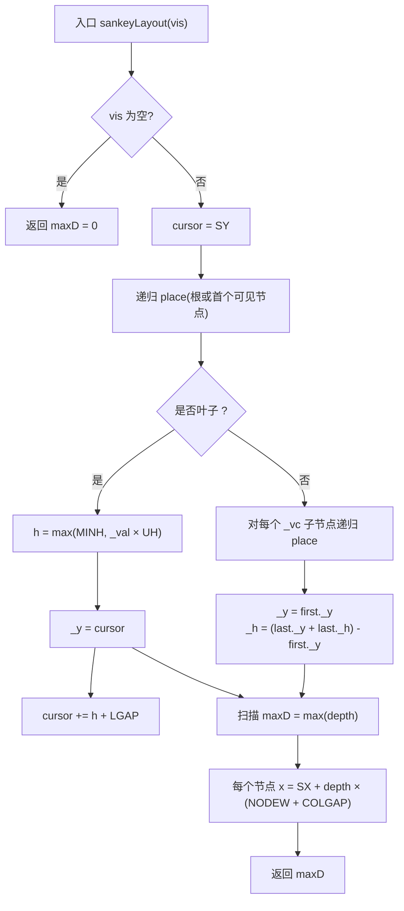
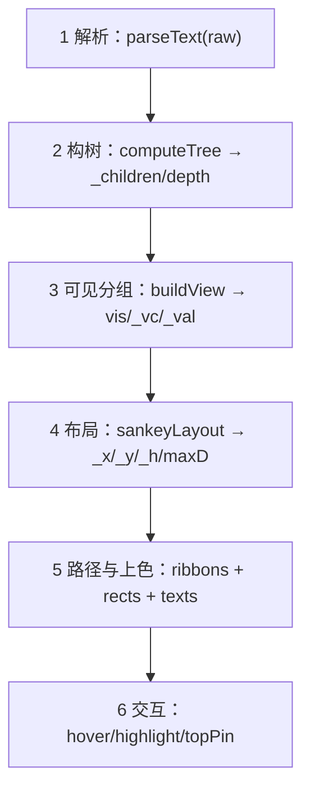
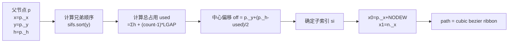
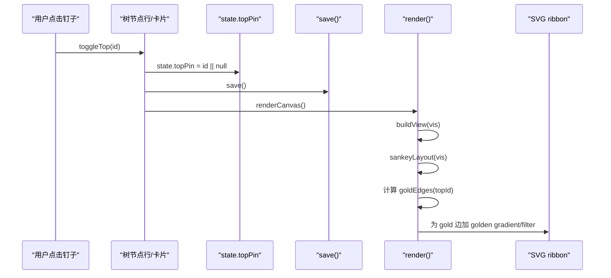
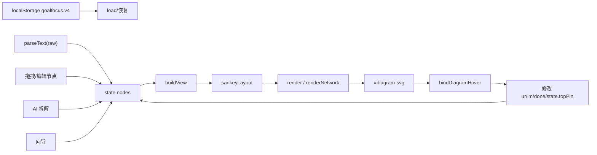

# Sankey 流图渲染器

<cite>
**本文引用的文件**   
- [assets/js/app.js](file://assets/js/app.js)
- [assets/js/gf-tokens.js](file://assets/js/gf-tokens.js)
- [index.html](file://index.html)
- [README.md](file://README.md)
</cite>

## 目录
1. [引言](#引言)
2. [项目结构与职责定位](#项目结构与职责定位)
3. [Sankey 数据模型](#sankey-数据模型)
4. [从自由文本到 SVG 边的最小链路](#从自由文本到-svg-边的最小链路)
5. [视图切换与 layout/视觉语义](#视图切换与-layout视觉语义)
6. [sankeyLayout 实现详解](#sankeylayout-实现详解)
7. [绘制步骤与流程图](#绘制步骤与流程图)
8. [依赖关系分析](#依赖关系分析)
9. [扩展维度：用横列表示 workflow / category / time / status](#扩展维度用横列表示-workflow--category--time--status)
10. [常见问题排查指南](#常见问题排查指南)
11. [性能与维护建议](#性能与维护建议)
12. [结论](#结论)

## 引言
Sankey 流图渲染器是 GoalFlow 的核心可视化组件，负责把“已解析的目标树”转成一张 SVG 桑基图。它不关心用户如何输入目标，也不直接保存 localStorage；它的核心职责只有三个：

1. 接收 state.nodes（以及其 parent→child 关系）和当前 scale、focus/noise 等可见性条件。
2. 通过 buildView 筛选出可见节点集合 vis，并通过 sankeyLayout 计算每个节点的深度 depth、横向坐标 _x、纵向起始 _y、高度 _h 及父级子集 _vc。
3. 将布局结果转换为 SVG 条带路径、矩形节点、标签和 Top1 金色高亮边，并在 renderNetwork、renderMindMap、四象限等其他视图中复用这些布局标注。

其中，宽度反映权重 _val（本质为重要度 im 的叶子聚合），颜色反映紧急度 ur，Top1 路径及其祖先链使用金色渐变和发光滤镜高亮，从而让“当下最重要的那条行动线”在整棵目标树上显出来。

**章节来源**
- [README.md:12-27](file://README.md#L12-L27)
- [index.html:24-69](file://index.html#L24-L69)

## 项目结构与职责定位
GoalFlow 采用“单文件 JS + HTML 模板 + CSS 主题令牌”架构：app.js 持有状态、解析器、布局器与渲染函数；gf-tokens.js 提供 PALETTE_UR、CAT、COLORS、STORAGE、BTN 等主题色板；index.html 提供页面骨架、左侧三视图导航、顶部工具栏以及 #diagram-svg 等挂载点。



**图表来源**
- [index.html:24-120](file://index.html#L24-L120)
- [assets/js/app.js:1205-1239](file://assets/js/app.js#L1205-L1239)
- [assets/js/gf-tokens.js:1-48](file://assets/js/gf-tokens.js#L1-L48)

**章节来源**
- [README.md:29-96](file://README.md#L29-L96)
- [index.html:24-120](file://index.html#L24-L120)

## Sankey 数据模型
Sankey 渲染器并不维护独立的“源节点表 + 边表”，而是把“边”视为父子关系的可视化投影。真正需要理解的数据结构可分为三类：**原始节点结构**、**布局注解**、**可见性子集**。

### 1）原始节点字段
app.js 中节点通过 newNode 创建，常见字段包括：id、text、parentId、im（重要度）、ur（紧急度）、scale、done、estimateMinutes、actualMinutes、deadline、slot、source、role、targetNum、timesPerWeek 等。对 Sankey 来说，最重要的是：

| 字段 | 类型 | 含义 | Sankey 用途 |
|---|---:|---|---|
| id | string | 全局唯一标识 | 构建 map、Gold Chain、交互定位 |
| text | string | 节点显示文本 | 标签、换行 wrapLabel |
| parentId | string \| null | 父节点 id | 推导 source/target、_children |
| im | number | 重要度 1–5 | 叶子 _val，聚合后决定 _h |
| ur | number | 紧急度 | urColor → 渐变起点/终点 |
| scale | string | day/week/month/year/all/long | buildView 过滤层级上下文 |
| done | boolean | 完成标记 | bar opacity、ribbon opacity |
| _children | Node[] | computeTree 计算的子树数组 | 分支节点 _vc |
| depth | number | 由根开始递归的深度 | _x = SX + depth × (NODEW + COLGAP) |

注意：SANKEY 本身并不要求节点有显式 `source`/`target` 边对象；边是在渲染过程中通过 `p._vc` 推导出每一个“父→子”连接。

### 2）布局注解
sankeyLayout 会为 visible 节点添加布局字段：

| 字段 | 类型 | 含义 |
|---|---:|---|
| _vc | Node[] | 父节点下按纵序排列的子节点列表 |
| _val | number | 节点“价值”：叶节点为 im；非叶子为其 _vc 子树的 im 之和 |
| _h | number | 节点条高度：Math.max(MINH, _val × UH) |
| _y | number | 在当前纵轴上的起始位置 |
| _x | number | 根据 depth 算出的横坐标 |

### 3）可见子集 vis
buildViewRaw 会把 state.nodes 压缩成 vis。它会：

- 清空/重建每个节点的 _vc。
- 根据 scale 筛选节点：all 视图可包含 noise，其他尺度会保留选中节点及其祖先链，以便显示话题上下文。
- 如果启用噪音过滤，被 category(n.im, n.ur).key === 'noise' 的节点会被标为 _hidden 并排除。
- 从可见视图中找到根（没有 parentId 的节点），然后以自底向上方式计算 _val。
- 最终返回 vis。

```mermaid
classDiagram
    class Node {
        +string id
        +string text
        +string parentId
        +number im
        +number ur
        +string scale
        +boolean done
        +Node[] _children
        +Node[] _vc
        +number depth
        +number _val
        +number _h
        +number _y
        +number _x
        +string deadline
        +boolean overdue
        +number daysLeft
        +string slot
        +string source
    }

    View {
        +Array<Node> nodes
        +Array<Node> vis
        +number maxD
        +map id->Node
    }

    View --> Node : "vis[i]"
    Node --> Node : "_vc 指向子节点"
    Node --> Node : "parentId 指向父节点"
```

**图表来源**
- [assets/js/app.js:492-558](file://assets/js/app.js#L492-L558)
- [assets/js/app.js:1160-1239](file://assets/js/app.js#L1160-L1239)
- [assets/js/app.js:2356-2563](file://assets/js/app.js#L2356-L2563)

**章节来源**
- [assets/js/app.js:492-558](file://assets/js/app.js#L492-L558)
- [assets/js/app.js:1160-1239](file://assets/js/app.js#L1160-L1239)

## 从自由文本到 SVG 边的最小链路
以下是一个完整的最小示例链路，展示一段“自由目标文本”如何变成最终生成 SVG 边的过程。

1. **用户粘贴文本**  
   用户在 plan 视图文本框中粘贴多行目标，例如：
   - 一行“年度目标”作为根。
   - 几行缩进文本作为子任务。
2. **点击“解析并生成”**  
   index.html 中 `#btnParse` 触发 doParse，最终调用 app.js 中的 parseText(raw)。
3. **parseText：构建 parentId**  
   parseText 每行计算缩进 indent，维护一个 stack，使后续行的 parentId 指向栈顶节点；根节点 nodeId=0 时 parentId=null。每个节点 source='parse'。
4. **computeTree：填充 _children 与 depth**  
   computeTree 先给所有节点重置 _children=[]，再根据 parentId 填入 byId[parent]._children，并从根递归标注 depth。它还调用 beginTick() 使 tick 级缓存失效。
5. **inferScale 二次推断**  
   parseText 对有子节点的节点再次推断 scale，避免父分支误判为某个太细粒度的时间单位。
6. **afterChange / afterSave / afterRender 调度**  
   通常解析后会进入 afterChange → afterSave → afterRender → renderCanvas。
7. **renderCanvas：选择渲染器**  
   renderCanvas 根据 state.viewMode 选择 sankey、network、kanban、heatmap、calendar、mindmap 等；sankey 走 render 函数，network 走 renderNetwork。
8. **render：buildView → sankeyLayout → SVG 构建**  
   render 内部执行 buildView(nodes, state.scale)，得到 vis；调用 sankeyLayout(vis) 得到 maxD；计算 SVG width/height；构造 defs、ribbons、nodesSvg；最后 svg.innerHTML = defs + ribbons + nodesSvg。
9. **每条边对应一个“父→子” ribbon**  
   渲染循环跳过 root，遍历 vis 中每个有 parentId 的节点，查 map[n.parentId] 作为 p，再用 p._vc 中排序结果算 off，最后写出一条三次贝塞尔曲线。



**图表来源**
- [index.html:128-163](file://index.html#L128-L163)
- [assets/js/app.js:492-558](file://assets/js/app.js#L492-L558)
- [assets/js/app.js:6580-6710](file://assets/js/app.js#L6580-L6710)
- [assets/js/app.js:2356-2563](file://assets/js/app.js#L2356-L2563)

**章节来源**
- [index.html:128-163](file://index.html#L128-L163)
- [assets/js/app.js:492-558](file://assets/js/app.js#L492-L558)
- [assets/js/app.js:6580-6710](file://assets/js/app.js#L6580-L6710)
- [assets/js/app.js:2356-2563](file://assets/js/app.js#L2356-L2563)

## 视图切换与 layout/视觉语义
state.viewMode 控制的是“哪个可视化表达这棵树”，而不是改变 tree 本身的 parent→child 语义。但不同视图对 layout 和视觉语义有不同影响：

| viewMode | 是否使用 sankeyLayout | 主要视觉语义 | 说明 |
|---|---:|---|---|
| sankey | 是 | 层=depth，宽度=_val×UH，颜色=ur，金色=Top1 | 默认主视图 |
| network | 是 | 层仍基于 depth，但绘制为圆点+连线 | 强调节点/边拓扑，半径≈importance |
| kanban | 否 | 四象限卡片网格 | drag/drop 调整 im/ur/完成态 |
| heatmap | 否 | 365 天热力图 | 按 day/week/month/year 缩放 |
| calendar | 否 | 日历月视图 | URL hash 支持 #calendar/#cal=YYYY-MM-DD |
| mindmap | 否 | 树形脑图 | 显示子树百分比进度 |

关键行为：

- renderCanvas 先判断 VIZ_HTML.has(viewMode)。kanban、heatmap、mindmap、calendar 等非 SVG 类视图会隐藏 #diagram-svg，并显示对应的 alt HTML 面板。
- 对于网络/桑基两类 SVG 视图，都会调用 buildView 和 sankeyLayout，因此 _x/_y/_h/_vc 可共用。
- viewMode 也影响侧边提示文字；viewbar 按钮或下拉菜单切换时更新 subs[state.viewMode] 文案。
- mobile 模式下 README 特别说明：“手机桑基图左右滑动查看”。实际代码中通过 SVG viewBox 动态设置 width/height，滚动条来自 main-scroll 或 body 布局，并非专门手写滑动逻辑。



**图表来源**
- [assets/js/app.js:1940-1966](file://assets/js/app.js#L1940-L1966)
- [assets/js/app.js:2356-2563](file://assets/js/app.js#L2356-L2563)
- [assets/js/app.js:6604-6686](file://assets/js/app.js#L6604-L6686)

**章节来源**
- [README.md:12-17](file://README.md#L12-L17)
- [assets/js/app.js:1160-1239](file://assets/js/app.js#L1160-L1239)
- [assets/js/app.js:1940-1966](file://assets/js/app.js#L1940-L1966)
- [assets/js/app.js:2356-2563](file://assets/js/app.js#L2356-L2563)
- [assets/js/app.js:6604-6686](file://assets/js/app.js#L6604-L6686)

## sankeyLayout 实现详解
sankeyLayout 是一个紧凑而关键的纯布局函数，接收 buildView 输出的 vis，不直接操作 DOM。

### 关键常量与设计依据

| 常量 | 值 | 设计依据与用法 |
|---|---:|---|
| NODEW | 15 | 节点竖条宽度，配合 LBL 给右侧标签留出空间 |
| COLGAP | 214 | 同一列相邻分支间的水平间隙；用于计算 _x = SX + depth × (NODEW + COLGAP) |
| UH | 12.5 | 重要性到高度的比例：leaf.h = Math.max(MINH, im × UH) |
| MINH | 22 | 最小条高，防止很小的重要度无法点击或阅读 |
| LGAP | 15 | 兄弟节点之间的纵向间距；影响第一个 child 到最后一个 child 的区间 |
| SX | 46 | 左侧留白，供节点条起始 x 使用 |
| SY | 58 | 顶部留白，cursor 初始 y 从 SY 开始 |
| LBL | 196 | 估算右侧标签区域宽度，用于计算 W = maxX + SX |
| MAXLABEL | 13 | wrapLabel 中每行最大字符数，限制双行标签溢出 |

### 第一步：深度计算
computeTree 已经通过 DFS 填充 n.depth。sankeyLayout 并不重复计算深度，但会用 depth 计算每层横坐标。

### 第二步：纵向布局
sankeyLayout 用一个 cursor 从 SY 向下放置节点：

- 对叶子节点：h = max(MINH, _val × UH)，然后设置 y = cursor，cursor 前进 h + LGAP。
- 对分支节点：先递归铺满所有子节点，然后取 first = _vc[0]、last = _vc[-1]，令 n._y = first._y，n._h = (last._y + last._h) - first._y。

这个算法保证“父节点垂直范围刚好包裹其所有子节点”，从而实现桑基图的分组包围效果。但副作用是，父节点的 _vc 中间如果有 LGAP，父自身的高度只从第一个子延伸到最后一个子，内部空洞不会填满父条——不过 SVG 绘制时父条本身不是必绘条（渲染中 skip root 且父条只在 node 图形中画；ribbon 总是从父右边缘连到子左边缘）。



**图表来源**
- [assets/js/app.js:1160-1239](file://assets/js/app.js#L1160-L1239)

### 第三步：每层横坐标与列数
layout 返回 maxD，虽然当前 main render 没有直接使用返回值做列对齐，但它确实能代表桑基图横向跨度：第 0 层在 SX，第 d 层在 SX + d × (NODEW + COLGAP)。这意味着：

- 每一层都是一列。
- 列内不是简单“所有同 depth 节点排成一列”，而是“父节点包一组子节点”后再统一偏移。
- 最深层数越多，宽度越宽；COLGAP 越大，列间距越大。

### 第四步：min height 和 pixel gap 的作用
MINH 解决的是小任务条“太薄不可选”的问题；LGAP 解决的是相邻兄弟条之间“视觉粘连”的问题。但在某些极端情况下，两个问题也会带来隐患：

- MINH 过大会让低价值节点条占据过多纵轴，导致上层折叠区变大。
- LGAP 会影响父条上下边界，若子项很多且 _h 较小，父条可能因 _vc 中间空隙而看起来不够连贯。

**章节来源**
- [assets/js/app.js:1160-1239](file://assets/js/app.js#L1160-L1239)

## 绘制步骤与流程图
完整的 Sankey 绘制链路可以划分为六步：解析、分组、布局、路径、上色、交互。



**图表来源**
- [assets/js/app.js:492-558](file://assets/js/app.js#L492-L558)
- [assets/js/app.js:1205-1239](file://assets/js/app.js#L1205-L1239)
- [assets/js/app.js:2356-2563](file://assets/js/app.js#L2356-L2563)

下面逐项说明渲染阶段的实现细节。

### 分组 buildView
- 清除旧 _vc。
- 根据 scale 计算 keep ids：若 scale !== 'all'，则对每个匹配的 leaf 回溯其 parent 链。
- 若未开启 showNoise，category(n.im, n.ur).key === 'noise' 的节点会被丢弃，并打上 _hidden。
- 从可见节点集中找出根，再递归计算 _val：叶子 = im，分支 = sum(_vc.c._val)。
- 存在 _viewSlot 缓存 key，避免同一次重绘中被重复计算。

这里需要特别注意：_val 是基于 im，而不是 estimateMinutes/actualMinutes。重量级时间估算并不会自动放大桑基图条宽度；紧急度和期限主要通过颜色和高亮传递信息。

### 布局 sankeyLayout
见上一节分析；返回 maxD。

### 路径 ribbons
对每个 non-root 节点 n，渲染器查找 p = map[n.parentId]。若 p 不存在，该边被忽略；否则：

- sibs = p._vc.slice().sort((a,b) => a._y - b._y)
- used = sum(siblings._h) + (siblings.length - 1) × LGAP
- off 从 p._y + (p._h - used) / 2 起始居中分配
- si 为 n 在 sibs 中的索引
- x0 = p._x + NODEW，x1 = n._x，cx = (x0 + x1)/2
- h = n._h
- oy0 = off，oy1 = n._y
- path d = M x0,oy0 C cx,oy0 cx,oy1 x1,oy1 L x1,oy1+h C cx,oy1+h cx,oy0+h x0,oy0+h Z

这条路径就是典型的 Sankey ribbon：两端矩形，中间三段三次贝塞尔曲线拼接。



**图表来源**
- [assets/js/app.js:2394-2418](file://assets/js/app.js#L2394-L2418)

### 上色逻辑
颜色由 urColor(n.ur) 提供，基础色板来自 GF.PALETTE_UR，默认由 gf-tokens.js 注入。渲染中涉及的颜色策略：

- 普通边渐变：起点 urColor(p.ur)，终点 urColor(n.ur)。
- 噪声边：isNoise=true 且不在 gold chain 上时，fill 直接设为 '#7c8295'，opacity=0.28。
- Gold chain：topId 的祖先路径形成 goldEdges，ribbon 填金色渐变并使用 glow filter，opacity=0.92。
- 已完成节点：bar opacity=0.35，ribbon opacity=0.12。
- 节点条 fill：非 root 时使用 urColor(n.ur)；inGold 链上用渐变 url(g_n.id)；noise 节点用 muted gray；root 用半透明白。
- stroke：topId 节点边框为 var(--gold)，inGold 链边框为 rgba(245,196,81,.7)。

**章节来源**
- [assets/js/app.js:1160-1161](file://assets/js/app.js#L1160-L1161)
- [assets/js/app.js:1205-1239](file://assets/js/app.js#L1205-L1239)
- [assets/js/app.js:2369-2563](file://assets/js/app.js#L2369-L2563)
- [assets/js/gf-tokens.js:1-48](file://assets/js/gf-tokens.js#L1-L48)

### 交互 topPin/Top1
钉选流程如下：

1. 用户点击某节点的 “📌 钉为 Top1” 按钮。
2. 如果点击的是已经钉着的 id，取消 state.topPin。
3. 否则读取 byId(id) 并把 state.topPin 设置为该 id。
4. save() 持久化到 localStorage，afterChange() 刷新派生缓存，renderCanvas() 重绘。
5. render 中通过 topId 计算 goldEdges：从 topId 一路向上找 parentId，把所有 childId + '>' + parent.id 加入 Set。
6. 所有 ribbon 与节点边框根据是否命中 goldEdges 进行金色高亮。

需要注意：当前代码里 TopPin 相关处理位于侧栏/树交互区域附近，但 Sankey SVG 条带的 data-p/data-c 绑定是由 bindDiagramHover 负责高亮匹配节点，而不一定直接触发 topPin 切换。二者应保持一致行为；否则可能出现“条带上看到金线但面板中没有 Top1 高亮”或反之。



**图表来源**
- [assets/js/app.js:2330-2353](file://assets/js/app.js#L2330-L2353)
- [assets/js/app.js:2385-2410](file://assets/js/app.js#L2385-L2410)

## 依赖关系分析
Sankey 渲染器的依赖关系呈单向管道：上游数据结构 → buildView/sankeyLayout → DOM → 用户交互。



**图表来源**
- [assets/js/app.js:492-558](file://assets/js/app.js#L492-L558)
- [assets/js/app.js:1205-1239](file://assets/js/app.js#L1205-L1239)
- [assets/js/app.js:2356-2563](file://assets/js/app.js#L2356-L2563)

**章节来源**
- [assets/js/app.js:492-558](file://assets/js/app.js#L492-L558)
- [assets/js/app.js:1205-1239](file://assets/js/app.js#L1205-L1239)
- [assets/js/app.js:2356-2563](file://assets/js/app.js#L2356-L2563)

## 扩展维度：用横列表示 workflow / category / time / status
当前 Sankey 图的“横列维度”固定等于节点在父链中的 depth。要把 workflow、category、time、status 等新维度映射为横列，需要在不破坏原有 Sankey 语义的前提下做一层抽象。

### 现有约束
1. computeTree 严格用 parentId 建森林；_children/depth 描述的是“树层次”，不是业务维度。
2. buildView 先按业务规则过滤 vis，再填充 _vc，并按 _vc 计算 _val。
3. sankeyLayout 把 depth 映射为 x：SX + depth × (NODEW + COLGAP)。
4. ribbon 仍按 p._vc 父子关系连接，而不是按新维度的“源组→目标组”建模。

### 推荐扩展方案
不要直接改 SankeyLayout，而是新增“多维布局层”。核心想法是：保留原 Sankey 树作为“语义源”，同时引入 group 字段表示当前维度，并重新定义 x。

可设计如下扩展字段：

| 字段 | 类型 | 含义 |
|---|---:|---|
| group | string | 当前横向分组：workflow/category/time/status |
| groupKey | string | 具体组值：如“销售”“市场”、“day”“week”、“core”“noise” |
| depthByGroup | number | 可选；用于在单个 group 内继续分层 |
| isGroupHeader | boolean | 分组头节点，width/h 表示 group 总量 |

#### workflow 维度
1. 把 workflow 作为 group：每个 workflow 是一列。
2. 把 workflow 根节点设为 groupHeader，_val 为所有子节点 im 的和。
3. 各目标树节点不再按真实 tree depth 映射 x，而是按 groupKey 的次序映射 x。
4. 边改为 workflowRoot → targetNode 或 workflowRoot → subTopic，再由 subTopic → task。

#### category 维度
Category 已在 CAT 中存在 now/core/distract/noise。可直接把 category.key 作为 group，category.color 作为列色，并保持 urColor 作为节点条渐变。

#### time 维度
scale/day/week/month/year 适合“列=时间单位”，节点宽度代表该时间单元内的重要任务值。这样能把年度/季度/周/日的精力流向并列对比。

#### status 维度
可用 toDo/doing/done/parked 等作为列，帮助看完成流转。done 可像现有 noise/quiet 策略一样降低 opacity。

### 增量重建机制
当 nodesToIndentedText、parseText、computeTree 改变节点结构时，应同时重建 group 相关的辅助结构，例如：

- parseText 后若检测到 workflow 标签，设置每个节点的 group 和 groupKey。
- computeTree 之外增加 recomputeGroups(workflows/nodes) 来更新 group 维度。
- buildView/groupedLayout 替代单纯 sankeyLayout，负责把 groupKey 转为 x 列。
- 渲染 ribbon 时仍优先基于 parentId，但也允许“跨 group 边”，例如 workflowRoot → task。

为避免每次改动都全量重建，可以利用现有 _tickN 机制：

1. 任何影响 group 结构的变更调用 invalidateTreeCache()/beginTick()。
2. groupedLayout 基于 nodes.length + _tickN 参与 key 缓存。
3. 新增 groupNodes[] 数组保存稳定排序后的 group 名，避免多次排序抖动。

注意：由于 Sankey ribbon 算法依赖父子 _vc 和纵轴顺序，一旦改成“group 列”模型，原来的 Sankey 几何假设（x 随 depth 单调增长）就改变了。此时更安全的做法是新建 drawGroupedSankey，而不是完全覆盖现有 sankeyLayout。

**章节来源**
- [assets/js/app.js:492-558](file://assets/js/app.js#L492-L558)
- [assets/js/app.js:1160-1239](file://assets/js/app.js#L1160-L1239)
- [assets/js/app.js:2356-2563](file://assets/js/app.js#L2356-L2563)
- [assets/js/gf-tokens.js:115-177](file://assets/js/gf-tokens.js#L115-L177)

## 常见问题排查指南

### 1. SVG path 重叠或 ribbon 交叉
**现象**：同一个父节点的两个子 ribbon 相交，或同一列多个节点重叠。

**原因**：
- sibs 排序不稳定：如果 _y 相同，sort(a,b)=>a._y-b._y 不能保证稳定。
- p._vc 顺序与渲染顺序不一致。
- 父条 _h 只覆盖 first._y 到 last._y+_h，中间 LGAP 处没有填充，造成视觉断档。
- 同一列标签太多，collide 检测只阻止了上方放置，右侧 fallback 也可能拥挤。

**排查步骤**：
1. 打断点在 render 的 sibling loop，打印 sibs 的 _vc 索引、_y、_h。
2. 检查 p._vc 是否被 buildViewRaw 插入顺序影响。
3. 检查 LGAP 是否过小导致兄弟条挤压。
4. 检查 LBL、NODEW、COLGAP、SX 是否不足导致 SVG viewBox 内裁剪。

**修复方向**：
- 改进 sort：`(a,b) => a._y - b._y || a.id.localeCompare(b.id)`。
- 明确渲染阶段按 _vc 顺序遍历而非 vis 顺序。
- 增大 LGAP/MINH，或减小 UH。
- 对分支节点使用分段 ribbon，避免长跨度曲线。

**章节来源**
- [assets/js/app.js:2394-2418](file://assets/js/app.js#L2394-L2418)

### 2. 节点间距过小导致子项被裁切
**现象**：纵向子任务过多，底部条被 SVG 边界截断；或横向标签贴到右边看不全。

**原因**：
- viewBox 的 H/W 取决于 vis 中最大 _x + LBL、_y + _h。
- 大量叶子或很长文本会扩大 maxX/maxY，但若外层容器 width/height 固定，浏览器可能做额外缩放。
- LBL=196 可能不够容纳两行长标签。

**排查步骤**：
1. 控制台输出 `svg.getAttribute('viewBox')` 与 `svg.clientWidth`/`clientHeight`。
2. 确认 SVG 没有被父容器强制缩小且不设 `overflow-visible`。
3. 打印最大 depth、_val 和 _h，判断是横向还是纵向溢出。

**修复方向**：
- 在 render 开头追加安全 padding：maxX += 20，maxY += 20。
- 对 wrapLabel 的最大字符数 MAXLABEL 加配置项。
- 移动端考虑让 #diagram-svg 所在容器允许横向滚动。

**章节来源**
- [assets/js/app.js:1160-1161](file://assets/js/app.js#L1160-L1161)
- [assets/js/app.js:2370-2393](file://assets/js/app.js#L2370-L2393)
- [README.md:14-16](file://README.md#L14-L16)

### 3. 移动端横向滚动异常
**现象**：在手机端打开桑基图后内容被切掉，无法左右滑动。

**原因**：
- SVG viewBox 可能很宽，但外层 main-scroll 样式未正确应用。
- CSS 中 SVG 设置了固定 width/height，但父容器不允许 overflow-x。
- 移动设备浏览器 viewport-fit 和缩放可能改变可滚动区域。

**排查步骤**：
1. 查看 main-scroll 容器是否有 overflow-x:auto 或 auto-scroll behavior。
2. 在移动端 DevTools 中检查 #diagram-svg 的真实像素宽度和父容器宽度。
3. 检查 index.html 中 viewport meta。

**修复方向**：
- 给 #diagram-svg 或 .main-scroll 增加 `overflow-x: auto; -webkit-overflow-scrolling: touch;`。
- 避免父级 `width: 100%` 强行截断超宽 SVG。
- 移动端可考虑减少 COLGAP/NODEW/LBL，或提供“简化桑基模式”：只显示 Top1 链和少量关键分支。

**章节来源**
- [README.md:14-17](file://README.md#L14-L17)
- [index.html:1-21](file://index.html#L1-L21)

### 4. 颜色对比不足
**现象**：深暗模式下 UR 色与背景对比弱，或浅色模式下暖色系发灰。

**原因**：
- 不同主题的 PALETTE_UR 不同，浅/深 mode 分别定义。
- noise 和 done 会降低 opacity。
- 某些主题把 noise 色设得很靠近背景。

**排查步骤**：
1. 在 console 输出 PALETTE_UR 和当前 Colors.svgGlow。
2. 对比 light/dark 模式下的 PALETTE_UR。
3. 对特定 ribbon 临时关闭 opacity，验证是否是底色问题。

**修复方向**：
- 在新主题中确保 PALETTE_UR[4]（最暖）在 light/dark 下都与背景有足够的明度差。
- 为 Top1 金链使用恒定明亮金色，不受主题色板波动影响。
- 对噪声分支增加描边或加深灰色，而不是仅靠透明度。

**章节来源**
- [assets/js/gf-tokens.js:10-115](file://assets/js/gf-tokens.js#L10-L115)
- [assets/js/app.js:1-25](file://assets/js/app.js#L1-L25)

### 5. TopPin 钉选状态不刷新
**现象**：点击钉子后 SVG 没有高亮，或刷新后状态丢失。

**可能原因**：
- state.topPin 被正确赋值但没有触发 save() 或 renderCanvas()。
- 事件委托绑定的钉子元素没有 data-top 属性。
- 删除节点后 byId(id) 失败，导致 topPin 引用悬空。
- 视图切换 sankey↔network ↔ HTML 视图中，部分面板更新但没有同步 #viewbar button.on 状态。

**排查步骤**：
1. 在切换 topPin 处打日志，确认 state.topPin。
2. 确认 save/load 序列中包含 viewMode/topPin。
3. 检查加载后 syncViewbar 是否正确。
4. 确认 afterChange 触发 afterRender。

**章节来源**
- [assets/js/app.js:2330-2353](file://assets/js/app.js#L2330-L2353)
- [assets/js/app.js:6659-6686](file://assets/js/app.js#L6659-L6686)

### 6. 边集没有增量重建
Sankey 不维护显式 edge 数组，所以“边集重建”实际上是“父子 _vc 重建 + 渲染循环重建 ribbon”。需要关注的上游模块是：

- nodesToIndentedText：导出当前树。
- parseText：把自由文本重新构造 parentId。
- computeTree：重建 _children/depth。
- any edit/delete/move/drag-drop 逻辑，它们修改 parentId 或 done 后应调用 invalidateTreeCache() 或 computeTree()。

若某个上游只改了 state.nodes 却没有重算 _children/depth，就会出现“树看起来变了但 ribbon 指向旧父”的问题。

**修复原则**：
- 每次修改 nodes[].parentId 后调用 computeTree。
- 结构变化调用 invalidateTreeCache()。
- 只做 val/score/schedule 的派生计算可复用 tick 缓存；不要复用旧的 vis 和 _vc。

**章节来源**
- [assets/js/app.js:513-558](file://assets/js/app.js#L513-L558)
- [assets/js/app.js:2394-2418](file://assets/js/app.js#L2394-L2418)

## 性能与维护建议
- **keep vis 小**：Sankey 的 ribbon 数量约等于 edges，即非根节点数。几百个叶子仍可接受，但上千节点会产生大量 SVG path。
- **复用 _vc 和 tick 缓存**：已有 _viewSlot 和 _tickN 机制，应避免在重绘内反复构造新的 children 结构。
- **避免频繁 save/render**：解析、AI 拆解、批量导入后尽量合并 afterChange。
- **label 渲染成本**：wrapLabel 和 tspan 较多，大树上可考虑只对 visible/交互节点渲染 label。
- **SVG filter 开销**：glow 滤镜会影响性能，建议仅对 isGold/isTop 节点使用，或仅在 hover 时临时添加。
- **扩展新维度时保持单一职责**：不要把 workflow/category/time/status 混入 computeTree 的 depth 定义，应通过新的 groupedLayout 适配层实现。

**章节来源**
- [assets/js/app.js:552-562](file://assets/js/app.js#L552-L562)
- [assets/js/app.js:2356-2563](file://assets/js/app.js#L2356-L2563)

## 结论
Sankey 流图渲染器是 GoalFlow 中最接近“数据到视觉”的转换层。它的输入不是自由文本，而是已经被 parseText 和 computeTree 处理过的 state.nodes 与 _children 关系；它的输出不是 JSON，而是可直接在浏览器中渲染和交互的 SVG。

对于开发者来说，最关键的理解有三点：

1. **边的来源是 parent→child**，而不是独立 edge 表。渲染循环对每个非根节点构造一条 ribbon，source=p，target=n。
2. **布局分两步**：先纵向按 _vc 分组确定 _y/_h，再横向按 depth 乘以 (NODEW+COLGAP) 确定 _x。
3. **语义分层清晰**：value 来自 _val（im 聚合），颜色来自 ur，Top1 来自 goldChain，visibility 来自 scale/noise/category，新维度如 workflow/category/time/status 应该用扩展分组层映射到列，而不替换树结构。

只要保持这一分层，就可以在不破坏现有 Sankey 的前提下，逐步扩展 GoalFlow 的观察维度。