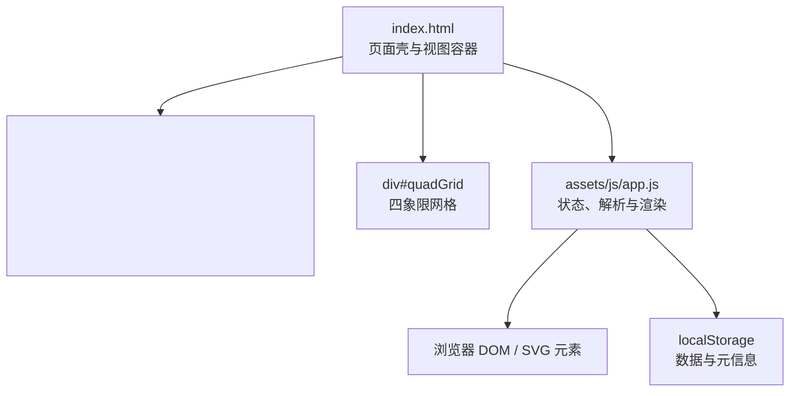
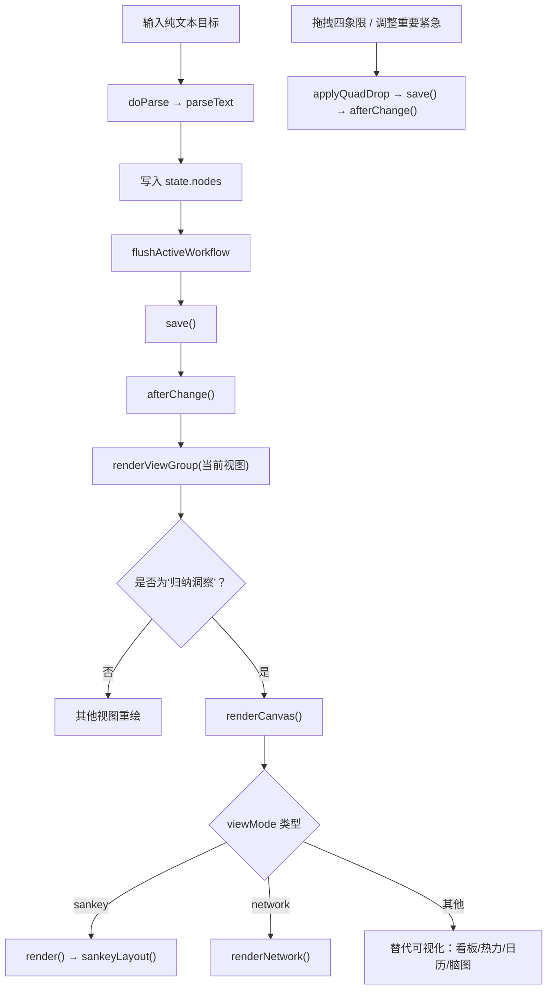
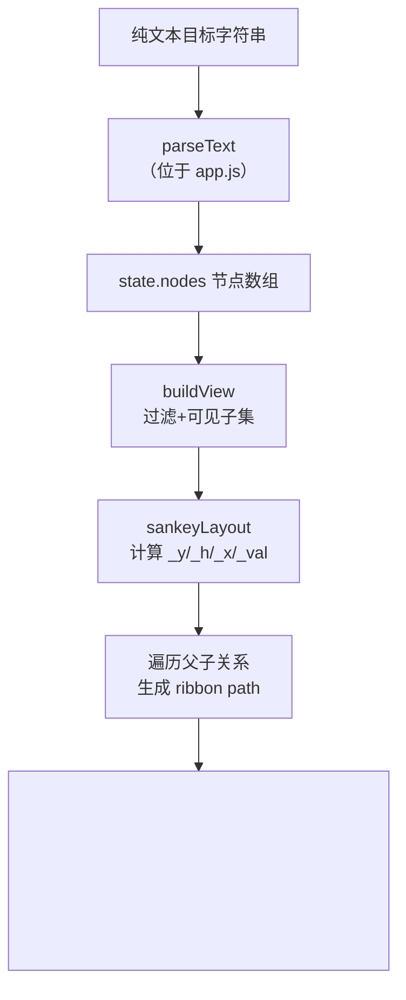
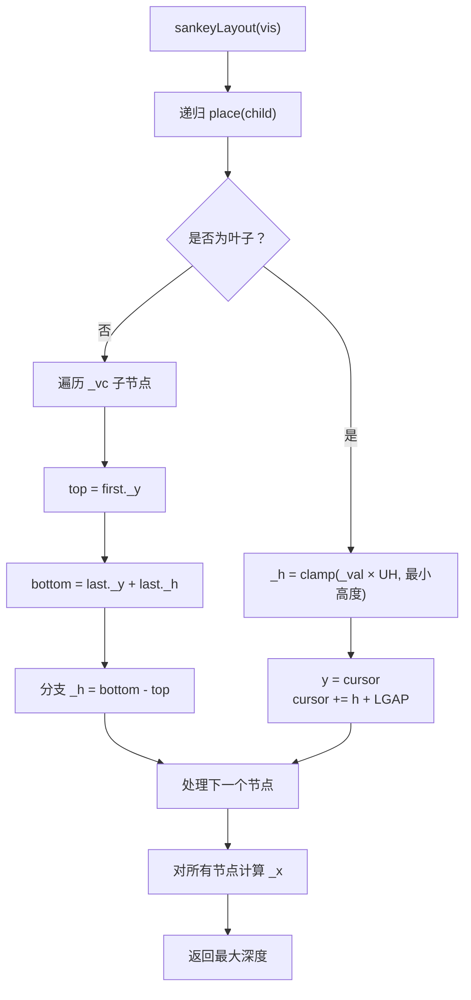
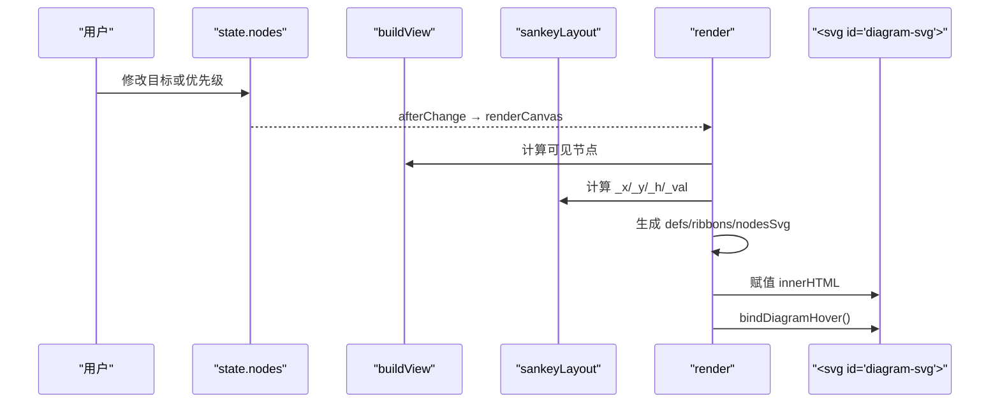
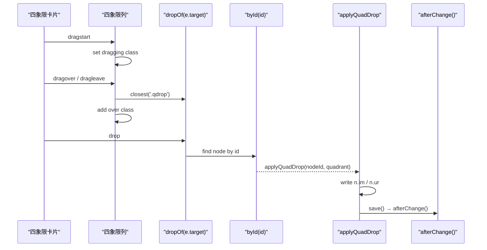
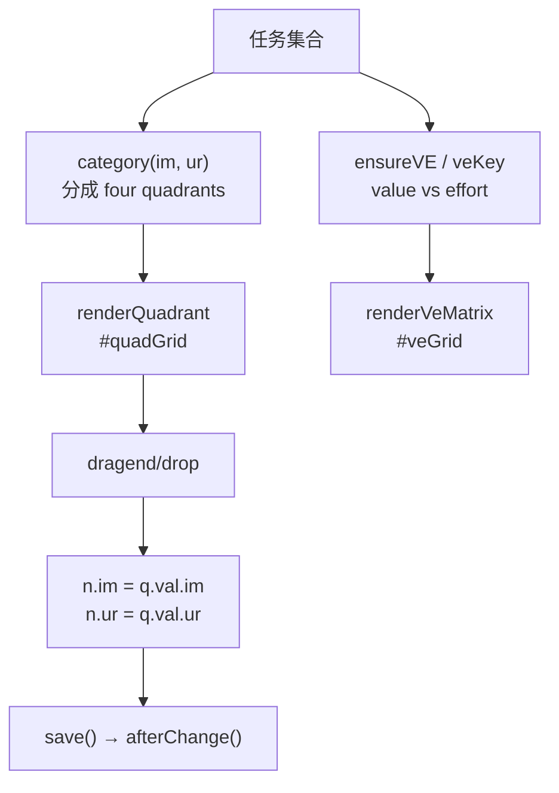
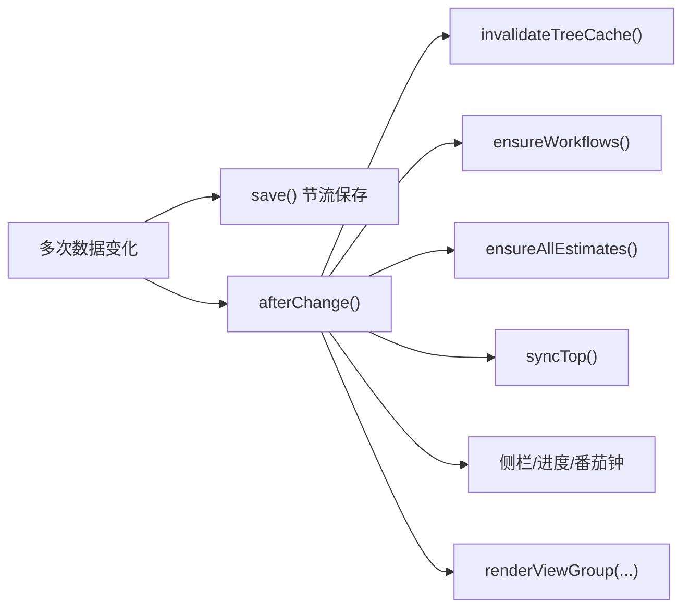
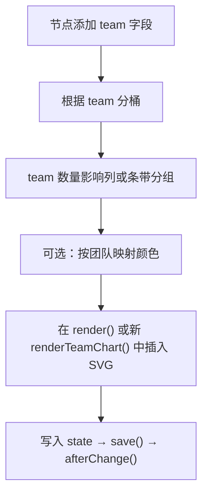
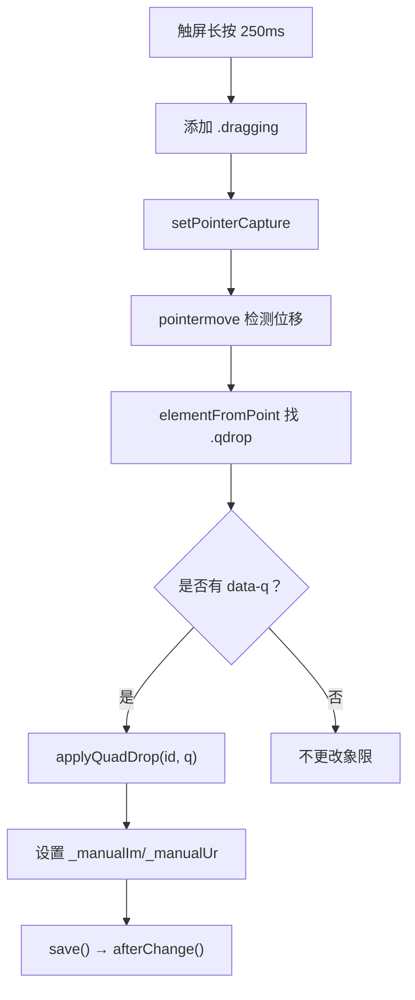

# 可视化与渲染引擎

<cite>
**本文引用的文件**  
- [index.html](file://index.html)
- [app.js](file://assets/js/app.js)
- [README.md](file://README.md)
</cite>

## 目录

1. [引言](#引言)
2. [项目结构与入口](#项目结构与入口)
3. [渲染流水线总览](#渲染流水线总览)
4. [桑基图数据模型](#桑基图数据模型)
5. [从文本到桑基边的最小流程](#从文本到桑基边的最小流程)
6. [桑基布局算法](#桑基布局算法)
7. [SVG 节点、边带与 DOM 更新](#svg-节点边带与-dom-更新)
8. [四象限 V×E 矩阵渲染与交互](#四象限-v×e-矩阵渲染与交互)
9. [批量更新与缓存机制](#批量更新与缓存机制)
10. [维度扩展指南](#维度扩展指南)
11. [常见问题排查](#常见问题排查)
12. [结论](#结论)

## 引言

目标流 GoalFlow 是一个纯本地可视化的时间管理与目标管理工具：用户粘贴一段纯文本目标，系统自动解析成树形任务结构，再通过多种可视化呈现出来。其中最重要的两条视觉主线是：

- **桑基流图**：把目标树按层级画成从左到右的流动，条带宽度映射子树重要性，颜色映射紧急度，金色高亮“当下最重要”的关键链。
- **四象限校准器**：用重要/紧急二维把任务划分到立即做、核心投入、干扰、噪音四个区域，并通过拖拽或调整控件改变任务分类。

文档面向希望理解“如何从数据生成桑基图和四象限”“DOM 增量更新在哪里发生”“如何新增可视化维度”的读者。为保证可追溯性，所有技术细节都基于当前仓库中的 `index.html` 与 `assets/js/app.js`。

**节内来源**  
- [README.md:1-30](file://README.md#L1-L30)
- [README.md:56-103](file://README.md#L56-L103)

## 项目结构与入口

整个应用的核心入口是页面壳文件 `index.html`，它负责：

- 三视图导航栏（今日行动、目标规划、归纳洞察、AI 分析）。
- “归纳洞察”页中的可视化容器 `<svg id="diagram-svg">` 和四象限容器 `#quadGrid`。
- 视图模式下拉框（桑基、关系、看板、脑图、热力、日历）和时间缩放按钮（年度、月度、周度、日度）。
- 移动端专用的底部导航、视图选择器和缩放选择器。
- 依次加载主题令牌、示例数据和主逻辑脚本。

真正的业务逻辑、数据模型、解析函数和渲染函数集中在 `assets/js/app.js`。样式、设计令牌和示例数据则放在 `assets/css` 与 `assets/js/gf-tokens.js`、`gf-demos.js` 中。



**图表来源**  
- [index.html:245-340](file://index.html#L245-L340)
- [app.js:6309-6323](file://assets/js/app.js#L6309-L6323)

**节内来源**  
- [index.html:1-120](file://index.html#L1-L120)
- [index.html:240-380](file://index.html#L240-L380)
- [README.md:85-103](file://README.md#L85-L103)

## 渲染流水线总览

GoalFlow 不是“每次修改都重建整页”，而是采用“状态变更 + 按需局部重绘”的模式。主要步骤如下：

1. 用户输入文本并点击“解析并生成”。
2. `doParse` 调用 `parseText`，得到 `state.nodes`。
3. 将当前工作流的节点同步到 `state.workflows` 对应项。
4. 调用 `save()` 持久化，再调用 `afterChange()`。
5. `afterChange` 统一触发树缓存失效、估算补全、侧栏和进度组件刷新。
6. 最终调用 `renderViewGroup(currentView())`，在“归纳洞察”视图中渲染画布、四象限等。

需要注意：**当前代码并没有一个名为 `setState` 的单一封装函数**。多数数据改动是直接操作 `state.nodes`、`node.im`、`node.ur` 等属性，然后调 `save()` 和 `afterChange()`；少数情况下再调用 `renderCanvas()` 提前重绘特定视图。因此，“数据变更触发 setState → renderSankey”应更精确地理解为：

- 数据变更直接写 `state`。
- 常规路径由 `afterChange` 统一调度视图重绘。
- 渲染路径通常是 `renderCanvas → renderNetwork | render`，而 Sankey 绘制主体就是裸函数 `render`。



**图表来源**  
- [app.js:6309-6323](file://assets/js/app.js#L6309-L6323)
- [app.js:6324-6343](file://assets/js/app.js#L6324-L6343)
- [app.js:2340-2525](file://assets/js/app.js#L2340-L2525)
- [app.js:2726-2732](file://assets/js/app.js#L2726-L2732)

**节内来源**  
- [app.js:520-730](file://assets/js/app.js#L520-L730)
- [app.js:6309-6343](file://assets/js/app.js#L6309-L6343)

## 桑基图数据模型

桑基图不是从零构建一套外部库的数据结构，而是复用 Node 树模型，并在可见视图对象上附加渲染用的字段。核心字段包括：

| 字段 | 含义 | 复杂度影响 |
|---|---|---|
| `id` | 节点唯一标识 | 用于查找父节点、Top 链条、边关联 |
| `text` | 任务标题 | 决定标签是否换行 |
| `parentId` | 父节点 ID | 决定流向和列深度 |
| `im` | 重要度，范围 1~5 | 影响 `_val` 累计和类别 |
| `ur` | 紧急度，范围 1~5 | 影响颜色和紧急度配色 |
| `done` | 是否完成 | 影响透明度、高亮和筛选 |
| `scale` | 时间尺度：day / week / month / year / long | 决定哪些节点进入“缩放视图” |
| `_children` | 子节点数组 | 由 `computeTree` 计算 |
| `_vc` | 当前 visible view 下的子集 | 由 `buildViewRaw` 填充 |
| `_hidden` | 是否在聚焦模式下被隐藏 | 用于 noise 过滤 |
| `_val` | 子树重要性总和 | 叶子为 `im`，分支为子节点 `_val` 之和 |
| `_y` | 垂直起始位置 | 由 `sankeyLayout` 计算 |
| `_h` | 节点高度 | 由 `sankeyLayout` 根据 `_val` 计算 |
| `_x` | 水平位置 | 由 `sankeyLayout` 按深度计算 |
| `depth` | 树深度 | 用于横向列距 |

其中 `_val` 的计算方式是后序遍历：若没有可见子节点，则 `_val = im`；否则 `_val = 子节点 _val 之和`。这是桑基图“越重要的目标带越宽”的直接数据来源。

**节内来源**  
- [app.js:1166-1235](file://assets/js/app.js#L1166-L1235)

### 重要性与价值

一个重要区分是：

- `im`：单个节点的显式重要度。
- `_val`：该节点在其可见上下文中的重要性权重。
- 叶子节点通常以自身 `im` 作为权重基础。
- 分支节点承载其子树的总体重要性。

因此，如果一条 Sankey 边看起来较窄，可能是因为叶子节点本身 `im` 较低，也可能因为该叶子在所选 `scale` 下不属于可见视图。

### 紧急度与类别

紧急度 `ur` 通过 `PALETTE_UR` 调色板映射为颜色。同时，`(im, ur)` 组合会被归类到四类之一：

| 分类键 | 标签 | 行为 |
|---|---|---|
| `now` | 立即做·重要且紧急 | 火急类任务 |
| `core` | 核心投入·重要不紧急 | 长期主线 |
| `distract` | 干扰枝干·紧急不重要 | 短平快打扰 |
| `noise` | 噪音·不重要不紧急 | 默认隐藏，除非勾选“显示噪音” |

这个分类既用于 Sankey 的颜色和透明度，也用于四象限分组。

**节内来源**  
- [app.js:1-60](file://assets/js/app.js#L1-L60)
- [app.js:1166-1212](file://assets/js/app.js#L1166-L1212)

## 从文本到桑基边的最小流程

虽然完整解析逻辑可能包含日期、周期、指标、期限等处理，但就 Sankey 渲染而言，最小需要的数据是：一组节点，其中每个叶子都有非零的重要度，并能组成一棵根在第一个节点的树。

### 输入假设

一个最小可行的目标字符串可以是：

```text
目标：学习编程
1. 入门语法
   - 每天练习 30 分钟
2. 项目实践
   - 搭建个人网站
   - 写博客文章
```

系统会将其解析为节点数组，并为叶子节点设置初始估时、日期信息和 `_children`。随后，`render()` 只关心的是：

1. `state.nodes` 不为空。
2. 每个节点能通过 `byId` 找到。
3. 父子关系能形成连通树。
4. 每个叶子节点有 `im` 值。

### 生成 Sankey 边的过程

Sankey 边并不是预先存储在一个独立数组里，而是由以下计算动态生成：

1. 通过 `buildView(nodes, state.scale)` 得到可见节点集合。
2. 对可见节点补全 `_children`、`_vc`、`_val`、`_y`、`_h`、`_x`。
3. 遍历每个有父节点的可见节点，从其父节点 `_vc` 的有序排列中计算偏移。
4. 用起点 `(父.x+宽，父.y+offset)` 和终点 `(子.x，子.y)` 构造贝塞尔曲线 `M ... C L L C Z`。
5. 把这段 path 字符串赋给 `<path class="ribbon" d="...">`。

因此，从数据结构角度看，“源”是父子父节点对，“目标”是该父子对在视觉布局后的几何坐标。



**图表来源**  
- [app.js:6324-6343](file://assets/js/app.js#L6324-L6343)
- [app.js:1171-1235](file://assets/js/app.js#L1171-L1235)
- [app.js:2384-2415](file://assets/js/app.js#L2384-L2415)

**节内来源**  
- [app.js:6324-6343](file://assets/js/app.js#L6324-L6343)
- [app.js:1171-1235](file://assets/js/app.js#L1171-L1235)

## 桑基布局算法

`sankeyLayout(vis)` 实现了一个自上而下、自顶向下的两阶段布局：

### 第一阶段：纵向堆叠

从可见视图的根节点开始递归放置子节点：

- 如果是叶子：使用公式 `Math.max(MINH, _val * UH)` 计算高度，然后放入垂直光标，光标每次推进 `高度 + LGAP`。
- 如果是分支：先递归放置全部 `_vc` 子节点，再把分支矩形对齐到第一个子节点的顶部，并把高度扩展到最后一个子节点底部加间距。

常量定义表明：

- 节点宽度固定为 15。
- 列间距为 214。
- 单位高度因子为 12.5。
- 节点最小高度为 22。
- 兄弟间距为 15。
- 左侧留白 `SX=46`，顶部留白 `SY=58`。
- 标签预留宽度为 196，最大标签字符数为 13。

这些常数是解决“节点间距过小”“桑基边重叠”“标签碰撞”的重要参数。

### 第二阶段：横向定位

遍历可见节点，令 `n._x = SX + n.depth * (NODEW + COLGAP)`。这样每条父→子边横向上跨越一列。



**图表来源**  
- [app.js:1205-1235](file://assets/js/app.js#L1205-L1235)

**节内来源**  
- [app.js:1166-1235](file://assets/js/app.js#L1166-L1235)

## SVG 节点、边带与 DOM 更新

### Sankey 渲染函数

Sankey 的主渲染函数命名为 `render`，不是 `renderSankey`。它在节点为空时会清空 SVG 并设置极小的 viewBox；如果有节点，则：

1. 调用 `buildView` 获取可见节点。
2. 调用 `sankeyLayout` 进行布局。
3. 计算 Top 节点祖先链并标记金色边。
4. 计算整个 SVG 的宽高和 viewBox。
5. 生成 `defs`，包括金色发光滤镜和平滑渐变。
6. 生成 `ribbons` 边带字符串。
7. 生成 `nodesSvg` 节点与标签字符串。
8. 最后把三部分拼接到 `svg.innerHTML`，再绑定悬停交互。



**图表来源**  
- [app.js:6309-6343](file://assets/js/app.js#L6309-L6343)
- [app.js:2340-2525](file://assets/js/app.js#L2340-L2525)

### 为什么不是整页重建

`render()` 确实对 `<svg>` 做了整段 innerHTML 替换，但它只作用于单个 SVG 容器。同一次 re-render 内，昂贵的计算部分已经被缓存：

- 树结构由 `getCachedTree` 复用。
- 可见视图由 `buildView` 的 `_viewSlot` 复用。
- Top3/Backlog 排序由 `pickRanked` 的 `_rankSlot` 复用。
- 估算补全由 `_estTick` 控制。
- 日期 key 由 `_dkCache` 控制。

因此，渲染层避免重复扫描树和重新排序，真正“重建”的是当前视图对应的 DOM 片段，而不是整个页面。

### SVG 元素创建策略

桑基图的 SVG 主要由三个部分组成：

| 部分 | 说明 |
|---|---|
| `defs` | 全局渐变和滤镜，按父子边 ID 注册渐变 |
| `ribbons` | 子边的曲线 `<path class="ribbon">` |
| `nodesSvg` | 节点的 `<g class="node">`，包含矩形条和文本 |

边带路径使用三次贝塞尔曲线。关键点：

- 起点 x：父节点右边缘。
- 终点 x：子节点左边缘。
- 中间控制点 x：两列中点。
- 起点 y：父节点内部按兄弟顺序分配的起始偏移。
- 终点 y：子节点起始 y。
- 路径形状：`M → C → L → C → Z`。

颜色规则：

- 非噪音节点：按 `ur` 取值从调色板映射。
- Top 关键链：使用金色渐变和发光滤镜。
- 噪音边：低不透明度灰色。
- 已完成节点：降低不透明度和边框透明度。

**节内来源**  
- [app.js:2340-2525](file://assets/js/app.js#L2340-L2525)
- [index.html:300-370](file://index.html#L300-L370)

## 四象限 V×E 矩阵渲染与交互

### 四象限维度

四象限使用的是“重要度 × 紧急度”，对应两个数字轴：

- **纵轴（隐含）**：重要程度，从小到大为噪音 → 干扰 → 核心投入 → 立即做。
- **横轴（隐含）**：紧急程度，从小到大为噪音 → 核心投入 → 立即做 → 干扰。

注意：这里的“横轴”不是传统笛卡尔坐标系；实际 DOM 是一个固定顺序的四列容器，顺序由 `QUAD_ORDER` 决定。

| 象限 | 重要 | 紧急 | 典型意义 |
|---|---:|---:|---|
| now | 高 | 高 | MIT、即将逾期任务 |
| core | 高 | 低 | 战略主线、习惯、KR |
| distract | 低 | 高 | 打扰、回复、会议等应急事务 |
| noise | 低 | 低 | 可选、可丢弃的目标 |

### 四象限渲染

`renderQuadrant()` 的工作流程：

1. 获取容器 `#quadGrid`。
2. 调用 `quadNodes()` 得到参与四象限的任务集合。
3. 按 `category(n.im, n.ur).key` 分桶。
4. 清空容器后重建四个单元格。
5. 对空列渲染占位文案：“拖任务卡到……”。
6. 保留每列滚动位置。
7. 最后调用 `renderVeMatrix()` 渲染价值×费力矩阵。

四象限卡片由 `makeQuadCard` 创建（具体实现未在此范围），并支持：

- 点击展开/收起详细字段。
- 编辑完成状态。
- 选择时间尺度。
- 分配时段槽。
- 调整重要度或紧急度滑块。

这些交互最终都会调用 `save()` 与 `afterChange()`，从而联动 Sankey、英雄卡、焦点任务和 Backlog。

### 四象限拖拽流程

桌面端依赖原生 drag-and-drop：



**图表来源**  
- [app.js:2558-2615](file://assets/js/app.js#L2558-L2615)
- [app.js:2650-2680](file://assets/js/app.js#L2650-L2680)
- [app.js:2726-2732](file://assets/js/app.js#L2726-L2732)

### Top3、Backlog 与 Quick Win

#### Top3

Top3 来自当前可见视图中的 `pickRanked(vis, 3)`，它会优先选叶子未完成任务；如果没有，则回退到非叶子候选。Backlog 由 `backlogLanes()` 计算，分为：

- “上周未完成”：过去一周截止或已过期且无 Top3 标签的任务。
- “下月预告”：未来一个月截止或标记为月度尺度的任务。

Top3 任务不会混入这两类 Backlog 列表，防止占用次要视野。

#### V×E 快速赢

价值×费力矩阵由 `ensureVE`、`veKey`、`isQuickWin` 等辅助函数驱动：

| VE 类型 | 条件 | 含义 |
|---|---|---|
| quick | `val ≥ 4 且 eff ≤ 2` | 高价值低费力，称为“快速赢” |
| major | `val ≥ 4 且 eff ≥ 3` | 高价值高费力的主战役 |
| easy | `val < 4 且 eff < 3` | 低成本小活 |
| trap | `val < 4 且 eff ≥ 3` | 低价值高费力的陷阱 |

“仅快速赢”按钮切换 `state.quadQuickWin`，用于把注意力暂时集中到高回报低成本任务上。



**图表来源**  
- [app.js:2650-2732](file://assets/js/app.js#L2650-L2732)

**节内来源**  
- [app.js:1195-1204](file://assets/js/app.js#L1195-L1204)
- [app.js:2558-2732](file://assets/js/app.js#L2558-L2732)
- [app.js:2726-2732](file://assets/js/app.js#L2726-L2732)

## 批量更新与缓存机制

### `afterChange` 是统一批入口

`afterChange()` 做的事情可以看作一次重绘周期内的批处理：

1. `invalidateTreeCache()`：使旧的 `_children`、`_vc`、深度等缓存失效。
2. `ensureWorkflows()`：确保工作流、项目结构和活跃项目存在。
3. `ensureAllEstimates()`：为节点补全预估时长。
4. `syncTop()`：同步“当下最重要”的状态。
5. 渲染侧边栏、项目栏、进度、番茄钟等静态面板。
6. 清空各视图的 `rendered` 脏标记。
7. 渲染当前视图。
8. 检查提醒。

这意味着一次用户操作中多次数据变化通常会收敛到一个 `afterChange()`，而不是每次都完整重排布局。



**图表来源**  
- [app.js:545-595](file://assets/js/app.js#L545-L595)
- [app.js:6309-6323](file://assets/js/app.js#L6309-L6323)

**节内来源**  
- [app.js:545-605](file://assets/js/app.js#L545-L605)
- [app.js:6309-6323](file://assets/js/app.js#L6309-L6323)

### 关键缓存

| 缓存变量 | 作用 | 失效时机 |
|---|---|---|
| `_treeCache` | 缓存计算后的树结构 | `invalidateTreeCache()` |
| `_tickN` | 表示一次重绘循环 | `beginTick()` |
| `_viewSlot.key` | 缓存 `buildView` 结果 | key 或 nodes 变化 |
| `_rankSlot` | 缓存 Top/N 排序 | tick、pool 或 limit 变化 |
| `_estTick` | 缓存估算补全结果 | tick 变化 |
| `_dkCache` | 缓存当日 dateKey | 时间变化 |

特别值得注意：`buildView` 的缓存键不仅包含 scale、focus、showNoise 和 nodes 长度，还包含 `_tickN`。这样可以避免同一轮渲染中因中间临时状态导致缓存误命中旧结果。

**节内来源**  
- [app.js:537-575](file://assets/js/app.js#L537-L575)
- [app.js:612-705](file://assets/js/app.js#L612-L705)
- [app.js:1171-1195](file://assets/js/app.js#L1171-L1195)

### 关于 batched updates

代码中没有采用 React-style 的 `batchedUpdates`，也没有一个通用的 reducer。实际的批处理语义由以下手段构成：

- `requestAnimationFrame` 用于动画帧回调。
- `throttledSave` 延迟合并 localStorage 写入。
- `debouncedAfterChange` 使用 `requestAnimationFrame` 防抖连续变化。
- `invalidateTreeCache` 统一清空派生结构缓存。
- `_tickN` 在同一重绘轮次中复用派生计算结果。
- `afterChange` 串行执行多项刷新，避免多个事件各自触发完整渲染。

因此，如果你要扩展示例或集成新逻辑，应尽量：

- 修改多个字段后再调一次 `afterChange()`。
- 不要每改一个数值字段就立刻调一次 Sankey 重绘。
- 必要时使用 `beginTick()` 主动让旧派生缓存失效。
- 谨慎跳过 `recomputeSchedule`；结构调整必须让它重新计算期限和到期状态。

**节内来源**  
- [app.js:557-595](file://assets/js/app.js#L557-L595)
- [app.js:6309-6323](file://assets/js/app.js#L6309-L6323)

## 维度扩展指南

如果要新增一个可视化维度，推荐从现有模式中复制三条主线：

1. **数据层扩展**：在节点结构上加一个字段，例如 `risk`、`team` 或自定义权重。
2. **视图层扩展**：在 `buildView` 或其附近加入对该维度的计算。
3. **渲染层扩展**：在 `render()` 或其他视图函数中读取该维度，映射为宽度、颜色、形状或分组。

以“为 Sankey 增加团队维度”为例，建议遵循：



**图表来源**  
- [app.js:1171-1235](file://assets/js/app.js#L1171-L1235)
- [app.js:2340-2525](file://assets/js/app.js#L2340-L2525)

### 现有可复用维度参考

| 维度 | 实现位置 | 可扩展方向 |
|---|---|---|
| 重要度 `im` | 分类、分数、颜色、热度 | 可改为自定义权重 |
| 紧急度 `ur` | 分类、颜色、Top 排名加分 | 可直接映射调色板 |
| 时间尺度 `scale` | `buildView`、缩放按钮 | 可作为新列或维度 |
| 时段 `slot` | 今日排期、能量高峰加权 | 可用于时间带状图 |
| 完成态 `done` | 透明度、筛除、统计 | 可增加对比度策略 |
| 价值/费力 `val/eff` | VE 矩阵、Quick Win | 适合做第二维矩阵 |
| 角色 `role` | O/KR/习惯 | 可用于聚合统计或高亮 |
| 项目/workflow | `state.workflows` | 可做跨项目桑基图 |

**节内来源**  
- [app.js:1-200](file://assets/js/app.js#L1-L200)
- [app.js:1171-1235](file://assets/js/app.js#L1171-L1235)
- [app.js:1400-1470](file://assets/js/app.js#L1400-L1470)

## 常见问题排查

### 桑基边重叠

**原因**

- 兄弟节点过多，导致 `_y` 堆叠过密。
- `UH`、`MINH`、`LGAP` 太小。
- `_val` 为 0 或很小，导致某个叶子很细但依然挤入布局。
- 节点高度差异较大，分支区间没有覆盖全部子节点。

**定位方法**

- 打开“显示噪音”，确认 noise 节点没有突然增大可见子树权重。
- 检查某节点的 `_children.length` 是否为 0，判断它是否被当作叶子。
- 检查 `CATEGORY` 分类结果，确认 `_val` 累计是否正确。

**修复思路**

- 调大 `COLGAP`：增加列宽，减小边弯曲压力。
- 调大 `LGAP`：增加兄弟之间间隙。
- 调大 `UH` 或 `MINH`：提高叶子基本高度。
- 限制每个分支最多显示 N 个兄弟，超出的进入 Backlog 或折叠视图。

**节内来源**  
- [app.js:1166-1235](file://assets/js/app.js#L1166-L1235)

### 节点间距过小

**原因**

- `NODEW`（15px）固定宽度在宽屏下显得窄。
- `LAB`/`LBL` 标签空间不足，导致分支标签靠右挤压。
- 多行标签的 `LH=16` 加上多层 depth，让整体高度不足。

**修复思路**

- 在 `sankeyLayout` 附近增加响应式 `NODEW` 或 `COLGAP`。
- 对标签过长时使用 `wrapLabel` 折行，已在代码中存在。
- 对分支标签增加右侧兜底位置，当顶部空间和前一列冲突时退回节点右侧。

**节内来源**  
- [app.js:1166-1205](file://assets/js/app.js#L1166-L1205)
- [app.js:2384-2415](file://assets/js/app.js#L2384-L2415)

### 移动端缩放异常

**原因**

- SVG 最初根据内容宽高设置 `width`/`height`。
- 移动端屏幕较小，若不缩放到容器宽度，左右可能需要滚动查看。
- 代码提供了“适应宽度”按钮，通过 `canvasWrap.classList.toggle('fit')` 切换 CSS 样式来控制响应式。

**使用方式**

- 在移动端点击“↔ 适应宽度”，把 SVG 适配到容器宽度。
- 再次点击可恢复原始像素尺寸。
- 移动端视图切换和时间缩放都走统一 `afterChange()`，保持与桌面端一致的增量更新。

**节内来源**  
- [index.html:300-360](file://index.html#L300-L360)
- [app.js:6603-6648](file://assets/js/app.js#L6603-L6648)
- [app.js:6649-6715](file://assets/js/app.js#L6649-L6715)

### 颜色对比不足

**原因**

- `urColor(ur)` 从 `PALETTE_UR` 取色，若背景过浅或颜色相邻，可读性较差。
- `noise` 节点默认灰度较低，对比本就较弱。
- 深色主题下某些冷色调可能与背景混淆。

**修复思路**

- 引入 `COLORS.svgGlow` 和主题 palette，而不是硬编码。
- 为完成态任务进一步降低不透明度，突出未完成。
- 对 Top 关键链使用金色渐变与发光滤镜，已在代码中实现。
- 在导出 PNG 前使用 Canvas 重写背景，保证导出版本也有足够对比。

**节内来源**  
- [app.js:2365-2415](file://assets/js/app.js#L2365-L2415)
- [app.js:2384-2450](file://assets/js/app.js#L2384-L2450)
- [app.js:6596-6648](file://assets/js/app.js#L6596-L6648)

### 拖拽无效或落不到正确象限

**排查点**

- 确认拖拽目标最近匹配 `.qdrop`。
- 确认该容器上有 `dataset.q`。
- 桌面端走 HTML drag-and-drop。
- 移动端走 `pointerdown` + `setPointerCapture` + `elementFromPoint` 模拟拖放。
- 触达 `applyQuadDrop` 后会写入 `n.im`、`n.ur` 并设置 `_manualIm`、`_manualUr`，阻止后续文本推断覆盖。



**图表来源**  
- [app.js:2603-2615](file://assets/js/app.js#L2603-L2615)
- [app.js:6765-6785](file://assets/js/app.js#L6765-L6785)
- [app.js:2726-2732](file://assets/js/app.js#L2726-L2732)

**节内来源**  
- [app.js:2558-2615](file://assets/js/app.js#L2558-L2615)
- [app.js:6765-6785](file://assets/js/app.js#L6765-L6785)
- [app.js:2726-2732](file://assets/js/app.js#L2726-L2732)

## 结论

GoalFlow 的可视化与渲染引擎是一个典型的轻量级浏览器可视化实现。它没有引入重型图表库，而是直接操作 SVG 和 DOM，并在每一步关键流程中注入缓存与节流机制，以保证从纯文本目标到桑基图、四象限和各类替代视图的一致体验。

对于开发者来说，最重要的几条原则是：

1. **数据源是 Node 树**，Sankey 只是把父→子关系渲染成贝塞尔曲线。
2. **宽度来自 `_val`，颜色来自 `ur`，高亮来自 Top 链。**
3. **四象限和 VE 矩阵共享相同的数据模型，只是不同视图层解读方式不同。**
4. **渲染批处理依靠 `afterChange()`、`invalidateTreeCache()`、`beginTick()` 和各种 `_tick`/`_slot` 缓存。**
5. **扩展现有维度时，尽量复用 `buildView`、`renderCanvas`、`afterChange` 的约定，而不是绕过批处理单独操作 DOM。**

这些约定既能帮助读懂当前实现，也能指导如何在未来增加新的可视化维度，比如按团队、风险、协作方或项目族谱来分组桑基流。