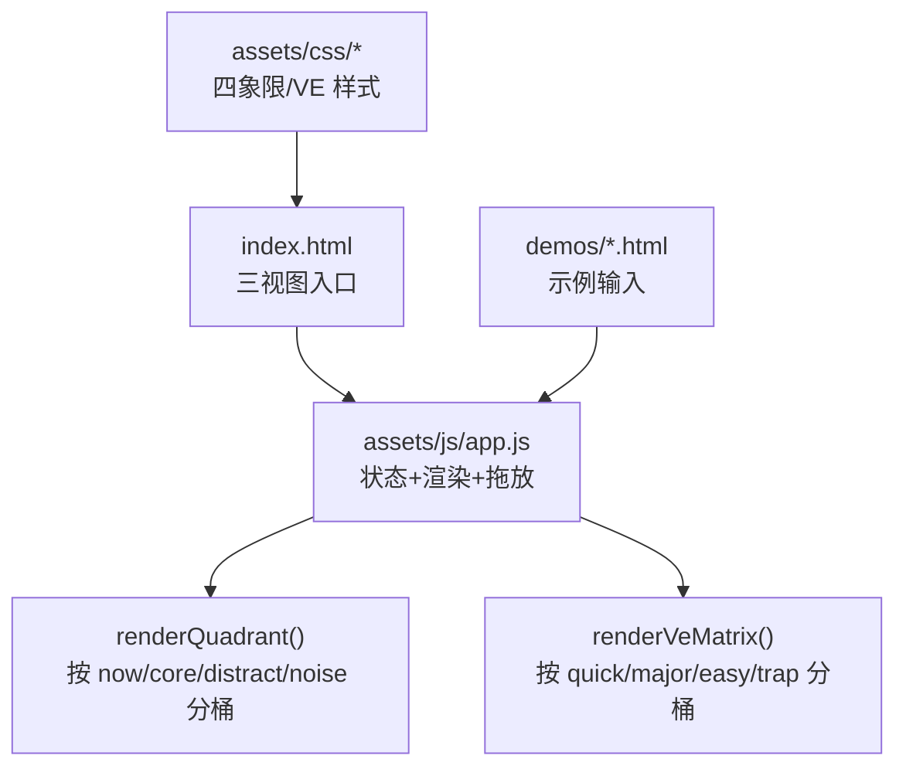
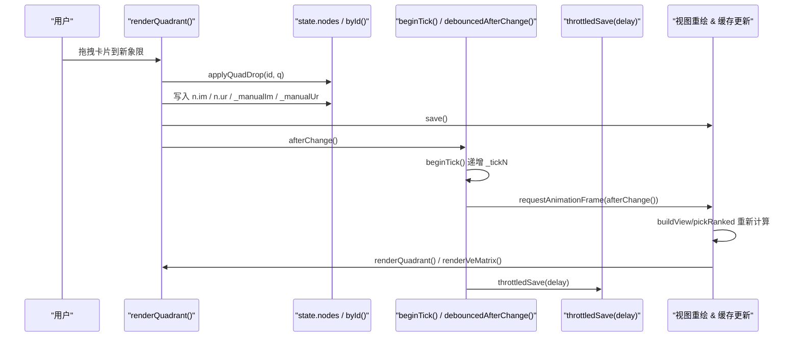
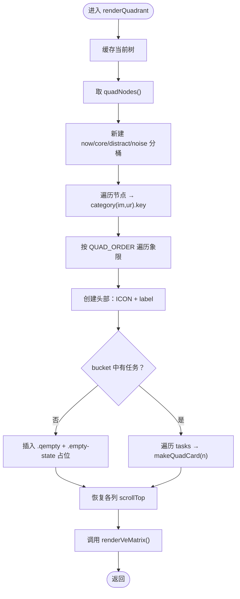
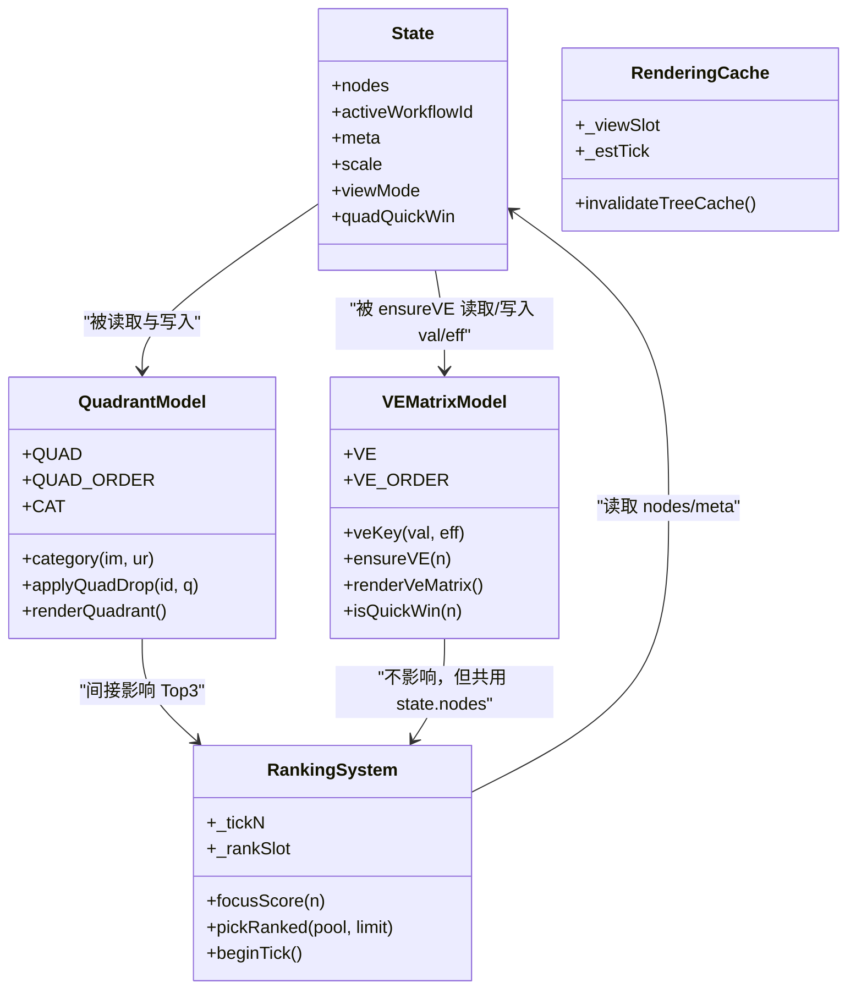

# 四象限矩阵与交互

<cite>
**本文引用的文件 **
- [assets/js/app.js](file://assets/js/app.js)
- [index.html](file://index.html)
- [README.md](file://README.md)
</cite>

## 目录

1. [引言](#引言)
2. [项目结构中的相关入口](#项目结构中的相关入口)
3. [核心模型](#核心模型)
4. [架构总览](#架构总览)
5. [详细组件分析](#详细组件分析)
6. [依赖关系分析](#依赖关系分析)
7. [性能与一致性](#性能与一致性)
8. [端到端示例：从核心拖到救火象限](#端到端示例从核心拖到救火象限)
9. [常见问题排查](#常见问题排查)
10. [可维护性与演进建议](#可维护性与演进建议)
11. [结论](#结论)

## 引言

目标流 GoalFlow 的“归纳洞察”视图包含两个相互关联的分析层：

- **V×E（VE）矩阵**：用价值 `val` 和费力 `eff` 把任务划分到四个象限——快速赢、主战役、顺手活、陷阱。它的重点不是“什么时候做”，而是“投入是否值得”。
- **VE_ORDER 对应的 V/E 顺序**：即 `quick → major → easy → trap`，是 VE 象限的渲染次序和展示逻辑。
- **紧急—重要四象限（now/core/distract/noise）**：由 `QUAD`/`CAT`、`category()`、`QUAD_ORDER` 共同决定，用于把节点分配到“立即做、核心投入、干扰、噪音”四列，并驱动四象限拖拽。

这两者共用同一份 `state.nodes`，但对未完成任务执行不同的分类函数：四象限看 `(im, ur)`，VE 矩阵看 `(val, eff)`，并通过 `ensureVE()` 在缺省时补齐 `val` 与 `eff`。文档的目标就是把这些常量、计算、渲染和拖放落盘流程串联成一张可操作的实现说明。

本节来源
- [README.md:9-56](file://README.md#L9-L56)

## 项目结构中的相关入口

GoalFlow 采用单页 + 外链资源结构：

- `index.html` 提供页面骨架、导航、主视区，以及“今日行动 / 目标规划 / 归纳洞察”三个视图按钮；其中归纳洞察承载桑基图、节奏图和四象限。
- `assets/js/app.js` 集中了应用状态、数据持久化、评分、视图缓存、四象限与 VE 矩阵渲染、拖拽处理。
- `assets/css/main.css` 及组件样式控制四象限列、任务卡片、VE 单元格、空态、Top3/Backlog 高亮等外观。
- `demos/index.html` 提供示例主题面板；示例数据会构造一组初始 `state.nodes`，从而填充四象限和 VE 矩阵。

图表来源
- [index.html:1-40](file://index.html#L1-L40)
- [assets/js/app.js:2650-2765](file://assets/js/app.js#L2650-L2765)

本节来源
- [index.html:1-140](file://index.html#L1-L140)
- [README.md:64-93](file://README.md#L64-L93)

## 核心模型

### 1. 紧急—重要四象限维度

四象限由常量表和分类函数共同定义：

| 象限键 | 语义标签 | 紧急度 ur | 重要度 im | 颜色来源 | 图标 |
|---|---|---:|---:|---|---|
| `now` | 立即做 · 重要且紧急 | ≥4 | ≥4 | `PALETTE_UR[4]` | 🔴 |
| `core` | 核心投入 · 重要不紧急 | <4 | ≥4 | `PALETTE_UR[0]` | 🔵 |
| `distract` | 干扰枝干 · 紧急不重要 | ≥4 | <4 | `PALETTE_UR[3]` | 🟠 |
| `noise` | 噪音 · 不重要不紧急 | <4 | <4 | `'#7c8295'` | ⚪ |

分类规则来自 `category(im, ur)`：先判断重要度 `≥4`，再判断紧急度 `≥4`，最后归入对应象限。没有匹配时回退为 `CAT.noise`。

本节来源
- [assets/js/app.js:13-21](file://assets/js/app.js#L13-L21)
- [assets/js/app.js:378-382](file://assets/js/app.js#L378-L382)

### 2. V×E 值—力象限

VE 矩阵使用另一套二维：**价值 `val`** 和 **费力 `eff`**。

| VE 键 | 语义标签 | 条件 | 图标 | 颜色 |
|---|---|---|---|---|
| `quick` | 快速赢 · 高价值低费力 | `val ≥ 4` 且 `eff < 3` | ⚡ | `PALETTE_UR[2]` |
| `major` | 主战役 · 高价值高费力 | `val ≥ 4` 且 `eff ≥ 3` | 🏔 | `PALETTE_UR[0]` |
| `easy` | 顺手活 · 低价值低费力 | `val < 4` 且 `eff < 3` | 🍃 | `#8a93ab` |
| `trap` | 陷阱 · 低价值高费力 | 其他 | 🕳 | `PALETTE_UR[3]` |

映射函数 `veKey(val, eff)` 以阈值 `val ≥ 4`、`eff ≥ 3` 切出四个分支；当某个节点缺少有效象限时，分桶代码会把它们写入兜底象限 `trap`。

渲染顺序由 `VE_ORDER = ['quick', 'major', 'easy', 'trap']` 固定。

本节来源
- [assets/js/app.js:60-76](file://assets/js/app.js#L60-L76)

### 3. `ensureVE` 的职责与 VE 属性来源

`ensureVE(n)` 负责保证叶子节点的 `val` 与 `eff` 存在且落在 `[1, 5]`：

| 字段 | 已有值时的行为 | 默认或推断逻辑 |
|---|---|---|
| `n.val` | 若为空，赋值为 `clamp(n.im, 1, 5)` | 复用重要度 `im` |
| `n.eff` | 若为空，根据文本和紧急度推断 | “只需/简单/5分钟”为低费力，复杂/重构等词汇为高费力；高紧急推高费力，低紧急推低费力；最终 `clamp(eff, 1, 5)` |
| `n.val / n.eff` | 二次 `clamp(1, 5)` | 防止外部脏数据导致象限越界 |

需要注意：`ensureVE` 不会修改已有的 `n.val` / `n.eff`；它只补全缺失字段，并把已存在的值裁剪到范围。这是“初始化健壮性”而非“覆盖用户显式设置”的操作。

此外还有一个辅助判定：

- `isQuickWin(n)`：`val ≥ 4` 且 `eff ≤ 2`。VE 列表中凡命中该条件的行会追加 CSS 类 `qw`，用作“快速赢”视觉强调，但与四象限的 Top3/Backlog 高亮机制不同。

本节来源
- [assets/js/app.js:55-73](file://assets/js/app.js#L55-L73)

### 4. 已完成、待办、阻塞、等待节点的处理

对于四象限与 VE 矩阵来说，关键区别在于：

- 四象限渲染通过 `quadNodes()` 获取待处理的节点集合，并把每个节点按 `category(im, ur)` 分配进 `buckets = { now, core, distract, noise }`。
- VE 矩阵通过 `vePanelNodes()` 获取面板上的节点集合，再把每个节点按 `veKey(val, eff)` 分配到 `buckets = { quick, major, easy, trap }`。
- 已完成的节点通常通过上层视图函数过滤掉；因此四象限和 VE 面板一般不会把 `done=true` 的任务重复放进对应 buckets。
- `status='blocked'` / `waiting` 的节点仍可能出现在分类结果中，因为分类本身只看 `im/ur/val/eff/text`；但在“当下最重要”评分、排名等逻辑中，被阻塞或等待的节点会通过 `focusScore` 大幅降权，从而极少进入 Top3。

本节来源
- [assets/js/app.js:546-675](file://assets/js/app.js#L546-L675)
- [assets/js/app.js:2650-2725](file://assets/js/app.js#L2650-L2725)

## 架构总览

下图展示一次典型的用户操作链：用户拖动四象限卡片后，状态、缓存、渲染和保存是如何协作的。

图表来源
- [assets/js/app.js:565-596](file://assets/js/app.js#L565-L596)
- [assets/js/app.js:2730-2744](file://assets/js/app.js#L2730-L2744)

## 详细组件分析

### 1. 四象限容器与列头渲染

`renderQuadrant()` 的 DOM 构建过程如下：

1. 获取容器 `#quadGrid`。
2. 调用 `getCachedTree(state.nodes)` 缓存当前树结构。
3. 用 `quadNodes()` 得到参与渲染的节点列表。
4. 创建四类分桶：`{ now: [], core: [], distract: [], noise: [] }`。
5. 遍历节点，调用 `category(n.im, n.ur).key` 放入对应 bucket；无法匹配时落入 `noise`。
6. 对 `QUAD_ORDER` 的每个象限创建 `.quad-cell`、`.quad-head`、`.qdrop`。
7. 列头 HTML 直接来源于 `QUAD[q].icon` 与 `QUAD[q].label`。
8. 列内左侧边框颜色由 `QUAD[q].color` 驱动；CSS 中对 `.quad-head` 的颜色赋值应在 `main.css` 中完成，而 JS 只负责提供源数据。
9. 如果某列没有节点，插入带 `.qempty` 的占位卡片，并使用 `.empty-state` 样式显示灰色提示文字和象限图标。
10. 将对应 bucket 中的未完成节点依次交给 `makeQuadCard(n)` 生成卡片。
11. 恢复上次滚动位置。
12. 最后调用 `renderVeMatrix()`。

列头的计数由 CSS 组件类控制；本仓库当前四象限列头主要绑定的是象限名和空态文本，VE 矩阵侧则明确有 `ve-cnt` 计数器。具体样式归属应查阅 `assets/css/main.css` 或 `components/layout.css` 中的 `.quad-head`、`.ve-head`、`.ve-cnt`、`.ve-empty`、`.qempty`、`.qcard`、`top3/highlight` 等规则。

#### 四象限渲染流程

图表来源
- [assets/js/app.js:2650-2677](file://assets/js/app.js#L2650-L2677)

本节来源
- [assets/js/app.js:2650-2677](file://assets/js/app.js#L2650-L2677)

### 2. VE 矩阵的象限定义、头部分配与 ve-cnt 计数

`renderVeMatrix()` 的工作更侧重于“价值×费力”的分项展示：

1. 获取容器 `#veGrid` 和参与面板计算的节点集合 `vePanelNodes()`。
2. 创建 `{ quick, major, easy, trap }` 四个 bucket。
3. 遍历节点，调用 `veKey(n.val, n.eff)` 分组；失败时放入 `trap`。
4. 如果全局面板元素存在，更新“快速赢数量”摘要文本。
5. 首次绑定时注册 `.ve-more` 点击事件，切换 `_veExpanded[k]` 并重新渲染。
6. 清空容器，按 `VE_ORDER` 输出 `ve-cell`。
7. 每列头部 HTML 由以下部分组成：
   - `VE[k].icon`
   - `VE[k].label`
   - ``，内容为该 bucket 的长度。
8. 头部左边框颜色设为 `VE[k].color`。
9. 如果 bucket 为空，插入一个 `.ve-empty` 元素，内容为短横线。
10. 如果展开，显示全部任务；否则只显示前 6 个。
11. 超过 6 项时插入 `.ve-more` 按钮，文案根据是否展开动态切换。
12. 每个任务行如果满足 `isQuickWin(n)`，会追加 `qw` 类，便于 CSS 高亮快速赢任务。

本节来源
- [assets/js/app.js:60-76](file://assets/js/app.js#L60-L76)
- [assets/js/app.js:2680-2725](file://assets/js/app.js#L2680-L2725)

### 3. 顶部 Top3 与 Backlog 的高亮逻辑

Top3 与 Backlog 的高亮并不是直接从四象限 bucket 名称决定的，而是基于“排名结果集”：

- `pickRanked(pool, limit)` 会先从池中筛选未完成的叶子节点，若无则退化为未完成的父节点；然后按 `focusScore(b) - focusScore(a)` 排序，再按 `im` 与到期天数打平。
- 四象限相关的位置会读取前 N 名节点 ID（例如 Top3、Top1），并把它们转换为 id 集合。
- 高亮函数 `highlightNode(id, on)` 会为桑基图节点、 ribbon、以及四象限中的 `.qcard[data-id=...]` 切换高亮类。
- Backlog 泳道用于承接那些排名靠后的候选任务，避免污染 Top3；其可见内容也受 `pickRanked(..., limit)` 影响。

因此，当一个节点被拖到新的四象限后，`(im, ur)` 变化会影响 `focusScore()`，进而改变下一轮 `pickRanked` 结果；这可能导致该任务进入或退出 Top3，也可能改变 Backlog 的构成。

本节来源
- [assets/js/app.js:560-675](file://assets/js/app.js#L560-L675)

### 4. 拖拽交互与状态写入

四象限的主要交互入口位于 `renderQuadrant()` 调用的委托监听。虽然完整拖放绑定细节在当前截取范围内未完全显示，但状态写入终点非常明确：`applyQuadDrop(id, q)`。

它的核心职责是：

| 步骤 | 操作 |
|---|---|
| 查找节点 | `const n = byId(id)` |
| 读取目标象限 | `v = QUAD[q].val` |
| 覆盖维度 | `n.im = v.im`，`n.ur = v.ur` |
| 标记手动调整 | `n._manualIm = true`，`n._manualUr = true` |
| 持久化 | `save()` |
| 触发后续渲染 | `afterChange()` |

`_manualIm/_manualUr` 的含义是告诉后续的文本重推断逻辑：不要再用节点文字重新猜测重要度和紧急度，以免冲掉用户手动拖来的分类。

注意：该函数**没有**同步更新 `val` 或 `eff`。因此从紧急—重要象限拖拽后，VE 矩阵可能仍沿用旧的价值和费力评分，除非另有刷新逻辑触发 `ensureVE` 或相关缓存失效。

本节来源
- [assets/js/app.js:2730-2744](file://assets/js/app.js#L2730-L2744)
- [assets/js/app.js:60-73](file://assets/js/app.js#L60-L73)

### 5. 批处理：beginTick / debouncedAfterChange / throttledSave

GoalFlow 在同一 tick 内尽量合并计算和保存：

- `beginTick()`：每次重绘前递增 `_tickN`，清空 `_viewSlot`、`_rankSlot`、`_estTick`。
- `debouncedAfterChange()`：取消上一个 rAF，在当前帧回调中调用 `afterChange()`。
- `throttledSave(delay)`：标记有挂起保存，并在延时后用一次性定时器调用 `save()`。
- `pickRanked(pool, limit)`：如果传入池对象、limit、当前 tick 相同，直接返回上一次排序结果 `_rankSlot.out`。
- `_viewSlot`：用于缓存 `buildView` 的结果，避免多次构建同尺度视图。
- `_estTick`：用于缓估值估计初始化。

这个设计确保“一次用户操作引起的多次状态变化”在同一渲染周期内共享排序结果，减少重复 sort 和视图重建。

本节来源
- [assets/js/app.js:554-596](file://assets/js/app.js#L554-L596)
- [assets/js/app.js:1177-1181](file://assets/js/app.js#L1177-L1181)

### 6. 空态占位样式

四象限和 VE 矩阵各自定义了空态展示策略：

| 场景 | 容器/元素 | 显示内容 |
|---|---|---|
| 四象限某一列为空 | `.qdrop` 下的 `.qempty` + `.empty-state` | 居中图标 + “拖任务卡到 X” 文案 |
| VE 矩阵某一列为空 | `.ve-list` 下的 `.ve-empty` | 短横线“—” |
| VE 矩阵任务过多 | `.ve-more` | “▾ 展开全部 N 项”或“▴ 收起” |
| VE 快速赢任务 | `.ve-row.qw` | 通过 CSS 类 `qw` 进行高亮 |

具体配色、圆角、间距等均由 CSS 控制；JS 只负责添加 class 和基础文本。

本节来源
- [assets/js/app.js:2663-2677](file://assets/js/app.js#L2663-L2677)
- [assets/js/app.js:2710-2725](file://assets/js/app.js#L2710-L2725)

### 7. 评分缓存与 Top3 联动

`focusScore(n)` 的加分项包括：

- 基础重要性：`im * 10`
- 期限奖励：逾期 `+30`、1 天内 `+26`、3 天内 `+20`、7 天内 `+13`、14 天内 `+7`、其他有期限 `+3`
- 长期主线奖励：无截止日期且 `im ≥ 5` 加 `4`，`im ≥ 4` 加 `2`
- 状态惩罚：阻塞 `-60`，等待 `-45`
- 精力高峰附加：如果节点属于高费力任务、钉在高能时段、且当前确处高峰时段，临时加 `6`
- 已完成节点统一给极低分值，使其不参与排名

`pickRanked` 会先筛出符合条件候选，再排序，最多保留前 N 个。同一 tick 内对相同 pool 和 limit 的请求复用 `_rankSlot`。

本节来源
- [assets/js/app.js:597-675](file://assets/js/app.js#L597-L675)

## 依赖关系分析

下面这张类级关系图聚焦四象限和 VE 相关的核心数据结构与函数边界，便于理解耦合点：

图表来源
- [assets/js/app.js:13-21](file://assets/js/app.js#L13-L21)
- [assets/js/app.js:55-76](file://assets/js/app.js#L55-L76)
- [assets/js/app.js:378-382](file://assets/js/app.js#L378-L382)
- [assets/js/app.js:597-675](file://assets/js/app.js#L597-L675)
- [assets/js/app.js:2650-2765](file://assets/js/app.js#L2650-L2765)

本节来源
- [assets/js/app.js:55-76](file://assets/js/app.js#L55-L76)
- [assets/js/app.js:378-382](file://assets/js/app.js#L378-L382)
- [assets/js/app.js:554-675](file://assets/js/app.js#L554-L675)
- [assets/js/app.js:2650-2765](file://assets/js/app.js#L2650-L2765)

## 性能与一致性

### 增量重绘与整页重建的界限

- `renderQuadrant()` 目前会清空 `#quadGrid.innerHTML` 并重建四象限 DOM，同时内部调用 `renderVeMatrix()` 也清空 `#veGrid`。因此在当前实现中，一次四象限渲染通常会重建这两个面板的全部 DOM。
- 真正的增量优化集中在计算层：`buildView`、`pickRanked`、估算值初始化等会被 tick 和 slot 缓存复用，从而避免大量节点在多次 `focusScore` 或排序中重复计算。
- `_viewSlot` 故意按最后一个 `buildView` 的尺度缓存；切换时间尺度时会互相顶掉，避免跨尺度读到错误的子树价值注解。

建议在后续扩展时：

- 如果只是单个任务属性变化，应优先定位到 `data-id` 卡片，仅更新该卡片的 `hl/top/backlog` 样式，而不是每次都销毁整个 `quadGrid`。
- 对于 VE 矩阵，`_veExpanded` 已经提供了局部展开状态；新增任务时可尝试复用现有 `.ve-list` 节点，减少全量重建。

本节来源
- [assets/js/app.js:554-596](file://assets/js/app.js#L554-L596)
- [assets/js/app.js:1177-1181](file://assets/js/app.js#L1177-L1181)
- [assets/js/app.js:2650-2725](file://assets/js/app.js#L2650-L2725)

### 频繁拖拽下的节流保存

`throttledSave(delay)` 的设计目标是：

- 在一次用户交互中可能触发多次 `save()`。
- 通过 `_saveTimer` 避免多个定时器并行运行。
- 延迟后确认 `_savePending` 是否为真，再进行实际持久化，并将标志重置。
- 默认延迟为 1 秒；某些调用可以传入自定义 delay。

这意味着即使短时间内连续拖拽多张卡片，也不会每改一次都写 localStorage；但最终所有挂起的保存请求会被合并执行。

本节来源
- [assets/js/app.js:572-596](file://assets/js/app.js#L572-L596)
- [assets/js/app.js:2738-2744](file://assets/js/app.js#L2738-L2744)

### 排序缓存的一致性

`_tickN`、`_rankSlot`、`_viewSlot`、`_estTick` 共享 tick 语义：

- 任何需要重新派生视图或排序的入口应先调用 `beginTick()`。
- 同一个 tick 内，只要 `pool`、`limit`、`tick` 一致，`pickRanked` 就不重新排序。
- `_viewSlot.key` 还拼接 scale、聚焦状态、噪音开关和节点数，以尽量避免跨视图误用。

这种设计的优点是：一次重大变更（如解析新目标）可以批量更新状态后再刷一次界面，期间所有 Top3/焦点判断复用同一份排序结果。

本节来源
- [assets/js/app.js:560-596](file://assets/js/app.js#L560-L596)
- [assets/js/app.js:1177-1181](file://assets/js/app.js#L1177-L1181)

## 端到端示例：从核心拖到救火象限

假设有一个节点：

- 原文本是“完成季度预算复盘”，当前属于“核心投入”。
- 拖到“救火象限”后，它的类别从 `core` 变为 `now`。

### 开始状态（简化）

| 字段 | 原始值含义 |
|---|---|
| `im` | ≥4（重要） |
| `ur` | <4（不紧急） |
| `cat` | `core` |
| `val` | 未显式设定时为克隆自 `im` |
| `eff` | 未显式设定，由 `ensureVE` 推断 |
| 在四象限中的列 | 核心 |
| 是否可能进入 Top3 | 取决于 `focusScore` 与其他节点竞争 |

### 用户操作

1. 用户将卡片拖入 `now` 象限。
2. `applyQuadDrop(id, 'now')` 被调用。
3. `v = QUAD['now'].val`，即 `{ im: 5, ur: 5 }`。
4. 节点字段更新为：
   - `n.im = 5`
   - `n.ur = 5`
   - `n._manualIm = true`
   - `n._manualUr = true`
5. 调用 `save()`，随后调用 `afterChange()`。
6. `afterChange()` 进入 `debouncedAfterChange()`，触发 `requestAnimationFrame` 回调。
7. `beginTick()` 递增 `_tickN`，清理视图与排名缓存。
8. 视图刷新过程中：
   - `renderQuadrant()` 重新把节点分到 `now` bucket。
   - `renderVeMatrix()` 重新计算 VE 分桶。
   - `pickRanked()` 使用新的 `focusScore` 重新评估 Top3。
   - 由于节点现在是紧急+重要，可能获得更高权重，也可能因 `ur` 变化影响排名和 Backlog。

### 结束状态（简化）

| 字段 | 变化后语义 |
|---|---|
| `im` | 5 |
| `ur` | 5 |
| 四象限类别 | `now` |
| VE 象限 | 不一定变，因为 `val`/`eff` 没有由 `applyQuadDrop` 直接更新 |
| Top3 可能性 | 可能提高，但也受其他节点分数影响 |
| 是否继续提示文本推断维度 | `_manualIm/_manualUr` 会阻止文本重推断覆盖手工拖来的值 |

本节来源
- [assets/js/app.js:2730-2744](file://assets/js/app.js#L2730-L2744)
- [assets/js/app.js:565-596](file://assets/js/app.js#L565-L596)
- [assets/js/app.js:597-675](file://assets/js/app.js#L597-L675)
- [assets/js/app.js:2650-2725](file://assets/js/app.js#L2650-L2725)

## 常见问题排查

### 1. 任务被拖到了错误列

**可能原因**

- `category(im, ur)` 阈值是 `≥4`，并非 1~5 线性渐变到某个象限；`im=3`、`ur=3` 都会落入非紧急或低重要路径。
- 目标象限的 `QUAD[q].val` 可能被预期为 `{ im: 5, ur: 2 }` 之类，而用户期望是均匀间隔值。
- 如果节点之前已通过文本推断过 `im`/`ur`，后续可能又有一次推断逻辑把它改写回来——但 `_manualIm/_manualUr` 正是为了打断这一点。

**排查步骤**

1. 检查拖入的 `q` 是否为 `now/core/distract/noise` 之一。
2. 打印 `QUAD[q].val`，确认目标象限的重要度和紧急度是否与业务语义相符。
3. 检查节点在 drop 前后 `im`、`ur`、`_manualIm`、`_manualUr` 的值。
4. 如果是渲染问题，检查 `category(n.im, n.ur).key` 是否确实等于目标象限键。

本节来源
- [assets/js/app.js:13-21](file://assets/js/app.js#L13-L21)
- [assets/js/app.js:378-382](file://assets/js/app.js#L378-L382)
- [assets/js/app.js:2730-2744](file://assets/js/app.js#L2730-L2744)

### 2. 拖出界面后任务丢失

**可能原因**

- 拖放事件只在四象限容器上绑定，拖出 `#quadGrid` 后没有触发状态写入；此时只有本地内存改动，没有 `save()`。
- 刷新页面后，没有持久化的改动会丢失。
- 浏览器清除 localstorage 或切换工作区后，状态恢复为上次保存版本。

**排查步骤**

1. 确认 drop 回调是否调用了 `applyQuadDrop` 或等价写入。
2. 检查 `save()` 是否被调用。
3. 在控制台查看 `localStorage` 中的 `goalflow.v4`（或配置的 LS_KEY）中最新保存的节点是否有该更改。
4. 如果是移动端，需确认触摸拖拽是否走的是兼容降级逻辑。

本节来源
- [assets/js/app.js:572-596](file://assets/js/app.js#L572-L596)
- [assets/js/app.js:597-602](file://assets/js/app.js#L597-L602)

### 3. 移动端触摸 drag 不支持时的降级

文档提到“移动端 H5 四象限手机端仅查看，拖拽归位请回桌面端”；因此降级方案通常是：

- 不在移动端启用拖放，只允许浏览四象限和 VE 矩阵。
- 如需移动任务，可使用编辑弹窗、表单或上下文菜单显式设置 `im`、`ur`、`val`、`eff`。
- 若未来要支持触屏拖拽，应避免直接使用原生 `drag` 事件，改为指针事件或第三方手势库，并保持与桌面端的 `applyQuadDrop` 语义一致。

本节来源
- [README.md:17-25](file://README.md#L17-L25)

### 4. 四象限计数与实际任务不一致

四象限计数由 `categories` 分桶长度决定，但 VE 矩阵的 `ve-cnt` 由 `veKey(val, eff)` 统计。二者使用不同维度：

| 视图 | 维度假设 | 数据来源 |
|---|---|---|
| 四象限 | `im`、`ur` | `category(im, ur)` |
| VE 矩阵 | `val`、`eff` | `veKey(val, eff)` |

若出现“某一象限总数对不上”，常见原因是：

- 某些节点未执行 `ensureVE`，`val`/`eff` 为空；VE 分桶会将失败情况归入 `trap`。
- `quadNodes()` / `vePanelNodes()` 过滤条件不同，比如一个是当前尺度视图，另一个是全局节点。
- CSS 或折叠逻辑隐藏了某些卡片，让人以为它们没进分桶。

**排查步骤**

1. 对比 `quadNodes().length` 与 `sum(now+core+distract+noise)`。
2. 对比 `vePanelNodes().length` 与 `sum(quick+majoreasy+trap)`。
3. 打印任意节点 `val`、`eff`，确认 `veKey` 返回值。
4. 检查是否有节点被 Top3、折叠、过滤等 UI 逻辑隐藏。

本节来源
- [assets/js/app.js:2680-2725](file://assets/js/app.js#L2680-L2725)
- [assets/js/app.js:1970-1975](file://assets/js/app.js#L1970-L1975)

### 5. Top3 与 Backlog 状态冲突

可能的根因：

- 某个节点刚刚拖到新的四象限，`im/ur` 更新后尚未完成一次 `beginTick()` 前的缓存失效，旧 `pickRanked` 结果仍在复用。
- `focusScore` 对 `done`、`blocked`、`waiting` 有特殊处理，可能导致一个节点虽然在某个象限，却被压到 Backlog。
- 多个视图组件在同一 tick 内分别计算 Top3，但缓存 key 或 pool 不同，造成“局部一致，整体不一致”。

**排查步骤**

1. 触发 `beginTick()` 后立即观察 Top3 结果。
2. 检查该节点是否被标记为 `done`、`blocked`、`waiting`。
3. 检查 `focusScoreParts(n)` 的解释分支，确认是期限、阻塞还是重要度拉低了排名。
4. 比较 `pickRanked(vis, 3)` 与 `pickRanked(vis, 8)` 的区别，确认 Backlog 是否正确承接排不到 Top3 的高分任务。

本节来源
- [assets/js/app.js:597-675](file://assets/js/app.js#L597-L675)
- [assets/js/app.js:1177-1181](file://assets/js/app.js#L1177-L1181)

## 可维护性与演进建议

当团队调整象限语义或引入新维度时，应考虑以下修改点：

### 调整紧急—重要象限语义

- 修改 `CAT` 或 `QUAD` 中的象限键、标签、颜色和默认 `val`。
- 若象限数量增加，必须更新 `category(im, ur)` 的分类表。
- 若象限顺序变化，更新 `QUAD_ORDER`。
- 更新 `renderQuadrant()` 中列头、空态文案和容器分配逻辑。
- 更新 CSS 中四象限列头、左边框、占位的布局与颜色变量。

### 新增 priority 等级或其他维度

如果需要引入第三维，例如 `priority ∈ {low, medium, high}`：

1. 不要在 VE 或四象限之间强行复用同一数值类型；应定义独立的数据结构，例如：
   - 四象限继续用 `im`、`ur`；
   - VE 继续用 `val`、`eff`；
   - 新增维度放在专用字段。
2. 新增维度应有独立的排序器、筛选器和可视化组件，不要硬塞进 `category` 或 `veKey`。
3. 如果新维度影响 Top3，应在 `focusScore` 中加入加权分支，并更新 `focusScoreParts` 以便解释得分。
4. 如果新维度影响分桶，新增一个专门的 buckets 映射函数，不要混用 `QUAD` 与 `VE` 的键空间。
5. 新增对应的 CSS 类，保持 JS 只负责添加 class，不写样式。

### 保持 API 边界清晰

| 模块 | 对外职责 | 不应做的事 |
|---|---|---|
| `ensureVE` | 补全 `val`/`eff` | 不强制覆盖用户显式的值 |
| `applyQuadDrop` | 应用四象限 `(im, ur)` | 不直接修改 `val`/`eff` |
| `category` | 把 `(im, ur)` 转为四象限 | 不读取 `val`/`eff` |
| `veKey` | 把 `(val, eff)` 转为 V/E 象限 | 不读 `im`/`ur` |
| `focusScore` | 计算“当下最重要”得分 | 不承担持久化职责 |
| `renderQuadrant` / `renderVeMatrix` | 只负责根据当前 state 构建 DOM | 不直接写入业务状态 |

本节来源
- [assets/js/app.js:55-76](file://assets/js/app.js#L55-L76)
- [assets/js/app.js:378-382](file://assets/js/app.js#L378-L382)
- [assets/js/app.js:2650-2765](file://assets/js/app.js#L2650-L2765)

## 结论

GoalFlow 的四象限与 VE 矩阵共享同一份任务模型，但服务于不同决策层：

- **四象限**回答“重要且不紧急的核心任务为什么迟迟没有被安排”；它通过 `(im, ur)` 和 `category()` 把未完成任务落到现在、核心、干扰、噪音四列。
- **VE 矩阵**回答“哪些任务是高性价比的快速赢、哪些是高投入的主战役、哪些是陷阱”；它通过 `(val, eff)` 和 `veKey()` 分桶，并借助 `ensureVE` 保证维度完备。
- 两者的连接点是：拖拽修改 `(im, ur)` 会改变四象限归属，并间接影响 Top3/Backlog 排名；VE 象限则更多用于发现价值/用力不匹配的潜在风险。
- 在高频交互下，`beginTick`、`_tickN`、`_rankSlot`、`_viewSlot`、`debouncedAfterChange` 与 `throttledSave` 共同把计算、渲染和存储收敛到较少的真实开销点上。

维护这类实现的关键原则是：**严格区分紧急—重要维度与价值—费力维度，不要把两类分桶逻辑互相渗透；让常量、分类函数、分桶器、DOM 类和样式各司其职。** 这样后续加入新维度、新象限或新视图时，才能做到最小扩散、最大一致性。