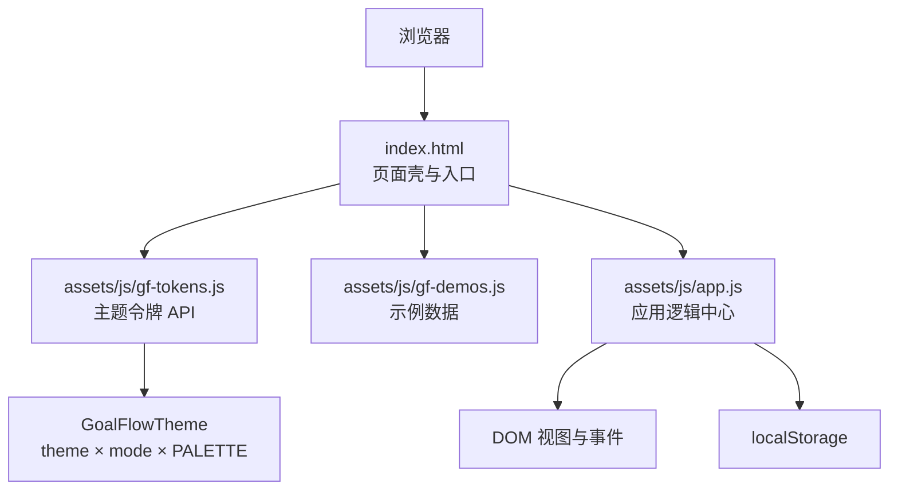
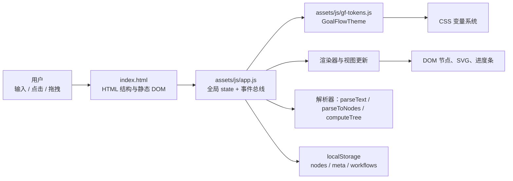
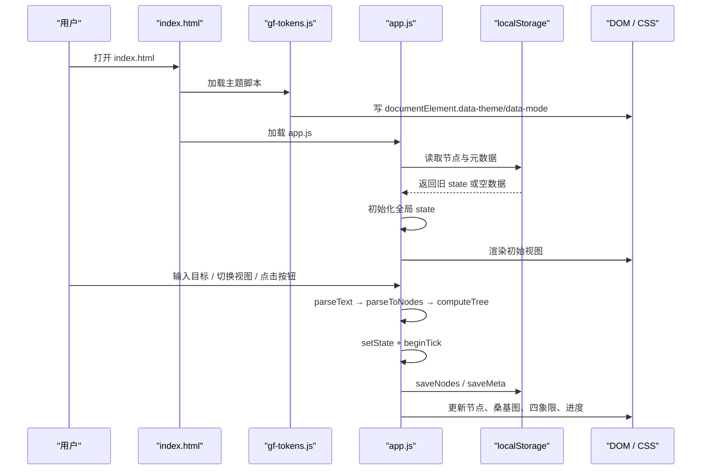
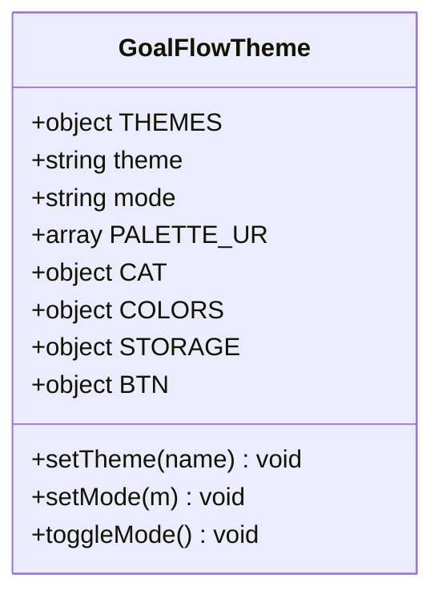
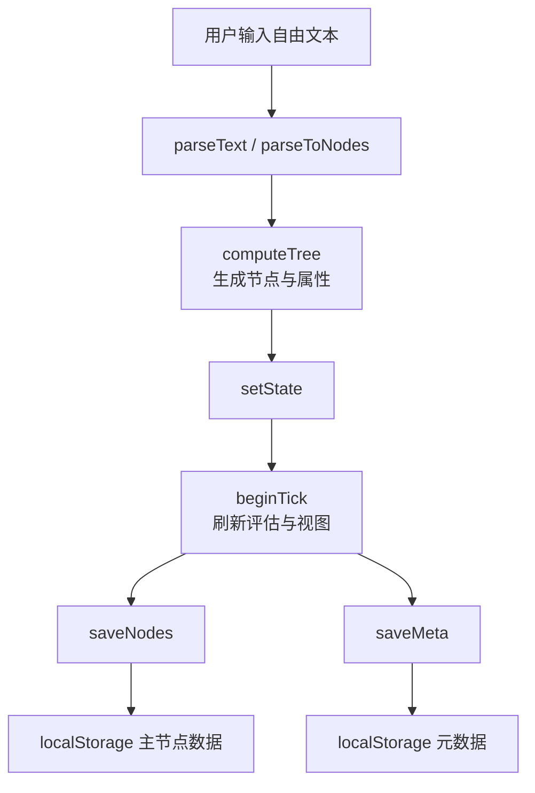
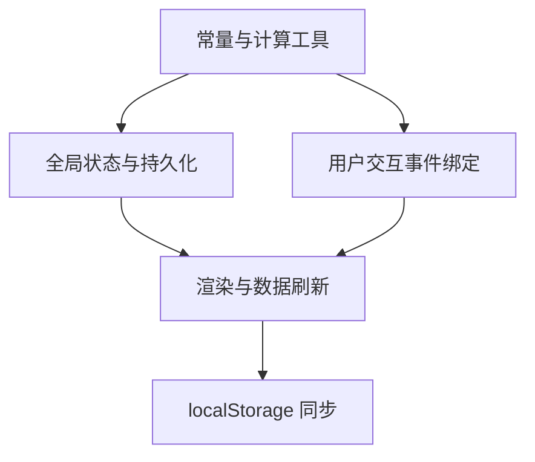

# 整体架构概览

<cite>
**本文引用的文件**   
- [index.html](file://index.html)
- [assets/js/app.js](file://assets/js/app.js)
- [assets/js/gf-tokens.js](file://assets/js/gf-tokens.js)
- [README.md](file://README.md)
</cite>

## 目录
1. [简介](#简介)
2. [项目结构](#项目结构)
3. [核心组件](#核心组件)
4. [架构总览](#架构总览)
5. [关键组件深度分析](#关键组件深度分析)
6. [依赖关系与职责矩阵](#依赖关系与职责矩阵)
7. [性能与取舍](#性能与取舍)
8. [故障排查指南](#故障排查指南)
9. [结论](#结论)

## 简介
GoalFlow 是一个“单 HTML + 静态资源”的纯本地浏览器应用。它没有账号、没有后端、也没有运行时前端框架；用户打开 `index.html`，浏览器直接加载 CSS 和 JavaScript，并通过 `localStorage` 持久化所有数据。该文档说明这一高层设计，解释页面壳 `index.html` 如何充当外壳入口，`gf-tokens.js` 如何作为主题令牌 API，以及 `app.js` 为何成为唯一的业务逻辑中心。

## 项目结构
仓库采用极简的平铺组织：

- `index.html`：单页外壳，声明三视图布局、侧栏、顶部工具栏，并在 `<head>` 中初始化主题数据属性、引入主样式；在 `</body>` 前按顺序加载 `gf-tokens.js`、`gf-demos.js`、`app.js`。
- `assets/js/`：核心脚本目录。
  - `gf-tokens.js`：定义目标流的主题模型、色板、按钮类名与 `localStorage` key，并暴露全局 `GoalFlowTheme`。
  - `gf-demos.js`：示例主题数据（被 app.js 引用）。
  - `app.js`：唯一业务逻辑中心——状态管理、事件绑定、解析渲染、存储同步、定时器与算法。
- `assets/css/`：CSS 入口 `main.css` 及其组件样式。
- `demos/`：独立主题风格演示页面。
- `scripts/inline-bundle.mjs`：构建期把依赖内联成单文件的脚本。
- `README.md`：产品能力与目录结构说明。

图表来源  
- [index.html:380-416](file://index.html#L380-L416)
- [assets/js/gf-tokens.js:1-177](file://assets/js/gf-tokens.js#L1-L177)
- [assets/js/app.js:1-260](file://assets/js/app.js#L1-L260)

章节来源  
- [README.md:1-103](file://README.md#L1-L103)

## 核心组件
| 组件 | 所在文件 | 职责摘要 | 对外接口或边界 |
|---|---|---|---|
| 页面壳 index.html | `index.html` | 提供导航、侧栏、今日/规划/洞察/AI 视图模板；注入默认主题、模式与主样式；最后引入 JS 资源并设置兜底就绪类名。 | 向浏览器提供单一 URL 可打开的入口点；通过元素 ID 与 class 约束被 JS 选择器定位。 |
| 主题令牌模块 | `assets/js/gf-tokens.js` | 声明多主题 × 明暗模式配置；读取并持久化 `goalflow.theme`、`goalflow.mode`；写入 `document.documentElement.dataset`；暴露 `GoalFlowTheme`。 | `setTheme(name)`、`setMode(mode)`、`toggleMode()`、`PALETTE_UR`、`CAT`、`COLORS`、`STORAGE`、`BTN`。 |
| 应用逻辑中心 | `assets/js/app.js` | 集中保存全局 `state.nodes`、`state.meta`、当前工作区与视图；监听 DOM 事件；调用文本解析与树计算；驱动开始帧刷新；读写 `localStorage`。 | 不导出 API，而是直接操作全局 state 和 DOM；依赖 `GF` 命名空间下的常量。 |
| 示例数据模块 | `assets/js/gf-demos.js` | 提供下拉框中的多种示例主题文本内容，便于首次体验。 | 通过全局变量供 app.js 引用。 |
| 构建辅助脚本 | `scripts/inline-bundle.mjs` | 将依赖打包成可在无构建环境运行的单 HTML 文件。 | 开发者构建流程，非运行时部分。 |

章节来源  
- [index.html:380-416](file://index.html#L380-L416)
- [assets/js/gf-tokens.js:1-177](file://assets/js/gf-tokens.js#L1-L177)
- [assets/js/app.js:1-260](file://assets/js/app.js#L1-L260)

## 架构总览
GoalFlow 的高层运行时链路是：**用户 → 页面壳 → 应用逻辑 → 主题令牌 API → CSS 变量系统 → DOM**。它与常见 SPA 一样遵循单向数据流：输入改变 state，state 变化触发更新与保存，更新结果反映回 UI。

图表来源  
- [index.html:380-416](file://index.html#L380-L416)
- [assets/js/gf-tokens.js:1-177](file://assets/js/gf-tokens.js#L1-L177)
- [assets/js/app.js:1-260](file://assets/js/app.js#L1-L260)

### 运行上下文图

图表来源  
- [index.html:380-416](file://index.html#L380-L416)
- [assets/js/gf-tokens.js:1-177](file://assets/js/gf-tokens.js#L1-L177)
- [assets/js/app.js:565-600](file://assets/js/app.js#L565-L600)
- [assets/js/app.js:5324-5332](file://assets/js/app.js#L5324-L5332)

## 关键组件深度分析

### index.html：Shell UI 与资源入口
`index.html` 并不承担业务规则。它的职责集中在：

- 头部预填充主题模式：优先从 `localStorage` 读 `goalflow.theme` 和 `goalflow.mode`，再回退到默认值；之后才加载主样式，以减少主题闪烁。
- 声明左侧图标轨、侧栏、右侧主内容、底部移动端 tab、多个弹窗容器及进度提示容器。
- 按顺序加载 `gf-tokens.js`、`gf-demos.js`、`app.js`。
- 提供一个兜底机制：如果 `app.js` 因异常未设置就绪状态，`1.5` 秒后为 `body` 添加 `is-ready` 类，避免用户看到一个无法操作的空白页面。

这意味着，`index.html` 相当于一个稳定的容器契约：所有由 JS 操作的元素必须具有对应 ID 或 class；所有主题相关的全局对象必须由 `gf-tokens.js` 在 app.js 之前准备完毕。

章节来源  
- [index.html:1-25](file://index.html#L1-L25)
- [index.html:380-416](file://index.html#L380-L416)

### gf-tokens.js：主题令牌与命名空间隔离
`gf-tokens.js` 使用自执行函数包裹，把目标流的常量与 API 集中挂载到全局 `GoalFlowTheme`，从而形成清晰的模块边界：

- **主题定义**：支持 `linear`、`raycast`、`rpg` 三种主题，每种主题区分深色和浅色两套配置，包含冷→暖五阶色板、噪声色、高亮色、渐变轴和 SVG 光晕色等。
- **持久化**：通过封装函数读写 `goalflow.theme` 与 `goalflow.mode`，并对无效值进行验证，失败时回退默认值。
- **DOM 预处理**：在可访问 DOM 环境中立即写入 `documentElement` 的 `data-theme` 与 `data-mode`，使 CSS 能在第一个重绘前生效。
- **对外 API**：`setTheme(name)`、`setMode(m)`、`toggleMode()` 负责校验、写入和本地重载；同时暴露 `THEMES`、`PALETTE_UR`、`CAT`、`COLORS`、`STORAGE`、`BTN`。

对 `app.js` 而言，这个模块的价值在于把颜色、分类、本地键名和按钮 class 统一收口。若后续扩展新主题，只需修改此处与 CSS 令牌，而不必改动业务逻辑。

图表来源  
- [assets/js/gf-tokens.js:1-177](file://assets/js/gf-tokens.js#L1-L177)

章节来源  
- [assets/js/gf-tokens.js:1-177](file://assets/js/gf-tokens.js#L1-L177)

### app.js：唯一业务逻辑中心
`app.js` 是整个应用的中央调度器。虽然它只有一个大文件，但通过常量区域、工具函数集合、UI 绑定函数、持久化和定时任务划分了清晰职责面。其关键职责包括：

#### 全局状态
- 维护节点树、工作区、当前激活项目、活动视图等核心 state。
- 复用 `GF` 命名空间下的 `PALETTE_UR`、`CAT`、`COLORS`、`STORAGE`，实现与主题模块的解耦。

#### 事件绑定
- 绑定导航按钮、解析按钮、示例下拉、清空、导出 JSON、导入 JSON、主题切换、模式切换等交互。
- 通过统一的视图切换逻辑与“折叠状态记忆”机制维持用户上下文。

#### 解析与渲染
- 接受自由文本输入，调用 `parseText` / `parseToNodes` 生成结构化节点。
- 调用 `computeTree` 或等价树计算逻辑推断层级、期限、角色、价值与费力程度。
- 将计算后的数据结构交给渲染器，分别更新今日行动、目标树、桑基图、四象限、进度指示器等视图。

#### 启动循环与刷新
- `beginTick` 是一处关键刷新协调点：它在状态变化或时间推进时执行评估、评分、预估校验、提醒与界面刷新。
- 结合自动评分、日完成计数、周期计划与仪式闹钟，把一次用户操作的结果扩散到全部视图。

#### 持久化
- `saveNodes` 将扁平化的目标节点树写入 localStorage 的主键。
- `saveMeta` 单独保存元数据，例如分数、节奏、能量、备份时间、回顾状态等。
- 工作区/工作流数据也使用独立的 local storage 键进行保存，并在写入成功时创建备份副本。

图表来源  
- [assets/js/app.js:565-600](file://assets/js/app.js#L565-L600)
- [assets/js/app.js:5324-5332](file://assets/js/app.js#L5324-L5332)
- [assets/js/app.js:5257-5270](file://assets/js/app.js#L5257-L5270)

章节来源  
- [assets/js/app.js:1-260](file://assets/js/app.js#L1-L260)
- [assets/js/app.js:269-276](file://assets/js/app.js#L269-L276)
- [assets/js/app.js:336-344](file://assets/js/app.js#L336-L344)
- [assets/js/app.js:519-519](file://assets/js/app.js#L519-L519)
- [assets/js/app.js:554-554](file://assets/js/app.js#L554-L554)
- [assets/js/app.js:5324-5332](file://assets/js/app.js#L5324-L5332)
- [assets/js/app.js:5257-5270](file://assets/js/app.js#L5257-L5270)

### 单文件中职责边界是如何维护的
尽管 `app.js` 是单文件，但从代码组织可以看到明确的分块策略：

- 常量与类型映射：如类别标签、颜色带、四象限、VE 矩阵、容量常量等，靠近文件开头集中定义。
- 计算工具：估计分钟解析、日期 key、度量指标、配额计算、权重与排序等。
- 状态与存储：全局 state、`saveNodes`、`saveMeta`、工作流元信息等。
- UI 交互：视图切换、折叠状态、弹窗开关、导出导入、设置表单等事件处理。
- 分析与提醒：自动评分、时间审计、倦怠预警、周回顾准备、仪式闹钟等。
- 启动时序：初始化、加载旧数据、设置初始视图、调用 `beginTick`。

这种分块方式类似于在一个进程中使用内部 module 的写法：虽然不可被外部 import，但在文件内部通过注释标题和函数语义保持职责边界。

[本图为概念性示意，不直接映射具体代码结构，因此不提供图表来源]

## 依赖关系与职责矩阵

### 顶层依赖关系表
| 依赖方 | 依赖方 | 方向 | 依赖原因 |
|---|---|---|---|
| index.html | gf-tokens.js | 上层引用下层 | 需要在主样式与 app.js 之前准备主题令牌。 |
| index.html | app.js | 上层引用下层 | 在应用初始化后驱动整个 SPA。 |
| app.js | gf-tokens.js | 运行时依赖 | 读取主题色板、分类常量、本地 key 前缀。 |
| app.js | DOM | 运行期耦合 | 所有渲染和用户交互都基于 DOM 节点和属性。 |
| app.js | localStorage | 运行期耦合 | 目标、元数据和偏好均以字符串形式本地持久化。 |
| gf-demos.js | app.js | 数据提供方 | 为示例下拉提供主题文本数据。 |

章节来源  
- [index.html:380-416](file://index.html#L380-L416)
- [assets/js/gf-tokens.js:1-177](file://assets/js/gf-tokens.js#L1-L177)
- [assets/js/app.js:1-260](file://assets/js/app.js#L1-L260)

### 职责矩阵
| 场景 | index.html | gf-tokens.js | app.js |
|---|---|---|---|
| 首次打开页面 | 加载资源、预填主题、加载主样式 | 读取主题与模式并写 data 属性 | 加载旧 state，绑定初始视图 |
| 输入目标文本 | 提供 textarea 与解析按钮 | 不参与 | 解析文本、构造节点树、写入 state |
| 切换主题 | 提供控件但不改逻辑 | 写 localStorage，强制刷新 | 依赖重新加载后的新色板 |
| 保存目标 | 不提供持久化 | 不参与 | 调用 `saveNodes` 与 `saveMeta` |
| 刷新视图 | 不直接渲染 | 不参与 | 调用 `beginTick` 等刷新函数 |
| 恢复数据 | 只负责加载 HTML | 不参与 | 从 `localStorage` 读取并重建 state |

章节来源  
- [index.html:380-416](file://index.html#L380-L416)
- [assets/js/gf-tokens.js:1-177](file://assets/js/gf-tokens.js#L1-L177)
- [assets/js/app.js:5324-5332](file://assets/js/app.js#L5324-L5332)

## 性能与取舍
### “单 HTML + 无运行时框架”的优势
- **零构建门槛**：仓库可直接双击 `index.html` 或托管到静态站点，适合个人知识工具。
- **低启动开销**：不需要模块打包器和路由框架；数据全部来自 `localStorage`。
- **可移植性强**：即使离线运行，只要保留 `assets/` 目录即可完整工作。

### 成本与权衡
- **单文件过重**：`app.js` 同时承载状态、事件、解析、渲染、计算、定时器、弹窗、导出导入和多视图逻辑，阅读、修改和测试成本显著上升。
- **全局耦合**：app.js 通过全局 `GoalFlowTheme` 和全局 DOM 节点协作，缺少模块级封装，增加了无意耦合的风险。
- **单点失效**：如果 app.js 异常，虽然 index.html 会在兜底时间内显示页面，但业务逻辑仍可能不可用。
- **扩展难度**：新增功能时通常只能追加到现有文件末尾或新增内部函数，编译期错误检测较难建立。

### 可行的改进方向
- 把 app.js 拆分为状态层、解析层、渲染层、事件层和持久化层。
- 为状态变更增加轻量事件总线或 reducer，减少渲染函数中的分支条件。
- 对解析器、计算器、持久化工具进行单元测试。
- 保留 `gf-tokens.js` 的模式：将易变主题与稳定业务逻辑分离，通过配置对象注入而非硬编码。

[本节为通用建议，不直接分析具体代码片段，因此不提供章节来源]

## 故障排查指南
| 现象 | 可能原因 | 排查步骤 |
|---|---|---|
| 打开页面后长时间空白或无响应 | `app.js` 初始化异常，或未设置就绪标志 | 检查控制台；index.html 已内置 1.5 秒兜底，若仍不可用应检查 JS 报错。 |
| 主题不生效 | `goalflow.theme` 或 `goalflow.mode` 不是有效值 | 确认 `gf-tokens.js` 已先于 `app.js` 加载；主题名应为 `linear`、`raycast` 或 `rpg`。 |
| 数据丢失 | 浏览器缓存清理或换了设备 | 使用“备份 JSON”重新导入；查看 `localStorage` 中的 nodes、meta 和工作流 key。 |
| 切换主题后页面闪烁或重复加载 | `setTheme` / `setMode` 会调用页面重载 | 这是预期行为；若希望异步生效需额外改造主题模块。 |
| 解析不出树形 | 输入格式不正确或缺少缩进/编号 | 检查首行是否作为根目标；子项需使用缩进、编号或项目符号。 |
| 视图状态不一致 | 旧 state 或折叠状态损坏 | 清除对应 view/fold/meta/localStorage 条目后重试，或恢复最新备份。 |

章节来源  
- [index.html:412-416](file://index.html#L412-L416)
- [assets/js/gf-tokens.js:77-136](file://assets/js/gf-tokens.js#L77-L136)
- [assets/js/app.js:5324-5332](file://assets/js/app.js#L5324-L5332)
- [assets/js/app.js:5257-5270](file://assets/js/app.js#L5257-L5270)

## 结论
GoalFlow 的整体架构非常朴素：`index.html` 提供稳定的页面外壳，`gf-tokens.js` 提供主题令牌与全局命名空间，`app.js` 是唯一业务逻辑中心。这种设计的优点是简单、透明、可离线运行；代价是 `app.js` 负担过重、全局耦合明显、长期演进风险较高。

理解 GoalFlow 的最佳方式，是先把它当作一条明确的流水线：

- **用户动作**进入 `index.html` 提供的 DOM。
- `app.js` 作为中枢读取状态、调用解析器和计算逻辑、更新 state。
- `beginTick` 协调刷新，并将结果写入 `localStorage`。
- 主题令牌 API 决定渲染使用的色板与视觉上下文。
- CSS 变量和 class 最终将结构化数据变成可视化结果。

对于初学者，可以把这套模式看作“SPA 外壳 + 单脚本引擎”的经典原型；对于维护者，下一步最值得关注的是如何在不破坏现状的前提下，把 `app.js` 的职责逐步拆分。