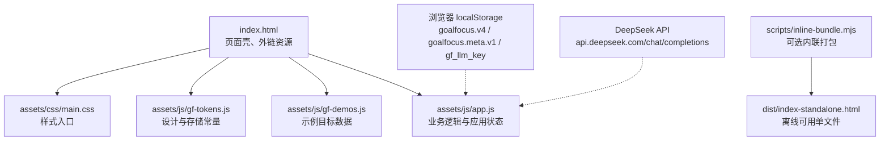
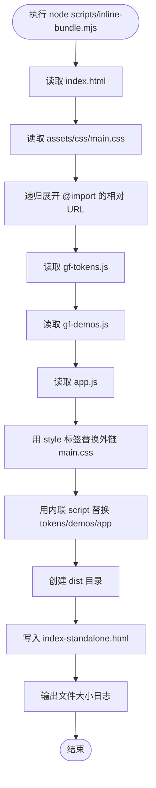
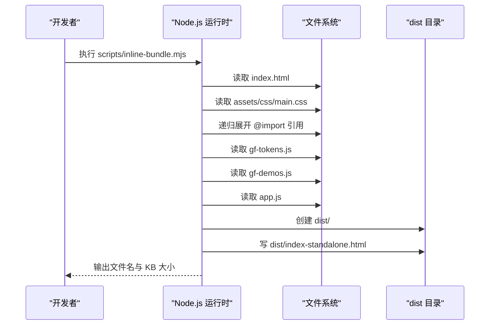
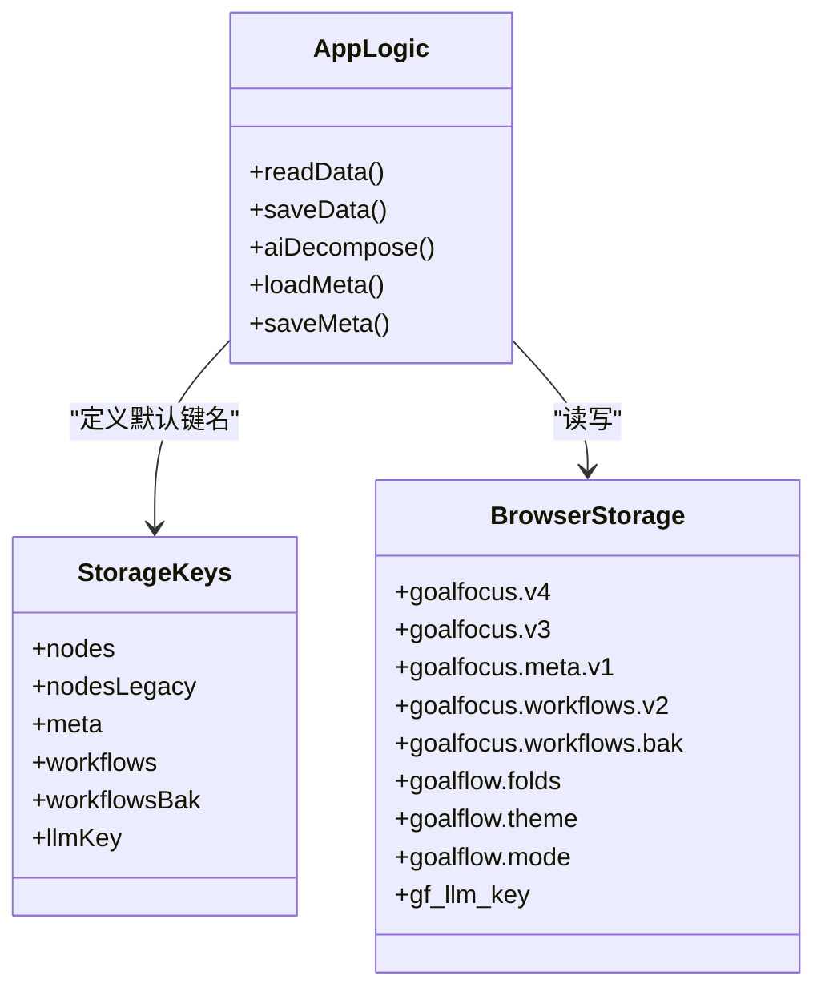

# 构建、部署与分发

<cite>
**本文引用的文件**   
- [README.md](file://README.md)
- [index.html](file://index.html)
- [scripts/inline-bundle.mjs](file://scripts/inline-bundle.mjs)
- [assets/js/app.js](file://assets/js/app.js)
- [.gitignore](file://.gitignore)
</cite>

## 目录
1. [引言](#引言)
2. [项目结构](#项目结构)
3. [为什么没有传统构建系统与运行时依赖](#为什么没有传统构建系统与运行时依赖)
4. [核心打包命令与产物](#核心打包命令与产物)
5. [内联打包脚本分析](#内联打包脚本分析)
6. [数据模型、版本号与缓存键关系](#数据模型版本号与缓存键关系)
7. [部署选项与资源配置](#部署选项与资源配置)
8. [文件大小变化对比](#文件大小变化对比)
9. [故障排查清单](#故障排查清单)
10. [极简发布检查清单](#极简发布检查清单)
11. [回滚策略](#回滚策略)
12. [结语](#结语)

## 引言
目标流 GoalFlow 是一个纯本地浏览器应用：所有业务逻辑集中在单个 `app.js`，样式通过主入口按顺序加载，字体资源来自 Google Fonts。仓库本身不包含 Webpack、Vite、TypeScript 编译器等常规前端工程化依赖，因此可以“打开即用”。在需要离线可用或单文件分发的场景中，可以通过 Node.js 执行 `scripts/inline-bundle.mjs`，把外链脚本与样式内联进最终 HTML。

生产环境可直接分发 `index.html` 及其静态资源，也可以通过内联打包直接分发 `dist/index-standalone.html`。

## 项目结构
仓库采用扁平且按职责划分的结构：

| 路径 | 职责 |
|---|---|
| `index.html` | 页面壳；声明 Google Fonts、主样式和三个 JS 模块；挂载三视图、侧栏、设置、备份等 UI 元素 |
| `assets/css/main.css` | CSS 入口，负责基础样式、布局、组件样式及移动端适配 |
| `assets/js/gf-tokens.js` | 设计令牌与常量，定义颜色、存储键、按钮文案等业务基础值 |
| `assets/js/gf-demos.js` | 10 个示例目标主题数据 |
| `assets/js/app.js` | 唯一业务逻辑实现，包括任务树解析、四象限、评分、番茄钟、AI 拆解、DeepSeek 调用、备份恢复、localStorage 读写等 |
| `demos/` | 风格实验室示例页面，不改变主程序运行时行为 |
| `scripts/inline-bundle.mjs` | 将样式和脚本内联进 `dist/index-standalone.html` |
| `.gitignore` | 忽略本地工作副本、`dist/` 打包产物及编辑器临时文件 |
| `docs/` | 进度说明与设计文档（非运行时代码） |



**图表来源**
- [index.html:1-20](file://index.html#L1-L20)
- [index.html:409-416](file://index.html#L409-L416)
- [assets/js/app.js:1-30](file://assets/js/app.js#L1-L30)
- [assets/js/app.js:740-760](file://assets/js/app.js#L740-L760)
- [scripts/inline-bundle.mjs:1-52](file://scripts/inline-bundle.mjs#L1-L52)

**章节来源**
- [README.md:62-103](file://README.md#L62-L103)
- [index.html:1-20](file://index.html#L1-L20)

## 为什么没有传统构建系统与运行时依赖
GoalFlow 的选择是“尽可能少”：

1. **单一业务文件**  
   `assets/js/app.js` 是唯一完整的应用逻辑实现，它直接操作 DOM、管理 `localStorage`、处理用户交互、调用第三方 AI API 并渲染可视化内容。无需模块化构建器导入导出其他业务模块。

2. **CSS 通过主入口顺序加载**  
   `index.html` 引入 `assets/css/main.css`，该样式文件承担基础样式、布局、组件以及移动端适配的样式职责。虽然存在 `components/` 子目录，但运行时由主入口决定样式加载顺序，而非打包器。

3. **Google Fonts 只是可选体验优化**  
   Google Fonts 提供 Inter 与 JetBrains Mono 字体。当网络不可用时，浏览器会使用系统字体或默认回退字体，不会阻止应用启动。这也意味着即使无法连接外部 CDN，仍可使用最小功能集。

4. **无服务端依赖**  
   除 DeepSeek API 这一可选能力外，所有目标数据、视图折叠状态、用户 API Key、当前主题和模式都保存在浏览器本地。应用本身不上传任何数据。

5. **可选的 Node.js 内联步骤**  
   只有在需要“单文件离线包”时才使用 `scripts/inline-bundle.mjs`；日常开发可以直接双击 `index.html` 运行。

这个设计的权衡很明确：工具链简单、学习成本低、部署门槛低，但样式跨文件和资源缓存控制更依赖开发者自觉。

**章节来源**
- [README.md:1-30](file://README.md#L1-L30)
- [README.md:72-86](file://README.md#L72-L86)
- [index.html:7-14](file://index.html#L7-L14)
- [index.html:409-416](file://index.html#L409-L416)
- [assets/js/app.js:1-30](file://assets/js/app.js#L1-L30)

## 核心打包命令与产物
安装 Node.js 后，在项目根目录执行：

```text
node scripts/inline-bundle.mjs
```

该命令会：
- 读取 `index.html`
- 读取 `assets/css/main.css`
- 递归展开 `main.css` 中的 `@import url("./...")` 引用
- 读取 `assets/js/gf-tokens.js`
- 读取 `assets/js/gf-demos.js`
- 读取 `assets/js/app.js`
- 用 `<style>` 替换外链 CSS
- 用内联 `<script>` 替换外链 JS
- 输出到 `dist/index-standalone.html`
- 在控制台输出文件大小

**重要注意**：Google Fonts 外链不会被内联。若需要完全离线，还必须确保浏览器已缓存字体文件，或把字体下载到本地并通过相对路径加载；当前脚本不处理字体下载。

**章节来源**
- [scripts/inline-bundle.mjs:1-52](file://scripts/inline-bundle.mjs#L1-L52)
- [README.md:88-92](file://README.md#L88-L92)

## 内联打包脚本分析
`scripts/inline-bundle.mjs` 是一个基于 Node.js 原生文件系统与路径模块的轻量生成器，而不是通用打包工具。其核心行为如下：

| 步骤 | 行为 |
|---|---|
| 路径准备 | 使用 `fileURLToPath` 和 `path.join` 确定脚本所在目录和项目根目录 |
| CSS 展开 | 递归读取被 `@import url("./relative/path")` 引入的 CSS 文件 |
| 资源收集 | 读取主样式、设计令牌、示例数据和主脚本 |
| HTML 替换 | 用正则表达式匹配 `index.html` 中的外链 CSS 和内联 JS 片段 |
| 输出写入 | 创建 `dist/` 目录并写入 `index-standalone.html` |
| 日志输出 | 按 UTF-8 字节长度计算并以 KB 输出 |

### 内联流程


**图表来源**
- [scripts/inline-bundle.mjs:1-52](file://scripts/inline-bundle.mjs#L1-L52)

### 关键限制
1. **只内联主样式**  
   当前替换逻辑针对 `assets/css/main.css`，不会自动扫描任意链接式 CSS。
2. **JS 有固定引用顺序**  
   脚本期望 HTML 中存在 `gf-tokens.js`、`gf-demos.js`、`app.js` 这三个外链脚本并按顺序出现。
3. **不拷贝静态资产**  
   图片、图标或其他非脚本资源不在内联范围内，仍然依赖与 HTML 同级的文件位置。
4. **Google Fonts 不内联**  
   字体仍是外部请求，因此不是绝对意义上的“离线单文件”。
5. **错误处理较薄**  
   如果 HTML 结构变化导致正则无法匹配，脚本可能静默完成无效替换或抛出文件读取异常。



**图表来源**
- [scripts/inline-bundle.mjs:1-52](file://scripts/inline-bundle.mjs#L1-L52)

**章节来源**
- [scripts/inline-bundle.mjs:1-52](file://scripts/inline-bundle.mjs#L1-L52)
- [index.html:7-14](file://index.html#L7-L14)
- [index.html:409-416](file://index.html#L409-L416)

## 数据模型、版本号与缓存键关系
应用使用多个 `localStorage` 键来区分数据版本和配置：

| 键名 | 含义 | 对应位置与意义 |
|---|---|---|
| `goalfocus.v4` | 核心目标节点数据 | 主应用数据载体；若损坏则影响树形目标、计划、得分等 |
| `goalfocus.v3` | 历史版本兼容键 | 用于旧数据迁移或降级处理 |
| `goalfocus.meta.v1` | 元数据键 | 保存主题、模式、容量等配置元信息 |
| `goalfocus.workflows.v2` | 工作流相关数据 | 工作区与工作流状态 |
| `goalfocus.workflows.bak` | 工作流备份键 | 工作流快照与恢复 |
| `goalflow.folds` | 面板折叠状态 | 今日面板各区域是否折叠 |
| `goalflow.theme` | 界面主题 | Linear、Raycast、RPG 等主题选择 |
| `goalflow.mode` | 明暗模式 | dark 或浅色模式 |
| `gf_llm_key` | DeepSeek API Key | AI 功能的可选密钥 |

`app.js` 中定义了这些键的默认值，并通过 `STORAGE` 对象从 `gf-tokens.js` 注入可覆盖。这意味着：升级时更换默认值不会自动删除已有键，除非应用显式实现迁移逻辑。



**图表来源**
- [assets/js/app.js:1-30](file://assets/js/app.js#L1-L30)

**章节来源**
- [assets/js/app.js:1-30](file://assets/js/app.js#L1-L30)
- [assets/js/app.js:740-760](file://assets/js/app.js#L740-L760)

## 部署选项与资源配置
由于 GoalFlow 是浏览器端应用，部署本质上是“托管静态资源”。以下是常见方案：

| 方案 | 适用场景 | 注意事项 |
|---|---|---|
| 双击本地运行 | 个人开发、离线演示 | 必须保留 `index.html` 与 `assets/` 的相对位置；部分浏览器对本地 `file://` 的 CORS、Web Worker 或复杂 API 有限制 |
| GitHub Pages | 公开静态站点 | 使用 `index.html` 或其分支下的 `public/` 目录；开启 HTTPS 避免部分浏览器安全限制 |
| Vercel Static Site | 快速部署静态目录 | 可选择将 `.` 作为源码根；确保不启用后端函数误匹配 `index.html` |
| CDN 直链 | 内网分发、镜像站 | 要求正确返回 `Content-Type`、允许跨域读取字体等资源 |
| 内联单文件 | 最简分发 | 发布 `dist/index-standalone.html`；仍需保证浏览器缓存字体或使用本地字体 |

### HTTPS
浏览器在现代安全策略下，对混合内容、凭证访问和外网 API 调用有更严格约束。GoalFlow 本身主要走 `localStorage`，但以下情况建议始终启用 HTTPS：
- 未来可能接入更严格的 Cookie、IndexedDB 或 Service Worker
- 企业代理或安全软件拦截 HTTP 资源
- 某些浏览器对未受信来源的网络请求实施更强限制

GitHub Pages 和多数现代 CDN 默认提供 HTTPS，部署平台通常会自动重定向到 `https://`。

### Cache-Control
推荐为静态资源设置长期缓存，例如：
- HTML：短期缓存或 no-store
- CSS、JS、图片、字体：长期缓存，如 `max-age=31536000, immutable`
- 字体优先使用 `Cache-Control: public, max-age=31536000, immutable`

如果 HTML 未被缓存，每次刷新都会重新拉取 HTML，而 HTML 中的 `?v=7.6` 又会让样式与脚本按版本失效。这有利于强制更新，但会牺牲首屏缓存命中率。

### Content-Type
- `*.css` 应为 `text/css`
- `*.js` 应为 `application/javascript`
- 字体 MIME 类型取决于后缀，例如 `woff2`、`woff`、`ttf`
- 字体服务器响应头应包含正确的 `Access-Control-Allow-Origin`，否则可能触发跨域失败并导致字体回退

### CSP 影响
当前仓库未内置 `Content-Security-Policy`，也没有内联 nonce。部署到强 CSP 环境中时需要特别注意：
- 外链脚本和样式会被阻止
- 内联 `<script>` 和 `<style>` 通常需要 nonce 或放宽 `unsafe-inline`
- `dist/index-standalone.html` 包含大量内联脚本和样式，宽松 CSP 下可运行，严格 CSP 需重新生成带 nonce 的版本
- Google Fonts 的 `fonts.googleapis.com`、`fonts.gstatic.com` 需要出现在允许列表中

**章节来源**
- [README.md:28-38](file://README.md#L28-L38)
- [README.md:72-86](file://README.md#L72-L86)
- [index.html:7-14](file://index.html#L7-L14)
- [index.html:409-416](file://index.html#L409-L416)

## 文件大小变化对比
目前仓库未提供 `dist/index-standalone.html` 的预设输出，因此具体数值应在实际机器上运行构建命令后获得：

```bash
node scripts/inline-bundle.mjs
wc -c dist/index-standalone.html
```

预期差异如下：

| 条目 | 构建前 | 构建后 |
|---|---|---|
| HTML 体积 | 较小，仅承载外链引用 | 显著增大，因为包含了 CSS、tokens、demos 与 app.js |
| 请求数 | HTML + CSS + 三个 JS + Google Fonts + 可能的图片/字体资源 | 更接近单次 HTML 请求，但仍有 Google Fonts 外链 |
| 缓存粒度 | CSS、JS 可单独版本化 | 所有内联资源绑定单一 HTML，任一变更会导致整包失效 |
| 可移植性 | 需要保留资源目录结构 | 单文件便于复制和邮件附件分发，但维护多资源时较重 |

**建议测量方式**：记录命令行输出的 KB 数值，并与原始 `index.html`、`main.css`、`gf-tokens.js`、`gf-demos.js`、`app.js` 的字节大小做加法比较。通常内联后 HTML 体积接近各资源总和，再加上包裹 HTML 外壳与换行空白。

**章节来源**
- [scripts/inline-bundle.mjs:25-52](file://scripts/inline-bundle.mjs#L25-L52)
- [index.html:7-14](file://index.html#L7-L14)
- [index.html:409-416](file://index.html#L409-L416)

## 故障排查清单

### 资源 404
**现象**：页面缺少样式、脚本报错找不到文件。  
**原因**：
- `index.html` 与 `assets/` 不在同一相对目录
- 部署平台未正确映射静态文件路径
- 使用了 `dist/index-standalone.html`，但其中仍引用了未在相同目录提供的其他静态资源

**处理**：
- 确认 `assets/css/main.css`、`assets/js/gf-tokens.js`、`assets/js/gf-demos.js`、`assets/js/app.js` 可通过浏览器请求到
- 如果是 GitHub Pages 或 CDN，确认部署根目录正确，不要误把资源放到子目录
- 如改用 `dist/index-standalone.html`，请确认不再依赖外部资源目录，或只依赖与 HTML 同级的资源

### CSP 阻止脚本或样式
**现象**：控制台出现 CSP 拒绝执行内联脚本或样式。  
**原因**：
- 部署服务器设置了严格的 `Content-Security-Policy`
- `dist/index-standalone.html` 中包含大量内联 `<script>` 与 `<style>`
- Google Fonts 外链也不符合 CSP 白名单

**处理**：
- 测试阶段可临时放宽策略验证问题源，但不要长期放行 `unsafe-inline`
- 生产环境应通过构建工具生成带 nonce 的 HTML，并添加可信域名白名单
- 若不需要 AI，也可减少对外部 API 调用的信任面

### Google Fonts 跨域或字体加载失败
**现象**：网页使用系统字体或显示错乱字体；字体 403、跨域错误或超时。  
**原因**：
- 处于离线环境
- 代理或防火墙拦截 `fonts.googleapis.com`
- 跨域响应头不正确
- 字体资源被 CSP 阻断

**处理**：
- 检查网络是否可达外部字体服务器
- 配置正确的 `Access-Control-Allow-Origin`
- 考虑将字体下载到项目内并使用本地路径
- 或者接受无网时的字体回退体验

### localStorage 配额不足
**现象**：数据丢失、写入失败，或备份/恢复时提示存储空间问题。  
**原因**：
- 目标树、JSON 备份、历史记录较大
- 浏览器会话清理或隐私模式限制存储
- 移动端 Safari 等对 `localStorage` 配额较保守

**处理**：
- 定期导出 `goalflow-backup-*.json`
- 清除无用项目或合并低频目标
- 不同浏览器间不共享 `localStorage`，不要假设本地数据能随账户同步
- 如需更大容量，可在后续版本评估 IndexedDB

**章节来源**
- [README.md:38-49](file://README.md#L38-L49)
- [assets/js/app.js:267-276](file://assets/js/app.js#L267-L276)

### DeepSeek API Key 未保存或不可用
**现象**：AI 智能拆解不可用，或点击后退回内置规则引擎提示。  
**原因**：
- 未在设置页保存 DeepSeek API Key
- `gf_llm_key` 所在 `localStorage` 被清理
- API Key 失效或账号余额不足
- 网络无法访问 `api.deepseek.com`
- `Content-Security-Policy` 阻止外部 fetch

**处理**：
- 进入「设置」或 AI 相关面板重新保存 API Key
- 检查浏览器控制台是否有 CORS 或权限错误
- 确认 API Key 与 DeepSeek 账号有效
- 如只需本地使用，可不配置 Key，应用会回退到内置分解建议
- 若启用了严格 CSP，需要放行外部 AI API 域名

**章节来源**
- [assets/js/app.js:740-760](file://assets/js/app.js#L740-L760)
- [assets/js/app.js:1017-1020](file://assets/js/app.js#L1017-L1020)
- [assets/js/app.js:1017-1154](file://assets/js/app.js#L1017-L1154)
- [assets/js/app.js:5245](file://assets/js/app.js#L5245)
- [assets/js/app.js:6681](file://assets/js/app.js#L6681)

### 数据版本不一致
**现象**：升级后旧数据未显示、数据为空，或元数据异常。  
**原因**：
- 新旧版本的存储键语义变化
- 浏览器保留了旧版 `goalfocus.v3` 而新版本优先读 `goalfocus.v4`
- 用户清空了浏览器数据

**处理**：
- 先恢复 JSON 备份
- 不要手动编辑 `localStorage`，容易破坏 JSON 结构
- 如果希望强制重置，可清除对应键对应的浏览器数据后再重试
- 升级前导出一次备份

**章节来源**
- [assets/js/app.js:1-30](file://assets/js/app.js#L1-L30)

## 极简发布检查清单
适用于直接分发 `index.html` 及其资源：

1. 克隆仓库或下载最新发布版。
2. 确认 `index.html` 与 `assets/` 在同一目录结构中。
3. 在浏览器打开 `index.html`，检查主导航、示例和目标树是否正常。
4. 检查样式是否加载，控制台无 404。
5. 检查 JS 是否加载，控制台无语法错误。
6. 登录或切换深色/浅色主题，确认界面持久化。
7. 载入一个示例目标，检查解析、树状图、四象限和指标是否正常。
8. 备份 JSON，然后恢复，确认数据一致。
9. 如需要离线包，执行 `node scripts/inline-bundle.mjs`，并打开 `dist/index-standalone.html`。
10. 如需上线，确认部署根目录为 `index.html` 所在位置，而不是 `src` 或其他子路径。
11. 在移动设备浏览器中测试首页和基本跳转。
12. 如果使用 GitHub Pages 或 Vercel，确认 HTTPS 正常。
13. 如果使用强 CSP，测试内联 HTML 能否通过策略校验。
14. 如启用 DeepSeek，测试 API Key 保存与 AI 拆解是否可用。
15. 导出并删除一份模拟数据，再用备份恢复。
16. 提交前检查 `.gitignore` 未泄露 `dist/`、私人文件或敏感 API Key。

## 回滚策略
### 代码与静态资源回滚
1. Git 项目：使用 Git 回到上一个稳定版本，然后重新部署。
2. GitHub Pages：切换到上一个 tag 或分支。
3. Vercel：回到上一个 Deployment，或通过 History 恢复。
4. CDN：将上一版本的 `index.html` 和 `assets/` 重新覆盖，或删除新 HTML 让旧地址命中缓存。

### 数据回滚
GoalFlow 的数据主要存在于两个地方：
- 浏览器 `localStorage`
- 用户导出的 JSON 备份

推荐回滚步骤：
1. 优先恢复上一次导出的 JSON 备份。
2. 如果本地数据已污染，先备份当前浏览器本地数据。
3. 在需要时清除对应键数据，再恢复备份。
4. 不要直接粘贴大段 JSON 到浏览器控制台，避免格式错误；优先使用应用内的恢复功能。

### 版本命名与前缀策略
GoaFlow 的本地数据键以 `goalfocus.` 开头，而界面主题等元数据以 `goalflow.` 开头。版本号位于键末尾，例如：
- `goalfocus.v4`：核心数据
- `goalfocus.meta.v1`：元数据
- `goalfocus.workflows.v2`：工作流数据
- `goalflow.theme`、`goalflow.mode`、`goalflow.folds`：用户界面偏好

发布新的数据格式时，应考虑：
- 新增独立键名，避免覆盖现有版本数据
- 提供迁移逻辑
- 明确告知哪些键会在升级时被废弃
- 保留至少一个旧版本键的兼容路径

### Git 与 .gitignore
`.gitignore` 已经忽略：
- `.workbuddy/`
- `goal-focus.html`
- `dist/`
- Windows 和 macOS 系统文件
- OpenMemory 相关 IDE 规则

这意味着生产产物不应被提交；版本控制的是源代码、HTML 和资源结构，而不是内联生成的 HTML。如果需要发布版本记录，建议在 Git tag 中标识 HTML 版本号或构建时间。

**章节来源**
- [README.md:1-30](file://README.md#L1-L30)
- [README.md:38-49](file://README.md#L38-L49)
- [scripts/inline-bundle.mjs:25-52](file://scripts/inline-bundle.mjs#L25-L52)
- [.gitignore:1-16](file://.gitignore#L1-L16)
- [assets/js/app.js:1-30](file://assets/js/app.js#L1-L30)

## 结语
GoalFlow 的部署优势在于结构简单、零构建依赖和可直接在浏览器运行的特性；其代价是资源管理与离线能力需要开发者自行把握。对于普通用户，直接双击 `index.html` 即可使用；对于团队或站点分发，可以选择 GitHub Pages、Vercel 或自有 CDN；对于需要单文件的场景，再通过 `scripts/inline-bundle.mjs` 生成 `dist/index-standalone.html`。无论采用哪种方式，都应重视 HTTPS、CSP、字体跨域、`localStorage` 配额、备份恢复和版本键管理。这样既能保持 GoaFlow “本地优先”的定位，又能让它在不同托管环境中可靠运行。