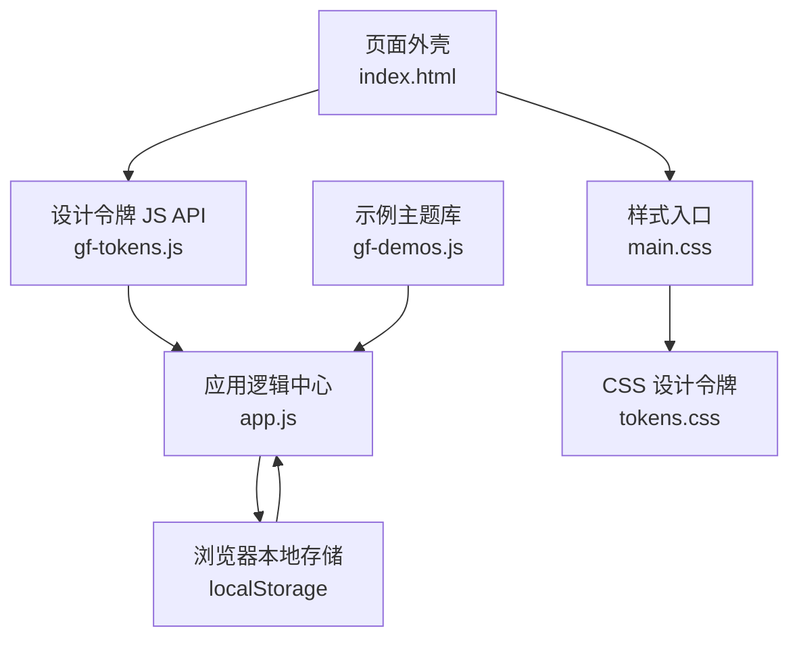
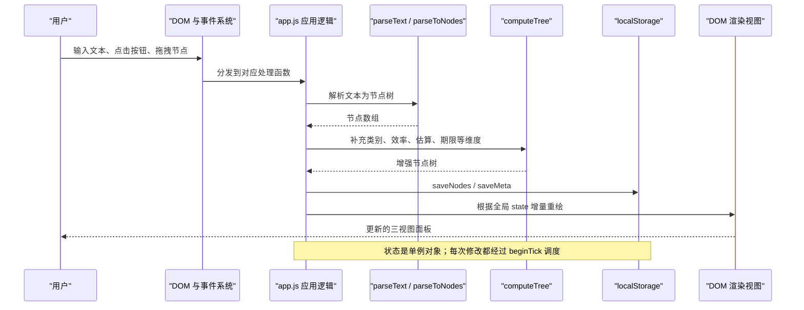
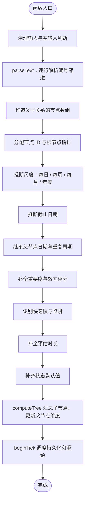
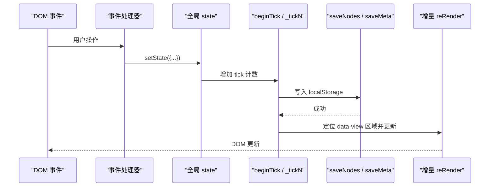
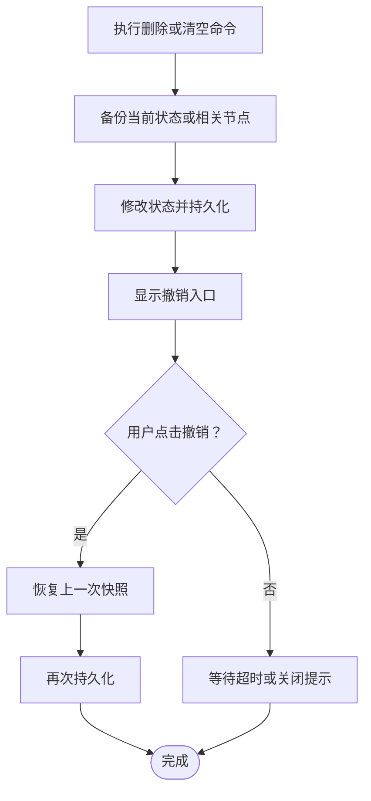
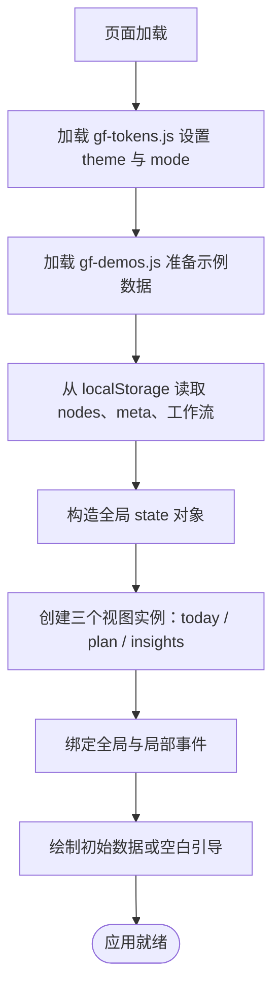
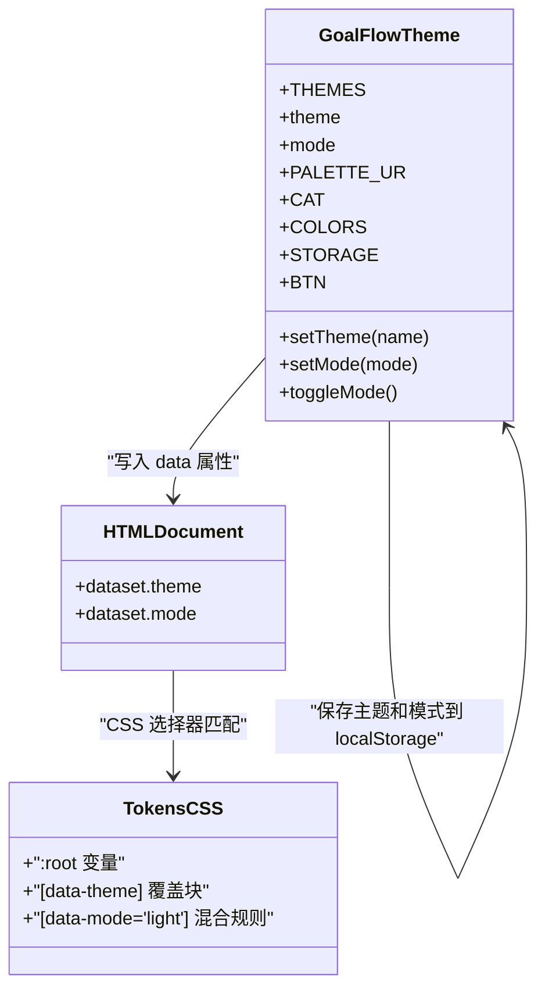
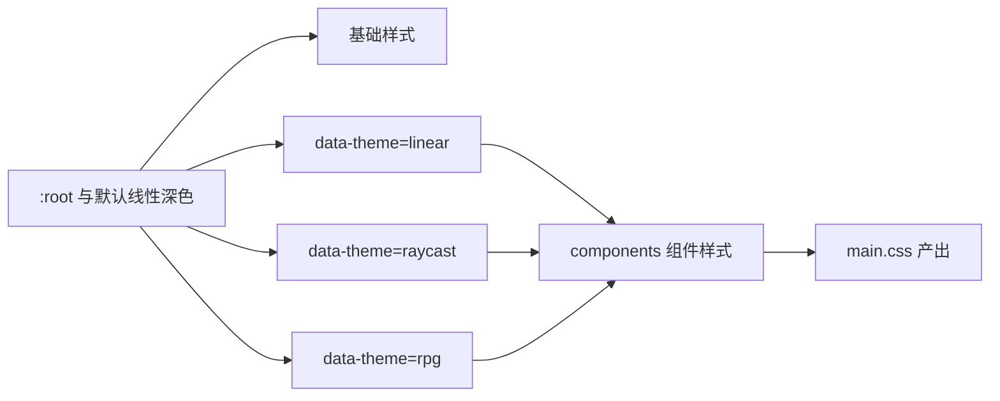
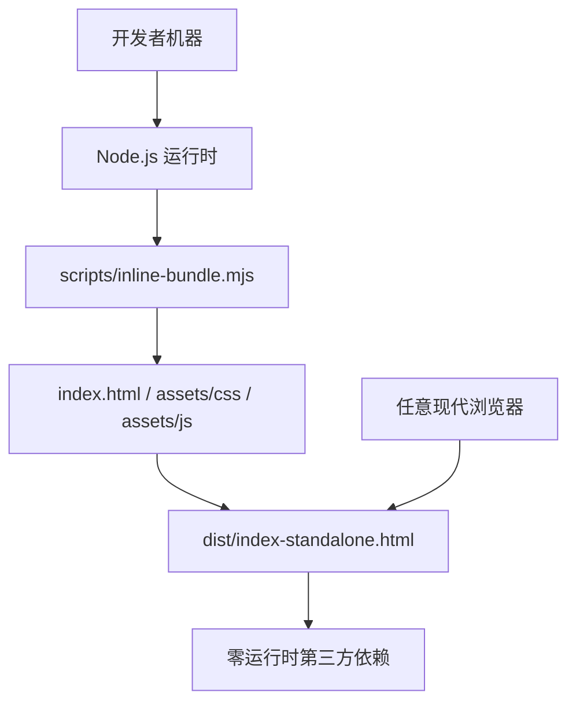

# 架构与设计

<cite>
**本文引用的文件**   
- [index.html](file://index.html)
- [assets/js/app.js](file://assets/js/app.js)
- [assets/js/gf-tokens.js](file://assets/js/gf-tokens.js)
- [assets/js/gf-demos.js](file://assets/js/gf-demos.js)
- [assets/css/main.css](file://assets/css/main.css)
- [assets/css/tokens.css](file://assets/css/tokens.css)
- [scripts/inline-bundle.mjs](file://scripts/inline-bundle.mjs)
- [README.md](file://README.md)
</cite>

## 目录
1. [简介](#简介)
2. [项目结构](#项目结构)
3. [核心组件](#核心组件)
4. [体系结构总览](#体系结构总览)
5. [详细组件分析](#详细组件分析)
6. [依赖关系分析](#依赖关系分析)
7. [性能考虑](#性能考虑)
8. [故障排除指南](#故障排除指南)
9. [结论](#结论)

## 简介
目标流 GoalFlow 是一个零运行时依赖的纯前端静态单页应用。它以 `index.html` 作为浏览器直接双击打开的入口，把用户的目标文本转换为目标节点树，通过维度计算、时间预算和重要紧急四象限分类，生成今日行动、目标规划与归纳洞察等视图；所有数据写入浏览器的 `localStorage`，无需服务器、账号或构建产物即可使用。生产打包脚本可将多个外链资源内联为单个 HTML，方便离线分发。

## 项目结构
GoalFlow 采用功能组织方式，职责比较清晰：

- `index.html`：页面外壳与 DOM 骨架。负责加载主题样式、CSS 主样式，并在 `<head>` 中初始化 `data-theme` / `data-mode`。
- `assets/js/app.js`：唯一业务逻辑中心，承担状态管理、事件监听、解析、调度、存储、渲染等全部运行期逻辑。
- `assets/js/gf-tokens.js`：暴露 `GF Theme API`，定义并同步 JS 设计令牌（色板、分类、颜色键、存储键名、按钮类名等）。
- `assets/js/gf-demos.js`：示例数据源，提供多种预设目标主题供“载入示例”复用。
- `assets/css/main.css`：CSS 入口，按依赖顺序引入结构令牌、基础层和各组件样式。
- `assets/css/tokens.css`：CSS 侧唯一色值来源，按 `data-theme` 与 `data-mode` 切换。
- `scripts/inline-bundle.mjs`：基于 Node.js 的构建脚本，将 CSS 与 JS 内联成单一发布 HTML。

**图表来源**
- [index.html:1-25](file://index.html#L1-L25)
- [assets/js/gf-tokens.js:1-177](file://assets/js/gf-tokens.js#L1-L177)
- [assets/css/main.css:1-11](file://assets/css/main.css#L1-L11)
- [assets/js/app.js:1-60](file://assets/js/app.js#L1-L60)

**章节来源**
- [README.md:1-103](file://README.md#L1-L103)

## 核心组件
| 组件 | 路径 | 主要职责 | 输入 | 输出 /副作用 |
|---|---|---|---|---|
| 页面外壳 | `index.html` | 构建 shell UI，定义三视图与侧栏骨架，初始化主题 data 属性 | 用户直接打开浏览器 | 可交互 DOM；`data-theme`、`data-mode` |
| 设计令牌 | `assets/js/gf-tokens.js` | 导出 `GoalFlowTheme`，维护主题与明暗模式持久化，向 `document.documentElement` 注入属性 | `localStorage` 中的主题和模式 | 全局 `GoalFlowTheme`、CSS 变量 |
| 示例库 | `assets/js/gf-demos.js` | 暴露 10 个内置目标主题数据 | 无 | `GoalFlowDemos` |
| 应用逻辑 | `assets/js/app.js` | 解析文本、构造节点树、补充维度、更新状态、触发重绘、持久化、事件绑定 | 用户输入、DOM 事件 | 更新后的 DOM、localStorage 数据 |
| CSS 入口 | `assets/css/main.css` | 统一引用 tokens、base 与各组件样式 | 开发时多文件 | 构建后展开为一个 CSS 字符串内联 |
| CSS 设计令牌 | `assets/css/tokens.css` | 按主题 × 模式切换 CSS 变量，承载视觉设计系统 | `data-theme`、`data-mode` | 应用到各组件类的颜色样式 |
| 打包脚本 | `scripts/inline-bundle.mjs` | 将 index.html、CSS、JS 内联为 `dist/index-standalone.html` | 源码文件 | 独立可发布 HTML 包 |

**章节来源**
- [index.html:1-200](file://index.html#L1-L200)
- [assets/js/gf-tokens.js:1-177](file://assets/js/gf-tokens.js#L1-L177)
- [assets/js/gf-demos.js:1-166](file://assets/js/gf-demos.js#L1-L166)
- [assets/css/main.css:1-11](file://assets/css/main.css#L1-L11)
- [assets/css/tokens.css:1-200](file://assets/css/tokens.css#L1-L200)
- [scripts/inline-bundle.mjs:1-52](file://scripts/inline-bundle.mjs#L1-L52)

## 体系结构总览
GoalFlow 在浏览器运行时并不存在服务端调用：它是一个典型的数据驱动单页应用。整体流程可以概括为用户操作 → 状态变更 → 时钟 tick → 持久化 → 根据全局 `state` 增量更新视图。

**图表来源**
- [assets/js/app.js:489-580](file://assets/js/app.js#L489-L580)
- [assets/js/app.js:5257-5303](file://assets/js/app.js#L5257-L5303)
- [assets/js/app.js:6608-6614](file://assets/js/app.js#L6608-L6614)

## 详细组件分析

### 全局状态与单例模式
应用使用一个顶层模块级对象保存全部可观察状态，包括节点列表、元信息、当前工作流、待处理回调、撤销栈等。该对象在整个应用内以全局变量形式被访问，因此属于典型的**单例状态模式**：

- 全局状态对象集中存放业务数据，避免散落在多个闭包中。
- 所有关键状态修改最终汇聚到统一的 `setState` 流程，再由调度机制保证一次性刷新。
- 历史命令通过撤销栈保存上一次可用状态，用于删除节点、清空数据等操作的临时回滚。

这种结构简化了跨视图共享数据的方式，也避免了传统 SPA 框架中复杂的依赖注入和状态容器订阅模型。缺点则是所有状态变化都会经过同一份计算逻辑，后续可通过更细粒度脏标记进一步优化。

**章节来源**
- [assets/js/app.js:550-610](file://assets/js/app.js#L550-L610)
- [assets/js/app.js:3940-4013](file://assets/js/app.js#L3940-L4013)

### 数据处理管线：从文本到节点树
当用户在“目标规划”视图输入自由文本时，系统按以下顺序处理：

**图表来源**
- [assets/js/app.js:489-540](file://assets/js/app.js#L489-L540)
- [assets/js/app.js:513-580](file://assets/js/app.js#L513-L580)
- [assets/js/app.js:189-210](file://assets/js/app.js#L189-L210)

关键点说明：

1. **文本解析**  
   `parseText` 将原始文本转为结构化节点树。它能识别编号层级、缩进、项目符号，并把首行自动视为目标根。
2. **维度推断**  
   `computeTree` 会补充每个节点的重要度、紧急度、价值、效率、类别、是否例行、持续时间等信息。
3. **估算与可行性**  
   系统尝试从文本中提取预估分钟数；未显式写出的叶子任务会使用默认估算，再结合日容量判断“能否在今日完成”。
4. **V/E 分类**  
   应用将“价值 vs 费力”分为快速赢、主战役、顺手活、陷阱四类，并据此影响四象限与可视化配色。
5. **增量缓存**  
   部分视图渲染结果带有 `tick` 缓存，只有状态版本号 `_tickN` 变化时才重新计算，减少无效开销。

**章节来源**
- [assets/js/app.js:489-580](file://assets/js/app.js#L489-L580)
- [assets/js/app.js:170-230](file://assets/js/app.js#L170-L230)
- [assets/js/app.js:1160-1200](file://assets/js/app.js#L1160-L1200)

### 状态变更与观察者模式
虽然应用没有使用观察者库，但它以 DOM 事件为入口、以单例状态为中心，实现了**函数式的观察者模式**：

- DOM 是信号源，例如文本框、按钮、导航、拖拽、键盘、窗口可见性等事件。
- 事件处理器不直接大量拼装 DOM，而是优先修改 `state`。
- `setState` 会推进全局 tick 计数，然后调用 `beginTick`。
- `beginTick` 依次触发保存数据、计算调度、渲染更新。
- 具体视图通过匹配 `data-view` 找到挂载区，只局部替换内容，而不是整页重建。

**图表来源**
- [assets/js/app.js:554-610](file://assets/js/app.js#L554-L610)
- [assets/js/app.js:2590-2645](file://assets/js/app.js#L2590-L2645)
- [assets/js/app.js:6608-6614](file://assets/js/app.js#L6608-L6614)

**章节来源**
- [assets/js/app.js:240-280](file://assets/js/app.js#L240-L280)
- [assets/js/app.js:554-610](file://assets/js/app.js#L554-L610)
- [assets/js/app.js:4363-4390](file://assets/js/app.js#L4363-L4390)

### 命令与撤销操作
对于可能破坏用户数据的操作，如删除节点、清空全部数据等，应用采用命令式写法：

1. 在执行前复制当前状态或节点快照。
2. 执行动作，如标记节点为已删除、清空节点树或重置视图。
3. 立即持久化，但保留撤销能力。
4. 提供一个“撤销”控件或快捷键，读取上一个快照恢复 `state`。
5. 通常伴随超时取消：例如提示出现 10 秒后自动取消撤销窗口，防止长期悬留危险状态。

这种方式比无限历史记录更适合这个体量：它用 O(n) 的节点快照换取一次危险操作的回滚能力，实现简单且对内存友好。

**图表来源**
- [assets/js/app.js:3940-4013](file://assets/js/app.js#L3940-L4013)

**章节来源**
- [assets/js/app.js:3940-4013](file://assets/js/app.js#L3940-L4013)

### 工厂与初始化流程
应用的启动过程具有明显的**工厂初始化模式**：

**图表来源**
- [index.html:1-25](file://index.html#L1-L25)
- [assets/js/app.js:550-610](file://assets/js/app.js#L550-L610)
- [assets/js/gf-tokens.js:85-177](file://assets/js/gf-tokens.js#L85-L177)

**章节来源**
- [index.html:1-25](file://index.html#L1-L25)
- [assets/js/app.js:550-610](file://assets/js/app.js#L550-L610)

### 主题与数据属性机制
GoalFlow 的主题不是由 JavaScript 动态逐个设置元素样式，而是通过两层协同实现：

1. **JS 层**：`gf-tokens.js` 从 `localStorage` 读取上次主题和模式，若无有效值则回退到默认值，然后立即设置 `document.documentElement.dataset.theme` 与 `document.documentElement.dataset.mode`，并暴露 `setTheme`、`setMode`、`toggleMode` 等接口。
2. **CSS 层**：`tokens.css` 以 `:root` 提供默认 Linear 主题变量，再以 `[data-theme="raycast"]`、`[data-theme="rpg"]` 覆盖其余主题变量，最后通过 `[data-mode='light']` 组合出浅色方案。

JS 侧还导出 `PALETTE_UR`、`CAT`、`COLORS`、`BTN` 等同步键，确保可视化颜色、分类颜色和按钮类名与 CSS 设计保持对齐。切换主题时会刷新页面，从而让样式与色板完全一致。

**图表来源**
- [assets/js/gf-tokens.js:1-177](file://assets/js/gf-tokens.js#L1-L177)
- [assets/css/tokens.css:1-120](file://assets/css/tokens.css#L1-L120)

**章节来源**
- [assets/js/gf-tokens.js:1-177](file://assets/js/gf-tokens.js#L1-L177)
- [assets/css/tokens.css:1-120](file://assets/css/tokens.css#L1-L120)

### CSS 分层：入口与组件
CSS 采用“入口 + 原子/基础 + 组件”的分层：

- `tokens.css`：主题与结构 token，是整个样色的权威来源。
- `main.css`：入口，按依赖顺序引入 `tokens`、`base`、以及按钮、芯片、表单、布局、特性、移动端等组件样式。
- `components/*.css`：分别封装按钮、芯片、表单、布局、业务特性与移动端适配，便于扩展新模块而不污染全局。

在构建环境中，`inline-bundle.mjs` 会递归展开 `@import url('./...')`，将样式合并后以内联 `<style>` 形式注入单个 HTML。

**图表来源**
- [assets/css/tokens.css:1-180](file://assets/css/tokens.css#L1-L180)
- [assets/css/main.css:1-11](file://assets/css/main.css#L1-L11)

**章节来源**
- [assets/css/main.css:1-11](file://assets/css/main.css#L1-L11)
- [assets/css/tokens.css:1-180](file://assets/css/tokens.css#L1-L180)

## 依赖关系分析
GoalFlow 的构建依赖和应用依赖边界很清晰：

- 生产运行时：只依赖浏览器 DOM 和 `localStorage`，没有任何第三方运行时库。
- 构建期依赖：Node.js 仅用于执行 `scripts/inline-bundle.mjs`。它使用内置 `fs`、`path`、`url` 模块，无需 npm 包。
- 外部字体 CDN 仅为可选体验优化；无网络时回退系统字体。

**图表来源**
- [scripts/inline-bundle.mjs:1-52](file://scripts/inline-bundle.mjs#L1-L52)
- [README.md:65-103](file://README.md#L65-L103)

### 模块间依赖表
| 模块 | 依赖 | 被谁依赖 |
|---|---|---|
| `gf-tokens.js` | 无业务依赖，读取/写入 `localStorage` | `index.html`、`app.js` |
| `gf-demos.js` | 无外部依赖，暴露全局 `GoalFlowDemos` | `index.html`（打包）、`app.js` |
| `app.js` | `GoalFlowTheme`、`GoalFlowDemos`、`document`、`localStorage` | 整个应用行为 |
| `main.css` | 其他 CSS 文件 | `index.html` |
| `inline-bundle.mjs` | Node.js 内置模块 | 开发者命令行 |

**章节来源**
- [scripts/inline-bundle.mjs:1-52](file://scripts/inline-bundle.mjs#L1-L52)
- [assets/js/app.js:1-60](file://assets/js/app.js#L1-L60)
- [assets/js/gf-tokens.js:1-177](file://assets/js/gf-tokens.js#L1-L177)

## 性能考虑
1. **零运行时依赖**  
   浏览器只需解析原生 DOM API 和字符串，没有打包体积较大的框架运行时。这带来更快的首次渲染和低内存占用，但也意味着复杂状态订阅、虚拟 DOM diff 等能力需要自行实现或通过轻函数组合获得。
2. **增量重绘**  
   视图渲染尽量按 `data-view` 分区域操作，而不是整页重建；某些排序和筛选结果会带 tick 缓存，避免同一次状态内重复计算。
3. **批处理 tick**  
   `beginTick` 推进 `_tickN`，使多次状态更新能在一个调度周期内合并为一次持久化和渲染，降低 `localStorage` 写入压力和 DOM 重排次数。
4. **数据规模敏感点**  
   若目标树非常大，`computeTree`、遍历祖先链、重新计算四象限或桑基图等聚合逻辑可能成为热点。可考虑按视图懒计算和更细粒度 dirty flag 优化。
5. **LocalStorage 限额**  
   浏览器 `localStorage` 通常为 5–10 MB。应用应继续鼓励定期 JSON 备份，并通过压缩字段、移除已完成历史日志等方式控制增长。
6. **构建产物大小**  
   内联 HTML 会把 CSS 与 JS 全部打入文件，提升单次加载稳定性，但会增加初始字节量。可通过拆分演示数据、延迟加载大可视化为进一步优化空间。

[本节为通用性能讨论，不直接分析具体代码片段]

## 故障排除指南
| 现象 | 可能原因 | 排查与修复 |
|---|---|---|
| 打开后主题闪烁或错乱 | `html` 上未正确写入 `data-theme` / `data-mode` | 检查 `index.html` 头部初始化脚本；确认 `localStorage` 中值是否为合法主题 |
| 主题切换无效 | `setTheme` 或 `setMode` 参数不在注册表中 | 只接受预定义主题名称与 `dark` / `light`；否则函数返回且不改变界面 |
| `localStorage` 报错 | 隐私模式限制写入 | 脚本已加 try-catch 保护，主题仍可使用默认值；建议普通页面环境打开 |
| 数据丢失 | `localStorage` 被浏览器清理 | 使用顶栏“备份数据”导出 JSON，再通过“恢复数据”导入 |
| 构建后样式错位 | 打包未覆盖 CSS import 或替换正则失败 | 确认 main.css 仍使用相对路径 `@import url(...)`，并以原 `assets/css/main.css` 路径运行脚本 |
| 打包文件名不同 | 输出路径固定为 `dist/index-standalone.html` | 查看控制台输出的 KB 信息与文件位置 |

**章节来源**
- [assets/js/gf-tokens.js:70-110](file://assets/js/gf-tokens.js#L70-L110)
- [scripts/inline-bundle.mjs:12-52](file://scripts/inline-bundle.mjs#L12-L52)
- [README.md:85-103](file://README.md#L85-L103)

## 结论
GoalFlow 通过极小运行时与高度集中的模块职责，实现了一个完整的时间管理与目标可视化应用。其高层设计围绕几个核心原则：

- 单例状态：`state` 对象是所有业务的唯一真相源。
- 事件驱动：DOM 事件是输入入口，但不直接持有业务语义。
- 函数式数据流：`parseText → computeTree → setState → beginTick → save → render`，每一步都力求明确。
- 可撤销命令：对破坏性操作保留最近快照，保障数据安全性。
- 设计令牌双端同步：`gf-tokens.js` 与 `tokens.css` 分别承担 JS 常量与 CSS 变量的一致性。
- 零运行时依赖：Node.js 仅用于开发阶段打包，浏览器运行时干净可控。

这套结构适合中小规模工具型应用，既容易理解，也便于在不引入框架的前提下演进更大功能的分析视图与工作流。