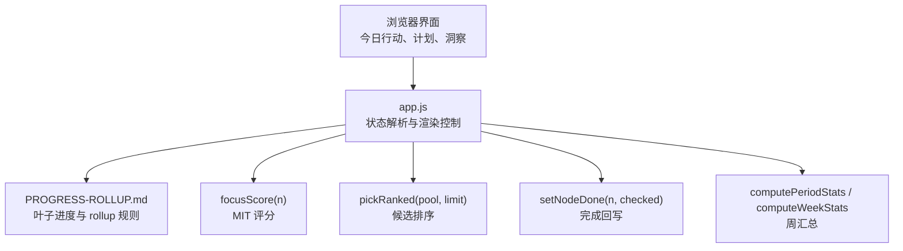
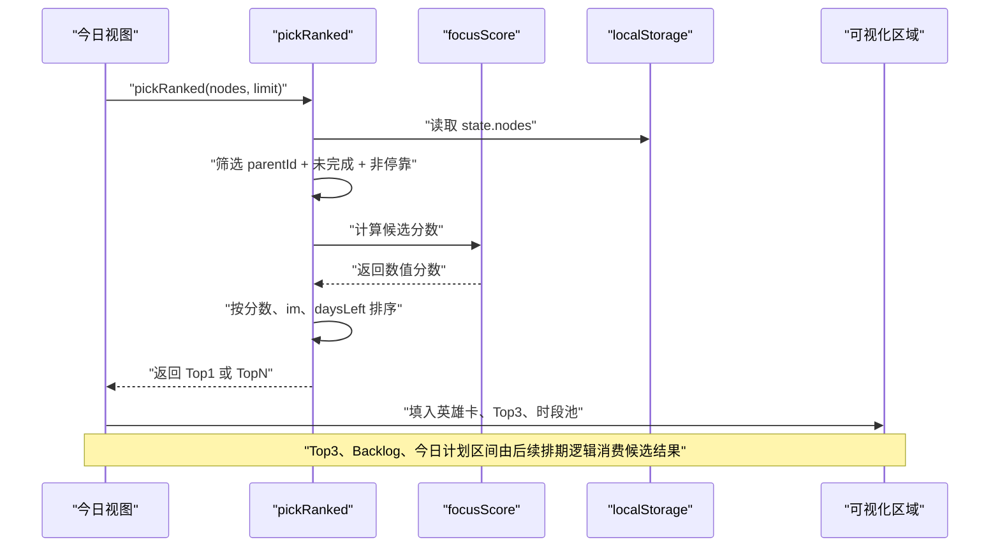
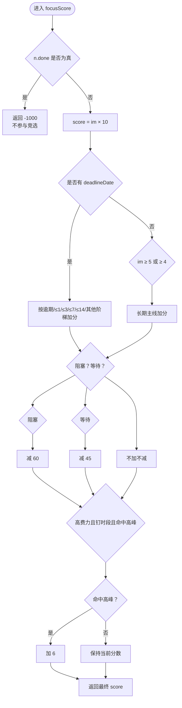
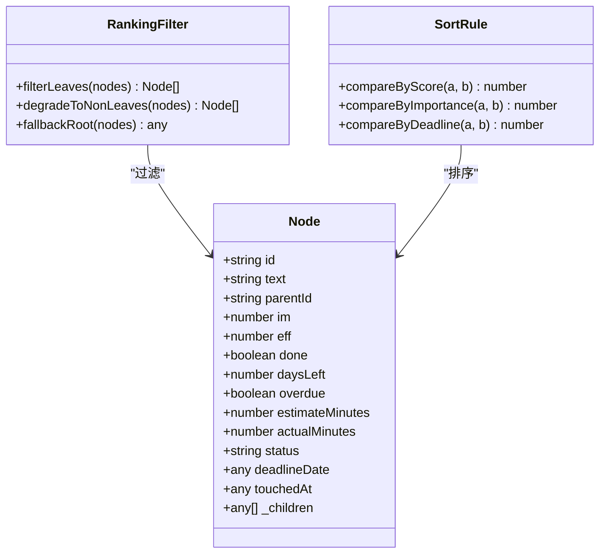
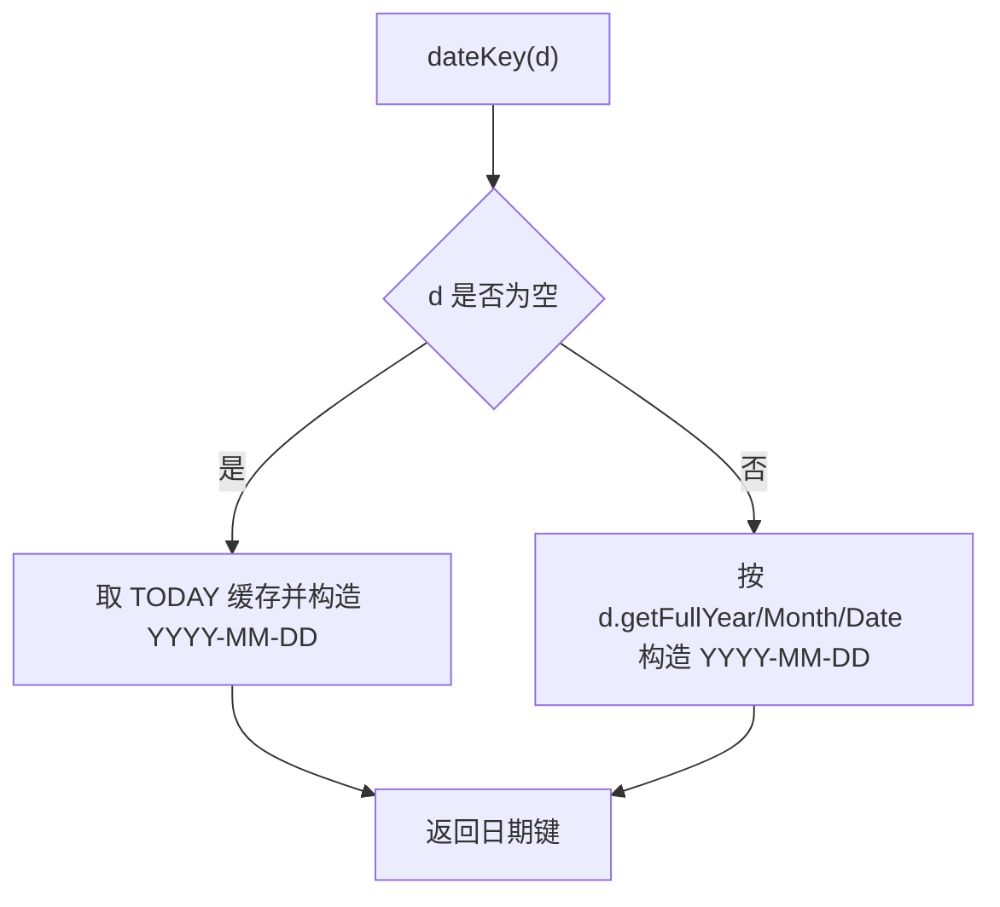
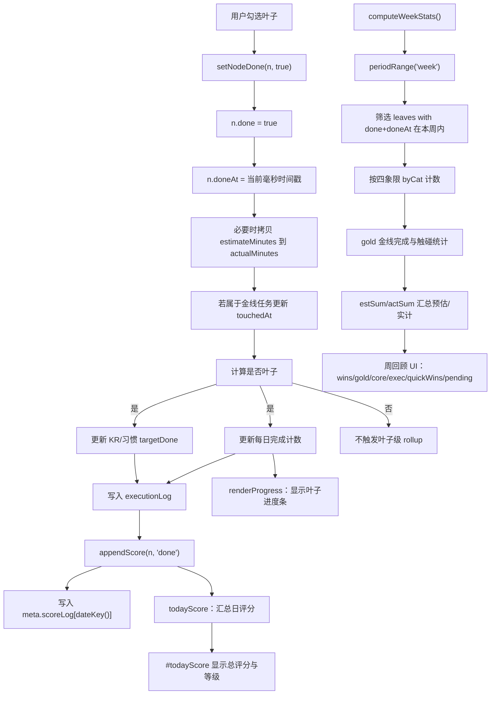

# MIT 选择、评分与进度 Rollup

<cite>
**本文引用的文件**
- [app.js](file://assets/js/app.js)
- [PROGRESS-ROLLUP.md](file://docs/PROGRESS-ROLLUP.md)
</cite>

## 目录
1. [引言](#引言)
2. [项目结构与职责边界](#项目结构与职责边界)
3. [核心组件总览](#核心组件总览)
4. [架构：MIT 决策与进度计算流程](#架构mit-决策与进度计算流程)
5. [`focusScore` 评分模型](#focusscore-评分模型)
6. [`pickRanked` / `pickTop` 任务选择策略](#pickranked-picktop-任务选择策略)
7. [`dateKey` 与日期边界](#datekey-与日期边界)
8. [完成动作、Rollup 与可视化反馈链](#完成动作rollup与可视化反馈链)
9. [API 契约与边界行为](#api-契约与边界行为)
10. [性能、可观测指标与测试建议](#性能可观测指标与测试建议)
11. [结论](#结论)

## 引言
本文件从算法级视角梳理目标流 GoalFlow 的核心计算层，重点说明「当下最重要任务」的选择顺序、评分公式、完成度 Rollup 规则，以及「日维度统计 → 周滚动汇总 → 可视化反馈」的完整数据链。目标读者是希望在不破坏现有语义的前提下扩展评分策略的高级开发者。

## 项目结构与职责边界
GoalFlow 是单页前端应用，核心逻辑集中于 `assets/js/app.js`；权威完成度口径由 `docs/PROGRESS-ROLLUP.md` 约定。该文档把「叶子节点」「父节点进度」「completedAt（仓库代码使用 `doneAt`）」「estimateMinutes 不改变完成百分比」等规则写为不可变契约；实现函数则集中在 `assets/js/app.js` 中。



**图表来源**
- [app.js:328-376](file://assets/js/app.js#L328-L376)
- [app.js:597-663](file://assets/js/app.js#L597-L663)
- [app.js:5413-5507](file://assets/js/app.js#L5413-L5507)
- [PROGRESS-ROLLUP.md:1-37](file://docs/PROGRESS-ROLLUP.md#L1-L37)

## 核心组件总览
| 符号 | 作用 | 输入 | 输出 | 副作用 |
|---|---|---|---|---|
| `dateKey(d)` | 将时间戳或日期对象映射到 `YYYY-MM-DD` | 可选 `Date` | 日期字符串 | 缓存 `TODAY` 对应的今天 key |
| `category(im, ur)` | 四象限分类 | `im`、`ur` | `{ now, core, distract, noise }` 之一 | 无 |
| `focusScore(n)` | 给未完成任务打分 | 单个任务节点 | 数字分数 | 只读 |
| `focusScoreParts(n)` | 拆解评分项 | 同 `focusScore` | `{ total, parts }` | 无 |
| `pickRanked(pool, limit)` | 从池中选择前若干任务 | 节点数组、返回数量 | 单个或数组 | 按 `(pool, limit)` 缓存 |
| `pickTop(pool)` | 选出唯一 MIT | 节点数组 | 单个节点或 `null` | 复用 `pickRanked` |
| `leafProgress()` | 全树叶子完成比 | 当前 `state.nodes` | `{ done, total, pct }` 或 `null` | 读取缓存子树 |
| `subtreeProgress(node)` | 以某节点为根的叶子完成比 | 根节点 | `{ done, total, pct }` 或 `null` | 读取缓存子树 |
| `setNodeDone(n, checked)` | 勾选/取消勾选 | 节点、布尔值 | 无直接返回值 | 写入 `done/doneAt/touchedAt/scoreLog/executionLog/habitStreaks` |
| `appendScore(n, kind, extra)` | 写入当日评分记录 | 节点、评分类型、额外参数 | 无 | 写入 `meta.scoreLog[dk]` |
| `todayScore()` | 汇总当天评分 | 无显参 | `{ total, count, pomos, focusMin, entries, grade }` | 读取 `meta.scoreLog` |
| `computePeriodStats(cycle)` | 周期统计 | 周期键名 | 周/月/季回顾统计对象 | 读取完整树与估计时长 |
| `computeWeekStats()` | 快捷周统计 | 无 | 等价调用 `computePeriodStats('week')` | 同上 |

**章节来源**
- [app.js:198-208](file://assets/js/app.js#L198-L208)
- [app.js:328-376](file://assets/js/app.js#L328-L376)
- [app.js:597-663](file://assets/js/app.js#L597-L663)
- [app.js:5413-5507](file://assets/js/app.js#L5413-L5507)
- [PROGRESS-ROLLUP.md:1-37](file://docs/PROGRESS-ROLLUP.md#L1-L37)

## 架构：MIT 决策与进度计算流程
MIT 计算不是简单取最大重要度；它是一个“先过滤、再加权、最后稳定排序”的过程。进度 Rollup 则是另一条独立的数据流：以 `done`、`doneAt`、`estimateMinutes` 为依据统计本周成果，但不参与百分比分母计算。



**图表来源**
- [app.js:646-663](file://assets/js/app.js#L646-L663)
- [app.js:597-625](file://assets/js/app.js#L597-L625)

**章节来源**
- [app.js:646-663](file://assets/js/app.js#L646-L663)

## `focusScore` 评分模型

### 输入与中间变量
- **必要输入**：`n.im`、`n.deadlineDate`、`n.overdue`、`n.daysLeft`、`n.eff`、`n.slot`、`n.status`、`isNodeBlocked(n)`、`isNodeWaiting(n)`。
- **依赖外部状态**：`state.meta.energyLog`、当前精力高峰桶 `ENERGY_BUCKETS`、`energyBucketNow()`。
- **关键中间变量**：
  - `base = n.im * 10`
  - `deadlineBonus`：逾期或不同期限阶梯加分
  - `longLineBonus`：无截止但长期主线加分
  - `parkedPenalty`：等待减 `-45`，阻塞减 `-60`
  - `peakBoost`：高费力任务落在本人当前精力高峰段时加 `+6`

### 评分公式（伪代码）
1. 若 `n.done === true`，返回固定极大负数，让已完成任务退出 MIT 竞选。
2. 初分 = `n.im × 10`。
3. 有截止时间时：
   - 已逾期 `+30`
   - 剩余 ≤1 天 `+26`
   - 剩余 ≤3 天 `+20`
   - 剩余 ≤7 天 `+13`
   - 剩余 ≤14 天 `+7`
   - 其他短期 `+3`
4. 无截止时间时：
   - `n.im ≥ 5` 加 `+4`，否则 `≥ 4` 加 `+2`
5. 若被标记阻塞，减去 `60`；若仅等待，减去 `45`。
6. 若 `n.eff ≥ 4` 且钉了时段，且当前处于该任务的精力高峰桶，则再加 `+6`。
7. 返回累计分数。

### 输出等级含义
`focusScore` 本身输出的是连续数值；但在实际选择中，它决定排序优先级，而不是 S/A/B/C。真正的等级出现在 `todayScore().grade`，即当日总评分对应评级。



**图表来源**
- [app.js:597-625](file://assets/js/app.js#L597-L625)

**章节来源**
- [app.js:597-645](file://assets/js/app.js#L597-L645)

## `pickRanked` / `pickTop` 任务选择策略

### 设计意图
MIT 不是从整棵树里任意挑一个节点，而是先从「待办集合」开始收敛。它的目标是保证：日常入口只显示可执行、不会被挂起任务污染、在截止日期与长期主线之间找到平衡。

### 过滤阶段
1. **首选叶子候选**：必须满足：
   - 有 `parentId`（不是根）
   - `!done`
   - `_children.length === 0`（叶子）
   - `!isNodeParked(n)`（未阻塞也未等待）
2. **退化候选集**：若无符合条件的叶子，退化为所有未完成非停靠节点，包含父节点。
3. **空池处理**：若仍为空，退回全局根节点；当 `limit > 1` 返回 `[root]`，否则返回根节点本身。

### 排序阶段
候选比较优先使用：
1. `focusScore(b) - focusScore(a)`：分数越高越靠前。
2. `b.im - a.im`：重要度相同时更重要者居前。
3. `daysLeft`：无截止视为 `999`，更早到期者优先。

### 输出形态
- `pickTop(pool)`：取第 1 个，用于英雄卡 MIT。
- `pickRanked(pool, limit)`：返回前 `limit` 个；常用于构建今日执行池、Top3 候选。

### 分类与权重如何影响 MIT
- V/E 分类和四象限本身不直接出现在 `focusScore` 比较中，但它们通过 `im`、`eff` 间接作用：
  - 四象限帮助设定 `im`/`ur`，从而改变重要度权重。
  - V/E 中的 “价值 ≥ 4、费力 ≤ 2” 标记为快速赢，主要用于「筛选叙述」与周回顾计数；根据权威文档，Quick Win **不改变 rollup 分母**。
  - `focusScore` 会对高费力任务做精力高峰加成，使“高价值高费力”的任务更可能成为 MIT，前提是用户确实在能量高峰时段处理它。



**图表来源**
- [app.js:646-663](file://assets/js/app.js#L646-L663)

### 映射到 Top3、Backlog、今日计划与日程区间
虽然 MIT 挑选函数本身只输出分数与顺序，但其返回值会被上层视图消费：
- **英雄卡 MIT**：通常由 `pickTop` 的结果直接呈现。
- **Top3**：一般来自 `pickRanked(nodes, 3)` 的前三项。
- **Backlog 泳道**：不包含进 Top3 的候选、跨期遗留、下月预告；`openMonthPlan` 等流程会消费未完成叶子。
- **今日计划与日程区间**：由 `todayExecutionPoolFor`、日容量判断、slot 字段与时间段聚合后，把候选落入“立即做 / 核心投入 / Backlog / 📥 未排期”等视觉分区。具体 UI 分区位置见 `index.html` 今日面板结构，MIT 与按时段的执行区相互去重。

**章节来源**
- [app.js:646-663](file://assets/js/app.js#L646-L663)
- [index.html:130-190](file://index.html#L130-L190)

## `dateKey` 与日期边界

### 定义
`dateKey(d)` 的目标是把时间归一化到天。若传入为假值，则取运行时 `TODAY`；否则用传入日期对象。结果是 `YYYY-MM-DD` 格式。

### 关键特性
- 当天计算存在缓存：重复查询同一时刻的 today key 不会重复构造日期。
- 没有直接暴露 `startOfWeek` / `endOfWeek`；周统计使用 `weekKey` 与 `weekRange`。
- `weekKey` 以本地时区的星期日为周起点；`weekRange` 返回 `start inclusive、end exclusive` 的日期区间。

### 周切分与时区
- 周范围：`start` 为周一 0:0:0，`end` 为下一天 0:0:0。
- 已完成任务归属周的条件：`doneAt >= start.getTime() && doneAt < end.getTime()`。
- 因此“周日”归属上一周还是下一周取决于当地时间的 `new Date(year, month, date)` 落在哪个 Monday-based 区间。

### 缺失估计时间时的默认行为
- `parseEstimateMinutes`：能从文本解析出“X 小时 / X 分钟 / X min / 半天 / 五分钟”等格式。
- `ensureEstimate`：若是叶子且未解析出值，赋默认 `30` 分钟。
- `ensureAllEstimates`：会在需要估算统计前先对所有节点补全。
- 在统计中，`estimateMinutes || 0`，所以缺失时不影响完成数量，只贡献 0 预估时长。



**图表来源**
- [app.js:198-208](file://assets/js/app.js#L198-L208)
- [app.js:5413-5425](file://assets/js/app.js#L5413-L5425)

**章节来源**
- [app.js:198-208](file://assets/js/app.js#L198-L208)
- [app.js:5413-5425](file://assets/js/app.js#L5413-L5425)

## 完成动作、Rollup 与可视化反馈链

### 权威规则
根据 `docs/PROGRESS-ROLLUP.md`：
- 只有叶子计入完成进度。
- 根节点和任意有子节点的中间层不计入完成百分比。
- “聚焦模式”隐藏节点仍参与统计。
- 完成写入 `doneAt`；取消完成清空 `doneAt`。
- 仅统计完成且 `doneAt` 落在本周一到下周一区间的叶子。
- Quick Win 不改变 rollup 分母。
- `estimateMinutes` / `actualMinutes` 不参与叶子完成百分比。

注意：仓库实现中使用 `doneAt`，文档中称为 `doneAt`（标题也出现 `completedAt`）。应以代码使用的 `doneAt` 为准，文档是概念命名。

### 从节点完成到可视化的逐步过程



**图表来源**
- [app.js:328-376](file://assets/js/app.js#L328-L376)
- [app.js:5448-5507](file://assets/js/app.js#L5448-L5507)
- [PROGRESS-ROLLUP.md:1-37](file://docs/PROGRESS-ROLLUP.md#L1-L37)

### 状态写入位置清单

| 操作 | 主数据 | 元数据 | 可视反馈 |
|---|---|---|---|
| 完成叶子 | `node.done`、`node.doneAt`、`node.touchedAt`（可能是金线）、`node.targetDone`（计数型叶子） | `meta.scoreLog[dk].entries` | 进度条、今日评分、执行日志 |
| 取消完成叶子 | `node.done=false`、`node.doneAt=null` | `meta.scoreLog[dk]` 中删除相应 done 条目 | 日评分重新汇总 |
| 完成普通任务但非叶子 | 仍会完成标记和 touchedAt；不会触发叶子级完成计数和 KR/targetDone 追加 | 评分仍可追加（调用方决定是否调用 `appendScore`） | 取决于调用方 |
| 周回顾 | 不直接写入周统计；仅读取状态 | 已有回顾记录保存在 review store | 自动填充下周草稿 |
| 专注时长与番茄钟 | 由番茄逻辑追加 `actualMinutes` 并调用评分 | `meta.scoreLog[dk]` | 顶部进度条、日评分 |

### 边界情况

| 场景 | 行为 | 原因与建议 |
|---|---|---|
| 子节点未完成、父节点能否计为完成 | 只有叶子计入完成进度；父节点只是容器 | 这与 PROGRESS-ROLLUP.md 一致；若想推进父节点，应完成其叶子 |
| 回退 `doneAt` | `setNodeDone` 只在勾选时设置新时间戳；取消时设为 `null`；不支持直接覆盖历史已完成时间戳 | 若需修复历史数据，应在恢复 JSON 或批处理脚本中调整，避免破坏 rollup |
| 重复完成 | 第二次勾选会把 `doneAt` 改为新时间戳 | 对周统计而言，同一节点在该窗口内仍然只作为一条完成；推荐业务层防止重复操作或提示用户 |
| 跨周日切分 | `weekRange` 以本地时间构造区间，区间右端是开区间 | 周日晚上完成会落入“下一个自然周的开始”，但 `weekKey` 仍以周一为起点，需特别注意本地时区边界 |
| 缺失 `estimateMinutes` | 叶子默认 `30` 分钟，统计时用 `|| 0` | 不影响百分比，只影响预估与估/实偏差分析 |
| Quick Win 不改变 rollup 分母 | 分母是所有叶子，不是仅 Quick Win | 文档明确这一点，扩展时不要偷偷改变完成占比定义 |
| 聚焦模式隐藏节点 | 仍计入叶子统计 | Rollup 基于完整 `state.nodes`，不应按视图过滤后统计 |

**章节来源**
- [app.js:328-376](file://assets/js/app.js#L328-L376)
- [app.js:646-663](file://assets/js/app.js#L646-L663)
- [app.js:5448-5507](file://assets/js/app.js#L5448-L5507)
- [PROGRESS-ROLLUP.md:1-37](file://docs/PROGRESS-ROLLUP.md#L1-L37)

## API 契约与边界行为

### `dateKey`

| 字段 | 类型 | 说明 |
|---|---|---|
| 输入 | `Date \| null \| undefined` | 默认使用运行时 `TODAY` |
| 输出 | `string` | `YYYY-MM-DD` |
| 复杂度 | `O(1)` | 含内部当天缓存 |
| 典型用途 | 评分 log key、提醒 key、日维度统计键 |

**示例**
- 输入 `new Date(...)` → `"2026-11-23"`
- 输入空 → 返回今天日期字符串

### `category`

| 字段 | 类型 | 说明 |
|---|---|---|
| 输入 | `im: number`, `ur: number` | 重要度与紧急度 |
| 输出 | 四象限对象 | `now`、`core`、`distract` 或 `noise` |
| 规则 | `im≥4` 重要，`ur≥4` 紧急 | 对应“立即做、核心投入、干扰、噪音” |

### `focusScore`

| 字段 | 类型 | 说明 |
|---|---|---|
| 输入 | 节点对象 `n` | 至少包含 `done`、`im`、`deadlineDate`、`daysLeft`、`overdue`、`eff`、`slot`、`status` |
| 输出 | `number` | 正越大越可能成为 MIT；已完成返回 `-1000` |
| 复杂度 | `O(1)` | 依赖局部字段与能量曲线常量查找 |
| 注意事项 | 等待/阻塞大幅扣分 | 高费力任务命中精力高峰才获得临时加分 |

### `pickRanked`

| 字段 | 类型 | 说明 |
|---|---|---|
| 输入 | `pool?: node[]`, `limit?: number` | pool 默认 `state.nodes`，limit 默认未在此函数强制；常见用法为 `1` 或 `3` |
| 输出 | `node \| node[] \| null` | 返回单个 MIT、TopN 列表或空值 |
| 复杂度 | `O(k log k)`，k 为候选节点数 | 后续切片 `slice(0, limit)` 为 `O(limit)` |
| 缓存 | 同 `pool` 与 `limit`、同 tick 直接返回 | 提高渲染热点效率 |

### `pickTop`

| 字段 | 类型 | 说明 |
|---|---|---|
| 输入 | `pool?: node[]` | 传入候选池；通常为全部 nodes |
| 输出 | `node \| null` | 唯一 MIT |
| 备注 | 实际上是 `pickRanked(pool, 1)` | 可优先复用此函数 |

### `setNodeDone`

| 字段 | 类型 | 说明 |
|---|---|---|
| 输入 | `n: node`, `checked: boolean` | 完成或取消 |
| 输出 | 无 | 副作用为主 |
| 主要副作用 | 修改 `done`、`doneAt`、`touchedAt`、`targetDone`（部分叶子）、`meta.scoreLog`、执行日志、习惯 streak | 仅叶子会触发完成计数和评分追加 |

### `appendScore`

| 字段 | 类型 | 说明 |
|---|---|---|
| 输入 | `n: node`, `kind: string`, `extra?` | `kind` 支持 `'done'`、`'pomo'` |
| 输出 | 无 | 写入 `meta.scoreLog[dk]` |
| 评分来源 | done 走 `scoreDoneItem`；pomo 走 `scorePomoItem(n, minutes)` |

### `todayScore`

| 字段 | 类型 | 说明 |
|---|---|---|
| 输出 | `total`, `count`, `pomos`, `focusMin`, `entries`, `grade` | `focusMin = pomos × 25` |
| 评级 | `scoreGrade(total)` | 对应 S/A/B/C 日评分等级 |
| 复杂度 | `O(n)`，n 为当天评分条目 |

### `computeWeekStats` / `computePeriodStats`

| 字段 | 类型 | 说明 |
|---|---|---|
| 输入 | `cycle: 'week'|'month'|'quarter'` | `computeWeekStats` 固定传 `'week'` |
| 输出 | 周期统计对象 | 包含 `total`、`byCat`、`coreVsFire`、`quickWins`、`pending`、`range`、`completedTexts`、`goldMoved`、`goldDetail`、`goldCompleted`、`goldTouched`、`estSum`、`actSum`、`progressed`、`stalled` |
| 复杂度 | `O(N)`，N 为节点总数 | 多次 filter/collect 树节点 |
| 与 Rollup 的关系 | 基于叶子完成和 `doneAt` 计算；不改变 rollup 百分比 |

### 返回值示例（简化描述）

`pickRanked([nodes], 3)`：
```json
{
  "type": "数组",
  "description": "最多三个尚未完成的叶子节点，按 focusScore 降序",
  "exampleDescription": "第一项通常是今日 MIT，第二三项是备选"
}
```

`todayScore()`：
```json
{
  "total": 85,
  "count": 2,
  "pomos": 2,
  "focusMin": 50,
  "entries": [
    {
      "kind": "done",
      "nodeId": "leaf-id-a",
      "text": "完成某个叶子",
      "score": 30,
      "reason": "由 scoreDoneItem 生成"
    },
    {
      "kind": "pomo",
      "nodeId": "leaf-id-b",
      "text": "另一个完成目标",
      "score": 25,
      "reason": "由 25 分钟番茄推导"
    }
  ],
  "grade": "A 或 B 或 C 或 S"
}
```

`computeWeekStats()`：
```json
{
  "cycle": "week",
  "total": 4,
  "byCat": {
    "core": 2,
    "now": 1,
    "distract": 1,
    "noise": 0
  },
  "corePct": 50,
  "coreVsFire": {
    "core": 2,
    "fire": 2,
    "corePct": 50,
    "firePct": 50
  },
  "quickWins": 2,
  "pending": 3,
  "range": {
    "start": "2026-11-23T00:00:00.000Z",
    "end": "2026-11-30T00:00:00.000Z",
    "label": "本周"
  },
  "goldMoved": true,
  "estSum": 90,
  "actSum": 75
}
```

**章节来源**
- [app.js:198-208](file://assets/js/app.js#L198-L208)
- [app.js:328-376](file://assets/js/app.js#L328-L376)
- [app.js:597-663](file://assets/js/app.js#L597-L663)
- [app.js:5448-5507](file://assets/js/app.js#L5448-L5507)

## 性能、可观测指标与测试建议

### 时间复杂度

| 函数 | 时间复杂度 | 说明 |
|---|---:|---|
| `dateKey` | `O(1)` | 含当天缓存 |
| `category` | `O(1)` | 常数分支 |
| `focusScore` | `O(1)` | 有限条件与常数次查表 |
| `focusScoreParts` | `O(1)` | 构造几条加分信息 |
| `pickRanked` | `O(k log k)` | k 为候选数；之后切片 |
| `pickTop` | `O(k log k)` | 委托 `pickRanked` |
| `leafProgress` | `O(N)` | 遍历一次 nodes |
| `subtreeProgress` | `O(T)` | T 为指定子树节点数 |
| `setNodeDone` | 近似 `O(C + D)` | 树缓存更新 + 日志/计分操作 |
| `appendScore` | `O(1)` | 写入 `meta.scoreLog[dk]` 并持久化 |
| `todayScore` | `O(E)` | E 为当日评分条目 |
| `computePeriodStats` | `O(N)` | 多次扫描 nodes 与 leaves |

### 可观测指标建议

| 指标 | 读取位置 | 意义 |
|---|---|---|
| `leafProgress.pct` | `assets/js/app.js` 进度 chip | 整体完成进度 |
| `todayScore.total / grade` | `#todayScore` | 当日产出质量 |
| `meta.scoreLog[dk].entries.length` | 评分日志 | 当日事件量 |
| `computeWeekStats().total` | 周回顾 | 本周有效完成数 |
| `computeWeekStats().corePct` | 周回顾 | 核心投入比例 |
| `computeWeekStats().estSum / actSum` | 周回顾 | 预估 vs 实计偏差线索 |
| `weeklyMomentum.done / habitsDone` | 周回顾摘要 | 近 7 天动态 |
| `stagnantDays(node)` | 停滞预警 | 高重要节点无动静的天数 |
| `burnoutSignal()` | 倦怠预警 | 低能量×低产出信号 |

### 单元测试用例设计建议

#### 评分类
1. 已完成任务得分应小于任何未完成任务。
2. 相同 `im` 下，更早 deadline 的任务分数更高。
3. 阻塞任务应显著低于等待任务；两者都远低于正常任务。
4. 无截止但高 `im` 任务仍能获得“长期主线”加分。
5. 高费力任务在未钉时段或不在当前精力高峰时，不得获得峰值加成。
6. 高费力任务钉在当前精力高峰时段时应获得额外加分。

#### 选择类
7. `pickTop` 对空节点池返回 `null`。
8. `pickRanked` 在空池且存在根节点时，根据 `limit` 返回根节点或根节点数组。
9. 候选优先排除根节点以外的普通节点；仅在没有可用叶子时退化为父节点。
10. 重复调用相同 pool 与 limit 应命中缓存并返回相同结果。

#### 进度 Rollup
11. 根节点不计入叶子完成百分比。
12. 带子节点的中间层不计入完成百分比。
13. 真正叶子完成才能进入分母与分子。
14. 取消勾选应从当日评分中移除对应条目。
15. 周统计只包含 `done === true` 且 `doneAt` 落在本周一到下周一区间的叶子。
16. 无 `doneAt` 的历史完成项不应计入“本周完成”。
17. Quick Win 标记不能改变叶子完成百分比。
18. 缺失 `estimateMinutes` 的叶子在统计预估时按 0 计算。

#### 日期与边界
19. `dateKey(null)` 返回当天日期字符串，并且多次调用返回相同 key。
20. `weekRange` 左闭右开：`at >= start && at < end`。
21. 跨周日切分时，同一时间点不应同时属于两个周的 completed 列表。
22. 多工作日/周末容量配置下，周容量应反映 `workdayHours × 5 + weekendHours × 2`。

**章节来源**
- [app.js:198-208](file://assets/js/app.js#L198-L208)
- [app.js:328-376](file://assets/js/app.js#L328-L376)
- [app.js:597-663](file://assets/js/app.js#L597-L663)
- [app.js:5413-5507](file://assets/js/app.js#L5413-L5507)
- [PROGRESS-ROLLUP.md:1-37](file://docs/PROGRESS-ROLLUP.md#L1-L37)

## 结论
GoalFlow 的算法核心可以拆成两条独立路径：

1. **MIT 选择路径**：`dateKey` 负责时间归一化；`category` 负责四象限语义；`focusScore` 把重要度、期限、停靠状态和精力高峰组合成一个数值；`pickRanked`/`pickTop` 用稳定比较得到今日最重要的叶子。
2. **进度 Rollup 路径**：`setNodeDone` 统一改写任务状态与评分日志；`leafProgress`/`subtreeProgress` 严格遵循“只有叶子计入完成百分比”的权威规则；`computeWeekStats` 在同一个权威定义之上，补充四象分布、金线动静与估/实统计。

扩展评分策略时，最安全的方式是围绕 `focusScore` 和 `pickRanked` 比较器新增评分项，而不是改动叶子完成百分比的定义。若要引入新的激励因子，应先把它表现为可选中间项，并通过单元测试验证：不会把已完成任务重新纳入竞争、不会让等待/阻塞任务意外成为 MIT、不会篡改周统计的边界区间。