# localStorage 持久化与备份恢复

<cite>
**本文引用的文件列表**   
- [assets/js/app.js](file://assets/js/app.js)
</cite>

## 目录

1. [引言](#引言)
2. [存储键位与分层设计](#存储键位与分层设计)
3. [核心持久化机制](#核心持久化机制)
4. [工作区节点序列化模型](#工作区节点序列化模型)
5. [项目元数据与滚动日志](#项目元数据与滚动日志)
6. [备份、导出与导入恢复流程](#备份导出与导入恢复流程)
7. [异常捕获与降级策略](#异常捕获与降级策略)
8. [跨标签页与工作流切换行为](#跨标签页与工作流切换行为)
9. [手动排查与修复示例](#手动排查与修复示例)
10. [常见问题排查清单](#常见问题排查清单)
11. [性能与体积监控建议](#性能与体积监控建议)
12. [结论](#结论)

## 引言

GoalFlow 的目标流应用以浏览器本地存储为核心数据层，没有后端数据库。其主要职责是把目标树、项目结构、滚动汇总、能量日志、习惯打卡和提醒状态写入浏览器 `localStorage`，同时在启动时按优先级尝试多个历史键名进行兼容与迁移。

该实现的关键特点是：

- **双键分层**：结构化目标节点和项目元数据放在主存储键中；滚动汇总、执行日志、习惯打卡等 meta 数据单独存放。
- **多版本迁移**：从旧单树格式自动迁移到基于工作区的多项目结构。
- **节流保存**：用户操作不直接触发高频磁盘写入，而是合并为有限次数的批量落盘。
- **内容对比与滚动裁剪**：meta 仅在内容变化时写入；逐日明细默认只保留最近约 400 天，控制长期体积增长。
- **冗余备份与兜底解析**：工作流主键有镜像副本，主存损坏时可回退；非法 JSON 会进入安全默认值，而非阻止界面使用。
- **可导出可导入**：支持将当前数据导出为 JSON 备份，并可选择性导出带期限的叶子任务为 ICS 日历文件。

以下说明全部基于应用源代码中的实现细节进行分析。

**章节来源**
- [assets/js/app.js:14-18](file://assets/js/app.js#L14-L18)
- [assets/js/app.js:5200-5600](file://assets/js/app.js#L5200-L5600)

## 存储键位与分层设计

### 主要键位表

| 键名 | 用途 | 主要内容 | 是否频繁写入 | 典型体积特征 |
|---|---|---|---|---|
| `goalfocus.v4` | 主存储键，存放当前项目的扁平目标树 | 目标节点的 ID、文本、重要性与紧急度、价值费力评分、截止时间、预估时长、实际时长、状态等 | 每次批量保存 | 随目标数量和描述长度增长 |
| `goalfocus.workflows.v2` | 工作区主存储键 | 所有工作区结构、活跃工作区 ID、以及每个工作区的节点 | 每次批量保存 | 通常大于等于主存储键 |
| `goalfocus.workflows.bak` | 工作区备份键 | 与主工作区键相同内容的镜像副本 | 每 5 分钟写一次 | 与主工作区键相近 |
| `goalfocus.meta.v1` | 滚动汇总与工作区外的全局元数据 | 周/月/季度回顾、每日完成、执行日志、能量日志、习惯打卡、提醒去重、最后备份时间等 | 仅 meta 内容变化时 | 随时间和打卡记录线性增长，但有裁剪 |
| `goalfocus.v3` | 旧版单树存储键 | 已迁移到 v4 前的一维目标数组 | 迁移成功后不再使用 | 应被新键替代 |
| `goalfocus.workflows.v1` | 更旧的工作区键名 | 结构已被 v2 替换，用于兼容读取 | 兼容读取后若存在则重写 | 由迁移逻辑处理 |

键名在脚本开头通过常量定义：

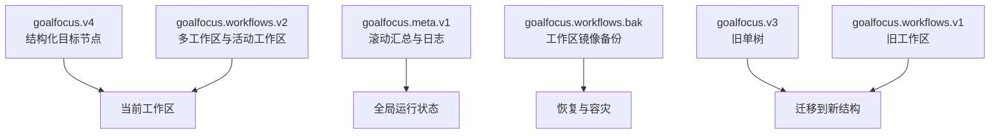

**图表来源**
- [assets/js/app.js:14-19](file://assets/js/app.js#L14-L19)
- [assets/js/app.js:5315-5600](file://assets/js/app.js#L5315-L5600)

### 为什么分为两个大键

1. `goalfocus.v4` 和 `goalfocus.workflows.v2` 都存放“目标树”，而后者同时覆盖多个工作区；它们属于业务主干数据，但更新频率和访问方式略有不同。
2. `goalfocus.meta.v1` 存放的是汇总、指标、日志和应用状态，不是用户直接编辑的目标树。它的特点是与时间强相关、容易无限增长。
3. 把日志类数据放到 meta 中，可以配合 `trimLogs` 对历史记录做滚动裁剪，而不影响用户当前的目标树结构。
4. 在 `saveMeta` 中加入内容比对，可以避免因渲染或状态变化重复重写 meta，从而减少不必要的磁盘写入。

**章节来源**
- [assets/js/app.js:14-19](file://assets/js/app.js#L14-L19)
- [assets/js/app.js:5257-5304](file://assets/js/app.js#L5257-L5304)
- [assets/js/app.js:5267-5288](file://assets/js/app.js#L5267-L5288)

## 核心持久化机制

### `saveNodes` 的概念对应：`save` 与 `flushActiveWorkflow`

代码中没有名为 `saveNodes` 的独立函数，目标节点的主存储逻辑位于 `save` 与 `flushActiveWorkflow` 的配合中：

- `flushActiveWorkflow` 负责把当前视图中的 `state.nodes`、钉选任务等同步到当前工作区对象。
- `save` 负责串行化目标树、写入主存储键、写入工作区主存储键和备份键，并最终调用 `saveMeta`。

关键顺序如下：

1. 刷新当前工作区引用，确保 `wf.nodes === state.nodes`。
2. 序列化当前项目目标树。
3. 写入 `LS_KEY`，即 `goalfocus.v4`。
4. 打包多工作区数据并写入 `goalfocus.workflows.v2`。
5. 如果距离上次写备份已经 5 分钟以上，再写入 `goalfocus.workflows.bak`。
6. 调用 `saveMeta`，写入 `goalfocus.meta.v1`。
7. 整个保存过程被 `try/catch` 包裹，外部只会记录警告，不会让上层调用失败。

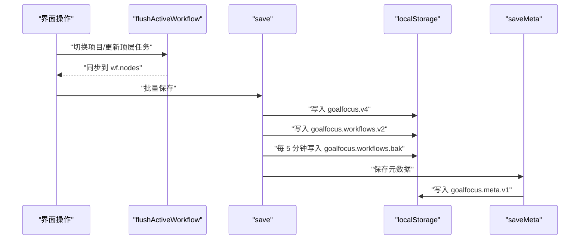

**图表来源**
- [assets/js/app.js:1364-1392](file://assets/js/app.js#L1364-L1392)
- [assets/js/app.js:5315-5333](file://assets/js/app.js#L5315-L5333)

**章节来源**
- [assets/js/app.js:1364-1392](file://assets/js/app.js#L1364-L1392)
- [assets/js/app.js:5315-5333](file://assets/js/app.js#L5315-L5333)

### `saveMeta` 的实现

`saveMeta` 是元数据的集中落盘入口，其设计重点是避免无意义重写。

核心行为：

1. 把 `state.meta` 序列化为 JSON。
2. 如果结果与上一次序列化字符串相等，直接返回，不调用 `localStorage.setItem`。
3. 只有内容变化时才写入 `goalfocus.meta.v1`。
4. 任何写入异常都被静默捕获。
5. `loadMeta` 会从现有键值恢复到 `state.meta`，再填充缺失字段，然后裁剪日志。

需要注意：**`saveMeta` 不防抖。**  
它的防抖是由上层调度实现的：

- 普通 UI 操作先触发 `afterChange`。
- `afterChange` 使用 `requestAnimationFrame` 触发的 `debouncedAfterChange`，最终调用真正的保存逻辑。
- 真正落盘的 `throttledSave` 又进一步把连续保存请求合并为一个定时器任务，默认延迟为 1 秒，且保证同一轮内只执行一次。

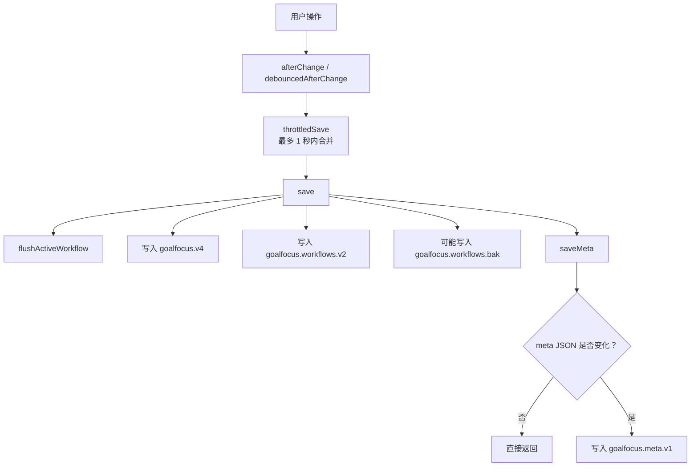

**图表来源**
- [assets/js/app.js:572-590](file://assets/js/app.js#L572-L590)
- [assets/js/app.js:5257-5304](file://assets/js/app.js#L5257-L5304)
- [assets/js/app.js:5315-5333](file://assets/js/app.js#L5315-L5333)

**章节来源**
- [assets/js/app.js:572-590](file://assets/js/app.js#L572-L590)
- [assets/js/app.js:5257-5304](file://assets/js/app.js#L5257-L5304)
- [assets/js/app.js:5315-5333](file://assets/js/app.js#L5315-L5333)

### 是否存在 `flushWrites`

源码中没有名为 `flushWrites` 的函数。持久化的统一出口是 `save`，而元数据入口是 `saveMeta`。如果你在其他文档中看到 `flushWrites`，它更可能是指：

- 内部节流定时器的批量保存，对应 `throttledSave`；
- 或者外层 UI 回调中的批量刷盘动作；
- 也可能只是概念描述，并非源码中的真实标识符。

在当前仓库中，应按以下映射理解：

| 概念 | 实际源码 | 作用 |
|---|---|---|
| flushWrites（概念） | `throttledSave` + `save` | 防抖后的批量写入 |
| flushWrites（按字面名） | 不存在 | 不要依赖该函数名 |
| 实际落盘入口 | `save` | 写入目标节点、工作区、备份和 meta |
| 元数据落盘入口 | `saveMeta` | 只在元数据内容变化时写 `goalfocus.meta.v1` |

**章节来源**
- [assets/js/app.js:572-590](file://assets/js/app.js#L572-L590)
- [assets/js/app.js:5257-5333](file://assets/js/app.js#L5257-L5333)

## 工作区节点序列化模型

目标节点不会被原样整树存入，而是先通过 `serializeNodes` 转为扁平数组。这样做的好处是：

- 避免循环引用带来的 JSON 序列化失败。
- 显式声明哪些字段值得持久化。
- 去掉不需要存储的计算属性，如根据截止时间重新计算的剩余天数和是否逾期。

### 字段含义摘要

| 字段 | 类型 | 说明 |
|---|---|---|
| `id` | 字符串 | 节点唯一标识 |
| `text` | 字符串 | 目标文本 |
| `im` | 数字 | 重要性评分 |
| `ur` | 数字 | 紧急性评分 |
| `val` | 数字 | 价值评估 |
| `eff` | 数字 | 费力程度 |
| `role` | 字符串 | 角色分类 |
| `targetNum/targetDone` | 数字 | 量化指标目标与实际 |
| `deadline` | 字符串 | 用户输入的时间描述 |
| `deadlineDate` | 数字时间戳或空值 | 解析后的截止时间 |
| `done/doneAt/touchedAt` | 布尔/时间戳 | 完成状态与操作时间 |
| `estimateMinutes/actualMinutes` | 数字或空值 | 预估与已完成时长 |
| `remindAt` | 数字时间戳或空值 | 提醒时间 |
| `status/waitNote` | 字符串 | 任务状态与等待备注 |
| `timesPerWeek` | 数字 | 每周次数 |
| `conf/confNote/confAt` | 数字/字符串/时间戳 | 置信度相关信息 |
| `recur/scale` | 布尔/字符串 | 是否周期任务和周期尺度 |
| `parentId/slot` | 字符串或空值 | 父节点 ID 和时间槽 |

需要特别注意：**`daysLeft` 和 `overdue` 是重新计算值，不存入 JSON**。这既节省体积，也避免陈旧日期字段导致排序错乱。

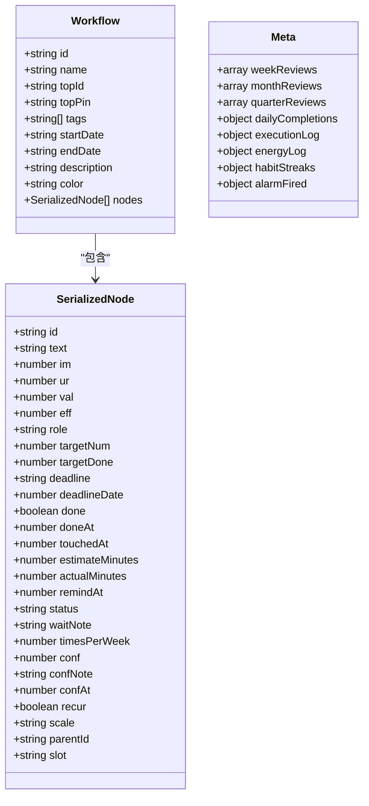

**图表来源**
- [assets/js/app.js:1882-1907](file://assets/js/app.js#L1882-L1907)
- [assets/js/app.js:5305-5313](file://assets/js/app.js#L5305-L5313)
- [assets/js/app.js:5571-5598](file://assets/js/app.js#L5571-L5598)

**章节来源**
- [assets/js/app.js:1882-1907](file://assets/js/app.js#L1882-L1907)
- [assets/js/app.js:5305-5313](file://assets/js/app.js#L5305-L5313)

## 项目元数据与滚动日志

### `goalfocus.meta.v1` 的结构

加载时会从已有键值解析并合并到默认结构中。默认字段包括：

- 周回顾、月回顾、季度回顾；
- 每日完成计数；
- 执行日志；
- 能量日志；
- 习惯打卡统计；
- 提醒已触发标记；
- 每周弹窗关闭标记；
- 最后一次备份时间；
- 以及其他功能扩展的自定义状态。

加载后的健壮性保障包括：

1. 无论解析成功与否都会确保 `state.meta` 不为空。
2. 若缺少执行日志、习惯打卡或提醒标记，则赋予默认空对象。
3. 调用 `ensureScoreMeta()` 补充分数相关元数据。
4. 调用 `trimLogs()` 清理过期记录。

### 滚动裁剪策略

`trimLogs` 每天最多裁剪一次，裁剪规则如下：

- 计算 cutoff 日期：当前日期减去 400 天。
- 从 `executionLog`、`scoreLog`、`dailyCompletions`、`energyLog` 中删除早于 cutoff 的逐日键。
- 从 `habitStreaks[hk].log` 中裁剪历史打卡日志。
- 从 `alarmFired` 中删除超过前一天的日期键，以避免跨午夜重复提醒。
- 用 `logsTrimmedAt` 当天键值缓存裁剪结果，避免同一天反复扫描。

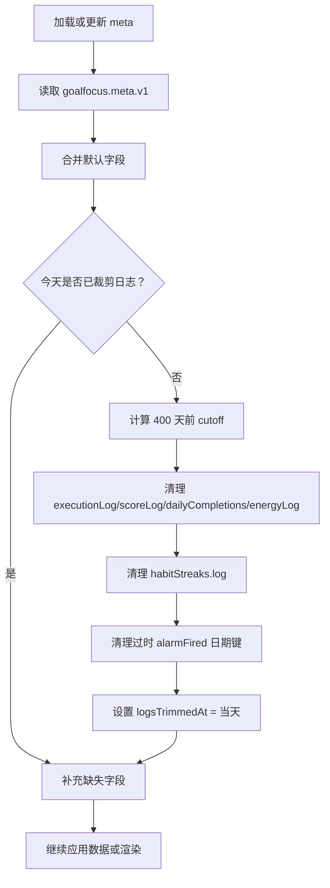

**图表来源**
- [assets/js/app.js:5267-5288](file://assets/js/app.js#L5267-L5288)
- [assets/js/app.js:5288-5314](file://assets/js/app.js#L5288-L5314)

**章节来源**
- [assets/js/app.js:5267-5288](file://assets/js/app.js#L5267-L5288)
- [assets/js/app.js:5288-5314](file://assets/js/app.js#L5288-L5314)

## 备份、导出与导入恢复流程

### 备份导出：`exportBackup`

导出生成一个 JSON Blob，文件名类似 `goalflow-backup-YYYY-MM-DD.json`。导出内容包括：

- `app: "goalflow"`；
- `version: 10`；
- `exportedAt`；
- `viewMode`；
- `activeWorkflowId`；
- `workflows`：每个工作区的结构化快照；
- `nodes`：当前活动项目节点快照；
- `meta`：完整 meta 状态。

导出完成后会把 `lastBackupAt` 写入 meta，并通过 `saveMeta` 保存。

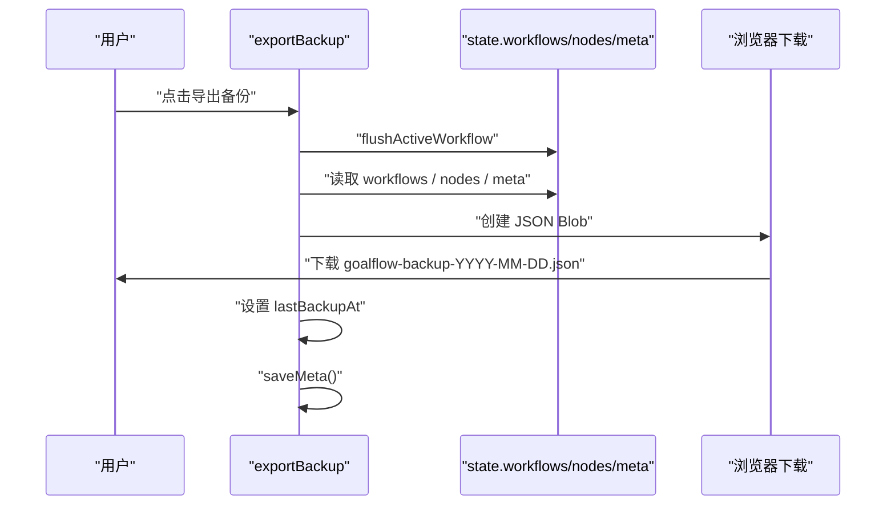

**图表来源**
- [assets/js/app.js:5571-5598](file://assets/js/app.js#L5571-L5598)
- [assets/js/app.js:5598-5604](file://assets/js/app.js#L5598-L5604)

**章节来源**
- [assets/js/app.js:5571-5598](file://assets/js/app.js#L5571-L5598)
- [assets/js/app.js:5598-5604](file://assets/js/app.js#L5598-L5604)

### ICS 日历导出

ICS 导出与 JSON 备份不同：

- 它不包含完整数据，只导出**带截止日期的叶子任务**。
- 没有工作区、meta、未完成非叶子节点、能量日志或习惯打卡。
- 生成的事件 ID 以任务 ID 加上 `@goalflow.local`，适合在同一浏览环境识别。
- 当没有符合条件的叶子任务时，会弹出提示并停止。
- 导出格式遵循标准 VCALENDAR，包含事件摘要、描述、开始日期和时间戳。

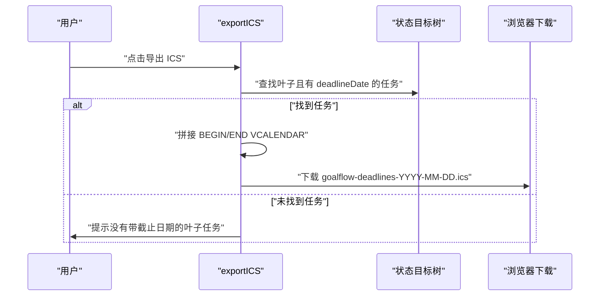

**图表来源**
- [assets/js/app.js:5566-5592](file://assets/js/app.js#L5566-L5592)

**章节来源**
- [assets/js/app.js:5566-5592](file://assets/js/app.js#L5566-L5592)

### 导入恢复：`importBackup`

导入接受一个文件对象，通过 `FileReader` 异步读取文本，再解析为 JSON。流程如下：

1. 读取文件内容为字符串。
2. 尝试 `JSON.parse`。
3. 如果 `data.nodes` 存在且为有效非空数组，则以它为根。
4. 如果是新版多工作区格式，则构造 `state.workflows`，并按 `activeWorkflowId` 应用活动工作区。
5. 如果旧版单条节点数组，则回退到单树模式。
6. 如果 `data.meta` 存在，则与当前 meta 合并。
7. 如果 `data.viewMode` 存在，则恢复视图模式。
8. 最终调用 `save()` 写回 localStorage。

导入过程中的校验重点：

- `nodes` 必须是数组。
- `nodes` 至少有一个元素。
- 导入前弹出确认对话框。
- 如果找不到有效节点数据，会弹出提示并不破坏当前状态。

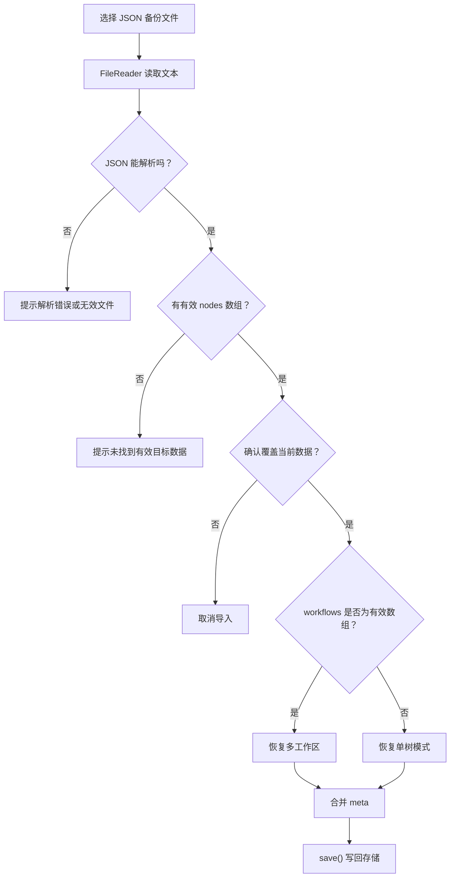

**图表来源**
- [assets/js/app.js:5598-5640](file://assets/js/app.js#L5598-L5640)

**章节来源**
- [assets/js/app.js:5598-5640](file://assets/js/app.js#L5598-L5640)

### 首次启动加载与迁移

`load` 函数的优先级顺序如下：

1. 加载 meta。
2. 依次尝试 `goalfocus.workflows.v2`、`goalfocus.workflows.bak`、`goalfocus.workflows.v1`。
3. 如果能解析出工作区结构，就应用它；如果不是主工作区键，则执行 `save()` 以恢复到主存储。
4. 否则尝试 `goalfocus.v4` 或旧 `goalfocus.v3`。
5. 如果是合法数组，则迁移成工作区模式。
6. 最终确保工作区初始化，并给出提示信息。

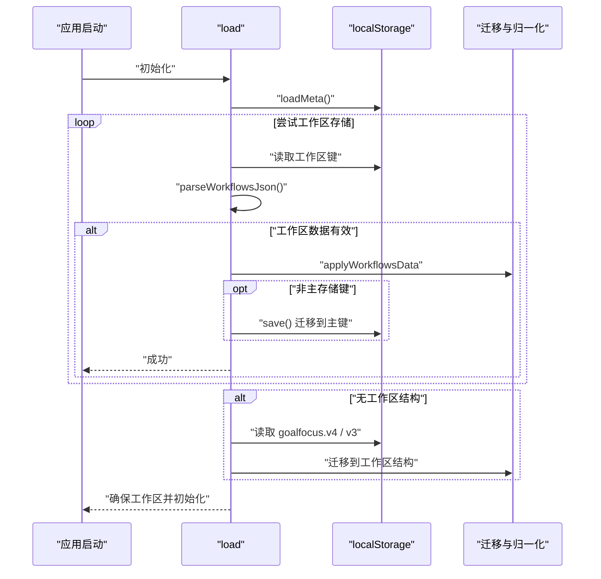

**图表来源**
- [assets/js/app.js:5360-5414](file://assets/js/app.js#L5360-L5414)

**章节来源**
- [assets/js/app.js:5360-5414](file://assets/js/app.js#L5360-L5414)

## 异常捕获与降级策略

### JSON 解析失败

所有 localStorage 读写都尽量用 `try/catch` 包裹：

- `loadMeta` 解析失败时保持默认 meta。
- `storageReport` 枚举 key 时捕获错误。
- `load` 逐个尝试键时捕获 `getItem` 异常。
- `parseWorkflowsJson` 遇到非法 JSON 时返回 `null`，并在控制台警告失败来源。
- `importBackup` 捕获文件读取和解析异常。

### localStorage 不可用或配额耗尽

源码中并没有使用 `QuotaExceededError` 做分支判断。整体行为更接近“尽力保存 + 静默降级”：

| 场景 | 行为 | 影响 |
|---|---|---|
| `localStorage.getItem` 抛出异常 | 多数读取处返回默认值或空对象 | 启动后仍可渲染，但部分数据为空 |
| `localStorage.setItem` 抛出异常 | 多数写入处吞掉错误 | 用户可能看到数据未持久化，但没有页面崩溃 |
| 备份键写入失败 | 单独捕获错误，不影响主键 | 主存储正常，丢失的是镜像备份 |
| `saveMeta` 写失败 | 完全吞掉异常 | 主目标和主工作区可能已写出，元数据未落盘 |
| 滚动裁剪失败 | 裁剪发生在 saveMeta 之前；即使后续失败也不会导致当前 meta 崩溃 | 下一次启动仍可恢复 |
| `JSON.stringify` 产生无效对象 | 仍会尝试写入，失败后被 catch 捕获 | 界面可能使用内存中的 `state.meta`，但不能持久化 |

注意：虽然常见配额不足会抛出 `QuotaExceededError`，但该代码并未显式区分该错误类型。因此不能假设应用对 QuotaExceededError 有专门恢复逻辑；实际可用的是广义的 try/catch 降级。

### 数据损坏时的兜底

- 若工作区 JSON 非法，解析返回空，继续尝试下一个键。
- 若最后一个候选也不可用，调用 `ensureWorkflows` 创建默认工作区结构。
- 单树 JSON 解析失败时打印警告，但不中断初始化。
- meta 解析失败时返回空对象并填充默认结构。

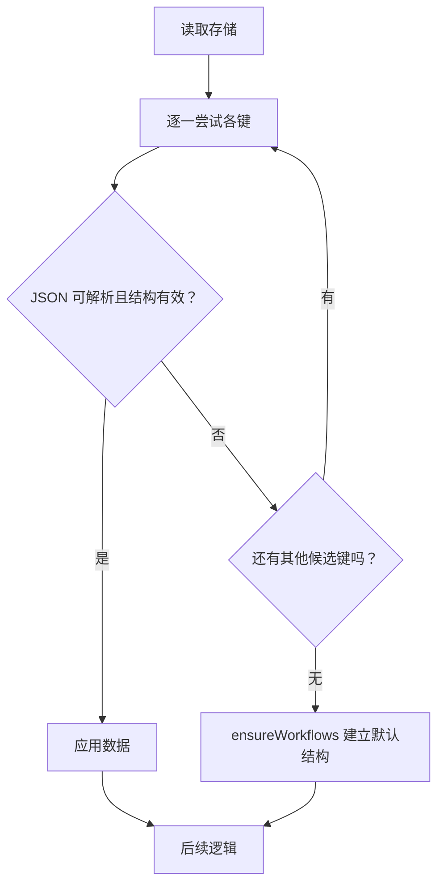

**图表来源**
- [assets/js/app.js:5360-5414](file://assets/js/app.js#L5360-L5414)
- [assets/js/app.js:5333-5360](file://assets/js/app.js#L5333-L5360)

**章节来源**
- [assets/js/app.js:5315-5414](file://assets/js/app.js#L5315-L5414)

## 跨标签页与工作流切换行为

### 工作流切换时的数据一致性

`switchWorkflow` 的流程是：

1. 先把当前 `state.nodes` 写入当前工作区对象。
2. 切换 `activeWorkflowId`。
3. 加载新工作区的节点、置顶节点和钉选项。
4. 如有节点则重新计算排程。
5. 同步输入框到树。
6. 立刻调用 `save()` 落盘。
7. 调度 `afterChange` 进行视图重建。

这意味着工作流切换会立即写盘，而不是交给 `throttledSave` 合并。高频快速切换多个项目会造成更多磁盘写入。

### 跨标签页冲突

该实现没有实现浏览器本地存储变更事件监听器。因此：

- 同一账户在同一浏览器下的不同标签页各自维护自己的内存 `state`。
- 一个标签页写 `localStorage`，另一个标签页不会主动收到通知。
- 除非两个标签页都在后台周期性触发 `save()`，否则第二个打开的标签页通常会显示上次读取的数据，或启动时再次读取最新版本。
- 若一个标签页正在修改 `state.meta`，另一个标签页同时写入 meta，由于没有事务锁，可能出现最后写入者覆盖的情况。

换句话说：**`localStorage` 提供了最终一致性，而不是实时一致性。**

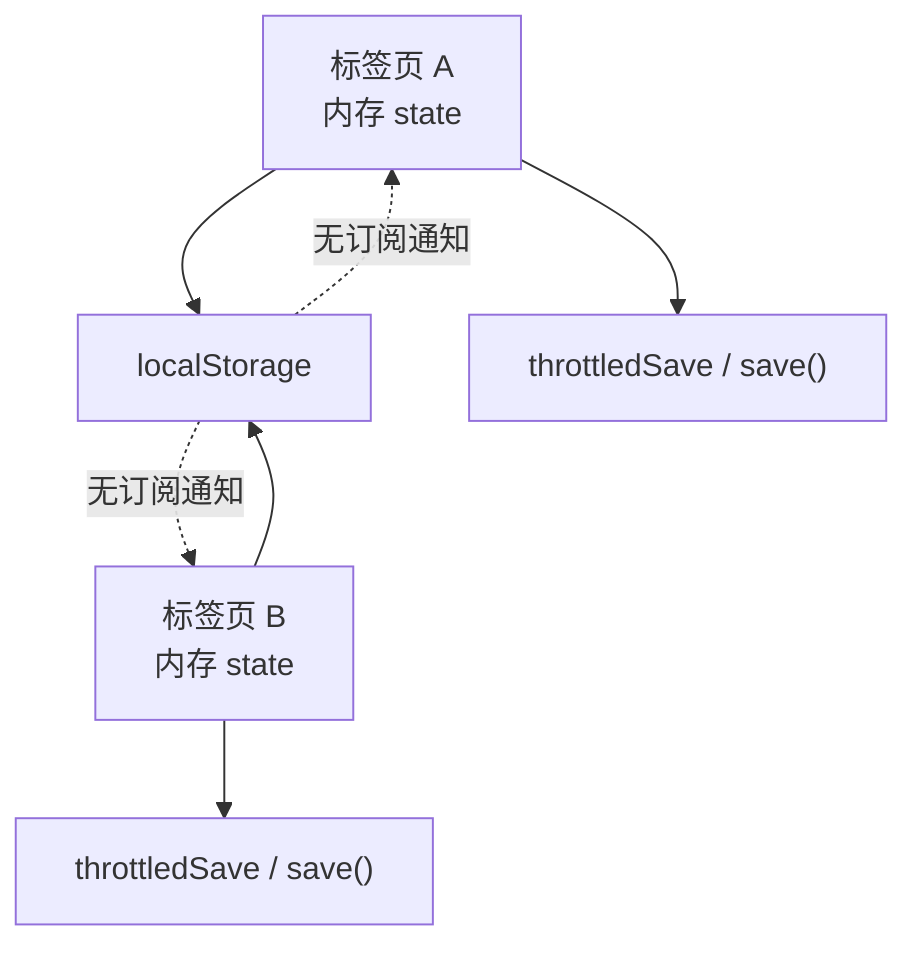

**图表来源**
- [assets/js/app.js:572-590](file://assets/js/app.js#L572-L590)
- [assets/js/app.js:1404-1420](file://assets/js/app.js#L1404-L1420)
- [assets/js/app.js:5315-5333](file://assets/js/app.js#L5315-L5333)

**章节来源**
- [assets/js/app.js:572-590](file://assets/js/app.js#L572-L590)
- [assets/js/app.js:1404-1420](file://assets/js/app.js#L1404-L1420)
- [assets/js/app.js:5315-5333](file://assets/js/app.js#L5315-L5333)

## 手动排查与修复示例

以下操作均应在浏览器开发者工具的“应用 → 本地存储”或 JavaScript 控制台执行。请谨慎操作，备份后再修改。

### 查看当前持久化键的大小

在控制台中运行存储报告工具函数即可输出表格，包含每个键的存在情况和长度：

```js
// 在浏览器开发者工具控制台中运行
const rows = storageReport();
console.table(rows);
```

这个函数枚举：

- `goalfocus.workflows.v2`
- `goalfocus.workflows.bak`
- `goalfocus.workflows.v1`
- `goalfocus.v4`
- `goalfocus.v3`
- `goalfocus.meta.v1`

并可用来判断哪个键占用了最多空间。

**章节来源**
- [assets/js/app.js:5360-5388](file://assets/js/app.js#L5360-L5388)

### 读取主存储目标树

在控制台中读取当前节点结构：

```js
const rawNodes = localStorage.getItem('goalfocus.v4');
if (rawNodes) {
  const nodes = JSON.parse(rawNodes);
  console.log('节点数量', nodes.length);
  console.log(nodes);
} else {
  console.warn('未找到 goalfocus.v4');
}
```

如需检查最新工作区结构，则读取 `goalfocus.workflows.v2`：

```js
const wfRaw = localStorage.getItem('goalfocus.workflows.v2');
if (wfRaw) {
  const data = JSON.parse(wfRaw);
  console.log(data);
}
```

### 直接替换或修复损坏的 JSON

如果某个键已经变成非法 JSON，可以先尝试读出来看看：

```js
const bad = localStorage.getItem('goalfocus.workflows.v2');
console.log(bad);
```

修复思路：

1. 从 JSON 备份恢复文件里复制正确的 `workflows` 数组。
2. 用编辑器修复引号、逗号、括号、转义字符等问题。
3. 在控制台中解析测试：`JSON.parse(fixedString)`。
4. 写入主键：`localStorage.setItem('goalfocus.workflows.v2', fixedString)`。
5. 刷新页面，观察是否恢复正常。

如果要优先利用镜像备份恢复主键：

```js
const bak = localStorage.getItem('goalfocus.workflows.bak');
if (bak) {
  // 先打印检查备份内容是否有效
  console.log(JSON.parse(bak));
  localStorage.setItem('goalfocus.workflows.v2', bak);
}
```

### 重置或清空某个键

如果希望强制首次安装体验：

```js
localStorage.removeItem('goalfocus.v4');
localStorage.removeItem('goalfocus.workflows.v2');
localStorage.removeItem('goalfocus.meta.v1');
```

刷新后应用会执行默认初始化，并打印相应提示。

### 验证恢复后的状态

恢复后可执行以下检查：

```js
// 检查是否有活动工作区
const wf = JSON.parse(localStorage.getItem('goalfocus.workflows.v2') || '{}');
console.log('工作区数量', wf.workflows?.length);
console.log('活动工作区', wf.activeWorkflowId);

// 检查节点数
const nodes = JSON.parse(localStorage.getItem('goalfocus.v4') || '[]');
console.log('节点数量', nodes.length);
```

如果需要彻底重新初始化应用，可在恢复备份后调用一次清理逻辑，但请注意这会删除原始键：

```js
// 仅建议在确认备份已完成或明确需要清零时使用
localStorage.removeItem('goalfocus.v4');
localStorage.removeItem('goalfocus.workflows.v2');
localStorage.removeItem('goalfocus.workflows.bak');
localStorage.removeItem('goalfocus.meta.v1');
```

**章节来源**
- [assets/js/app.js:5360-5388](file://assets/js/app.js#L5360-L5388)
- [assets/js/app.js:5598-5640](file://assets/js/app.js#L5598-L5640)

## 常见问题排查清单

### “数据过大”或写入后立即失效

**现象**：添加大量任务、长描述、长时间段或使用大量日志后，应用无法保存、界面闪烁、或重启后数据丢失。

**原因**：`localStorage` 通常为每个源的配额约 5 MB；超出配额会触发写入失败，且大多数 `setItem` 调用被 `catch` 吞掉。

**排查步骤**：

1. 运行 `storageReport()`，查看六个键的大小。
2. 重点检查 `goalfocus.workflows.v2`、`goalfocus.v4`、`goalfocus.meta.v1`。
3. 如果发现 `executionLog`、`scoreLog`、`dailyCompletions`、`energyLog`、`habitStreaks.log` 有大量历史日期，可能是日志膨胀。
4. 不要手动删除整个 meta；应让 `loadMeta` 正常载入，并由 `trimLogs` 滚动裁剪。
5. 若仍超限，优先缩小任务描述、清理长期已完成的历史打卡和能量日志。
6. 避免手工拼装超大字符串直接写入；改用增量更新和备份恢复。

### `QuotaExceededError`

源码没有显式捕获该错误名称，但由于 `localStorage.setItem` 的调用几乎全在 try/catch 中，典型表现是：

- 控制台可能没有明显堆栈。
- `console.warn('[GoalFlow] 保存失败', e)` 可能被触发。
- 界面仍可用，但元数据或节点数据未能持久化。

**应对方案**：

- 先导出 JSON 备份，以防进一步损坏。
- 检查并缩短超长节点文本、任务说明、日程描述。
- 避免频繁批量写入，比如短时间内多次快速切换工作区。
- 清理长期历史日志，但优先使用应用程序自身逻辑。
- 如确认为某键损坏，可从 `goalfocus.workflows.bak` 恢复到主键。

### 主版本号不匹配怎么办

这里的“版本”分两层：

1. **工作区存储格式版本**：当前主要读取 `goalfocus.workflows.v2`，但也兼容 `v1` 和旧单树 `goalfocus.v3`。
2. **备份版本**：导出的 JSON 中 `version: 10`，表示应用数据结构的导出版本。

处理原则：

- 如果主键是 `goalfocus.workflows.v2`，应用直接解析并使用。
- 如果是 `goalfocus.workflows.bak` 或 `v1`，解析成功后会自动 `save()`，把有效数据恢复到主键。
- 如果旧单树 `goalfocus.v3` 解析成功，也会迁移并保存到新项目结构。
- 导入备份文件时，只要 `nodes` 是有效数组，就能恢复单树模式；如果同时提供 `workflows`，会恢复多工作区模式。
- 即使导入文件的版本号不是最新，只要字段能被 `normalizeNode`、`normalizeWorkflowMeta` 处理，应用也能继续运行。

### 首次安装没有键值

这是预期行为。当没有任何可解析键时：

- `loadMeta` 创建默认 meta。
- `ensureWorkflows` 创建默认工作区。
- 控制台打印未找到已存数据的提示。
- 用户可以从零开始创建目标。

如果预期有数据却看不到，应先检查是否在其它浏览器、私有窗口、不同端口或不同域名的环境下使用过。

### 跨标签页写入冲突

症状包括：

- 标签 A 新增任务，标签 B 不出现。
- 两个标签交替编辑同一条任务，其中一个修改丢失。
- meta 中某些日志只出现在一个标签中。

推荐实践：

- 生产环境中不要在多个标签同时编辑同一工作区。
- 如需多端同步，必须在后端加版本号和变更冲突解决逻辑。
- 如果仅是查看和编辑分离，可以将其中一端设为只读视图。
- 不要把 meta 当作实时状态同步通道。

### 如何定位具体失败位置

可使用源码导出的调试辅助方法：

```js
storageReport();
```

它列出每个关键键是否存在及其字节长度。对于保存失败，可查看控制台是否有 `[GoalFlow] 保存失败` 的警告；对于解析失败，查看是否有 `[GoalFlow] 解析存储失败：...` 的警告。

**章节来源**
- [assets/js/app.js:5257-5333](file://assets/js/app.js#L5257-L5333)
- [assets/js/app.js:5360-5414](file://assets/js/app.js#L5360-L5414)
- [assets/js/app.js:5598-5604](file://assets/js/app.js#L5598-L5604)

## 性能与体积监控建议

### 写入频率优化

当前实现已经做了两层次的节流：

1. UI 变更后使用 `requestAnimationFrame` 延迟 `afterChange`，减少高频渲染回调导致的重复保存。
2. 真正写盘使用 `throttledSave`，默认 1 秒内只触发一次，且标记 `_savePending` 防止定时器重叠。

但以下路径会绕过节流或直接调用 `save()`：

- 工作流切换。
- 某些界面交互路径。
- 部分直接调用 `save()` 的业务入口。

监控建议：

- 在生产环境临时封装或埋点 `save()` 的调用次数。
- 记录两次保存之间的时间间隔。
- 记录平均保存体积，特别是 `goalfocus.v4` 与 `goalfocus.meta.v1`。
- 如发现保存过于频繁，优先检查高频 UI 事件是否正确落入 `afterChange` 与 `throttledSave`。

### 体积增长瓶颈

主要增长源：

| 组件 | 增长原因 | 建议上限 |
|---|---|---|
| `goalfocus.v4` | 节点数量 × 文本与元数据大小 | 一般保持在数百 KB 级 |
| `goalfocus.workflows.v2` | 多工作区总节点规模 | 应略大于等于主键 |
| `goalfocus.workflows.bak` | 主工作区副本 | 不应显著大于主键 |
| `goalfocus.meta.v1` | 日志、打卡、能量追踪、每日完成 | 应受 400 天裁剪约束 |

特别关注 meta 中的四类逐日地图：`executionLog`、`scoreLog`、`dailyCompletions`、`energyLog`，以及 `habitStreaks` 下每个习惯的 `log`。这些键值按日期增长，`trimLogs` 每天只切一次，所以长时间使用后仍是潜在体积隐患。

### 故障恢复优先级

建议按以下顺序恢复：

1. **导出 JSON 备份**：尽量先保留可离线恢复的文件。
2. **检查工作区镜像备份**：优先从 `goalfocus.workflows.bak` 恢复主工作区键。
3. **恢复单树备份**：如果有 `goalfocus.v3`，可作为最后手段恢复基础目标树。
4. **只恢复 meta**：不要随意丢弃 `goalfocus.meta.v1`，因为它是累积统计和打卡的基础。
5. **清空键前的最小范围**：如果确实要清空，应先记录 `storageReport()` 的输出，再逐步移除键。

### 生产环境可观测性建议

理想的生产实现应增加：

- localStorage 可用性探测，例如检测是否可正常读写。
- 明确的 QuotaExceededError 分支，并在配额不足时引导用户使用导出功能或压缩数据。
- 每个键的容量监控和历史趋势图。
- 保存失败的错误上报与重试上限。
- 导入失败的原因分类与用户提示。
- 首次启动耗时、restore 命中键名、迁移是否发生等埋点。
- 对 `storageReport` 的可观测性封装，而不是只在控制台输出。

但这些增强尚未存在于源码中，因此目前只能基于现有 try/catch 行为做保守推断。

**章节来源**
- [assets/js/app.js:572-590](file://assets/js/app.js#L572-L590)
- [assets/js/app.js:5257-5314](file://assets/js/app.js#L5257-L5314)
- [assets/js/app.js:5360-5388](file://assets/js/app.js#L5360-L5388)

## 结论

GoalFlow 的 localStorage 持久化采用简单清晰的分层设计：

- `goalfocus.v4` 与 `goalfocus.workflows.v2` 承载结构化目标和多工作区结构，其中前者是当前活动视图的直接映射，后者是多项目持久化的主载体。
- `goalfocus.meta.v1` 承载与应用生命周期相关的滚动汇总、日志和打卡，并通过内容对比与滚动裁剪控制体积。
- `save` 承担批量落盘职责，`saveMeta` 负责元数据幂等写入；两者都具备基本异常保护。
- 加载流程支持从新旧工作区键、镜像备份和旧单树格式恢复，并在最终失败时回到默认空状态。
- JSON 备份导出覆盖应用结构和工作区数据，ICS 导出则专注于带期限的叶子任务，便于集成外部日历。
- 多标签页之间没有锁或事件订阅，属于最终一致的本地存储语义，不适合多端并发写入。

在生产使用中，最重要的是把 `localStorage` 视为有限容量的离线草稿存储：优先保证目标结构不丢，再用定期 JSON 备份和多键迁移能力作为兜底；同时对保存频率和 meta 日志体积持续监控，避免出现 `QuotaExceededError` 或难以诊断的大体积损坏问题。