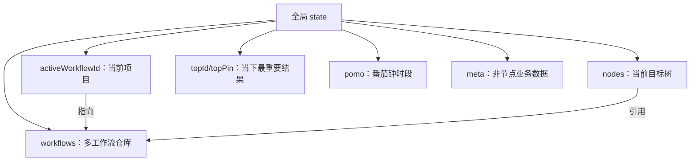
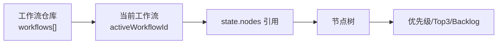
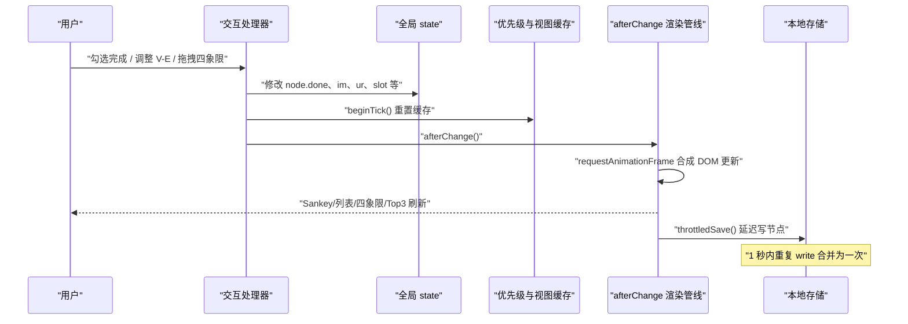
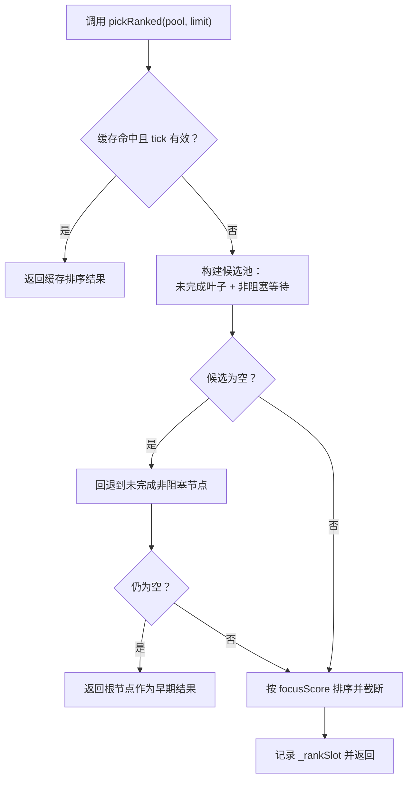
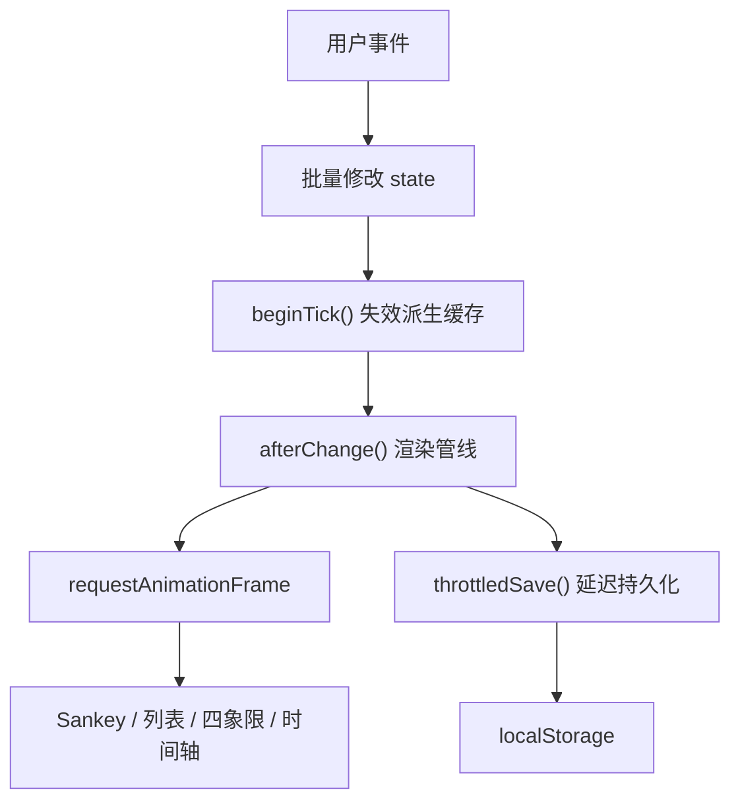

# 全局 State 模型与变更驱动

<cite>
**本文引用的文件**   
- [assets/js/app.js](file://assets/js/app.js)
</cite>

## 目录
1. [引言](#引言)
2. [目标状态概览](#目标状态概览)
3. [顶层字段契约](#顶层字段契约)
4. [工作流与当前流](#工作流与当前流)
5. [Pomo 专注时段状态](#pomo-专注时段状态)
6. [视图与四象限配置](#视图与四象限配置)
7. [当前选中节点语义](#当前选中节点语义)
8. [更新模式：单条写入与批量调度](#更新模式单条写入与批量调度)
9. [数据与本地存储的调度时序](#数据与本地存储的调度时序)
10. [从用户交互到重绘的完整链路](#从用户交互到重绘的完整链路)
11. [典型用例：pickRanked / pickTop / focusScore 联动 Top3、Backlog 与日程安排](#典型用例pickranked-picktop-focusscore-联动-top3-backlog-与日程安排)
12. [类型契约与常见非法状态](#类型契约与常见非法状态)
13. [调试手段](#调试手段)
14. [性能注意事项](#性能注意事项)
15. [结论](#结论)

## 引言

GoalFlow 的全局 `state` 对象是应用的唯一权威状态源。它同时承载三件事：

- 核心数据结构：至少包含一个工作流，以及其中由目标解析生成的节点树。
- 运行时选择态：当前工作流、当前时间尺度、当前“当下最重要”结果、当前活动番茄等。
- 用户持久化数据：周/月/季度回顾、评分记录、晨/晚仪式计划、习惯追踪、能量日志等，统一挂在 `meta` 下。

在代码实现中，`nodes` 并不是孤立存在的；它与当前工作流共享引用。对 `state.nodes` 的直接修改会反映到 `state.activeWorkflowId` 所指的工作流的 `nodes` 上。这一点决定了它的写约束、持久化策略和渲染刷新边界。

本技术文档聚焦以下目标：

1. 明确 `nodes`、`meta`、`workflows`、`pomo`、`view`、`currentWfId`、`selectedNodeId` 这些字段的职责与可空性。
2. 说明实际代码中的初始化结构，并对比“需求约定字段”和“已实现字段”。
3. 解释 beginTick、beginBatch、tickEnd、saveNodes、saveMeta、flushWrites 的职责，并结合真实实现说明哪些逻辑已在应用层完成。
4. 给出一个典型用户操作路径：勾选完成、调整 V/E、拖拽四象限、调用 `pickRanked/pickTop/focusScore`，以及 Top3、Backlog、MIT 和日程安排的联动。
5. 总结类型契约、非法状态、调试手段与性能要点。

## 目标状态概览

`state` 的实际初始值为：

- `nodes`: 空数组。
- `topId`: `null`。
- `topPin`: `null`。
- `scale`: `'all'`。
- `viewMode`: `'sankey'`。
- `quadQuickWin`: `false`。
- `workflows`: 空数组。
- `activeWorkflowId`: `null`。
- `pomo`: 包含 `active: false`、`endAt: 0`、`nodeId: null`、`minutes: 25`、`wfId: null`。
- `meta`: 包含默认回顾、已完成计数、告警日志、执行记录、习惯进度等结构。

| 字段 | 类型契约 | 默认值 | 可空性 | 核心职责 |
|---|---|---|---|---|
| `nodes` | 节点数组 | `[]` | 可为 `[]`；但业务期望始终存在数组 | 当前工作流的目标树 |
| `workflows` | 工作流元信息数组 | `[]` | 可为 `[]`；业务方法会通过 `ensureWorkflows` 创建默认工作流 | 多项目/多目标流隔离 |
| `activeWorkflowId` | 字符串或 `null` | `null` | 可为空；切换后应落盘 | 当前激活工作流标识 |
| `topId` | 字符串或 `null` | `null` | 可为空 | “当下最重要”节点的 ID |
| `topPin` | 任意或 `null` | `null` | 可为空 | 英雄卡钉住选项，不参与重新排序 |
| `scale` | `'all' \| 'day' \| 'week' \| 'month' \| 'year'` | `'all'` | 不应为 `undefined` | 当前时间尺度 |
| `viewMode` | `'sankey'` 或其他视图片段 | `'sankey'` | 不应为 `undefined` | Sankey、列表等渲染模式 |
| `quadQuickWin` | 布尔 | `false` | 不应为 `undefined` | 四象限快捷区是否按高价值低费力过滤 |
| `pomo` | 专注时段对象 | 见下方合约 | 不应为 `undefined` | 控制番茄钟计时与当前关联任务 |
| `meta` | 配置与审计数据对象 | 见下方合约 | 某些分支会惰性初始化，但读写前应判空或调用守卫 | 非节点业务数据的持久化容器 |

[此图为概念映射图，不直接对应某段具体代码结构]

**章节来源**
- [assets/js/app.js:1224-1231](file://assets/js/app.js#L1224-L1231)

## 顶层字段契约

### nodes

**职责**

- `nodes` 是目标树的扁平数组根；第一个元素通常作为整棵树的根节点。
- 节点通过 `parentId` 建立父子关系；树形结构会在解析后被注入 `_children`、`depth` 等计算字段。
- 所有叶子节点候选都来自这里：未完成、有父节点、无子节点的节点才会进入优先级排序池。
- 重要度和紧急度（`im`、`ur`）、预估时长、期限、角色、状态、槽位等都与节点字段相关。

**默认初始值**

- 初始为空数组 `[]`。
- 加载本地数据、粘贴目标文本、解析示例主题时，会被替换为新解析结果。
- `parseText` 生成节点数组后调用 `computeTree(nodes)`，进而调用 `beginTick()`，使本轮 tick 中的派生缓存失效。

**可空约束**

- 类型为 `[]`；当没有项目时应先通过 `ensureWorkflows` 创建默认项目。
- 不能为 `null`；多数遍历逻辑依赖数组方法，`null` 会导致运行时异常。

**与其他字段的关系**

- 与 `workflows[*].nodes` 共享同一引用：当前活动的 `state.nodes` 被回写为工作流中的节点数组。
- 与 `topId` 绑定：`isUnderTopNode` 根据 `topId` 判定节点是否位于“今日主线”树下。
- 与 `focusScore` 强耦合：排序只考虑未完成的叶子节点，阻塞与等待会严重压分。
- 与 `scale` 共同影响“可做完性”和周期推断。

### meta

**职责**

`meta` 是“非节点型持久化数据”的统一容器，包括：

- 回顾数据：`weekReviews`、`monthReviews`、`quarterReviews`。
- 今日完成计数：`dailyCompletions`。
- 告警与引导：`alarmFired`、`bannerDismissedWeek` 等。
- 当日执行日志：`executionLog`。
- 习惯进度：`habitStreaks`。
- 评分日志：`scoreLog`。
- 日程辅助：`planShare`、`energyLog`、`pendingActions`、`eveningDispo`、`goodThings`、`ritual` 等。

很多字段并非一开始就填满，而是由 `ensureScoreMeta` 及各自写入函数惰性补齐。

**可空约束**

- 初始为非空对象，但仍有字段可能首次访问时为空。
- 推荐通过 `ensureScoreMeta` 或直接使用带有 `if (!state.meta) state.meta = {}` 保护的方法写入。
- 直接读取深层嵌套字段前应判空。

### view 与命名差异

需求中提及的 `view` 字段在源码中实际不存在；真实名称是多个小字段组合：

- `viewMode`：渲染视图，如 Sankey。
- `scale`：时间尺度，如 `day`、`week`、`month`、`year`。
- `quadQuickWin`：四象限快捷过滤开关。
- `currentWfId` 不存在；真实字段是 `activeWorkflowId`。
- `selectedNodeId` 不存在；源码中没有该字段。

因此，“类型契约要求”必须与实际实现对齐：UI 或后续扩展如果需要选择节点，应该新增明确字段，而不是假定已有 `selectedNodeId`。

### currentWfId 与 activeWorkflowId

需求描述中使用的是 `currentWfId`，但源码使用 `activeWorkflowId`。两者语义相同，都是“当前激活的项目”。

- 新建工作流后，`createWorkflow` 把 `activeWorkflowId` 设置为新工作流 ID。
- 切换工作流时 `switchWorkflow` 会先写出当前流，再读取新的流并触发 `afterChange`。
- 删除最后一个项目时，逻辑限制删除全部；如果切换到了被删工作流，则恢复为默认工作流。

### selectedNodeId

源码中不存在 `selectedNodeId` 字段。若 UI 未来需要高亮选中节点，应：

1. 在 `state` 初始化处添加明确字段，例如 `selectedNodeId: null`。
2. 在点击节点或拖拽节点时赋值。
3. 在观察者或 `afterChange` 流程中触发对应控件重绘。
4. 不要把选中态混入持久化数据，除非确实需要跨会话记忆。

目前源码中接近“选中当前重点”的结构是：

- `topId`：当前最重要的节点。
- `topPin`：英雄卡固定项，不参与自动排名。
- `focusScore`：用于算出 Top 结果的打分函数。

## 工作流与当前流

### 多工作流结构

每个工作流代表一个独立目标体系，例如“年度增长”“副业收入”“健康计划”。其典型结构包括：

| 字段 | 类型 | 含义 |
|---|---|---|
| `id` | 字符串 | 唯一工作流标识 |
| `name` | 字符串 | 项目名称 |
| `tags` | 字符串数组 | 标签 |
| `startDate` | 字符串日期 | 开始时间 |
| `endDate` | 字符串日期 | 结束时间 |
| `description` | 字符串 | 项目描述 |
| `color` | 字符串 | 视觉颜色 |
| `nodes` | 节点数组 | 当前目标的树形结构 |
| `topId` | 字符串或 `null` | 项目级“当下最重要”节点 ID |
| `topPin` | 任意或 `null` | 项目级钉住条目 |

`normalizeWorkflowMeta` 负责确保这些字段存在且为合理字符串。

### 当前工作流语义

- `ensureWorkflows`：如果没有工作流数组或为空，会创建一个名为“默认目标”的工作流，并把当前 `nodes`、`topId`、`topPin` 复制进去。
- `flushActiveWorkflow`：保存前把当前 `state.nodes`、`state.topId`、`state.topPin` 同步回活动工作流。
- `applyActiveWorkflow`：加载活动时把工作流的 `nodes` 引用赋给 `state.nodes`，并重建计划。
- `switchWorkflow`：切换工作流后会刷新输入框、调用 `save` 和 `afterChange`。

这带来一个重要设计结论：**`state.nodes` 不是当前工作流 `nodes` 的拷贝，而是同一引用。** 因此在任何修改 `state.nodes` 中节点的函数里，都可能同时修改某个工作流的数据。

[此图为概念图，不标注具体行号]

**章节来源**
- [assets/js/app.js:1263-1320](file://assets/js/app.js#L1263-L1320)
- [assets/js/app.js:1321-1376](file://assets/js/app.js#L1321-L1376)

## Pomo 专注时段状态

### pomo 字段类型

| 字段 | 类型 | 默认值 | 含义 |
|---|---|---|---|
| `active` | 布尔 | `false` | 是否正在运行专注计时 |
| `endAt` | 数字时间戳 | `0` | 定时结束时刻 |
| `nodeId` | 字符串或 `null` | `null` | 当前专注绑定的节点 |
| `minutes` | 数字 | `25` | 单次专注时长 |
| `wfId` | 字符串或 `null` | `null` | 所属工作流 |

### 交互语义

- 启动番茄钟时，设置 `active=true` 与 `endAt=Date.now()+duration`。
- 停止或取消时清空 `active`、`endAt` 和相关节点引用。
- 番茄结束后，会根据当前节点追加评分、执行日志或习惯打卡。
- `scorePomoItem` 会根据任务重要度给专注行为加分。

**章节来源**
- [assets/js/app.js:1224-1231](file://assets/js/app.js#L1224-L1231)
- [assets/js/app.js:381-400](file://assets/js/app.js#L381-L400)

## 视图与四象限配置

### scale

`scale` 是 Viewport 的时间范围控制器，决定“本周最重要”和“今日最重要”是否不同。可选值包括：

- `all`：当下范围。
- `day`：每日。
- `week`：每周。
- `month`：每月。
- `year`：每年。

时间尺度也会影响：

- 目标解析时的默认周期推断。
- 日程能力估计：`DAY_CAPACITY_MIN` 默认以分钟为单位表示日容量。
- 四象限和目标层级布局。

### viewMode

`viewMode` 控制主可视化模式，默认值为 `'sankey'`。其他渲染模式可能在应用中进一步扩展。

### quadQuickWin

`quadQuickWin` 用于四象限快捷筛选。配合 VE 分类：

| VE 类型 | 含义 | 典型特征 |
|---|---|---|
| quick | 快速赢 | 高价值、低费力 |
| major | 主战役 | 高价值、高费力 |
| easy | 顺手活 | 低价值、低费力 |
| trap | 陷阱 | 低价值、高费力 |

**章节来源**
- [assets/js/app.js:17-38](file://assets/js/app.js#L17-L38)
- [assets/js/app.js:1224-1231](file://assets/js/app.js#L1224-L1231)

## 当前选中节点语义

源码中并没有 `selectedNodeId`。与之更接近的概念是 `topId`：

- `topId` 是当前最重要的叶子节点。
- `pickTop(pool)` 返回当前池中的第一名。
- `focusScore(n)` 计算节点竞争“当下最重要”的分值。
- `topPin` 是被固定在英雄卡上的节点，不参与重新排序。

因此，如果把“选中节点”理解为 UI 高亮的单个节点，需要单独增加字段；如果把“当前重点”理解为系统推理出的 MIT，则由 `topId` + `focusScore` 控制。

## 更新模式：单条写入与批量调度

### 单条写入：beginTick

`beginTick()` 不做脏标记，而是递增内部版本号 `_tickN`，并清空以下缓存槽：

- `_viewSlot`：当前构建视图缓存。
- `_rankSlot`：当前优先级排序缓存。
- `_estTick`：估算字段缓存。

这样做的目的是保证一次“重绘 tick”内多次计算不会重复。

典型调用点：

- `computeTree(nodes)` 构建完 `_children` 后调用。
- `invalidateTreeCache()` 树结构变更后调用。
- 首次初始化也用于重置 tick。

### beginBatch / flushWrites / saveNodes

源码中并未实现显式的 `beginBatch`、`flushWrites`、`saveNodes` 函数。实际批量写入是通过以下方式控制的：

1. **DOM 更新合并**：`debouncedAfterChange` 使用 `requestAnimationFrame` 合并多次 UI 更新。
2. **持久化节流**：`throttledSave` 延迟 1 秒后调用 `save()`，期间避免重复写本地存储。
3. **增量保存策略**：节点数据用 `save()` 写全量节点，`meta` 数据用 `saveMeta()` 写 meta；二者可以分别持久化。

也就是说，**“beginTick 控制内存派生缓存，throttledSave 控制磁盘写入频率。”**

| 机制 | 作用域 | 是否已实现 | 行为 |
|---|---|---:|---|
| beginTick | 渲染与派生计算 | 是 | 重置 tick、视图、排名、估算缓存 |
| afterChange | UI 观察链 | 是 | 触发重绘、四象限、Sankey、列表等更新 |
| debouncedAfterChange | DOM 帧合成 | 是 | 防抖到下一次重绘帧 |
| throttledSave | localStorage 写入 | 是 | 节流 1 秒，防止频繁磁盘 IO |
| beginBatch | 批处理入口 | 否 | 应自行组合多次 beginTick 与 afterChange |
| flushWrites | 批写提交 | 否 | 可用 throttledSave 替代 |
| saveNodes | 只写 nodes | 否 | 可直接调用 `save()` |
| tickEnd | tick 关闭信号 | 否 | beginTick 已采用版本号，无需显式关闭 |

**章节来源**
- [assets/js/app.js:520-526](file://assets/js/app.js#L520-L526)
- [assets/js/app.js:528-559](file://assets/js/app.js#L528-L559)

## 数据与本地存储的调度时序

### 本地存储键

源码定义如下关键键名：

| 存储目的 | 键名 |
|---|---|
| 节点数据 | `goalfocus.v4` |
| 旧版本节点数据 | `goalfocus.v3` |
| meta 数据 | `goalfocus.meta.v1` |
| 工作流数据 | `goalfocus.workflows.v2` |
| 工作流备份 | `goalfocus.workflows.bak` |

注意：需求文档中提到的“goalfocus.v4”就是节点存储键，而 meta 和数据工作流另有密钥。调试时应分别检查。

### 时序图：一次典型用户修改

**图示来源**
- [assets/js/app.js:528-559](file://assets/js/app.js#L528-L559)

**章节来源**
- [assets/js/app.js:1-6](file://assets/js/app.js#L1-L6)
- [assets/js/app.js:528-559](file://assets/js/app.js#L528-L559)

## 从用户交互到重绘的完整链路

### 场景一：勾选完成

用户勾选一个叶子节点后，系统会：

1. 更新 `node.done` 与 `doneAt`。
2. 如果是完成：
   - 若存在预估但未填写实计，则将 `actualMinutes` 设为 `estimateMinutes`。
   - 判断是否属于 `topId` 主干，若是则标记 `touchedAt`。
   - 计算黄金链条节点。
   - 重建缓存树。
   - 若为叶子节点：
     - 增加当日完成计数。
     - 对于循环或 KR 类任务，自动递增 `targetDone`。
     - 追加执行日志。
     - 追加评分日志。
     - 更新习惯连击。
     - 记录习惯打卡日志。
3. 最终触发本地存储保存。

**章节来源**
- [assets/js/app.js:300-400](file://assets/js/app.js#L300-L400)

### 场景二：调整 V/E

用户调整 `val` 与 `eff` 后：

1. `ensureVE` 将 `val`、`eff` 钳制到 1–5。
2. VE 分类可能被改变：quick、major、easy、trap。
3. 四象限、Sankey 权重、优先级排序随之变化。
4. `beginTick` 失效缓存，`afterChange` 驱动视图重绘。

**章节来源**
- [assets/js/app.js:47-61](file://assets/js/app.js#L47-L61)

### 场景三：拖拽四象限

四象限键分为：

- `now`：立即做，重要且紧急。
- `core`：核心投入，重要不紧急。
- `distract`：干扰枝干，紧急不重要。
- `noise`：噪音，不重要不紧急。

拖拽会重新分配节点的 `slot`，并可影响：

- `im` 与 `ur` 的推断。
- `scale` 的默认周期。
- Sankey 图的分支布局。
- 视图展示的分类顺序。

**章节来源**
- [assets/js/app.js:20-38](file://assets/js/app.js#L20-L38)

## 典型用例：pickRanked / pickTop / focusScore 联动 Top3、Backlog 与日程安排

### 调用链分析

`pickRanked` 的逻辑如下：

1. 如果同一批节点池和排序数量未变，并且本次 tick 仍有效，则返回缓存结果。
2. 首选候选池：
   - 有父节点；
   - 未完成；
   - 叶子节点；
   - 未被阻塞或等待。
3. 若无候选，退化为：
   - 有父节点；
   - 未完成；
   - 非阻塞等待。
4. 若仍然没有候选，取根节点作为早期结果。
5. 否则按 `focusScore` 降序排列，再按 `im` 和到期天数比较。
6. 截取最多 `limit` 个节点，并缓存结果。

`pickTop` 只是 `pickRanked(pool, 1)` 的包装。

`focusScore` 加分逻辑包括：

- 完成节点直接压到 `-1000`，排除竞争。
- 基础分 = `im * 10`。
- 过期获得大幅加分。
- 近期到期按天数阶梯加分。
- 无期限的重要分支也有一定加分。
- 阻塞或等待被严重压分。
- 精力高峰时段的高费力任务会有小幅加权。

**图示来源**
- [assets/js/app.js:560-640](file://assets/js/app.js#L560-L640)

### 同时对 Top3、Backlog 与日程安排的影响

| 区域 | 数据来源 | 受影响的 key | 刷新原因 |
|---|---|---|---|
| Top3 | `pickRanked`、`pickTop` | `topId`、`_rankSlot` | 节点重要性、期限、阻塞状态变化 |
| Backlog | 尚未完成或未纳入 Top 池的叶子 | `nodes`、`_viewSlot` | 节点完成或优先级变化 |
| MIT | `focusScore`、`topId` | `meta.scoreLog`、`meta.executionLog` | 完成或专注结束时追加评估 |
| 日程安排 | 节点 `slot`、`deadline`、`estimateMinutes` | `meta.energyLog`、`meta.planShare` | V/E、四象限、期限、周期推断变化 |

### 真实代码片段路径

| 行为 | 代码位置 |
|---|---|
| 节点工厂与默认字段 | [assets/js/app.js:401-420](file://assets/js/app.js#L401-L420) |
| `focusScore` 打分 | [assets/js/app.js:560-600](file://assets/js/app.js#L560-L600) |
| `pickRanked` | [assets/js/app.js:600-640](file://assets/js/app.js#L600-L640) |
| `pickTop` | [assets/js/app.js:636-638](file://assets/js/app.js#L636-L638) |
| 完成节点评分与日志 | [assets/js/app.js:300-360](file://assets/js/app.js#L300-L360) |
| 习惯打卡写入 meta | [assets/js/app.js:1300-1360](file://assets/js/app.js#L1300-L1360) |

**章节来源**
- [assets/js/app.js:560-640](file://assets/js/app.js#L560-L640)
- [assets/js/app.js:300-360](file://assets/js/app.js#L300-L360)
- [assets/js/app.js:1300-1360](file://assets/js/app.js#L1300-L1360)

## 类型契约与常见非法状态

### 节点类型契约

| 字段 | 类型 | 默认值 | 合法范围与说明 |
|---|---|---|---|
| `id` | 字符串 | `'n0'` | 唯一节点标识 |
| `text` | 字符串 | `''` | 目标或任务文本 |
| `im` | 数字 | `3` | 重要度 1–5 |
| `ur` | 数字 | `3` | 紧急度 1–5 |
| `val` | 数字或 `null` | `null` | 用户价值评分，规范化后 1–5 |
| `eff` | 数字或 `null` | `null` | 用户费力评分，规范化后 1–5 |
| `role` | 字符串 | `''` | 角色：目标、KR、习惯等 |
| `targetNum` | 数字或 `null` | `null` | 目标次数 |
| `targetDone` | 数字 | `0` | 已完成次数，钳制到 0–9999 |
| `deadline` | 字符串 | `''` | 原始期限文本 |
| `deadlineDate` | Date 或 `null` | `null` | 解析后的截止时间 |
| `daysLeft` | 数字或 `null` | `null` | 剩余天数 |
| `overdue` | 布尔 | `false` | 是否逾期 |
| `done` | 布尔 | `false` | 是否完成 |
| `doneAt` | 数字或 `null` | `null` | 完成时间戳 |
| `touchedAt` | 数字或 `null` | `null` | 最近手动影响时间 |
| `createdAt` | 数字 | 当前时间戳 | 创建时间 |
| `estimateMinutes` | 数字或 `null` | `null` | 预估分钟，0–999 |
| `actualMinutes` | 数字或 `null` | `null` | 实际分钟，0–9999 |
| `recur` | 布尔 | `false` | 是否循环任务 |
| `scale` | 字符串或 `null` | `null` | 周期：day/week/month/year/all |
| `slot` | 字符串 | `''` | 四象限或时间槽 |
| `ifThen` | 字符串 | `''` | 执行意图 if-then |
| `premortem` | 字符串 | `''` | 事前验尸 |
| `status` | 字符串 | `''` | 状态，如 blocked、waiting 等 |
| `waitNote` | 字符串 | `''` | 等待备注 |
| `timesPerWeek` | 数字 | `0` | 每周次数 |
| `conf` | 数字 | `0` | 信心分或类似字段 |
| `confNote` | 字符串 | `''` | 置信度备注 |
| `confAt` | 数字或 `null` | `null` | 置信度更新时间 |
| `source` | 字符串 | `''` | 数据来源 |
| `dropped` | 布尔 | `false` | 是否丢弃 |
| `_manualIm` | 布尔 | `false` | 是否手动调整过重要度 |
| `_manualUr` | 布尔 | `false` | 是否手动调整过紧急度 |
| `_children` | 数组 | 内部构建 | 渲染树用的孩子列表 |

### 常见非法状态

| 问题 | 说明 | 风险 |
|---|---|---|
| `state.nodes === null` | 应为数组而非 `null` | 遍历与数组 API 报错 |
| `state.workflows.length === 0` | 首次打开可能是空，但业务方法应创建默认项目 | 工作流切换或保存失败 |
| `activeWorkflowId` 不在工作流列表中 | 加载了损坏数据或手动篡改 | 当前流无法应用 |
| `nodes[0]` 存在但没有根预期结构 | 数据导入或解析异常 | 树深、桑基图或排序出现异常 |
| `im` 或 `ur` 超出 1–5 | 应避免，但部分推断逻辑未完全钳制 | 分数计算偏离预期 |
| `deadlineDate` 为无效日期 | 日期解析错误 | `daysLeft` 与 overdue 不正确 |
| `meta` 深层字段缺失 | 历史数据未携带新字段 | 阅读深层字段需判空 |
| `pomo` 字段缺失 | 初始化提供默认对象，但仍应判空 | 定时器逻辑崩溃 |

### 维护约定

- 不要绕过 `newNode` 或 `applySuggestions` 构造业务节点。
- 修改 `nodes` 后应调用 `computeTree` 或 `invalidateTreeCache`，然后进入 `afterChange` 流程。
- 修改 `meta` 前优先使用 `ensureScoreMeta`。
- 不要在高频回调中反复遍历整个节点树；复用 `_rankSlot`、`_viewSlot`、`_treeCache`。
- 每次持久化前区分节点与 meta，避免不必要的 JSON 重载。

## 调试手段

### 浏览器控制台步骤

1. 打开 GoalFlow 页面。
2. 打开浏览器开发者工具。
3. 在控制台输入全局 JavaScript 变量访问语句，获取当前 `state`。
4. 重点检查：
   - `nodes`：节点总数、根节点是否存在、叶子数、完成率。
   - `workflows`：是否有默认项目，ID 是否有效。
   - `activeWorkflowId`：是否与期望项目一致。
   - `topId`：今天最重要是否是预期节点。
   - `scale`、`viewMode`：当前视图和时间尺度。
   - `pomo`：番茄钟状态。
   - `meta`：评分日志、习惯追踪、能量日志、计划分享比例等。

### 重点本地存储键

| 键名 | 用途 |
|---|---|
| `goalfocus.v4` | 节点数据 |
| `goalfocus.v3` | 旧版节点数据 |
| `goalfocus.meta.v1` | meta 业务数据 |
| `goalfocus.workflows.v2` | 工作流元信息与数据 |
| `goalfocus.workflows.bak` | 工作流备份 |
| `goalflow.folds` | 折叠面板展开状态 |

### 建议诊断命令

- 查看全局 state：输出 `state` 并展开关键字段。
- 验证本地存储：逐个输出上述五个键的原始字符串，确认没有损坏的 JSON。
- 验证工作流：确认 `state.activeWorkflowId` 存在于 `state.workflows`。
- 验证节点拓扑：检查根节点及其 `_children` 是否形成稳定树。
- 观察缓存：查看 `_tickN`、`_rankSlot`、`_viewSlot`、`_treeCache` 是否随交互更新。

**章节来源**
- [assets/js/app.js:1-12](file://assets/js/app.js#L1-L12)
- [assets/js/app.js:1263-1376](file://assets/js/app.js#L1263-L1376)

## 性能注意事项

### 避免重复遍历节点树

源码已采用多层缓存：

| 缓存 | 失效时机 | 收益 |
|---|---|---|
| `_treeCache` | 节点数组引用变化或结构变更后失效 | 避免反复重建 `_children` |
| `_viewSlot` | 每轮 tick 清空 | 避免 buildView 在当前重绘帧内重复计算 |
| `_rankSlot` | 每轮 tick 清空，并检查 pool/limit/tick | 避免 Top3 重复排序 |
| `_estTick` | 每轮 tick 清空 | 避免重复解析估计字段 |
| `_dkCache` | 按日期时间戳更新 | 减少 dateKey 重复计算 |

### 最佳实践

1. **单次操作只做一次 beginTick。**  
   在一次交互事件中集中修改 `state.nodes` 和 `state.meta`，再在最后调用 `afterChange`。
2. **优先依赖现有缓存。**  
   调用 `pickRanked` 时使用与上次相同的 pool，以避免重复排序。
3. **拆分持久化。**  
   修改节点调 `save()`，修改业务配置调 `saveMeta()`，避免整体重写。
4. **谨慎触发全量渲染。**  
   只针对必要视图调用重绘函数，避免对所有 Sankey、列表、四象限和时间轴进行无意义渲染。
5. **不假设字段一定存在。**  
   `meta`、`pomo`、节点可选字段都应判空或使用守卫函数。
6. **不在高频路径构造对象。**  
   例如不在每次滚动或鼠标移动中创建大量新数组、Map 或日期对象。
7. **警惕 worklfows 与工作流引用。**  
   `state.nodes` 与当前工作流节点数组共享引用，修改任一都会影响另一侧。

[此图为概念流程图，不映射具体源码函数]

## 结论

GoalFlow 的全局 `state` 是一个轻量但边界清晰的中央状态对象：

- `nodes` 是当前目标树的权威载体，并与当前工作流共享引用。
- `workflows` 提供多项目隔离，`activeWorkflowId` 决定哪个项目的树处于活跃编辑状态。
- `meta` 是所有非节点持久化数据的容器，需要惰性初始化和逐层判空。
- `pomo` 是专注时段的运行时状态，不应误写成持久化的核心业务键。
- 真正决定“当下最重要”的是 `focusScore`、`pickRanked`、`pickTop` 以及 `topId`，而不是所谓 `selectedNodeId`。
- beginTick 控制内存层面的派生缓存失效；`requestAnimationFrame` 控制 DOM 更新合并；`throttledSave` 控制本地存储节流。
- 高效扩展应以现有缓存契约为基础：同一 tick 内的相同查询尽量复用结果，避免反复扫描整个节点树。
- 调试时应同时检查 `state`、`goalfocus.v4`、`goalfocus.meta.v1` 与 `goalfocus.workflows.v2`，因为它们是不同层次的状态快照。

这份设计避免了重型框架，但在关键路径上使用了版本号驱动的缓存、帧级 UI 合成和节流保存。只要遵循类型契约、可空性约定与 beginTick 生命周期，就可以在不引入全局副作用的情况下保持节点、Top3、Backlog、MIT、四象限和时间轴的联动一致性。