# 状态管理与存储层

<cite>
**本文引用的文件**   
- [README.md](file://README.md)
- [app.js](file://assets/js/app.js)
</cite>

## 目录
1. [引言](#引言)
2. [项目结构定位](#项目结构定位)
3. [核心数据模型与全局状态](#核心数据模型与全局状态)
4. [架构总览：从用户操作到持久化](#架构总览从用户操作到持久化)
5. [组件详解](#组件详解)
6. [端到端流程示例](#端到端流程示例)
7. [依赖关系分析](#依赖关系分析)
8. [性能特征与优化策略](#性能特征与优化策略)
9. [降级与恢复方案](#降级与恢复方案)
10. [常见问题排查](#常见问题排查)
11. [结论](#结论)

## 引言
GoalFlow 的“目标流”以浏览器本地 localStorage 为唯一长期存储，没有账号、服务器和构建过程。状态管理的职责集中在一个应用逻辑入口中：全局 state 对象持有节点树、元信息、工作流列表、番茄钟状态以及视图缓存；所有交互通过直接修改 state 后触发统一重绘与节流保存完成闭环。文档聚焦该状态下半部如何组织数据、如何被 Top3/Backlog/MIT 等视图共享、如何通过 `beginTick` 与 afterChange 联动观察者刷新，以及如何用命令式撤销与滚动裁剪控制 localStorage 成本。

[本节不直接分析具体代码行]

## 项目结构定位
前端仓库采用极简布局：入口页面引用主题常量与主业务脚本；localStorage 中的数据键集中在应用逻辑文件内声明并使用。

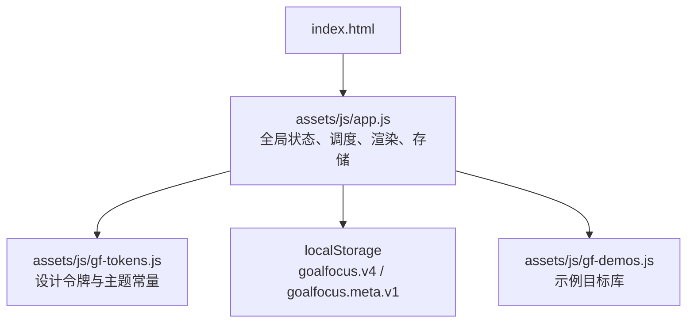

**图示来源**
- [README.md:1-103](file://README.md#L1-L103)

**章节来源**
- [README.md:1-103](file://README.md#L1-L103)

## 核心数据模型与全局状态
全局状态由一个单例对象维护，它既是“单一事实来源”，也是各功能分支直接读写的数据中枢。

| 字段 | 类型与含义 | 典型消费者 |
|---|---|---|
| `nodes` | 数组，扁平或树形节点集合；每个节点包含标识、文本、父级、重要度、紧急度、到期日、完成态、预估/实计时长等 | 任务渲染、Top3 排序、进度 Rollup、日程计算 |
| `topId` | 当前“今天最重要”的目标节点标识 | 英雄卡、桑基金线、侧栏重点 |
| `topPin` | 用户手动钉住的当前最重要节点标识 | 允许暂时覆盖算法结果 |
| `scale` | 时间尺度：`all` / `day` / `week` / `month` / `year` | 四象限、今日面板、周回顾 |
| `viewMode` | 可视化模式：桑基图、网络图、看板、热力图等 | Canvas/SVG 渲染层 |
| `workflows` | 多工作流元数据及各自节点快照 | 项目切换器、项目总览、跨项目统计 |
| `activeWorkflowId` | 当前编辑的工作流标识 | 工作流同步与保存 |
| `pomo` | `active`、`endAt`、`nodeId`、`minutes`、`wfId` | 番茄钟 UI、计时回调、完成后评分 |
| `meta` | 所有非节点运行时与用户偏好：评分日志、习惯打卡、警报标记、周/月/季度回顾、执行日志、能量曲线、每日完成计数等 | 统计图表、仪式提醒、回测审计 |

其中 `state.nodes` 是当前活动工作流的“真实引用”。当切换到另一个工作流时，会先调用 `flushActiveWorkflow` 把上一次改动的节点写回对应工作流对象；再让 `applyActiveWorkflow` 将 `state.nodes` 指向新工作流的节点数组。因此，“同一份 nodes”是视图共享的事实，而 `workflows[*].nodes` 用于多项目隔离与序列化备份。

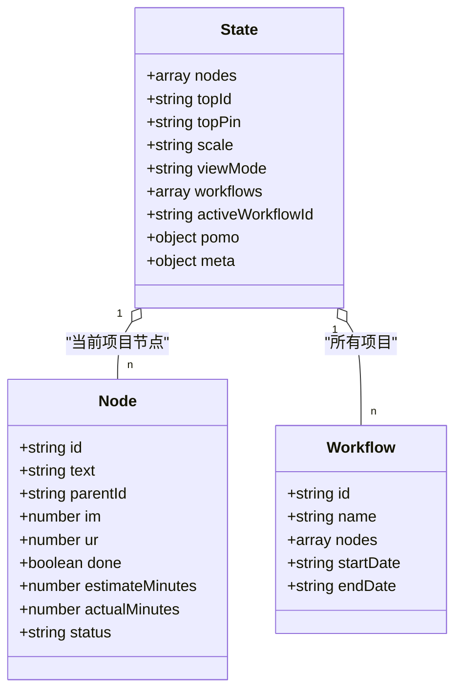

**图示来源**
- [app.js:1224-1240](file://assets/js/app.js#L1224-L1240)
- [app.js:1364-1384](file://assets/js/app.js#L1364-L1384)

**章节来源**
- [app.js:1224-1240](file://assets/js/app.js#L1224-L1240)
- [app.js:1364-1384](file://assets/js/app.js#L1364-L1384)

## 架构总览：从用户操作到持久化
整个状态变更链路可概括为：界面事件 → 修改 state → 批量刷新视图 → 防抖写入 localStorage。系统没有独立的 setState 函数，而是通过约定式更新和统一的 afterChange 通道协调副作用。

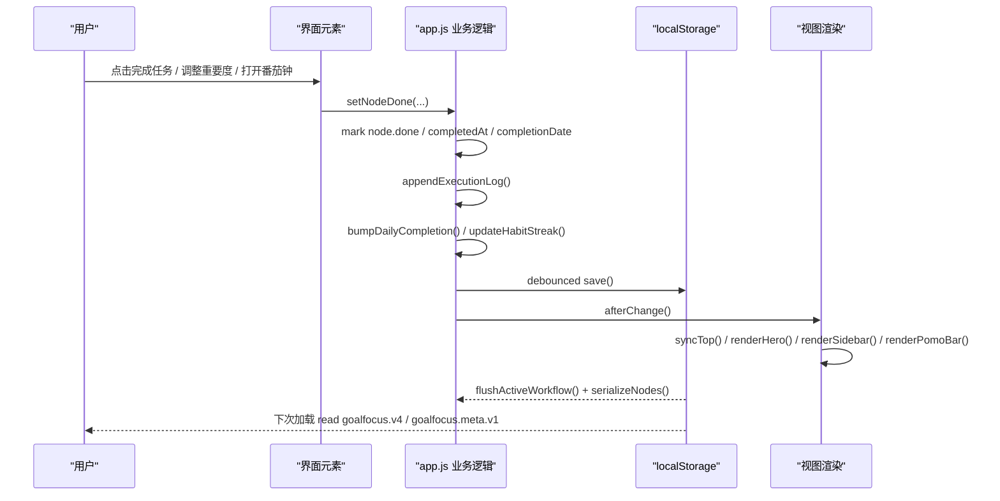

**图示来源**
- [app.js:354-420](file://assets/js/app.js#L354-L420)
- [app.js:5257-5345](file://assets/js/app.js#L5257-L5345)
- [app.js:6305-6317](file://assets/js/app.js#L6305-L6317)

### beginTick 与批处理机制
`beginTick` 并不做物理批量提交，而是递增 `_tickN`，并清空视图槽位与估算缓存。这使以下场景形成轻量“批处理语义”：

| 机制 | 变量 | 行为 |
|---|---:|---|
| 视图槽位失效 | `_viewSlot` | 每次 tick 后下一次视图查询会重新计算 |
| 优先级候选缓存失效 | `_rankSlot` | 避免同一次 tick 内重复排序 |
| 预估分钟缓存失效 | `_estTick` | `ensureAllEstimates` 在一次批量初始化后只遍历一遍节点树 |

这相当于给“短时间内多次读取 Top3、进度、视图”加了一个帧内去重开关。

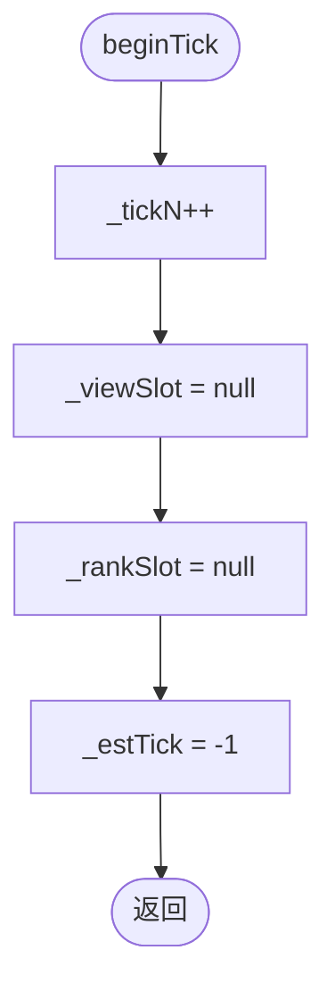

**图示来源**
- [app.js:560-570](file://assets/js/app.js#L560-L570)

**章节来源**
- [app.js:560-588](file://assets/js/app.js#L560-L588)

## 组件详解

### 状态读取与计算：dateKey、focusScore、pickRanked/pickTop
这些函数本身不修改 state，但它们是 Top3、MIT、日程评估、英雄卡和滚动优先级的基础输入。

| 函数 | 关键参数 | 返回值 | 在状态流转中的角色 |
|---|---|---|---|
| `dateKey(d?)` | 可选日期 | 字符串如 `"2026-11-24"` | 生成每日元数据键：`executionLog`、`scoreLog`、`dailyCompletions`、习惯日志 |
| `focusScore(n)` | 节点 | 加权分数 | 节点参与“当下最重要”竞价的得分 |
| `pickRanked(pool, limit)` | 池数组、期望数量 | 单节点或数组 | 返回未完成的叶子；若叶子不足退化为所有待办；若无节点则退回根节点 |
| `pickTop(pool)` | 池数组 | 单节点 | 快捷包装，等价 `pickRanked(pool, 1)` |
| `subtreeProgress(n)` | 父节点 | `{done,total,pct}` | 子树完成度；用于指标目标和桑基宽度累计 |
| `leafProgress()` | 无 | `{done,total,pct}` | 整体叶子完成统计，常用于仪表盘 |

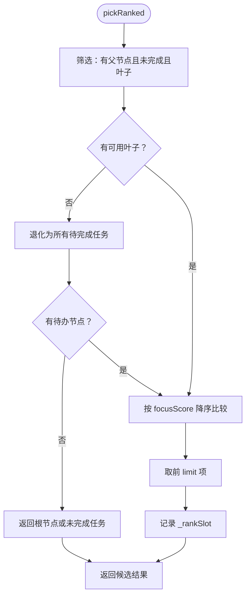

**图示来源**
- [app.js:588-662](file://assets/js/app.js#L588-L662)

**章节来源**
- [app.js:209-223](file://assets/js/app.js#L209-L223)
- [app.js:588-662](file://assets/js/app.js#L588-L662)

### 工作流与“同一份 state.nodes”
工作流不是多个互相复制的大树副本；它是节点的元数据容器。当前活动节点的真正位置在 `state.nodes`，但每切换或保存之前都会把变化写回 `workflowById(id).nodes`。

| 函数 | 主要职责 |
|---|---|
| `ensureWorkflows()` | 保证存在至少一个默认工作流，并把原始 `state.nodes` 放入第一个项目的 `nodes` |
| `workflowById(id)` | 按 ID 查找工作流 |
| `flushActiveWorkflow()` | 把当前 `state.nodes`、`topId`、`topPin` 同步回活动工作流对象 |
| `applyActiveWorkflow()` | 从活动工作流恢复 `state.nodes` 与焦点节点 |
| `switchWorkflow(id)` | 先刷新旧工作流，再激活新项目，最后保存并重绘 |
| `createWorkflow(meta)` | 创建新项目、清空中继状态、初始化保存 |
| `deleteWorkflow(id)` | 至少保留一个项目，删除后自动切换到剩余项目 |

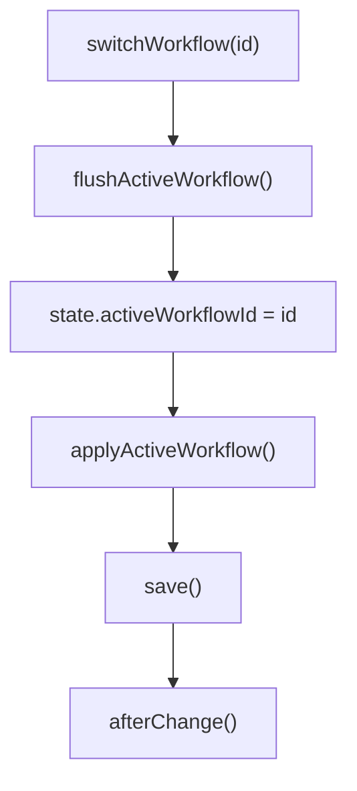

**图示来源**
- [app.js:1364-1400](file://assets/js/app.js#L1364-L1400)
- [app.js:1400-1430](file://assets/js/app.js#L1400-L1430)

**章节来源**
- [app.js:1224-1240](file://assets/js/app.js#L1224-L1240)
- [app.js:1364-1430](file://assets/js/app.js#L1364-L1430)

### localStorage 存储契约
目前源码定义了两个关键持久化键：

| 键名 | 数据结构 | 生命周期 |
|---|---|---|
| `goalfocus.v4` | 目标节点扁平序列（通过 `serializeNodes(state.nodes)`） | 随工作流保存；旧键 `goalfocus.v3` 仅兼容读取 |
| `goalfocus.meta.v1` | `state.meta` 的直接 JSON | 由 `saveMeta()` 增量保存 |
| `goalfocus.workflows.v2` | 多工作流负载，含每个项目的节点快照和当前活跃工作流 | 主备份 |
| `goalfocus.workflows.bak` | 主工作流负载的镜像 | 冗余恢复 |
| `goalfocus.workflows.v1` | 旧版本工作流数据 | 迁移来源 |

`saveMeta()` 会先比对 `_lastMetaJson`，只有内容变化时才写入，从而减少无意义写入。`loadMeta()` 使用对象展开把空壳字段补齐；`trimLogs()` 则定期裁剪超过约 400 天的逐日日志，防止长期运行压垮本地配额。

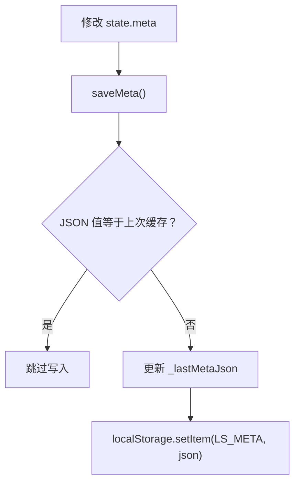

**图示来源**
- [app.js:5257-5280](file://assets/js/app.js#L5257-L5280)
- [app.js:5282-5317](file://assets/js/app.js#L5282-L5317)

**章节来源**
- [app.js:5257-5345](file://assets/js/app.js#L5257-L5345)

### 保存策略：throttledSave 与 save/load
代码中没有名为 `flushWrites` 的函数，实际实现分为两阶段：

1. **节流保存调度器**：`throttledSave(delay)` 设置 `_saveTimer`，把重复保存合并为一个定时器任务，默认延迟约 1 秒。
2. **完整保存**：`save()` 负责：
   - 刷新活动工作流；
   - 序列化当前节点树写入主键；
   - 序列化多工作负载；
   - 按不少于 5 分钟间隔写入镜像备份；
   - 调用 `saveMeta()`。

同时，界面多处直接调用 `save(); afterChange()`，说明“立即保存 + 立即渲染”是常见的业务路径；节流更多用于保护高频、短时间多次触发的场景。

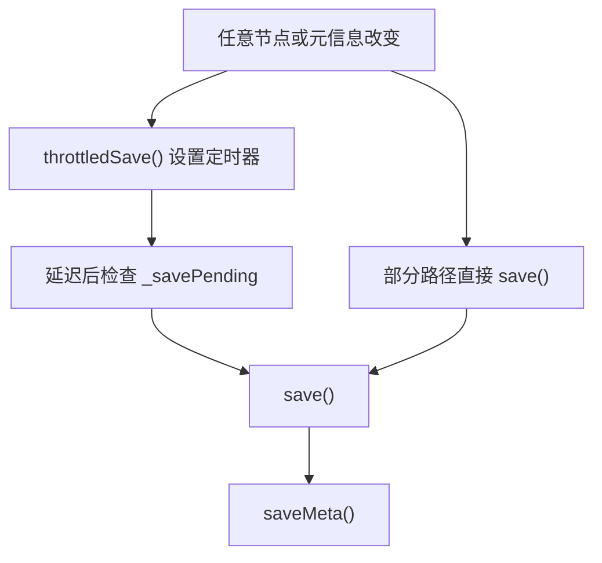

**图示来源**
- [app.js:538-559](file://assets/js/app.js#L538-L559)
- [app.js:5319-5345](file://assets/js/app.js#L5319-L5345)

**章节来源**
- [app.js:538-559](file://assets/js/app.js#L538-L559)
- [app.js:5319-5345](file://assets/js/app.js#L5319-L5345)

### 观察者重绘：afterChange 与 currentView
`afterChange()` 是“状态变更后驱动视图”的统一钩子。它会：

- 失效整树缓存；
- 确保工作流与预估分钟；
- 同步 topId；
- 刷新项目栏、进度条、侧边栏、番茄钟；
- 标记四个视图组为脏；
- 渲染当前活动视图；
- 触发提醒校验。

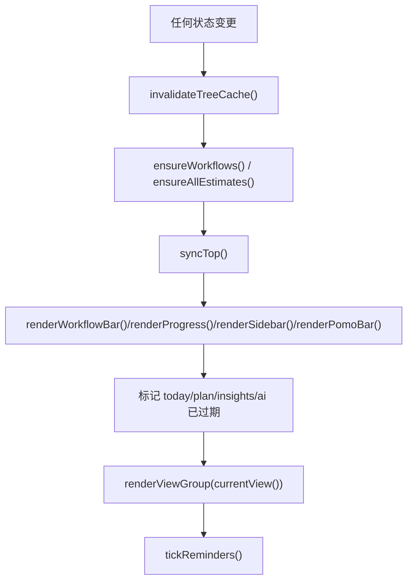

**图示来源**
- [app.js:6305-6317](file://assets/js/app.js#L6305-L6317)

**章节来源**
- [app.js:6305-6317](file://assets/js/app.js#L6305-L6317)

### 撤销与恢复：命令式撤销而非传统命令队列
当前撤销不是典型的“命令栈 + 反转命令”系统，而是“快照 + 临时还原”的简单命令模式变体。典型模式如下：

1. 操作前用深拷贝保存状态快照；
2. 执行破坏性操作；
3. 弹出带“撤销”按钮的通知，点击后执行 restore 函数；
4. 定时移除通知；
5. 若超时或出错，静默丢弃撤销能力。

例如清空全部目标流后，会提示可在 10 秒内恢复，restore 回调会把原来的 `workflows`、`activeWorkflowId`、`nodes`、`topId`、`topPin` 重新赋值并再次计算日程、保存、渲染。

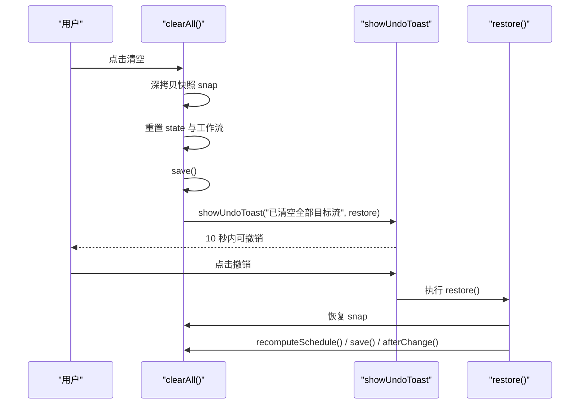

**图示来源**
- [app.js:6354-6375](file://assets/js/app.js#L6354-L6375)
- [app.js:290-323](file://assets/js/app.js#L290-L323)

**章节来源**
- [app.js:290-323](file://assets/js/app.js#L290-L323)
- [app.js:6354-6375](file://assets/js/app.js#L6354-L6375)

### 多视图共享：Top3 / Backlog / MIT / 日程分配
虽然这些视图可能分别出现在“今日行动”“目标规划”“归纳洞察”三视图下，但它们大多读的是同一份 `state.nodes`，只是用不同的过滤器和时间边界：

| 视图 | 主要读取逻辑 | 是否写入 state |
|---|---|---|
| Top3 / 当前排名 | `pickRanked`、`focusScore`、`buildView` | 否 |
| Backlog | 已完成、周期过渡、下周预告、未完成叶子 | 通常否，可能触发保存 |
| MIT 英雄卡 | `topId`、`topPin`、`syncTop()` | 通过锁定或选择影响 `topId` |
| 日程分配 | `recomputeSchedule`、槽位、估计时长、容量 | 可计算 slot 或状态，最终 `save()` |
| 四象限 | 节点 `im`/`ur`、`status`、叶子过滤 | 拖拽时更新权重后 `save()` |

**章节来源**
- [app.js:354-420](file://assets/js/app.js#L354-L420)
- [app.js:588-662](file://assets/js/app.js#L588-L662)
- [app.js:1364-1400](file://assets/js/app.js#L1364-L1400)

## 端到端流程示例：完成任务
这是一个从点击“完成任务”到数据落盘的全链路示例。

1. 用户点击任务完成复选框或勾选控件。
2. 事件处理器找到对应节点并调用 `setNodeDone(node, true)`。
3. `setNodeDone` 设置节点完成态与完成时间，并写入执行日志；如果是习惯型节点，还会更新 `habitStreaks` 的日期记录与连续次数。
4. 当日每日完成数 `bumpDailyCompletion()` 增加。
5. 如果番茄钟结束与该任务绑定，完成时长也可能计入实际工时。
6. 保存路径可能被触发：多数 UI 路径直接调用 `save()`，然后调用 `afterChange()`。
7. `save()` 序列化当前工作流节点与多工作流负载，并将最新值写入两个主键，必要时写一份备份副本。
8. `afterChange()` 失效树缓存、重新计算 Top1，并刷新侧边栏、进度、番茄钟和当前视图。

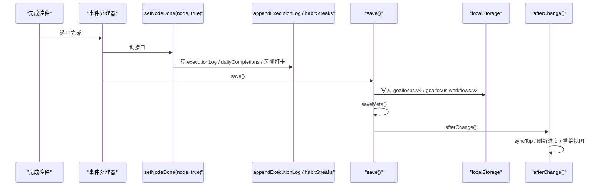

**图示来源**
- [app.js:354-420](file://assets/js/app.js#L354-L420)
- [app.js:5319-5345](file://assets/js/app.js#L5319-L5345)
- [app.js:6305-6317](file://assets/js/app.js#L6305-L6317)

### 相关函数的职责边界
| 函数 | 输入 | 输出或副作用 | 说明 |
|---|---|---|---|
| `dateKey(d?)` | 可选 Date | 字符串键 | 提供稳定的“年-月-日”键；内部缓存当天键 |
| `focusScore(n)` | 节点 | 数字分数 | 综合重要度、逾期、临近、等待/阻塞、精力曲线等 |
| `pickRanked(pool, limit)` | 节点池、限制数 | 候选节点集合或单节点 | 优先叶子 → 所有待办 → 根节点；同 tick 缓存排序结果 |
| `pickTop(pool)` | 节点池 | 单个节点 | Top1 快捷封装 |
| `subtreeProgress(n)` | 父节点 | `{done,total,pct}` | 子树叶子完成百分比 |
| `bumpDailyCompletion()` | 无 | 修改 `state.meta.dailyCompletions[当天]` | 记录每日完成任务数 |
| `appendExecutionLog(wfId, n, patch)` | 工作流 ID、节点、扩展字段 | 写入 `state.meta.executionLog` | 时间审计、计划 vs 实际的基础 |
| `updateHabitStreak(n, wfId, checked)` | 节点、工作流、状态 | 更新 `habitStreaks` | 连续打卡历史与最佳连续 |
| `logHabitCheck(...)` | 节点、工作流、完成标志 | 更新日期打卡日志 | 支持每周 N 次计数与回滚 |
| `save()` | 无 | 写入 localStorage | 串行序列化节点和工作流，并调用 `saveMeta()` |
| `saveMeta()` | 无 | 条件写入 `goalfocus.meta.v1` | 值不变则跳过 |
| `loadMeta()` | 无 | 恢复 `state.meta` | 缺字段时用空壳补全 |
| `flushActiveWorkflow()` | 无 | 同步活动工作流 | 避免切换时丢失当前改动 |

**章节来源**
- [app.js:209-223](file://assets/js/app.js#L209-L223)
- [app.js:354-420](file://assets/js/app.js#L354-L420)
- [app.js:588-662](file://assets/js/app.js#L588-L662)
- [app.js:5257-5345](file://assets/js/app.js#L5257-L5345)

## 依赖关系分析

### 全局状态依赖图
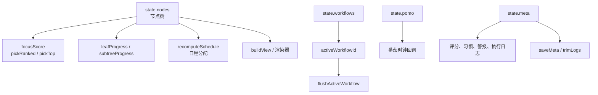

**图示来源**
- [app.js:1224-1240](file://assets/js/app.js#L1224-L1240)
- [app.js:5257-5345](file://assets/js/app.js#L5257-L5345)

### 状态转换图
全局状态的主要可视状态包括工作流、时间尺度、视图模式与番茄钟。

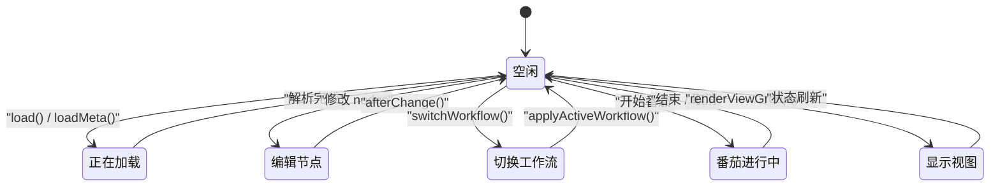

**图示来源**
- [app.js:560-588](file://assets/js/app.js#L560-L588)
- [app.js:6305-6317](file://assets/js/app.js#L6305-L6317)

**章节来源**
- [app.js:560-588](file://assets/js/app.js#L560-L588)
- [app.js:6305-6317](file://assets/js/app.js#L6305-L6317)

## 性能特征与优化策略

### 当前优化手段
| 问题 | 实现 | 效果 |
|---|---|---|
| 频繁 DOM 刷新抖动 | `debouncedAfterChange` + `requestAnimationFrame` 延迟 `afterChange` | 批量动画帧内刷新 |
| 重复排序与 Top3 计算 | `_rankSlot` 同 tick 缓存 | 降低 `focusScore` + 排序开销 |
| 重复枚举节点树 | `_estTick` 配合 `ensureAllEstimates` | 批量初始化预估字段只走一次 |
| 同天日期键重复计算 | `_dkCache` | `dateKey()` 在同一天复用 |
| 视图数据重复重建 | `_viewSlot` 失效机制 | 同 tick 内减少视图重建 |
| 无用 localStorage 写入 | `saveMeta` JSON 值对比 | 未变化时跳过写磁盘 |
| 高频率保存 | `throttledSave` | 合并短时间内的保存请求 |
| 日志膨胀 | `trimLogs` 滚动删除超期明细 | 控制 400 天以内的历史体量 |

### 潜在瓶颈
- `localStorage` 是同步 API，大型节点树序列化与字符串拼接会在渲染帧上产生卡顿。
- 直接 `localStorage.setItem` 发生在主线程；频繁写入会挤压交互响应。
- `serializeNodes` 可能扫描整棵树；若节点量增长显著，应在批量变更中减少不必要的遍历。
- 多工作流保存时不仅写主键，还写工作流负载和镜像键，三次写磁盘放大风险。
- `executionLog`、`habitStreaks`、`dailyCompletions` 都是按日累积的结构，长周期数据会增加序列化体积。

### 建议优化方向
1. 对极大节点树启用按需序列化：只对活动工作流序列化的同时，暂存其他工作流的原引用，必要时再序列化。
2. 为 `save()` 提供显式“低优先级异步保存”接口，结合 `IdleCallback` 或后台 Web Worker，把大 JSON 字符串化移出主线程。
3. 为 `serializeNodes` 增加增量标识：只在变更节点及其祖先路径上重新序列化，避免全量 map。
4. 使用结构化克隆替代字符串往返，前提是存储目标支持。若仍用 `JSON.stringify`，应减少中间模板字符串。
5. 对 `executionLog` 引入分片：按月度或小窗口写入不同键，而不是把所有天都放在一个庞大对象中。
6. 对 `trimLogs` 加入阈值判断：只有当存储键体积超过某个 MB 阈值时才触发裁剪，减轻常态开销。
7. 把 `afterChange` 拆成“轻量重绘”和“重算重绘”两个阶段：轻量 UI 更新立即执行，复杂计算放在空闲时间。

[本节基于通用存储与渲染特征进行分析，不再追加文件切片引用]

## 降级与恢复方案

### 主键缺失或损坏
加载流程首先读取 `goalfocus.workflows.v2`，其次尝试镜像备份 `goalfocus.workflows.bak`，再尝试 `goalfocus.workflows.v1`，最后才使用更早期的主节点键进行兼容恢复。工作流负载解析失败时会发出警告并返回空结果。

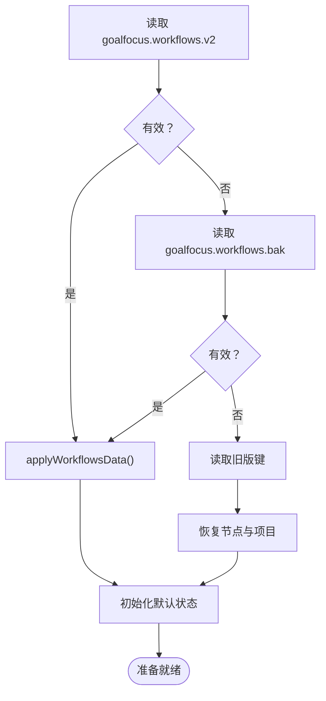

**图示来源**
- [app.js:5373-5414](file://assets/js/app.js#L5373-L5414)

### 元信息键缺失
`loadMeta()` 在解析失败或字段缺失时会填充默认字段：周/月/季度回顾、横幅标记、每日完成计数、执行日志、习惯打卡、警报标记等。这意味着即使 `goalfocus.meta.v1` 完全不存在，系统仍可启动，只是丢失历史统计与习惯记录。

### 备份恢复与导出
README 明确建议通过顶部“备份”导出 JSON，并在需要时使用“恢复”还原。由于数据完全存在于 localStorage，换浏览器、清空缓存或设备更换后，都需要通过导入外部备份进行恢复。

**章节来源**
- [README.md:1-103](file://README.md#L1-L103)
- [app.js:5282-5317](file://assets/js/app.js#L5282-L5317)
- [app.js:5373-5414](file://assets/js/app.js#L5373-L5414)

## 常见问题排查

| 现象 | 可能原因 | 诊断步骤 |
|---|---|---|
| 刷新页面后项目为空 | `goalfocus.workflows.v2` 损坏或被清理，或旧键迁移失败 | 查看浏览器控制台输出；检查对应 key 是否存在 |
| 历史统计丢失但节点还在 | `goalfocus.meta.v1` 丢失，而节点主键仍正常 | 确认元数据键；如需可重建习惯与统计 |
| 保存很慢 | 节点过多、日志堆积、同步写 localStorage | 查看节点数量、执行日志规模；尝试导出备份后清理旧键 |
| 撤销无效 | 撤销弹窗已关闭，或还原回调抛出异常 | 注意 10 秒时限；检查还原过程中 `recomputeSchedule` 或保存是否报错 |
| 本周完成度和评分不一致 | 评分与完成度来源于不同字段：节点完成态、执行日志、习惯打卡、番茄钟 | 分别检查 `nodes[].done`、`executionLog`、`habitStreaks`、`pomo` |
| 多项目进度不准 | 当前 `state.nodes` 属于活动工作流，但未正确 flush | 切换项目后观察 `flushActiveWorkflow` 是否执行 |
| 浏览器换环境后数据消失 | localStorage 与浏览器/端口/隐私模式绑定 | 使用导出的 JSON 在新环境恢复 |

**章节来源**
- [app.js:290-323](file://assets/js/app.js#L290-L323)
- [app.js:5257-5345](file://assets/js/app.js#L5257-L5345)
- [app.js:5373-5414](file://assets/js/app.js#L5373-L5414)
- [README.md:1-103](file://README.md#L1-L103)

## 结论
GoalFlow 的状态管理采用“单一 state 对象 + 直接变更 + 统一 afterChange 重绘 + 多层 localStorage 备份”的模式。它的优点是结构简单、多视图共享方便、无需构建；代价是把大量编排逻辑、存储细节与渲染副作用耦合在一个文件中。对新手而言，理解 `state.nodes`、`state.meta`、`activeWorkflowId`、`topId` 这四个核心字段的含义，就能把握大多数 UI 行为。对高级开发者而言，下一步优化应聚焦于：把大对象序列化移出主线程、缩小 save() 的写盘范围、为 `trimLogs` 与 `afterChange` 引入更细粒度的阈值，以及在恢复路径中增强更完善的降级消息。

[本节不直接分析具体代码行]