# 领域模型与文本解析器

<cite>
**本文引用的文件**   
- [README.md](file://README.md)
- [PROGRESS-ROLLUP.md](file://docs/PROGRESS-ROLLUP.md)
- [gf-demos.js](file://assets/js/gf-demos.js)
- [app.js](file://assets/js/app.js)
</cite>

## 目录
1. [引言](#引言)
2. [项目结构与入口](#项目结构与入口)
3. [核心数据实体](#核心数据实体)
4. [工作区、树结构与视图展平](#工作区树结构与视图展平)
5. [自然语言目标文本解析器](#自然语言目标文本解析器)
6. [默认属性计算：重要度、紧急度、价值、费力与预估](#默认属性计算重要度紧急度价值费力与预估)
7. [日期与时间刻度推断](#日期与时间刻度推断)
8. [进度 Rollup 与周回顾规则](#进度-rollup-与周回顾规则)
9. [输入样例与解析结果对照](#输入样例与解析结果对照)
10. [依赖关系分析](#依赖关系分析)
11. [性能特性](#性能特性)
12. [常见解析失败场景与修复建议](#常见解析失败场景与修复建议)
13. [结论](#结论)

## 引言
GoalFlow 是一个纯本地运行的可视化时间管理工具。用户把整段目标文本粘贴进页面后，应用会把自然语言目标解析成带层级、期限、重要度、紧急度、预估时长和完成状态的目标节点树；视图层再基于该树生成桑基图、英雄卡、聚焦清单、四象限等展示面。

本文重点面向“领域模型”和“文本解析器”，即：从输入字符串到结构化 node 节点数组的转换过程，以及与进度 Rollup、能量日志、时间审计相关的数据契约。

**章节来源**
- [README.md:7-12](file://README.md#L7-L12)
- [README.md:16-18](file://README.md#L16-L18)
- [README.md:22-35](file://README.md#L22-L35)

## 项目结构与入口
从仓库结构看，本任务相关的可执行逻辑主要集中在一处前端主脚本中，示例主题提供一组可直接粘贴的自然语言目标样本，文档说明进程汇总规则。

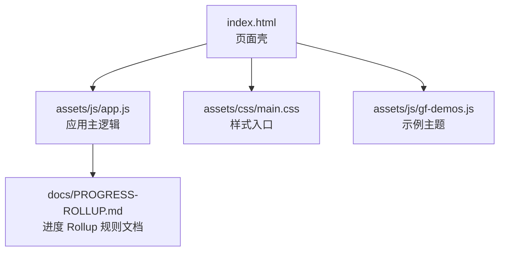

**图表来源**
- [README.md:79-97](file://README.md#L79-L97)
- [PROGRESS-ROLLUP.md:1-8](file://docs/PROGRESS-ROLLUP.md#L1-L8)

代码层面最重要的三个事实是：
- `assets/js/app.js` 导出并实现了解析器、评分、排期、周统计等核心函数。
- `assets/js/gf-demos.js` 提供 10 个示例主题对象，其中的 `text` 字段就是典型的自然语言目标输入。
- `docs/PROGRESS-ROLLUP.md` 明确定义叶子、完成时间戳、快速赢、时长字段参与范围等业务约束。

**章节来源**
- [README.md:79-97](file://README.md#L79-L97)
- [gf-demos.js:1-15](file://assets/js/gf-demos.js#L1-L15)
- [app.js:6788-6793](file://assets/js/app.js#L6788-L6793)

## 核心数据实体

### 节点 node
Node 是 GoalFlow 领域模型的基础单位。所有新节点都通过同一工厂构造，以保证字段一致性。它同时承担“目标描述”“任务卡”“习惯打卡项”等角色。

| 字段 | 类型 | 必填性 | 语义与约束 |
|---|---|---:|---|
| `id` | 字符串 | 必需 | 唯一标识，解析时形如 `n0`、`n1` … |
| `text` | 字符串 | 必需 | 清洗后的正文，已去掉编号、列表符、前后空白 |
| `parentId` | 字符串或空 | 允许为空 | 父节点 `id`；空表示根节点 |
| `_children` | 节点数组 | 内部维护 | 视图侧缓存的子节点列表，由 `computeTree` 填充 |
| `im` | 数字 1-5 | 非空但可推断 | 重要度（Importantness） |
| `ur` | 数字 1-5 | 非空但可推断 | 紧急度（Urgency） |
| `val` | 数字 1-5 或空 | 可选 | 派生价值维度；默认可能为 `null`，并通过 `ensureVE` 保证取值范围 |
| `eff` | 数字 1-5 或空 | 可选 | 派生费力维度；同样由 `ensureVE` 规范化 |
| `role` | 字符串 | 允许空串 | 业务角色，例如习惯、关键结果等 |
| `targetNum` | 数字或空 | 可选 | 目标次数，用于循环任务、习惯、关键结果 |
| `targetDone` | 数字 | 至少为 0 | 已完成的累计次数 |
| `deadline` | 字符串 | 允许空 | 原文档中的截止日期片段 |
| `deadlineDate` | 日期或空 | 允许空 | 解析后的截止日期对象 |
| `daysLeft` | 数字或空 | 允许空 | 距离截止日的天数 |
| `overdue` | 布尔值 | 非空但可推算 | 是否逾期 |
| `done` | 布尔值 | 非空但默认假 | 是否勾选完成 |
| `doneAt` | 毫秒时间戳或空 | 条件可选 | 完成时刻；取消完成时清空 |
| `touchedAt` | 毫秒时间戳或空 | 可选 | 最近一次被修改的时间 |
| `createdAt` | 毫秒时间戳 | 有默认值 | 节点创建时间 |
| `estimateMinutes` | 数字或空 | 可选；叶子默认推断 30 | 计划分钟数 |
| `actualMinutes` | 数字或空 | 可选 | 实际分钟数；完成叶子时若未填写会复制预估 |
| `recur` | 布尔值 | 非空但默认假 | 是否循环/周期性任务 |
| `scale` | 字符串或空 | 允许空；可推断 | 时间尺度：`day`、`week`、`month`、`year` |
| `slot` | 字符串或空 | 允许空 | 日时段位置 |
| `ifThen` | 字符串或空 | 可选 | 执行意图 |
| `premortem` | 字符串或空 | 可选 | 事前验尸记录 |
| `status` | 字符串或空 | 允许空 | 自定义状态 |
| `waitNote` | 字符串或空 | 可选 | 等待备注 |
| `timesPerWeek` | 数字 | 至少为 0 | 每周次数 |
| `conf` | 数字 | 至少为 0 | 置信度或相关评分 |
| `confNote` | 字符串或空 | 可选 | 置信度备注 |
| `confAt` | 毫秒时间戳或空 | 可选 | 置信度更新时间 |
| `source` | 字符串或空 | 允许空 | 数据来源，如 `parse` |
| `dropped` | 布尔值 | 非空但默认假 | 标记丢弃分支 |
| `_manualIm` | 布尔值 | 内部标记 | 是否手动调整过重要度 |
| `_manualUr` | 布尔值 | 内部标记 | 是否手动调整过紧急度 |

解析阶段的行为要点：
- 空行会被过滤，不会变成节点。
- 第一个节点通常成为根节点（`parentId` 为空）。
- 后续节点的缩进决定父子关系。
- 节点 id 在解析时为每个行分配一个全局自增值。
- 解析结束后调用树构建和尺度二次推断。

**章节来源**
- [app.js:451-463](file://assets/js/app.js#L451-L463)
- [app.js:453-459](file://assets/js/app.js#L453-L459)
- [app.js:492-511](file://assets/js/app.js#L492-L511)
- [app.js:513-520](file://assets/js/app.js#L513-L520)

### 元数据 meta
`meta` 不是单个节点上的普通字段，而是与应用级配置和统计数据关联的全局对象。其结构体现在存储键、容量设置、活跃工作区、分数记录和滚动更新上。

典型职责包括：
- `capacity`：工作区和全局的时间预算，包含工作日、周末、每日小时等。
- `activeWorkflowId`：当前激活的工作区 id。
- `workflows`：全部工作区的列表，存在于存储键名中。
- `scoreLog`：按日期键记录的今日评分条目。
- `energyLog`：能量日志；Rollup 文档强调其累积方式和周回顾记录。
- 其他持久化键还包括节点数据、元数据、备份间隔、工作区及备份副本等。

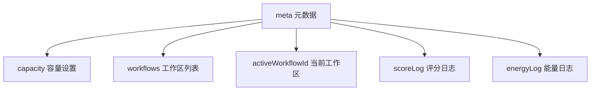

**图表来源**
- [app.js:16-25](file://assets/js/app.js#L16-L25)
- [PROGRESS-ROLLUP.md:18-23](file://docs/PROGRESS-ROLLUP.md#L18-L23)
- [PROGRESS-ROLLUP.md:25-37](file://docs/PROGRESS-ROLLUP.md#L25-L37)

**章节来源**
- [app.js:16-25](file://assets/js/app.js#L16-L25)
- [app.js:58-85](file://assets/js/app.js#L58-L85)
- [app.js:147-186](file://assets/js/app.js#L147-L186)
- [PROGRESS-ROLLUP.md:25-37](file://docs/PROGRESS-ROLLUP.md#L25-L37)

### 工作区 workflow
工作区表示一个独立的目标空间。它至少包含 id 与节点集合，并配合 `activeWorkflowId` 实现多项目隔离。

关键关系：
- 根节点位于某个 worklow 的 `nodes` 数组顶部。
- 时间容量既可以在全局 `meta.capacity.globalWorkdayHours/globalWeekendHours` 设定，也可以在项目级别配置。
- 多个工作区的占用时间会通过 `getOtherProjectsTimeUsage` 聚合，从而影响当前项目可用的平均每日容量。
- `computeWeekStats` 与周期统计会围绕当前激活工作区记录完成情况。

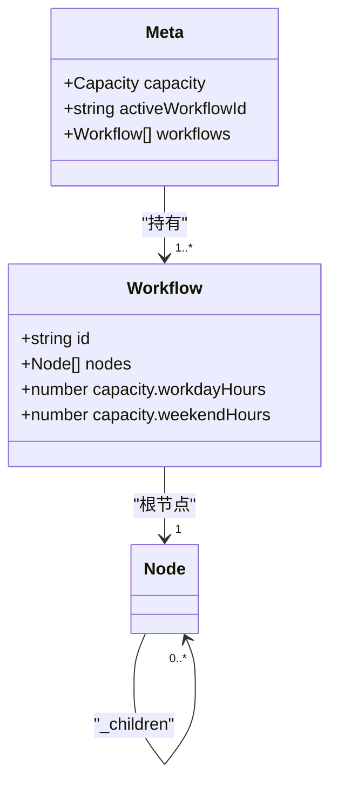

**图表来源**
- [app.js:16-25](file://assets/js/app.js#L16-L25)
- [app.js:58-85](file://assets/js/app.js#L58-L85)
- [app.js:147-186](file://assets/js/app.js#L147-L186)

**章节来源**
- [app.js:58-85](file://assets/js/app.js#L58-L85)
- [app.js:147-186](file://assets/js/app.js#L147-L186)

### 番茄钟 pomo
Pomo 并不是直接写在 node 上的单字段；它更多以执行日志的形式进入当日评分与时间追踪。

根据代码可见行为：
- 番茄钟操作会产生一个类型为 `pomo` 的评分条目。
- 今日总评分统计会累计 `kind === 'pomo'` 的数量。
- 焦点分钟数由 Pomo 数量乘以 25 分钟推导而来。
- 这与“完整 25 分钟自动计入实计时长并评分”的产品描述一致。

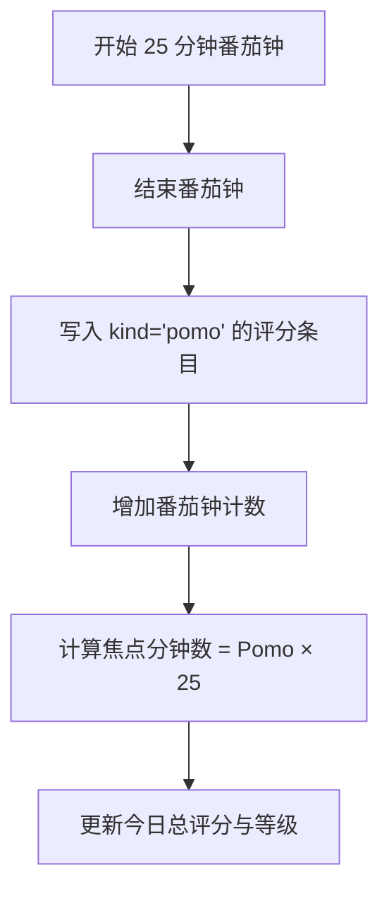

**图表来源**
- [app.js:348-352](file://assets/js/app.js#L348-L352)

**章节来源**
- [app.js:348-352](file://assets/js/app.js#L348-L352)

### 标签 tag 与其他分类
GoalFlow 没有使用独立的 `Tag` 实体类，但其领域模型已经内置了多维分类体系：

| 分类 | 含义 | 判定方式 |
|---|---|---|
| 四象限类别 | now / core / distract / noise | 由 `category(im, ur)` 计算 |
| 时间刻度 | day / week / month / year | 由 `inferScale` 推断 |
| VE 阵营 | quick / major / easy / trap | 由 `val`、`eff` 映射 |
| 快速赢 | 高价值低费力 | `val ≥ 4` 且 `eff ≤ 2` |
| 循环任务 | 日常、每周、月度重复 | `inferRecur` 结合 scale 判断 |
| 角色 | habit / KR 等 | 出现在 node.role 字段 |

注意：“标签”在这里更多表现为枚举式字段和衍生分类，而不是自由文本标签库。

**章节来源**
- [app.js:16-25](file://assets/js/app.js#L16-L25)
- [app.js:378-382](file://assets/js/app.js#L378-L382)
- [app.js:426-436](file://assets/js/app.js#L426-L436)
- [app.js:27-35](file://assets/js/app.js#L27-L35)

## 工作区、树结构与视图展平

### 树结构构建
`parseText` 先逐行扫描，再通过 `computeTree` 建立 `_children` 链表结构。

具体流程：
1. 清空旧 `_children`。
2. 构建 `byId` 映射。
3. 把所有有 `parentId` 的节点挂入对应父节点的 `_children`。
4. 从根节点深度遍历，填充 `depth`。
5. 触发 tick 计时，使本次绘制的派生计算只重算一次。

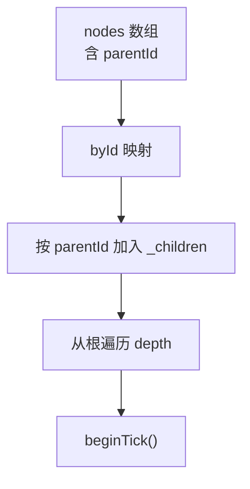

**图表来源**
- [app.js:513-520](file://assets/js/app.js#L513-L520)

**章节来源**
- [app.js:513-520](file://assets/js/app.js#L513-L520)

### 视图层如何从 tree 变扁平列表
应用并未保留一个显式的 `flatten(nodes)` 函数名，但存在两个关键机制：
- `getCachedTree(nodes)` 缓存树结构。
- 注释指出 `buildView` 会根据不同尺度 `day/week/month/year` 选择子树，并把选中分支投影为视图使用的可视节点集合。
- 同时，`scale !== 'all'` 时会按节点所属工作区间隔渲染。

因此，“扁平列表”实际上是“选定尺度下的子树 → 视图层展平为卡片列表”。被隐藏但仍留在完整树中的节点，仍然参与叶子完成度统计。

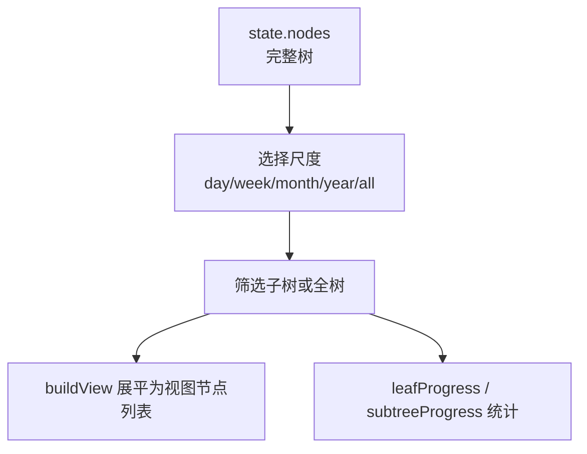

**图表来源**
- [app.js:541-547](file://assets/js/app.js#L541-L547)
- [PROGRESS-ROLLUP.md:3-15](file://docs/PROGRESS-ROLLUP.md#L3-L15)

**章节来源**
- [app.js:541-547](file://assets/js/app.js#L541-L547)
- [app.js:549-554](file://assets/js/app.js#L549-L554)
- [PROGRESS-ROLLUP.md:3-15](file://docs/PROGRESS-ROLLUP.md#L3-L15)

## 自然语言目标文本解析器

### parseText 总览
`parseText(raw, today)` 是将一段自然语言目标转为 structured node 数组的主函数。

处理步骤如下：

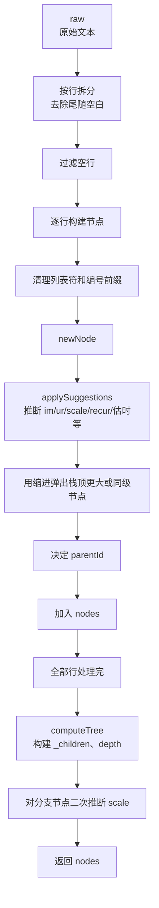

**图表来源**
- [app.js:492-511](file://assets/js/app.js#L492-L511)
- [app.js:513-520](file://assets/js/app.js#L513-L520)

**章节来源**
- [app.js:492-511](file://assets/js/app.js#L492-L511)
- [app.js:513-520](file://assets/js/app.js#L513-L520)

### 行清洗约定
每一行在成为节点前会执行两步清洗：
1. 去掉换行前的多余空白。
2. 去掉开头的列表符号和编号前缀，包括：
   - `- `
   - `* `
   - `• `
   - `· `
   - `数字.`
   - `数字、`

也就是说，“冒号”分隔不是解析器的强制语法；真正的语法边界主要由**换行+缩进**表达。文本中出现的“冒号”只会作为普通正文保留在 `text` 字段中，而不会被当作结构分隔符。

这一点很重要：如果用户希望某条正文包含冒号，不必加转义；但如果冒号紧跟在编号之后，需要确保它不在“编号 + 点/顿号”之前。

**章节来源**
- [app.js:494-502](file://assets/js/app.js#L494-L502)

### 编号和缩进形成的树
算法使用一个 `(node, indent)` 栈来确定父子关系：
- 每行读取当前行缩进空格数。
- 如果栈顶缩进大于等于当前行缩进，就弹出栈顶元素，直到找到严格更浅的缩进作为潜在父节点。
- 首个节点永远挂到根；其余节点挂到栈中最近的更浅节点。
- 然后当前节点压入栈。

这说明：
- **缩进变深**：成为上一个节点的子任务。
- **缩进相同**：成为上一个兄弟节点的兄弟节点。
- **缩进变浅**：回到更高层级，成为祖先的兄弟节点。
- **第一行无父节点**：会成为年度或主题级根节点。

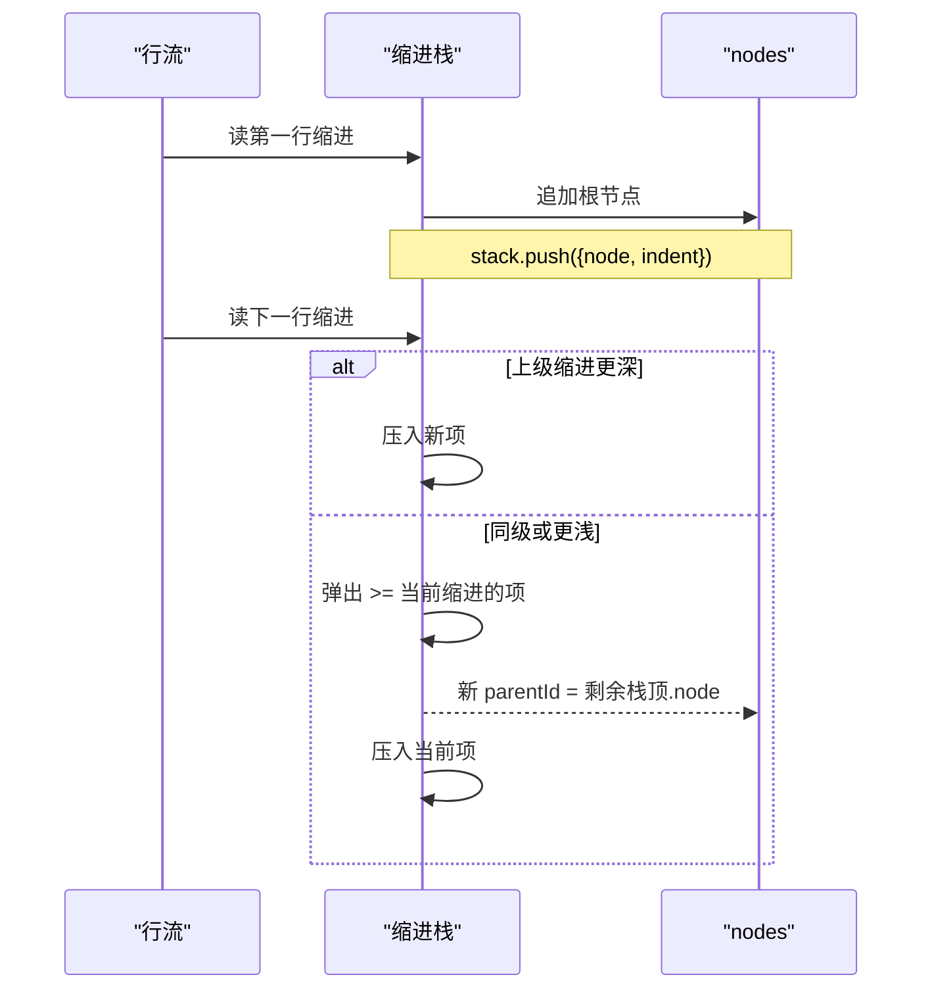

**图表来源**
- [app.js:496-506](file://assets/js/app.js#L496-L506)

**章节来源**
- [app.js:496-506](file://assets/js/app.js#L496-L506)

### Markdown 标题的处理
从 `parseText` 的实现来看，解析器并没有专门针对 `#` Markdown 标题做特殊分支。标题字符仍属于清洗后的一般文本。Markdown 标题更多是用户可读结构，而不是解析器的结构约定；真正驱动层次的是缩进。

需要注意：
- 如果一行只写 `# 某个标题`，它会被当成一个正常节点。
- 如果标题后面紧接更深层节点，只有缩进变化才会形成父子关系。
- 如果想让标题与下面内容合并为一个节点，应让正文在同一行。

**章节来源**
- [app.js:494-502](file://assets/js/app.js#L494-L502)
- [app.js:496-506](file://assets/js/app.js#L496-L506)

## 默认属性计算：重要度、紧急度、价值、费力与预估

### applySuggestions：文本到属性的映射
`applySuggestions(node, text, opts)` 负责把自然语言特征映射到结构性字段。

它做的事情包括：
- 关键词提升重要度或紧急度。
- “不重要”和“噪音”类词汇会降低评分甚至归为噪音。
- 解析截止日期，写入 `deadline`、`deadlineDate`、`daysLeft`、`overdue`。
- 根据截止日期紧迫程度拉高紧急度。
- 不覆盖已由用户手动设置的 `_manualIm` / `_manualUr`。
- 推断 `scale`、`recur`、`timesPerWeek`。
- 推断 `val` 和 `eff`。
- 从文案提取 `estimateMinutes`。

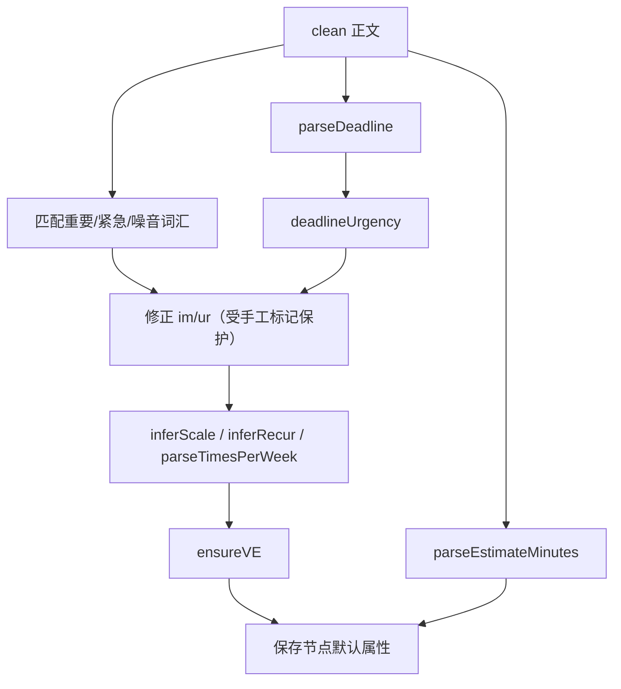

**图表来源**
- [app.js:465-490](file://assets/js/app.js#L465-L490)
- [app.js:398-422](file://assets/js/app.js#L398-L422)
- [app.js:426-447](file://assets/js/app.js#L426-L447)

**章节来源**
- [app.js:465-490](file://assets/js/app.js#L465-L490)

### ensureVE：value/effort 与快速赢
`ensureVE(n)` 的职责是让价值维度和费力维度可用，并支持“简单/复杂”词汇启发。

规则摘要：
- `val` 缺省时取 `im`，并钳制到 1-5。
- `eff` 缺省时从 3 起步；短动词或短时提示降为 2，“复杂/深度/重构/搭建/体系”升为 4；紧急度高也可能偏向费力。
- `val` 与 `eff` 都会钳制到 1-5。
- 快速赢定义为价值 ≥ 4 且费力 ≤ 2，用于筛选和周回顾叙述，不影响 rollup 分母。
- `veKey(val, eff)` 将四个组合映射为 quick、major、easy、trap。

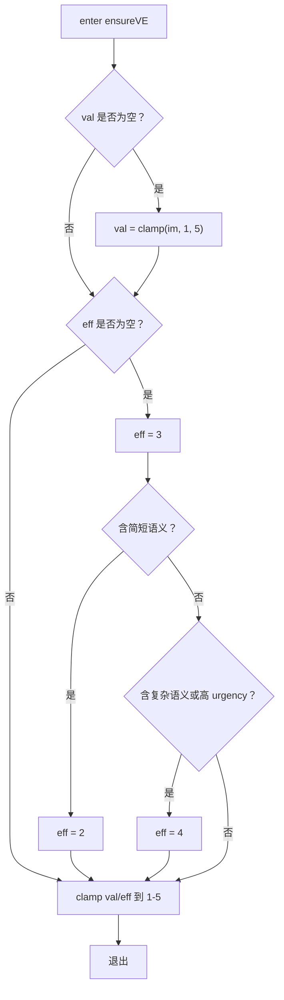

**图表来源**
- [app.js:35-53](file://assets/js/app.js#L35-L53)

**章节来源**
- [app.js:27-53](file://assets/js/app.js#L27-L53)

### parseEstimateMinutes 与叶子默认 30 分钟
解析预估分钟数时，支持的语义包括：
- `X 小时`：转换为 X×60 分钟。
- `X 分钟` 或 `X min`。
- “半天”记为 240 分钟。
- “五分钟”或“5 分钟”。

如果没有在文案中找到预估，并且该节点是叶子，则默认赋予 30 分钟。最终估计值和实际值都会被钳制并在非法零值时转为 `null`。

**章节来源**
- [app.js:188-215](file://assets/js/app.js#L188-L215)
- [PROGRESS-ROLLUP.md:25-31](file://docs/PROGRESS-ROLLUP.md#L25-L31)

## 日期与时间刻度推断

### parseDeadline 支持的自然日期
`parseDeadline(text)` 支持：
- 中文相对日期：今天、明日、后天。
- ISO 格式：YYYY-MM-DD。
- 月日格式：MM 月 DD 日。
- 周几：本周、下周、周一到周日。
- 月底、月末、本月、下月底。
- “第 X 周”。

返回对象包括可读 `label`、日期对象、距离天数的 `daysLeft` 和 `overdue` 标记。

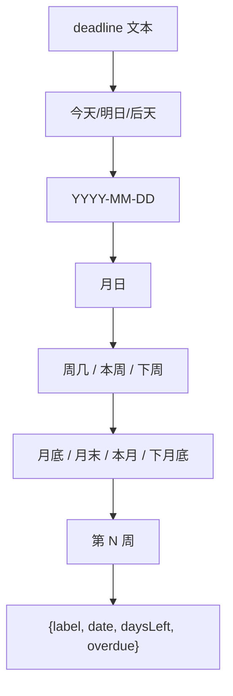

**图表来源**
- [app.js:398-422](file://assets/js/app.js#L398-L422)

**章节来源**
- [app.js:398-422](file://assets/js/app.js#L398-L422)

### inferScale 与二次尺度推断
`inferScale` 根据文本和时间信息决定 `scale`：
- “每天”“每日”“日课”等 → `day`。
- “每周”“周报”“每星期” → `week`。
- “每月”“月度”“月报” → `month`。
- “今年”“年度”“长期”“主线”→ `year`。
- 若有余下 deadline：≤1 天为 day，≤7 天为 week，否则为 month。
- 若已知它有子节点，默认倾向 `year`；叶子默认 `month`。

`parseText` 会在树结构构建完成后对“已有子节点的分支”再做一次尺度推断，这更符合“分支往往是中长期目标，叶子通常是短期行动”的结构直觉。

**章节来源**
- [app.js:426-436](file://assets/js/app.js#L426-L436)
- [app.js:492-511](file://assets/js/app.js#L492-L511)

## 进度 Rollup 与周回顾规则

### 叶子完成度向上聚合
Rollup 的核心约束是：
- 只有叶子节点计入完成进度。
- 根节点不计入。
- 中间层节点即使 `done=true`，也不会直接改变百分比。
- 被聚焦模式过滤但仍在完整树中的节点，仍然参与叶子统计。

叶子定义为：
- `parentId` 非空。
- `_children.length === 0`。

有两个常用指标：
- 全树叶子进度：`leafProgress()`。
- 子树叶子进度：`subtreeProgress(node)`。

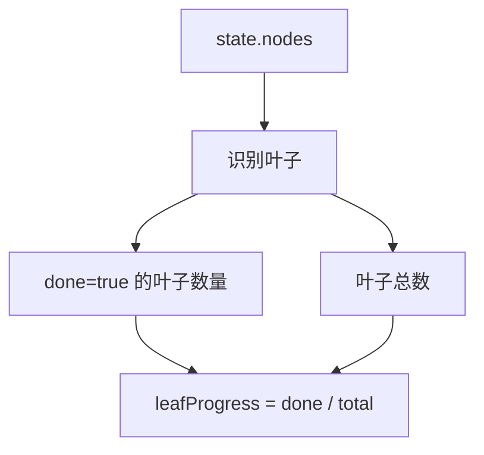

**图表来源**
- [PROGRESS-ROLLUP.md:3-15](file://docs/PROGRESS-ROLLUP.md#L3-L15)

**章节来源**
- [PROGRESS-ROLLUP.md:3-15](file://docs/PROGRESS-ROLLUP.md#L3-L15)

### doneAt 与“本周完成”
- 勾选叶子时写入 `doneAt`。
- 取消勾选时清空 `doneAt`。
- “本周完成”要求：`done === true` 且 `doneAt` 落在本周一 0:00 到下一周一 0:00。
- 历史数据里已有勾选但没有 `doneAt` 的节点，不会计入“本周完成”。
- 再次勾选时会补录时间戳。

这说明 Rollup 区分两类概念：
- 长期完成状态：`done`。
- 本周新增完成事件：`doneAt` 所在周。

**章节来源**
- [PROGRESS-ROLLUP.md:16-23](file://docs/PROGRESS-ROLLUP.md#L16-L23)
- [app.js:354-376](file://assets/js/app.js#L354-L376)

### Value/Effort、时长字段与周回顾
- 快速赢（价值 ≥ 4，费力 ≤ 2）用于筛选和周回顾叙述，不改变叶子分母。
- `estimateMinutes` 和 `actualMinutes` 不参与叶子完成百分比。
- 它们主要用于日容量与周回顾中的“预估 vs 实计”对比。
- 叶子默认预估 30 分钟，可从文本中解析出更长或更短值。
- 当叶子被完成且已有预估但未填实际时间时，`setNodeDone` 会把实际分钟设为预估分钟。

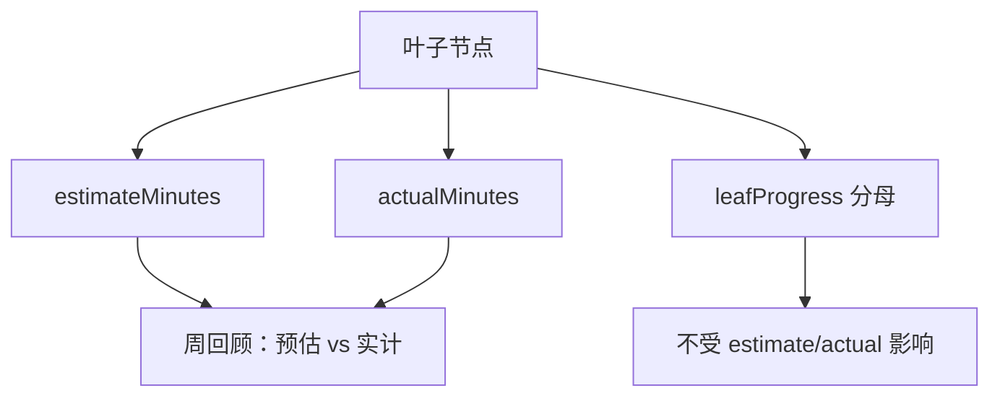

**图表来源**
- [PROGRESS-ROLLUP.md:25-37](file://docs/PROGRESS-ROLLUP.md#L25-L37)
- [app.js:354-371](file://assets/js/app.js#L354-L371)

**章节来源**
- [PROGRESS-ROLLUP.md:25-37](file://docs/PROGRESS-ROLLUP.md#L25-L37)
- [app.js:354-371](file://assets/js/app.js#L354-L371)

### 能量日志 energyLog 和时间审计数据的累积
从领域模型角度，能量日志和时间审计都是工作区级元数据的累积载体：
- 能量日志通过滚动更新功能写入当前工作区。
- 周回顾统计通过 `computeWeekStats` 获取本周数据。
- 时间审计用于比较计划与实际，支撑“计划谬误校准”。
- 这些统计数据与节点完成、番茄钟、日程排期联动，但不直接改变 `leafProgress` 的计算公式。

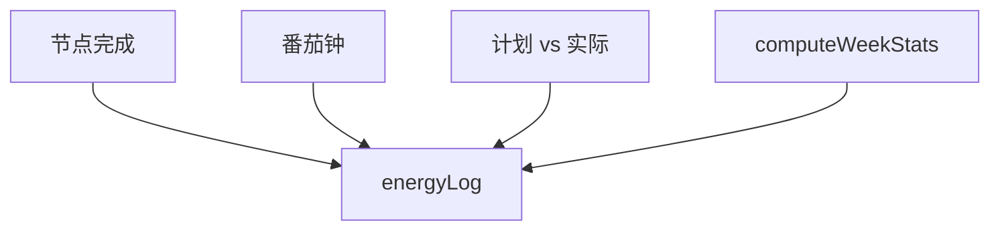

**图表来源**
- [PROGRESS-ROLLUP.md:25-37](file://docs/PROGRESS-ROLLUP.md#L25-L37)

**章节来源**
- [PROGRESS-ROLLUP.md:25-37](file://docs/PROGRESS-ROLLUP.md#L25-L37)

## 输入样例与解析结果对照

以下样例来自示例主题模块。由于真实 JSON 输出体积较大，本文仅给出输入结构和解析结果字段的解释；若需验证，可在应用中粘贴对应示例主题的 `text` 字段后查看解析产物。

### 样例一：销售体系 · 月入 5 万
输入主体：
- 一行年度或季度目标。
- 四大主干：核心、紧急、干扰、噪音。
- 每个主干包含若干缩进的叶子任务。

期望的节点树结构特点：
- 第一行成为根节点。
- 一级编号 `1.`、`2.`、`3.`、`4.` 成为根的四个子节点。
- 二级列表成为一级目标的叶子任务。
- “核心”节点的重要度较高；“紧急”节点紧急度较高；“噪音”会被文本特征拉低。
- 每个叶子可能有估算分钟、截止时间、循环标记和时间尺度。

参考路径：
- [gf-demos.js:23-53](file://assets/js/gf-demos.js#L23-L53)

### 样例二：考研上岸 · 2027 研究生
该样例包含更明确的短期截止日期表述，例如“本周完成第 3 章习题”“月底前测模考”。解析预期：
- 短期动作可能被推至 `day` 或 `week`。
- 长线学习被推至 `month` 或 `year`。
- “本周”“周五前”“月底”等短语可能触达截止时间和紧急度推断。

参考路径：
- [gf-demos.js:54-86](file://assets/js/gf-demos.js#L54-L86)

### 样例三：独立产品 · MVP 上线
此样例更接近产品开发场景，常见关键词如“访谈”“PRD”“登录/计费链路”“发布版本”等。这类文本容易触发：
- 较高重要度和较高中等或偏高的费力值。
- 较长的预估分钟数。
- 较高概率被判断为“月”或“年”尺度。

参考路径：
- [gf-demos.js:109-140](file://assets/js/gf-demos.js#L109-L140)

### 解析结果关键字段对照表
对于任意一个 parsed node，至少应该能够检查以下字段是否合理：

| 结果字段 | 应如何验证 |
|---|---|
| `text` | 不应包含 `1.`、`-`、`*` 等前缀，但应保留正文 |
| `parentId` | 符合缩进层级，第一行为 null，其他应与上一级缩进匹配 |
| `_children` | 叶子为 `[]`，父节点应按子节点顺序列出 |
| `depth` | 根为 0，逐级递增 |
| `im` | 核心、目标、长期等文本应偏高；噪音应偏低 |
| `ur` | “紧急”“周五前”“截止”等应偏高 |
| `scale` | 日常动作为 day，定期为 week，长期为主 year |
| `deadlineDate` | 若有日期短语则非空，并能回溯原始 label |
| `estimateMinutes` | 若文本有“半小时”“5 分钟”等，不应仍为空；否则叶子应默认 30 |
| `doneAt` | 未完成应为空；完成且重新勾选时应获得时间戳 |

### 实际解析结果建议
若开发者需要测试用例，推荐：
- 使用 10 个 demo 主题的完整 `text`。
- 在解析后打印每条节点的 id、text、parentId、im、ur、scale、deadlineLabel、estimateMinutes。
- 确认叶子总数、完成叶子数、quick-win 数量与预期一致。

[本节为结构化说明，不直接展示敏感或超大全量 JSON 输出]

## 依赖关系分析

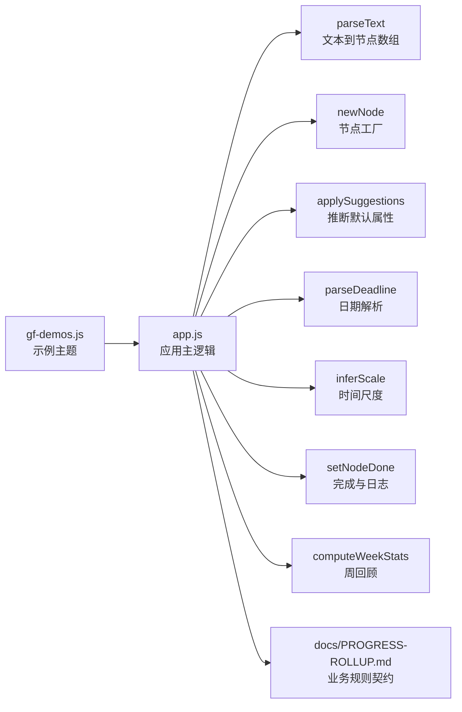

**图表来源**
- [gf-demos.js:1-15](file://assets/js/gf-demos.js#L1-L15)
- [app.js:354-371](file://assets/js/app.js#L354-L371)
- [app.js:398-422](file://assets/js/app.js#L398-L422)
- [app.js:426-436](file://assets/js/app.js#L426-L436)
- [app.js:451-490](file://assets/js/app.js#L451-L490)
- [PROGRESS-ROLLUP.md:1-37](file://docs/PROGRESS-ROLLUP.md#L1-L37)

**章节来源**
- [gf-demos.js:1-15](file://assets/js/gf-demos.js#L1-L15)
- [app.js:354-371](file://assets/js/app.js#L354-L371)
- [app.js:398-422](file://assets/js/app.js#L398-L422)
- [app.js:426-436](file://assets/js/app.js#L426-L436)
- [app.js:451-490](file://assets/js/app.js#L451-L490)
- [PROGRESS-ROLLUP.md:1-37](file://docs/PROGRESS-ROLLUP.md#L1-L37)

## 性能特性
代码中设计了多处减少重复计算的机制：

| 机制 | 作用 |
|---|---|
| `computeTree` | 重建 `_children`、`depth` 并与 tick 周期绑定 |
| `getCachedTree` | 避免在相同 nodes 数组上重复建树 |
| `invalidateTreeCache` | 当 `parentId`、`scale`、`done` 等结构可能变化时主动失效缓存 |
| `_tickN`、`_viewSlot`、`_rankSlot`、`_estTick` | 单次绘制内只计算视图、排名、估算等开销较大的派生数据 |
| `debouncedAfterChange` | 使用动画帧防抖变更后的批量刷新 |
| 节点估计预检 | `ensureAllEstimates` 只在必要时刷新 `estimateMinutes` 和 `actualMinutes` |

这意味着对大目标树的多次交互应尽量减少完整的 parse 重建频率；UI 层应尽量复用现有 `state.nodes` 并依靠缓存刷新。

**章节来源**
- [app.js:513-520](file://assets/js/app.js#L513-L520)
- [app.js:541-570](file://assets/js/app.js#L541-L570)
- [app.js:188-215](file://assets/js/app.js#L188-L215)

## 常见解析失败场景与修复建议

| 现象 | 可能原因 | 修复建议 |
|---|---|---|
| 第一行被忽略或结构异常 | 首行完全空白，或者开头带有无法识别的前缀 | 确保第一行是有意义的目标或主题文本；去掉不可见空白行 |
| 子任务归属错误 | 缩进比预期更浅或更深，导致 parent 指针指向错误层级 | 统一使用空格缩进，让子任务缩进明显大于父任务 |
| 编号混乱导致父节点错乱 | 混用 `1.`、`2.`、`-`、`*`、连续跳号或不规范编号 | 保持顶层使用有序编号 `1.`、`2.`；子任务使用列表符或缩进；不要混合两套风格 |
| 冒号被误认为分隔符 | 解析器不以冒号为结构语法 | 如需冒号，只需放在正文中；不要把冒号用于切分结构，用缩进代替 |
| Markdown 标题不被识别 | 解析器不对 `#` 做专用结构处理 | 如果需要标题和内容合为一个节点，请放在同一行；如需层级，改用缩进 |
| 叶子未完成百分比不动 | 该节点仍有子节点，被视为中间层 | 删除中间层子节点或将其拆成叶子；只有 `_children.length === 0` 的叶子才参与分母 |
| “本周完成”没增长 | 已完成节点没有 `doneAt`，或者时间戳不在本周一到下一周一区间 | 重新勾选该叶子以补写 `doneAt`；确认系统日期和周起始时间 |
| 预估时长始终为空 | 文本里没有小时/分钟/半天/五分钟等模式，并且该节点不是叶子 | 补充“X 分钟”“半小时”等字样；或把任务下沉为叶子 |
| 预估时长被截断 | 数值超出允许上限或被非法 0 值清洗 | 检查 `estimateMinutes` 是否在有效范围；异常值会被规范化或置空 |
| 重要度/紧急度不符合预期 | 文本缺乏关键词，或用户已手动设置了 `_manualIm`/`_manualUr` | 补充“核心”“紧急”“截止”“长期”等词，或在 UI 中调整重要度与紧急度 |
| 时间尺度总是 month 或 year | 文本中没有 day/week/month/year 特征词，也未提供临近 deadline | 添加“每天”“每周”“本月”“年度”等词，或写出清晰日期 |

特别要注意两类歧义：
- **歧义编号**：例如第二层又出现 `1.`，并不一定重置层级；它只是被解析为另一个列表条目。缩进才是主结构信号。
- **嵌套超限**：虽然代码没有硬编码最大嵌套层数，但极深缩进会让树阅读和维护困难；建议控制在一到三级主层级以内，必要时拆分为多个根目标。

**章节来源**
- [app.js:494-511](file://assets/js/app.js#L494-L511)
- [app.js:465-490](file://assets/js/app.js#L465-L490)
- [app.js:188-215](file://assets/js/app.js#L188-L215)
- [PROGRESS-ROLLUP.md:3-23](file://docs/PROGRESS-ROLLUP.md#L3-L23)

## 结论
GoalFlow 的领域模型以 node 为核心，以 meta 为工作区级配置和统计容器，以 workflow 为多目标空间。目标树的物理形态是 `parentId` 指针结构，视觉形态则是按尺度选出的扁平节点列表。

`parseText` 的强假设是用缩进表达层级，而不是冒号或 Markdown 标题。`applySuggestions` 承担了“自然语言语义 → 结构化属性”的主要压力，把词汇线索、截止日期、估算时长、循环习惯和价值费力偏好收敛到节点字段。

Rollup 的规则保证了完成进度由叶子贡献，周回顾区分“已经完成”和“本周完成”，能量日志与时间审计则用于反馈和改进排期，而不混淆“完成率”这一度量本身。

理解这套模型后，用户可以：
- 用简洁的缩进式自然语言目标快速建图。
- 通过关键词和日期短语获得合理的默认评估。
- 用叶子勾选和番茄钟推进执行闭环。
- 用周回顾和能量趋势发现精力错配，持续校准计划与实际。

[本节为总结性内容，不引用具体代码片段]