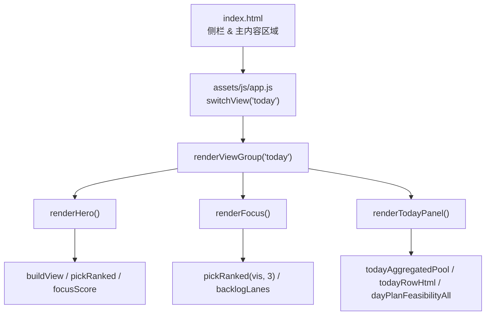
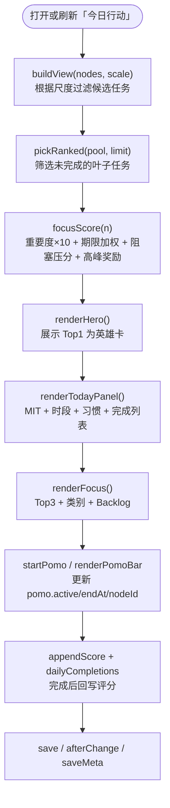
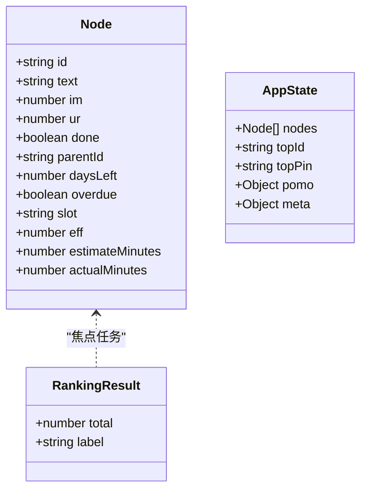
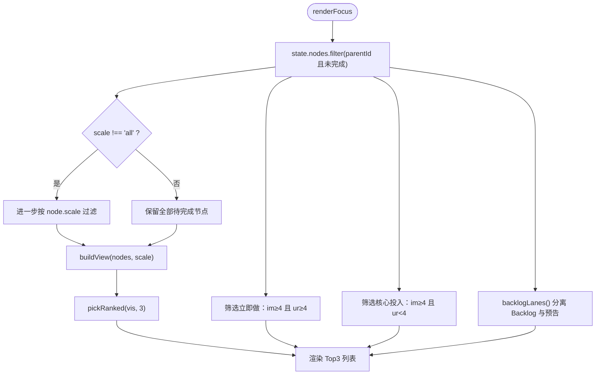
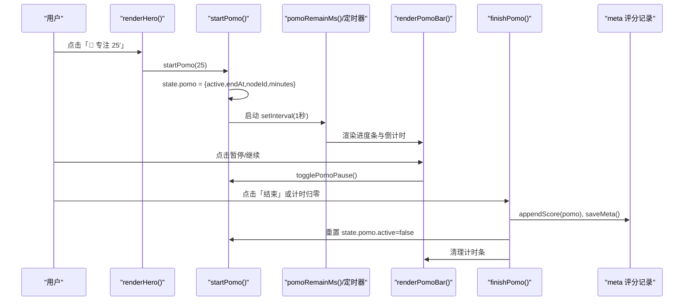
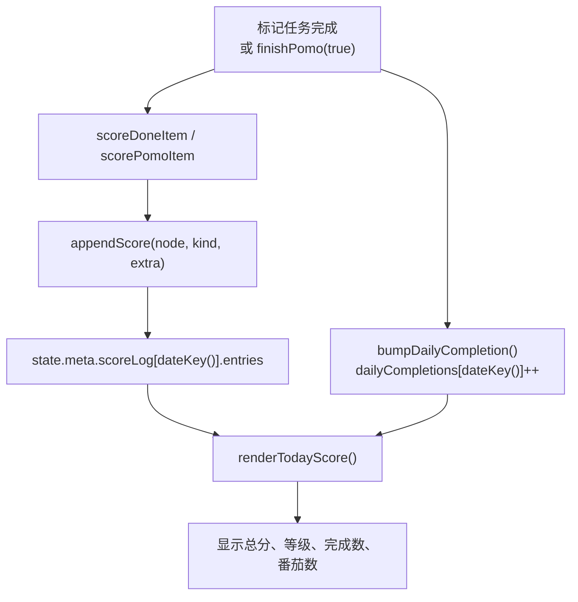
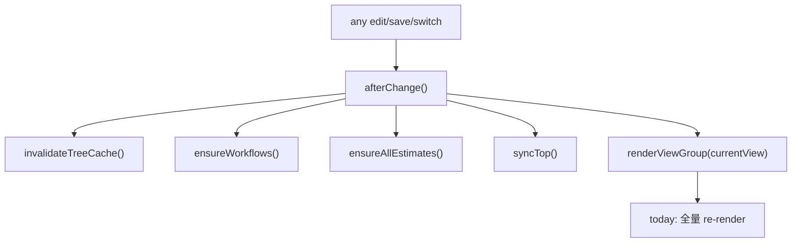

# ☀ 今日行动视图

<cite>
**本文引用的文件**
- [index.html](file://index.html)
- [app.js](file://assets/js/app.js)
</cite>

## 目录
1. [什么是今日行动视图](#什么是今日行动视图)
2. [页面结构与用户操作入口](#页面结构与用户操作入口)
3. [核心机制总览](#核心机制总览)
4. [英雄卡 MIT 与 Top3 聚焦清单](#英雄卡-mit-top3-和选择逻辑)
5. [Backlog 与日期筛选](#backlog-with-datekey-filters)
6. [番茄钟流程](#番茄钟流程)
7. [每日总评分与评级](#每日总评分与评级)
8. [依赖关系与渲染调度](#依赖关系与渲染调度)
9. [常见问题排查](#常见问题排查)
10. [扩展与二次开发建议](#扩展与二次开发建议)

## 什么是今日行动视图
「今日行动」是目标流 GoalFlow 的默认主页，负责把仓库里复杂的任务树收敛成「今天真正该做」的最小动作集合。它在视觉上分为三条主线：

| 区域 | 用户价值 | 对应 DOM 容器 | app.js 关键函数 |
|---|---|---|---|
| 英雄卡 | 只显示「当下最重要」的一件任务，并说明为什么选它 | `#hero`、`#pomoBar` | `renderHero()` |
| MIT + 执行清单 | 以 MIT 为核心，按时段展示今天可执行的叶子任务；习惯打卡放在微习惯区 | `#todayMit`、`#todaySlots`、`#todayMicro`、`#todayChecklist` | `renderTodayPanel()` |
| 备选与 Backlog | 按日期范围列出 Top3、立即做、核心投入、上周遗留和下月预告 | `#todayFocus` | `renderFocus()` |

用户进入应用时，左侧导航栏会选中「☀ 今天」，右侧主面板默认显示该视图；也可通过移动端底部 tab 中的「☀ 今日」切换回来。



**图示来源**
- [index.html:19-44](file://index.html#L19-L44)
- [index.html:94-180](file://index.html#L94-L180)
- [app.js:3198-3390](file://assets/js/app.js#L3198-L3390)
- [app.js:4091-4360](file://assets/js/app.js#L4091-L4360)
- [app.js:4356-4382](file://assets/js/app.js#L4356-L4382)

**段落来源**
- [index.html:19-44](file://index.html#L19-L44)
- [index.html:94-180](file://index.html#L94-L180)

## 页面结构与用户操作入口
### 左导航
- 图标轨按钮 `data-nav="today"` 用于快速切换到「今日行动」。
- 侧栏中「☀ 今日行动」按钮与标签为当前活动视图提供视觉标记。
- 「晨计划」「晚总结」「周计划」「周回顾」等仪式按钮会打开弹窗，但不会直接进入今日数据流，只在保存后触发 `afterChange()` 影响评分、提醒和可视化。

### 主内容区顶部工具条
- 「进度」胶囊根据叶子任务完成度动态变化。
- 「更多」菜单中包含设置、备份恢复、主题切换等全局操作，其中「设置」会影响每日可做完性估算与本周时间预算。
- 「今日行动」面包屑在 `switchView('today')` 时显示为“今日行动”。

### 主体三块
| HTML 区域 | 功能 | 用户操作路径 |
|---|---|---|
| `#heroWrap` | 英雄卡 + 倒计时栏 | 点击「🍅 专注 25′」启动番茄钟；点击「✎ 编辑」调整重要/紧急/期限；点击 Top2/Top3 复选框标记完成 |
| `#todayPanel` | 主执行区 | 查看 MIT、按时段拖拽任务、点习惯打卡、查看「今日已完成」历史 |
| `#zoneFocus` | 备选与 Backlog | 展开折叠，查看 Top3、立即做、核心投入、Backlog |

**段落来源**
- [index.html:19-44](file://index.html#L19-L44)
- [index.html:63-107](file://index.html#L63-L107)
- [index.html:109-180](file://index.html#L109-L180)

## 核心机制总览
「今日行动」不是简单地把节点列表刷一遍，而是围绕 state 的核心字段做一次「构建 → 打分 → 筛选 → 渲染」流水线：



**图示来源**
- [app.js:597-663](file://assets/js/app.js#L597-L663)
- [app.js:3198-3390](file://assets/js/app.js#L3198-L3390)
- [app.js:4091-4360](file://assets/js/app.js#L4091-L4360)
- [app.js:4356-4382](file://assets/js/app.js#L4356-L4382)
- [app.js:2757-2798](file://assets/js/app.js#L2757-L2798)
- [app.js:328-336](file://assets/js/app.js#L328-L336)
- [app.js:245-249](file://assets/js/app.js#L245-L249)

**段落来源**
- [app.js:597-663](file://assets/js/app.js#L597-L663)
- [app.js:3198-3390](file://assets/js/app.js#L3198-L3390)

## 英雄卡 MIT、Top3 与选择逻辑

### 用户在页面上的可见体验
1. 页面顶部出现一张带星号的「英雄卡」，标题是“FOCUS · 当下河流”，正文是系统选出的最重要任务。
2. 卡片下方显示该任务的分类（如“重要且紧急”）、剩余天数、估时、完成子树进度和「🍅 专注 25′」按钮。
3. “得分分解”可以展开，看到为什么这个任务被选中。
4. 如果还有其他 Top2、Top3，会以“执行栈”形式跟在后面，可勾选完成，也可点击展开查看详情。
5. 用户可以通过「✎ 编辑」修改文案、期限、估时、重要度和紧急度；也可以通过「📌 已固定 · 取消」手动固定或交回算法。



**图示来源**
- [app.js:597-663](file://assets/js/app.js#L597-L663)
- [app.js:3198-3390](file://assets/js/app.js#L3198-L3390)

### 选择算法的三个层次

| 步骤 | 函数或逻辑 | 输入 | 输出 | 说明 |
|---|---|---|---|---|
| 构建候选 | `buildView(nodes, scale)` | 全部节点与当前 scale | 可视任务数组 vis | 根据年度/季度/月度/每周/每日等尺度过滤任务 |
| 排序筛选 | `pickRanked(pool, limit)` | pool（默认 `state.nodes`）与 limit | 排序后的前 N 个，或单个 Top1 | 优先筛选未完成、有父节点、无子节点的叶子 |
| 单项打分 | `focusScore(n)` | 单个节点 n | 数字分数 | 综合重要度、期限、状态、精力高峰等维度 |
| Top1 挑选 | `pickHeroTop()` | 候选 Top8 | 最终英雄卡节点 | 排除 habit/循环任务；允许 `topPin` 覆盖算法 |
| Top3 聚焦 | `renderFocus` 中 `pickRanked(vis, 3)` | 可视化池 | Top3 列表 | 用于「备选与 Backlog」区的 Top3 头排 |

#### focusScore 权重说明
- 基础分：`im × 10`，重要度越高基数越大。
- 期限加分：  
  - 已逾期：+30  
  - 1 天内到期：+26  
  - 3 天内到期：+20  
  - 7 天内到期：+13  
  - 14 天内到期：+7  
  - 其他有期限任务：+3  
- 没有显式期限但重要度高（im≥4/5）：加一个“长期主线”加分。
- 阻塞压分：`status === 'blocked'` 减去 60 分；`status === 'waiting'` 减去 45 分。这样等待和阻塞任务通常不再抢英雄卡。
- 精力高峰加成：当节点设置了时段 slot、费力较高，并且当前处于用户近 14 天记录的精力高峰时段时，临时加 6 分。
- 已完成任务返回负数 `-1000`，避免完成的任务继续竞争。

#### 可选调整入口
| 调整内容 | 用户操作 | app.js 对应处理 |
|---|---|---|
| 修正「重要度/紧急度」 | 英雄卡上点击「✎ 编辑」，修改下拉选择 | 写入 `node.im`、`node.ur` |
| 修正期限 | 编辑表单填「期限」或「deadlineText」 | 调用 `parseDeadline`，更新 `deadlineDate` |
| 修正估时 | 编辑表单中输入分钟数 | 写入 `estimateMinutes` |
| 固定某个任务 | 洞察页或日历固定后，state.topId/topPin 指向它 | `renderHero` 优先使用 `state.topPin` |
| 取消固定 | 点击「📌 已固定 · 取消」 | 清空 `state.topPin` |
| 调整「当下」选择 | 修改重要度、紧急度、期限、时段或 status | 下次 `renderHero` 重算 |

**段落来源**
- [app.js:597-663](file://assets/js/app.js#L597-L663)
- [app.js:3198-3390](file://assets/js/app.js#L3198-L3390)
- [index.html:109-180](file://index.html#L109-L180)

## Backlog 与 dateKey 筛选

### Top3 聚焦清单
「备选与 Backlog」区块由 `renderFocus()` 生成，包含：

1. **Top3 算法排序**：对可视化池再次调用 `pickRanked(vis, 3)`，得到三项可完成的重点任务。
2. **立即做**：从当前工作流中筛选 `im ≥ 4 && ur ≥ 4` 的未完成任务，再按 `focusScore(b) - focusScore(a)` 排序。
3. **核心投入**：筛选 `im ≥ 4 && ur < 4` 的未完成任务，同样按焦点分数降序排列。
4. **Backlog 滞留区**：基于 `backlogLanes()`，将超过本月的旧任务放入“上周未完成 Backlog”；未来月份的远期任务归入“下月预告”。
5. **日期上下文提示**：顶部小字显示当前 scale 是“全部”还是“某日/周/月重点”。

注意：**「备选与 Backlog」并非严格按 `dateKey(TODAY)` 筛选当日节点**，它的根筛选条件是 `n.parentId && !n.done`，即所有未完成的叶子或分支；真正的“日期约束”主要体现在：
- `buildView(nodes, scale)` 受当前 scale 影响；
- Top3 来自可视化池，而非全部节点；
- Backlog 按历史和未来月份划分滞留项目。

因此，如果你期望这里只看到「今天」，请先确认视图缩放档位是否设在「day」；若想看更广泛范围，可用「all」查看跨尺度待办。



**图示来源**
- [app.js:4356-4382](file://assets/js/app.js#L4356-L4382)
- [app.js:597-663](file://assets/js/app.js#L597-L663)

### 日期相关状态字段
| 字段 | 含义 | 在「今日行动」中的作用 |
|---|---|---|
| `state.scale` | 当前时间尺度：`day` / `week` / `month` / `year` / `all` | 控制 hero、图表、执行池和聚焦清单的时间窗口 |
| `dateKey(d)` | 返回 `YYYY-MM-DD` 字符串 | 用于记录每日完成次数、评分、执行日志等 |
| `TODAY` | JavaScript Date 对象，表示本地当天零点 | `dateKey()` 默认使用它 |
| `scale` | 节点属性 | 决定任务适合落在哪一层级，影响 `buildView` 与聚焦清单过滤 |
| `scaleLabel` | 映射表 | 把 `day`→“今日”、`week`→“本周”等显示给用户 |

**段落来源**
- [app.js:198-208](file://assets/js/app.js#L198-L208)
- [app.js:4356-4382](file://assets/js/app.js#L4356-L4382)

## 番茄钟流程

### 用户操作路径
1. 打开「今日行动」。
2. 确保英雄卡上有「当下最重要」任务；如果没有，先解析或生成目标。
3. 点击英雄卡上的「🍅 专注 25′」。
4. 页面顶部出现番茄计时条，显示任务名、剩余时间、百分比和「暂停」「结束」按钮。
5. 可随时暂停再继续；计时结束时自动统计实际耗时。

### 状态字段变化过程
| 阶段 | 状态字段 | 说明 |
|---|---|---|
| 初始化计时 | `state.pomo = { active: true, paused: false, endAt: Date.now() + minutes×60000, nodeId: id, minutes }` | 绑定到当前英雄的 `state.topId` |
| 每秒推进 | `pomoRemainMs()` | 计算剩余毫秒 |
| 暂停 | `state.pomo.paused = true; remainMs = max(0, endAt - now)` | 停止定时器，冻结剩余时间 |
| 继续 | `state.pomo.paused = false; endAt = Date.now() + remainMs` | 重启每秒定时器 |
| 自然结束 | `finishPomo(true)` | 把 `pomo.minutes` 累加到 `node.actualMinutes`，追加评分，然后停掉计时器 |
| 手动提前结束 | `stopPomo()` 调 `finishPomo(false)` | 不记完成积分，只清除计时状态 |



**图示来源**
- [app.js:2757-2798](file://assets/js/app.js#L2757-L2798)
- [app.js:2738-2755](file://assets/js/app.js#L2738-L2755)
- [app.js:328-336](file://assets/js/app.js#L328-L336)

**段落来源**
- [app.js:2738-2798](file://assets/js/app.js#L2738-L2798)
- [index.html:109-180](file://index.html#L109-L180)

## 每日总评分与评级

### 评分从哪里来
每日评分不是只看“勾选了多少任务”，而是合并三类信息：

1. **完成叶子任务**：通过 `scoreDoneItem(n)` 把“完成一项可交付”纳入评分。
2. **番茄钟专注**：通过 `scorePomoItem(n, minutes)` 把“完整专注 x 分钟”计入评分。
3. **完成标记频率**：每次完成操作会通过 `bumpDailyCompletion()` 写入 `state.meta.dailyCompletions[dk]`，其中 `dk = dateKey()`。

`renderTodayScore()` 会读取这些累积数据，输出：
- 今日总评分（0–100）
- 等级（例如已达成或未达成）
- 完成项数量
- 番茄数量与专注总分钟数
- 最近一条评分事件的简略原因
- 距 100 分的差额



**图示来源**
- [app.js:245-249](file://assets/js/app.js#L245-L249)
- [app.js:328-336](file://assets/js/app.js#L328-L336)
- [app.js:316-327](file://assets/js/app.js#L316-L327)
- [app.js:6073-6091](file://assets/js/app.js#L6073-L6091)

### 时间与估算的影响
除了“是否完成”，以下字段也会改变用户感知与辅助评分：
- `estimateMinutes`：任务估时越清楚，Day Plan Feasibility 和“可做完性”越真实。
- `actualMinutes`：番茄结束后会增加此项；「今日已完成」列表也显示实计时间。
- `im` / `ur`：越重要、越接近期限的任务，完成时的分值贡献更高。
- `overdue` 与 `daysLeft`：已逾期任务的焦点分数显著提升，完成这类任务对反馈更有意义。

**段落来源**
- [app.js:245-249](file://assets/js/app.js#L245-L249)
- [app.js:316-336](file://assets/js/app.js#L316-L336)
- [app.js:6073-6091](file://assets/js/app.js#L6073-L6091)

## 依赖关系与渲染调度

### 渲染入口
「今日行动」在 `view group` 中以一组函数一起重绘：
```javascript
today: () => {
  renderHero();
  renderFocus();
  renderMetricsStrip();
  renderPlanShareStrip();
  renderTodayPanel();
  renderReviewBanner();
  updateTodayZones();
}
```

任何数据变更（编辑节点、切换工作流、切换视图等）通常走 `afterChange()`，它会：
1. 失效树缓存；
2. 确保 workflows；
3. 预估时间；
4. 同步 Top；
5. 重绘当前视图组。



**图示来源**
- [app.js:6117-6140](file://assets/js/app.js#L6117-L6140)

### 视图切换与导航
- 侧栏按钮与移动端 tab 都通过 `switchView(name)` 切换。
- 切换时会更新 `document.querySelectorAll('[data-nav]').classList.toggle('on', ...)`。
- URL hash 会变成 `#/today` 等，方便直接跳转。
- 首次加载或切到今天时，如果对应视图组脏标记存在，才重新跑 `today` 渲染组，避免重绘其他昂贵视图。

**段落来源**
- [app.js:4285-4350](file://assets/js/app.js#L4285-L4350)
- [app.js:6117-6140](file://assets/js/app.js#L6117-L6140)

## 常见问题排查

| 现象 | 可能原因 | 排查建议 | 关键代码位置 |
|---|---|---|---|
| 今日页面是空白的 | 尚未解析任务或没有工作流 | 先进「目标规划」粘贴或载入示例，再切回「今日行动」 | `renderTodayPanel` 空工作流分支 |
| 英雄卡没有任务 | 没有完成叶子，或只剩习惯/周期任务 | 让至少一个叶子未被标记完成；英雄卡会排除循环任务，留下执行型任务 | `renderHero`、`pickHeroTop` |
| MIT 不符合预期 | 重要度低、期限远、被标记 blocked/waiting，或被你固定了另一个 | 调高 im；补期限；取消 blocked/waiting；检查是否用了「固定」 | `focusScore`、`isNodeBlocked`、`isNodeWaiting`、`pickHeroTop` |
| 每天 MIT 变来变去 | algorithm 依赖 im、ur、期限和能量曲线，随数据变化而变 | 固定你最关心的任务作为 MIT，减少每天漂移 | `renderHero` 顶部的 `state.topPin` |
| Top3 看不到今天的任务 | 当前 scale 不在 day/all，或任务不在可视化视图中 | 切换到「全部」或在洞察图左上角改为 week/day | `buildView`、`renderFocus` |
| Backlog 一直很多 | 这些任务超出本月、仍未完成，或属于更早工作流的遗留 | 检查节点 scale 与期限；确认 backlogLanes 的“上周未完成 / 下月预告”区分 | `renderFocus`、`backlogLanes` |
| 番茄钟不显示 | 英雄卡没有选定 topId；pomoBar DOM 缺失；浏览器阻止脚本运行 | 先确认英雄卡上有任务；点击“专注 25′”再试 | `startPomo`、`renderPomoBar` |
| 番茄钟开始后立即消失 | `endAt` 被误改、`Date.now()` 不一致、页面长时间后台运行后被回收 | 刷新页面重试；检查系统时钟；避免长时间切后台 | `pomoRemainMs`、`togglePomoPause` |
| 结束番茄没有计分 | 提前点击「结束」会调用 `finishPomo(false)`，不计完成积分 | 让计时走到终点，或理解主动结束只清状态不加分 | `finishPomo(credit)` |
| 今日评分始终偏低 | 没有完成任务或没有专注完成；缺少 estimateMinutes 也会影响能力感 | 勾选叶子、完成番茄、为叶子设估时；查看每日总评分栏 | `scoreDoneItem`、`scorePomoItem`、`renderTodayScore` |
| 历史评分丢了 | 本地存储损坏或隐私模式未持久化 | 导出 JSON 备份后重新导入；检查 localStorage 权限 | `saveMeta`、`loadMeta` 相关逻辑 |
| 拖任务进时段没反应 | 拖放时未成功写 slot/scale，或事件绑定失败 | 看控制台错误；确认行带 `draggable`、drop 区有 `data-slotdrop`；刷新后重试 | `renderTodayPanel` 拖拽逻辑 |
| 习惯打卡不出现 | 没有习惯类节点，或已被挑走成为 MIT | 点击“＋ 习惯”添加；检查是否有 role/habit/recur 标记 | `renderTodayPanel` micro habits 分组 |

**段落来源**
- [app.js:4091-4360](file://assets/js/app.js#L4091-L4360)
- [app.js:2757-2798](file://assets/js/app.js#L2757-L2798)
- [app.js:597-663](file://assets/js/app.js#L597-L663)
- [app.js:6073-6091](file://assets/js/app.js#L6073-L6091)

## 扩展与二次开发建议

### 如果想调整 MIT 的优先级
- 不建议直接硬编码 `focusScore` 返回值，应先评估对 Top3、Block 分类和桑基金线的影响。
- 更适合的方式是在 `focusScore(n)` 增加新的可读条件，例如针对特殊 category、特殊 tag 或用户自定义偏好。
- 如果需要让用户“今天不管算法”，推荐使用 `state.topPin`，它能让英雄卡绕过 `pickHeroTop` 选择用户固定的 ID。

### 如果想加入新的日期筛选
- 不要只修改 `renderFocus` 的原始 filter，因为当前实现还同时负责 Top3、类别和 Backlog。
- 可在 `buildView` 或 `todayAggregatedPool` 附近新增日期维度参数，并把结果同时提供给 `renderTodayPanel` 和 `renderFocus`。
- 如果要做严格“只今天”的模式，推荐新增一个 `dateKey` 匹配条件，例如 `node.deadlineDate` 落在 target dateKey 内。

### 如果想改进每日评分
- 现有评分已经拆分为完成评分与番茄评分，并通过 `scoreLog.dateKey.entries` 聚合。
- 如需引入新维度（如“按时段完成数”、“早完成任务加分”），可在对应的评分函数中追加规则，并保持 `appendScore(kind)` 结构一致。
- 记得同时在 `renderTodayScore` 中消费新字段，避免评分增长但界面不变化。

### 如果想优化性能
- `pickRanked` 本身已有 `_rankSlot` 缓存：同一次 tick 内同一 pool 与 limit 不会重复排序。
- `ensureAllEstimates` 用 `_estTick` 保证一帧内只扫描一次节点估时。
- `VIEW_GROUP.today` 会把所有今日相关渲染集中在一次切换中调用，尽量避免分散重绘。
- 如果扩展更多筛选逻辑，请优先复用 `pool.filter(...).sort(focusScore)`，而不是每次独立遍历 `state.nodes`。

**段落来源**
- [app.js:557-575](file://assets/js/app.js#L557-L575)
- [app.js:597-663](file://assets/js/app.js#L597-L663)
- [app.js:6117-6140](file://assets/js/app.js#L6117-L6140)
- [assets/js/app.js](file://assets/js/app.js)