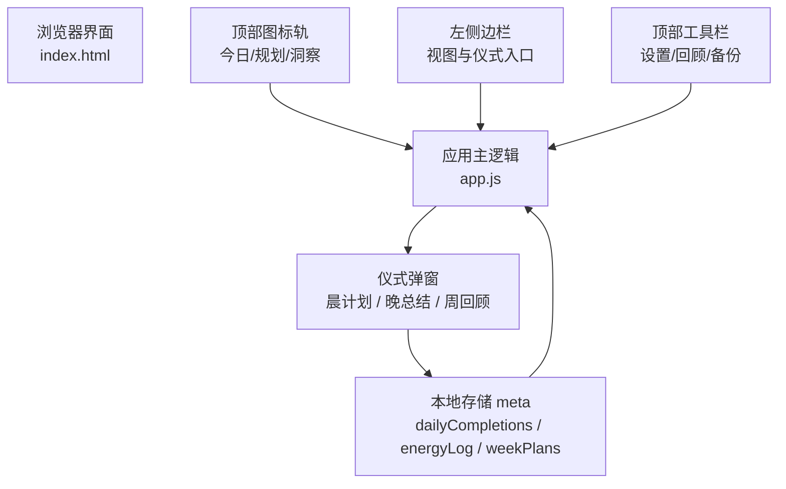
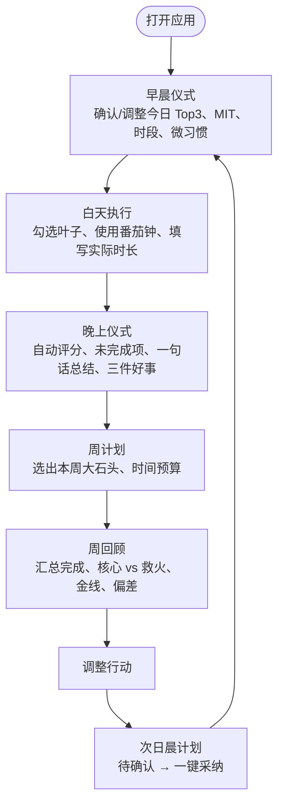
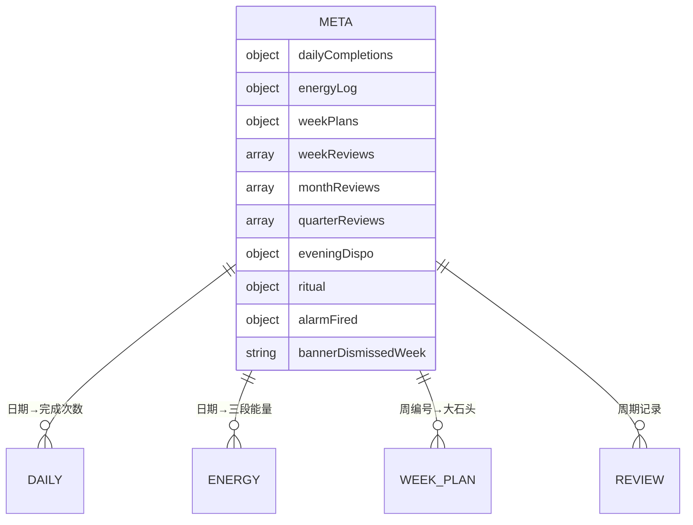
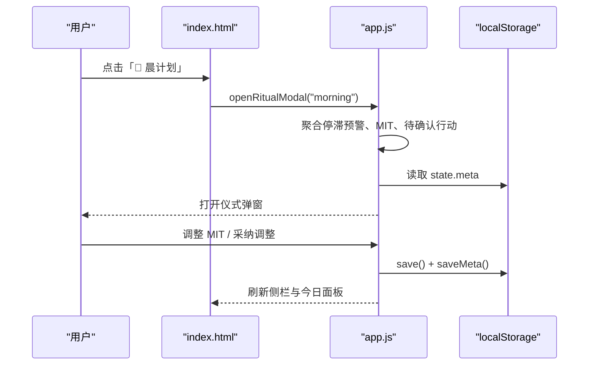
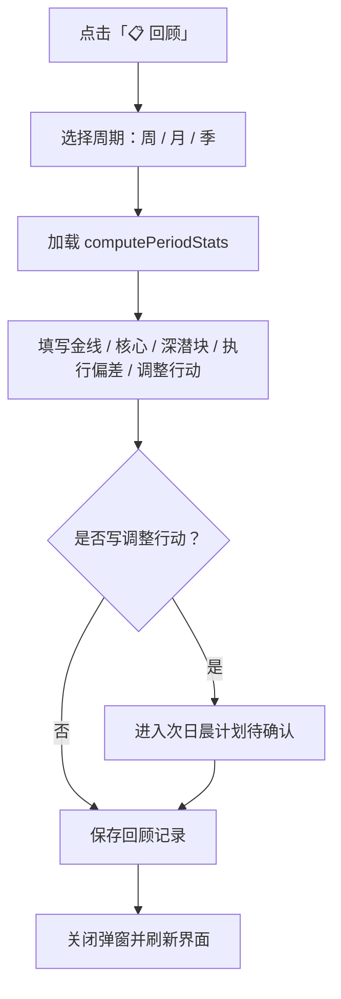
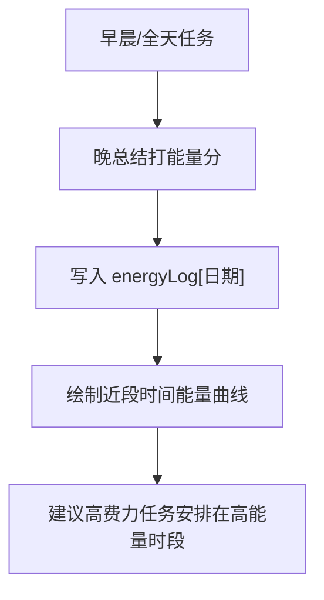
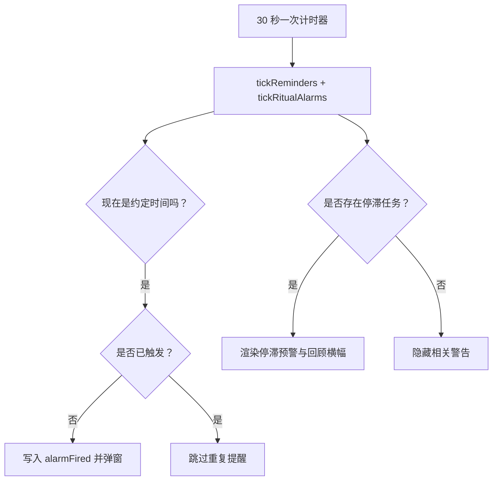
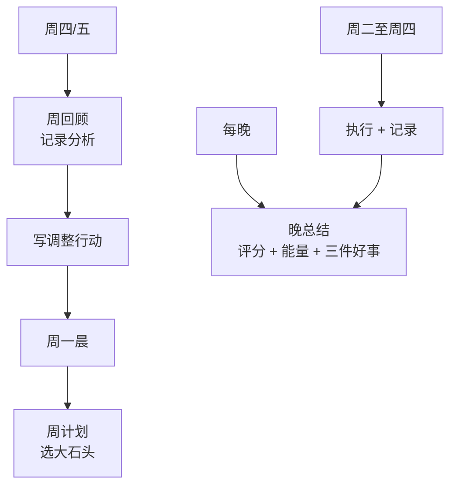

# 仪式感工作流

<cite>
**本文引用的文件 **
- [index.html](file://index.html)
- [assets/js/app.js](file://assets/js/app.js)
- [README.md](file://README.md)
- [PROGRESS-ROLLUP.md](file://docs/PROGRESS-ROLLUP.md)
</cite>

## 目录
1. [引言](#引言)
2. [项目结构与仪式入口](#项目结构与仪式入口)
3. [核心设计意图：PDCA 闭环](#核心设计意图pdc-a-c-闭环)
4. [仪式与元数据模型](#仪式与元数据模型)
5. [晨计划操作指南](#晨计划操作指南)
6. [晚总结操作指南](#晚总结操作指南)
7. [周计划与周回顾操作指南](#周计划与周回顾操作指南)
8. [三件好事与能量曲线](#三件好事与能量曲线)
9. [未按时回顾的提醒与停滞预警](#未按时回顾的提醒与停滞预警)
10. [仪式对后续 MIT 与评分的反作用](#仪式对后续-mit-与评分的反作用)
11. [嵌入日常节奏的建议流程](#嵌入日常节奏的建议流程)
12. [扩展自定义仪式的开发者指南](#扩展自定义仪式的开发者指南)
13. [故障排查](#故障排查)
14. [结论](#结论)

## 引言
“仪式感工作流”的目标不是增加负担，而是把 GoalFlow 从一张目标图变成一个持续运转的计划—执行—检查—调整循环。应用在 `index.html` 中提供主视图、侧栏导航和「仪式」组按钮；在 `assets/js/app.js` 中由事件绑定、模态框渲染器和 `meta` 持久化逻辑串联起来。

这套仪式涵盖：
- 每天早上的「晨计划」
- 每天晚上结束的「晚总结」
- 每周一（或周末）的「周计划」「周回顾」
- 「三件好事」作为一天积极收尾
- 「能量曲线」作为精力管理依据

这些动作写入 `state.meta` 中的 `dailyCompletions`、`energyLog`、`weekPlans`、`weekReviews`、`eveningDispo`、`ritual` 等字段，再反过来影响次日 MIT、时间预算、评分以及「需要关注」面板。

**节内来源**
- [index.html:1-120](file://index.html#L1-L120)
- [README.md:1-103](file://README.md#L1-L103)

## 项目结构与仪式入口
GoalFlow 的界面被分成三个主视角：**今日行动**、**目标规划**、**归纳洞察**。左侧图标轨提供顶层切换，左侧边栏提供具体视图与仪式入口。

### 侧栏中的仪式按钮
| 入口 | `index.html` 元素 | 打开后行为 |
|---|---|---|
| 🌅 晨计划 | 侧栏 `button#sideMorning` | 调用 `openRitualModal('morning')` |
| 🌙 晚总结 | 侧栏 `button#sideEvening` | 调用 `openRitualModal('evening')` |
| 🗓 周计划 | 侧栏 `button#sideWeekPlan` | 调用 `openWeekPlan()` |
| ◔ 周回顾 | 侧栏 `button#sideWeekReview` 与顶栏「📋 回顾」 | 分别进入周期回顾与周回顾筛选流程 |

**图表来源**
- [index.html:28-85](file://index.html#L28-L85)
- [index.html:100-180](file://index.html#L100-L180)
- [assets/js/app.js:6512-6549](file://assets/js/app.js#L6512-L6549)

### 顶栏「需要关注」中的回顾横幅
在「今日行动」视图中有一个可折叠区域叫「需要关注」。当本周尚未完成周回顾时，会显示一个引导横幅，提供两个动作：
1. 「开始周回顾」——跳转到周回顾流程
2. 「稍后」——记录为已忽略本周末，避免再次打扰

该横幅由 `renderReviewBanner` 控制是否显示，状态存于 `state.meta.bannerDismissedWeek`。

**节内来源**
- [index.html:120-175](file://index.html#L120-L175)
- [assets/js/app.js:5496-5512](file://assets/js/app.js#L5496-L5512)
- [assets/js/app.js:6547-6551](file://assets/js/app.js#L6547-L6551)

## 核心设计意图：PDCA 闭环
GoalFlow 的仪式体系围绕 PDCA（计划 → 执行 → 检查 → 调整）展开，但不依赖复杂外部系统，而是把每一步落在浏览器本地数据中。

这个闭环的关键是：**回顾不是终点，而是下一个计划周期的输入**。周回顾里写的「下周期调整行动」会进入晨计划的待确认区；选择采纳后，它会进入任务树；之后可能被算法选为明日 MIT。

**节内来源**
- [README.md:1-103](file://README.md#L1-L103)
- [assets/js/app.js:5496-5667](file://assets/js/app.js#L5496-L5667)

## 仪式与元数据模型
`state.meta` 是仪式结果的主要承载对象。应用默认加载时会对缺失字段做兼容初始化；同时，逐日明细会被按天裁剪，保留约 400 天的执行历史。

| 键名 | 数据类型 | 含义 | 主要写入点 |
|---|---|---|---|
| `dailyCompletions` | 日期字符串 → 数量 | 某日完成的叶子数 | 每次完成叶子时自增 |
| `energyLog` | 日期字符串 → 时间段对象 | 上午/下午/晚的能量打分 | 晚总结中手动打能量分 |
| `weekPlans` | 周编号 → `{ rocks, savedAt }` | 每周选出的“大石头” | 周计划保存时 |
| `weekReviews` | 数组 | 周/月/季回顾记录 | 周回顾关闭前 |
| `monthReviews` | 数组 | 月回顾记录 | 月回顾关闭前 |
| `quarterReviews` | 数组 | 季回顾记录 | 季回顾关闭前 |
| `eveningDispo` | ID → `'continue' | 'defer' | 'drop'` | 晚总结中给未完成叶子做去向决定 |
| `ritual.morning/evening/on` | 字符串/布尔值 | 早晚闹钟时间、总开关 | 设置页或首次初始化 |
| `alarmFired` | 键 → 真值 | 某些定时触发标记，防止重复提醒 | 定时检测器 |
| `bannerDismissedWeek` | 周编号 | 用户暂时忽略本周回顾提示 | 点击“稍后” |

**图表来源**
- [assets/js/app.js:5218-5266](file://assets/js/app.js#L5218-L5266)
- [assets/js/app.js:247-262](file://assets/js/app.js#L247-L262)

**节内来源**
- [assets/js/app.js:5218-5266](file://assets/js/app.js#L5218-L5266)

## 晨计划操作指南
晨计划的核心不是新建一堆任务，而是**确认今天最重要的事、容量上限和可用时段**。它应被视为当天执行的最终决策点。

### 推荐操作步骤
1. 打开页面后先停留在「今日行动」。
2. 点击侧栏「🌅 晨计划」，或点击设置中的「早间提醒」快速入口。
3. 弹窗首先展示停滞预警：如果某些重要叶子超过 `STALE_DAYS`（默认 7 天）无动静，会在弹窗顶部提示。
4. 查看 MIT：系统可能根据前一晚预选、金线进展和近期完成记录给出建议。
5. 确认或调整今日 Top3，并查看每日容量提示。
6. 如存在来自周/月/季调整的「待确认行动」，点击「采纳」使其进入任务树。
7. 若昨晚选了明天第一件事，可点击对应操作切换到下一天 MIT。
8. 完成后应用保存节点树和 `meta`，并继续打开后续流程，避免重复提醒。

### 关键数据读写
- 读取：当前任务树、昨日/本周完成情况、能量日志、上周回顾遗留、停滞任务。
- 写入：
  - 采纳调整后写回 `state.nodes` 和任务树结构
  - 保存 `state.meta.alarmFired` 防重
  - 通过通用 `save()` 同步节点与工作流 JSON
  - 通过 `saveMeta()` 增量更新 `meta`

**图表来源**
- [index.html:54-75](file://index.html#L54-L75)
- [assets/js/app.js:5783-5877](file://assets/js/app.js#L5783-L5877)

**节内来源**
- [assets/js/app.js:5783-5877](file://assets/js/app.js#L5783-L5877)
- [assets/js/app.js:2950-2979](file://assets/js/app.js#L2950-L2979)

## 晚总结操作指南
晚总结发生在白天任务结束后，目标是完成两件事：
1. **反馈真实产出**：查看自动评分、未完成项、预估 vs 实计。
2. **积极收尾**：写一句今晚总结和三件好事，并对未完成事项做去向决策。

### 推荐操作步骤
1. 在傍晚或睡前点击「🌙 晚总结」。
2. 先看「今日分数」和未完成任务列表。
3. 对未完成条目依次选择：
   - “继续推进”
   - “推迟到以后”
   - “丢弃”
4. 给今天打能量分（上午/下午/晚），帮助形成未来两周能量曲线。
5. 用三行文字结束一天：一句话总结和“三件好事”。
6. 确认后，应用保存到本地存储，并可跳转回今日页面。

### 关键数据与意图
| 步骤 | 写入或读取字段 | 后续影响 |
|---|---|---|
| 未完成事项处理 | `eveningDispo[nodeId]` | 下周回顾时可解释为什么某个重点仍在继续或已被放弃 |
| 能量打分 | `energyLog[日期][slot]` | 生成个人能量曲线，辅助排程 |
| 一句话总结 / 三件好事 | 属于当日文本日志，不会像执行明细那样被滚动裁剪 | 用户长期记录积极体验与反思 |

应用会把完成叶子数累加到 `dailyCompletions[日期]`，并把能量打分写入 `energyLog`；所有变更都会 `saveMeta()`。

**节内来源**
- [assets/js/app.js:247-262](file://assets/js/app.js#L247-L262)
- [assets/js/app.js:3011-3089](file://assets/js/app.js#L3011-L3089)
- [assets/js/app.js:5877-5970](file://assets/js/app.js#L5877-L5970)

## 周计划与周回顾操作指南
周计划与周回顾是两个不同阶段：前者面向输入，后者面向复盘。

### 周计划
适合在周一早晨或周末最后一天进行。

推荐流程：
1. 点击侧栏「🗓 周计划」或选择“周一晨计划”提示。
2. 查看系统推荐的候选任务：通常是高价值、可在一周内推进的重点叶子。
3. 选取不超过五个“大石头”，形成 `state.meta.weekPlans[周编号].rocks`。
4. 保存后，这些大石头会在今日行动区域可见，成为一周的执行锚点。
5. 如果已经填过本周计划，界面对已有计划进行复用和保护。

### 周回顾
周回顾是 PDCA 中最关键的“检查—调整”环节。

推荐流程：
1. 点击侧栏「◔ 周回顾」或顶栏「📋 回顾」。
2. 在弹窗中选择“周/月/季”标签，周回顾默认打开。
3. 完成以下关键字段：
   - 金线推进情况：是否推进了年度金线任务或其子树
   - 核心投入比例：完成了多少重要不紧急任务，而不是只解决救火
   - 下周深潜块：固定时间做什么
   - 执行偏差：近 7 天完成数量、预估分钟与实计分钟差异
   - 附加小赢：补充完成亮点
   - 下周期调整行动：一行一条，保存后进入“待确认”
   - 承诺句：用于强化执行动机
4. 如果是月/季回顾，还会看到 OKR/KR 进度、哪些目标“前进”、哪些“还在原地”。
5. 点击保存后，记录写入 `weekReviews`、`monthReviews` 或 `quarterReviews`，并刷新回顾横幅状态。

**图表来源**
- [index.html:54-75](file://index.html#L54-L75)
- [assets/js/app.js:5496-5667](file://assets/js/app.js#L5496-L5667)

**节内来源**
- [assets/js/app.js:6028-6086](file://assets/js/app.js#L6028-L6086)
- [assets/js/app.js:5496-5667](file://assets/js/app.js#L5496-L5667)

## 三件好事与能量曲线
### 三件好事
“三件好事”是晚总结的积极收尾动作。它的设计来自正念与积极心理学中的峰终效应：人更容易记住一件事的结尾。用户在晚上写下 3 个积极时刻，有助于缓解焦虑、降低倦怠，并让一天的结束更有意义。

在实现上，“三件好事”与“今日总结”都属于用户自然语言日记类内容，不会像 `executionLog`、`scoreLog` 这样被滚动裁剪。这意味着用户可以长期积累自己的积极记录。

**节内来源**
- [README.md:1-103](file://README.md#L1-L103)
- [assets/js/app.js:5238-5266](file://assets/js/app.js#L5238-L5266)

### 能量曲线
能量曲线用于回答这个问题：**我的深度工作应该放在上午、下午还是晚上？**

操作流程：
1. 在晚总结中为今天打能量分。
2. 每个时间段可以打一次分，系统维护 `energyLog[日期] = { am, pm, eve }`。
3. 后续渲染时会根据过去多天数据聚合出周级趋势。
4. 高价值任务（例如 effort ≥ 4）可结合能量曲线优先安排在能量较高的时段。

**图表来源**
- [assets/js/app.js:3011-3089](file://assets/js/app.js#L3011-L3089)

**节内来源**
- [assets/js/app.js:3011-3089](file://assets/js/app.js#L3011-L3089)

## 未按时回顾的提醒与停滞预警
应用没有后端通知服务，提醒完全基于前端定时器和本地状态。

### 提醒方式
| 场景 | 表现 | 数据来源 |
|---|---|---|
| 本周未完成周回顾 | 今日面板「需要关注」中显示回顾横幅 | `!hasWeekReviewThisWeek()` |
| 周一缺少周计划 | 定时检测中判断周一且本周计划未保存 | `state.meta.weekPlans[wk]` |
| 早晚仪式未打卡 | 到设定时间弹出晨/晚仪式弹窗 | `state.meta.ritual` |
| 重要任务超过 7 天不动 | 在晨计划弹窗和「需要关注」中提示 | `stagnationAlerts(STALE_DAYS)` |
| 很久没有备份 | README 明确建议定期导出 JSON，代码中也更新最近备份时间 | `exportBackup` 与文档建议 |

### 控制逻辑概览

**图表来源**
- [assets/js/app.js:5762-5780](file://assets/js/app.js#L5762-L5780)
- [assets/js/app.js:5496-5512](file://assets/js/app.js#L5496-L5512)
- [assets/js/app.js:2950-3042](file://assets/js/app.js#L2950-L3042)
- [assets/js/app.js:6560-6578](file://assets/js/app.js#L6560-L6578)

**节内来源**
- [assets/js/app.js:5748-5780](file://assets/js/app.js#L5748-L5780)
- [assets/js/app.js:2950-2979](file://assets/js/app.js#L2950-L2979)
- [assets/js/app.js:6560-6578](file://assets/js/app.js#L6560-L6578)

## 仪式对后续 MIT 与评分的反作用
### 对 MIT 的影响
1. **前一晚预选**：晚总结后可指定明天的第一件重要事项；次日晨计划可直接采用。
2. **调整行动**：周/月/季回顾中的“调整行动”会出现在晨计划待确认区。采纳后插入任务树，后续可由算法重新评估是否成为 MIT。
3. **金线与核心任务**：周回顾强调金线和核心投入，有助于减少只救火的倾向，从而在未来几天提升高价值任务的入选概率。
4. **时间预算**：容量设置影响每日可做完性计算，间接影响 MIT 选择空间。

### 对评分的影响
- 每次完成叶子会累加 `dailyCompletions[日期]`。
- 配合实际时长、估算时长和完成状态，系统在晚总结中汇总评分。
- 连续低能量、低产出时，界面可能输出倦怠型提醒，鼓励恢复。
- 如果长时间只看简单任务而不完成高价值任务，周回顾的“核心 vs 救火”数字会揭示偏航。

### 完成度统计规则
只有叶子节点计入完成百分比和周期完成率；父节点本身的状态不参与百分比计算。这样可以避免“勾选一个大目标但底下全是未完成细节”带来的虚假完成感。

**节内来源**
- [README.md:1-103](file://README.md#L1-L103)
- [docs/PROGRESS-ROLLUP.md:1-37](file://docs/PROGRESS-ROLLUP.md#L1-L37)
- [assets/js/app.js:247-262](file://assets/js/app.js#L247-L262)
- [assets/js/app.js:5496-5667](file://assets/js/app.js#L5496-L5667)

## 嵌入日常节奏的建议流程
建议把 GoalFlow 当成“轻量工作操作系统”，而非单纯待办清单。

### 每日节奏
| 时间 | 动作 | 目的 | 数据落点 |
|---|---|---|---|
| 早晨 | 打开“今日行动” → 点击「晨计划」 | 确认 MIT、Top3、时段、是否采纳调整行动 | `state.nodes`、`state.meta.alarmFired` |
| 工作日 | 按 MIT 执行；勾完成；必要时写实际时长 | 产生真实执行数据 | 节点状态、完成时间戳 |
| 晚上 | 点击「晚总结」 | 评分、处理未完成项、能量打卡、三件好事 | `dailyCompletions`、`energyLog`、`eveningDispo` |

### 每周节奏
| 时间 | 动作 | 目的 | 数据落点 |
|---|---|---|---|
| 周一上午 | 先做「周计划」 | 选出 ≤5 个大石头，定周焦点 | `weekPlans` |
| 周五下午或周日 | 做「周回顾」 | 检查金线、核心投入、偏差、遗留 | `weekReviews`、`bannerDismissedWeek` |
| 月末/季度末 | 做「月回顾 / 季回顾」 | 宏观对齐 OKR 和年度主题 | `monthReviews`、`quarterReviews` |

**图表来源**
- [assets/js/app.js:5762-5780](file://assets/js/app.js#L5762-L5780)
- [assets/js/app.js:6028-6086](file://assets/js/app.js#L6028-L6086)
- [assets/js/app.js:5496-5667](file://assets/js/app.js#L5496-L5667)

## 扩展自定义仪式的开发者指南
如果你希望添加“月度复盘”“项目里程碑”“季度冲刺启动”等自定义仪式，可以在现有架构上做最小增量扩展。

### 推荐扩展点
1. **在侧栏添加入口按钮**
   - 参考现有侧栏仪式按钮模式：新增一个 `<button class="si" id="sideMonthReview">`。
   - 在初始化函数中调用类似 `bindRit('sideMonthReview', () => openMonthReview())` 的方式绑定。

2. **增加独立弹窗函数**
   - 参考 `openRitualModal(kind)`、`openWeekPlan()`、`openReview(cycle)`。
   - 新函数应负责渲染表单、收集用户输入、验证必要字段。

3. **定义新的 meta 字段**
   - 不要直接复用已有字段的旧语义；例如可新增 `state.meta.projectMilestones`。
   - 在应用初始加载时确保该字段存在空默认值，避免旧数据损坏 `loadMeta()`。

4. **与现有 PDCA 链路耦合**
   - 月度复盘的输出应能产出具体的“调整行动”，以便接入晨计划。
   - 如果有里程碑成功标准，可把它写成可追踪的叶子，参与 rollup 与评分。

5. **持久化与校验**
   - 使用 `save()` 保存节点变化。
   - 使用 `saveMeta()` 保存 `meta` 字段。
   - 对关键字段写保护：如检查是否有有效目标树、是否为叶子、是否存在截止日期等。

### 示例扩展思路
- **月度复盘**：
  - 输入：本月高光、失误、指标变化、下月主题、调整行动。
  - 输出：写入 `state.meta.monthReviews`，并在下一轮晨计划中放入待确认动作。
- **项目里程碑**：
  - 输入：项目名称、里程碑描述、成功指标、目标日期。
  - 输出：写入 `state.meta.projectMilestones`，同时创建对应的根节点或 KR 叶子。
  - 反馈：如果临近截止日期仍未有叶子完成，可在「需要关注」中显示风险卡。

**节内来源**
- [index.html:54-75](file://index.html#L54-L75)
- [assets/js/app.js:6512-6549](file://assets/js/app.js#L6512-L6549)
- [assets/js/app.js:5218-5266](file://assets/js/app.js#L5218-L5266)

## 故障排查
| 问题 | 可能原因 | 解决方法 |
|---|---|---|
| 早上没有收到晨计划提醒 | 时间未正确配置，或 `alarmFired` 已记录 | 打开设置检查早晚时间；刷新后若仍无，确认是否刚错过触发时间 |
| 始终出现“还未做周回顾”横幅 | 点击“稍后”记录了忽略标志 | 换到新的一周会自动重置；或等待新一轮周期判断 |
| 能量曲线不变 | 未在晚总结中打能量分，或只打了一次 | 多日记录后才出现趋势；检查 `energyLog` 是否写入 |
| 完成度没有变化 | 勾选的是非叶子节点 | 只有叶子才计入进度；参见 rollup 规则 |
| 数据恢复后丢失部分历史 | 应用按 ~400 天滚动裁剪执行日志 | 正常设计；备份 JSON 可恢复完整结构 |
| 本地存储异常或过大 | 大量日志或缓存损坏 | 使用内置存储报告功能；导出备份后清空无效键 |

**节内来源**
- [assets/js/app.js:2927-3042](file://assets/js/app.js#L2927-L3042)
- [assets/js/app.js:5218-5266](file://assets/js/app.js#L5218-L5266)
- [docs/PROGRESS-ROLLUP.md:1-37](file://docs/PROGRESS-ROLLUP.md#L1-L37)

## 结论
GoalFlow 的“仪式感工作流”不是六个互相独立的弹窗，而是一整套围绕 `meta` 数据的持续改进协议：

- 晨计划负责锁定当天方向；
- 晚总结负责回收事实、整理情绪、记录能量；
- 周计划负责拉出一周重点；
- 周/月/季回顾负责对照事实做策略调整；
- 调整行动回流到第二天，形成 PDCA；
- 如果用户不按预期使用，应用会用横幅、弹窗、停滞预警进行温和提醒。

开发者扩展新仪式时，最安全的路径是：先在侧栏增加入口，再写出独立处理函数，定义专属 meta 字段，最后把输出连接到现有的晨计划待确认机制和「需要关注」面板。这样既能保持 GoalFlow 的简洁，又能让用户在工作流的每个阶段都有明确的下一步。