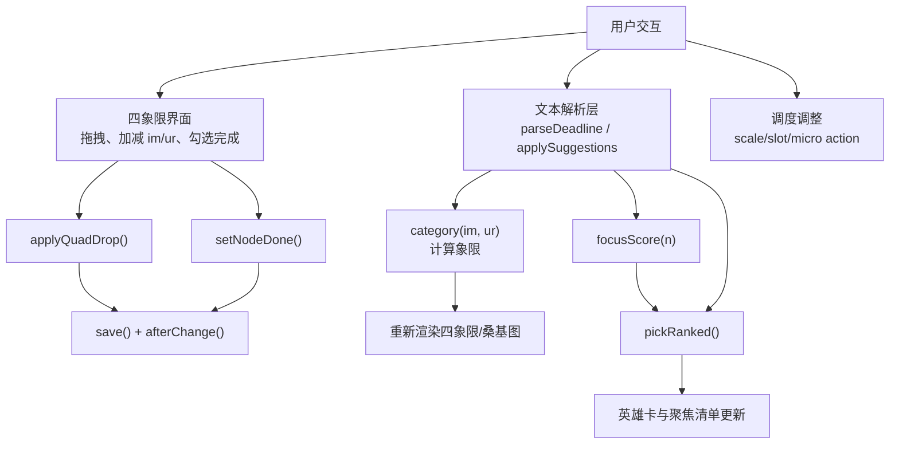
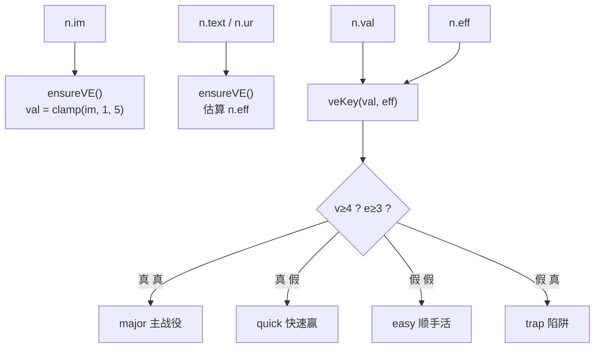
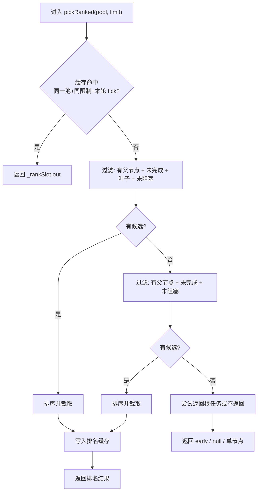
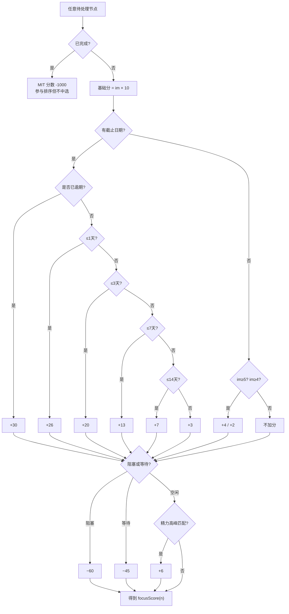
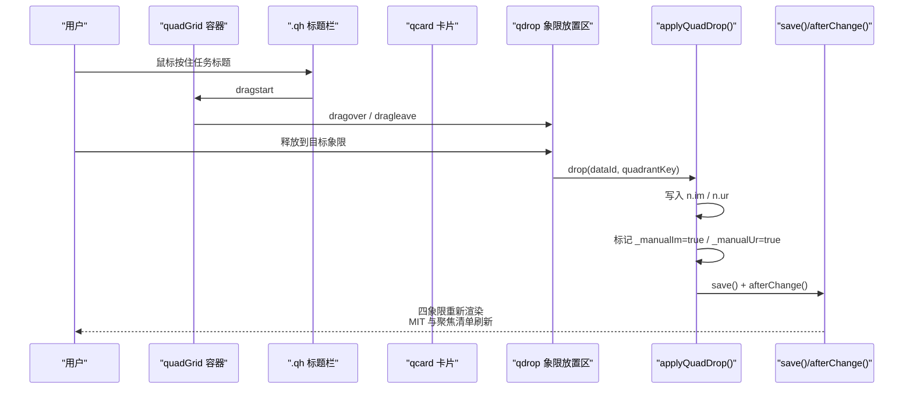
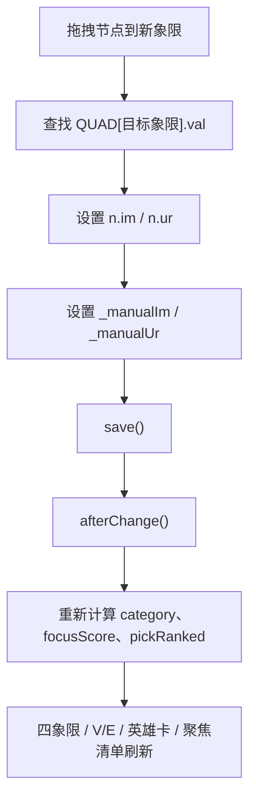
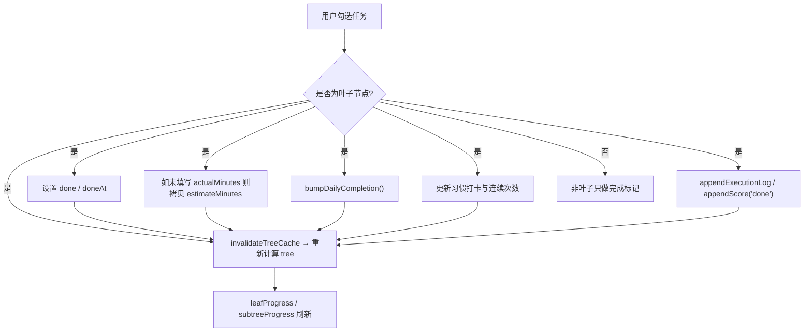

# 优先级与 MIT 算法

<cite>
**本文引用的文件**   
- [app.js](file://assets/js/app.js)
- [PROGRESS-ROLLUP.md](file://docs/PROGRESS-ROLLUP.md)
- [README.md](file://README.md)
</cite>

## 目录

1. [引言](#引言)
2. [项目结构中的实现入口](#项目结构中的实现入口)
3. [核心概念：V/E、重要×紧急与象限](#核心概念ve重要紧急与象限)
4. [MIT 评分：focusScore、pickRanked、pickTop](#mit-评分focusscorepickrankedpicktop)
5. [四象限拖拽：跨象限移动与分数同步](#四象限拖拽跨象限移动与分数同步)
6. [叶子进度 Rollup 与评分系统的协作](#叶子进度-rollup-与评分系统的协作)
7. [边界情况与常见错误用例](#边界情况与常见错误用例)
8. [扩展新的优先级信号](#扩展新的优先级信号)
9. [故障排查](#故障排查)
10. [结论](#结论)

## 引言

GoalFlow 的目标不是让用户永远记住“要事第一”，而是通过算法把“当下最重要”这件任务推到用户眼前。它同时维护了两套分类体系：

| 体系 | 输入 | 输出 | 主要用途 |
|---|---|---|---|
| V/E 矩阵 | 价值 `val` × 费力 `eff`（取值均为 1～5） | quick / major / easy / trap | 分析当前工作负载分布、快速赢与陷阱识别 |
| 重要×紧急四象限 | 重要度 `im` × 紧急度 `ur`（取值均为 1～5） | now / core / distract / noise | 任务归类、四象限卡片渲染、筛选噪音 |
| MIT 评分 | `focusScore(n)` | 一个数值 | 从整棵目标树中挑选当日最重要的一到若干任务 |

MIT 的候选必须是“可执行的最小任务”——有父节点、未完成、没有子节点，且未被阻塞或等待；在无法选出这类任务时，算法会逐步放宽条件，回退到已完成前缀或根任务。

**章节来源**
- [README.md:18-60](file://README.md#L18-L60)

## 项目结构中的实现入口

所有优先级逻辑集中在单文件 `assets/js/app.js` 中。关键位置如下：

| 职责 | 函数或常量 | 所在行区间 |
|---|---|---|
| 四象限定义 | `QUAD`、`QUAD_ORDER` | 29–35 |
| 显示象限标签 | `CAT` | 7–11 |
| V/E 矩阵定义 | `VE`、`VE_ORDER`、`VE_ORDER` | 约 60–78 |
| 任务工厂字段 | `newNode()` | 约 428–446 |
| 日期/紧急度推断 | `parseDeadline()`、`deadlineUrgency()` | 412–473 |
| 任务完成 | `setNodeDone()` | 354–380 |
| 象限归类 | `category()` | 378–383 |
| 阻塞/等待判定 | `isNodeBlocked()`、`isNodeWaiting()`、`isNodeParked()` | 586–596 |
| MIT 打分 | `focusScore()` | 597–624 |
| MIT 得分分解 | `focusScoreParts()` | 627–645 |
| 排名函数 | `pickRanked()` | 646–662 |
| 今日 MIT | `pickTop()` | 663 |
| 叶子进度 | `leafProgress()` | 665–671 |
| 子树进度 | `subtreeProgress()` | 672–686 |
| 四象限渲染与事件委托 | `renderQuadrant()`、`bindQuadDelegation()` | 2538–2720 |
| 拖拽落格回调 | `applyQuadDrop()` | 2726–2732 |



**图示来源**
- [app.js:354-380](file://assets/js/app.js#L354-L380)
- [app.js:378-383](file://assets/js/app.js#L378-L383)
- [app.js:597-663](file://assets/js/app.js#L597-L663)
- [app.js:2538-2732](file://assets/js/app.js#L2538-L2732)

**章节来源**
- [app.js:354-383](file://assets/js/app.js#L354-L383)
- [app.js:597-663](file://assets/js/app.js#L597-L663)
- [app.js:2538-2732](file://assets/js/app.js#L2538-L2732)

## 核心概念：V/E、重要×紧急与象限

### 重要×紧急四象限

四象限使用两个 1～5 的整数：

| 字段 | 含义 | 默认值 | 是否可直接编辑 |
|---|---|---|---|
| `n.im` | 重要度 importance | 3 | 是 |
| `n.ur` | 紧急度 urgency | 3 | 是 |
| `n._manualIm` | 是否手动修改过重要度 | false | 由 UI 设置 |
| `n._manualUr` | 是否手动修改过紧急度 | false | 由 UI 设置 |

四象限映射规则：

| 重要度 | 紧急度 | 象限键 | 视觉标签 | 推荐解释 |
|---:|---:|---|---|---|
| ≥ 4 | ≥ 4 | `now` | 立即做 | 已逾期、临近截止或业务上必须立刻处理 |
| ≥ 4 | < 4 | `core` | 核心投入 | 长期主线、战略任务，应提前安排 |
| < 4 | ≥ 4 | `distract` | 干扰 | 表面紧急但影响有限，需谨慎承接 |
| < 4 | < 4 | `noise` | 噪音 | 非关键事务，可在容量允许时处理 |

注意显示标签 `CAT` 和布局常量 `QUAD.val` 的阈值并不完全一致：代码中使用 `category()` 判定显示象限，阈值是 4；而 `QUAD.now.val` 写为 `{im:5, ur:5}`。真正决定拖拽归位的常量是 `QUAD[key].val`，因此“现在立即”拖入时会写入 `im=5, ur=5`，而非严格按照 4 判断。这个差异属于实现细节，不应被当作两套独立的数学分类。

**章节来源**
- [app.js:7-11](file://assets/js/app.js#L7-L11)
- [app.js:29-35](file://assets/js/app.js#L29-L35)
- [app.js:378-383](file://assets/js/app.js#L378-L383)
- [app.js:2726-2732](file://assets/js/app.js#L2726-L2732)

### V/E 矩阵

V/E 使用 `val` 与 `eff`，两者都为 1～5。其分类依据是“高/低价值”与“高/低费力”的布尔比较：

| `val >= 4` | `eff >= 3` | VE 类别 | GoalFlow 中文标签 |
|---:|---:|---|---|
| true | false | quick | 快速赢 |
| true | true | major | 主战役 |
| false | false | easy | 顺手活 |
| false | true | trap | 陷阱 |

这里的 `val` 并不独立存储成另一个评分维度；`ensureVE` 的默认行为是让 `val = clamp(n.im, 1, 5)`，也就是说 V/E 中的价值维度主要由重要度驱动。`eff` 则来自估算：文本中出现简单语义时为 2，出现复杂语义时为 4，否则根据紧急度回落到 2 或 4。

因此不要把 `val` 理解为独立于 `im` 的价值输入；它是“重要度经过 V/E 约束后的衍生值”，用于快速定位“高价值低费力”的任务群。



**图示来源**
- [app.js:49-78](file://assets/js/app.js#L49-L78)
- [app.js:38-78](file://assets/js/app.js#L38-L78)

**章节来源**
- [app.js:49-78](file://assets/js/app.js#L49-L78)

## MIT 评分：focusScore、pickRanked、pickTop

### 总公式语义

MIT 分数并非一个简单的“重要×紧急”乘积。它是一个以重要度为主轴、以截止日期为强加权、以状态为抑制项的可解释评分。

伪代码形式：

```text
function focusScore(节点):
    if 节点已完成:
        return -1000

    分数 = 节点重要度 × 10

    if 有截止日期:
        if 已逾期:
            分数 += 30
        else if 剩余 ≤ 1 天:
            分数 += 26
        else if 剩余 ≤ 3 天:
            分数 += 20
        else if 剩余 ≤ 7 天:
            分数 += 13
        else if 剩余 ≤ 14 天:
            分数 += 7
        else:
            分数 += 3
    else:
        if 重要度 ≥ 5:
            分数 += 4
        else if 重要度 ≥ 4:
            分数 += 2

    if 状态为阻塞:
        分数 -= 60
    else if 状态为等待:
        分数 -= 45

    if 存在能量时段偏好:
        如果当前高峰时段包含该任务的日时段且费力较高:
            分数 += 6

    return 分数
```

这里的关键设计是：**已完成任务总是被排在最后**，因为 `-1000` 低于任何合理正向分数。即使某任务即将逾期，它的分数也不会超过正常待办任务的排序优先级；这符合“不要重复做已经做的事”的执行直觉。

### 各因子权重说明

| 因子 | 作用方式 | 设计理由 |
|---|---|---|
| `im * 10` | 基础分，取值范围 10～50 | 保证重要度能跨越多档截止日期奖励 |
| 截止日期 | 分段阶梯加分，最高 +30 | 已过期和极短期任务获得显著优先权 |
| 无截止期限 | 对长期主线加 2 或 4 | 避免重要但无限期任务永远被短截止任务压制 |
| 阻塞 | -60 | 类似 Taskwarrior 的 blocked 压降 |
| 等待 | -45 | 依赖外部，暂时不适合排进今日 MIT |
| 能量时段 | +6（条件触发） | 仅在高费力任务匹配个人精力高峰时加分 |
| 完成状态 | -1000 | 已完成任务不参与竞择 |

需要注意的是，`ur` **不会直接出现在 `focusScore` 中**。紧急度的影响是通过截止日期解析间接进入评分的。这意味着一个 `ur=5` 但没有解析出有效截止日期的任务，并不会自动获得截止日期奖励；反之，一个 `ur=1` 但有今天截止日期的任务，可以凭借截止日期获得很高分数。

### pickRanked 与 pickTop

`pickRanked(pool, limit)` 的核心流程：

1. 从池中选择候选节点。
2. 第一轮只选择：有父节点、未完成、叶子、未阻塞。
3. 若没有候选，放宽为：有父节点、未完成、未阻塞（允许内部节点参与）。
4. 若仍为空，退回根节点或空集合。
5. 按三项规则排序。
6. 取前 `limit` 个；`pickTop` 固定 `limit=1`。



**图示来源**
- [app.js:586-596](file://assets/js/app.js#L586-L596)
- [app.js:597-663](file://assets/js/app.js#L597-L663)

排序比较函数的语义是：

```text
比较 a 与 b:
    scoreA = focusScore(a)
    scoreB = focusScore(b)
    if scoreA ≠ scoreB:
        返回 scoreB - scoreA          // 分数高的在前
    if a.important > b.important:
        返回负数                      // 同样分数下更重要者优先
    剩余截止时间差:
        没有截止日期视为 999
        返回 a.daysLeft - b.daysLeft  // 更早截止者优先
```

这里没有把 `done` 放在最后一位作为次要排序键；已完成节点已经被初筛剔除。因此平局时，重要度和截止日期共同决定顺序。

### 决策流程图



**图示来源**
- [app.js:597-645](file://assets/js/app.js#L597-L645)

**章节来源**
- [app.js:354-380](file://assets/js/app.js#L354-L380)
- [app.js:586-663](file://assets/js/app.js#L586-L663)

## 四象限拖拽：跨象限移动与分数同步

### 数据流

四象限界面的交互流程如下：



**图示来源**
- [app.js:2538-2720](file://assets/js/app.js#L2538-L2720)
- [app.js:2726-2732](file://assets/js/app.js#L2726-L2732)

### 字段同步规则

将节点拖入象限后，`applyQuadDrop` 执行以下动作：

| 字段 | 新值 | 目的 |
|---|---|---|
| `n.im` | `QUAD[q].val.im` | 重要度对齐象限 |
| `n.ur` | `QUAD[q].val.ur` | 紧急度对齐象限 |
| `_manualIm` | true | 防止后续 `applySuggestions` 用文本语义覆盖 |
| `_manualUr` | true | 同上 |

随后调用 `save()` 持久化并触发 `afterChange()`，导致视图重绘、MIT 重新计算、聚焦列表刷新、桑基图与 V/E 面板联动。



**图示来源**
- [app.js:2726-2732](file://assets/js/app.js#L2726-L2732)
- [app.js:611-645](file://assets/js/app.js#L611-L645)

### 按钮式加减 im/ur

除了拖拽，四象限卡片还提供 `+` / `-` 步进器，直接修改 `n.im` 或 `n.ur`，值始终被钳制在 1～5。更重要的是：

- 当修改 `im` 时，会把 `n.val` 提升到至少 `n.im`。
- 这保证了 V/E 中“价值不低于重要度”的一致性。
- 修改后也会 `save()` 和 `afterChange()`。

因此“手动增减重要度”本质上也是对 MIT 的重要度输入进行直接微调；它与拖拽象限的差别在于，后者一次性写入 `im` 和 `ur`，并同时锁定不再被文本语义推断覆盖。

**章节来源**
- [app.js:2538-2720](file://assets/js/app.js#L2538-L2720)
- [app.js:2726-2732](file://assets/js/app.js#L2726-L2732)

## 叶子进度 Rollup 与评分系统的协作

GoalFlow 明确区分“执行评分”和“进度统计”。

### 叶子进度统计规则

| 项目 | 行为 |
|---|---|
| 叶子节点 | 有父节点且 `_children.length === 0` |
| 父节点 | 不直接计入百分比 |
| 根节点 | 不计入叶子进度 |
| 隐藏节点 | 聚焦模式下隐藏，但仍参与叶子统计 |
| 百分比 | `Math.round(done / total × 100)` |
| 快速赢 | 只影响筛选和叙述，不改变 rollup 分母 |
| 时长字段 | 不参与完成百分比，仅用于容量分析和周回顾对比 |

这与 MIT 不同：MIT 只关心“哪些待办应该先做”，而叶子进度只回答“子树内的最小任务完成了多少”。

### setNodeDone 的反向副作用

勾选叶子时，`setNodeDone` 不只是打一个 `done` 标志，还会：

1. 写入 `done` 和 `doneAt`。
2. 若尚未填写实际耗时，复制预估时长。
3. 若是金线节点或今日关注节点，更新时间戳 `touchedAt`。
4. 如果是叶子：
   - 增加日常完成计数；
   - 对习惯或关键结果类任务累加完成次数；
   - 追加执行日志；
   - 给该项追加一次 `done` 类型的执行评分；
   - 更新习惯连续打卡和打卡记录。

取消完成则会移除当天的 done 评分，并恢复习惯连续状态。



**图示来源**
- [app.js:354-380](file://assets/js/app.js#L354-L380)
- [app.js:665-686](file://assets/js/app.js#L665-L686)

### 与评分系统的区别

Rollup 只看 `done` 和叶子身份；它不读 `focusScore`、`im`、`ur` 或 `estimateMinutes`。相反，执行评分系统会在完成任务时添加一条评分记录，最终汇总到日的总分等级 S/A/B/C。因此：

- “任务完成了多少”由 leaf/subtree progress 回答。
- “今天做得好不好”由执行评分和历史累计回答。
- “明天先做什么”由 `focusScore` / `pickRanked` 回答。
- “这个任务看起来属于哪类工作”由 category / VE 分类回答。

这四条线索并行存在，互不替代。

**章节来源**
- [PROGRESS-ROLLUP.md:1-37](file://docs/PROGRESS-ROLLUP.md#L1-L37)
- [app.js:354-380](file://assets/js/app.js#L354-L380)
- [app.js:665-686](file://assets/js/app.js#L665-L686)

## 边界情况与常见错误用例

### 场景一：多个节点具有相同最高 score

#### 规则

如果 `focusScore(a) == focusScore(b)`，其次序由以下规则决定：

1. 先比较高重要度；
2. 再比较截止日期，没有截止日期视为 999，也就是越有截止日期的越靠前；
3. `ur` 和 `deadline.label` 不参与这一级排序；
4. `done` 已被初筛排除，所以不会用“未完成优先”作兜底。

#### 正确用例

- 节点 A：`im=4`，剩余 3 天，score=53。
- 节点 B：`im=4`，剩余 7 天，score=53。
- 预期：A 排在 B 之前。

#### 错误示例

认为 score 相同就按插入顺序、字母 ID 顺序或 `ur` 大小排序。

### 场景二：已完成但有紧迫截止日期的任务

#### 规则

无论截止日期多紧，已完成节点的 `focusScore` 固定为 `-1000`，会被排在其他任何正常任务之后。

#### 正确用例

一个已完成的周五任务不会因“曾经逾期”而被选为明日 MIT。

#### 错误示例

假设已过期任务会自动成为 MIT，除非用户手动关闭或归档。

### 场景三：重要但没有截止日期

#### 规则

对于重要度 4 或 5 的长期任务，会分别加 2 或 4；但这通常低于临近截止日期任务的加分。因此，仅靠重要度未必能把长期主线排在明天。

#### 正确用例

长期主线 `im=5` 得基础 50 + 4 = 54；今天逾期任务可能得更高或相近分数，取决于整体上下文和排序链。

#### 错误示例

认为只要 `im=5` 就一定被选中。如果没有截止日期，它只是“获得长期主线加权”，并不必然成为 Top1。

### 场景四：阻塞或等待中的任务

#### 规则

- 阻塞：-60；
- 等待：-45；
- 这些任务仍可被纳入候选集合（取决于 filter1/filter2 的结果），但 MIT 分数被大幅压低；
- 它们更可能被推迟到其他任务都处理完后再考虑。

#### 正确用例

被其他部门依赖的对外接口开发不会被推为 MIT，除非没有其它任务可选。

#### 错误示例

把“阻塞”等同于“不存在”。它仍在候选池中，只是几乎不可能胜出。

### 场景五：无叶子可用时的回退

#### 规则

如果既没有叶子也没有符合条件的内部节点，函数会检查根节点。若根节点存在且未完成，可按 `limit` 决定是否返回根；否则返回空或 `null`。

#### 正确用例

空目标树或只有根节点时，MIT 查询不会抛出异常，而是返回 `null` 或 `[root]`。

#### 错误示例

认为没有叶子就一定是 bug。这是有意设计的降级策略。

### 场景六：拖拽后文本语义能否改写象限

#### 规则

拖拽后会设置 `_manualIm=true` 和 `_manualUr=true`，从而阻止后续的文本推断覆盖这两个字段。

#### 正确用例

把一个原本语义中偏向“噪音”的任务拖入“干扰”，它保持紧急重要配置不变。

#### 错误示例

认为再次修改任务描述后，UI 会强制把它重新塞回“噪音”象限。

### 场景七：四象限阈值与拖拽值的差异

#### 规则

显示分类函数用 4 作为阈值；但 `QUAD.now.val` 写的是 `{im:5, ur:5}`。

#### 正确用例

拖入“立即做”后节点得到 `im=5, ur=5`，它同时满足 `category` 的 ≥4 条件。

#### 潜在风险

如果一个未来重构把 `QUAD.now.val` 改为 `{im:4, ur:4}`，而 `category` 仍用 4，两者仍然一致；但如果未来改为开区间或使用其他阈值，可能出现“拖到的象限”和“显示象限”不一致的情况。当前实现中，显示与归位在数值上基本保持一致。

**章节来源**
- [app.js:378-383](file://assets/js/app.js#L378-L383)
- [app.js:597-663](file://assets/js/app.js#L597-L663)
- [app.js:2726-2732](file://assets/js/app.js#L2726-L2732)

## 扩展新的优先级信号

如果要引入新的优先级信号，例如“能量时段”“习惯打卡频率”“最近活跃天数”“计划偏差系数”，应遵循以下原则：

### 1. 新增评分维度但保留可解释性

不要直接把新因子嵌入不可读的权重乘积。更好的做法是像现有截止日期一样，采用“显式加分项”：

```text
function extendFocusScore(node):
    基础 = focusScore(node)
    加分项 = []

    加分项.push("重要 = im × 10")
    加分项.push("截止日期分段加成")
    加分项.push("阻塞或等待惩罚")
    加分项.push("新增信号 X: ...")

    if 满足新信号条件:
        加分项.append("X 加分: +k")
        基础 += k

    return { total: 基础, parts: 加分项 }
```

这样既能保持 `focusScoreParts()` 的解释能力，也便于在英雄卡里展示“为什么选了这件事”。

### 2. 新增候选池过滤器时要谨慎

当前 `pickRanked` 已经把“有父节点 + 未完成 + 叶子 + 未阻塞”作为默认候选集。如果要让新信号影响候选资格，应该新增一个独立的过滤步骤，而不是直接放宽初始过滤条件；否则容易误把不应该竞争 MIT 的任务拉进来。

### 3. 能量时段已有可扩展点

能量时段的加分代码已经封装在一个条件块中，并带有 try-catch。这说明项目预留了“从 state.meta.energyLog 读取曲线并叠加额外偏好”的能力。未来可以增加更多类似的软信号：

- 高频习惯任务可适当加分；
- 刚被打断后短暂冷却的任务适当降分；
- 接近周末的周期性任务提前；
- 与上周同周期任务的相似度加分；
- 历史估时偏差大的任务增加缓冲权重。

每个新信号都应具备三个属性：**输入字段清晰、数值范围可控、负面后果可预测。**

### 4. 避免与既有指标耦合过深

新信号最好通过新增字段或 `conf`、`confNote` 等轻量字段承载，而不是反复改写 `im`/`ur`/`val`。因为 `im` 和 `ur` 既是输入又是四象限可视化、VE 推导和用户可编辑参数；混入隐藏优先级容易导致用户看到 4/4 却不确定为什么排这么前面。

### 5. 推荐的演进步骤

| 阶段 | 操作 | 验证重点 |
|---|---|---|
| 第一阶段 | 新增 `extendFocusScore(n, newSignalValue)` | 不改变现有 `focusScore` |
| 第二阶段 | 把新信号集成进 `focusScoreParts` | 能看到加分原因 |
| 第三阶段 | 更新 MIT 候选过滤 | 不误选阻塞/已完成节点 |
| 第四阶段 | 在 UI 中暴露新信号的编辑入口 | 用户能理解并信任排序变化 |
| 第五阶段 | 加入单元测试或对照用例表 | 同分、无截止日期、已完成、阻塞等边界回归通过 |

**章节来源**
- [app.js:597-645](file://assets/js/app.js#L597-L645)
- [app.js:646-663](file://assets/js/app.js#L646-L663)
- [app.js:2726-2732](file://assets/js/app.js#L2726-L2732)

## 故障排查

| 现象 | 可能原因 | 排查路径 |
|---|---|---|
| MIT 一直是一个已完成任务 | MIT 本身不会选已完成任务；查看是否调用了错误的候选池或未调用 `pickRanked` | 检查调用方传入的 pool |
| 拖到某个象限后颜色不匹配 | 检查 `QUAD[象限].val` 与 `category()` 的阈值是否一致 | 核对 29–35 行与 378–383 行 |
| 拖拽后再次编辑文本导致象限被改回 | `_manualIm/_manualUr` 没有被设置，或调用时机早于 `applyQuadDrop` | 检查 `applySuggestions` 与拖拽回调顺序 |
| 高重要但无截止日期的任务不被选中 | 长期主线只获得 +2/+4 附加分，不足以超越紧迫截止日期 | 检查 `focusScoreParts()` 的输出 |
| 阻塞任务仍能排在很前 | 检查是否绕过 `focusScore`，直接按 `im` 排序 | 确认排序调用入口 |
| 完成叶子后百分比不更新 | `getCachedTree` 缓存未被失效 | 检查 `invalidateTreeCache` 或 `beginTick` |
| V/E 分类与 `im` 不一致 | 检查用户是否手动改过 `val` | `ensureVE` 会让 `val` 至少等于 `im`，但手动修改 `val` 可突破该关系 |
| 每日评分不增加 | 非叶子节点不会走 `bumpDailyCompletion`、`appendScore('done')` 等分支 | 检查 `setNodeDone` 的叶子判断 |

**章节来源**
- [app.js:354-380](file://assets/js/app.js#L354-L380)
- [app.js:597-663](file://assets/js/app.js#L597-L663)
- [app.js:665-686](file://assets/js/app.js#L665-L686)
- [app.js:2726-2732](file://assets/js/app.js#L2726-L2732)

## 结论

GoalFlow 的优先级机制由四个相对独立但又相互协作的部分组成：

1. **四象限分类**用 `im` × `ur` 帮助人类理解和布置任务。
2. **V/E 分类**用 `val` × `eff` 帮助用户识别快速赢、主战役和陷阱。
3. **MIT 评分**用 `focusScore` 从真实待办池里挑出最值得立刻执行的一项。
4. **叶子进度 Rollup**只统计最小任务的完成比例，不与 MIT 分数混为一谈。

这套设计的好处是可解释：`focusScoreParts` 能够告诉用户今天是重要度高、快到期、仍是主线还是遇到阻滞。缺点也相应存在：重要任务如果没有截止日期，难以稳定胜出；`category` 的显示阈值和 `QUAD.val` 的具体数值存在实现层面的小差异；`ur` 本身不直接参与 MIT 打分，容易被误当成 MIT 的核心权重。

未来扩展时，最安全的方向是增加“可解释的加分项”，并在 `extendFocusScore` 风格的新函数中组合信号，而不是继续膨胀现有的三元乘积或隐式排序键。这样既能保留 GoalFlow“让当下最重要自己发光”的产品语义，又能为能量时段、习惯频率等新信号留下干净接入点。