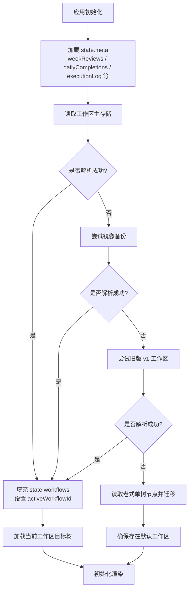
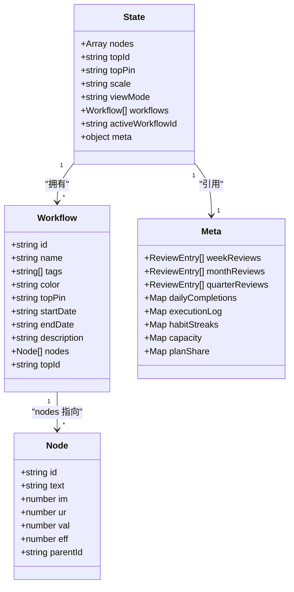
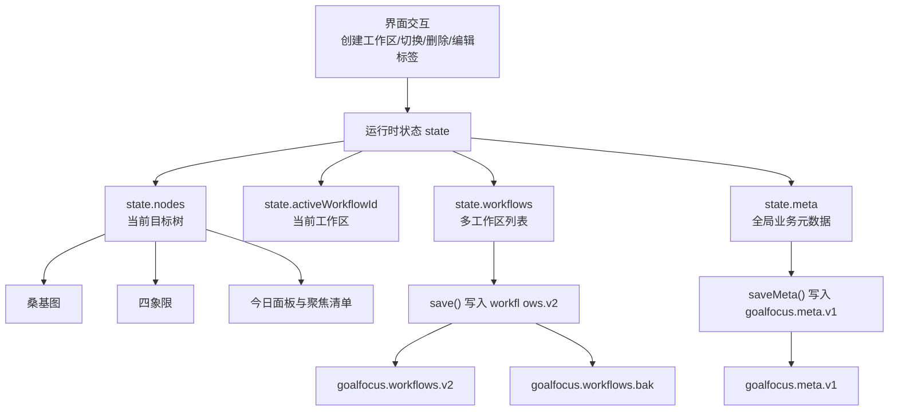
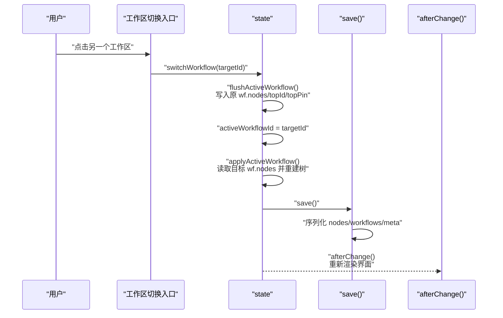
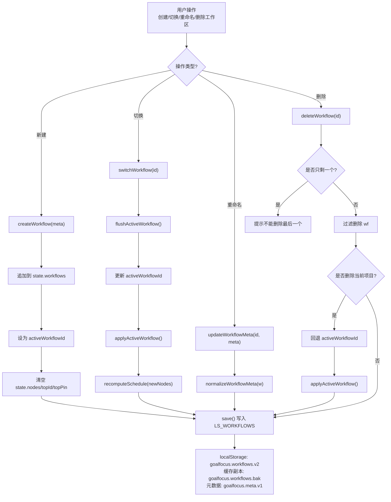
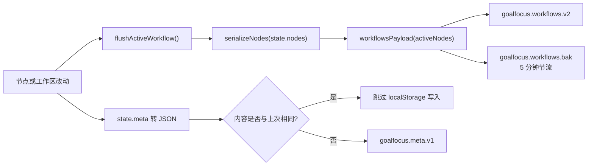
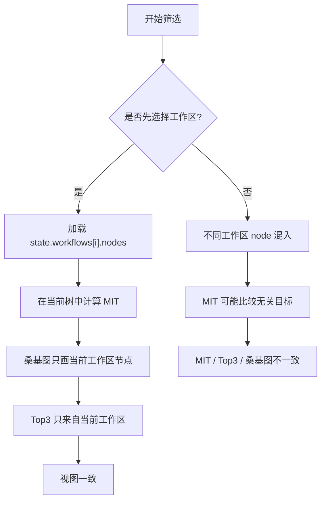

# 多工作区与标签筛选

<cite>
**本文引用的文件**   
- [assets/js/app.js](file://assets/js/app.js)
- [README.md](file://README.md)
</cite>

## 目录
1. [简介](#简介)
2. [项目结构定位](#项目结构定位)
3. [核心数据模型](#核心数据模型)
4. [系统架构概览](#系统架构概览)
5. [关键流程详解](#关键流程详解)
6. [状态流转图](#状态流转图)
7. [依赖关系分析](#依赖关系分析)
8. [性能特征与优化策略](#性能特征与优化策略)
9. [典型多项目场景示例](#典型多项目场景示例)
10. [标签命名规范](#标签命名规范)
11. [常见问题排查](#常见问题排查)
12. [结论](#结论)

## 简介
目标流 GoalFlow 的多工作区（项目）功能把一棵“目标树”绑定到一个可命名的工作区上，并通过 `state.workflows`、`state.activeWorkflowId` 与跨项目的元数据 `state.meta` 实现隔离。用户可以在界面创建、切换、编辑或删除工作区；工作区的节点、MIT 选择、置顶行为等由当前活动工作区承载，而周回顾、完成统计、执行记录等按日期或键值维度保存在 `state.meta` 中。

仓库中的应用逻辑集中在单页文件的 JavaScript 模块内：所有多工作区加载、持久化、保存、切换、标签解析、时间预算和存储恢复逻辑都位于 `assets/js/app.js`；README 提供整体产品说明和本地存储隐私背景。

**章节来源**
- [README.md:1-30](file://README.md#L1-L30)

## 项目结构定位
GoalFlow 是一个纯本地、双击启用的页面项目，核心入口为 `index.html`，运行时主要依赖 `assets/js/app.js`。多工作区能力并不是一个独立后端服务，而是通过浏览器 `localStorage` 的多个键名组合出工作区持久化：

| localStorage 键 | 作用 | 默认值 |
|---|---|---|
| `LS_KEY` | 旧版单树节点数组 | `goalfocus.v4` |
| `LS_META` | 全局业务元数据 | `goalfocus.meta.v1` |
| `LS_WORKFLOWS` | 工作区主存储 | `goalfocus.workflows.v2` |
| `LS_WORKFLOWS_BAK` | 工作区冗余镜像备份 | `goalfocus.workflows.bak` |
| 旧兼容键 | 兼容 v1 工作区/旧版本单树 | `goalfocus.workflows.v1`、`goalfocus.v3` |

启动时，程序先加载 `state.meta`，然后按优先级读取 `LS_WORKFLOWS`、备份键、旧版键；如果只找到老格式的单树节点，则迁移成“只有一个默认工作区”的新结构。

**章节来源**
- [assets/js/app.js:13-20](file://assets/js/app.js#L13-L20)
- [assets/js/app.js:5373-5410](file://assets/js/app.js#L5373-L5410)

**图表来源**
- [assets/js/app.js:5265-5275](file://assets/js/app.js#L5265-L5275)
- [assets/js/app.js:5373-5410](file://assets/js/app.js#L5373-L5410)
- [assets/js/app.js:5337-5363](file://assets/js/app.js#L5337-L5363)
- [assets/js/app.js:1347-1359](file://assets/js/app.js#L1347-L1359)

## 核心数据模型

### 工作区对象字段语义
每个工作区都是 `state.workflows` 中的一个对象。代码中通过 `normalizeWorkflowMeta` 统一处理默认值和类型，因此未显式填写的字段会获得安全默认值。

| 字段 | 含义 | 默认值 | 约束说明 |
|---|---|---|---|
| `id` | 工作区唯一标识，用于区分不同项目 | 调用 `newWorkflowId()` 生成形如 `wf_xxx` 的随机 id | 不应由用户重复输入；删除后不再复用旧 id |
| `name` | 显示名称 | 新建时为 `""`，规范化后若为空可回退到 `新项目` 或 `默认目标` | 字符串；提交时会去除首尾空白 |
| `tags` | 标签数组 | `[]` | 解析时用逗号、中文逗号或空格拆分，去掉空项；建议用稳定简短的词 |
| `color` | 工作区颜色标记 | `""` | 目前由归一化函数保留为空串，未看到直接参与 MIT/Top3/桑基图计算的核心逻辑；可作为视觉或扩展用途 |
| `topPin` | 手动置顶或锁定目标 | `null` | 与 `state.topPin` 同步，用于固定某节点成为重要锚点 |
| `startDate` | 工作区开始时间 | `""` | 字符串；适合写 ISO 形式日期或可读时间戳，供筛选或展示使用 |
| `endDate` | 工作区结束时间 | `""` | 同上，常用于阶段性目标，例如半年冲刺或年度计划 |
| `description` | 工作区描述 | `""` | 非结构化文本，适合说明项目背景或目标边界 |
| `nodes` | 工作区内的目标树节点数组 | 新工作区为 `[]`；初始迁移时可能复用现有 `state.nodes` | 与 `state.nodes` 在写入阶段共享引用以减少拷贝 |
| `topId` | 根级重要目标节点 id | `null` | 与当前工作区的 MIT 计算结果同步 |

此外，时间预算和计划带宽不属于工作区对象的直接字段，而是存储在 `state.meta.capacity[wfId]` 和 `state.meta.planShare[wfId]` 中，与工作区 id 关联。

**章节来源**
- [assets/js/app.js:1336-1345](file://assets/js/app.js#L1336-L1345)
- [assets/js/app.js:1391-1411](file://assets/js/app.js#L1391-L1411)
- [assets/js/app.js:1414-1426](file://assets/js/app.js#L1414-L1426)
- [assets/js/app.js:5306-5316](file://assets/js/app.js#L5306-L5316)

### 全局状态与工作区的关系
`state` 是一个集中运行时对象，至少包含以下与工作区相关的关键部分：

| 状态字段 | 类型 | 作用 |
|---|---|---|
| `state.nodes` | 数组 | 当前工作区的节点树数组；也是桑基图、四象限、今日面板等可视化的直接数据源 |
| `state.topId` | 字符串或 null | 当前工作的重要目标根 id |
| `state.topPin` | 字符串或 null | 置顶或锁定的目标节点 id |
| `state.scale` | 字符串 | 当前时间缩放尺度，如 `day`、`week`、`month`、`year` 或 `all` |
| `state.viewMode` | 字符串 | 当前视图模式，如 `sankey` |
| `state.workflows` | 数组 | 所有工作区对象列表 |
| `state.activeWorkflowId` | 字符串或 null | 当前选中工作区 id |
| `state.meta` | 对象 | 全局业务元数据，包括周/月/季度回顾、每日完成数、执行日志、习惯打卡等 |

在工作切换时，`switchWorkflow` 会先把当前工作区的数据刷回对应对象，再替换 `activeWorkflowId`，最后把目标树恢复到新的工作区并触发后续刷新。

**图表来源**
- [assets/js/app.js:1224-1229](file://assets/js/app.js#L1224-L1229)
- [assets/js/app.js:1336-1345](file://assets/js/app.js#L1336-L1345)
- [assets/js/app.js:5265-5275](file://assets/js/app.js#L5265-L5275)

## 系统架构概览
从数据角度看，GoalFlow 的多工作区体系由三层组成：

1. **视图层**：通过 DOM 操作展示工作区列表、目标树、MIT、Top3、桑基图、四象限等。
2. **状态层**：以 `state` 为中心维护当前工作区的 `nodes`、`topId`、`topPin`，以及 `workflows` 与 `activeWorkflowId`。
3. **持久化层**：把当前工作区和全部工作区元数据写入 `localStorage`，并把跨项目历史存入 `meta`。

**图表来源**
- [assets/js/app.js:1224-1229](file://assets/js/app.js#L1224-L1229)
- [assets/js/app.js:5306-5335](file://assets/js/app.js#L5306-L5335)
- [assets/js/app.js:5257-5275](file://assets/js/app.js#L5257-L5275)

## 关键流程详解

### 工作区创建
当用户打开“新建项目”流程并提交时，代码会：

1. 先调用 `flushActiveWorkflow`，把当前工作区的节点树、`topId`、`topPin` 刷回已有工作区对象。
2. 使用传入或表单元数据构造新工作区对象。
3. 通过 `normalizeWorkflowMeta` 标准化 `name`、`tags`、`startDate`、`endDate`、`description`、`color`、`topPin`。
4. 把新工作区加入 `state.workflows`，设置为活动工作区，清空当前 `nodes`、`topId`、`topPin`。
5. 持久化并触发界面刷新。
6. 若设置了时间预算，还会把 `state.meta.capacity[wfId]` 写入 `meta`。
7. 若设置了计划带宽，会把 `state.meta.planShare[wfId]` 写入 `meta`。

这意味着新建工作区不是简单复制旧目标树，而是开启一棵空的目标树；之前已存在的工作区保留各自节点树。

**章节来源**
- [assets/js/app.js:1391-1411](file://assets/js/app.js#L1391-L1411)
- [assets/js/app.js:1447-1486](file://assets/js/app.js#L1447-L1486)
- [assets/js/app.js:1501-1510](file://assets/js/app.js#L1501-L1510)

### 工作区切换
`switchWorkflow(id)` 的实现思路非常清晰：

需要注意：`switchWorkflow` 只对 `nodes`、`topId`、`topPin` 做切换；`state.meta` 并不随工作区切换而丢弃其他项目数据。

**图表来源**
- [assets/js/app.js:1382-1390](file://assets/js/app.js#L1382-L1390)
- [assets/js/app.js:1364-1380](file://assets/js/app.js#L1364-L1380)
- [assets/js/app.js:5319-5335](file://assets/js/app.js#L5319-L5335)

### 重命名工作区
工作区重命名通过更新工作区元数据进行。`updateWorkflowMeta(id, meta)` 支持修改：

- `name`
- `tags`
- `startDate`
- `endDate`
- `description`
- `color`

它不会修改 `nodes` 或 `topId`，也就是说重命名只会影响标题与元数据，不会影响已有目标树。

**章节来源**
- [assets/js/app.js:1414-1426](file://assets/js/app.js#L1414-L1426)

### 删除工作区
删除流程有以下保护：

1. 如果 `state.workflows.length <= 1`，直接提示“至少保留一个”，不允许删除最后一个工作区。
2. 弹出确认框，提示将删除该项目及其目标树，且不可撤销。
3. 过滤掉被删 id 的工作区。
4. 如果被删的是当前工作区，活动工作区回退到剩余的第一个。
5. 重新载入该工作区的节点树，持久化并刷新界面。

这意味着删除操作是“项目维度删除”，而不是仅隐藏元数据。

**章节来源**
- [assets/js/app.js:1428-1445](file://assets/js/app.js#L1428-L1445)

## 状态流转图

**图表来源**
- [assets/js/app.js:1364-1445](file://assets/js/app.js#L1364-L1445)
- [assets/js/app.js:5306-5335](file://assets/js/app.js#L5306-L5335)

## 依赖关系分析

### 工作区与 MIT、Top3、桑基图的一致性
当前实现保证三者在同一工作区内保持一致，因为：

- `state.nodes` 是当前工作区的树；
- `state.topId` 是该工作区的重要目标根；
- `state.topPin` 是该工作区的置顶锚点；
- `switchWorkflow` 会在切换后把目标树恢复到 `state.nodes`，并在有节点时重新执行调度计算。

因此，只要 MIT、Top3 和桑基图的渲染都读取 `state.nodes`、`state.topId`、`state.topPin`，而不直接遍历 `state.workflows` 的某个其他索引，它们在同一个工作区内自然对齐。

**章节来源**
- [assets/js/app.js:1373-1380](file://assets/js/app.js#L1373-L1380)
- [assets/js/app.js:1382-1390](file://assets/js/app.js#L1382-L1390)

### 工作区元数据的隔离方式
全局元数据保存在 `state.meta`，其中许多字段按“日期键”或“业务键”进行细分：

| 元数据字段 | 隔离维度 | 说明 |
|---|---|---|
| `weekReviews` | 周 key | 每周回顾列表，属于全局历史而非某个 wf 的私有树 |
| `monthReviews` | 月 key | 每季度回顾列表，同样属于全局历史 |
| `quarterReviews` | 季度 key | 季度回顾列表 |
| `dailyCompletions` | 天 key | 每日完成计数，适合查看日历维度趋势 |
| `executionLog` | 通常是天 key | 按日滚动裁剪，避免长期堆积 |
| `habitStreaks` | 任务 + 工作区键 | 结合节点 id 和 `wfId` 跟踪连续打卡 |
| `alarmFired` | 细粒度键 | 按闹钟触发记录清理过期条目 |
| `capacity` | `wfId` | 每个工作区的时间预算：工作日与周末小时数 |
| `planShare` | `wfId` | 每个工作区的计划精力百分比 |

这里有一个重要的设计差异：像 `weekReviews`、`dailyCompletions` 这类指标通常不按 `wfId` 单独存子对象；它们更像是“全局执行历史”。如果要严格区分某个项目的完成量，需要基于 `executionLog.entries[].wfId` 或 `habitStreaks` 等具备工作区关联的字段聚合，而不能假定整个 `state.meta` 自动隔离。

**章节来源**
- [assets/js/app.js:331-335](file://assets/js/app.js#L331-L335)
- [assets/js/app.js:364-376](file://assets/js/app.js#L364-L376)
- [assets/js/app.js:1228-1228](file://assets/js/app.js#L1228-L1228)
- [assets/js/app.js:5265-5275](file://assets/js/app.js#L5265-L5275)
- [assets/js/app.js:5280-5304](file://assets/js/app.js#L5280-L5304)

## 性能特征与优化策略

### 已有的优化措施
1. **活动工作区对象共享引用**：`flushActiveWorkflow` 不深拷贝当前 `state.nodes`，而是让 `w.nodes === state.nodes`，减少频繁拷贝。
2. **持久化时重用已序列化节点**：`workflowsPayload(activeNodes)` 对当前工作区直接使用已经序列化的 `activeNodes`，而不是再次 map 整个节点树。
3. **元数据保存去抖去重**：`saveMeta` 对比上次序列化结果，内容不变就不写磁盘，避免每次 save 都全文重写。
4. **工作区备份备份节流**：主存储失败时的备用副本 `LS_WORKFLOWS_BAK` 每 5 分钟同步一次，减少高频写入。
5. **旧单树自动迁移**：老浏览器数据会在首次检测到时转换为带默认工作区的结构，降低异常路径。

**图表来源**
- [assets/js/app.js:1364-1380](file://assets/js/app.js#L1364-L1380)
- [assets/js/app.js:5306-5335](file://assets/js/app.js#L5306-L5335)
- [assets/js/app.js:5257-5264](file://assets/js/app.js#L5257-L5264)

### 大量工作区下的查找复杂度
- 获取当前工作区：`workflowById(id)` 是线性查找，时间复杂度 `O(n_w)`。
- 切换工作区：`switchWorkflow` 本身只做线性查找和少量赋值；真正成本来自随后的 `recomputeSchedule`、序列化、持久化和渲染。
- 保存：`save()` 会序列化当前节点树并构建全部工作区负载；节点越多、工作区越多，序列化开销越大。
- 元数据裁剪：`trimLogs` 只按“今天裁一次”，并使用 date key 滚动裁剪，避免无限增长。

### 可扩展优化建议
在不改变现有语义的前提下，未来可考虑：

1. **建立工作区 id → 索引映射**：如果工作区数量很大，可以把 `state.workflows` 改为附带 `byId` 快速查询结构，使 `workflowById` 降为接近 `O(1)`。
2. **增量持久化**：目前 `save()` 序列化所有工作区负载；对于只有工作区元数据变化的场景，可以优先写出轻量级元数据，再异步序列化大节点。
3. **标签索引**：如果以后出现“按标签筛选所有工作区的节点”的聚合视图，可为标签建反向索引，避免每次全树扫描。
4. **渲染虚拟化**：对于非常大的目标树，可考虑虚拟列表或懒展开分支，减轻 SVG/DOM 绘制压力。

**章节来源**
- [assets/js/app.js:1335-1335](file://assets/js/app.js#L1335-L1335)
- [assets/js/app.js:5319-5335](file://assets/js/app.js#L5319-L5335)
- [assets/js/app.js:5277-5304](file://assets/js/app.js#L5277-L5304)

## 典型多项目场景示例

### 场景一：“销售冲刺 vs 考研复习”
假设用户在 GoalFlow 中维护两个相互独立但共享浏览器的项目：

| 项目 | 标签建议 | 开始日期 | 结束日期 | 目标树特点 |
|---|---|---|---|---|
| 销售冲刺 | `销售`, `业绩`, `Q3`, `团队` | 当前季度开始 | 季度末 | 聚焦客户跟进、月度目标、复盘与转化 |
| 考研复习 | `考试`, `上岸`, `2026考研`, `数学`, `英语` | 备考启动日 | 初试或复试截止日 | 聚焦科目分解、模拟测试、复习节奏 |

操作步骤如下：

1. 进入“项目设置/新建项目”，输入项目名称、标签、起止时间和描述。
2. 如需预算分配，配置“工作日每天”和“周末每天”可用小时，或在“计划带宽”填入预期精力占比。
3. 在新项目中粘贴目标，形成独立的桑基图和 Top3。
4. 回到原项目，继续处理另一个目标树。
5. 切换项目后，顶部“当下最重要”、“今日行动”和桑基图都会切换到当前工作区。

这样，两个项目不会因为 `topId`、`nodes` 或 `topPin` 互相覆盖。

**章节来源**
- [assets/js/app.js:1447-1486](file://assets/js/app.js#L1447-L1486)
- [assets/js/app.js:1391-1411](file://assets/js/app.js#L1391-L1411)
- [assets/js/app.js:1373-1390](file://assets/js/app.js#L1373-L1390)

### 场景二：个人主线与副业探索
另一个常见用法是把“人生主线”与“短期副业”拆成工作区：

- “个人主线”：长期习惯、健康、阅读、技能成长，标签更抽象。
- “副业探索”：项目周期短、迭代快，标签更具体，如产品名、版本号、渠道名。

注意事项：
- 不要把两个高度相关的子项目合并成一个工作区，除非它们的 MIT 确实经常竞争同一个“今天最重要”。
- 如果某些全局指标要按项目划分，建议在“执行记录”“习惯连续次数”等业务字段中使用工作区 id，而不是只依赖标签文本。

## 标签筛选与聚合视图

### 当前标签的作用位置
从源码证据看，`workflow.tags` 主要用于工作区级别的标签元数据，并由 `parseTagsInput` 解析为字符串数组。搜索标签解析逻辑可以发现它按中文逗号、英文逗号和空白分割。

这表示：

- 当前标签更多用于给“工作区”打分类标签，而不是直接作为每个节点的筛选字段。
- 如果需求是“在界面上按工作区标签过滤节点”，需要在展示层进一步读取 `workflow.tags` 并结合工作区 id 进行判断；否则节点集合本身仍以 `state.nodes` 为准。
- 如果需求扩展到“按节点自身标签筛选”，则需要节点也携带标签字段；当前工作区工作区模型只暴露了 `workflow.tags`，没有统一的 `node.tags` 过滤入口。

**章节来源**
- [assets/js/app.js:1336-1345](file://assets/js/app.js#L1336-L1345)
- [assets/js/app.js:1361-1363](file://assets/js/app.js#L1361-L1363)

### 按工作区维度的筛选与一致性
在多项目环境中，真正的“第一层筛选”实际上是“选择 `activeWorkflowId`”。一旦切换工作区：

- `state.nodes` 指向该项目目标树；
- 桑基图依据这些节点渲染能量流动；
- MIT 计算基于当前树的依赖链和重要紧急评分；
- Top3 通常从 MIT 或其下属高价值节点中选择；
- 四象限依据 `val`、`eff`、象限配置渲染当前节点。

因此，只要筛选始终先锁定工作区，MIT、Top3 与桑基图就能保持工作区维度一致。跨工作区的全局汇总则需要额外聚合，不能只依赖单个视图渲染路径。

[本图为概念性工作区筛选示意；实际实现中切换工作区会重置当前目标树，不必手工合并多个工作区的节点。]

## 性能特征与优化策略

### 已有优化措施总结
- 活动工作区对象共享引用，减少拷贝。
- 持久化时复用已序列化节点负载。
- 元数据 JSON 去重，避免无变化时反复落盘。
- 工作区冗余备份 5 分钟节流。
- 日志按天滚动裁剪。

### 大量标签与工作区的优化建议

| 场景 | 风险 | 建议 |
|---|---|---|
| 工作区数量很大 | `workflowById` 线性扫描变慢 | 增加 id→工作区对象索引表 |
| 每个工作区标签很多 | 标签解析和展示重复切割字符串 | 在创建/更新时缓存规范化后的标签数组 |
| 同时打开多个超大目标树 | 多次序列化代价高 | 延迟序列化非活动工作区 |
| 需要按标签全局聚合 | 全树扫描成本高 | 为节点或工作区建标签索引 |
| 长时间运行导致元数据膨胀 | daily/execution 日志占空间 | 利用已有 `trimLogs`，并可扩展按工作区键分组修剪 |

**章节来源**
- [assets/js/app.js:1361-1363](file://assets/js/app.js#L1361-L1363)
- [assets/js/app.js:1335-1335](file://assets/js/app.js#L1335-L1335)
- [assets/js/app.js:5257-5264](file://assets/js/app.js#L5257-L5264)
- [assets/js/app.js:5277-5304](file://assets/js/app.js#L5277-L5304)

## 标签命名规范

建议把“工作区标签”视为项目分类标签，而不是自由散落的文档关键字。推荐规则如下：

1. **长度适中**：每个标签尽量不超过 6 个字符，便于在小屏设备上显示。
2. **类别+主题**：如 `销售`, `市场`, `产品`, `考研`, `面试`, `健康`。
3. **时间可选**：如 `Q3`, `2026`, `H1`；不要在标签中写完整日期，起止时间应放在 `startDate` / `endDate`。
4. **避免同义分裂**：`sales`、`销售`、`Sales`、`销售组` 代表同类意义时尽量统一为一个词；若确实需要中英文并存，应明确语义差异。
5. **避免句子型标签**：标签是分类符，不是自然语言；长句建议放到 `description`。
6. **避免过度细分**：不要每个子任务都创建一个工作区；工作区更适合“一个完整目标线”。
7. **避免动态拼接 id**：不要用任务 id 拼成工作区 tag，这会放大存储体积并难以阅读。

如果遇到“标签显示混乱”，可从以下方面检查：

- 是否混用了中文逗号、英文逗号和空格；
- 是否存在两端空白导致的重复标签；
- 是否使用了大小写不同的英文词；
- 是否把时间范围错误写成标签；
- 是否在多处重复创建同一业务项目，却给了不同名称。

**章节来源**
- [assets/js/app.js:1336-1345](file://assets/js/app.js#L1336-L1345)
- [assets/js/app.js:1361-1363](file://assets/js/app.js#L1361-L1363)

## 常见问题排查

| 问题 | 可能原因 | 排查步骤 |
|---|---|---|
| 切换工作区后 MIT 变了 | 每个工作区的 `nodes`、`topId`、`topPin` 不同 | 检查 `activeWorkflowId` 和目标工作区的 root 节点是否正确 |
| 误以为关闭项目会丢失目标树 | `deleteWorkflow` 是真实删除 | 先使用工作区元数据中的 `startDate`、`endDate`、`description` 做归档标记；确认是否误触删除 |
| 备份恢复后工作区顺序异常 | 恢复时 `applyWorkflowsData` 使用原始顺序 | 检查 `workflowsPayload` 输出顺序；必要时根据 `id` 校验 |
| 元数据没有隔离 | `state.meta` 是全局对象 | 按日期键或 `wfId` 字段理解隔离边界；跨项目汇总需自己聚合 |
| 容量预算不符合预期 | 新旧时间预算字段共存 | 检查 `state.meta.capacity[wfId]` 以及全局工作日/周末总预算逻辑 |
| 标签没有生效 | 标签只是工作区元数据 | 确认是否需要前端再加一层按工作区标签过滤的功能 |
| 浏览器清除数据后项目消失 | 工作区存在 `goalfocus.workflows.v2` | 检查是否误清除了 localStorage 或用了不同浏览器 |
| 想找回旧项目 | 主存储损坏但有备份 | 可通过 `storageReport` 辅助诊断 localStorage 键情况 |

针对元数据清理与容量计算，代码已经提供了较完整的保护机制：

- `saveMeta` 使用内容比对避免无效写盘。
- `trimLogs` 按天裁剪日志。
- `getOtherProjectsTimeUsage` 累积其他项目的工时占用，帮助评估当前工作区的计划带宽。
- `load` 依次尝试主存储、备份、旧版 v1、老单树节点，提升容错性。

**章节来源**
- [assets/js/app.js:5364-5371](file://assets/js/app.js#L5364-L5371)
- [assets/js.js:5257-5275](file://assets/js/app.js#L5257-L5275)
- [assets/js/app.js:5277-5304](file://assets/js/app.js#L5277-L5304)
- [assets/js/app.js:124-144](file://assets/js/app.js#L124-L144)
- [assets/js/app.js:5373-5410](file://assets/js/app.js#L5373-L5410)

## 结论
GoalFlow 的多工作区模型本质上是“一个 `workflows` 数组 + 一个活动工作区 id + 全局 `meta`”的组合：

- `state.workflows` 保存各项目的名称、标签、时间、颜色、描述、顶点和目标树。
- `state.activeWorkflowId` 决定哪个工作区的 `nodes`、`topId`、`topPin` 是当前渲染和业务计算的焦点。
- `state.meta` 保存跨工作区的业务历史、完成统计、习惯追踪和时间预算等信息；按日期或 wfId 等键细分，但不是每个字段都自动绑定某个工作区。
- 工作区层面的切换通过 `switchWorkflow` 同步目标树、持久化并刷新界面，从而保持 MIT、Top3 与桑基图在当前项目下的一致性。
- 性能上已有引用共享、序列化复用、元数据去重和日志裁剪等基础优化；在大量工作区或标签场景下，还可考虑引入 id 索引和标签索引。

对于大多数双项目使用者，“销售冲刺 vs 考研复习”这样的拆分方式是合理的：不同目标的树、日程重心和完成轨迹相互独立，又共享同一个浏览器环境。使用时重点注意：不要误删最后一个工作区；不要把每个小任务都做成工作区；把长期边界放进 `startDate` / `endDate`，把分类语义放进 `tags`，把详细背景放进 `description`。

**章节来源**
- [assets/js/app.js:1224-1229](file://assets/js/app.js#L1224-L1229)
- [assets/js/app.js:1336-1445](file://assets/js/app.js#L1336-L1445)
- [assets/js/app.js:5257-5410](file://assets/js/app.js#L5257-L5410)