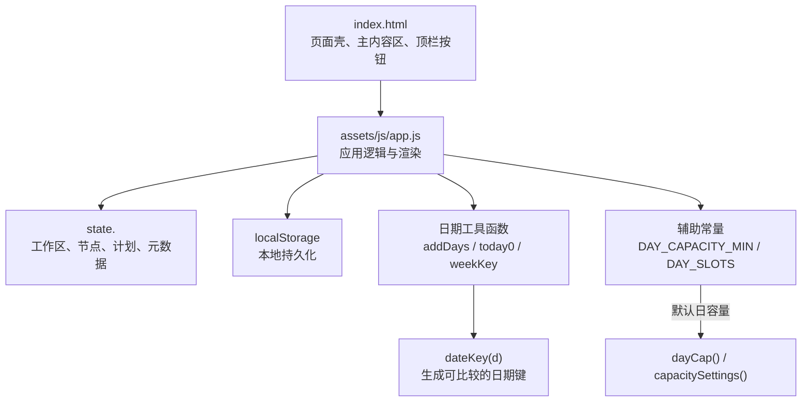
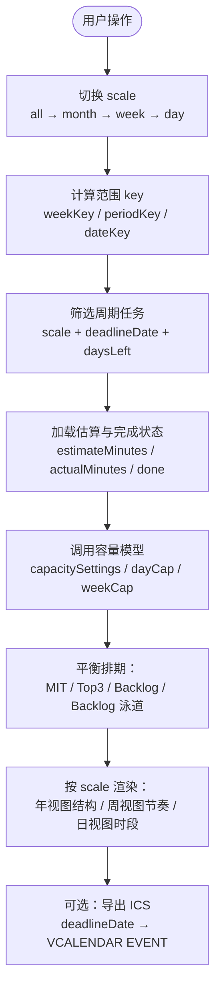
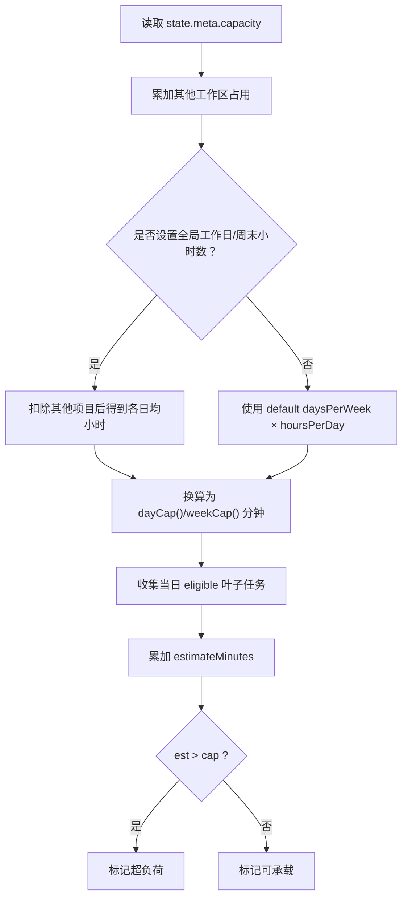
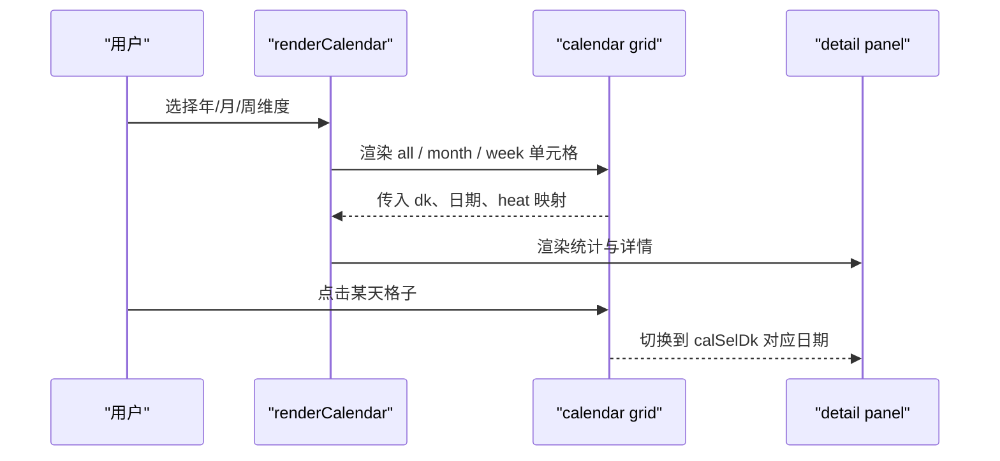
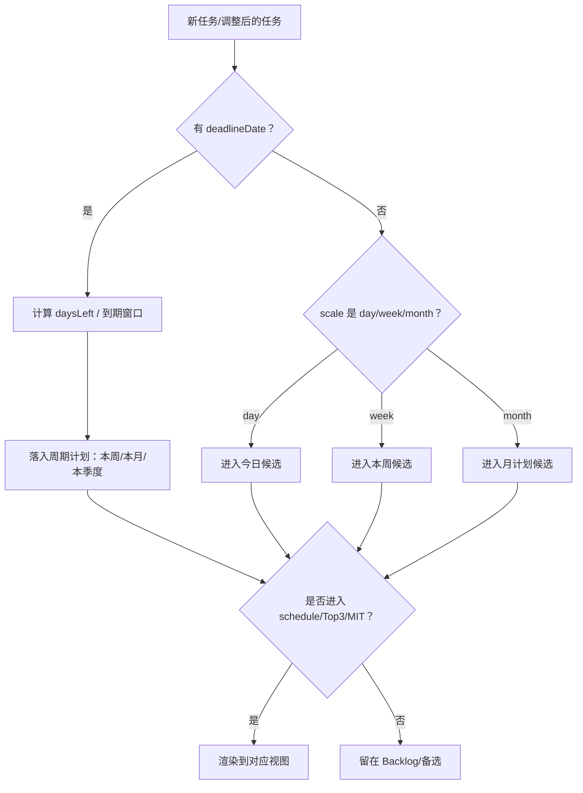
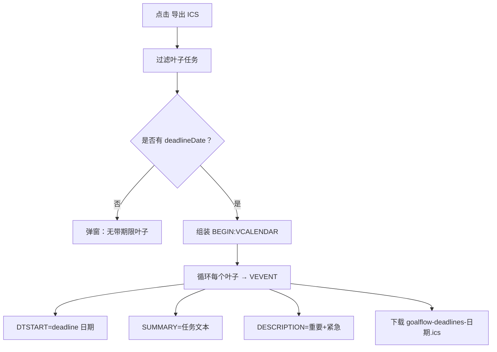

# 多维度时间轴与调度

<cite>
**本文引用的文件**
- [index.html](file://index.html)
- [README.md](file://README.md)
- [app.js](file://assets/js/app.js)
- [PROGRESS-ROLLUP.md](file://docs/PROGRESS-ROLLUP.md)
</cite>

## 目录
1. [引言](#引言)
2. [项目结构与入口](#项目结构与入口)
3. [核心概念](#核心概念)
4. [架构总览](#架构总览)
5. [维度切换机制](#维度切换机制)
6. `dateKey` 粒度与当日任务筛选
7. [容量计算与排期平衡](#容量计算与排期平衡)
8. [渲染差异与交互行为](#渲染差异与交互行为)
9. [周期计划如何影响 Backlog、Top3 与 MIT](#周期计划如何影响-backlog-top3-与-mit)
10. [ICS 日历导出映射](#ics-日历导出映射)
11. [关联状态字段清单](#关联状态字段清单)
12. [常见问题排查](#常见问题排查)
13. [实现提示](#实现提示)
14. [结论](#结论)

## 引言
目标流 GoalFlow 的多维度时间轴设计，遵循“先看见结构，再放大细节”的理念：年度看趋势、月度看布局、周度看节奏、日视图看时段。每次缩放都会联动聚焦清单、英雄卡（MIT）、能量热力、四象限和容量指标；不同时间尺度下，“本周最重要”和“今日最重要”不一定相同。本文围绕年→月→周→日联动说明其中的时间建模、任务筛选、容量平衡、渲染策略、计划传播与 ICS 导出映射，并给出排查问题时可对照的状态字段和函数位置。

## 项目结构与入口
GoalFlow 是纯前端应用，没有构建过程，由浏览器直接打开 HTML 页面加载资源：
- `index.html`：页面外壳、导航栏、今日行动主面板、侧边栏与更多操作按钮（包括 ICS 导出、备份恢复、设置等）。
- `assets/js/app.js`：全部应用逻辑，包括目标解析、树形维护、四象限、MIT 计算、日历与热度、调度、容量、ICS 导出、事件绑定与视图渲染。
- `README.md` 与 `docs/PROGRESS-ROLLUP.md`：功能概览、进度 rollup 规则、时长字段与完成语义，可作为本主题的数据一致性参考。

**图示来源**
- [index.html:1-140](file://index.html#L1-L140)
- [app.js:76-148](file://assets/js/app.js#L76-L148)
- [app.js:198-205](file://assets/js/app.js#L198-L205)
- [app.js:5523-5544](file://assets/js/app.js#L5523-L5544)

**章节来源**
- [index.html:1-200](file://index.html#L1-L200)
- [README.md:1-100](file://README.md#L1-L100)

## 核心概念
在讨论调度之前，需要明确几个被多维时间轴反复使用的基础概念。

| 概念 | 含义 | 关键使用位置 |
|---|---|---|
| `scale` | 节点的调度尺度，如空值、“每日”“每周”“每月”“年度”“长期”，决定它主要出现在哪个层级 | 四象限编辑选择、周规划候选筛选、AI 生成任务 |
| `slot` | 叶子节点的日时段标记，例如清晨、上午、中午、午后、下午、傍晚、夜间，用于日视图时段划分 | 今日时段渲染与微习惯展示 |
| `deadlineDate` / `deadlineText` | 从文本或人工输入推断出的具体截止日期与原始文本 | 日期识别、日历 deadline、ICS 导出 |
| `estimateMinutes` / `actualMinutes` | 预估分钟与实际分钟，仅参与容量判断和“预估 vs 实计”审计，不参与叶子完成百分比 | 日程可行性、日评分、滚动统计 |
| `doneAt` | 叶子完成时写入的毫秒时间戳，用于判定是否属于“本周完成”等历史统计 | PROGRESS-ROLLUP 规则与周回顾 |
| `state.viewMode` / `state.scale` | `viewMode` 控制看板/热力图/日历/桑基图/关系图等视觉模式；`scale` 表示当前宏观视图粒度 | 画布渲染分支、日历/周计划/年历联动 |
| `calMonth` / `calWeekOff` / `calSelDk` | 可视化光标变量：当前月份、偏移周数、已选日期 key，驱动日历区域渲染 | `renderCalendar` 及点击事件绑定 |

其中，`PROGRESS-ROLLUP.md` 明确指出：**只有叶子节点计入完成进度，`estimateMinutes` 与 `actualMinutes` 不参与完成百分比**。这对容量判断非常重要——系统可以把一个尚未完成的叶子放入今天的时间表，但不会把它当成已经完成的任务。

**章节来源**
- [app.js:2559-2575](file://assets/js/app.js#L2559-L2575)
- [app.js:3397-3428](file://assets/js/app.js#L3397-L3428)
- [app.js:5388-5406](file://assets/js/app.js#L5388-L5406)
- [PROGRESS-ROLLUP.md:1-37](file://docs/PROGRESS-ROLLUP.md#L1-L37)

## 架构总览
多轴时间系统的核心是：**统一的日期建模 + 按粒度切分任务 + 用容量控制落位 + 在不同视图中呈现不同信息密度**。

**图示来源**
- [app.js:76-148](file://assets/js/app.js#L76-L148)
- [app.js:5388-5406](file://assets/js/app.js#L5388-L5406)
- [app.js:5528-5544](file://assets/js/app.js#L5528-L5544)
- [app.js:3397-3428](file://assets/js/app.js#L3397-L3428)

## 维度切换机制
维度切换发生在两个层面：
1. **宏观视图**：`state.scale` 和 `viewMode` 决定画布中显示的是桑基图、四象限、周频、年历还是日历。
2. **局部维度**：每个任务的 `scale`、`slot`、`deadlineDate` 决定该任务出现在哪些视图和时段。

当用户在画布或日历中切换时，典型路径是：更新 `calMonth`、`calWeekOff`、`calSelDk` 或 `state.scale`，然后触发 `renderCanvas()`。`renderCanvas` 会根据 `viewMode` 决定渲染看板、热力图、mindmap、日历等；对于日历，`renderCalendar` 会依据 `state.scale === 'all'`、`month`、`week` 选择不同的网格方式。

此外，周/月/季的周期边界通过 `periodKey(cycle, d)` 统一表达，便于“最近一周”“本月”“本季”之类的区间计算。

**章节来源**
- [index.html:100-140](file://index.html#L100-L140)
- [app.js:1949-1965](file://assets/js/app.js#L1949-L1965)
- [app.js:2170-2230](file://assets/js/app.js#L2170-L2230)
- [app.js:5388-5406](file://assets/js/app.js#L5388-L5406)

## `dateKey` 粒度与当日任务筛选
`dateKey(d)` 负责把一个 Date 对象转换成稳定的字符串键。代码中的逻辑说明它是基于当天的年月日组合的，并在内部做了结果缓存，避免频繁转换同一个当天带来的开销。

它与时间轴的关系如下：

| 维度 | 时间粒度 | `dateKey` 的作用 |
|---|---|---|
| 年 | 不直接使用某日的 dateKey，而是以 12 个月为单位聚合 | `dateKey` 主要用于单日与跨月的底层日期标识 |
| 月 | 当前月包含多个日期格子 | 每个格子都有 `dk: dateKey(日期)`，用于命中热力、截止线和详情 |
| 周 | 固定 7 个日期格 | 同样为每日提供 `dk`，保证周视图与月/年视图共用同一套日期键 |
| 日 | 一天内进一步分成约 7 个时段块 | 日视图不再按“日期”筛，而按“时段 bucket”筛；但日期仍由 `dateKey` 定位 |

### 当日任务筛选逻辑
当日可见性通常不是单靠 `deadlineDate` 判定，而是把多种信号结合起来：
1. **自然到期类**：设置了 `deadlineDate` 且接近当天的任务；
2. **主动粒度类**：`scale` 设为“每日”的任务；
3. **临界到期类**：通过计算得到的 `daysLeft` 小于等于某个阈值（例如 1）的任务；
4. **计划落位类**：已经进入 `schedule`、`slot`、Top3、MIT 或被用户选择的“大石头”。

当日任务最终要满足三个约束之一：要么它被调度进“今天”的某个时段，要么它被认为应该在今天关注（即将到期、每日尺度、MIT 选中），否则可能留在 Backlog 中。

**章节来源**
- [app.js:198-205](file://assets/js/app.js#L198-L205)
- [app.js:2121-2132](file://assets/js/app.js#L2121-L2132)
- [app.js:2227-2233](file://assets/js/app.js#L2227-L2233)
- [app.js:1932-1938](file://assets/js/app.js#L1932-L1938)

## 容量计算与排期平衡
容量模型是连接“计划”和“现实”的桥梁。GoalFlow 的核心思路是：先定义你的可用时间，再用任务的时长估计去判断是否可承载，而不是把所有待办全塞进当天。

### 1. 能力设定来源
`capacitySettings()` 从 `state.meta.capacity` 读取用户的预算：
- 支持全局工作日每小时与周末每小时；
- 支持为其他工作区分配占用时间，从而推算出当前工作区的可用时间；
- 返回“每天平均小时数”、“周总小时数”等信息。

如果用户没有设置，则回退到默认的每日容量常量 `DAY_CAPACITY_MIN = 480`，即默认 8 小时作为日容量上限。

### 2. 日容量与周容量
- `dayCap()`：返回分钟单位的一天容量。
- `weekCap()`：根据工作日×5天 + 周末×2天的模式计算周容量；若未配置则按 `daysPerWeek × hoursPerDay` 计算。

这意味着“可做完性”不是一个固定 8 小时的死数字，而是可以随用户设置动态变化的预算工具。

### 3. 日计划可行性
`dayPlanFeasibility()` 会收集符合“今日维度”的叶子任务：
- 叶子且未完成；
- `scale === 'day'`；
- 或有明确截止日期且 `daysLeft ≤ 1`。

汇总这些任务的 `estimateMinutes`，并与 `dayCap()` 对比，输出：
- 预估分钟；
- 已计分钟；
- 任务数量；
- 是否超载；
- 容量上限。

这就是“可做完性”标签和进度条的依据。

**图示来源**
- [app.js:78-148](file://assets/js/app.js#L78-L148)
- [app.js:1932-1938](file://assets/js/app.js#L1932-L1938)
- [app.js:3433-3442](file://assets/js/app.js#L3433-L3442)

### 4. 排期平衡原则
虽然调度具体排序算法可能分布在较多函数中，但从已有结构可以归纳出以下优先级：
1. **MIT**：当前最重要的单一任务，应优先落在当日容量充足的位置。
2. **Top3**：短期重要任务，通常作为本周重点，但不污染当日焦点清单。
3. **Backlog**：未完成、低紧急或未安排的任务，保留为备选池。
4. **Backlog 泳道**：上周未完成和下月预告，用于隔离噪音。
5. **时段匹配**：对每日叶子，优先分配到其 `slot`，同时受 `estimateMinutes` 与剩余容量约束。
6. **容量溢出**：当预估超过 `dayCap()` 时，系统会提示“超负荷”，用户可通过拆分、延后、降低估值或将任务移出当日重新调度来缓解。

**章节来源**
- [app.js:76-148](file://assets/js/app.js#L76-L148)
- [app.js:1932-1938](file://assets/js/app.js#L1932-L1938)
- [app.js:3433-3442](file://assets/js/app.js#L3433-L3442)

## 渲染差异与交互行为
不同的时间尺度对应不同的信息密度与操作目标：

| 尺度 | 渲染目标 | 用户感知 | 关键交互 |
|---|---|---|---|
| 年（`scale === 'all'`） | 12 个月结构、月度热力、截止线分布 | “哪几个月精力扎堆” | 点击进入具体月份，缩小至月视图 |
| 月（`state.scale === 'month'`） | 当月日期格子、周结构、热点和截止线 | “这个月怎么安排” | 点击某日跳转到日详情；查看最佳日、热力统计 |
| 周（`state.scale === 'week'`） | 7 天固定网格 | “本周节奏是否健康” | 点击某一天查看当日调度；查看周统计 |
| 日（`state.scale === 'day'`） | 时段 block（清晨→夜间） | “今天能做什么、做多少” | 将叶子拖入时段、确认 MIT、执行番茄 |
| 非时间轴视图 | 看板、热力图、桑基图、mindmap 等 | “结构化分析” | 切换 `viewMode`，不受 `state.scale` 完全约束 |

`timeBuckets(scale, TODAY)` 将当前 scale 映射为时间段桶：
- 年度：12 个月；
- 月度：按月拆成若干周；
- 周度：周一到周日；
- 日度：按 7 个时段划分；
- 其他：空桶。

这使得不同尺度的任务都可以落到对应的 bucket 中统计负载、紧急度和数量，进而渲染出一致的条形图和热力。

**图示来源**
- [app.js:2170-2219](file://assets/js/app.js#L2170-L2219)
- [app.js:2221-2233](file://assets/js/app.js#L2221-L2233)
- [app.js:3397-3428](file://assets/js/app.js#L3397-L3428)

### 放大查看详情
放大是从“结构”走向“任务”的过程：
- 点击年视图的某月 → 切换到月视图；
- 点击月视图的某天 → 聚焦 `calSelDk`，并进入 Today 视图；
- 点击周视图某天 → 同样切换到当天；
- 在日视图内，通过时段区块查看可安排任务和已完成/进行中的任务。

这种“缩小看结构、放大看细节”的设计，正是 README 所说“每周看节奏、每日看时段”的实现目标。

**章节来源**
- [README.md:6-40](file://README.md#L6-L40)
- [app.js:2303-2322](file://assets/js/app.js#L2303-L2322)
- [app.js:3397-3428](file://assets/js/app.js#L3397-L3428)

## 周期计划如何影响 Backlog、Top3 与 MIT
周期计划在本项目中主要通过三类状态协作：
1. `node.scale`：决定任务的主要生命周期尺度；
2. `schedule`：决定任务是否已进入某个时间段；
3. `topId` / `topPin`：决定什么是当下最重要或临时固定项。

### 对 Backlog 的影响
Backlog 通常是“未完成且未被调度到近期”的叶子集合。如果一个任务的 `scale` 是“每月”，但没有立即到期的 deadline，它就不会挤占日视图，而是停留在 Backlog 或月级结构中；一旦到了它的周期范围或临近到期，它会向 Top3 或日视图迁移。

### 对 Top3 的影响
Top3 聚焦的是“近期内真正重要的事情”，不一定是今天的唯一任务。周度计划会把 ≤5 块“大石头”挂起来，作为本周推进主线；它们会影响“本周 MIT”，但与“今日 MIT”仍有区别。

### 对 MIT 的影响
MIT 的计算会考虑重要度、紧急度、到期时间和进度状态。如果某任务处于活跃周内、即将到期或已被设置为重点，它更可能成为 `state.topId` 所展示的“英雄卡任务”。同时，`tomorrowMit.forDate` 支持前一晚预选明天第一件大事，以减少早晨决策压力。

**图示来源**
- [app.js:1923-1930](file://assets/js/app.js#L1923-L1930)
- [app.js:1932-1938](file://assets/js/app.js#L1932-L1938)
- [app.js:5891-5898](file://assets/js/app.js#L5891-L5898)
- [index.html:43-62](file://index.html#L43-L62)

**章节来源**
- [app.js:1923-1938](file://assets/js/app.js#L1923-L1938)
- [app.js:3397-3422](file://assets/js/app.js#L3397-L3422)
- [app.js:5891-5898](file://assets/js/app.js#L5891-L5898)
- [index.html:43-70](file://index.html#L43-L70)

## ICS 日历导出映射
ICS 导出是一个“截止时间投影”：它只导出**叶子任务**且有 `deadlineDate` 的项目，把它们写成一个标准的 VCALENDAR 文件，供外部日历应用导入。

关键点如下：
- 筛选条件：叶子（`parentId` 存在且 `_children.length === 0`）且 `deadlineDate` 不为空；
- `DTSTART;VALUE=DATE`：使用 deadline 的日期部分；
- `UID`：使用任务 id 加域名后缀，防止冲突；
- `SUMMARY`：任务文本；
- `DESCRIPTION`：携带 GoalFlow 的重要度和紧急度信息；
- 文件名格式：`goalflow-deadlines-YYYY-MM-DD.ics`；
- 若没有带期限的叶子，会弹出提示，要求补充类似“周五前”“3月15日”这样的描述或在任务里设置 deadline。

**图示来源**
- [index.html:50-58](file://index.html#L50-L58)
- [app.js:5523-5544](file://assets/js/app.js#L5523-L5544)

### ICS 时间与时间轴关系
- ICS 只关心“截止日期”，不关心 `slot`、`estimateMinutes` 或是否在日视图中已排好。
- 即使某天在日视图里为空，只要某个叶子标注了 deadline，也可能出现在 ICS 文件中。
- 如果 `deadlineDate` 是通过自然语言推断得到的，那么导入外部日历时的显示取决于宿主应用如何解析 `VALUE=DATE`；通常它会把该任务放在截止日期的“全天事件”上。

**章节来源**
- [index.html:50-58](file://index.html#L50-L58)
- [app.js:5523-5544](file://assets/js/app.js#L5523-L5544)

## 关联状态字段清单
下面列出与“时间轴缩放与调度”最直接相关的关键字段。它们分散在节点、工作区元数据和状态容器中。

| 字段 | 所属对象 | 作用 | 常见风险 |
|---|---|---|---|
| `nodes[].id` | 节点 | 唯一标识，用于关联 ICS UID、选中、固定等 | ID 重复会导致锚点失效 |
| `nodes[].text` | 节点 | 任务标题、ICS SUMMARY | 过长会在小卡片裁剪 |
| `nodes[].parentId` | 节点 | 区分叶子与非叶子 | 非叶子错误地参与完成统计会影响体验 |
| `nodes[].done` | 节点 | 是否完成 | 完成但未记录 `doneAt` 可能不计入本周完成 |
| `nodes[].doneAt` | 节点 | 完成时间戳 | 旧数据缺 `doneAt` 会被视为未完成的历史勾选 |
| `nodes[].deadlineDate` | 节点 | 截止时间；驱动 ICS 和部分到期逻辑 | 缺失导致任务不出 ICS 或不被视为近日到期 |
| `nodes[].deadlineText` | 节点 | 原始截止日期文本 | 方便用户核对推断是否正确 |
| `nodes[].estimateMinutes` | 节点 | 预估时长，用于容量 | 估太小会造成超负荷预警不准确 |
| `nodes[].actualMinutes` | 节点 | 实际时长 | 不参与完成百分比，仅影响审计/评分 |
| `nodes[].scale` | 节点 | “每日/每周/每月/年度/长期” | 设错可能导致周/月计划漏掉任务 |
| `nodes[].slot` | 节点 | 日时段 | 非叶子一般没有 slot |
| `nodes[].im` / `nodes[].ur` / `nodes[].val` / `nodes[].eff` | 节点 | 重要度、紧急度、价值、费力 | 影响 MIT、四象限和评估 |
| `nodes[].schedule` | 节点 | 时段排期引用 | 清空后会从日视图消失 |
| `nodes[].slotIndex` | 节点 | 时段索引 | 与时段渲染对应 |
| `state.activeWorkflowId` | 状态 | 当前工作区 | 切错工作区会导致看不到本项目任务 |
| `state.topId` / `state.topPin` | 状态 | 今日/周 MIT 与置顶 | 指向不存在节点时会破坏英雄卡 |
| `state.meta.capacity` | 元数据 | 用户时间预算 | 不设置则使用默认 480 分钟日容量 |
| `state.meta.tomorrowMit` | 元数据 | 前一晚预选明日 MIT | 与次日日期 key 不一致则不显示 |
| `state.viewMode` | 状态 | 看板/热力/桑基/日历等视图 | 非时间视图下 `state.scale` 影响较小 |
| `state.scale` | 状态 | 当前宏观尺度 | 误设会导致日历不渲染预期网格 |
| `calMonth` / `calWeekOff` / `calSelDk` | 本地变量 | 日历光标 | 不清理会显示上月/上周内容 |

**章节来源**
- [app.js:76-148](file://assets/js/app.js#L76-L148)
- [app.js:2119-2132](file://assets/js/app.js#L2119-L2132)
- [app.js:3397-3428](file://assets/js/app.js#L3397-L3428)
- [app.js:5528-5544](file://assets/js/app.js#L5528-L5544)
- [PROGRESS-ROLLUP.md:1-37](file://docs/PROGRESS-ROLLUP.md#L1-L37)

## 常见问题排查

### 某日任务为空
可能原因：
- 没有叶子任务的 `scale` 被设置为“每日”，且没有临近到期的 deadline；
- 任务的 `estimateMinutes` 总和超过 `dayCap()`，被标记超负荷，用户手动移出日视图；
- 任务仍在 Backlog，没有被纳入 schedule、Top3 或 MIT；
- 日期 key 异常：比如 `calSelDk` 与实际希望查看的日期不一致；
- 工作区切错：`state.activeWorkflowId` 不是当前数据所在工作区。

排查顺序建议：
1. 确认查看的日期 key 是否真实对应目标日期；
2. 检查该日期对应叶子是否存在 `deadlineDate`；
3. 检查叶子 `estimateMinutes` 和 `dayCap()` 的比较结果；
4. 检查任务是否还在 Backlog 或 Backlog 泳道；
5. 检查工作区是否为当前 active workflow。

**章节来源**
- [app.js:1932-1938](file://assets/js/app.js#L1932-L1938)
- [app.js:2170-2219](file://assets/js/app.js#L2170-L2219)
- [app.js:3433-3442](file://assets/js/app.js#L3433-L3442)

### 跨周计划断链
可能原因：
- 任务的 `scale` 被错误设为“月”或“长期”，而没有进入周计划；
- 截止日期跨越周界，但依赖 deadline 判断的窗口没有覆盖到下一周；
- 周计划回调或 PDCA 动作没有正确设置新的 cycle 范围；
- 周回顾没有回填下周候选项；
- 时间刻度变量 `calWeekOff` 偏移了目标周。

解决建议：
- 对需要连续推进的重要叶子，确保它有明确的 deadline 和合理的 `scale`；
- 在使用周期统计时使用 `periodKey`，而非拼接字符串；
- 周回顾后检查是否把调整项加入了下周的候选计划；
- 校准当前周视图的游标。

**章节来源**
- [app.js:2121-2132](file://assets/js/app.js#L2121-L2132)
- [app.js:2303-2322](file://assets/js/app.js#L2303-L2322)
- [app.js:5388-5406](file://assets/js/app.js#L5388-L5406)

### ICS 导入后时间错乱
可能原因：
- 没有 `deadlineDate`：任务不会出现在 ICS 中；
- 日期文本解析失败：Natural Language 解析后没有得到合法 Date；
- 宿主日历忽略 `VALUE=DATE` 或使用不同 timezone；
- `DTSTART` 使用日期类型而非具体时分秒，有些客户端会按当地时间解释；
- 文件名中包含日期但不代表事件具体时间；
- 多个工作区同 ID 或 UID 冲突；虽然这里使用了 `id@goalflow.local`，仍需保证节点 id 不重复。

修复步骤：
1. 在 GoalFlow 中确认叶子任务已有合理截止日期；
2. 重新导出 ICS 并检查文件名；
3. 在宿主日历中查看事件是否为全天事件；
4. 如发现 timezone 差异，可在外部日历中调整显示设置；
5. 若事件未出现，确认该任务确实是叶子且有 `deadlineDate`。

**章节来源**
- [app.js:5523-5544](file://assets/js/app.js#L5523-L5544)

### 周 MIT 与日 MIT 不同步
这是正常现象。README 强调：“‘本周最重要’和‘今日最重要’不是同一件事。”
- 周 MIT 体现一段时间的主线；
- 日 MIT 体现“现在最值得做的唯一一件事”；
- 两者由不同范围、不同权重、不同上下文决定。

如果用户希望它们一致，需要在日视图确认后显式固定 `state.topId` 或 `state.topPin`。

**章节来源**
- [README.md:6-40](file://README.md#L6-L40)
- [app.js:5891-5898](file://assets/js/app.js#L5891-L5898)

### 历史数据中没有 `doneAt`
PROGRESS-ROLLUP 规则指出，历史中已勾选但无 `doneAt` 的任务不应计入“本周完成”，重新勾选会补记时间戳。因此若发现已完成任务没有出现在周回顾完成统计中，应重新勾选一次。

**章节来源**
- [PROGRESS-ROLLUP.md:14-32](file://docs/PROGRESS-ROLLUP.md#L14-L32)

## 实现提示
如果需要修改或定位时间切换与范围过滤相关逻辑，可按以下线索阅读 `assets/js/app.js`：

| 目标 | 建议查找区域 |
|---|---|
| 日期 key 生成与缓存 | `function dateKey(d)` 附近 |
| 周/月/季 periodKey 定义 | `periodKey(cycle, d)` 附近 |
| 日历渲染入口 | `renderCalendar(box)` |
| 年视图渲染 | `renderCalendarYear(box, dlMap)` |
| 周/月网格生成 | `calMonthCells()`、`calWeekCells()` |
| 周期统计 | `computePeriodStats(cycle)` |
| 容量模型 | `capacitySettings()`、`dayCap()`、`weekCap()` |
| 日可行性 | `dayPlanFeasibility()` |
| 时间 bucket 映射 | `timeBuckets(scale, TODAY)` |
| 视图切换 | `renderCanvas()`、`VIEW_GROUP` |
| ICS 导出 | `exportICS()` |
| 时间轴与 ICS 交互 | 顶部菜单绑定的 `btnExportIcs` |
| 周期/规模相关文案 | `timeAxis`、`scaleUnit`、`rhythm` 渲染处 |

注意：不要把“渲染逻辑”等同于“调度算法”。日历、热力图、日程条都是不同表现形式；真正的调度还涉及任务筛选、容量平衡、MIT 计算、Top3/Backlog 分流等多个模块。

**章节来源**
- [app.js:198-205](file://assets/js/app.js#L198-L205)
- [app.js:1949-1965](file://assets/js/app.js#L1949-L1965)
- [app.js:2170-2230](file://assets/js/app.js#L2170-L2230)
- [app.js:3397-3428](file://assets/js/app.js#L3397-L3428)
- [app.js:5523-5544](file://assets/js/app.js#L5523-L5544)

## 结论
GoalFlow 的多维度时间轴并不只是“年、月、周、日四个日历模板”，而是一个由统一日期键、周期 key、容量模型、调度落位和多视图渲染共同构成的系统。它通过 `dateKey`、`scale`、`slot`、`deadlineDate`、`estimateMinutes`、`schedule` 以及用户能力设定协同工作，实现：

- 年看趋势；
- 月看布局；
- 周看节奏；
- 日按时段执行；
- 计划沿 Backlog → Top3 → MIT → 时段 → 完成的路径流动；
- 导出 ICS 时保持截止日期与日历事件的稳定对应。

开发和维护时应特别注意：不要只在渲染层改日期，而不校验 `dateKey` 一致性；不要在容量不足时强行展示所有任务；不要把日 MIT 和周 MIT 混为一谈；也不要假设没有 `deadlineDate` 的任务会出现在 ICS 中。