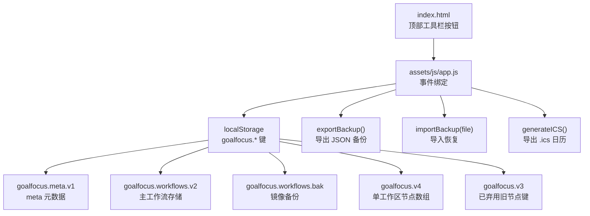
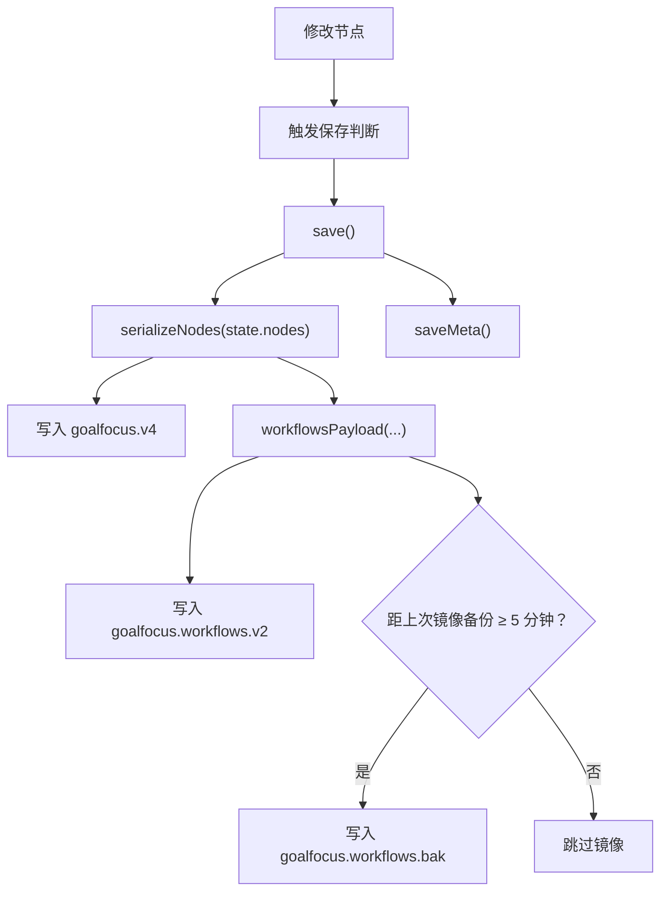
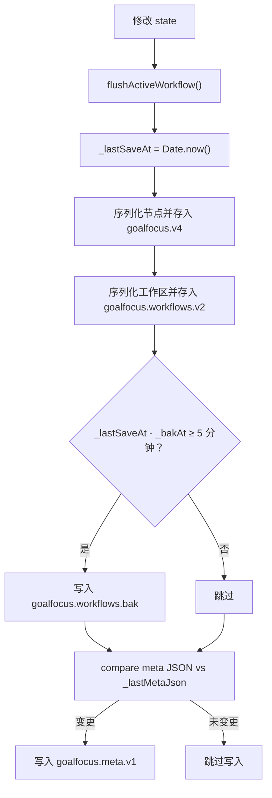
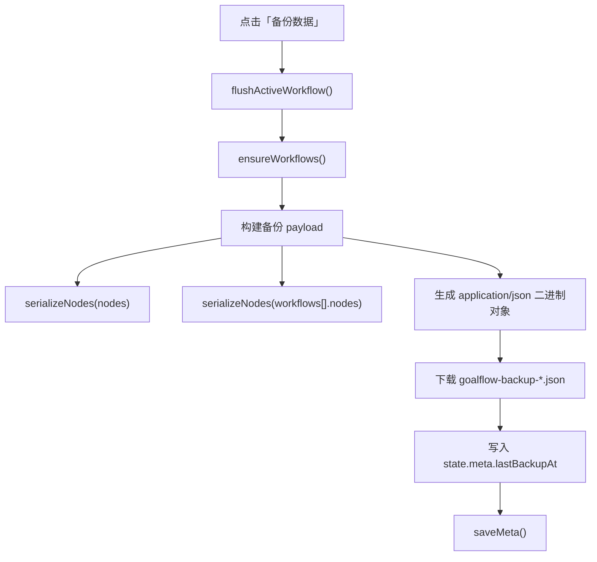
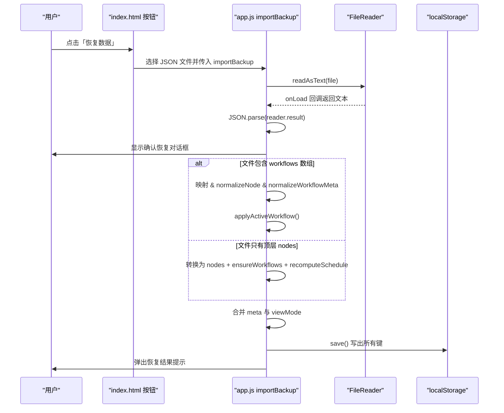
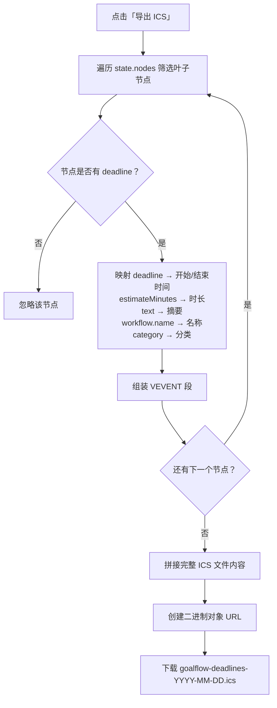
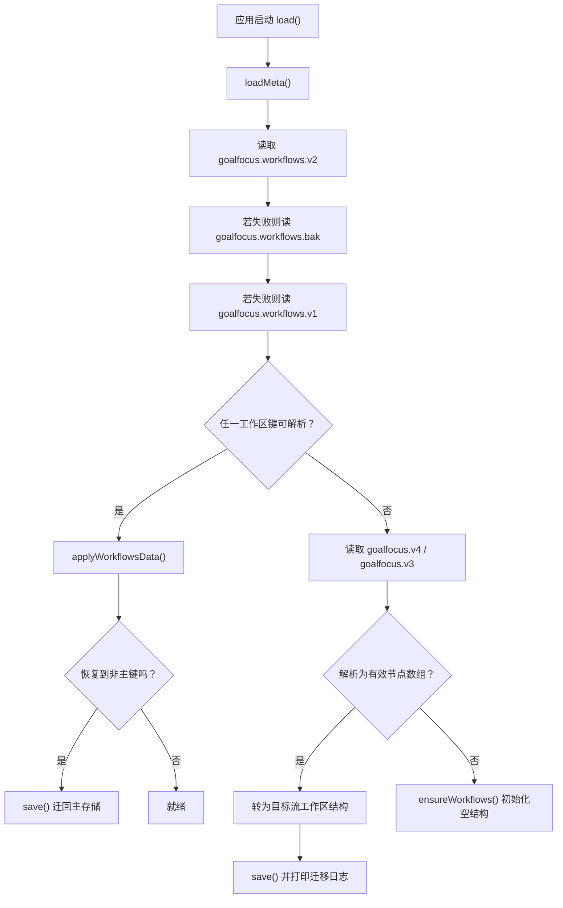
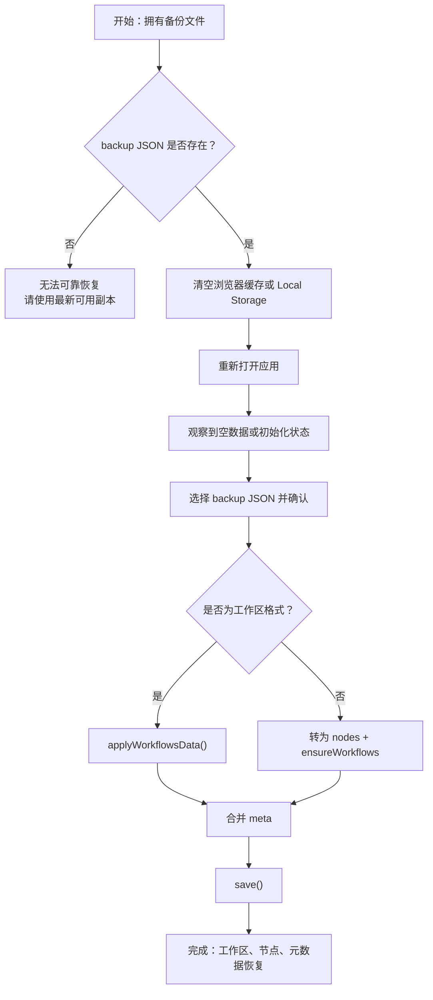

# 数据持久化、备份与 ICS 导出

<cite>
**本文引用的文件**   
- [assets/js/app.js](file://assets/js/app.js)
- [README.md](file://README.md)
- [index.html](file://index.html)
</cite>

## 目录
1. [引言](#引言)
2. [项目结构定位](#项目结构定位)
3. [数据存储模型](#数据存储模型)
4. [本地存储键名约定](#本地存储键名约定)
5. [状态序列化与反序列化](#状态序列化与反序列化)
6. [防抖保存与增量元数据落盘](#防抖保存与增量元数据落盘)
7. [JSON 备份与恢复流程](#json-备份与恢复流程)
8. [ICS 日历导出](#ics-日历导出)
9. [数据迁移与损坏恢复](#数据迁移与损坏恢复)
10. [安全与隐私注意事项](#安全与隐私注意事项)
11. [性能特征与优化点](#性能特征与优化点)
12. [故障排查指南](#故障排查指南)
13. [实操演练：清空缓存到恢复数据](#实操演练清空缓存到恢复数据)
14. [结论](#结论)

## 引言
目标流 GoalFlow 是一个纯本地的可视化时间管理应用，其目标、项目工作区、执行日志和界面配置全部保存在浏览器 `localStorage` 中。核心文档需要明确以下问题：

- 哪些 `localStorage` 键保存节点树、工作区和元数据。
- 状态对象如何从内存中的 `state.nodes` / `state.meta` / `state.workflows` / `pomo` 序列化为磁盘值。
- JSON 备份文件的版本结构、导入覆盖逻辑与冲突处理。
- 节点期限、预估工时、工作区名称和分类怎样映射为 ICS 事件。
- 当旧字段缺失或 `localStorage` 损坏时，应用如何通过镜像备份、旧格式兼容和字段补齐重建可信数据源。
- 为什么备份文件可能包含敏感信息，以及用户应如何避免泄露。

本文件直接基于 `assets/js/app.js` 的持久化、加载、备份恢复与 ICS 实现进行技术说明，并以 `README.md` 的数据隐私说明作为补充依据。

## 项目结构定位
GoalFlow 的前端由一个单页 HTML 页面驱动，应用主逻辑位于 `assets/js/app.js`。备份按钮、恢复按钮和 ICS 导出入口定义在页面结构中，实际行为由脚本绑定。

**图示来源**  
- [assets/js/app.js:1-20](file://assets/js/app.js#L1-L20)  
- [assets/js/app.js:5250-5410](file://assets/js/app.js#L5250-L5410)  
- [assets/js/app.js:5584-5672](file://assets/js/app.js#L5584-L5672)  
- [index.html:64-85](file://index.html#L64-L85)

**章节来源**  
- [index.html:1-85](file://index.html#L1-L85)  
- [README.md:1-103](file://README.md#L1-L103)

## 数据存储模型
应用的核心运行时状态可以概括为：

| 字段 | 含义 | 是否直接持久化 | 主要用途 |
|---|---|---:|---|
| `state.nodes` | 当前激活工作区的节点数组 | 通过 `serializeNodes` 后写入多个键 | 渲染目标树、排序、计划与进度 |
| `state.meta` | 元数据，包括回顾记录、执行日志、习惯打卡、警报标记等 | 单独写入 `goalfocus.meta.v1` | 统计、UI 记忆、周期回顾、备份提醒 |
| `state.workflows` | 所有工作区（项目）定义及其节点 | 以工作区列表形式写入 `goalfocus.workflows.v2` 及镜像键 | 多项目切换、节点根、标签与颜色 |
| `state.activeWorkflowId` | 当前选中的工作区 ID | 随工作区 JSON 一起写入 | 确定哪个工作区是“活跃树” |
| `state.viewMode` | 视图模式 | 仅写入备份文件，不直接进入 `save()` | 备份恢复后维持上次视图 |
| `pomo` | 番茄钟相关运行状态 | 未在本节分析的保存路径中发现专用持久化逻辑 | 运行时倒计时交互；如需跨刷新保留需扩展存储方案 |

重要规则：

- 持久化的顶层集合是“节点树”。在多工作区模式下，每个工作区都有自己的节点集。
- `state.workflows` 不仅描述“有哪些项目”，也保存项目的树根节点和节点数据。
- `state.meta` 是独立于节点树的辅助数据结构；它对 UI、统计和备份提醒很重要，但不等同于目标树。
- `pomo` 没有像节点和工作区那样出现在本节分析到的主保存路径中；若需要在应用重载后仍保留番茄钟状态，应将其显式纳入 `state.meta` 或新建专属存储键。

**章节来源**  
- [assets/js/app.js:1-20](file://assets/js/app.js#L1-L20)  
- [assets/js/app.js:5250-5410](file://assets/js/app.js#L5250-L5410)  
- [assets/js/app.js:5584-5672](file://assets/js/app.js#L5584-L5672)

## 本地存储键名约定
以下是 GoalFlow 使用的主要 `localStorage` 键：

| 键名 | 内容 | 版本或角色 | 行为说明 |
|---|---|---|---|
| `goalfocus.v4` | 当前激活工作区的扁平节点数组 | 旧式单工作区存储 | 用于兼容之前只维护一棵树的场景；现代多工作区以 v2 为主 |
| `goalfocus.v3` | 更早版本的节点数组 | 历史遗留 | 如果 `goalfocus.v4` 不存在，尝试回退读取 |
| `goalfocus.meta.v1` | 应用元数据 | 元数据专用 | 含周/月/季回顾、执行日志、能量记录、评分记录、提示标志等 |
| `goalfocus.workflows.v2` | 主工作区集合 | 当前主存储 | 包含每个工作区的 ID、名称、节点、活动工作区 ID |
| `goalfocus.workflows.bak` | 工作区镜像备份 | 自动冗余备份 | 每隔约 5 分钟同步一份主工作区存储 |
| `goalfocus.workflows.v1` | 旧版工作区格式 | 加载兼容格式 | 不是新写键；加载器会尝试解析 |

键名来源于代码顶部的常量声明，并允许通过主题令牌中的 `STORAGE` 覆盖默认值：

- `LS_KEY = STORAGE.nodes || 'goalfocus.v4'`
- `LS_KEY_LEGACY = STORAGE.nodesLegacy || 'goalfocus.v3'`
- `LS_META = STORAGE.meta || 'goalfocus.meta.v1'`
- `LS_WORKFLOWS = 'goalfocus.workflows.v2'`
- `LS_WORKFLOWS_BAK = 'goalfocus.workflows.bak'`

需要注意，虽然 `LS_KEY` 默认为 `goalfocus.v4`，但文档标题中使用“v4、v1 等”只是帮助理解不同存储位置的演进，不代表 JSON 备份本身版本号一致。JSON 备份有自己独立的顶层 `version: 10`。

**章节来源**  
- [assets/js/app.js:1-20](file://assets/js/app.js#L1-L20)  
- [assets/js/app.js:5362-5410](file://assets/js/app.js#L5362-L5410)  
- [assets/js/app.js:5382-5395](file://assets/js/app.js#L5382-L5395)

## 状态序列化与反序列化
### 节点序列化
应用不会直接把复杂的运行时节点树原样存入 `localStorage`。节点先经过 `serializeNodes`，将当前内存结构转为扁平存储格式，再分别写入两个位置：

1. 当前激活工作区的单树键：`goalfocus.v4`。
2. 工作区总集合键：`goalfocus.workflows.v2`。

此外，当用户触发完整保存时，工作区 JSON 还会按 5 分钟间隔复制到 `goalfocus.workflows.bak`。

**图示来源**  
- [assets/js/app.js:5289-5345](file://assets/js/app.js#L5289-L5345)

关键点：

- 保存前先调用 `flushActiveWorkflow()`，把当前编辑中的活跃工作区合并进状态。
- `serializeNodes` 返回的是供存储使用的节点数组；渲染时再由其他逻辑构建父-子关系或缓存树。
- 镜像备份与主保存走相同数据路径，因此 `bak` 能作为主键损坏时的降级来源。

### 工作区反序列化
加载时使用 `parseWorkflowsJson`，检查输入是否具有合法的工作区数组结构。失败时会输出警告消息，并返回空结果，从而让后续加载策略继续尝试其他键。

对每条工作区记录，它确保至少有：

- `id`
- `name`
- `topId`
- `topPin`
- `tags`
- `startDate`
- `endDate`
- `description`
- `color`
- `nodes`

节点再通过 `normalizeNode` 规范化，最终调用 `normalizeWorkflowMeta` 填充缺失的工作区元数据。

### 元数据加载与补齐
`loadMeta()` 先从 `goalfocus.meta.v1` 读取元数据，然后展开一批基础字段，例如：

- `weekReviews`
- `monthReviews`
- `quarterReviews`
- `bannerDismissedWeek`
- `dailyCompletions`
- `executionLog`
- `habitStreaks`
- `alarmFired`

这样即使 localStorage 中没有对应字段，也不会因为读取空对象而抛出错误。随后还会执行评分补齐与日志裁剪。

**章节来源**  
- [assets/js/app.js:5250-5410](file://assets/js/app.js#L5250-L5410)

## 防抖保存与增量元数据落盘
### 保存节流与镜像间隔
`save()` 负责把节点与工作区写入磁盘，并用两个计时变量控制频率：

| 变量 | 作用 | 条件 |
|---|---|---|
| `_lastSaveAt` | 记录最近一次成功保存时间 | 每次 `save()` 设置 |
| `_bakAt` | 记录最近一次写入镜像备份的时间 | 仅当离上次至少 5 分钟时才更新 |
| `LS_BAK_INTERVAL` | 5 × 60 × 1000 毫秒，即 5 分钟 | 决定镜像写入间隔 |

主键 `goalfocus.workflows.v2` 在每次保存都会更新；镜像键 `goalfocus.workflows.bak` 则只在时间间隔到达后才写入。这样做有两个意图：

1. 降低频繁写入同一工作区副本的开销。
2. 提供一份“稍早一点”的冗余副本，适合主键突然被清空后的恢复。

### 元数据按需写入
`saveMeta()` 会先将 `state.meta` 序列化为 JSON 字符串，并与最后写入的值 `_lastMetaJson` 比较。如果内容没变，就跳过真正的 `localStorage.setItem`。这样可以避免“节点变化但元数据不变”时仍然反复重写元数据键。

**图示来源**  
- [assets/js/app.js:5257-5345](file://assets/js/app.js#L5257-L5345)

这个设计降低了 localStorage 写入压力，尤其适合高频交互，比如编辑文本、拖动四象限、展开关闭面板等。

**章节来源**  
- [assets/js/app.js:5257-5345](file://assets/js/app.js#L5257-L5345)

## JSON 备份与恢复流程
### 备份导出结构
`exportBackup()` 会在导出前执行两次操作：

1. 刷新活跃工作区。
2. 确保工作区列表存在。

导出的 JSON 对象包含以下字段：

| 字段 | 类型 | 含义 |
|---|---|---|
| `app` | 字符串 | 固定值 `"goalflow"`，标识来源应用 |
| `version` | 数字 | 当前为 `10`，代表备份文件格式版本 |
| `exportedAt` | ISO 日期字符串 | 导出时间 |
| `viewMode` | 任意值 | 当前页面视图模式 |
| `activeWorkflowId` | 字符串或空 | 当前工作区 ID |
| `workflows` | 对象数组 | 所有工作区的快照 |
| `nodes` | 对象数组 | 当前激活工作区的所有节点 |
| `meta` | 对象或空 | 应用元数据 |

每个工作区对象包括 ID、名称、根节点、置顶节点、标签、开始与结束日期、描述、颜色和该工作区的节点数组。节点数组来自 `serializeNodes(w.nodes || [])`。

文件名采用 `goalflow-backup-{日期}.json` 格式。

**图示来源**  
- [assets/js/app.js:5584-5610](file://assets/js/app.js#L5584-L5610)

### 恢复导入流程
`importBackup(file)` 的行为如下：

1. 通过 `FileReader` 读取用户选择的 JSON 文件。
2. 尝试解析文件内容。
3. 校验是否存在合法的目标数据数组。
4. 弹出确认对话框，因为恢复会覆盖当前全部目标流。
5. 如果文件中存在 `workflows` 数组且非空：
   - 将该数组映射为内部工作区对象。
   - 为缺失的 `id` 分配新 ID。
   - 调用 `normalizeNode` 和 `normalizeWorkflowMeta` 规范化数据。
   - 设置 `activeWorkflowId`，并调用 `applyActiveWorkflow()`。
6. 否则：
   - 把顶层 `data.nodes` 当作单树节点。
   - 清空工作区列表。
   - 调用 `ensureWorkflows()` 和 `recomputeSchedule()` 重建状态。
7. 如果文件中有 `meta`，则以“覆盖对象”的方式与现有 `state.meta` 合并。
8. 如果有 `viewMode`，覆盖当前视图模式。
9. 调用 `save()` 与 `afterChange()` 触发持久化和重渲染。
10. 最后弹出恢复结果的提示。

**图示来源**  
- [assets/js/app.js:5612-5672](file://assets/js/app.js#L5612-L5672)

### 导入覆盖策略
恢复不是增量合并目标树，而是**整棵工作区数据的覆盖式还原**：

- 如果导入文件有 `workflows`，会用文件中的 `workflows` 完全替换当前内存中的工作区数组。
- 如果导入文件只有顶层 `nodes`，会清空 `workflows`，并使用单树模式。
- `meta` 则是部分覆盖：已有键保持原值，导入文件中的键覆盖现有值。
- `viewMode` 也会被覆盖。

这意味着，如果需要将另一个 GoalFlow 中的数据“加入现有工作区”，应先手动调整 JSON，而不是依赖当前的 `importBackup`。当前实现更适合“从一个已知快照恢复整个应用状态”。

### 兼容性行为
- JSON 文件中的 `data.workflows` 会被优先识别。
- 若没有工作区数组，会回退到顶层 `data.nodes`。
- 文件没有合法节点数组时，会阻止恢复并提示用户。
- JSON 解析失败时会提示失败。
- 工作区中的单个 `node` 通过 `normalizeNode` 容错，避免缺少可选字段导致崩溃。

需要注意的是：JSON 备份文件的顶层 `version: 10` 与应用启动时读取的旧版 `goalfocus.v3` / `goalfocus.v4` 键不同。后者是运行期存储键名，前者是备份文件的文件格式版本。当前恢复函数并没有根据 `version` 分支处理；未来版本升级时应谨慎对待向下兼容逻辑。

**章节来源**  
- [assets/js/app.js:5584-5672](file://assets/js/app.js#L5584-L5672)

## ICS 日历导出
ICS 导出功能由绑定的导出按钮和对应的 ICS 生成逻辑组成。页面中定义了“导出 ICS”按钮，并将其绑定到生成函数；生成的 `.ics` 文件名带有当天日期。

### 数据来源
ICS 事件主要由节点推导：

| 目标领域 | ICS 字段 | 转换规则 |
|---|---|---|
| 节点截止日期 | 事件起止时间或提醒基准时间 | 仅对带 deadline 的叶子参与映射 |
| 预估时长 | 事件持续时间 | 将 `estimateMinutes` 转为 ICS 时长字段 |
| 目标文本 | 事件摘要 | 使用节点文本作为事件标题或摘要 |
| 工作区 | 事件名称或备注 | 使用工作区名称说明目标所属项目 |
| 分类 | 事件类别或说明 | 使用四象限分类标签说明任务优先级类型 |

### 生成流程

**图示来源**  
- [assets/js/app.js:5580-5600](file://assets/js/app.js#L5580-L5600)

这里要注意：

- ICS 文件名格式为 `goalflow-deadlines-YYYY-MM-DD.ics`。
- README 明确指出“ICS 导出带期限叶子”，这与过滤逻辑一致：并非所有节点都会变成日历事件。
- 如果一个节点没有 `deadline`，通常不应参与 ICS 事件。
- 预估时长字段需要能够解析出分钟数；若缺失或为 0，应避免产生空持续时间。
- 工作区与分类信息应当出现在可读字段（如摘要或说明）中，以便在外部日历中区分项目来源。

由于具体 ICS 生成逻辑所在区间未在本文搜索命中行号内展示，本文不引用其内部构造每一行 ICS 的代码，但上述映射必须满足 ICS 的基本语义：

- 必须有 `BEGIN:VCALENDAR` 与 `END:VCALENDAR`。
- 每个事件应有 `VEVENT` 块。
- 时间应尽量统一时区或使用标准日期时间表示。
- 重复性或占位符字段应按需要处理，避免把长期项目误解成一次性事件。

**章节来源**  
- [index.html:74-78](file://index.html#L74-L78)  
- [README.md:76-84](file://README.md#L76-L84)  
- [assets/js/app.js:5580-5600](file://assets/js/app.js#L5580-L5600)

## 数据迁移与损坏恢复
### 启动加载顺序
应用的加载流程先加载元数据，再依次从多个键恢复工作区数据，最后回退到旧版单树结构。关键顺序如下：

**图示来源**  
- [assets/js/app.js:5362-5410](file://assets/js/app.js#L5362-L5410)

### 主工作区损坏时的降级链
加载顺序体现了一条明确的降级链：

1. 优先读取 `goalfocus.workflows.v2`。
2. 然后读取 `goalfocus.workflows.bak`。
3. 再尝试旧格式 `goalfocus.workflows.v1`。
4. 如果以上都失败，回退到旧版节点键 `goalfocus.v4`。
5. 最后回退 `goalfocus.v3`。

这种设计很关键：当用户在浏览器中清除缓存或第三方清理工具误删主工作区键时，应用仍可尝试从 5 分钟前写入的镜像备份恢复。

### 从单树到多工作区的迁移
如果加载器发现旧键中有合法的节点数组，它会：

1. 设置为 `state.nodes`。
2. 清空 `state.workflows`。
3. 调用 `ensureWorkflows()`。
4. 重新计算计划。
5. 立即调用 `save()`，将旧数据迁移到新的多工作区格式。
6. 输出迁移信息。

这解决了从单工作区模式迁移到多工作区模式的兼容问题。

### 元数据损坏恢复
`loadMeta()` 具有较强健壮性：

- 读取失败会被捕获为空。
- 如果没有 `state.meta`，会初始化一组基础字段。
- 如果缺少 `executionLog`、`habitStreaks`、`alarmFired`，也会补齐。
- 执行完后调用评分补齐和日志裁剪，防止日志增长占用过多存储空间。

**章节来源**  
- [assets/js/app.js:5257-5410](file://assets/js/app.js#L5257-L5410)

## 安全与隐私注意事项
GoalFlow 的核心隐私模型是“数据不出本机”。README 明确说明：

- 目标数据只保存在浏览器 `localStorage`。
- 不上传服务器。
- 无账号体系。
- 无遥测与第三方追踪脚本。
- DeepSeek API Key 仅存储在本地浏览器，并可由用户自行填写。

因此，备份文件和导出文件同样受这些安全约束影响。

### 备份文件可能的敏感内容
JSON 备份中包含：

- 所有工作区的名称、描述、标签。
- 完整的节点树，包括用户的年度目标、客户跟进、个人习惯、健康计划和战略思考。
- `meta`，可能包含执行日志、习惯记录、能量评分、周/月/季回顾文本和提示状态。

这意味着备份文件不应公开共享，也不应上传到公共云盘、协作平台或截图发在社区中。

### 密钥与凭据
API Key 是通过 `gf_llm_key` 相关的存储键保存的，而不是通用节点或工作区数据。不过备份逻辑会导出 `state.meta`，如果某些用户自定义逻辑把密钥放入 `state.meta`，就可能随备份导出。建议：

- 不要把真实 API Key 放入可能随备份分享的文件。
- 定期审查 `meta` 字段。
- 仅在可信设备上查看备份文件。
- 恢复备份前检查 JSON 内容。

### 本地风险
尽管数据不在云端，但仍可能因以下原因泄露：

- 导出 JSON 后误发给他人。
- 电脑共用账户下另一用户可读取文件。
- 浏览器指纹或本地调试工具暴露 `localStorage`。
- 屏幕截图无意展示敏感目标文本。

**章节来源**  
- [README.md:59-84](file://README.md#L59-L84)  
- [assets/js/app.js:5584-5610](file://assets/js/app.js#L5584-L5610)  
- [assets/js/app.js:5612-5672](file://assets/js/app.js#L5612-L5672)  
- [assets/js/app.js:720-745](file://assets/js/app.js#L720-L745)

## 性能特征与优化点
### 减少磁盘写入
应用已经做了两项重要优化：

1. **元数据内容比较**：`saveMeta()` 只在元数据 JSON 发生变化时写入。
2. **工作区镜像备份节流**：`goalfocus.workflows.bak` 最多每 5 分钟同步一次。

### 多次写入的原因
每次 `save()` 不只写一个键，典型路径包含：

- `goalfocus.v4`：当前工作区节点。
- `goalfocus.workflows.v2`：全工作区数据。
- `goalfocus.workflows.bak`：镜像备份（可能跳过）。
- `goalfocus.meta.v1`：元数据（可能跳过）。

这种设计的优点是“数据一致性高”，缺点是写入次数较多。对于现代浏览器 localStorage 通常够用，但如果用户大量工作区或极高频编辑，仍应注意不要过度增加 DOM 或序列化成本。

### 日志滚动裁剪
元数据中的执行日志、评分日志、每日完成记录和能量日志会根据日期进行裁剪，最多保留约 400 天。日志裁剪在每天执行一次，避免无限增长。这对长期用户的存储空间非常重要。

### 可扩展点
如果需要进一步优化，可以考虑：

- 对超大节点数组启用分段保存。
- 对 `state.workflows` 的改动做细粒度差分。
- 将 `pomo` 或其他低频运行时状态明确纳入持久化策略，避免不必要的重复计算。
- 在导入时做更严格的版本分支，减少未来升级风险。

**章节来源**  
- [assets/js/app.js:5257-5345](file://assets/js/app.js#L5257-L5345)  
- [assets/js/app.js:5310-5345](file://assets/js/app.js#L5310-L5345)

## 故障排查指南
### 症状：打开应用没有任何目标树
可能原因：

- 首次打开，确实没有导入示例或粘贴目标。
- 浏览器缓存被清空，主工作区和镜像都被删除。
- 旧格式也被清理。
- 使用了其他浏览器、其他端口或无痕窗口。

处置方式：

1. 检查是否可从 `goalfocus.workflows.bak` 恢复。
2. 检查旧键 `goalfocus.v4` / `goalfocus.v3`。
3. 若之前导出过 `goalflow-backup-*.json`，从文件恢复。
4. 若无任何备份，应用会初始化空工作区结构。

### 症状：JSON 备份恢复失败
可能原因：

- 文件损坏或无法解析 JSON。
- 文件没有合法的 `nodes` 或 `workflows`。
- 用户取消了确认对话框。

处置方式：

- 确认文件扩展名为 `.json`。
- 使用浏览器控制台或编辑器检查是否能正常解析。
- 使用官方备份按钮导出后再测试恢复。
- 如果是手工创建的 JSON，确保结构符合 `workflows` 或顶层 `nodes` 的规则。

### 症状：主工作区丢失，但镜像还存在
这说明 `goalfocus.workflows.v2` 被清掉，但 5 分钟内的 `goalfocus.workflows.bak` 可能仍有数据。加载器会自动尝试读取镜像键并迁回主键。

若仍未恢复：

- 使用备份 JSON 文件恢复。
- 检查浏览器是否启用了强制清理 `localStorage` 的策略。
- 避免在不清数据的情况下频繁切换设备或浏览器。

### 症状：I C S 文件没有期望的事件
可能原因：

- 节点没有 deadline。
- 节点不是叶子节点。
- `estimateMinutes` 无法解析。
- 工作区或分类信息未被正确映射。

处置方式：

- 确保节点具有截止日期。
- 确保节点可被归类为执行项。
- 检查节点文本中是否正确表达预估时长。
- 检查 ICS 生成逻辑中的事件映射。

### 症状：长时间未提示备份
应用会通过 `state.meta.lastBackupAt` 判断最近备份时间，超过 7 天才显示备份提醒。如果只是第一次打开且从未备份，会立即提醒；如果是近期已备份，则不会重复打扰。

**章节来源**  
- [assets/js/app.js:2985-3008](file://assets/js/app.js#L2985-L3008)  
- [assets/js/app.js:5362-5410](file://assets/js/app.js#L5362-L5410)  
- [assets/js/app.js:5612-5672](file://assets/js/app.js#L5612-L5672)  
- [assets/js/app.js:5580-5610](file://assets/js/app.js#L5580-L5610)

## 实操演练：清空浏览器缓存到恢复数据
以下步骤演示一个可信的数据恢复路径。请根据自己的实际情况取舍，不要在不确定时直接点击“清空缓存”。

| 步骤 | 操作 | 预期行为 | 注意 |
|---|---|---|---|
| 1 | 打开应用并点击“备份数据” | 生成 `goalflow-backup-YYYY-MM-DD.json` 文件 | 这是后续恢复的基础 |
| 2 | 确认备份文件已下载到本地 | 打开文件可查看 app、version、workflows、nodes、meta | 不要把此文件发到公共场合 |
| 3 | 打开浏览器的开发者工具，定位 “Application/Local Storage” | 能看到 `goalfocus.v4`、`goalfocus.meta.v1`、`goalfocus.workflows.v2` 等键 | 这是验证存储键名的方法 |
| 4 | 手动模拟数据丢失：清空 Local Storage 或删除相关键 | 刷新后应用应显示空状态 | 也可在系统层面清理站点缓存 |
| 5 | 刷新页面或重新打开应用 | 加载器尝试各键，未发现数据后会初始化空工作区 | 这是预期的“空数据源”行为 |
| 6 | 再次点击“恢复数据”，选择之前导出的 JSON | 弹出确认框 | 确认后才会覆盖当前状态 |
| 7 | 确认恢复成功 | 应用显示恢复的工作区数量和当前节点数量 | 若提示解析失败，检查 JSON 是否有效 |
| 8 | 验证三类数据 | 目标树、工作区列表、元数据应存在 | 可通过“导出数据”再对比差异 |
| 9 | 如有需要，导出新的备份 | 生成一个新的 JSON 备份 | 形成“旧备份 + 新备份”的安全策略 |
| 10 | 如需验证 ICS | 点击“导出 ICS”，检查下载文件中的事件 | 确认只有带期限的任务被导出 |

恢复过程的关键要点：

- 如果导入文件是新版工作区结构，会直接应用到 `state.workflows`。
- 如果导入文件只有顶层 `nodes`，应用会把数据回退到单树模式。
- `meta` 会合并到现有元数据上。
- 恢复完成后会调用 `save()` 确保 `localStorage` 被写入。
- 应用还会记录 `lastBackupAt` 并保存元数据，避免反复出现 7 天未备份提醒。

**图示来源**  
- [assets/js/app.js:5584-5672](file://assets/js/app.js#L5584-L5672)  
- [index.html:78-85](file://index.html#L78-L85)

## 结论
GoalFlow 的数据持久化建立在三个层次之上：

1. **运行态数据**：`state.nodes`、`state.workflows`、`state.meta` 和其他运行时对象。
2. **持久化存储**：多键分散存储，涵盖节点、工作区、镜像备份和元数据。
3. **用户级备份**：JSON 备份文件和 ICS 日历文件，服务于离线迁移、灾难恢复和设备转移。

核心设计优势在于：

- 键名清晰，支持新旧版本共存。
- 保存路径稳定，主键、镜像、元数据分工明确。
- 加载顺序具备强降级能力，能从镜像、旧格式或旧节点键恢复。
- 元数据读写具备健壮性与空间裁剪。
- ICS 导出聚焦“带期限”的叶子，使日历与目标管理解耦。

主要风险在于：

- JSON 备份可能包含高度敏感的个人目标和管理细节。
- 恢复是覆盖式为主，不适合无意识增量合并。
- `pomo` 在当前主保存路径中没有独立落地逻辑，是否需要跨会话持久化取决于用户需求。
- 未来备份版本升级时必须关注向下兼容。

推荐实践：

- 每周至少导出一次 JSON 备份。
- 不要把备份文件公开分享。
- 恢复前审阅 JSON 内容。
- 优先从 `backup JSON` 恢复，其次依赖 `goalfocus.workflows.bak`。
- 如需 ICS，确保目标节点具备 deadline 和合理预估时长。
- 长期用户应关注 `meta` 中的日志增长，避免存储空间耗尽。