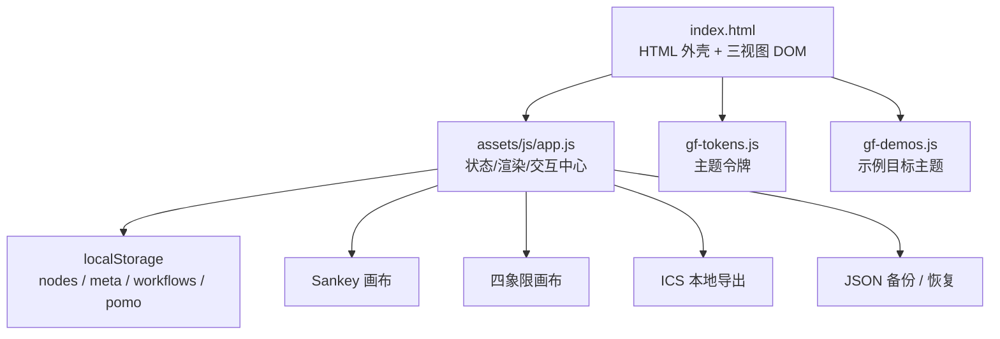
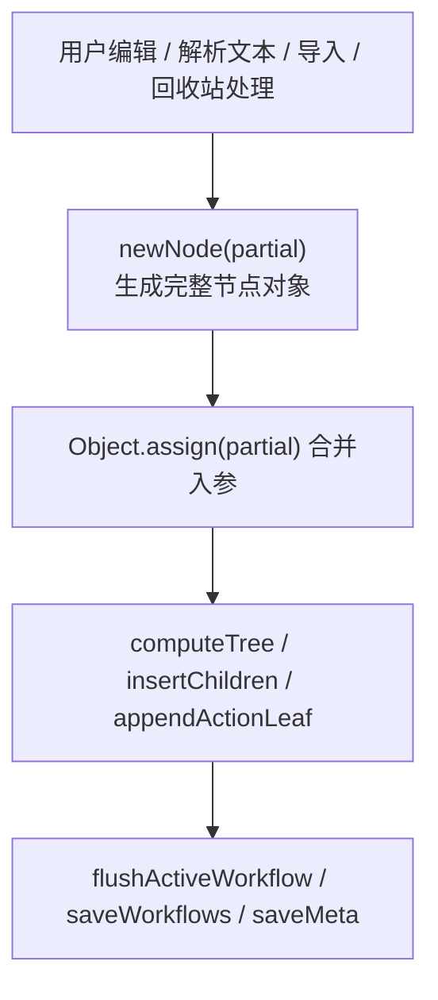
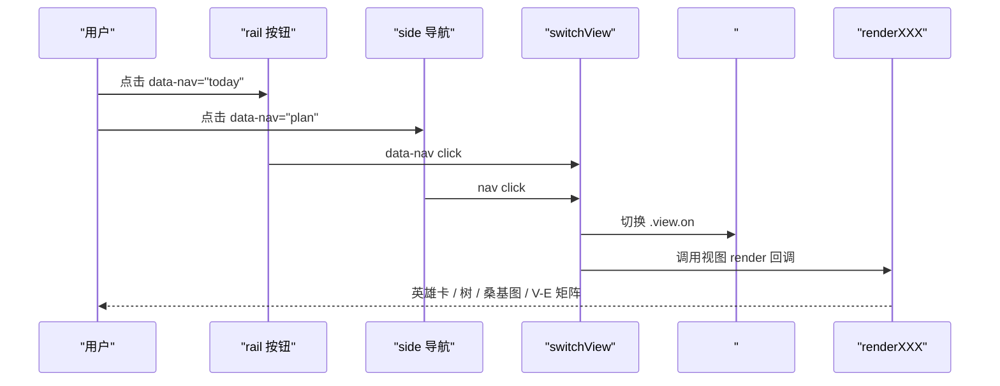
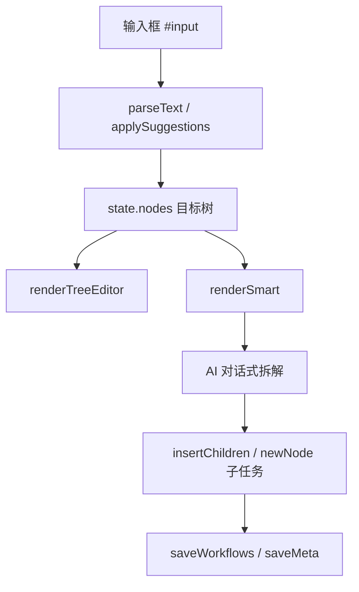
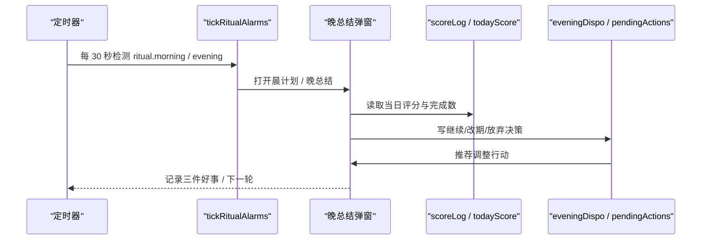
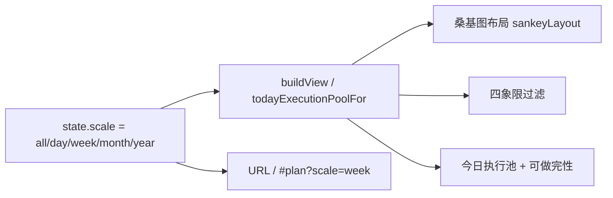
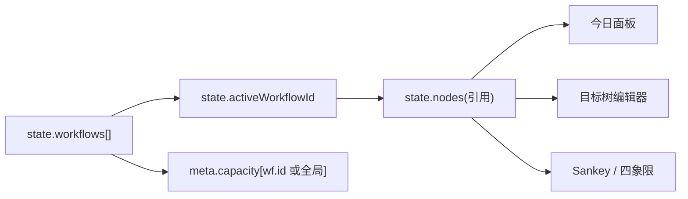
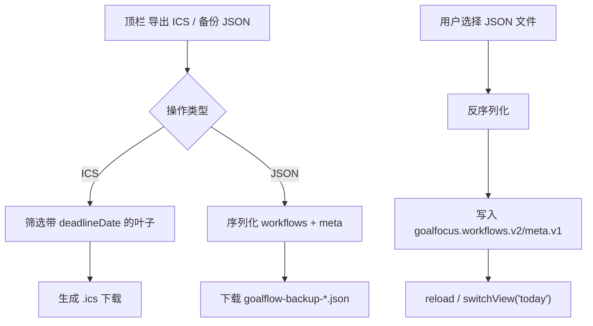

# 核心功能详解

<cite>
**本文引用的文件**   
- [index.html](file://index.html)
- [README.md](file://README.md)
- [openmemory.md](file://openmemory.md)
- [assets/js/app.js](file://assets/js/app.js)
</cite>

## 目录
1. [引言](#引言)
2. [项目结构与总体架构](#项目结构与总体架构)
3. [状态模型与数据来源](#状态模型与数据来源)
4. [三视图总览](#三视图总览)
5. [☀ 今日行动](#今日行动)
6. [🎯 目标规划](#目标规划)
7. [📊 归纳洞察](#归纳洞察)
8. [仪式化工作流](#仪式化工作流)
9. [多维度时间轴缩放](#多维度时间轴缩放)
10. [多工作区与标签筛选](#多工作区与标签筛选)
11. [ICS 日历导出与 JSON 备份恢复](#ics-日历导出与-json-备份恢复)
12. [开发者实现提示](#开发者实现提示)
13. [常见故障排查](#常见故障排查)
14. [结论](#结论)

## 引言
GoalFlow（目标流）是一个纯本地、无需构建的时间管理应用。用户把年度目标或计划文本粘贴进去，系统会把它解析成目标树，自动画出桑基精力图，并用“重要度 × 期限临近”等算法给出每天唯一最重要任务。所有数据只存储在浏览器 `localStorage`；LLM 能力基于用户自己在页面填入的 DeepSeek API Key。

从产品视角，工具按三视图组织：
- ☀ 今日行动：英雄卡 MIT、Top3、Backlog、番茄钟、每日评分。
- 🎯 目标规划：自由文本输入、Smart 体检、对话式拆解、目标树维护、期限与估算设置。
- 📊 归纳洞察：桑基图、V/E 矩阵、精力曲线、时间审计、计划谬误校准、停滞预警。

**章节来源**
- [README.md:9-103](file://README.md#L9-L103)

## 项目结构与总体架构
| 路径 | 职责 |
|---|---|
| `index.html` | 应用 HTML 壳层，包含左导航、侧栏、顶部操作区和三个视图区域。 |
| `assets/css/main.css` | 全局样式，未在本文档深入展开。 |
| `assets/js/gf-tokens.js` | 主题 Token，供 CSS 与 app.js 共用。 |
| `assets/js/gf-demos.js` | 10 个示例目标主题的数据源。 |
| `assets/js/app.js` | 全部应用逻辑：状态、渲染、事件、评分、仪式、图表、导入导出。 |



**图表来源**
- [index.html:1-120](file://index.html#L1-L120)
- [assets/js/app.js:4320-4450](file://assets/js/app.js#L4320-L4450)
- [assets/js/app.js:6110-6165](file://assets/js/app.js#L6110-L6165)

**章节来源**
- [index.html:1-120](file://index.html#L1-L120)
- [README.md:85-103](file://README.md#L85-L103)
- [openmemory.md:5-18](file://openmemory.md#L5-L18)

## 状态模型与数据来源
GoalFlow 的核心数据结构分为四类：节点树 `state.nodes`、元数据 `state.meta`、工作区集合 `state.workflows` 和番茄钟状态 `state.pomo`。

| 字段组 | 说明 | 关键子字段与行为 |
|---|---|---|
| `state.nodes` | 当前工作区的目标树镜像，含父级 `_children`、叶子与分支结构。 | `text/im/ur/val/eff/slot/scale/doneAt/touchedAt/estimateMinutes/actualMinutes/ifThen/premortem/status/waitNote/conf/confAt/createdAt/source/dropped/targetNum/targetDone/timesPerWeek/_manualIm/_manualUr` |
| `state.meta` | 非任务数据：评分、能量日志、仪式配置、回顾、inbox、待确认调整、上周回写、备份信息、计划分享比例等。 | `scoreLog/dayNotes/ritual/pendingActions/weekPlans/energyLog/inbox/planShare/eveningDispo/goodThings/dailyCompletions/lastBackupAt/onboarded/...` |
| `state.workflows` | 多工作区：每个区有 `id/name/tags[]/startDate/endDate/description/color/nodes/topId`，对应一个目标流。 | `state.activeWorkflowId` 决定当前可见的 `state.nodes`。 |
| `state.pomo` | 番茄钟运行状态。 | 通常包含绑定节点、剩余毫秒、是否运行等运行时字段。 |

持久化键值约定由 `app.js` 定义：
- 主工作区节点数据：`goalfocus.v4`（或通过 `STORAGE.nodes` 覆盖）。
- 旧版单树：`goalfocus.v3`。
- 元数据：`goalfocus.meta.v1`。
- 工作区：`goalfocus.workflows.v2`，并双写镜像到 `goalfocus.workflows.bak`。
- LLM Key：`gf_llm_key`。

新增节点的统一入口是工厂函数，避免手写分散字面量导致字段遗漏。



**图表来源**
- [assets/js/app.js:388-520](file://assets/js/app.js#L388-L520)
- [openmemory.md:13-16](file://openmemory.md#L13-L16)
- [openmemory.md:67-88](file://openmemory.md#L67-L88)

**章节来源**
- [assets/js/app.js:15-21](file://assets/js/app.js#L15-L21)
- [assets/js/app.js:388-520](file://assets/js/app.js#L388-L520)
- [openmemory.md:5-18](file://openmemory.md#L5-L18)
- [openmemory.md:67-88](file://openmemory.md#L67-L88)

## 三视图总览
页面通过左侧图标轨和侧栏按钮在四个入口间切换：**今日行动**、**目标规划**、**归纳洞察**、**AI 分析**。路由同时支持深链 `#/today`、`#/plan`、`#/insights`，并可接受 `all/day/week/month/year` 直接跳转到洞察并按尺度重绘。



**图表来源**
- [index.html:12-100](file://index.html#L12-L100)
- [assets/js/app.js:4320-4450](file://assets/js/app.js#L4320-L4450)
- [assets/js/app.js:6110-6165](file://assets/js/app.js#L6110-L6165)

**章节来源**
- [index.html:12-100](file://index.html#L12-L100)
- [assets/js/app.js:4320-4450](file://assets/js/app.js#L4320-L4450)

## ☀ 今日行动
### 用户入口
- 默认主页：左侧图标轨 ☀。
- 顶部面包屑显示当前版块名称。
- 今日面板内部有折叠区：“今日状态”“需要关注”“备选与 Backlog（聚焦清单）”。

### 操作流程
1. 先有目标数据：在“目标规划”中粘贴文本、载入示例或完成 Smart 对话后生成的子任务。
2. 打开“今日行动”，看到 **英雄卡 MIT**，即系统选出最重要的叶节点。
3. 执行清单按照时段分组；无法安排或暂不做的进入 “📥 收件箱” 或 Backlog。
4. 对叶节点勾选完成、拖放到时段列、填写预估/实计时长、标记“习惯”。
5. 使用 Top3 与“立即做 / 核心投入”聚焦。
6. 启动番茄钟；25 分钟完成后自动加分。
7. 查看底部“今日状态”，包括容量、评分、时间审计摘要；以及“需要关注”中的备份提醒、倦怠预警、停滞预警、暂停任务条。

### 数据结构映射
| 用户界面元素 | 数据映射 | 计算逻辑 |
|---|---|---|
| 英雄卡 | `pickHeroTop(vis, top8)` | `focusScoreParts` 分解来源；习惯节点不参与竞选唯一 MIT。 |
| Top3 | `pickRanked(vis, 3)` | 按 `focusScore`、重要度、剩余天数排序。 |
| 可排日任务池 | `todayExecutionPoolFor(scale)` | 排除等待/阻塞节点，累计估时超过日容量时进入 `_overflow` 不下屏。 |
| Backlog | 过去周期未完成 + 下月预告 | 不进入 Top3，用于降级展示。 |
| 勾选项 | `node.done`、`node.doneAt` | 完成时写入 executionLog、当日评分、习惯 streak、完成率。 |
| 时段 | `node.slot`（h0–h6） | 时段列提供 `.drop-slot`，MIT 与行内任务均可钉时段。 |
| 每日容量 | `DAY_CAPACITY_MIN`（默认 480 分钟） | 可结合 `capacitySettings()` 周/小时预算影响更大范围预测。 |
| 自动评分 | `meta.scoreLog[dk].entries` | `scoreDoneItem`、`scorePomoItem` 按重要度、期限、估/实、习惯计分。 |
| 每日总评分 | `todayScore().total` | S/A/B/C 等级来源于总分阈值。 |
| 番茄钟进度 | `state.pomo` | 运行计时器 + `renderPomoBar()` + 页面顶部金色进度线。 |

```mermaid
sequenceDiagram
    participant UI as "今日面板"
    participant Pool as "todayExecutionPoolFor()"
    candidate as "pickRanked()"
    Hero as "renderHero() / pickHeroTop()"
    Score as "appendScore()"
    State as "meta.scoreLog / state.nodes"

    UI->>Pool: 获取可排任务池
    Pool-->>candidate: 返回候选节点
    candidate->>Hero: Top3 与排名
    Hero-->>UI: 英雄卡 MIT + 评分分解
    UI->>State: 勾选 / 完成
    State->>Score: scoreDoneItem 追加条目
    Score-->>State: 保存 scoreLog
    State-->>UI: 刷新 todayScore
```

**图表来源**
- [assets/js/app.js:597-663](file://assets/js/app.js#L597-L663)
- [assets/js/app.js:3147-3395](file://assets/js/app.js#L3147-L3395)
- [assets/js/app.js:3982-4080](file://assets/js/app.js#L3982-L4080)
- [assets/js/app.js:6073-6100](file://assets/js/app.js#L6073-L6100)

**章节来源**
- [index.html:66-130](file://index.html#L66-L130)
- [assets/js/app.js:385-390](file://assets/js/app.js#L385-L390)
- [assets/js/app.js:597-663](file://assets/js/app.js#L597-L663)
- [assets/js/app.js:2773-2775](file://assets/js/app.js#L2773-L2775)
- [assets/js/app.js:4085-4320](file://assets/js/app.js#L4085-L4320)
- [openmemory.md:27-39](file://openmemory.md#L27-L39)
- [openmemory.md:61-67](file://openmemory.md#L61-L67)

## 🎯 目标规划
### 用户入口
- 左侧图标轨 🎯 或侧栏“目标规划”。
- 顶部顶栏“更多 → 设置”用于时间预算与工作区相关设置。

### 操作流程
1. 在“输入目标（自由文本）”区粘贴文本或编号列表。
2. 系统自动识别缩进层级、日期词（如“周五前”“本周内”“3月15日”）、频率词（如“每天”“每周”），以及预估时长表达。
3. 点击“解析并生成”生成目标树；也可选择下拉中的示例主题点“载入示例”。
4. 在“树形维护 · 内联编辑”中：
   - 修改文本，重新推断 im/ur/scale/recur/estimated 等字段；
   - 手动设重要度与紧急度；
   - 设置期限、估算分钟、实际完成分钟、时间段；
   - 写执行意图（WOOP）、事前验尸、信心评分；
   - 拖拽换父节点。
5. 在 SMART 体检中看目标是否具体、可衡量、有期限、相关、可实现；可通过“对话式拆解”调用 DeepSeek 助手补充子步骤，再一键生成子任务。

### 数据结构映射
| 功能 | 字段 / 位置 | 行为 |
|---|---|---|
| 自由文本解析 | `parseText`、`applySuggestions` | 创建 `newNode`，推断 deadline、scale、recur、estimate、metrics。 |
| 期限解析 | `parseDeadline` | 识别“今天/明天/下周一/3月15日/本月/本周内/第X周”等。 |
| 时间尺度 | `inferScale`、`node.scale` | 由文本词、deadline.daysLeft、是否有子节点推断 day/week/month/year。 |
| 重复与频率 | `node.recur`、`node.timesPerWeek` | 匹配“每天/每周 N 次”等语义。 |
| 估算分钟 | `node.estimateMinutes`、`node.actualMinutes` | 可从文本解析 `X分钟/X小时` 或手工设置。 |
| 四象限 | `node.im`、`node.ur`、`_manualIm`、`_manualUr` | 拖四象限或树内输入；后续建议不再覆盖手动值。 |
| SMART | `panelSmart`、`renderSmart` | 指标进度、期限节奏、经验不足告警、事前验尸卡片。 |
| 对话式拆解 | LLM 配置 + AI 视图 | 根据 DeepSeek API Key 发起请求，返回结构化步骤，再生成子节点。 |
| 树维护 | `renderTreeEditor`、拖拽换父 | 更新 parent、重算 tree、同步顶层文本框。 |



**图表来源**
- [index.html:120-180](file://index.html#L120-L180)
- [assets/js/app.js:388-520](file://assets/js/app.js#L388-L520)
- [assets/js/app.js:4356-4711](file://assets/js/app.js#L4356-L4711)
- [openmemory.md:40-50](file://openmemory.md#L40-L50)

**章节来源**
- [index.html:120-180](file://index.html#L120-L180)
- [assets/js/app.js:388-520](file://assets/js/app.js#L388-L520)
- [assets/js/app.js:4356-4711](file://assets/js/app.js#L4356-L4711)
- [openmemory.md:40-50](file://openmemory.md#L40-L50)

## 📊 归纳洞察
### 用户入口
- 左侧图标轨 📊 或侧栏“归纳洞察”。
- 切到洞察视图时会优先触发 Sankey 或 Quadrant 重绘。
- 多维度缩放控制通常在顶部缩放条或 URL 片段中以 `#plan?scale=week` 等形式传入。

### 主要可视化
| 可视化 | 用途 | 数据来源 | 用户行为 |
|---|---|---|---|
| 桑基图 | 看见整年精力流向与错配 | `state.nodes` + scale 过滤后的任务集 | 切换 year/month/week/day；聚焦模式；切换 sankey/network/kanban/heatmap/calendar/mindmap 视图。 |
| V/E 矩阵 | 快速赢 vs 陷阱 | `node.val`、`node.eff` | 拖拽调整价值与费力；显示“⚡快速赢”筛选。 |
| 精力曲线 | 上午/下午/晚上三段五级打卡，生成近 14 天高峰 | `state.meta.energyLog` | 每段五级打分；建议将高难度任务排到高峰时段。 |
| 时间审计 | 近 7 天 plan vs actual，按工作区/象限聚合 | `executionLog` 及节点 im/ur | 查看偏差系数；一键缓冲今日预估。 |
| 计划谬误校准 | 计划超支 / 对齐率趋势 | `meta.planShare` | 顶部英雄卡旁横条对比计划与实际。 |
| 停滞预警 | 7 天无动静的中高重要性叶子 | touchedAt / createdAt + im | 提示“激活到今日”，进入今日关注区。 |

```mermaid
classDiagram
    class Node {
        +string id
        +string text
        +number im
        +number ur
        +number val
        +number eff
        +string scale
        +string slot
        +number deadlineDate
        +boolean done
        +number estimateMinutes
        +number actualMinutes
    }

    class Meta {
        +object scoreLog
        +object energyLog{dk}
        +array inbox
        +object weekPlans
        +object planShare
        +object eveningDispo
        +object goodThings
    }

    class Visualization {
        +renderCanvas()
        +renderQuadrant()
        +renderVeMatrix()
        +renderTimeAudit()
        +renderTodayStale()
    }

    Node <.. Visualization : "读节点树与属性"
    Meta <.. Visualization : "读评分/能量/复盘日志"
```

**图表来源**
- [assets/js/app.js:557-663](file://assets/js/app.js#L557-L663)
- [assets/js/app.js:1949-2352](file://assets/js/app.js#L1949-L2352)
- [assets/js/app.js:2637-2771](file://assets/js/app.js#L2637-L2771)
- [assets/js/app.js:2847-3146](file://assets/js/app.js#L2847-L3146)

**章节来源**
- [index.html:180-230](file://index.html#L180-L230)
- [assets/js/app.js:1949-2352](file://assets/js/app.js#L1949-L2352)
- [assets/js/app.js:2637-2771](file://assets/js/app.js#L2637-L2771)
- [assets/js/app.js:2847-3146](file://assets/js/app.js#L2847-L3146)
- [openmemory.md:52-61](file://openmemory.md#L52-L61)

## 仪式化工作流
GoalFlow 的仪式不是简单表单，而是把认知动作固化到早/晚/周的时间点上。

| 仪式 | 入口 | 触发时机 | 用户流程 | 数据映射 |
|---|---|---|---|---|
| 晨计划 | 侧栏“🌅 晨计划”、今日闹钟条 | 定时检查（`tickRitualAlarms`）+ 手动打开 | 对齐 MIT、今日容量、待办、WoOP 预案缺失；可从前一晚预选结果中选“就是它”。 | `state.meta.ritual.morning`、`tomorrowMit`、`pendingActions`、`ifThen`。 |
| 晚总结 | 侧栏“🌙 晚总结”、今日闹钟条 | 21:30 左右（可配置） | 汇总得分、未完成项、可继续/改期/放弃；收尾记“三件好事”。 | `meta.scoreLog[dk]`、`eveningDispo`、`goodThings[dk]`。 |
| 周计划 | 侧栏“🗓 周计划” | 建议周一早提醒；也可手动开启 | 从跨流高重要度叶子选 ≤5 块“大石头”，挂到“今日行动”顶部。 | `meta.weekPlans[wk].rocks[]`。 |
| 周回顾 | 侧栏“◔ 周回顾”、“顶栏 → 回顾” | 当“需要关注”中出现缺少周回顾提示 | 查看本周完成叶子、金线动静、核心 vs 救火计数；生成下一步调整，成为“待确认”行动。 | `pendingActions`、period rollup 统计。 |
| 三件好事 | 晚总结弹窗 | 晚总结结尾 | 写三个积极时刻，作为一天结束的记忆锚点。 | `meta.goodThings[dk][0..2]`。 |



**图表来源**
- [assets/js/app.js:246-388](file://assets/js/app.js#L246-L388)
- [assets/js/app.js:4055-4080](file://assets/js/app.js#L4055-L4080)
- [openmemory.md:46-61](file://openmemory.md#L46-L61)
- [openmemory.md:61-67](file://openmemory.md#L61-L67)

**章节来源**
- [index.html:38-98](file://index.html#L38-L98)
- [assets/js/app.js:246-388](file://assets/js/app.js#L246-L388)
- [assets/js/app.js:4055-4080](file://assets/js/app.js#L4055-L4080)
- [openmemory.md:46-67](file://openmemory.md#L46-L67)

## 多维度时间轴缩放
时间轴缩放贯穿 Sankey、四象限、聚焦清单和“今天能做完”的判断。缩放粒度是 **年 → 月 → 周 → 日**，而不是四个互斥视图。

| 尺度 | 说明 | 对用户的影响 | 相关逻辑 |
|---|---|---|---|
| year | 年度概览 | 看全年 12 个月精力扎堆情况、主干方向。 | `SCALES`、`SCALE_LABEL`、year 过滤。 |
| month | 月度节奏 | 看清哪些月份负荷过高，哪些长期目标被延迟。 | `inferScale` 对“每月/今年/长期”等词响应。 |
| week | 本周节奏 | 本周重点可能与“今日重点”不同。 | 按周过滤、按周内时段聚合。 |
| day | 今日切片 | 今日可排任务池、MIT、时段槽位、估时溢出判断。 | `dayCap()`、`DAY_CAPACITY_MIN`、slot h0–h6。 |
| all | 当下不分维度 | 展示当前所有活跃任务池，便于全局审视。 | 用于 Sankey 关系视图下的“当下”模式。 |



**图表来源**
- [assets/js/app.js:22-31](file://assets/js/app.js#L22-L31)
- [assets/js/app.js:498-520](file://assets/js/app.js#L498-L520)
- [assets/js/app.js:4325-4345](file://assets/js/app.js#L4325-L4345)
- [assets/js/app.js:6490-6505](file://assets/js/app.js#L6490-L6505)

**章节来源**
- [assets/js/app.js:22-31](file://assets/js/app.js#L22-L31)
- [assets/js/app.js:498-520](file://assets/js/app.js#L498-L520)
- [assets/js/app.js:4325-4345](file://assets/js/app.js#L4325-L4345)
- [assets/js/app.js:6490-6505](file://assets/js/app.js#L6490-L6505)

## 多工作区与标签筛选
GoalFlow 不只是多页签，而是用 `state.workflows` 表示多个独立目标流，每个流有自己的节点树、起止时间、描述、颜色与标签。

- 侧栏顶部“目标流”区域承载工作区列表。
- 选中某个工作区后，其 `nodes` 成为当前 `state.nodes`。
- 工作区可以像手风琴一样同时展开，显示标签、时间段、叶子进度、今日待办数等摘要。
- 每个工作区还可单独配置时间预算；在全局工作日/周末工时模式下，其他项目的占用会从当前项目配额中扣除。

| 工作区概念 | 数据结构 | 用户表现 |
|---|---|---|
| 工作区 ID | `wf.id` | 标签、项目设置、计划分享比例隔离。 |
| 当前工作区 | `state.activeWorkflowId` | 决定加载哪个 nodes。 |
| 当前树 | `state.nodes` | 渲染树、Sankey、四象限、今日池都基于当前 tree。 |
| 起止时间 | `wf.startDate/endDate` | 决定“本月/本季/本周期”统计窗口。 |
| 标签 | `wf.tags[]` | 辅助跨项目分类与筛选（以项目为单位）。 |



**图表来源**
- [assets/js/app.js:90-150](file://assets/js/app.js#L90-L150)
- [assets/js/app.js:6094-6241](file://assets/js/app.js#L6094-L6241)
- [openmemory.md:8-16](file://openmemory.md#L8-L16)

**章节来源**
- [assets/js/app.js:90-150](file://assets/js/app.js#L90-L150)
- [assets/js/app.js:6094-6241](file://assets/js/app.js#L6094-L6241)
- [openmemory.md:8-16](file://openmemory.md#L8-L16)

## ICS 日历导出与 JSON 备份恢复
### ICS 日历导出
- 入口：顶栏“更多 → 导出 ICS”。
- 规则：仅导出有有效 `deadlineDate` 的叶节点。
- 产物：下载到本地的 `.ics` 日历文件，可导入手机/电脑日历。

### JSON 备份与恢复
- 备份入口：顶栏“💾 备份数据”，或在规划页输入区也提供“备份 JSON”。
- 恢复入口：顶栏“📂 恢复数据”，选择 JSON 文件。
- 存储键：
  - 工作区数据：`goalfocus.workflows.v2` + `goalfocus.workflows.bak`。
  - 元数据：`goalfocus.meta.v1`。
  - 兼容加载顺序：v2 → bak → v1 → 单树；异常时可参考诊断日志。
- 备份提醒：若超过 7 天未备份，“需要关注”区显示导出 JSON 的提示；最后一次备份时间保存在 `meta.lastBackupAt`。



**图表来源**
- [index.html:48-70](file://index.html#L48-L70)
- [assets/js/app.js:15-21](file://assets/js/app.js#L15-L21)
- [openmemory.md:8-16](file://openmemory.md#L8-L16)
- [openmemory.md:67-78](file://openmemory.md#L67-L78)

**章节来源**
- [index.html:48-70](file://index.html#L48-L70)
- [assets/js/app.js:15-21](file://assets/js/app.js#L15-L21)
- [openmemory.md:8-18](file://openmemory.md#L8-L18)
- [openmemory.md:67-78](file://openmemory.md#L67-L78)

## 开发者实现提示
以下按源码中“负责渲染/交互的逻辑位置”给出开发线索。注意：这些不是代码复制，而是定位扩展点的指引。

| 需求 | 主要文件位置 | 开发要点 |
|---|---|---|
| 三视图切换 | `index.html` rail / side 按钮；`assets/js/app.js` `switchView` | 保持 `data-nav` 与 `VIEWS` 一致；新视图需在 `VIEW_GROUP` 中注册 render 回调，并把视图 section 放在 `#main-scroll`。 |
| 英雄卡 MIT | `renderHero`、`pickHeroTop`、`focusScoreParts`、`focusScore` | 新评分因素要加进 `focusScoreParts`，并在 `pickRanked` 排序策略中声明优先级。 |
| Top3 与聚焦清单 | `renderFocus`、`pickRanked(vis, 3)` | 不要破坏 Top3 与 Backlog 的去重关系；Backlog 不应进入 Top3。 |
| Backlog 泳道 | 今日面板渲染、Backlog 过滤逻辑 | Backlog 应由历史周期未完成任务与下月预告构成。 |
| 勾选完成 | `setNodeDone`、`appendExecutionLog`、`appendScore` | 勾选取消也要回滚评分与 habit streak，保证元数据一致性。 |
| 番茄钟 | `renderPomoBar`、番茄计时循环 | 开始/停止需读写 `state.pomo`；25 分钟完成后应触发评分与 `renderHero`。 |
| 每日总评分 | `todayScore`、`scoreDoneItem`、`scorePomoItem` | 新增评分来源时同时更新 S/A/B/C 阈值与 `renderTodayScore`。 |
| 目标解析 | `parseText`、`applySuggestions`、`newNode` | 扩展自然语言识别要在工厂字段范围内，避免跳过 `_manualIm/_manualUr`。 |
| SMART 体检 | `renderSmart`、AI 视图 | 对话式拆解依赖 DeepSeek Key，失败时需优雅降级。 |
| 目标树维护 | `renderTreeEditor`、拖拽换父 | 换父必须校验环、重新 `computeTree`，并可选同步顶层文本。 |
| 期限估算 | `parseDeadline`、`parseEstimateMinutes`、`ensureEstimate` | 新增时间词或单位要同时考虑 `daysLeft`、`overdue` 与 `scale` 推断。 |
| 时间审计 | `renderTimeAudit` | 审计基于 executionLog；新增维度要更新聚合 key。 |
| 精力曲线 | `renderEnergyWidget`、`energyCurve` | 能量桶为 am/pm/eve；建议与 `DAY_SLOTS` 中 slot 映射关联。 |
| 工作区与标签 | `renderWorkflowBar`、workflows 生命周期 | 新建工作区应初始化 nodes、topId、capacity；保留 active workflow 记忆。 |
| ICS / JSON | ICS 生成函数、JSON import/export 绑定 | ICS 只做 `deadlineDate` 叶子；JSON 恢复要处理新旧格式兼容性。 |
| 撤销与警告 | `showUndoToast`、`showToast` | 危险操作（删除、清空）前应快照 `state`，提供 10 秒撤销。 |

**章节来源**
- [assets/js/app.js:246-388](file://assets/js/app.js#L246-L388)
- [assets/js/app.js:385-520](file://assets/js/app.js#L385-L520)
- [assets/js/app.js:1949-2352](file://assets/js/app.js#L1949-L2352)
- [assets/js/app.js:2773-2850](file://assets/js/app.js#L2773-L2850)
- [assets/js/app.js:2915-3035](file://assets/js/app.js#L2915-L3035)
- [assets/js/app.js:3198-4711](file://assets/js/app.js#L3198-L4711)
- [assets/js/app.js:6047-6241](file://assets/js/app.js#L6047-L6241)

## 常见故障排查
| 症状 | 可能原因 | 排查建议 |
|---|---|---|
| 打开页面没有任务 | 首次为空白，需粘贴目标或选示例。 | 在“目标规划”中点击“载入示例”，或使用示例下拉。 |
| 切到“归纳洞察”图表不动 | 洞察视图可能隐藏了 Canvas 或需 rAF 重绘。 | 重新切回或触发 `renderCanvas/renderQuadrant`。 |
| 番茄钟倒计时停在后台后不走 | 浏览器冻结页面，唤醒时需要补跑计时 UI。 | 检查 `visibilitychange/pageshow/focus` 对应的唤醒逻辑并重绘 pomo。 |
| JSON 恢复后仍为空 | localStorage 键名损坏或浏览器缓存清除。 | 使用恢复功能重新导入备份；查看控制台诊断。 |
| 每日评分一直很低 | 未完成叶子或未开始番茄钟；习惯打卡次数不够。 | 完成至少一个叶子或 1 个完整番茄钟后刷新 `todayScore`。 |
| 某任务始终不成为 MIT | 可能被设为 waiting/blocked、是习惯节点、或估值较低。 | 检查 `status`、`waitNote`、`role === 'habit'`、`im/ur` 与 `deadline`。 |
| 时间审计无数据 | 尚未完成叶子，executionLog 为空。 | 先勾选完成一个任务，再刷新审计区。 |

**章节来源**
- [README.md:34-43](file://README.md#L34-L43)
- [assets/js/app.js:246-388](file://assets/js/app.js#L246-L388)
- [openmemory.md:54-61](file://openmemory.md#L54-L61)

## 结论
GoalFlow 的核心不是“又一个待办清单”，而是一条闭环：把一整年目标拆成树，让“当下最重要”自己发光；把计划变成可视的能量流向；再用番茄钟、完成打点、时间与精力审计把你拉回现实。  
对使用者而言，最重要的操作路径是：**贴目标 → 看 Sankey → 做 MIT → 勾完成 → 看今日评分**；  
对开发者而言，扩展的关键是守住三条线：**`state.nodes` 的节点工厂、`state.meta` 的评分/仪式日志、`assets/js/app.js` 中渲染与切换函数**。