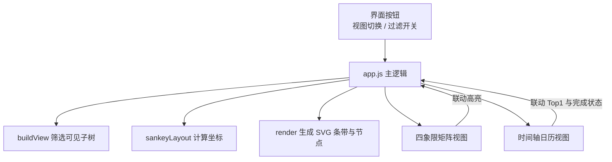
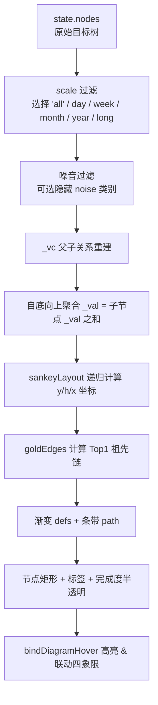
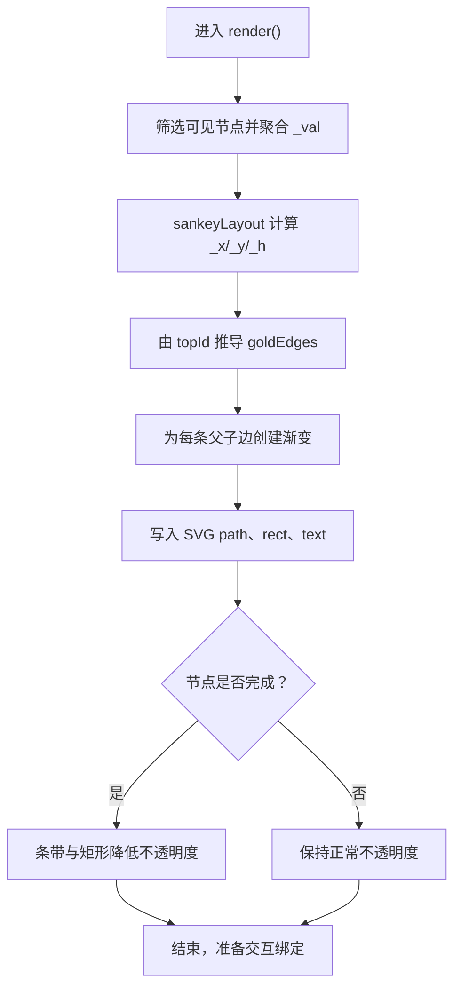
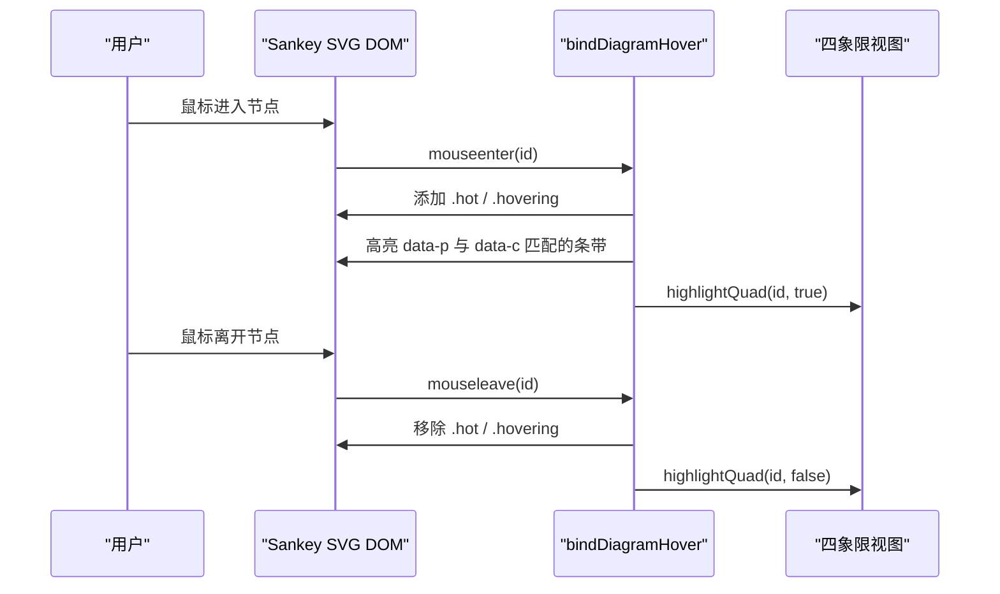
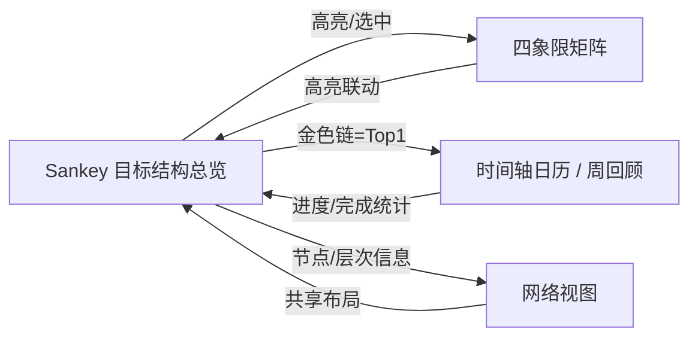
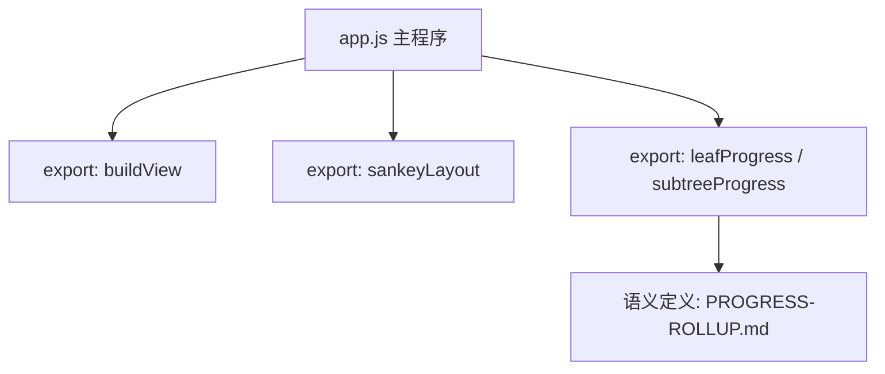

# 桑基图可视化引擎

<cite>
**本文引用的文件**   
- [app.js](file://assets/js/app.js)
- [PROGRESS-ROLLUP.md](file://docs/PROGRESS-ROLLUP.md)
</cite>

## 目录
1. [引言](#引言)
2. [项目结构定位](#项目结构定位)
3. [核心组件](#核心组件)
4. [架构总览](#架构总览)
5. [详细组件分析](#详细组件分析)
6. [依赖关系分析](#依赖关系分析)
7. [性能与可扩展性](#性能与可扩展性)
8. [故障定位指南](#故障定位指南)
9. [结论](#结论)
10. [附录：数据到视觉的对照表](#附录数据到视觉的对照表)

## 引言
本指南围绕 GoalFlow 应用中的“目标结构总览”视图展开，即 **Sankey（流式层级）可视化**。用户通过它理解“目标如何分层、重要性如何聚合、紧急性如何通过颜色表达”，开发者则通过 `buildView`、`sankeyLayout`、`render` 等函数扩展新指标和主题色。本文强调三个事实：

- “条带宽度代表重要性”，“颜色代表紧急性”，“金色表示 Top1 目标链”。
- “完成度”不直接决定 Sankey 的宽度；宽度来自目标重要度树，完成度影响条带透明度与边框高亮。
- `leafProgress` / `subtreeProgress` 是权威进度语义来源，其规则定义在 `docs/PROGRESS-ROLLUP.md`，实现集中在 `assets/js/app.js`。

面向初学者：本文先说“宽度是谁、颜色归谁、金色指哪条目标链”。面向开发者：每个绘制阶段都给出源码路径与可调用接口。

**本节未直接分析具体代码行。**

## 项目结构定位
GoalFlow 是一个单页应用，核心脚本入口为 `assets/js/app.js`；`docs/PROGRESS-ROLLUP.md` 定义叶子节点完成进度的业务语义；其余 HTML、CSS、demos 提供视图外壳和示例数据。Sankey 引擎没有独立文件，而是以一组纯函数+事件绑定形式嵌入主脚本中。



**图表来源**
- [app.js:1171-1221](file://assets/js/app.js#L1171-L1221)
- [app.js:2380-2560](file://assets/js/app.js#L2380-L2560)
- [app.js:6441-6495](file://assets/js/app.js#L6441-L6495)

**本节未直接分析具体代码行。**

## 核心组件
Sankey 引擎由五个协同函数构成：

| 函数 | 职责 | 输入 | 输出 / 副作用 | 关键路径 |
|---|---|---|---|---|
| `buildView(nodes, scale)` | 根据缩放尺度、是否显示噪音、聚焦模式，构建可视子树 | `state.nodes`、当前尺度 | 返回包含 `_vc`、`_val` 的可见数组，并缓存结果 | [buildView](file://assets/js/app.js#L1171-L1191)、[buildViewRaw](file://assets/js/app.js#L1192-L1205) |
| `sankeyLayout(vis)` | 递归放置层级节点，设置 `_y`、`_h`、`_x` | 已构建子树 | 返回最大深度 | [sankeyLayout](file://assets/js/app.js#L1205-L1221) |
| `render()` | 构造 SVG viewBox、defs、条带 `<path>`、节点矩形和文本，并绑定交互 | 全局 state | 改写 `diagram-svg` DOM | [render](file://assets/js/app.js#L2380-L2488) |
| `bindDiagramHover()` | 为 SVG 节点注册鼠标悬停，联动边高亮和四象限卡片 | SVG DOM 片段 | 增加 `.hot`、`.hovering` 类 | [bindDiagramHover](file://assets/js/app.js#L2757-L2776) |
| `highlightNode(id, on)` | 显式高亮指定节点及其关联边 | 节点 ID | 同步四象限高亮 | [highlightNode](file://assets/js/app.js#L2737-L2756) |

这四个部分形成一条标准流水线：**状态变化 → afterChange → render → buildView → sankeyLayout → 渲染 SVG → 绑定交互**。

**节来源**
- [app.js:1171-1221](file://assets/js/app.js#L1171-L1221)
- [app.js:2380-2488](file://assets/js/app.js#L2380-L2488)
- [app.js:2737-2776](file://assets/js/app.js#L2737-L2776)

## 架构总览
Sankey 不是简单树形列表，而是一条从“原始节点树”到“SVG 流带”的数据转换管道。



**图表来源**
- [app.js:1171-1205](file://assets/js/app.js#L1171-L1205)
- [app.js:1205-1221](file://assets/js/app.js#L1205-L1221)
- [app.js:2380-2488](file://assets/js/app.js#L2380-L2488)
- [app.js:2757-2776](file://assets/js/app.js#L2757-L2776)

该流程保证了：即使树很大，也只在真正改变视图时才重算；Sankey 布局基于不可变的 `vis` 数组，避免对原树重复破坏性赋值。

**本节未直接分析具体代码行。**

## 详细组件分析

### 一、数据到 SVG 的映射

#### 1. 可见性与父子关系：`buildView` / `buildViewRaw`
- 当 `scale === 'all'` 时，全部节点参与，但若未开启噪声显示且节点属于“不重要不紧急”类别，会被标记隐藏。
- 其他尺度会选取匹配 `node.scale` 的叶子，并保留它们的祖先链，用于维持上下文。
- 每次调用前，会为每个节点重置 `_vc` 和 `_hidden`。
- `_vc` 是从 `localById[parent.id]` 挂回的孩子数组。
- `_val` 是自底向上聚合的结果：叶子节点值为 `n.im`，分支节点值为所有子节点 `_val` 之和。

| 属性 | 数据来源 | 语义 |
|---|---|---|
| `_vc` | 重建 `parentId` 对应孩子数组 | 可视化层级关系 |
| `_val` | 叶子取重要度 `im`，分支求和 | 控制该分支条形高度 |
| `_hidden` | noise 类别过滤时使用 | 标记被过滤节点 |

**节来源**
- [app.js:1171-1191](file://assets/js/app.js#L1171-L1191)
- [app.js:1192-1205](file://assets/js/app.js#L1192-L1205)

#### 2. 坐标与形状：`sankeyLayout`
函数使用一次递归后扫描：

1. 若节点无孩子，用 `SY` 游标放置，高度至少为最小值，且与 `_val * UH` 成比例。
2. 若有孩子，递归放置后合并首尾坐标，得出父节点纵向区间。
3. 计算最大深度 `maxD`。
4. 将横坐标设为 `SX + depth × (NODEW + COLGAP)`。

| 字段 | 作用 |
|---|---|
| `n._x` | 第几层目标的水平位置 |
| `n._y` | 该目标条形起始纵坐标 |
| `n._h` | 该目标条形高度 |
| `maxD` | SVG 横向布局参考的最大层级深度 |

**节来源**
- [app.js:1205-1221](file://assets/js/app.js#L1205-L1221)

#### 3. 宽度、颜色与完成度
- **宽度 / 高度**：由 `_val` 控制。叶子节点的 `_val` 就是重要度 `im`；父节点把下属重要性相加。因此，“宽=重要性、深→浅按父子拆分”才是正确读法。
- **颜色分类**：由紧急度 `ur` 经 `urColor` 映射到调色板。根到叶的条带使用渐变连接父节点和子节点的紧急色。
- **Top1 金色链**：如果当前存在 `topId`，从该节点沿 `parentId` 回溯到根，构成 goldEdges；该链条上的边会用金色渐变和发光滤镜突出。
- **完成度表达**：`node.done` 不会改变 `_val` 或宽度；它会降低条带和节点矩形的不透明度，从而让已完成分支显得更淡。



**图表来源**
- [app.js:2380-2488](file://assets/js/app.js#L2380-L2488)
- [app.js:1171-1221](file://assets/js/app.js#L1171-L1221)

**节来源**
- [app.js:2380-2488](file://assets/js/app.js#L2380-L2488)
- [app.js:1205-1221](file://assets/js/app.js#L1205-L1221)

#### 4. 进度语义与 Rollup 规则的权威约定
`docs/PROGRESS-ROLLUP.md` 明确：

- 只有“叶子节点”计入完成进度。
- 叶子判定为：存在 `parentId` 且没有子节点。
- `leafProgress` 是全树叶子完成比；`subtreeProgress(n)` 是以 n 为根的叶子完成比。
- 根节点和中间层节点不贡献进度。
- 被“聚焦模式”隐藏但仍留在树中的节点，仍计入叶子统计。
- 勾选叶子写 `doneAt`，取消清掉；周回顾仅统计符合本周时间窗口的叶子。
- `estimateMinutes` / `actualMinutes` 不参与叶子完成百分比。

在 Sankey 上，这一语义表现为：

| 视觉维度 | 是否决定进度 | 说明 |
|---|---:|---|
| 条带宽度 | 否 | 由 `_val` = 重要性聚合决定 |
| 颜色 | 否 | 由紧急性 `ur` 决定 |
| 完成态不透明度 | 是 | 反映 `node.done`，但不改变宽度 |
| 顶栏百分比 / 周回顾 | 是 | 走 `leafProgress` / `subtreeProgress`，与 Sankey 宽度解耦 |

注意：虽然 Sankey 本身不按进度加权，但“指标进度”会在多处文案中使用 `metricProgress`，最终依赖 rollup 语义。

**节来源**
- [PROGRESS-ROLLUP.md:1-37](file://docs/PROGRESS-ROLLUP.md#L1-L37)
- [app.js:225-235](file://assets/js/app.js#L225-L235)
- [app.js:665-684](file://assets/js/app.js#L665-L684)

### 二、用户交互与重绘触发

Sankey 的主要交互包括高亮、视图切换、四象限联动、以及进度切换后的刷新。

#### 1. 鼠标悬停高亮
`bindDiagramHover` 为每个 SVG 节点元素绑定 mouseenter/mouseleave，行为如下：

- 给 SVG 容器加 `.hovering`，给当前节点组加 `.hot`。
- 查找与该节点相关的上游边 (`data-p=id`) 和下游边 (`data-c=id`)，加入 `.hot`。
- 调用 `highlightQuad` 联动四象限矩阵同名节点的高亮类。



**图表来源**
- [app.js:2737-2776](file://assets/js/app.js#L2737-L2776)

#### 2. 视图切换触发重绘
用户在“目标结构总览”和其他视图之间切换时，会修改 `state.viewMode`，然后调用 `renderCanvas()`。Sankey 的核心信息在这里体现：

- 视图标题提示“条带宽度 = 重要性 · 颜色 = 紧急性 · 金色 = Top1”。
- 选择框与按钮都会统一更新 `state.viewMode`，并把提示文案同步到界面。

**节来源**
- [app.js:2747-2776](file://assets/js/app.js#L2747-L2776)
- [app.js:6457-6495](file://assets/js/app.js#L6457-L6495)

#### 3. 完成度切换触发重绘
勾选叶子任务时，应用调用 `setNodeDone`，保存并触发 `afterChange`；之后 `render()` 会把完成节点的条带和矩形变为更低不透明度。

**节来源**
- [app.js:354-368](file://assets/js/app.js#L354-L368)
- [app.js:2633-2635](file://assets/js/app.js#L2633-L2635)
- [app.js:2430-2488](file://assets/js/app.js#L2430-L2488)

#### 4. 节点展开与折叠
当前 Sankey 的“展开/折叠”并不像文件夹那样动态插入删除节点。它采用“尺度过滤”来表达不同粒度：

- `scale === 'all'` 显示完整可见树。
- 其他尺度只保留处于该尺度的叶子及其祖先链。

此外，四象限矩阵中存在独立的 `_quadExpanded` Set，但该变量主要用于四象限卡片展开，不直接驱动 Sankey 的 DOM 增删。

**节来源**
- [app.js:1171-1205](file://assets/js/app.js#L1171-L1205)
- [app.js:2560-2600](file://assets/js/app.js#L2560-L2600)

### 三、与其他视图的联动关系

Sankey 作为“目标结构总览”，不是孤立模块。它与以下组件共享 `state.nodes`、`topId`、`scale`、焦点模式和完成状态。

| 视图 | 共用状态 | 联动方式 |
|---|---|---|
| 四象限矩阵 | `state.nodes`、`state.scale`、`topId`、完成状态 | `highlightNode` 同时点亮 Sankey 节点和四象限卡片 |
| 时间轴日历 | `leafProgress`、`subtreeProgress`、`doneAt`、`topId` | 周回顾统计依据 rollup 规则；日历展示可点击定位 Top1 |
| MIT 置顶 | `state.topId`、`goldEdges` | Sankey 通过金色链突出当前目标的主干 |
| 网络视图 | `state.nodes`、`scale` | 复用 `buildView` + `sankeyLayout`，改用点线结构 |



**图表来源**
- [app.js:2380-2560](file://assets/js/app.js#L2380-L2560)
- [app.js:2560-2776](file://assets/js/app.js#L2560-L2776)
- [app.js:6441-6495](file://assets/js/app.js#L6441-L6495)

**本节未直接分析具体代码行。**

## 依赖关系分析

Sankey 引擎对外暴露的关键符号已经由模块导出，便于测试和外部调用：



**图表来源**
- [app.js:6646-6655](file://assets/js/app.js#L6646-L6655)

内部关键依赖链：

| 函数 | 依赖 |
|---|---|
| `buildView` | 依赖 `category`、缩放尺度、noise 过滤 |
| `sankeyLayout` | 依赖 `buildView` 产出的 `_vc`、`_val` |
| `render` | 依赖 `buildView`、`sankeyLayout`、`urColor`、`topId` |
| `bindDiagramHover` | 依赖 `render` 创建的 SVG DOM 元素 |
| `highlightNode` | 依赖 SVG DOM、`highlightQuad` |

潜在循环依赖：无。Sankey 绘制位于单向数据流下游，不包含反向状态写入。

**节来源**
- [app.js:6646-6655](file://assets/js/app.js#L6646-L6655)
- [app.js:1171-1221](file://assets/js/app.js#L1171-L1221)
- [app.js:2380-2488](file://assets/js/app.js#L2380-L2488)
- [app.js:2737-2776](file://assets/js/app.js#L2737-L2776)

## 性能与可扩展性

### 1. 大型目标树的渲染策略
- `buildView` 带有按 `(scale, focus, showNoise, nodes.length, _tickN)` 组合键的缓存槽 `_viewSlot`，相同输入直接返回上次结果。
- `afterChange` 使用 `requestAnimationFrame` 防抖：高频状态变更只会触发一次渲染回调。
- Sankey 的 `_vc`、`_val` 是在本地 `vis` 数组上重建的临时结构，不会被误写回整个树。
- 空树路径直接清空 SVG 并返回，避免无用计算。

建议扩展时遵循以下约束：

1. 不要在布局过程中对 `state.nodes` 做二次遍历；优先使用 `buildView` 的输出。
2. 若新增指标，应进入 `buildView` 的数据准备阶段，而不是仅在 `render` 追加 DOM。
3. 若新增视图类型，复用 `buildView + sankeyLayout`，而非复制一遍树解析逻辑。

**节来源**
- [app.js:537-577](file://assets/js/app.js#L537-L577)
- [app.js:560-577](file://assets/js/app.js#L560-L577)
- [app.js:1171-1191](file://assets/js/app.js#L1171-L1191)
- [app.js:2380-2385](file://assets/js/app.js#L2380-L2385)

### 2. SVG DOM 管理
当前实现每次重新渲染时整段替换 SVG 内容：

```js
svg.innerHTML = defs + ribbons + nodesSvg;
```

优点是可读性强、避免复杂虚拟 DOM。缺点是在超大目标树下，DOM 字符串拼接和整体重建可能成为瓶颈。

可选优化方向：

- 将 `_vc`、`_val` 预先缓存，增量判断是否需要重建。
- 对条带和节点分别生成可复用的 key，再做局部更新。
- 对于只改进度不改结构的场景，跳过布局阶段。
- 控制单次渲染的最大节点数，超出后启用懒加载或分页展示。

这些是演进建议，当前仓库仍以简洁为主。

**节来源**
- [app.js:2485-2488](file://assets/js/app.js#L2485-L2488)
- [app.js:2530-2535](file://assets/js/app.js#L2530-L2535)

### 3. 主题与颜色扩展
- PALETTE_UR 默认取自 `GoalFlowTheme.PALETTE_UR`，Sankey 的紧急度色通过 `urColor(ur)` 索引调色板。
- CAT 定义四象限类别，但不直接控制 Sankey 的紧急色；Sankey 使用的是 `urColor` 映射。
- 如需新增主题色，建议在 `GoalFlowTheme.PALETTE_UR` 或 `COLORS.svgGlow` 等处注入。
- 如需新增业务指标，应在数据准备阶段接入 `buildView` 和进度计算。

**节来源**
- [app.js:1-20](file://assets/js/app.js#L1-L20)
- [app.js:6646-6655](file://assets/js/app.js#L6646-L6655)

## 故障定位指南

### 问题一：条带宽度异常

**现象**  
某个子节点看起来太宽、太窄，或与预期完成进度不一致。

**排查步骤**

1. 确认该节点是否为“叶子节点”：存在 `parentId` 且 `_children.length === 0`。
   - 参考：[PROGRESS-ROLLUP.md](file://docs/PROGRESS-ROLLUP.md#L1-L37)
2. 检查节点的 `im`（重要度）。Sankey 中叶子 `_val = im`，父节点 `_val` 是所有子节点之和。
   - 参考：[buildViewRaw](file://assets/js/app.js#L1192-L1205)
3. 如果启用了非全尺度显示，检查 `n.scale` 是否等于当前视图 `state.scale`。
   - 参考：[buildViewRaw](file://assets/js/app.js#L1192-L1205)
4. 检查节点是否被归入 noise 并被过滤掉：如果是，它会不在桑基图中，或透明度极低。
   - 参考：[buildViewRaw](file://assets/js/app.js#L1192-L1205)
5. 检查 `topId`：Top1 金色链不会影响宽度，但会影响条带颜色和透明度，容易误判。
   - 参考：[render](file://assets/js/app.js#L2380-L2488)

**结论**  
如果宽度不符合业务直觉，通常应调 `im` 而不是调 `n.done`。完成度只控制透明度，不负责宽度。

**节来源**
- [PROGRESS-ROLLUP.md:1-37](file://docs/PROGRESS-ROLLUP.md#L1-L37)
- [app.js:1192-1205](file://assets/js/app.js#L1192-L1205)
- [app.js:2380-2488](file://assets/js/app.js#L2380-L2488)

### 问题二：某些边丢失

**现象**  
父节点应该有一条连向子节点的条带，但没出现。

**排查步骤**

1. 确认渲染路径：Sankey 只对“有 `parentId`”的节点绘制条带。
   - 参考：[render](file://assets/js/app.js#L2410-L2445)
2. 查看父子映射：`buildViewRaw` 使用 `localById[n.parentId]._vc.push(...)` 恢复孩子数组。
   - 参考：[buildViewRaw](file://assets/js/app.js#L1200-L1205)
3. 检查父节点是否被噪音过滤：如果是 noise 且未开启噪声显示，则不会出现在 `vis`。
   - 参考：[buildViewRaw](file://assets/js/app.js#L1192-L1200)
4. 检查 `map[p.id]` 是否存在：若 parent 不存在于 `vis`，对应条带不会写入。
   - 参考：[render](file://assets/js/app.js#L2410-L2430)

**结论**  
边丢失通常是“父节点被过滤”或“scale 过滤导致父子不在同层集合”所致，不是随机渲染错误。

**节来源**
- [app.js:1192-1205](file://assets/js/app.js#L1192-L1205)
- [app.js:2410-2445](file://assets/js/app.js#L2410-L2445)

### 问题三：滚动卡顿

**现象**  
目标树很大时，勾选、切换视图、放大缩小后有明显卡顿。

**排查步骤**

1. 观察是否在高频触发 `afterChange`：每次状态改动都应经过 requestAnimationFrame 合并。
   - 参考：[afterChange](file://assets/js/app.js#L537-L577)
2. 检查是否因 `nodes.length` 发生变化导致 `buildView` 缓存失效。
   - 参考：[buildView](file://assets/js/app.js#L1171-L1191)
3. 确认是否频繁重建整个 SVG：当前实现整段替换 `svg.innerHTML`。
   - 参考：[render](file://assets/js/app.js#L2485-L2488)
4. 检查是否多次执行完整树排序或调度重算：如 `recomputeSchedule(state.nodes)`。
   - 参考：[多处 afterChange 调用](file://assets/js/app.js#L4260-L4533)
5. 对超大目标树建议：减少一次性渲染节点数、延迟渲染、或使用离屏 canvas 预览后再落到 SVG。

**结论**  
现有实现使用请求帧防抖和基本缓存，中等规模可用；极大树需要增量 DOM 和分批渲染。

**节来源**
- [app.js:537-577](file://assets/js/app.js#L537-L577)
- [app.js:1171-1191](file://assets/js/app.js#L1171-L1191)
- [app.js:2485-2488](file://assets/js/app.js#L2485-L2488)

### 问题四：完成进度不对

**现象**  
Sankey 看起来完成了很多，但顶栏百分比很低，或者周回顾统计异常。

**排查步骤**

1. 确认勾选的是“叶子节点”：存在 `parentId` 且 `_children.length === 0`。
   - 参考：[PROGRESS-ROLLUP.md](file://docs/PROGRESS-ROLLUP.md#L1-L37)
2. 检查 `setNodeDone` 是否正确设置了 `done` 和 `doneAt`。
   - 参考：[setNodeDone](file://assets/js/app.js#L354-L368)
3. 区分“Sankey 完成度视觉”与“rollup 进度百分比”：前者只影响不透明度，后者由 `leafProgress` / `subtreeProgress` 决定。
   - 参考：[leafProgress / subtreeProgress](file://assets/js/app.js#L665-L684)
4. 检查时长字段：`estimateMinutes` / `actualMinutes` 不参与叶子完成百分比。
   - 参考：[PROGRESS-ROLLUP.md](file://docs/PROGRESS-ROLLUP.md#L1-L37)
5. 核对 Focus 模式：被隐藏但仍在树中的节点仍然计入进度统计。
   - 参考：[PROGRESS-ROLLUP.md](file://docs/PROGRESS-ROLLUP.md#L1-L37)

**节来源**
- [PROGRESS-ROLLUP.md:1-37](file://docs/PROGRESS-ROLLUP.md#L1-L37)
- [app.js:354-368](file://assets/js/app.js#L354-L368)
- [app.js:665-684](file://assets/js/app.js#L665-L684)

## 结论
GoalFlow 的 Sankey 引擎是一组简洁、可读的函数管线：`buildView` 负责可见性和父子结构，`sankeyLayout` 负责坐标，`render` 负责 SVG 输出，`bindDiagramHover` 负责高亮联动。对用户而言，最关键的阅读约定是：

- **宽度 ≈ 重要性**
- **颜色 ≈ 紧急性**
- **金色 ≈ Top1 目标主干**
- **变淡 ≈ 已完成**

对开发者而言，最重要的扩展点是：

- 扩展主题色 → 调整 `GoalFlowTheme.PALETTE_UR` / `COLORS.svgGlow`。
- 扩展维度数据 → 接入 `buildView` 与 Sankey 布局前的节点预处理。
- 扩展视觉语义 → 重写 `render` 中渐变、透明度、高亮类命名，但不要动 `leafProgress` / `subtreeProgress` 的进度语义。

这种分工使“结构设计”“布局算法”“交互绑定”“进度计算”各司其职，既能服务初学者理解视觉语义，也能支撑开发者在不破坏 rollup 规则的前提下扩展新的指标与主题。

**本节未直接分析具体代码行。**

## 附录：数据到视觉的对照表

| 数据结构字段 | 视觉含义 | 何时生效 |
|---|---|---|
| `n.im` | 重要性，决定条带宽度 | `buildView` 计算 `_val` |
| `n.ur` | 紧急性，决定颜色 | `urColor` → `PALETTE_UR` |
| `node.done` | 节点完成，降低条带和节点不透明度 | `render` |
| `n.scale` | 所属尺度，用于 all/day/week/month/year/long 过滤 | `buildViewRaw` |
| `n.parentId` | 父子关系，决定条带起点 | `buildViewRaw` |
| `n._vc` | 可视化孩子列表 | `buildViewRaw` |
| `n._val` | 可视化权重，叶子=im，父=子之和 | `buildViewRaw` |
| `n._y` / `n._h` / `n._x` | Sankey 布局坐标 | `sankeyLayout` |
| `state.topId` | 当前最重要目标，产生金色祖先链 | `render` |
| `state.scale` | 当前可视化尺度 | `buildView` |
| `_showNoise` | 是否显示噪声类别 | `buildView` |
| `leafProgress()` / `subtreeProgress()` | 顶层或子树完成百分比 | 进度面板 / 周回顾 |

**节来源**
- [app.js:1171-1221](file://assets/js/app.js#L1171-L1221)
- [app.js:2380-2488](file://assets/js/app.js#L2380-L2488)
- [PROGRESS-ROLLUP.md:1-37](file://docs/PROGRESS-ROLLUP.md#L1-L37)