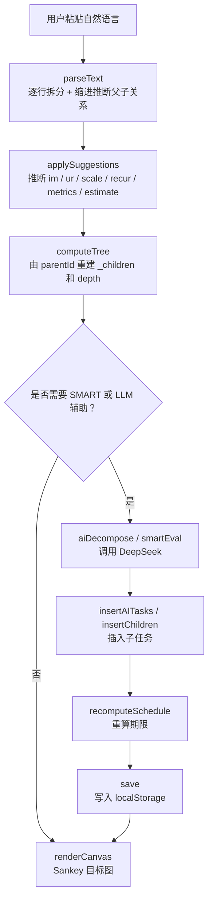
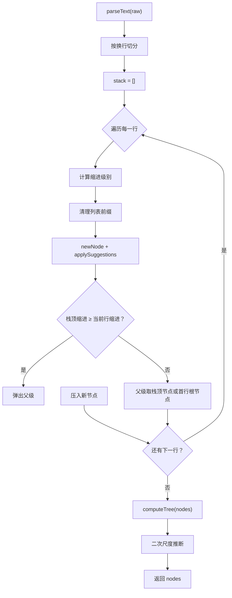
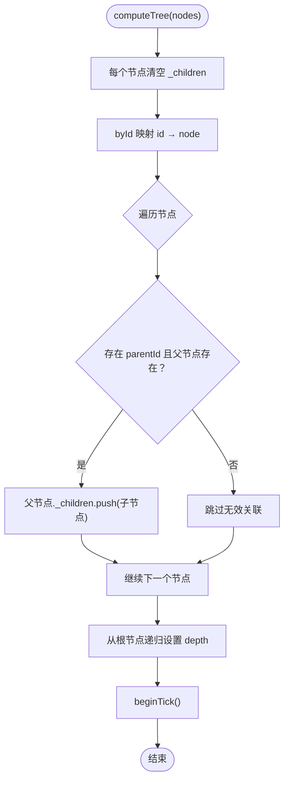
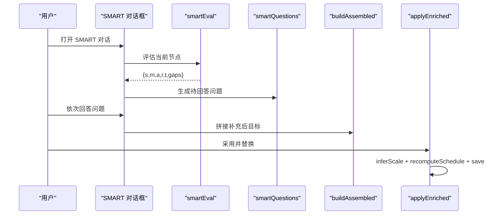
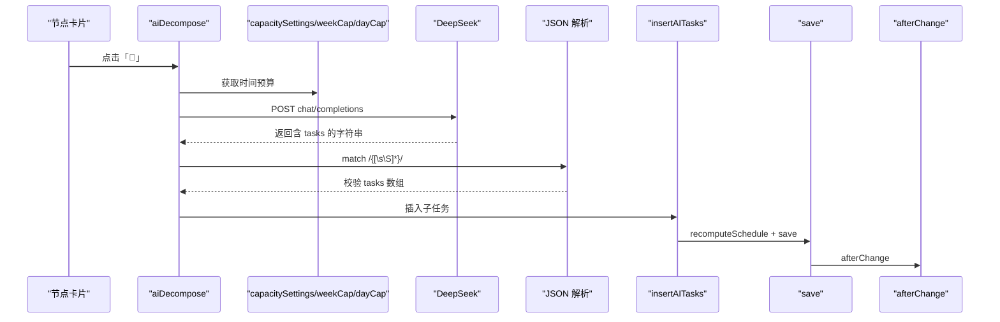
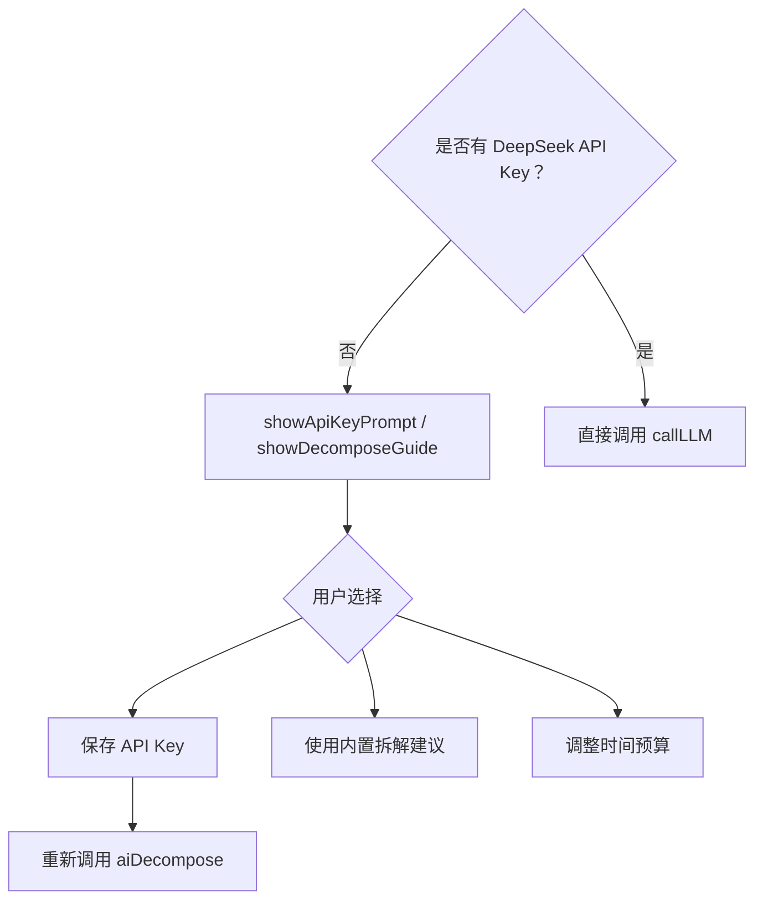
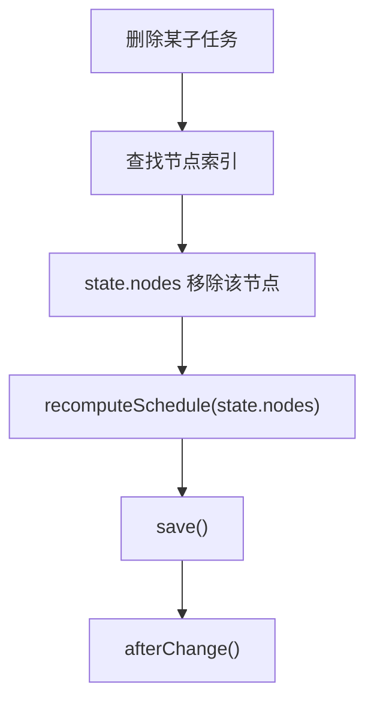
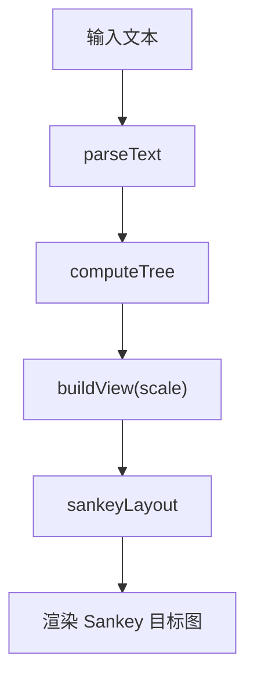
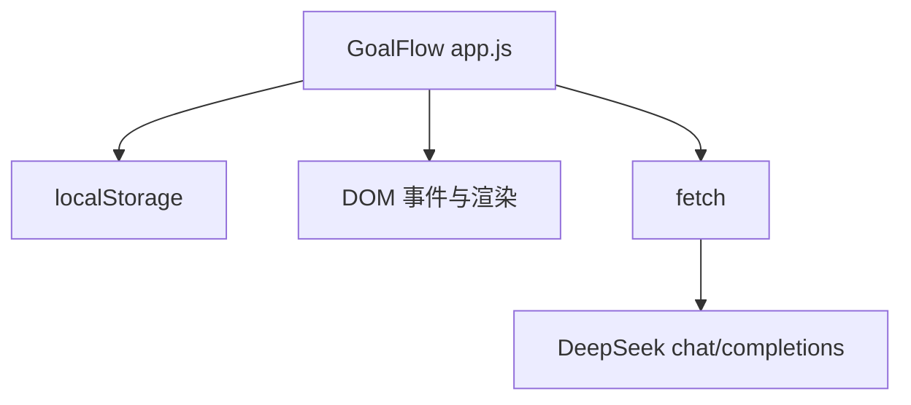
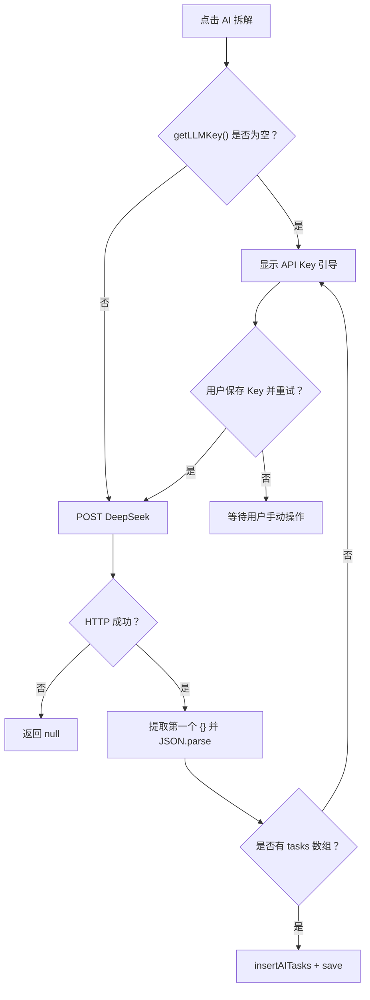

# 🎯 目标规划流程

<cite>
**本文引用的文件**   
- [assets/js/app.js](file://assets/js/app.js)
- [assets/js/gf-tokens.js](file://assets/js/gf-tokens.js)
</cite>

## 目录
1. [引言](#引言)
2. [总体架构与数据流](#总体架构与数据流)
3. [自然语言到树结构的解析管线](#自然语言到树结构的解析管线)
4. [Smart 体检提示机制](#smart-体检提示机制)
5. [对话式拆解与 DeepSeek LLM 集成](#对话式拆解与-deepseek-llm-集成)
6. [目标树的维护操作](#目标树的维护操作)
7. [期限、估算与 MIT/日程/评分的影响](#期限估算与-mit日程评分的影响)
8. [完整示例：一段自然语言 → Sankey 目标图](#完整示例一段自然语言-sankey-目标图)
9. [依赖关系分析](#依赖关系分析)
10. [性能特征](#性能特征)
11. [故障排查指南](#故障排查指南)
12. [结论](#结论)

## 引言
本文围绕 GoalFlow「目标规划」能力展开，覆盖以下五个关键问题：

- **自由文本输入 → node 数组**：粘贴自然语言后如何被拆成节点、父子关系和优先级标签。
- **解析器函数**：`parseText` 与 `computeTree` 的职责边界。
- **SMART 体检提示**：系统如何检查目标是否具体、可衡量、可达、相关、有期限，并给出建议。
- **对话式拆解**：配置 DeepSeek API Key 后，如何使用 LLM 把抽象目标逐层拆解为可执行子任务，以及返回结果如何落库并改变 `state.nodes`。
- **目标树维护**：新增子任务、重命名、提升/下沉、删除。
- **期限与估算**：`deadline`、`estimateMinutes`、`im`、`ur` 等属性对 MIT 选择、日程分配和评分的作用。
- **错误处理**：解析失败、LLM 无响应或层级异常时的排查方法。

本文所有实现细节均引用仓库中的 `assets/js/app.js`。

**Section sources**
- [assets/js/app.js:492-543](file://assets/js/app.js#L492-L543)
- [assets/js/app.js:683-910](file://assets/js/app.js#L683-L910)
- [assets/js/app.js:5071-5290](file://assets/js/app.js#L5071-L5290)

## 总体架构与数据流

GoalFlow 的目标规划不是单纯的 UI 组件，而是一个以内存中的节点数组为中心的数据处理管道：



核心变量与职责：

| 阶段 | 主要数据 | 主要行为 |
|---|---|---|
| 文本输入 | 原始字符串 | 按行切分、忽略空行、清理列表前缀 |
| 解析阶段 | 临时 node 数组 | 分配 id、text、parentId、source |
| 推理阶段 | node 的 im/ur/scale/recur/metrics/estimate | 应用默认值、正则规则、估算分钟数 |
| 建表阶段 | 带 `_children`、`depth` 的节点树 | 根据 parentId 构建父子关系 |
| AI 辅助 | 新的子任务数组 | 校验 JSON，写入 `state.nodes` |
| 持久化 | flat node 数组 + workflows | 同时写入主存储和 workflow 结构 |
| 渲染 | view 中的可见节点 | 根据尺度、噪音开关计算 Sankey 布局 |

**Section sources**
- [assets/js/app.js:492-543](file://assets/js/app.js#L492-L543)
- [assets/js/app.js:5251-5290](file://assets/js/app.js#L5251-L5290)
- [assets/js/app.js:1348-1443](file://assets/js/app.js#L1348-L1443)

## 自然语言到树结构的解析管线

### 第一步：parseText 解析
`parseText(raw, today)` 是整个流程的入口。它接收一段多行文本和一个可选的“今天日期”，然后完成三件事：

1. **行规范化**：按换行符分割，去除每行末尾空白，过滤空行。
2. **缩进驱动建树**：使用一个栈记录最近父级；每一行的缩进量决定该节点应该成为哪个祖先节点的子任务。
3. **初始父子关系确定**：首行通常被视为根节点；后续节点的父级是栈顶缩进更浅的那一层。

在创建每个节点时，它会调用内部逻辑去推断以下字段：

- `im`：重要性（1–5）
- `ur`：紧急性（1–5）
- `scale`：时间尺度，可选 `day`、`week`、`month`、`year`
- `recur`：是否为习惯或周期任务
- `timesPerWeek`：每周次数
- `estimateMinutes`：估计时长
- `metrics`：量化指标
- `source`：标记来源为解析输入

之后调用 `computeTree(nodes)` 正式建立 `_children` 和深度信息。随后做**二次尺度推断**：如果一个节点已经有子节点，就认为它是项目/阶段类节点，而不是叶子任务，因此会重新评估它的 `scale`。



**Diagram sources**
- [assets/js/app.js:492-511](file://assets/js/app.js#L492-L511)
- [assets/js/app.js:513-527](file://assets/js/app.js#L513-L527)

**Section sources**
- [assets/js/app.js:492-511](file://assets/js/app.js#L492-L511)
- [assets/js/app.js:513-527](file://assets/js/app.js#L513-L527)

### 第二步：computeTree 构建节点树
`computeTree(nodes)` 不负责理解业务语义，只负责把扁平数组变成可用的树形结构：

| 步骤 | 作用 |
|---|---|
| 初始化 `_children` | 把所有节点子列表清空，避免复用脏状态 |
| 构建 byId 索引 | 快速查找 parent 节点 |
| 追加子节点 | 如果存在有效 `parentId`，把它加入对应父级的 `_children` |
| 递归计算 depth | 从根节点开始向下赋予深度 |
| 开启 tick | 通过 `beginTick()` 触发后续渲染缓存失效 |

这一过程的时间复杂度大致是线性：**O(n)**，其中 n 是节点数量。



**Diagram sources**
- [assets/js/app.js:513-527](file://assets/js/app.js#L513-L527)

**Section sources**
- [assets/js/app.js:513-527](file://assets/js/app.js#L513-L527)

## Smart 体检提示机制

SMART 体检分为两个层次：**自动评估**和**交互式提问**。

### 自动评估
`smartEval(node)` 先检查是否已有 LLM 生成的评估对象 `node.smartEval`：

- 如果有，直接读取 `s`、`m`、`a`、`r`、`t`，取平均值生成结论。
- 如果没有，则用本地规则判断：

| 维度 | 判断方式 |
|---|---|
| S 具体 | 缺少明确动作或产出时会打低分；包含数字和较长描述会提高分数 |
| M 可衡量 | 包含数字、百分比、单位等关键词得高分 |
| A 可达 | 保持中性 |
| R 相关 | 重要度高的分支默认相关性更高 |
| T 有期限 | 显式 deadline 或明确周期表达式会加分 |

最终返回对象包括每项分数、平均分、缺失点列表、是否满足 SMART，以及是否来自 LLM。

### 交互式提问
`smartQuestions(node)` 根据评估缺失点生成引导问题，比如：

- 用什么指标判断达成？
- 什么时候完成？
- 具体要做什么、对谁做、产出是什么？
- 可以拆成哪几个小步骤？

用户在弹窗中回答后，系统会拼接成一个“补充后的目标”文本，供用户点击采用并替换原节点。



**Diagram sources**
- [assets/js/app.js:683-743](file://assets/js/app.js#L683-L743)
- [assets/js/app.js:5220-5250](file://assets/js/app.js#L5220-L5250)

**Section sources**
- [assets/js/app.js:683-743](file://assets/js/app.js#L683-L743)

## 对话式拆解与 DeepSeek LLM 集成

GoalFlow 提供两条对话式路径：

1. **单任务对话拆解**：对单个节点进行短期拆解建议。
2. **AI 智能拆解**：将某个目标分解为一个完整的可执行子任务树，并可进一步支持子任务嵌套。

### DeepSeek 调用约定

底层函数 `callLLM(system, user)` 固定调用 DeepSeek 在线接口：

| 项 | 值 |
|---|---|
| 接口地址 | `https://api.deepseek.com/chat/completions` |
| 模型名 | `deepseek-v4-flash` |
| 请求体字段 | `model`、`messages`、`temperature` |
| 消息角色 | system 固定提示词，user 传入目标上下文 |
| 返回值类型 | 字符串，需要前端再次匹配并解析 JSON |
| 超时或网络异常 | 返回 null |

Authorization Header 中包含保存的 API Key：

| 数据来源 | 键名 |
|---|---|
| 运行时变量 | `LLM_KEY` |
| localStorage | `gf_llm_key` |
| 主题令牌后备定义 | `STORAGE.llmKey` |

**Section sources**
- [assets/js/app.js:743-754](file://assets/js/app.js#L743-L754)
- [assets/js/app.js:18-22](file://assets/js/app.js#L18-L22)
- [assets/js/gf-tokens.js:145](file://assets/js/gf-tokens.js#L145)

### aiDecompose 主流程

`aiDecompose(nodeId)` 的核心流程如下：

1. 根据节点 ID 查找目标节点。
2. 获取时间预算：全局工作日/周末小时、每周可用总时长、本周已安排时长、剩余可用时长。
3. 组装用户上下文：目标文本 + 用户容量 + 本周计划情况。
4. 调用 `callLLM(AI_DECOMPOSE_SYSTEM, userContext)`。
5. 使用正则提取第一个 `{...}` JSON 片段。
6. 校验 `tasks` 是否为数组。
7. 如果校验通过，调用 `insertAITasks(parentId, tasks)`。
8. 如果失败或无法连接，显示降级引导界面。



**Diagram sources**
- [assets/js/app.js:756-837](file://assets/js/app.js#L756-L837)
- [assets/js/app.js:864-921](file://assets/js/app.js#L864-L921)

### insertAITasks：返回结果落库位置

`insertAITasks(parentId, tasks)` 是关键落库函数：

| 输出字段 | 写入节点属性 |
|---|---|
| `text` | `node.text` |
| `im` | `node.im`（限制 1–5） |
| `ur` | `node.ur`（限制 1–5） |
| `estimate` | `node.estimateMinutes`（限制 1–999） |
| `deadline` | `node.deadlineText` + `node.deadlineDate` |
| `timeSlot` | `morning→am`、`afternoon→pm`、`evening→eve`，存入 `node.slot` |
| `smart` | `node.smartEval`，字段 s/m/a/r/t 各限制 1–3 |
| `children` | 递归调用自身，最多两层 |

插入位置是父节点之后的相邻位置，并通过 `state.nodes.splice` 修改当前工作流的节点数组。之后调用：

1. `recomputeSchedule(state.nodes)`：重算 deadline。
2. `save()`：写入 localStorage。
3. `afterChange()`：触发 UI 刷新。
4. `warnIfOverCapacity(...)`：如果超负荷会提示。

这个函数最终影响的是活动工作流对应的 `state.nodes`，并且会被 `serializeNodes` 序列化后保存到两个 localStorage key：

- 旧格式的主存储 key（由 `STORAGE.nodes` 或 `goalfocus.v4` 决定）。
- workflow 结构存储 key `goalfocus.workflows.v2`。

**Section sources**
- [assets/js/app.js:756-921](file://assets/js/app.js#L756-L921)
- [assets/js/app.js:5246-5290](file://assets/js/app.js#L5246-L5290)

### 降级引导

当 LLM 不可用时，系统会打开名为「AI 拆解不可用」的引导模态框，提供三种路径：

- **配置 DeepSeek API Key**：保存后重新调用 `aiDecompose(node.id)`。
- **手动拆解建议**：内置模板根据目标领域提供常见建议。
- **调整时间预算**：进入设置页，解决容量超限导致的拆解质量下降。

注意：这里展示的是“AI 自动拆解不可用”时的引导，并非替代 SMART 对话。SMART 对话可以在没有 API Key 的情况下运行纯本地规则；只有调用 DeepSeek 才需要 API Key。



**Diagram sources**
- [assets/js/app.js:921-1028](file://assets/js/app.js#L921-L1028)

## 目标树的维护操作

### 新增子任务

有两种新增路径：

| 功能 | 实现函数 | 说明 |
|---|---|---|
| 手动新增 | `insertChildren(pid, texts)` | 批量插入多个子任务文本 |
| LLM 自动生成 | `insertAITasks(parentId, tasks)` | 结构化 JSON 转换为节点数组 |
| 快捷微动作 | 按钮绑定后也走子任务插入 | 针对叶子任务的短动作 |
| AI 对话新增 | `openSmart` 内嵌 `aiDecompose` | 先用对话生成建议再 `insertChildren` |

`insertChildren` 会为每个文本构造一个新节点，继承父节点的 importance、urgency 和时间尺度，然后把它们插入到父节点正下方。

**Section sources**
- [assets/js/app.js:5071-5085](file://assets/js/app.js#L5071-L5085)
- [assets/js/app.js:864-921](file://assets/js/app.js#L864-L921)
- [assets/js/app.js:2569](file://assets/js/app.js#L5069-L5250)

### 重命名

节点重命名通过 `applyEnriched(id, text)` 更新：

1. 更新 `node.text`。
2. 重新调用 `applySuggestions`，推断优先级、规模等。
3. 重新推断 `scale`，考虑该节点现在是否是父节点。
4. 重算期限。
5. `save()` 并 `afterChange()` 刷新界面。

**Section sources**
- [assets/js/app.js:5086-5091](file://assets/js/app.js#L5086-L5091)

### 提升与下沉

树形编辑中的移动操作会修改目标在 `state.nodes` 中的索引位置。由于父子关系由 `parentId` 决定，而不是靠顺序判断，所以同一层级内的“提升/下沉”不会轻易破坏树结构。

需要注意的关键点是：

- 一旦结构变化，应调用 `invalidateTreeCache()` 或 `recomputeSchedule`。
- 最终仍需要 `save()`，因为排序会影响视觉呈现和部分衍生视图。

代码中多处对 `state.nodes` 进行 splice/索引调整后再调用 `recomputeSchedule` 与 `save`，说明顺序维护属于“同级排序”，而父子关系由 `parentId` 严格约束。

**Section sources**
- [assets/js/app.js:513-527](file://assets/js/app.js#L513-L527)
- [assets/js/app.js:528-543](file://assets/js/app.js#L528-L543)

### 删除子任务

删除流程一般经过：

1. 从 `state.nodes` 过滤掉目标节点。
2. 如果删除导致结构损坏，需要重新构建或修复。
3. 调用 `recomputeSchedule` 和 `save`。
4. 更新 UI。

删除路径涉及的状态变更包括：

- 节点总数变化。
- 可能的叶子计数变化。
- MIT、日程池和进度统计可能受影响。



**Diagram sources**
- [assets/js/app.js:513-527](file://assets/js/app.js#L513-L527)
- [assets/js/app.js:5251-5290](file://assets/js/app.js#L5251-L5290)

## 期限、估算与 MIT/日程/评分的影响

### 期限解析与过期判断

`recomputeSchedule` 会遍历所有节点：

- 若节点有 `deadline`，调用 `parseDeadline(deadline)` 得到日期对象、剩余天数和是否过期。
- 否则把 `deadlineDate`、`daysLeft`、`overdue` 清空或置假。

这对后面视图很重要：临近到期、已过期、长期项目和日常任务会根据不同条件进入不同的推荐池。

**Section sources**
- [assets/js/app.js:523-527](file://assets/js/app.js#L523-L527)

### 预估时长

`parseEstimateMinutes(text)` 可从自然语言中提取预估时长：

| 文本模式 | 转换结果 |
|---|---|
| “X 小时” | X × 60 分钟 |
| “X 分钟”或“X min” | X 分钟 |
| “半天” | 240 分钟 |
| “5 分钟” | 5 分钟 |
| 其他情况 | 不自动填充 |

对于叶子节点，若无估算，系统会补一个默认值。`ensureEstimate` 会把数值限制在合理范围，并同步处理实际已完成时长。

这些估算会用于：

- 周容量检测。
- 日程可行性评估。
- 超额预警。
- 时间与产出的复盘。

**Section sources**
- [assets/js/app.js:110-185](file://assets/js/app.js#L110-L185)

### im 与 ur：MIT 与四象限

`im` 表示重要性，`ur` 表示紧急性，二者都是 1–5 的整数。它们在系统中的作用：

| 属性 | 对 MIT 的影响 | 对视觉的影响 |
|---|---|---|
| im | 高重要度节点更容易入选重点池 | 影响四象分类颜色 |
| ur | 高紧急度节点更容易被提醒关注 | 影响类别标签和配色 |
| im + ur | 组合决定立即做、核心投入、干扰、噪音四类 | 控制 Sankey 图中节点重要性权重 |

默认值由 `applySuggestions` 和相关推断逻辑设置，也可由用户通过交互调整；一旦用户手动调过，系统不会再被自动推断完全覆盖。

**Section sources**
- [assets/js/app.js:18-60](file://assets/js/app.js#L18-L60)
- [assets/js/app.js:480-511](file://assets/js/app.js#L480-L511)

### 时间尺度与日程池

`scale` 支持：

- `day`：每日
- `week`：每周
- `month`：每月
- `year`：年度

配合 `recur`、`timesPerWeek`、`deadlineDate`，节点可以被分配到：

- 今日行动池
- 本周池
- 月度池
- 特定日期的到期池

例如，`todayExecutionPoolFor` 只收集未完成的叶子任务，并根据视图构造候选；某些扫描逻辑会依据 `deadlinelineDate` 是否在区间内决定是否纳入当前视图。

**Section sources**
- [assets/js/app.js:2561-2577](file://assets/js/app.js#L2561-L2577)
- [assets/js/app.js:3484-3527](file://assets/js/app.js#L3484-L3527)
- [assets/js/app.js:3595-3601](file://assets/js/app.js#L3595-L3601)

### 评分与实际时长

`pomo` 计时完成后，会累加节点的 `actualMinutes`，记录触碰时间，并把一次番茄钟记录写入日志和评分元数据。这会让节点不仅是“目标规划产物”，也能沉淀真实的执行情况，用于后续进度统计和复盘。

**Section sources**
- [assets/js/app.js:2771](file://assets/js/app.js#L2771-L2771)

## 完整示例：一段自然语言 → Sankey 目标图

为了展示从粘贴自然语言到可视化 Sankey 图的端到端过程，下面给出一套符合 GoalFlow 行为的示例。这段示例本身不构成源代码，而是帮助用户理解数据流转。

### 输入文本

用户可以粘贴类似如下内容：

```text
今年目标：完善产品方法论并交付实战案例
  - 输出两份 PRD 文档（含评测指标）
  - 学习 prompt/RAG/Agent 基础课
    - 每周写学习笔记
  - 写 3 篇产品拆解长文
    - 每篇文章发布到平台
```

### 解析结果

经过 `parseText`，系统会得到一个至少五层的节点数组，例如：

1. 根节点：「今年目标：完善产品方法论并交付实战案例」
   - 子节点 1：「输出两份 PRD 文档（含评测指标）」
   - 子节点 2：「学习 prompt/RAG/Agent 基础课」
     - 孙子节点：「每周写学习笔记」
   - 子节点 3：「写 3 篇产品拆解长文」
     - 孙子节点：「每篇文章发布到平台」

### 自动属性推断

- **ID**：每个节点获得唯一 id。
- **父子关系**：根节点没有 `parentId`；子节点指向父节点 id。
- **优先级**：根目标可能是中高重要度；具体可交付文档可能获得较高 `im`。
- **期限**：根节点如果提到“今年”，可能被识别为年度尺度；具体文档可能需要用户补充 deadline。
- **估算时长**：系统能从“两份 PRD”“学习笔记”等文本尝试推断 estimateMinutes。
- **重复周期**：带有“每周”的子任务可能被设置为周期任务。

### 渲染路径

完成解析和 `computeTree` 后，系统进入 Sankey 渲染流程：

1. 调用 `buildView(state.nodes, scale)`。
2. 根据尺度过滤可见节点。
3. 计算每个节点的 `depth`、`_vc`(可见子节点)、`_val`(价值) 和 `_children`。
4. 调用 `sankeyLayout` 计算横向布局和纵向高度。
5. 绘制 SVG 节点、连线、标签和堆叠流。



**Diagram sources**
- [assets/js/app.js:492-543](file://assets/js/app.js#L492-L543)
- [assets/js/app.js:1230-1325](file://assets/js/app.js#L1230-L1325)

**Section sources**
- [assets/js/app.js:492-543](file://assets/js/app.js#L492-L543)
- [assets/js/app.js:1230-1325](file://assets/js/app.js#L1230-L1325)

## 依赖关系分析

GoalFlow 的目标规划部分在浏览器环境中主要依赖：

- `localStorage`：用于持久化节点和 workflow。
- DOM API：用于渲染 Sankey、打开提示、处理表单事件。
- Fetch API：用于调用 DeepSeek Chat Completions。
- 外部 API：`https://api.deepseek.com/chat/completions`。



**Diagram sources**
- [assets/js/app.js:18-22](file://assets/js/app.js#L18-L22)
- [assets/js/app.js:5251-5290](file://assets/js/app.js#L5251-L5290)
- [assets/js/app.js:743-754](file://assets/js/app.js#L743-L754)

**Section sources**
- [assets/js/app.js:18-22](file://assets/js/app.js#L18-L22)
- [assets/js/app.js:743-754](file://assets/js/app.js#L743-L754)
- [assets/js/app.js:5251-5290](file://assets/js/app.js#L5251-L5290)

## 性能特征

本节聚焦与“目标规划”相关的关键性能点：

| 场景 | 时间复杂度 | 空间复杂度 | 说明 |
|---|---:|---:|---|
| parseText | O(n) | O(d) | n 为行数，d 为最大缩进深度 |
| computeTree | O(n) | O(n) | 建索引、追加子节点、递归设深度 |
| getCachedTree | O(1) | O(1) | 命中缓存时直接返回上次计算结果 |
| buildView | O(n) | O(v) | v 是可见节点数 |
| sankeyLayout | O(n) | O(n) | 递归放置节点高度，计算 x/y |
| save | O(n) | O(n) | serializeNodes + 写 localStorage |
| aiDecompose | O(k) + LLM 耗时 | O(k) | k 是生成的任务数量，外加网络往返 |

缓存策略包括：

- `_treeCache`：缓存树结构。
- `_viewSlot`：缓存最后一次 buildView 的结果。
- `_tickN`：每次结构变化时递增 tick，让缓存失效。
- `_estTick`：估算值只在必要时重算。
- `debouncedAfterChange`：防抖刷新渲染。
- `throttledSave`：节流保存。

**Section sources**
- [assets/js/app.js:528-543](file://assets/js/app.js#L528-L543)
- [assets/js/app.js:582-588](file://assets/js/app.js#L582-L588)

## 故障排查指南

### 一、解析失败

#### 现象
- 粘贴后没有生成节点。
- Sankey 图显示“暂无目标树”。
- 节点父子关系明显错乱。

#### 可能原因
1. 输入是空白行或全空格行。
2. 所有行使用了不期望的缩进风格，导致全部挂在同一个深层父节点下。
3. 根节点没有正确作为首行。
4. 粘贴后触发了其他输入流程覆盖了 `state.nodes`。

#### 排查步骤
1. 确认输入确实包含非空行。
2. 检查缩进：根节点不要缩进，子任务相对父任务缩进更多。
3. 查看控制台错误：解析失败通常会有明确的 console 输出。
4. 检查存储：打开浏览器开发者工具，查看 `goalfocus.workflows.v2` 是否被意外写为空。

**Section sources**
- [assets/js/app.js:492-511](file://assets/js/app.js#L492-L511)
- [assets/js/app.js:3007](file://assets/js/app.js#L3007-L3007)

### 二、LLM 无响应

#### 现象
- 点击「🤖」后出现加载提示，但没有子任务。
- 界面弹出“AI 拆解不可用”。
- 控制台报错：Network error、401、timeout 或其他 fetch 异常。

#### 可能原因
1. 未配置 DeepSeek API Key。
2. API Key 无效、余额不足或被禁用。
3. 浏览器拦截了跨域请求或 HTTPS 接口。
4. DeepSeek 服务不可用。
5. 返回字符串中不包含合法 JSON。

#### 排查步骤
1. 打开设置或 AI 引导界面，确认是否存在 API Key。
2. 检查 localStorage 中的 `gf_llm_key`。
3. 打开浏览器 DevTools Network 面板，查看：
   - `https://api.deepseek.com/chat/completions`
   - method：POST
   - content-type：application/json
   - Authorization：Bearer `sk-...`
4. 确认返回内容是否符合预期：`choices[0].message.content`。
5. 如果返回内容不是合法 JSON，检查 DeepSeek 是否返回了解释性文本而非结构化数据。



**Diagram sources**
- [assets/js/app.js:743-910](file://assets/js/app.js#L743-L910)
- [assets/js/app.js:921-1028](file://assets/js/app.js#L921-L1028)

### 三、目标层级异常

#### 现象
- 所有子任务都成了根节点。
- 子任务嵌套过深。
- 某节点变成了“大项目”，但视觉上却像叶子任务。

#### 排查逻辑
1. 检查每个节点的 `parentId` 是否指向存在的有效节点 id。
2. 如果父 id 不存在，该节点不会被放入任何 `_children`。
3. 检查 `_children` 是否为空：如果为空，渲染时会把它当作叶子。
4. 确认是否有手动 move 或 splice 操作后忘记调用 `recomputeSchedule` 或 `invalidateTreeCache`。
5. 检查二次尺度推断：有 `_children` 的节点不应被简单当成叶子。

#### 恢复建议
- 对异常节点使用重命名或手动插入子任务修正结构。
- 如果是 AI 生成的任务结构异常，可删除后重新用内置建议生成。
- 在存储层检查 `goalfocus.workflows.v2`，必要时用备份 key 恢复。

**Section sources**
- [assets/js/app.js:513-543](file://assets/js/app.js#L513-L543)
- [assets/js/app.js:864-921](file://assets/js/app.js#L864-L921)
- [assets/js/app.js:5287-5290](file://assets/js/app.js#L5287-L5290)

### 四、新增节点后 MIT 或日程异常

#### 常见原因
1. 新增了高 `im`/`ur` 任务，但未设置 deadline，导致无法进入按日期推荐的池。
2. `estimateMinutes` 过大，使得周计划不可行。
3. 父节点是项目层级，系统可能优先挑选其叶子任务进入执行池。
4. 节点未完成但 `done` 字段异常，影响了进度统计。
5. 修改了结构但没有保存或刷新。

#### 建议
- 对即将执行的任务设置 `deadline`。
- 合理设置 `estimateMinutes`。
- 使用 SMART 对话补齐“具体产出 + 指标 + 期限”。
- 观察 `weeklyPlanFeasibility` 相关的周计划警告。

**Section sources**
- [assets/js/app.js:480-511](file://assets/js/app.js#L480-L511)
- [assets/js/app.js:523-527](file://assets/js/app.js#L523-L527)
- [assets/js/app.js:5251-5290](file://assets/js/app.js#L5251-L5290)

## 结论

GoalFlow 的「目标规划」是一个把**模糊自然语言**转成**结构化任务树**的系统。它并不依赖单一后端：文本解析、父子关系构建、SMART 判断、时间估算等都可在本地完成；DeepSeek API 只是增强选项，用来提供更具体的任务拆解和建议。

理解这条流水线有助于使用者更高效地管理目标：

- **输入阶段**：尽量写出清晰的多层级文本。
- **解析阶段**：理解 `im`、`ur`、`scale`、`deadline`、`estimateMinutes` 的含义。
- **拆解阶段**：能用 SMART 就先手动补齐；需要复杂工程时再用 LLM。
- **维护阶段**：持续调整优先级、层级和期限，而不是一次写完后就不再编辑。
- **持久化阶段**：明确数据存储的位置，以便恢复和备份。

这套设计既适合初学者通过 Sankey 目标图直观看到“我在为什么努力”，也为进阶用户提供灵活的结构化节点树，使目标能够真正走向日程、MIT 和执行台。