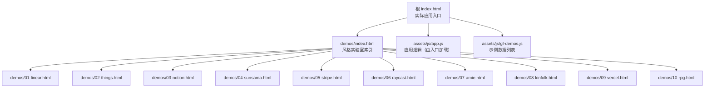
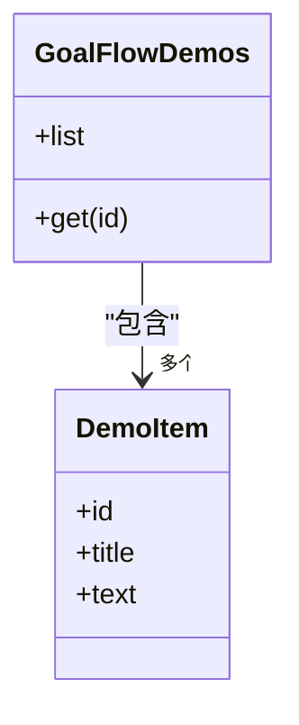
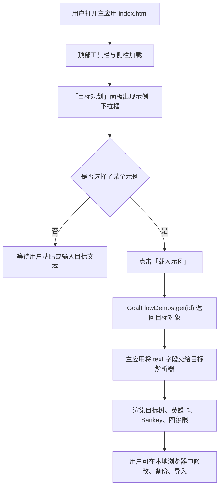
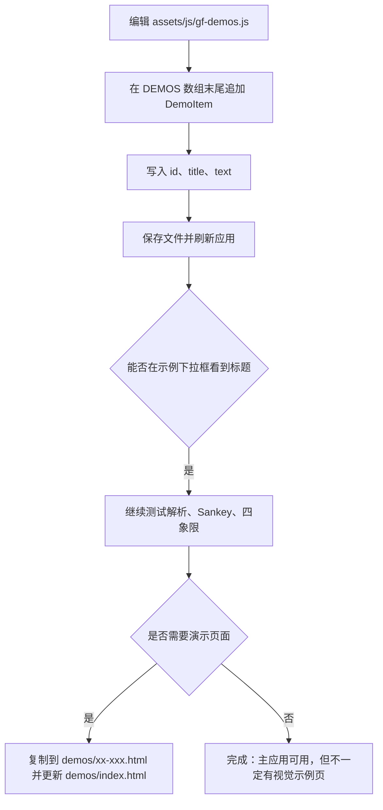
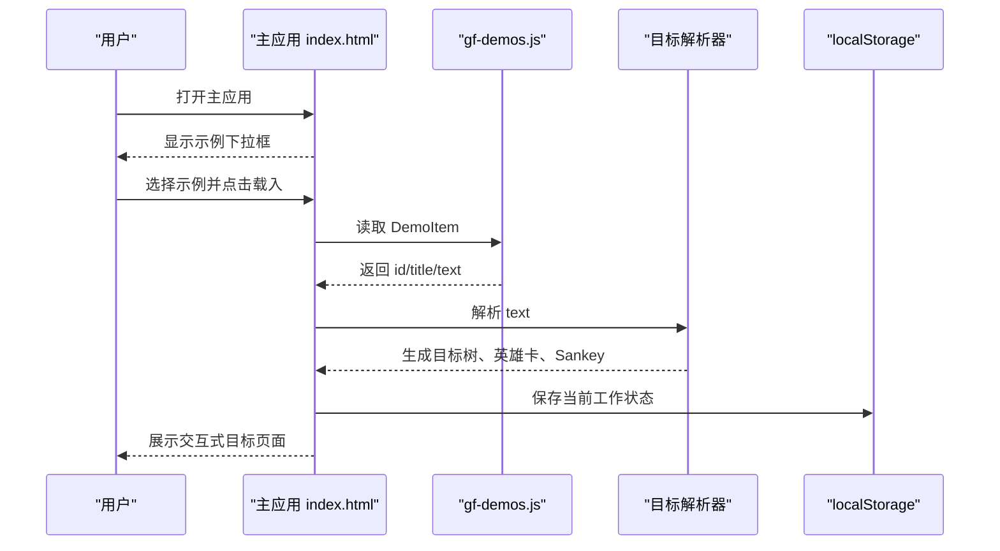
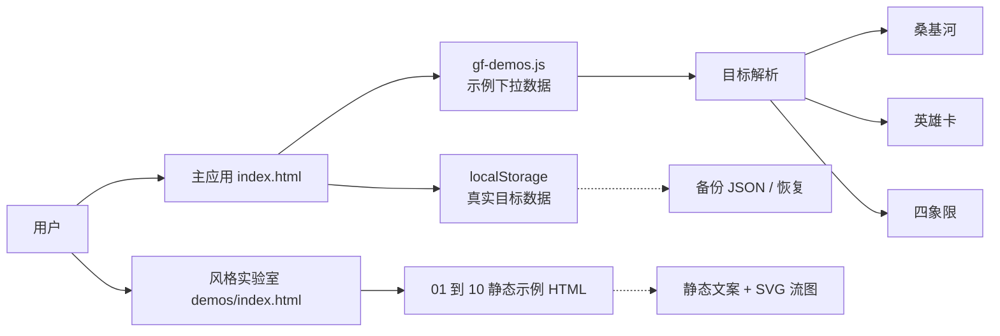

# 示例与演示主题

<cite>
**本文引用的文件**   
- [README.md](file://README.md)
- [index.html](file://index.html)
- [assets/js/gf-demos.js](file://assets/js/gf-demos.js)
- [demos/index.html](file://demos/index.html)
- [demos/01-linear.html](file://demos/01-linear.html)
- [demos/02-things.html](file://demos/02-things.html)
- [demos/03-notion.html](file://demos/03-notion.html)
- [demos/04-sunsama.html](file://demos/04-sunsama.html)
- [demos/05-stripe.html](file://demos/05-stripe.html)
- [demos/06-raycast.html](file://demos/06-raycast.html)
- [demos/07-amie.html](file://demos/07-amie.html)
- [demos/08-kinfolk.html](file://demos/08-kinfolk.html)
- [demos/09-vercel.html](file://demos/09-vercel.html)
- [demos/10-rpg.html](file://demos/10-rpg.html)
</cite>

## 目录
1. [引言](#引言)
2. [项目结构与职责划分](#项目结构与职责划分)
3. [「风格实验室」入口：demos/index.html](#风格实验室入口demosindexhtml)
4. [目标数据注册中心：gf-demos.js](#目标数据注册中心gfdemosjs)
5. [十个示例主题说明](#十个示例主题说明)
6. [从零创建新示例的步骤](#从零创建新示例的步骤)
7. [示例数据与用户数据的区别](#示例数据与用户数据的区别)
8. [行业模板、团队目标与培训素材最佳实践](#行业模板团队目标与培训素材最佳实践)
9. [架构总览图](#架构总览图)
10. [结论](#结论)

## 引言
本指南面向希望用 GoalFlow 展示产品样式、行业模板、团队目标树或培训素材的读者。GoalFlow 的核心并不是某一种固定的任务界面，而是一套可视化语义：

- 把自由文本目标解析为桑基河。
- 带宽代表重要度。
- 色温代表紧急度。
- 金色线条代表算法锁定的「当下最重要」。
- 四象限用于优先级校准。
- 周回顾、晨计划、晚总结等仪式围绕同一棵目标树联动。

仓库同时提供了两类内容：一是实际可运行的主应用，二是只读示例页面。前者管理你的真实数据；后者用来演示语言、配色和布局方向。本文聚焦后一类内容的组织方式与使用方法。

**章节来源**
- [README.md:1-103](file://README.md#L1-L103)

## 项目结构与职责划分
仓库根目录下的 `index.html` 是实际应用的入口。它包含三视图导航、侧栏工作区、今日行动、目标规划、归纳洞察以及备份恢复等功能。左侧图标轨底部有一个「◈」按钮，直接跳转到 `demos/index.html`，即风格实验室入口。

示例目录分为两个层次：
- `demos/index.html`：10 个视觉方向的索引页。
- `demos/01-linear.html` 到 `demos/10-rpg.html`：每张都是独立的静态视觉稿，描述一个产品界面风格，并展示同一条销售主线目标在某种语言下的样子。
- `assets/js/gf-demos.js`：主应用中「载入示例」下拉菜单使用的示例数据源。

**图表来源**
- [index.html:1-200](file://index.html#L1-L200)
- [demos/index.html:1-55](file://demos/index.html#L1-L55)
- [assets/js/gf-demos.js:1-166](file://assets/js/gf-demos.js#L1-L166)

**章节来源**
- [index.html:1-110](file://index.html#L1-L110)
- [README.md:67-103](file://README.md#L67-L103)

## 「风格实验室」入口：demos/index.html
`demos/index.html` 不是主业务应用。它是一个独立的静态介绍页面，标题为「GoalFlow 视觉方向实验室」，目标是让读者快速比较 10 套产品化视觉方向。它说明这些示例共享同一个内核：英雄卡、桑基精力河、四象限、周回顾，只是语言、排版、配色和交互气质不同。

该页面的关键信息如下：

| 编号 | 参考对象 | 视觉方向 | 主要布局特征 | 预期 Sankey 语义 |
|---|---|---|---|---|
| 01 | Linear | 深色工作台 | Icon rail + 侧栏 + issue 式英雄卡 | 三条流带：战略主线、常规推进、金色当下 |
| 02 | Things 3 | Mac 原生纯净 | 白底 + 交通灯侧栏 + 今日大标题 | 三段落宽度，金色河线提示当前重点 |
| 03 | Notion | 文档工作台 | 浅灰侧栏 + 居中 700px 文档流 | 表格视角中的能量流向块 |
| 04 | Sunsama | 平静日计划 | 左任务列 + 右时间轴日历 | 深潜时间块 + 极简能量预览 |
| 05 | Stripe | 营销落地页 | 深藏青 hero + 斜切彩条 + glass mock | 彩色渐变流带 + 三大特性网格 |
| 06 | Raycast | 命令面板 | 模糊壁纸上的单面板 | 搜索项 + 迷你河流 strip |
| 07 | Amie | 日历时间块 | 左 chip 任务 + 右周日历网格 | 底部曲线表示本周能量流 |
| 08 | Kinfolk | 高端编辑杂志 | 巨幅留白 + 细衬线刊名 | 河流退为墨线 + 赤陶焦点 |
| 09 | Vercel / Geist | 精密仪表格 | 纯黑底 bento 卡片 | 工程感 Sankey + 数字指标 |
| 10 | Habitica / RPG | 游戏化主线 | XP 等级 + 主线卷轴 + 支线任务 | 紫色策略流 + 金色能量流 |

这些页面的共同点是：它们都通过 SVG 展示 Sankey/河流图，而不是从浏览器 localStorage 读取真实用户数据。每个示例都嵌入自己模拟的目标树片段，例如「销售方法论」「客户跟进」「身体与精力」以及「读完《影响力》第三章，写出 3 条可用销售话术」这条金色主线。

**章节来源**
- [demos/index.html:1-55](file://demos/index.html#L1-L55)

## 目标数据注册中心：gf-demos.js
`assets/js/gf-demos.js` 的作用是为主应用提供一组示例目标。主应用会在「目标规划」输入区域渲染一个示例选择器，并使用其中的 `title` 作为下拉选项，`text` 作为待解析的目标字符串。

### 数据结构
示例数据通过一个名为 `DEMOs` 的数组暴露给全局对象 `GoalFlowDemos`。每个示例至少具有：

| 字段 | 含义 | 说明 |
|---|---|---|
| `id` | 示例唯一标识符 | 便于按 id 查找；默认回退到第一个示例 |
| `title` | 用户可见的示例名称 | 显示在下拉菜单中 |
| `text` | 目标原始文本 | 主应用会把它交给解析器生成目标树 |

**图表来源**
- [assets/js/gf-demos.js:1-166](file://assets/js/gf-demos.js#L1-L166)

### 当前内置示例范围
虽然 `demos/` 目录下只有 10 个静态示例 HTML 页面，但 `gf-demos.js` 中的示例数量更多。文件中定义的 `DemoItem.id` 包括：

| 序号 | id | title | 用途 |
|---|---|---|---|
| 1 | sales | 💼 销售体系 · 月入 5 万 | 面向个人销售的年度目标树 |
| 2 | postgrad | 📚 考研上岸 · 2027 研究生 | 学术备考与报名流程 |
| 3 | health | 🏃 健康减脂 · 减 10 公斤 | 体检、饮食、训练与健康纪律 |
| 4 | indie | 🚀 独立产品 · MVP 上线 | SaaS MVP 需求验证与开发节奏 |
| 5 | ai-pm | 🤖 转行 · AI 产品经理 | 作品集、课程与求职 |
| 6 | house | 🏠 储蓄计划 · 攒首付 | 收入、存钱、政策与消费控制 |
| 7 | english | 🌐 英语 · 雅思 7 分 | 考试训练、考位与材料 |
| 8 | lead | 👥 技术管理 · 带 8 人团队 | OKR、人才梯队、故障响应 |
| 9 | creator | ✍️ 个人 IP · 内容创作 | 定位、发布频率、商单 |
| 10 | ecom | 🛒 副业 · 跨境小铺 | 选品、供应链、内容与评价 |

注意：这 10 个 `gf-demos.js` 示例是主应用「载入示例」的数据来源，并非 `demos/` 目录下那 10 个 HTML 视觉示例页面。两者用途不同，不应混淆。

### 加载流程

**图表来源**
- [assets/js/gf-demos.js:1-166](file://assets/js/gf-demos.js#L1-L166)
- [index.html:110-200](file://index.html#L110-L200)

**章节来源**
- [assets/js/gf-demos.js:1-166](file://assets/js/gf-demos.js#L1-L166)
- [index.html:110-200](file://index.html#L110-L200)

## 十个示例主题说明
以下表格基于 `demos/index.html` 与各示例 HTML 页面的实际内容整理。它们不是主应用的工作流，而是产品语言样例。

| 文件名 | 示例主题 | 参考风格 | 目标叙事 | 配色与情绪 | 默认 workflow 表达 | 初始 targetText | 预期 Sankey 效果 |
|---|---|---|---|---|---|---|---|
| 01-linear.html | 深色工作台 | Linear | 月入 5 万销售体系 | 深色背景、紫蓝强调色、金线突出 | Icon rail + issue 式英雄卡 | 隐藏于页面结构中的固定文案示例 | 三条流带：战略、常规、金色 |
| 02-things.html | Mac 原生待办 | Things 3 | 今天完成销售相关任务 | 白底、系统蓝、金色高亮 | 「今天」顶部标题 + 圆形勾选 | 固定文案示例 | 三段宽窄不同的柔和流带 |
| 03-notion.html | 文档工作台 | Notion | 年度目标文档 + 四象限表 | 浅灰边线、金色 Callout、红蓝标签 | 页面树 + callout 英雄块 + 表格 | 文档正文中包含示例目标语义 | 表格上方的 Sankey 预览块 |
| 04-sunsama.html | 平静日计划 | Sunsama | 今天安排深潜与例行 | 米白纸感、赤陶、鼠尾草绿 | 左任务列 + 右 7 小时时间轴 | 每日任务与日程中的示例任务 | 底部极简能量条 + 深潜标记 |
| 05-stripe.html | 营销落地页 | Stripe | 向用户解释 Why rivers matter | 深藏青 hero、蓝紫渐变、玻璃质感 | 落地页 hero + product mock | 文案本身作为示例叙事 | hero mock 中渐变色流带 |
| 06-raycast.html | 命令面板 | Raycast | 以命令行为中心的效率语言 | 暗色模糊墙 + 红色强调 + 紫色功能 | 单面板 + kbd 快捷键 + 动作列表 | panel 内已选中“当下最重要” | 面板底部 mini Sankey strip |
| 07-amie.html | 日历时间块 | Amie | 拖入周日历的计划体验 | 粉色、紫罗兰、薄荷绿、暖金 | 左 chip 待安排 + 右周日历网格 | 卡片中的示例任务 | 底部彩色曲线 energy strip |
| 08-kinfolk.html | 高端编辑杂志 | Kinfolk | 把目标当作一篇文章排版 | 纸张白、细衬线、赤陶点缀 | 刊头 + 大图 hero + 分栏 | pull-quote 里的目标引用 | 手绘风墨线河流 |
| 09-vercel.html | 精密仪表格 | Vercel / Geist | 用看板与度量展示进度 | 纯黑底、蓝色/青色渐变、绿色状态 | bento 卡片 + monospace 指标 | 卡片内的 FOCUS_SCORE 与 Sankey | 工程感 Sankey + 百分比 |
| 10-rpg.html | RPG 游戏化 | Habitica 风格 | 主线任务 + 支线任务 + XP | 深紫黑 + 鎏金 + 紫色魔法色 | 玩家头像 + XP 条 + 主线卷轴 | 任务详情中带有奖励与期限 | 紫色策略流 + 金色能量流 |

需要特别注意：
- 这些 HTML 页面没有调用 `gf-demos.js`。它们是静态视觉稿，不包含主应用的行为逻辑。
- 示例数据并不存储在用户浏览器中；用户真正的数据位于主应用的 localStorage。
- 若要复用这些风格，应保留其中展示目标的文案结构，但不要假设它们能直接驱动真实目标分析。

**章节来源**
- [demos/index.html:10-55](file://demos/index.html#L10-L55)
- [demos/01-linear.html:1-151](file://demos/01-linear.html#L1-L151)
- [demos/02-things.html:1-113](file://demos/02-things.html#L1-L113)
- [demos/03-notion.html:1-110](file://demos/03-notion.html#L1-L110)
- [demos/04-sunsama.html:1-103](file://demos/04-sunsama.html#L1-L103)
- [demos/05-stripe.html:1-107](file://demos/05-stripe.html#L1-L107)
- [demos/06-raycast.html:1-87](file://demos/06-raycast.html#L1-L87)
- [demos/07-amie.html:1-116](file://demos/07-amie.html#L1-L116)
- [demos/08-kinfolk.html:1-83](file://demos/08-kinfolk.html#L1-L183)
- [demos/09-vercel.html:1-114](file://demos/09-vercel.html#L1-L114)
- [demos/10-rpg.html:1-106](file://demos/10-rpg.html#L1-L106)

## 从零创建新示例的步骤
这里分为两类场景：一类是扩展主应用可用的示例数据，另一类是新增一张风格演示页面。

### 场景一：在主应用中增加新的「载入示例」
如果你希望用户在主应用的「载入示例」下拉菜单中选择一个新的预设目标，请执行以下步骤：

1. 在 `assets/js/gf-demos.js` 中添加新的 `DemoItem` 对象。
2. 为该对象赋予唯一的 `id`。
3. 填写用户可读的 `title`，它将出现在下拉框中。
4. 使用自然的层级文本编写 `text`，让主应用可以像用户粘贴目标一样解析出目标树。
5. 确保它放在现有 `DEMOs` 数组末尾、函数 `get` 之前。
6. 刷新主应用页面即可在下拉框中看到新示例。
7. 若该示例也适合做宣传素材，再复制 `demos/index.html` 对应的链接位置加入索引，并创建相应 demo HTML。

**图表来源**
- [assets/js/gf-demos.js:1-166](file://assets/js/gf-demos.js#L1-L166)
- [demos/index.html:25-50](file://demos/index.html#L25-L50)

### 场景二：新增一张静态风格演示页
如果你只想做一份产品样机或培训幻灯片式的静态页面，不需要修改主应用逻辑：

1. 从现有任意 `demos/xx-xxx.html` 复制一个新文件，例如 `demos/11-new-theme.html`。
2. 重写 `<head>` 的 `<style>`，定义你自己的 CSS 变量、字体、配色与布局。
3. 保留展示目标语义的区域：
   - 一个代表「当下最重要」的英雄卡。
   - 一段 Sankey/河流图。
   - 可选的四象限或周回顾摘要。
4. 保留回到主页的链接，通常是 `../index.html`。
5. 在 `demos/index.html` 的卡片网格中新增一行链接到这个新页面。
6. 保持所有文字为静态文案；不要引入真实用户的任务数据。

关键约束：
- 不要把 `gf-demos.js` 的逻辑误写到静态示例页面里。
- 不依赖 `localStorage`。
- 如果用于培训，建议在页脚标注“演示数据，不代表真实用户进度”。
- 如果要复用主题给用户运行，建议将 CSS/HTML 整合进主应用的主题系统，而不是单独维护一批无法联动的静态页。

**章节来源**
- [demos/index.html:15-50](file://demos/index.html#L15-L50)
- [demos/01-linear.html:1-151](file://demos/01-linear.html#L1-L151)

## 示例数据与用户数据的区别
这是理解 GoalFlow 使用边界的重要部分。

| 维度 | gf-demos.js 示例数据 | 主应用 user data |
|---|---|---|
| 数据来源 | 脚本数组中的固定值 | 用户粘贴、编辑、同步的结果 |
| 存储位置 | 不写 localStorage | 默认保存在浏览器 localStorage |
| 可编辑性 | 仅开发者编辑代码 | 普通用户也可通过界面操作 |
| 生命周期 | 随源码版本变化 | 随用户持续使用积累 |
| 用途 | 教学、演示、下拉示例 | 真实时间管理、备份恢复 |
| 风险 | 改错可能影响新用户体验 | 误删/清空可能有数据丢失风险 |
| 建议使用者 | 产品作者、培训师、模板维护者 | 每位 GoalFlow 用户 |
| Sankey 效果 | 由文本解析后的演示结果呈现 | 由真实目标树实时计算 |

主应用明确建议：首次打开为空状态，需要先粘贴目标，或在示例下拉框中选择一个示例后点击「载入示例」。此外，README 提醒 localStorage 会随缓存清理丢失，应定期导出 JSON 备份；这也证明真实用户数据与静态示例完全不同。

**图表来源**
- [index.html:110-200](file://index.html#L110-L200)
- [assets/js/gf-demos.js:1-166](file://assets/js/gf-demos.js#L1-L166)

**章节来源**
- [README.md:62-82](file://README.md#L62-L82)
- [assets/js/gf-demos.js:1-166](file://assets/js/gf-demos.js#L1-L166)
- [index.html:110-200](file://index.html#L110-L200)

## 行业模板、团队目标与培训素材最佳实践
### 使用目的分层
- **产品介绍页面**：可使用 `demos/05-stripe.html` 的思路，用 hero、feature grid、glass mock 展示价值主张，并把 Sankey 作为产品能力图示。
- **内部团队看板**：可参考 `demos/01-linear.html` 或 `demos/09-vercel.html`，强调状态、编号、估算、期限等可复用的看板词汇。
- **个人培训计划**：可以参考 `demos/04-sunsama.html` 的时间轴或 `demos/07-amie.html` 的周日历，把「学习 → 练习 → 输出」拆成可安排时段的小块。
- **游戏化习惯养成**：使用 `demos/10-rpg.html` 的语言，XP、连胜、主线、支线都能帮助降低启动阻力。
- **阅读与笔记导向的团队**：`demos/03-notion.html` 展示了如何将 Sankey 融入文档、Callout、表格与属性。

### 模板设计规范
1. 每次示例只表达一层语义。不要在同一张页面堆满 hero、命令面板、杂志、bento 等多种样式。
2. 保持 Sankey 的一致性：带宽 = 重要，色温 = 紧急，金色 = 当前主线。
3. 始终让用户知道这是演示数据。可在页角加一句“仅示意，无真实用户数据”。
4. 如果示例要进入主应用，优先通过 `gf-demos.js` 添加；如果只用于视觉提案，则放在 `demos/` 静态页面中。
5. 对于团队模板，尽量给出“部门目标 → 季度目标 → 本月重点任务 → 下周三个交付物”的结构，以便被自动解析为清晰的子节点。
6. 对于培训教材，建议使用真实但去隐私化的案例，并在文末附上“如何在你自己的 GoalFlow 里加载这个目标”的操作步骤。

### 示例命名约定
建议保持与现有仓库一致的命名风格：
- 主应用示例 id：使用简短英文语义，如 `sales`、`indie`、`lead`。
- 演示页面文件名：使用 `序号-英文名.html`，如 `09-vercel.html`。
- 演示索引条目：保持编号、参考产品、一句话风格说明和色板。

**章节来源**
- [assets/js/gf-demos.js:1-166](file://assets/js/gf-demos.js#L1-L166)
- [demos/01-linear.html:1-151](file://demos/01-linear.html#L1-L151)
- [demos/09-vercel.html:1-114](file://demos/09-vercel.html#L1-L114)
- [demos/10-rpg.html:1-106](file://demos/10-rpg.html#L1-L106)
- [demos/index.html:25-50](file://demos/index.html#L25-L50)

## 架构总览图
下图展示主应用、示例数据和风格实验室之间的关系，以及用户如何在这三者之间迁移。

**图表来源**
- [index.html:1-200](file://index.html#L1-L200)
- [assets/js/gf-demos.js:1-166](file://assets/js/gf-demos.js#L1-L166)
- [demos/index.html:1-55](file://demos/index.html#L1-L55)

## 结论
GoalFlow 的示例系统分为两层：

- `gf-demos.js` 负责向主应用提供可解析的真实示例目标，供「载入示例」下拉菜单使用。
- `demos/` 目录下的 HTML 页面则是静态视觉方向稿，展示同一条销售主线在不同产品语言中的样子。

对初学者而言，最简单路线是：
1. 从 `gf-demos.js` 或 README 的用法入手，理解目标如何变成 Sankey。
2. 从现有 demo HTML 中选择最接近你产品的一个样式进行模仿。
3. 如果需要培训演示，优先做只读静态页面。
4. 如果要把预设目标提供给最终用户，再通过 `gf-demos.js` 注册新的 Demo 对象。

记住核心原则：示例数据是只读的、可复制的风格起点；真正改变桑基图、英雄卡和四象限的是主应用中的目标解析逻辑和用户数据。