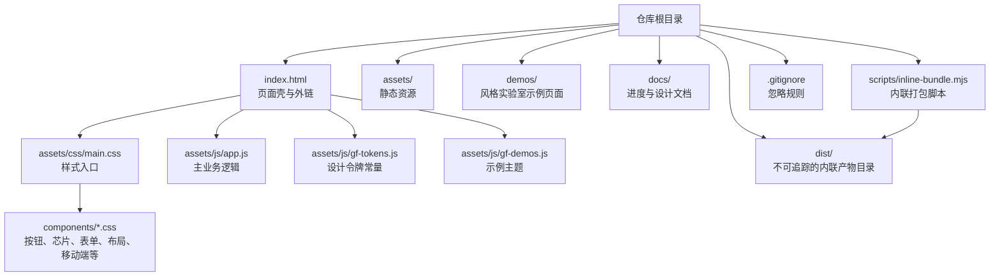
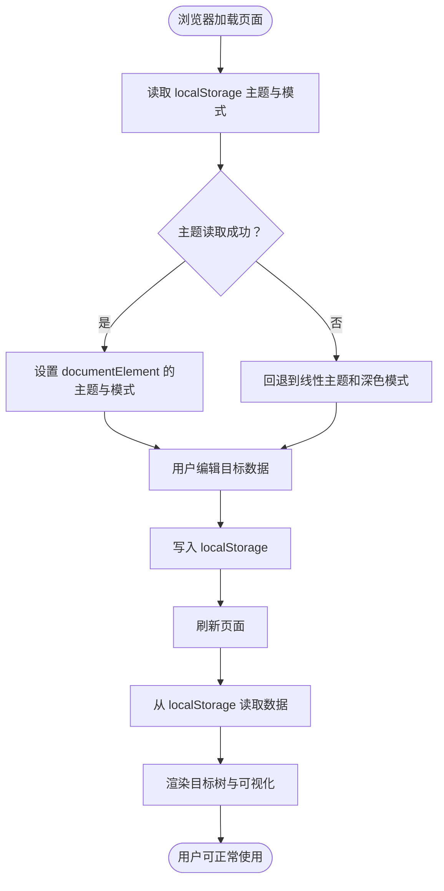
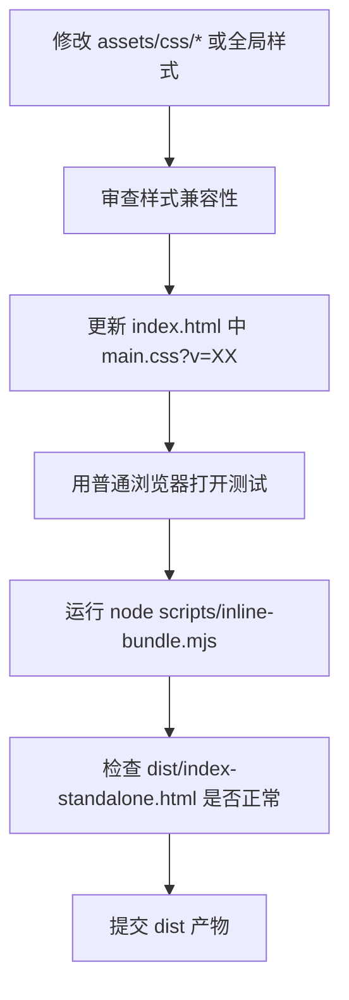
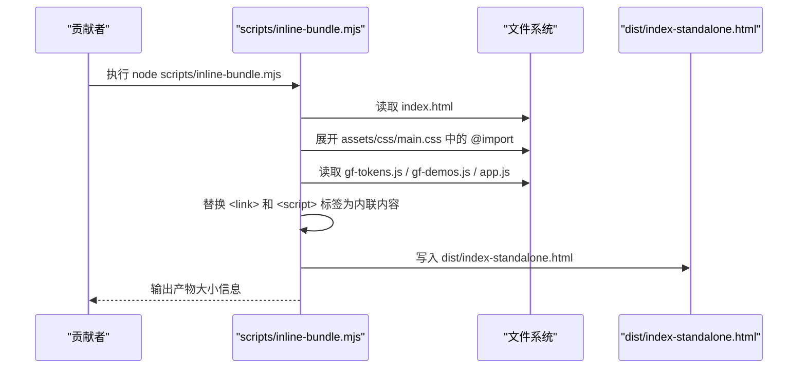
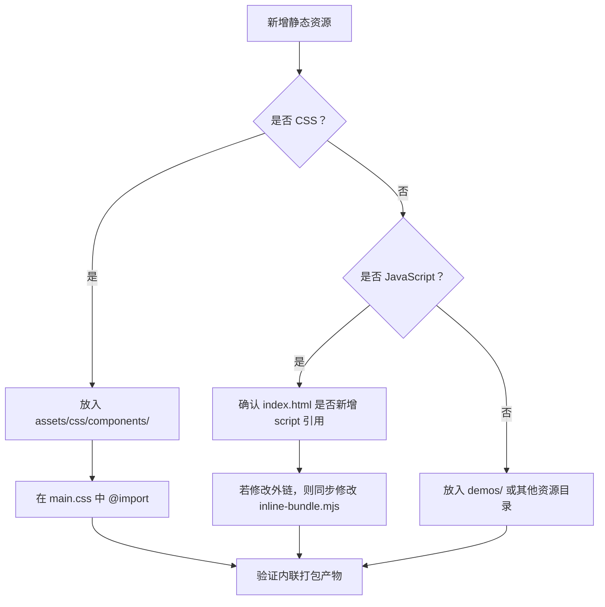
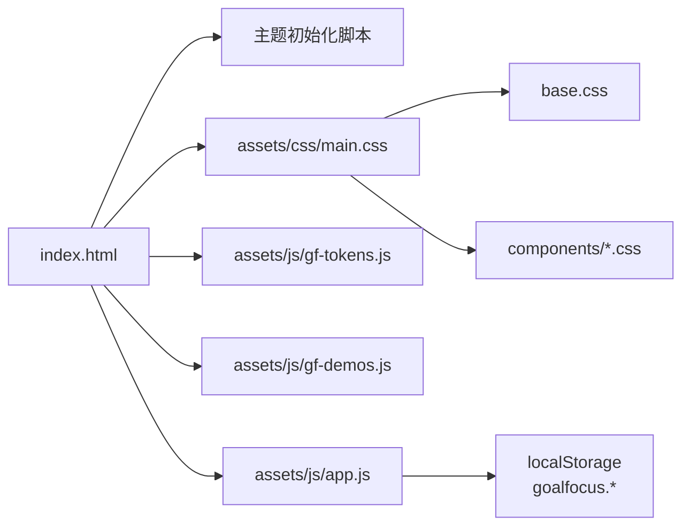
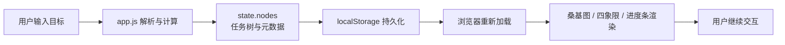

# 贡献与发布流程

<cite>
**本文引用的文件**   
- [README.md](file://README.md)
- [.gitignore](file://.gitignore)
- [scripts/inline-bundle.mjs](file://scripts/inline-bundle.mjs)
- [assets/css/main.css](file://assets/css/main.css)
- [index.html](file://index.html)
- [assets/js/app.js](file://assets/js/app.js)
- [docs/PROGRESS-ROLLUP.md](file://docs/PROGRESS-ROLLUP.md)
</cite>

## 目录

1. [简介](#简介)
2. [仓库定位与许可](#仓库定位与许可)
3. [项目结构](#项目结构)
4. [可接受的贡献类型](#可接受的贡献类型)
5. [开发环境与前置条件](#开发环境与前置条件)
6. [提交前自检清单](#提交前自检清单)
7. [版本号与缓存版本管理](#版本号与缓存版本管理)
8. [发布步骤](#发布步骤)
9. [静态资源与 .gitignore 约定](#静态资源与-gitignore-约定)
10. [最小 PR 描述模板](#最小-pr-描述模板)
11. [依赖关系与关键路径](#依赖关系与关键路径)
12. [故障排除](#故障排除)
13. [结论](#结论)

## 简介

这份《贡献与发布流程》指南面向希望向目标流 GoalFlow 提交修改的协作者。GoalFlow 是一个轻量级、纯本地、双击即可使用的可视化时间管理工具，核心由 `index.html` 和 `assets/` 组成，不包含账户体系、云端服务和订阅逻辑。数据默认存储在浏览器的 `localStorage` 中，因此贡献者需要特别关注数据读写行为及离线可打开能力。

本指南说明：

- 仓库的个人非商业许可要求；
- 可接受与不承诺的变更范围；
- 开发环境、手动验证项；
- 单页打包产物 `dist/index-standalone.html` 的版本对齐方式；
- GitHub Pages 分支发布的整体步骤；
- 新增静态资源的正确位置；
- 最小化 Pull Request 的描述模板与验收 checklist。

## 仓库定位与许可

### 项目定位

GoalFlow 的定位是轻量级个人项目：

- 以 `index.html + assets/` 的方式组织，无编译构建阶段。
- 通过浏览器直接打开使用，同时支持在线站点和本地文件打开两种方式。
- 首次进入为空状态，可选择“载入示例”体验功能。
- 数据存储在 `localStorage`，不提供第三方账号登录或遥测。

这些特性意味着贡献者应优先保证简单部署方式可用，而不是引入额外的运行时依赖。

### 许可要求

根据仓库文档：

- **个人非商业使用自由。**
- **商业再分发或商业化使用需作者授权。**

因此，以下场景可能需要事先联系作者获取授权：

- 将 GoalFlow 作为付费产品的一部分进行再分发；
- 对应用进行品牌化后对外出售；
- 将代码集成到按使用量收费的企业服务中；
- 任何明确以盈利为目的的分发形式。

若你的贡献涉及将仓库用于商业用途，请在提交前先确认许可边界。

**本节来源**
- [README.md:1-103](file://README.md#L1-L103)

## 项目结构

当前仓库的结构可以按用途分为以下几类：

| 目录 / 文件 | 职责说明 |
|---|---|
| `index.html` | 页面入口，负责 DOM 布局、样式与脚本外链、主题初始化、导航结构等。 |
| `assets/css/` | CSS 资源。`main.css` 是样式入口，内部通过 `@import` 加载基础样式与组件样式。 |
| `assets/js/` | JavaScript 逻辑。`app.js` 是主逻辑，`gf-tokens.js` 提供设计令牌常量，`gf-demos.js` 提供示例目标主题。 |
| `demos/` | “风格实验室”子页面集合，演示不同主题的展示效果。 |
| `docs/` | 设计与进度补充文档；`PROGRESS-ROLLUP.md` 定义叶子节点完成统计规则。 |
| `scripts/inline-bundle.mjs` | Node.js 脚本，把 HTML、CSS、JS 内联成独立单文件产物。 |
| `.gitignore` | 忽略工作副本辅助文件、生成产物与系统临时文件。 |



**图示来源**
- [index.html:1-18](file://index.html#L1-L18)
- [assets/css/main.css:1-11](file://assets/css/main.css#L1-L11)
- [scripts/inline-bundle.mjs:1-52](file://scripts/inline-bundle.mjs#L1-L52)

### 样式加载顺序

`assets/css/main.css` 按依赖顺序依次导入：

1. `tokens.css`
2. `base.css`
3. `components/button.css`
4. `components/chip.css`
5. `components/forms.css`
6. `components/layout.css`
7. `components/features.css`
8. `components/mobile.css`

这意味着新增的 UI 组件样式应放在 `components/` 下，并通过 `main.css` 控制加载顺序。如果破坏现有顺序，可能会导致颜色、排版或移动端适配回退。

**本节来源**
- [assets/css/main.css:1-11](file://assets/css/main.css#L1-L11)

## 可接受的贡献类型

以下类型贡献与 GoalFlow 的轻量目标一致：

| 贡献类型 | 说明 | 示例 |
|---|---|---|
| Bug 修复 | 修正解析错误、数据存储异常、计算逻辑错误或交互失效。 | 某个象限拖拽后评分未刷新。 |
| 可读性改善 | 重命名变量、拆分长函数、优化注释与段落结构。 | 重构耗时较大的渲染函数，避免阻塞主线程。 |
| 示例主题补充 | 给 `gf-demos.js` 增加新的示例目标，并配合 README 说明用法。 | 为“阅读习惯”添加结构化示例。 |
| 文档完善 | 改进 README、用户手册、进度规则、贡献指南等。 | 补充某功能的操作步骤截图描述。 |
| 样式与可访问性 | 调整配色、间距、对比度、焦点样式、ARIA 标签、语义化标记。 | 让深色模式下的图标更清晰，提升键盘操作体验。 |
| 性能优化 | 减少不必要的重绘重排，优化频繁触发的计算。 | 对滚动或输入回调进行节流。 |

### 不承诺的范围

作为轻量个人项目，维护者优先保持简单性和低耦合，因此不承诺引入：

- 大型架构重构；
- 新的前端框架（如 React、Vue、Svelte）；
- 后端服务；
- 复杂的构建管道；
- 与现有 DOM API 风格差异很大的重写方案。

若贡献可能触发这类变化，请在 PR 中明确说明动机，并给出替代的低成本方案。

**本节来源**
- [README.md:1-103](file://README.md#L1-L103)

## 开发环境与前置条件

### 最低运行环境

- **任意现代浏览器**。  
  包括桌面 Chrome、Edge、Firefox、Safari 及主流移动端浏览器。
- **可选：Node.js 与 npm**。  
  仅当你需要生成独立单页包 `dist/index-standalone.html` 时才必需；日常修改可直接在浏览器中打开 `index.html`。

### 推荐工作流程

1. 克隆或下载仓库。
2. 使用本地文件或任意静态服务器打开 `index.html`。
3. 编辑 `assets/css/` 与 `assets/js/` 中的资源。
4. 修改 `index.html` 中的外链资源时，注意其与 `scripts/inline-bundle.mjs` 的匹配规则。
5. 需要发布时执行内联打包脚本。
6. 自测后推送并创建 Pull Request。

### 为什么推荐使用静态服务器

虽然 GoalFlow 可以双文件方式本地打开，但部分浏览器会对 `file://` URL 的模块、字体或请求策略施加限制。使用任意轻量静态服务器可以避免这类问题，例如 Node 的 `http-server`、VS Code 插件 Live Server 等。不过这不是硬性依赖，只是推荐做法。

## 提交前自检清单

在提交之前，请按以下列表逐项验证。该清单聚焦于仓库当前“无构建、双文件可打开”的核心运行模型。

### 基础可用性

- [ ] `index.html` 可在浏览器中打开。
- [ ] 如果使用本地文件方式，`index.html` 与 `assets/` 目录必须保持相对路径关系；否则资源无法加载。
- [ ] 页面标题、语言属性、主题元信息与浅色/深色模式初始化正常。
- [ ] 侧栏与主视图导航能切换今日、规划、洞察、AI 分析等页面。

### 主题与本地存储

- [ ] 初始主题从主题名称与显示模式配置读取；若读取失败应回退到默认值。
- [ ] 切换界面主题后，UI 主题、图标轨道、面板内容同步更新。
- [ ] 切换深/浅模式后文本与边框可读性合格。
- [ ] 主题偏好持久化到 `localStorage`，刷新后仍然生效。
- [ ] 主题相关写入不会抛出未被捕获的错误。

### 主题相关实现要点

主题初始化代码会先尝试读取 `goalflow.theme` 与 `goalflow.mode`，只有在出现异常时才回退到默认值。主题选择器还支持多种预览主题。因此在贡献时应特别注意：

- 不要移除 `documentElement.dataset.theme` 与 `documentElement.dataset.mode` 的设置逻辑。
- 新增主题键名时需同时在 JS 常量和 UI 选项中使用相同键名。
- 所有主题色应以设计令牌为基础，不要硬编码散落的颜色值。

### 数据与 localStorage

- [ ] 新建、编辑、删除目标后能持久保存到 `localStorage`。
- [ ] 页面刷新后数据仍存在。
- [ ] JSON 备份与恢复流程可用。
- [ ] 历史数据结构升级不会导致旧数据直接崩溃。
- [ ] `localStorage` 写入失败时的降级行为合理。



**图示来源**
- [index.html:1-18](file://index.html#L1-L18)
- [assets/js/app.js:1-15](file://assets/js/app.js#L1-L15)

### 移动端与手势

GoalFlow 已提供移动端 H5 支持和底部 tab 三视图导航，贡献者尤其要注意：

- [ ] 在手机或窄视口下能切换三视图与周回顾。
- [ ] 今日面板勾选完成任务后能刷新状态。
- [ ] 番茄钟、早计划、晚总结弹窗等常用交互在手机端可点击。
- [ ] 页面从后台切回时定时器或闹钟行为正常。
- [ ] 桑基图左右滑动可查看；四象限在移动端查看不受阻。
- [ ] 新增的交互不要遮挡底部 tab。
- [ ] 新控件具备触摸反馈和足够的最小点击区域。

### 示例与文档

- [ ] 新增示例主题后，可在下拉框中选择并载入。
- [ ] 示例数据能够被解析为目标树。
- [ ] 文档更新内容与界面行为一致。
- [ ] 没有泄露敏感信息，例如个人 API Key、私有链接或私人目标数据。

## 版本号与缓存版本管理

### 版本号存放位置

当前仓库的主缓存版本字符串位于页面头部外链样式引用中：

```text
<link rel="stylesheet" href="assets/css/main.css?v=7.6">
```

这个版本号用于提醒浏览器重新拉取更新的 CSS，避免因长期缓存导致用户看到过时样式。

### 版本更新规则

每次发布时，请确保：

1. **HTML 中的 `assets/css/main.css?v=XX` 版本号递增。**
   - 例如从 `v=7.6` 改为 `v=7.7`。
2. **版本号体现发布次序。**
   - 如果是小修小补，可按次位递增。
   - 如果有影响结构或兼容性的较大发布，建议按主版本或次要版本演进。
3. **不要单独改动文件名。**
   - 内联打包脚本按固定资源路径查找 `assets/css/main.css`，改名会导致打包失败。
4. **只改版本号，不混入无关 diff。**
   - 将样式或逻辑变更合并到同一变更中，但不要只在发布时随意更改数字以外的内容。



**图示来源**
- [index.html:1-18](file://index.html#L1-L18)
- [scripts/inline-bundle.mjs:1-52](file://scripts/inline-bundle.mjs#L1-L52)

**本节来源**
- [index.html:1-18](file://index.html#L1-L18)

## 发布步骤

### 发布前准备

1. 确认本次变更已通过提交前自检清单。
2. 如果需要新增样式，确认 `assets/css/main.css` 的 `@import` 顺序正确。
3. 如果需要修改业务逻辑，重点测试 `localStorage` 读写与主题初始化。
4. 检查是否引入了不符合轻量项目定位的新依赖。

### 内联打包

当需要生成可独立分发的单文件时，运行：

```bash
node scripts/inline-bundle.mjs
```

该脚本会：

1. 读取 `index.html`；
2. 展开 `assets/css/main.css` 中的 `@import`；
3. 读取 `assets/js/gf-tokens.js`、`assets/js/gf-demos.js`、`assets/js/app.js`；
4. 将 CSS 内联进 `<style>`；
5. 将三个 JS 文件内联进一个 `<script>`；
6. 输出到 `dist/index-standalone.html`。



**图示来源**
- [scripts/inline-bundle.mjs:1-52](file://scripts/inline-bundle.mjs#L1-L52)

### 提交 dist 产物

生成的 `dist/index-standalone.html` 是需要随版本一起提交的发布产物。它适合只需要一个文件的分发自检或二次分发需求。请注意：

- 该产物由脚本自动生成；
- 通常不应手动编辑其内容；
- 发布流程应将最新产物纳入提交；
- 如果后续修改了 CSS、JS 或 HTML 外链资源，必须重新执行脚本生成最终 `dist`。

### 推送到 GitHub Pages 分支并发布站点

标准流程如下：

1. 创建或切换到 GitHub Pages 所监听的分支（仓库文档中提到 GitHub Pages 分支）。
2. 将最新源码、`index.html`、`assets/` 以及生成的 `dist/` 推送到该分支。
3. 在 GitHub 中触发站点发布。
4. 打开站点地址验证页面可打开、样式与新版本缓存参数已生效。
5. 打开 `dist/index-standalone.html` 做离线单文件校验。

若你只更新了 `assets/css/` 而忘记更新 `assets/css/main.css?v=XX`，GitHub Pages 上很可能仍显示旧的缓存样式。此时应修正版本号后再发布。

**本节来源**
- [scripts/inline-bundle.mjs:1-52](file://scripts/inline-bundle.mjs#L1-L52)
- [README.md:1-103](file://README.md#L1-L103)

## 静态资源与 .gitignore 约定

### .gitignore 中忽略的内容

当前 `.gitignore` 主要忽略以下四类内容：

| 类型 | 目的 |
|---|---|
| `.workbuddy/` | WorkBuddy 内部数据目录，不进仓库。 |
| `goal-focus.html` | 本地工作副本的文件门面，内容应与仓库正文保持一致。 |
| `dist/` | 内联打包脚本的自动生成产物。 |
| 系统杂物 | `Thumbs.db`、`desktop.ini`、`.DS_Store` 等平台临时文件。 |
| `.cursor/rules/openmemory.mdc` | IDE 或 AI 助手特定规则文件。 |

### 何时新增忽略项

建议仅在以下情况新增忽略规则：

- 文件仅在本地生成，且可重新构建；
- 文件包含敏感或个人信息；
- 文件体积大但与构建产物等价；
- 属于编辑器、IDE 或系统的临时缓存。

对于不可重复构建但必须本地生成的产物（当前仓库以“不构建”为主，因此类似场景较少），应评估是否可以改为跟踪源文件而非产物。

### 如何增加新的静态资源

#### CSS 资源

1. 将样式文件放入 `assets/css/components/`。
2. 在 `assets/css/main.css` 中按依赖顺序添加 `@import url('./components/xxx.css');`。
3. 确保基础 token 与 base 已经先行加载。
4. 测试普通双文件模式和内联单文件模式都正常。

#### JavaScript 资源

1. 若新增的是应用逻辑，优先考虑放入现有 `assets/js/` 结构；`app.js` 已经是主业务逻辑载体。
2. 若新增的是设计令牌或示例数据，对应放到 `gf-tokens.js` 或 `gf-demos.js`。
3. 如果在 `index.html` 中新增 `<script src="assets/js/xxx.js">`，还需同步修改 `scripts/inline-bundle.mjs` 中的脚本拼接正则与读取逻辑。
4. 如果新增的是纯示例页面，放入 `demos/`。



**图示来源**
- [assets/css/main.css:1-11](file://assets/css/main.css#L1-L11)
- [scripts/inline-bundle.mjs:1-52](file://scripts/inline-bundle.mjs#L1-L52)
- [.gitignore:1-16](file://.gitignore#L1-L16)

**本节来源**
- [.gitignore:1-16](file://.gitignore#L1-L16)
- [assets/css/main.css:1-11](file://assets/css/main.css#L1-L11)
- [scripts/inline-bundle.mjs:1-52](file://scripts/inline-bundle.mjs#L1-L52)

## 最小 PR 描述模板

建议使用如下最小描述格式。它足够短，但仍能覆盖贡献者和维护者都需要了解的信息。

```markdown
## 变更摘要

简要说明这次修改解决了什么问题或提升了哪方面体验。

## 变更类型

- [ ] 修复 bug
- [ ] 改善可读性
- [ ] 补充示例主题
- [ ] 完善文档
- [ ] 优化样式与可访问性
- [ ] 性能优化
- [ ] 其它

## 影响范围

- 样式：assets/css/...
- 逻辑：assets/js/app.js 等
- 页面结构：index.html
- 文档：README.md、docs/...
- 打包产物：dist/index-standalone.html
- 环境变量或依赖：无

## 自测结果

- [ ] 浏览器直接打开 index.html
- [ ] 保留 assets/ 的双文件方式可用
- [ ] 主题切换正常
- [ ] localStorage 读写无误
- [ ] 移动端 tab 与手势可用
- [ ] 内联打包产物 dist/index-standalone.html 可用
- [ ] GitHub Pages 站点可打开

## 截图或录屏

如有界面变化，附上变更前后的截图或短视频。
```

### 验收 checklist

PR 维护者可依据以下 checklist 审核：

| 维度 | 验收项 |
|---|---|
| 正确性 | 修改是否修复了问题，或是否实现了描述的收益。 |
| 兼容行为 | 是否兼容旧数据结构与已有用户数据。 |
| 轻量约束 | 是否避免引入大型依赖、复杂构建或后端服务。 |
| 双文件模式 | `index.html` 与 `assets/` 仍可一起打开。 |
| 单文件模式 | `dist/index-standalone.html` 可独立打开。 |
| 缓存版本 | CSS 外部引用的 `v=` 版本号是否正确。 |
| 移动端 | 手机浏览器打开后基础交互可用。 |
| 隐私与安全 | 未上传任何用户数据，未在日志中暴露密钥。 |
| 可维护性 | 代码与注释是否比原来更易读。 |
| 文档 | 行为和接口变更是否有相应文档或示例。 |

## 依赖关系与关键路径

### HTML 与资源依赖

`index.html` 是当前应用的页面壳，依赖：

- Google Fonts 主题字体（CDN，离线时可回退到系统字体）；
- `assets/css/main.css`；
- `assets/js/gf-tokens.js`；
- `assets/js/gf-demos.js`；
- `assets/js/app.js`。



**图示来源**
- [index.html:1-18](file://index.html#L1-L18)
- [assets/css/main.css:1-11](file://assets/css/main.css#L1-L11)
- [assets/js/app.js:1-20](file://assets/js/app.js#L1-L20)

### 数据流向

GoalFlow 的主要数据路径如下：

1. 用户输入目标文本；
2. `app.js` 解析并构建树形结构；
3. 重要度、紧急度、估计时长等字段进入 `state.nodes`；
4. 数据序列化后写入 `localStorage`；
5. 刷新页面时从 `localStorage` 读回并渲染。

此外，`docs/PROGRESS-ROLLUP.md` 明确了只有叶子节点参与完成进度计算，这是判断修改是否正确的重要约束。



**图示来源**
- [assets/js/app.js:1-200](file://assets/js/app.js#L1-L200)
- [docs/PROGRESS-ROLLUP.md:1-37](file://docs/PROGRESS-ROLLUP.md#L1-L37)

### 关键风险点

| 组件 | 风险 | 建议 |
|---|---|---|
| 主题初始化 | 若 `localStorage` 读取抛错，应安全回退默认主题。 | 保持 try-catch 或空值回退逻辑。 |
| `localStorage` 写入 | 容量有限或私有模式下不可写，应避免静默崩溃。 | 在关键写入处做容错处理。 |
| `main.css` 顺序 | 改变 `@import` 顺序可能导致主题或组件样式错乱。 | 新增组件放到合适顺序并测试。 |
| 外链 JS 改动 | 在 `index.html` 新增 `<script>` 但忘记改打包脚本，会导致单文件失效。 | 同步更新 `scripts/inline-bundle.mjs`。 |
| CSS 缓存 | 忘记更新 `main.css?v=XX` 可能导致线上缓存旧样式。 | 每次样式发布前检查版本号。 |

## 故障排除

### `index.html` 能打开但看不到样式

可能原因：

1. `assets/` 目录不在 `index.html` 同级目录；
2. `main.css` 的 `@import` 路径不正确；
3. CDN 字体加载缓慢导致初期视觉异常；
4. 单文件模式中修改过 HTML 但没有重建 `dist/index-standalone.html`。

排查方法：

- 先用开发者工具确认 `assets/css/main.css` 返回 200；
- 双文件模式下删除浏览器对该站点的缓存后重试；
- 单文件模式重新执行 `node scripts/inline-bundle.mjs`。

### 主题切换无效

可能原因：

1. `goalflow.theme` 或 `goalflow.mode` 对应的键名不一致；
2. 新增主题键在 CSS 或 JS 中存在拼写差异；
3. localStorage 被清理或处于隐私模式；
4. 自定义扩展程序阻止了 `localStorage`。

处理方法：

- 确认初始脚本设置了 `documentElement` 的 `theme` 与 `mode` 数据属性；
- 检查 UI 选项中的值与应用逻辑中的主题键一致；
- 在无痕窗口中测试默认行为。

### localStorage 数据丢失

可能原因：

- 用户清除了浏览器缓存；
- 使用了严格隐私模式；
- 浏览器禁用或限制了存储空间；
- 多设备间不能共享同一台机器的 `localStorage`。

处理方法：

- 引导用户使用“导出 JSON”定期备份；
- 提供“从 JSON 恢复”功能；
- 在恢复失败时显示提示，不要直接覆盖有效数据。

### 内联打包失败

常见原因：

1. `index.html` 中移除了预期的 `<link href="assets/css/main.css">`；
2. `index.html` 的 JS 引入顺序与打包脚本的正则不匹配；
3. 新增了 `<script src="assets/js/...">`，但未修改打包脚本；
4. `assets/js/` 下缺少被引用的 JS 文件。

处理方法：

- 只修改必要的外链或 script 引入；
- 检查 `scripts/inline-bundle.mjs` 中对 `main.css` 和 JS 的资源匹配逻辑；
- 重新执行脚本后比对 `dist/index-standalone.html`。

### 移动端手势异常

可能原因：

- 新控件覆盖了手势区域；
- 触摸事件与点击事件冲突；
- 视口缩放或父容器 overflow 导致手势失效；
- iOS Safari 的滚动动效干扰。

处理方法：

- 在真实手机或移动调试模拟器上测试；
- 避免对整行区块附加无意义的点击事件；
- 为可触摸控件提供明确的焦点与点击反馈。

### 进度统计不符合预期

GoalFlow 明确规定：**只有叶子节点计入完成进度**。如果 PR 修改了达成率或进度条，请重点检查：

- `leafProgress`、`subtreeProgress`、`setNodeDone`、`computeWeekStats`；
- 非叶子节点被错误计为完成；
- 历史数据缺失 `doneAt` 导致的统计差异；
- “聚焦模式”隐藏节点不影响分母统计。

**本节来源**
- [README.md:1-103](file://README.md#L1-L103)
- [assets/js/app.js:1-200](file://assets/js/app.js#L1-L200)
- [docs/PROGRESS-ROLLUP.md:1-37](file://docs/PROGRESS-ROLLUP.md#L1-L37)

## 结论

GoalFlow 的维护重点在于简洁、可靠与可本地运行。贡献者在提交前应优先保证：

1. `index.html` 与 `assets/` 双文件方式可用；
2. 主题、模式与 `localStorage` 的数据流稳定；
3. 移动端导航与手势可用；
4. 如需单文件发布，版本号和 `scripts/inline-bundle.mjs` 产物保持一致；
5. 变更范围尽量贴近轻量项目本身，避免引入大型重构。

只要遵循本指南的自检清单、版本号规则和 PR 模板，就能降低沟通成本和回归风险，也能帮助维护者更快审核与合并高质量的小步改动。