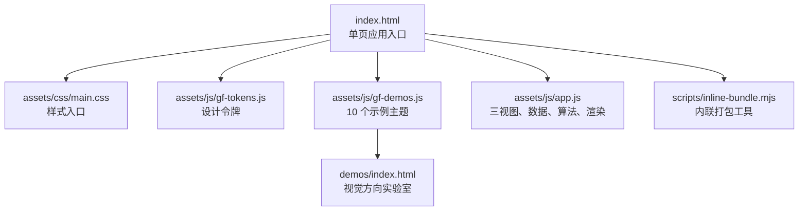
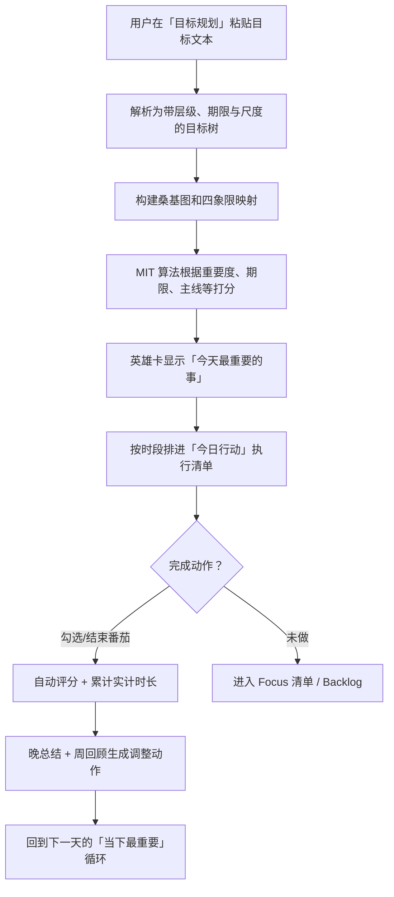
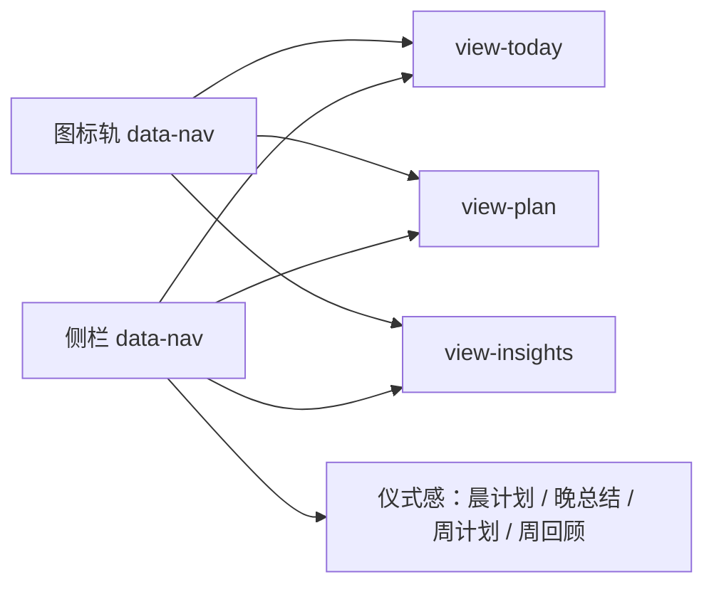
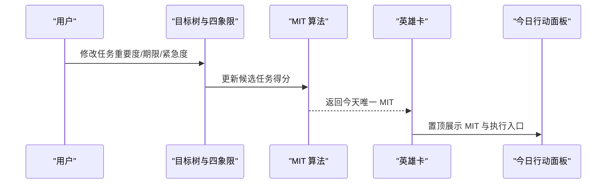
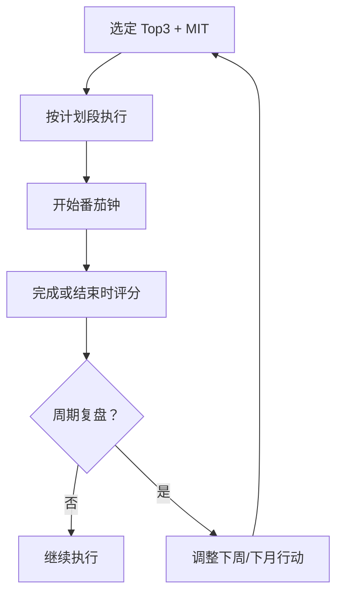
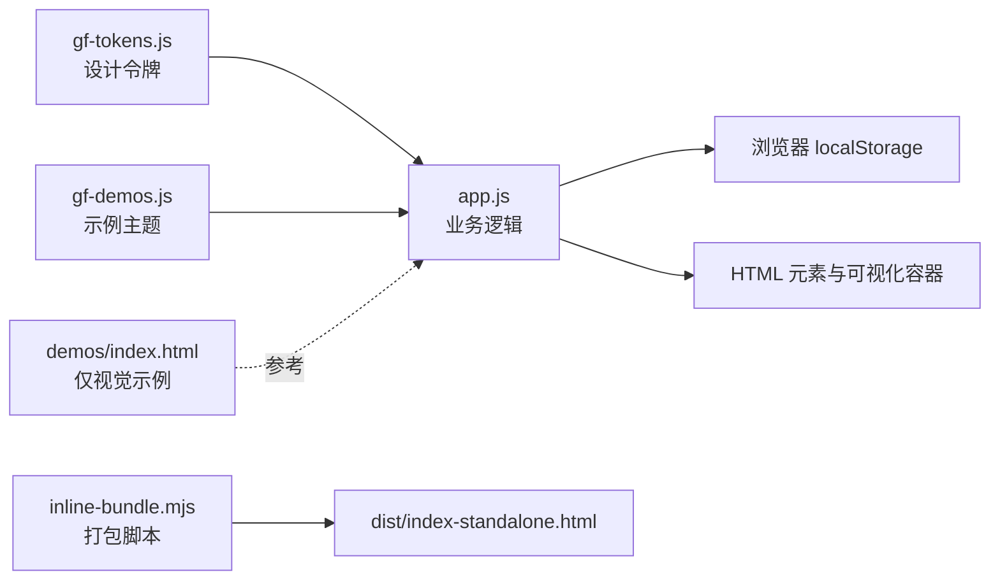
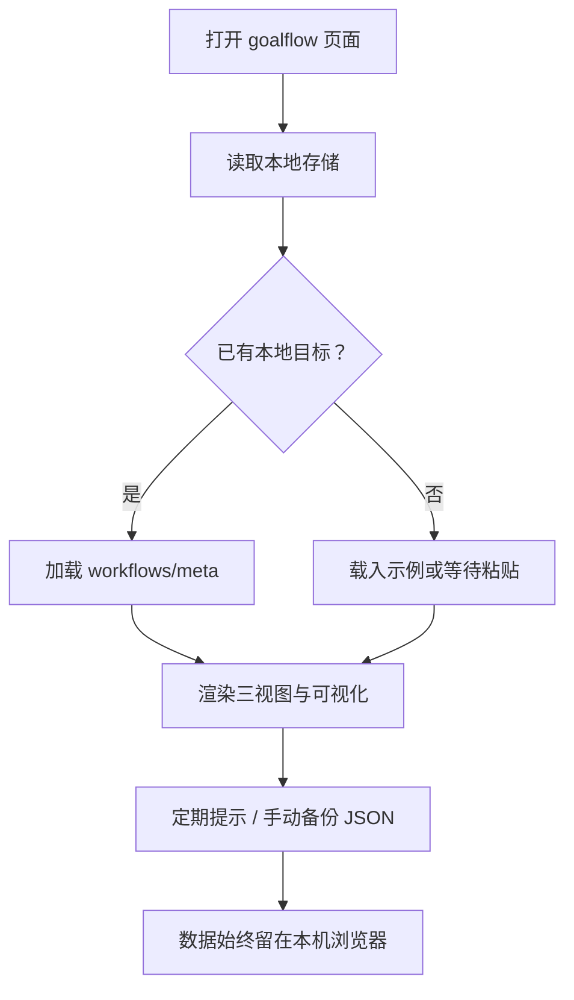

# 项目总览

<cite>
**本文引用的文件**
- [README.md](file://README.md)
- [index.html](file://index.html)
- [assets/js/app.js](file://assets/js/app.js)
- [assets/js/gf-demos.js](file://assets/js/gf-demos.js)
- [demos/index.html](file://demos/index.html)
- [scripts/inline-bundle.mjs](file://scripts/inline-bundle.mjs)
</cite>

## 目录
1. [简介](#简介)
2. [项目结构](#项目结构)
3. [核心组件](#核心组件)
4. [架构总览](#架构总览)
5. [关键能力详解](#关键能力详解)
6. [依赖关系分析](#依赖关系分析)
7. [在线体验与离线安装](#在线体验与离线安装)
8. [数据隐私与本地优先哲学](#数据隐私与本地优先哲学)
9. [性能与可移植性](#性能与可移植性)
10. [问题排查](#问题排查)
11. [结语](#结语)

## 简介
目标流 GoalFlow 的核心定位是：**把一整年画成一张图，让“当下最重要”自己发光**。它不是另一本待办清单手册，而是通过桑基精力流向、四象限校准和 MIT（今天最重要的事）算法，让你看见「真正重要却不紧急」的任务如何被日常杂务悄悄挤走，再提供可视化手段把它拉回视线。

常见痛点很清晰：
- 目标清单越长，人越容易顺手做最简单的小事；
- “重要不紧急”的长期主线总是无限延后；
- “周计划”和“日计划”割裂，缩放尺度切换需要重新思考。

GoalFlow 用三视图把这个问题拆解为可见路径：
- ☀ **今日行动**：默认主页，英雄卡聚焦唯一 MIT，按时段执行，配合 Top3、Backlog、番茄钟与评分；
- 🎯 **目标规划**：粘贴年度目标，自动解析为目标树，配合 SMART 体检与对话式拆解；
- 📊 **归纳洞察**：桑基图、四象限、时间审计等分析型可视化，用于校准精力错配。

它的技术哲学也很明确：**纯本地、双击即用、无账号无云端无订阅**。所有目标数据只存在你的浏览器中；如需 AI 协助，也是用户自己在页面填写自有 API Key，数据不出本机。

## 项目结构
项目采用最小前端结构：一个单页入口，加上按样式、逻辑与示例划分的资源目录。

**图表来源**
- [index.html:1-30](file://index.html#L1-L30)
- [assets/js/app.js:1-20](file://assets/js/app.js#L1-L20)
- [demos/index.html:1-20](file://demos/index.html#L1-L20)
- [scripts/inline-bundle.mjs:8-20](file://scripts/inline-bundle.mjs#L8-L20)

目录职责可以概括为：
- `index.html`：页面骨架、三视图容器、顶栏操作区、主题与明暗模式初始化；
- `assets/css/`：基础样式、组件样式，以及最终汇总的 `main.css`；
- `assets/js/`：设计令牌、示例主题数据和应用主逻辑；
- `demos/`：十个参考产品风格的静态视觉稿集合；
- `scripts/inline-bundle.mjs`：开发打包脚本，将多资源合并为一个独立 HTML；
- `README.md` 与 `openmemory.md`：用户引导与开发者视角的项目档案。

**章节来源**
- [index.html:1-90](file://index.html#L1-L90)
- [README.md:90-103](file://README.md#L90-L103)

## 核心组件
GoalFlow 并非传统大型工程，但其内部已经形成几个稳定的概念组件：

| 组件 | 位置或标识 | 职责 |
|---|---|---|
| 图标导航轨 | `nav.rail` 中的 `data-nav="today"|"plan"|"insights"|"ai"` | 在三视图之间切换，并携带 URL hash 记忆 |
| 侧边工作区 | `.side`、`#wfBar`、`#wsStore` | 当前项目列表、视图切换、“仪式”入口和目标树预览 |
| 今日行动面板 | `#view-today`、`#todayPanel` | 英雄卡 MIT、时段执行、备选与 Backlog、今日状态与提醒 |
| 目标规划面板 | `#view-plan`、`#panelInput`、`#panelTree` | 自由文本输入、树形维护、SMART 与生成向导 |
| 归纳洞察面板 | `#view-insights`、`canvasPanel`、`quadPanel` | 桑基/关系/热力等可视化 + 四象限拖拽 |
| 示例主题库 | `assets/js/gf-demos.js` 中的 `GoalFlowDemos.list` | 10 条预设目标文本，一键载入演示 |
| 打包器 | `scripts/inline-bundle.mjs` | 把 `index.html`、CSS、JS 合并为 `dist/index-standalone.html` |

这些组件通过页面 DOM 节点、`state` 对象、`localStorage` 与 URL hash 协作，而不是通过路由框架或服务器端接口。

**章节来源**
- [index.html:22-190](file://index.html#L22-L190)
- [openmemory.md:13-26](file://openmemory.md#L13-L26)

## 架构总览
从用户角度看，GoalFlow 的工作流程是：粘贴目标 → 解析为树 → 计算精力流向 → 选出当天唯一 MIT → 按时段推进 → 用评分、回顾和预警校准节奏。

**图表来源**
- [README.md:19-89](file://README.md#L19-L89)
- [assets/js/app.js:1-30](file://assets/js/app.js#L1-L30)

## 关键能力详解

### 三视图架构
GoalFlow 的主导航集中在两条线上：顶部左侧图标轨和右侧侧栏。两者都使用相同的 `data-nav` 值切换内容区域，URL hash 则保存 `/today`、`/plan`、`/insights`、`/ai`。

| 视图 | 图标与标题 | 主要区域 | 适合阶段 |
|---|---|---|---|
| ☀ 今日行动 | 太阳、`data-nav="today"` | 英雄卡、MIT、时段、备选、Backlog、番茄钟、评分 | 日常执行 |
| 🎯 目标规划 | 靶心、`data-nav="plan"` | 输入目标、目标树、SMART 体检、AI 辅助 | 输入与校准 |
| 📊 归纳洞察 | 统计、`data-nav="insights"` | 桑基图、四象限、时间分析 | 定期反思 |
| 🤖 AI 分析 | 机器人、`data-nav="ai"` | 对话式拆解、智能建议（可选） | 处理模糊愿望 |

此外，侧栏提供四个“仪式”按钮：晨计划、晚总结、周计划、周回顾，用来把“想清楚”和“做完它”绑在一起。

**图表来源**
- [index.html:22-130](file://index.html#L22-L130)

**章节来源**
- [index.html:22-160](file://index.html#L22-L160)
- [openmemory.md:31-51](file://openmemory.md#L31-L51)

### 桑基图自动生成
用户输入的目标文本不需要先做成结构化表格。系统会从缩进、编号、项目符号等格式推断父子关系，自动识别日期与时间尺度，再生成桑基图。图中带宽表示重要性或投入规模，色温表示紧迫程度，这样就能一眼看到“哪些枝干吸走了太多精力”。

实现要点包括：
- 目标文本解析；
- 子节点继承父级语义；
- 按叶子进度和时间尺度聚合到桑基层；
- 联动缩小时序维度（年、月、周、日）。

**章节来源**
- [README.md:25-44](file://README.md#L25-L44)
- [openmemory.md:13-20](file://openmemory.md#L13-L20)

### MIT 算法与英雄卡
“今天做什么”被收敛成**一条唯一动作路径**。MIT 算法综合考虑重要度、临近期限、是否长期主线、是否习惯任务等因素选出当前最重要事项，并将其放在页面最显眼的英雄卡里。若已逾期、临近截止或该长期主线应提前投入，算法会解释原因，减少“纠结先做哪个”的心智成本。

**图表来源**
- [README.md:44-53](file://README.md#L44-L53)
- [openmemory.md:63-73](file://openmemory.md#L63-L73)

**章节来源**
- [README.md:44-65](file://README.md#L44-L65)

### 多维时间轴缩放
GoalFlow 强调“本周最重要”和“今日最重要”不是同一件事。应用支持年、月、周、日四级缩放，每次切换都会联动：
- 精力比例尺；
- 桑基或关系流图；
- 四象限范围；
- 聚焦清单。

这使得长期主线不必因为“这周没空就消失”，也不至于因为“年度太宽泛而无法落地”。

**章节来源**
- [README.md:53-62](file://README.md#L53-L62)
- [assets/js/app.js:20-55](file://assets/js/app.js#L20-L55)

### 四象限拖拽归位
四象限不是填表游戏，而是可视空间：
- 🔴 重要且紧急：立即做；
- 🔵 重要不紧急：核心投入；
- 🟠 紧急不重要：干扰；
- ⚪ 不重要不紧急：噪音。

用户可以把任务卡片直接拖入对应象限，从而自动刷新重要度、紧急度和后续推荐顺序。移动端出于交互复杂度考虑仅提供查看，拖拽归位建议回桌面端进行。

**章节来源**
- [README.md:62-71](file://README.md#L62-L71)
- [assets/js/app.js:15-34](file://assets/js/app.js#L15-L34)

### SMART 体检与对话式拆解
当目标是“提升销售能力”这类模糊愿望时，SMART 体检不会只是给一句鼓励。它会逐项判断目标是否具体、可衡量、有期限、有价值，并以“亮灯”形式标注缺陷。随后可通过“对话拆解”入口，引导用户补充指标、截止日期和可执行子动作，再把模糊愿望变成可跟踪的叶子任务。

**章节来源**
- [README.md:71-80](file://README.md#L71-L80)
- [openmemory.md:51-70](file://openmemory.md#L51-L70)

### 执行闭环：Top3、Backlog、番茄钟与评分
GoalFlow 的执行闭环强调：**选对要事 ≠ 自动做好**。因此提供了完整执行链：

| 环节 | 作用 |
|---|---|
| Top3 | 当天聚焦少数高杠杆任务，避免全部平铺 |
| Backlog 泳道 | 放上周未完成和下月预告，不污染 Top3 |
| 预估/实计时长 | 配合“可做完性”评估当日容量 |
| 番茄钟 | 绑定 MIT 的 25 分钟专注计时，记录实际消耗 |
| 自动评分 | 完成叶子、结束番茄后按重要度、期限、时长达标、习惯等打分 |
| 日评分 | 汇总成 S/A/B/C 等级与今日总分 |
| 早晚仪式 | 早对齐 MIT 与容量，晚总结得分和未完成项 |
| 周回顾 | 预填完成数、金线动静、核心 vs 救火计数 |

**图表来源**
- [README.md:80-110](file://README.md#L80-L110)
- [openmemory.md:73-104](file://openmemory.md#L73-L104)

**章节来源**
- [README.md:80-105](file://README.md#L80-L105)

### 快速开始的两条路径

#### 在线体验
适合第一次接触 GoalFlow 的用户：打开 GitHub Pages 链接即可使用，数据保存在当前浏览器的 localStorage。无需安装，也不用注册账号。

适用情况：
- 只想快速看一遍“把一年画成一张图”的效果；
- 不想在本地保留仓库；
- 先用示例主题理解功能。

注意事项：
- 如果清理浏览器缓存或更换设备，未备份的数据不会随网络转移；
- 需要长期使用前建议导出 JSON。

#### 离线安装
适合希望完全本地运行、随时断开网络使用的人：
1. 克隆或下载整个仓库；
2. 确保 `index.html` 与 `assets/` 目录在同一层级；
3. 双击 `index.html` 在浏览器打开；
4. 字体 CDN 失败时自动回退到系统字体。

进阶路径：
- 运行 `node scripts/inline-bundle.mjs`，会把 HTML、CSS、JS 合并成一个 `dist/index-standalone.html`，便于脱离 `assets/` 目录分享或部署。

**章节来源**
- [README.md:86-103](file://README.md#L86-L103)
- [scripts/inline-bundle.mjs:1-52](file://scripts/inline-bundle.mjs#L1-L52)

## 依赖关系分析
从代码组织看，GoalFlow 的依赖关系非常简单且可控：

**图表来源**
- [assets/js/app.js:1-20](file://assets/js/app.js#L1-L20)
- [scripts/inline-bundle.mjs:12-52](file://scripts/inline-bundle.mjs#L12-L52)

关键点：
- 应用通过全局常量与 `GoalFlowTheme` / `GoalFlowDemos` 注入配置与示例数据，保持 app.js 相对独立；
- 示例主题 `demos/` 不包含真实业务逻辑，主要用于视觉方向和界面语言探索；
- 打包脚本只负责字符串替换和内联资源，不做模块框架转换。

**章节来源**
- [assets/js/app.js:1-20](file://assets/js/app.js#L1-L20)
- [assets/js/gf-demos.js:1-15](file://assets/js/gf-demos.js#L1-L15)
- [scripts/inline-bundle.mjs:8-52](file://scripts/inline-bundle.mjs#L8-L52)

## 在线体验与离线安装
以下是两种上手路径的最终对照：

| 维度 | 在线体验 | 离线安装 |
|---|---|---|
| 入口 | 浏览器访问站点地址 | 本地仓库中的 `index.html` |
| 是否需要安装 | 否 | 否（只需浏览器） |
| 是否需要 Git 客户端 | 否 | 可选（下载 ZIP 也可） |
| 是否需要 Node.js | 否 | 仅打包独立文件时需要 |
| 是否需要账号/订阅/云端 | 否 | 否 |
| 数据落点 | 当前浏览器的 localStorage | 同上，但本地可直接管理仓库 |
| 何时选择 | 初次体验、快速验证 | 本地化运行、定制主题、打包分发 |

如果你只是想验证 README 里的理念，优先选在线体验；如果你要二次开发、集成到内部笔记流程，或使用 offline-only 环境，请选择离线安装并了解打包脚本。

**章节来源**
- [README.md:86-103](file://README.md#L86-L103)
- [scripts/inline-bundle.mjs:1-52](file://scripts/inline-bundle.mjs#L1-L52)

## 数据隐私与本地优先哲学
GoalFlow 的技术哲学并不只停留在“不需要登录”。它的隐私边界体现在多个层面：

1. **数据存储在本机**：目标、回顾、评分、仪式、能量曲线等全部写入浏览器存储键，如工作流主键、元数据键和示例镜像键。
2. **无账号体系**：没有注册、登录、邮箱或手机号字段。
3. **无遥测与第三方追踪脚本**：产品文档明确指出无此类埋点。
4. **可选 LLM 对话使用自有密钥**：如果需要 AI 拆解，API Key 也只填入本机浏览器，不经过应用方服务器中转。
5. **主动备份机制**：超过一段时间未备份时，会在面板提示；同时支持 JSON 导入导出。

**图表来源**
- [README.md:96-103](file://README.md#L96-L103)
- [openmemory.md:20-30](file://openmemory.md#L20-L30)

**章节来源**
- [README.md:96-103](file://README.md#L96-L103)
- [openmemory.md:13-20](file://openmemory.md#L13-L20)

## 性能与可移植性
从现有结构看，GoalFlow 属于轻量纯前端单页应用：
- 入口是一个 HTML 文件加若干本地 CSS/JS；
- 没有后端服务；
- 没有数据库中间件；
- 渲染主体由 JavaScript 驱动 DOM 和可视化容器；
- 打包脚本使用字符串替换方式把样式和脚本嵌入 HTML。

这种方式的优点是：
- 部署极简单，GitHub Pages、本地磁盘、任意静态托管均可；
- 隐私边界清晰，数据不离开浏览器；
- 离线可用性高；
- 二次开发者可以直接阅读单页入口和资源文件。

潜在需要注意的点：
- 首屏字体来自 Google Fonts CDN，断网时可回退系统字体；
- 大量任务、长期历史记录和多个项目可能增加本地存储体积与 DOM 渲染压力；
- 如果要脱离 `assets/` 目录分发，建议使用内联打包脚本生成 `dist/index-standalone.html`。

[本节为通用指导，不直接分析具体源码行]

## 问题排查
以下是最常见的三类情况和解决方向：

| 现象 | 可能原因 | 处理方式 |
|---|---|---|
| 打开 `index.html` 后样式或行为异常 | `assets/` 目录缺失或路径变化 | 保持 `index.html` 与 `assets/` 同目录，或直接使用内联打包后的独立文件 |
| 切换主题后仍白屏或闪烁 | 主题或明暗属性本地缓存不匹配 | 检查 `goalflow.theme` 和 `goalflow.mode`，必要时重置；确认字体与样式可加载 |
| 换浏览器或清空缓存后数据丢失 | 目标数据只存于原浏览器 localStorage | 使用“恢复 JSON”导入之前导出的备份文件 |
| 看不到示例目标 | 首次打开不再自动灌满示例 | 通过下拉框选择示例主题并点击“载入示例” |
| 想离线运行但没有 `assets/` 文件夹 | 只复制了单个 HTML | 使用 `node scripts/inline-bundle.mjs` 生成独立 HTML |

**章节来源**
- [README.md:86-103](file://README.md#L86-L103)
- [openmemory.md:13-26](file://openmemory.md#L13-L26)

## 结语
GoalFlow 不是一个更漂亮的 To-Do List 皮肤，而是一个围绕“当下最重要”的时间管理系统原型：  
年度目标 → 可视化桑基河 → 算法推举 MIT → 三视图执行 → 周回顾校准。  
它的价值不在功能堆栈上，而在两点：第一，让“忙而无功”变得可见；第二，把复杂目标重新锚定到每天能执行的单一焦点。

对初学者：
- 先从 README 的在线体验开始；
- 载入一个示例主题，理解“一年 → 一天”的流转；
- 尝试把个人目标从模糊愿望写成叶子任务；
- 坚持一两个周期的“今日起板 + 晚总结 + 周回顾”。

对有经验的读者：
- 深入入口文件了解三视图布局与主题切换；
- 阅读 `assets/js/app.js` 中关于能力区间、评分、回溯、能量与收箱的逻辑；
- 结合 `demos/index.html` 评估不同风格语言；
- 用 `scripts/inline-bundle.mjs` 研究如何把项目打包成自包含单页产物。

GoalFlow 最适合你，当你不再需要更多清单模板，而是需要一个工具来回答一个问题：**“如果把一整年画成一张图，我今天应该让哪条河流发光？”**

[本节为总结性内容，不直接分析具体源码行]